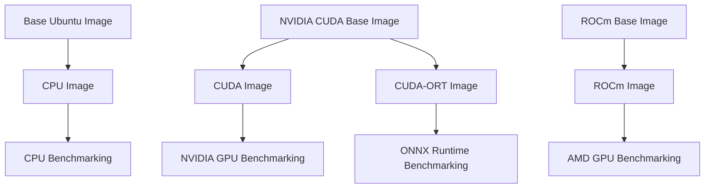
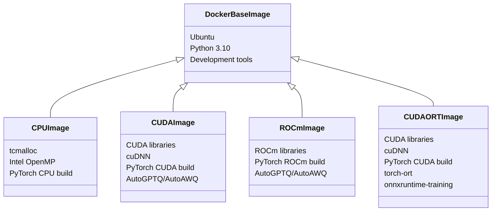
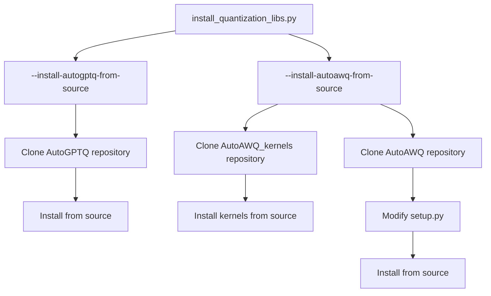

<!-- source: DeepWiki mcp.deepwiki.com · repo huggingface/optimum-benchmark · page 9.1 Docker Environments · fetched 2026-10-26 -->

# Docker Environments

<details>
<summary>Relevant source files</summary>

The following files were used as context for generating this wiki page:

- [docker/cpu/Dockerfile](docker/cpu/Dockerfile)
- [docker/cuda-ort/Dockerfile](docker/cuda-ort/Dockerfile)
- [docker/cuda/Dockerfile](docker/cuda/Dockerfile)
- [docker/rocm/Dockerfile](docker/rocm/Dockerfile)
- [scripts/install_quantization_libs.py](scripts/install_quantization_libs.py)

</details>


This page documents the Docker environments available in Optimum-Benchmark for running benchmarks across different hardware platforms. These Docker images provide consistent, pre-configured environments with all the necessary dependencies for benchmarking machine learning models.

## Available Docker Images

Optimum-Benchmark provides four specialized Docker images targeting different hardware platforms and optimization backends:



Sources: [docker/cpu/Dockerfile](), [docker/cuda/Dockerfile](), [docker/rocm/Dockerfile](), [docker/cuda-ort/Dockerfile]()

The table below summarizes the key characteristics of each Docker image:

| Docker Image | Base Image | Hardware Target | Notable Features |
|--------------|------------|-----------------|------------------|
| CPU | Ubuntu | CPU-only | tcmalloc, Intel OpenMP |
| CUDA | NVIDIA CUDA | NVIDIA GPUs | AutoGPTQ, AutoAWQ quantization |
| ROCm | ROCm/dev-ubuntu | AMD GPUs | ROCm libraries, PyTorch ROCm build |
| CUDA-ORT | NVIDIA CUDA | NVIDIA GPUs | ONNX Runtime, torch-ort integration |

## Docker Image Architecture



Sources: [docker/cpu/Dockerfile](), [docker/cuda/Dockerfile](), [docker/rocm/Dockerfile](), [docker/cuda-ort/Dockerfile]()

## CPU Docker Image

The CPU Docker image is designed for benchmarking on CPU-only environments. It includes performance optimizations such as tcmalloc and Intel OpenMP.

### Key Components

- Base image: Ubuntu (default 22.04)
- Python 3.10 with development tools
- PyTorch CPU build (configurable version)
- Performance optimizations:
  - Google perftools (tcmalloc)
  - Intel OpenMP

### Build Arguments

- `UBUNTU_VERSION`: Ubuntu version (default: 22.04)
- `TORCH_VERSION`: Specific PyTorch version (optional)
- `TORCH_RELEASE_TYPE`: "stable" or "nightly" (default: "stable")

Sources: [docker/cpu/Dockerfile:15-43]()

## CUDA Docker Image

The CUDA Docker image is optimized for NVIDIA GPUs and includes support for quantization libraries like AutoGPTQ and AutoAWQ.

### Key Components

- Base image: nvidia/cuda with cuDNN
- Python 3.10 with development tools
- PyTorch CUDA build (configurable version)
- Quantization libraries (built from source):
  - AutoGPTQ
  - AutoAWQ

### Build Arguments

- `CUDA_VERSION`: CUDA version (default: 12.4.1)
- `UBUNTU_VERSION`: Ubuntu version (default: 22.04)
- `TORCH_VERSION`: Specific PyTorch version (optional)
- `TORCH_CUDA`: CUDA version for PyTorch (default: cu124)
- `TORCH_RELEASE_TYPE`: "stable" or "nightly" (default: "stable")

The image is configured with support for multiple CUDA architectures through the environment variable:
```
TORCH_CUDA_ARCH_LIST="6.0 7.0 7.5 8.0 8.6 9.0+PTX"
```

Sources: [docker/cuda/Dockerfile:15-49](), [scripts/install_quantization_libs.py:67-81]()

## ROCm Docker Image

The ROCm Docker image is designed for AMD GPUs and includes the necessary ROCm libraries and PyTorch ROCm build.

### Key Components

- Base image: rocm/dev-ubuntu
- Python 3.10 with development tools
- PyTorch ROCm build (configurable version)
- ROCm libraries: rocsparse, hipsparse, rocthrust, rocblas, hipblas
- Quantization libraries (built from source):
  - AutoGPTQ
  - AutoAWQ

### Build Arguments

- `ROCM_VERSION`: ROCm version (default: 5.7.1)
- `UBUNTU_VERSION`: Ubuntu version (default: 22.04)
- `TORCH_VERSION`: Specific PyTorch version (optional)
- `TORCH_ROCM`: ROCm version for PyTorch (default: rocm5.7)
- `TORCH_RELEASE_TYPE`: "stable" or "nightly" (default: "stable")

The image is configured with support for multiple ROCm architectures through the environment variable:
```
PYTORCH_ROCM_ARCH="gfx900;gfx906;gfx908;gfx90a;gfx1030;gfx1100"
```

Sources: [docker/rocm/Dockerfile:15-52](), [scripts/install_quantization_libs.py:67-81]()

## CUDA-ORT Docker Image

The CUDA-ORT Docker image is specifically designed for ONNX Runtime integration with CUDA support, enabling benchmarks that leverage ONNX Runtime optimizations.

### Key Components

- Base image: nvidia/cuda with cuDNN
- Python 3.10 with development tools
- PyTorch CUDA build (configurable version)
- ONNX Runtime:
  - torch-ort
  - onnxruntime-training

### Build Arguments

- `CUDNN_VERSION`: cuDNN version (default: 8)
- `CUDA_VERSION`: CUDA version (default: 11.8.0)
- `UBUNTU_VERSION`: Ubuntu version (default: 22.04)
- `TORCH_CUDA`: CUDA version for PyTorch (default: cu118)
- `TORCH_VERSION`: Specific PyTorch version or "stable"/"nightly" (default: "stable")

The image is configured with support for multiple CUDA architectures through the environment variable:
```
TORCH_CUDA_ARCH_LIST="5.0 6.0 7.0 7.5 8.0 8.6 9.0+PTX"
```

Sources: [docker/cuda-ort/Dockerfile:15-46]()

## Quantization Libraries Installation

The CUDA and ROCm Docker images include specialized quantization libraries that are built from source during the Docker image creation. This is handled by the script `install_quantization_libs.py`.



Sources: [scripts/install_quantization_libs.py:10-82]()

## Building and Using Docker Images

### Building Docker Images

To build any of the Docker images, navigate to the repository root and use the `docker build` command with the appropriate Dockerfile:

For CPU image:
```bash
docker build -f docker/cpu/Dockerfile -t optimum-benchmark-cpu .
```

For CUDA image:
```bash
docker build -f docker/cuda/Dockerfile -t optimum-benchmark-cuda .
```

For ROCm image:
```bash
docker build -f docker/rocm/Dockerfile -t optimum-benchmark-rocm .
```

For CUDA-ORT image:
```bash
docker build -f docker/cuda-ort/Dockerfile -t optimum-benchmark-cuda-ort .
```

You can customize the build by passing build arguments:

```bash
docker build -f docker/cuda/Dockerfile \
  --build-arg CUDA_VERSION=11.8.0 \
  --build-arg TORCH_VERSION=2.0.1 \
  --build-arg TORCH_CUDA=cu118 \
  -t optimum-benchmark-cuda:2.0.1-cu118 .
```

### Running Benchmarks with Docker

To run benchmarks using the Docker images, you can mount your local benchmark configuration and code:

For CPU benchmarks:
```bash
docker run -it --rm \
  -v $(pwd):/workspace \
  optimum-benchmark-cpu \
  python -m optimum_benchmark <benchmark_arguments>
```

For CUDA benchmarks:
```bash
docker run -it --rm --gpus all \
  -v $(pwd):/workspace \
  optimum-benchmark-cuda \
  python -m optimum_benchmark <benchmark_arguments>
```

For ROCm benchmarks:
```bash
docker run -it --rm --device=/dev/kfd --device=/dev/dri \
  -v $(pwd):/workspace \
  optimum-benchmark-rocm \
  python -m optimum_benchmark <benchmark_arguments>
```

For information about the CLI and benchmark arguments, see [Command Line Interface](#8.1).

Sources: [docker/cpu/Dockerfile](), [docker/cuda/Dockerfile](), [docker/rocm/Dockerfile](), [docker/cuda-ort/Dockerfile]()

---

