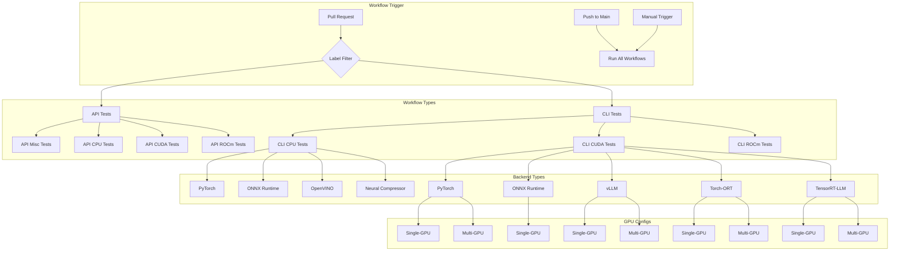
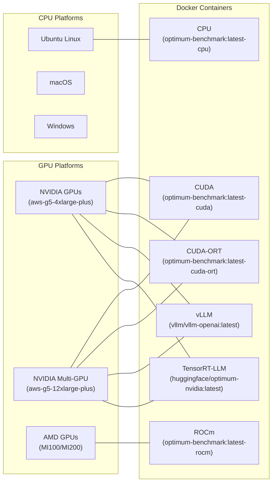
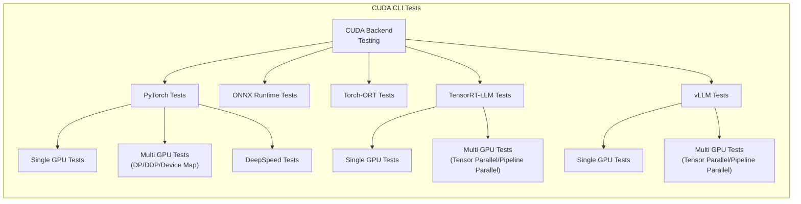

<!-- source: DeepWiki mcp.deepwiki.com · repo huggingface/optimum-benchmark · page 9.2 CI/CD Workflows · fetched 2026-10-26 -->

# CI/CD Workflows

<details>
<summary>Relevant source files</summary>

The following files were used as context for generating this wiki page:

- [.github/workflows/test_api_cpu.yaml](.github/workflows/test_api_cpu.yaml)
- [.github/workflows/test_api_cuda.yaml](.github/workflows/test_api_cuda.yaml)
- [.github/workflows/test_api_misc.yaml](.github/workflows/test_api_misc.yaml)
- [.github/workflows/test_api_rocm.yaml](.github/workflows/test_api_rocm.yaml)
- [.github/workflows/test_cli_cpu_onnxruntime.yaml](.github/workflows/test_cli_cpu_onnxruntime.yaml)
- [.github/workflows/test_cli_cpu_openvino.yaml](.github/workflows/test_cli_cpu_openvino.yaml)
- [.github/workflows/test_cli_cpu_pytorch.yaml](.github/workflows/test_cli_cpu_pytorch.yaml)
- [.github/workflows/test_cli_cuda_onnxruntime.yaml](.github/workflows/test_cli_cuda_onnxruntime.yaml)
- [.github/workflows/test_cli_cuda_pytorch.yaml](.github/workflows/test_cli_cuda_pytorch.yaml)
- [.github/workflows/test_cli_cuda_tensorrt_llm.yaml](.github/workflows/test_cli_cuda_tensorrt_llm.yaml)
- [.github/workflows/test_cli_cuda_torch_ort.yaml](.github/workflows/test_cli_cuda_torch_ort.yaml)
- [.github/workflows/test_cli_cuda_vllm.yaml](.github/workflows/test_cli_cuda_vllm.yaml)
- [.github/workflows/test_cli_rocm_pytorch.yaml](.github/workflows/test_cli_rocm_pytorch.yaml)
- [Makefile](Makefile)
- [optimum_benchmark/system_utils.py](optimum_benchmark/system_utils.py)
- [pyproject.toml](pyproject.toml)

</details>


This document describes the continuous integration and continuous deployment (CI/CD) workflows used in the Optimum-Benchmark repository. It covers the GitHub Actions configurations, testing infrastructure, and methods for testing across different hardware platforms and ML backends.

For information about the testing methodology itself, see [Testing Infrastructure](#9.3). For details on Docker environments used in testing, see [Docker Environments](#9.1).

## Workflow Architecture

The Optimum-Benchmark CI/CD system follows a matrix-based approach where tests are organized by multiple dimensions:

1. **Interface Type**: API vs CLI testing
2. **Hardware Platform**: CPU, CUDA (NVIDIA GPUs), ROCm (AMD GPUs)
3. **Backend Framework**: PyTorch, ONNX Runtime, OpenVINO, TensorRT-LLM, vLLM, etc.
4. **GPU Configuration**: Single GPU vs Multi-GPU



Sources: [.github/workflows/test_api_cuda.yaml](), [.github/workflows/test_cli_cuda_pytorch.yaml](), [.github/workflows/test_cli_cuda_onnxruntime.yaml](), [.github/workflows/test_cli_cuda_vllm.yaml](), [.github/workflows/test_cli_rocm_pytorch.yaml](), [.github/workflows/test_api_rocm.yaml]()

## Workflow Triggering and Filters

GitHub workflows are triggered in three ways:
1. **Push to main branch**: Runs all workflows
2. **Pull request events**: Runs workflows based on PR labels
3. **Manual dispatch**: Triggered manually via GitHub Actions UI

Pull requests use a label-based filtering system to selectively run relevant workflows, reducing the computational resources needed for CI. Labels can target specific components of the system:

| Label Type | Examples | Purpose |
|------------|----------|---------|
| Interface  | `api`, `cli` | Target API or CLI tests |
| Hardware   | `cuda`, `cpu`, `rocm` | Target specific hardware platform |
| Backend    | `pytorch`, `onnxruntime`, `openvino` | Target specific ML backend |
| GPU Config | `single_gpu`, `multi_gpu` | Test specific GPU configurations |
| Combined   | `api_cuda`, `cli_cpu_pytorch` | Target specific combinations |

Each workflow defines conditional expressions that check for these labels:

```yaml
if: ${{
  (github.event_name == 'push') ||
  (github.event_name == 'workflow_dispatch') ||
  contains( github.event.pull_request.labels.*.name, 'api') ||
  contains( github.event.pull_request.labels.*.name, 'cuda') ||
  contains( github.event.pull_request.labels.*.name, 'api_cuda')
  }}
```

Sources: [.github/workflows/test_api_cuda.yaml:23-30](), [.github/workflows/test_cli_cuda_pytorch.yaml:23-32](), [.github/workflows/test_cli_cpu_pytorch.yaml:23-31]()

## Hardware Test Environments

The CI/CD system runs tests on various hardware configurations, managed through GitHub Actions runners.



Sources: [.github/workflows/test_api_misc.yaml:32-36](), [.github/workflows/test_api_cuda.yaml:32-38](), [.github/workflows/test_cli_cuda_vllm.yaml:34-40](), [.github/workflows/test_cli_cuda_tensorrt_llm.yaml:34-39](), [.github/workflows/test_cli_rocm_pytorch.yaml:33-40]()

The hardware detection in the system is managed through the `system_utils.py` module, which provides functions for detecting available CPUs, GPUs, and their capabilities.

Sources: [optimum_benchmark/system_utils.py:45-242]()

## API Testing Workflows

API tests ensure the proper functioning of the Python API across different platforms.

### Misc API Tests

These tests run on multiple operating systems and Python versions without specific hardware requirements.

```yaml
strategy:
  fail-fast: false
  matrix:
    os: [ubuntu-latest, "macos-latest", windows-latest]
    python: ["3.8", "3.12"]
```

Sources: [.github/workflows/test_api_misc.yaml:32-36]()

### Hardware-specific API Tests

These test the API on specific hardware configurations:

- **CPU API Tests**: Run on Ubuntu with PyTorch CPU
- **CUDA API Tests**: Run on NVIDIA GPUs with PyTorch CUDA
- **ROCm API Tests**: Run on AMD GPUs with PyTorch ROCm

Sources: [.github/workflows/test_api_cpu.yaml](), [.github/workflows/test_api_cuda.yaml](), [.github/workflows/test_api_rocm.yaml]()

## CLI Testing Workflows

CLI tests validate the command-line interface across various backends and hardware configurations.

### CPU CLI Tests

Tests for CPU-based backends:
- PyTorch CPU
- ONNX Runtime CPU
- OpenVINO
- Neural Compressor

Sources: [.github/workflows/test_cli_cpu_pytorch.yaml](), [.github/workflows/test_cli_cpu_onnxruntime.yaml](), [.github/workflows/test_cli_cpu_openvino.yaml]()

### CUDA CLI Tests

Tests for NVIDIA GPU-based backends on single and multi-GPU configurations:
- PyTorch CUDA
- ONNX Runtime GPU
- Torch-ORT
- TensorRT-LLM
- vLLM



Sources: [.github/workflows/test_cli_cuda_pytorch.yaml](), [.github/workflows/test_cli_cuda_onnxruntime.yaml](), [.github/workflows/test_cli_cuda_torch_ort.yaml](), [.github/workflows/test_cli_cuda_tensorrt_llm.yaml](), [.github/workflows/test_cli_cuda_vllm.yaml]()

### ROCm CLI Tests

Tests for AMD GPU-based backends:
- PyTorch ROCm (single and multi-GPU)

Sources: [.github/workflows/test_cli_rocm_pytorch.yaml]()

## Testing Configuration

The testing infrastructure uses pytest with specific keywords to select relevant tests. For example:

```bash
# CLI PyTorch CUDA Multi-GPU tests
pytest tests/test_cli.py -x -s -k "cli and cuda and pytorch and (dp or ddp or device_map)"

# API CUDA tests
pytest tests/test_api.py -x -s -k "api and cuda"
```

Additional environment variables are used to control test behavior:

| Variable | Purpose |
|----------|---------|
| `FORCE_SEQUENTIAL=1` | Run tests sequentially (for resource-intensive tests) |
| `HF_TOKEN` | Authentication token for Hugging Face Hub access |
| `PUSH_REPO_ID` | Repository ID for pushing benchmark results |

Sources: [.github/workflows/test_cli_cuda_pytorch.yaml:87-93](), [.github/workflows/test_api_cuda.yaml:46-52](), [.github/workflows/test_cli_cuda_vllm.yaml:49-51]()

## Running Workflows Locally

The project includes Makefile targets for running tests locally that match those in CI:

```bash
# API tests
make test_api_misc
make test_api_cpu
make test_api_cuda
make test_api_rocm

# CLI tests
make test_cli_misc
make test_cli_cpu_pytorch
make test_cli_cuda_pytorch_single_gpu
make test_cli_cuda_pytorch_multi_gpu
# ... and many more targets
```

Sources: [Makefile:123-193]()

## Docker Images for Reproducible Testing

The repository provides Docker images for different hardware configurations:

| Docker Image | Purpose | Build Command |
|--------------|---------|--------------|
| `optimum-benchmark:latest-cpu` | CPU-only environments | `make build_cpu_image` |
| `optimum-benchmark:latest-cuda` | NVIDIA GPU environments | `make build_cuda_image` |
| `optimum-benchmark:latest-cuda-ort` | NVIDIA GPU with ONNX Runtime | `make build_cuda_ort_image` |
| `optimum-benchmark:latest-rocm` | AMD GPU environments | `make build_rocm_image` |

These images can be run with the corresponding Makefile commands:

```bash
# Run CPU container
make run_cpu_container

# Run CUDA container
make run_cuda_container

# Run CUDA-ORT container
make run_cuda_ort_container

# Run ROCm container
make run_rocm_container
```

Sources: [Makefile:21-79]()

## Integration with GitHub Repositories

The CI/CD system also integrates with external repositories, such as:

1. **Hugging Face Workflows**: Uses shared workflows from the huggingface/hf-workflows repository:
   ```yaml
   uses: huggingface/hf-workflows/.github/workflows/optimum_benchmark_instinct_ci.yaml@testing
   ```

2. **Container Registry**: Pulls Docker images from GitHub Container Registry:
   ```yaml
   image: ghcr.io/huggingface/optimum-benchmark:latest-cuda
   ```

Sources: [.github/workflows/test_api_rocm.yaml:32-36](), [.github/workflows/test_cli_cuda_pytorch.yaml:38]()

## PyTest Configuration

The project uses PyTest for testing, with specific settings configured in `pyproject.toml`:

```toml
[tool.pytest.ini_options]
log_cli = true
log_cli_level = "INFO"
log_cli_date_format = "%Y-%m-%d %H:%M:%S"
log_cli_format = "[PYTEST-PROCESS][%(asctime)s][%(name)s][%(levelname)s] - %(message)s"
```

This configuration enables detailed logging during test execution, making it easier to debug test failures.

Sources: [pyproject.toml:12-16]()

---

