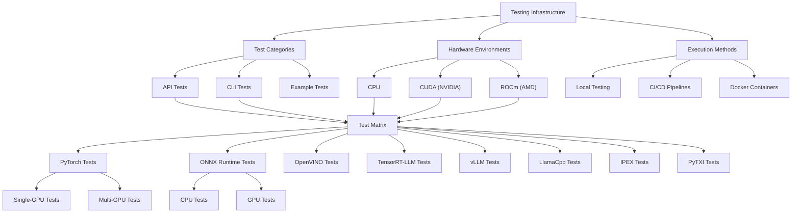
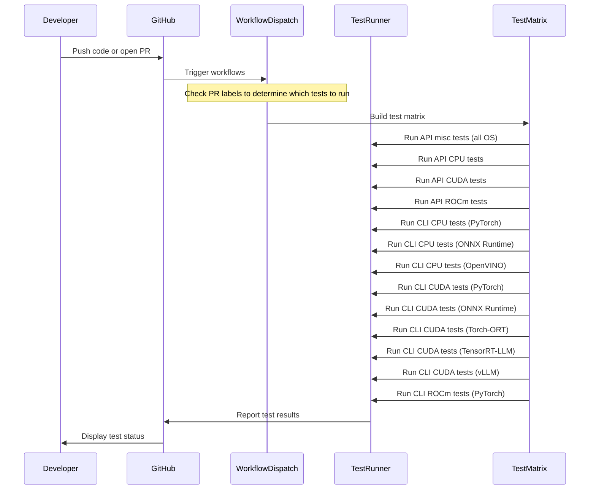
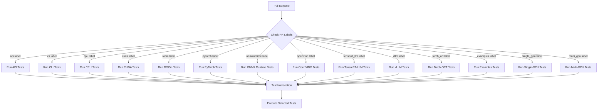
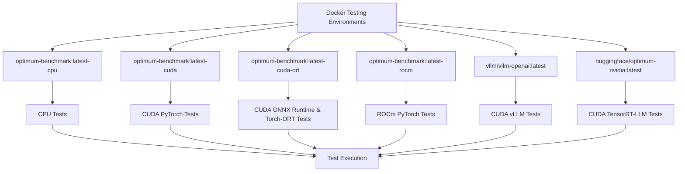
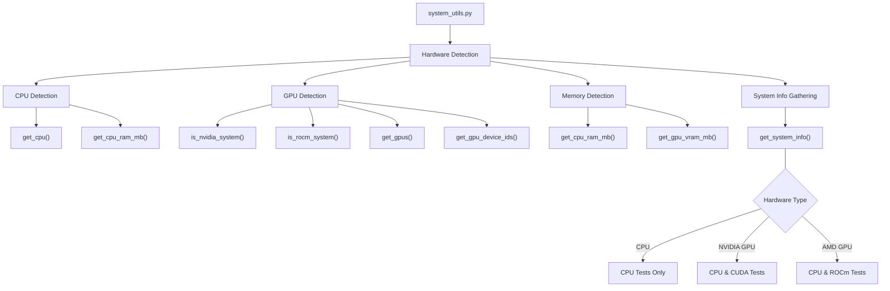

<!-- source: DeepWiki mcp.deepwiki.com · repo huggingface/optimum-benchmark · page 9.3 Testing Infrastructure · fetched 2026-10-26 -->

# Testing Infrastructure

<details>
<summary>Relevant source files</summary>

The following files were used as context for generating this wiki page:

- [.github/workflows/test_api_cpu.yaml](.github/workflows/test_api_cpu.yaml)
- [.github/workflows/test_api_cuda.yaml](.github/workflows/test_api_cuda.yaml)
- [.github/workflows/test_api_misc.yaml](.github/workflows/test_api_misc.yaml)
- [.github/workflows/test_api_rocm.yaml](.github/workflows/test_api_rocm.yaml)
- [.github/workflows/test_cli_cpu_onnxruntime.yaml](.github/workflows/test_cli_cpu_onnxruntime.yaml)
- [.github/workflows/test_cli_cpu_openvino.yaml](.github/workflows/test_cli_cpu_openvino.yaml)
- [.github/workflows/test_cli_cpu_pytorch.yaml](.github/workflows/test_cli_cpu_pytorch.yaml)
- [.github/workflows/test_cli_cuda_onnxruntime.yaml](.github/workflows/test_cli_cuda_onnxruntime.yaml)
- [.github/workflows/test_cli_cuda_pytorch.yaml](.github/workflows/test_cli_cuda_pytorch.yaml)
- [.github/workflows/test_cli_cuda_tensorrt_llm.yaml](.github/workflows/test_cli_cuda_tensorrt_llm.yaml)
- [.github/workflows/test_cli_cuda_torch_ort.yaml](.github/workflows/test_cli_cuda_torch_ort.yaml)
- [.github/workflows/test_cli_cuda_vllm.yaml](.github/workflows/test_cli_cuda_vllm.yaml)
- [.github/workflows/test_cli_rocm_pytorch.yaml](.github/workflows/test_cli_rocm_pytorch.yaml)
- [Makefile](Makefile)
- [optimum_benchmark/system_utils.py](optimum_benchmark/system_utils.py)
- [pyproject.toml](pyproject.toml)

</details>


This page documents the testing infrastructure used in optimum-benchmark to ensure code quality, functionality, and compatibility across different hardware platforms and ML backends. The testing system is designed to validate both the API and CLI interfaces of optimum-benchmark across various hardware environments (CPU, NVIDIA GPUs, AMD GPUs) and backend implementations.

For information about CI/CD workflows, see [CI/CD Workflows](#9.2).

## Overview of Testing Architecture

The testing infrastructure in optimum-benchmark is built around a comprehensive matrix of test cases covering different components, hardware platforms, and backend frameworks. The system uses pytest as the primary testing framework with customized test selection mechanisms.



Sources: [.github/workflows/test_api_misc.yaml](), [.github/workflows/test_api_cpu.yaml](), [.github/workflows/test_api_cuda.yaml](), [.github/workflows/test_api_rocm.yaml](), [Makefile:123-177]()

## Test Categories

The tests in optimum-benchmark are organized into two main categories:

1. **API Tests**: These tests focus on the Python API functionality, validating that the core classes and functions work as expected.
2. **CLI Tests**: These tests validate the command-line interface behavior, ensuring that users can run benchmarks correctly from the command line.

Each category is further divided by hardware platform (CPU, CUDA, ROCm) and backend implementation.

| Test Category | Hardware Platforms | Backends Tested |
|---------------|-------------------|-----------------|
| API Tests     | CPU, CUDA, ROCm   | PyTorch, with focus on core functionality |
| CLI Tests     | CPU               | PyTorch, ONNX Runtime, OpenVINO, Neural Compressor, LlamaCpp |
| CLI Tests     | CUDA (NVIDIA)     | PyTorch, ONNX Runtime, TensorRT-LLM, vLLM, Torch-ORT, PyTXI |
| CLI Tests     | ROCm (AMD)        | PyTorch |

Sources: [Makefile:123-177](), [.github/workflows/test_cli_cpu_pytorch.yaml](), [.github/workflows/test_cli_cpu_onnxruntime.yaml](), [.github/workflows/test_cli_cpu_openvino.yaml]()

## CI/CD Testing Pipeline

The optimum-benchmark repository uses GitHub Actions for continuous integration and testing. The CI system automatically runs tests when code is pushed to the main branch or when a pull request is opened or updated.



Sources: [.github/workflows/test_api_misc.yaml:1-66](), [.github/workflows/test_cli_cuda_pytorch.yaml:1-94](), [.github/workflows/test_cli_rocm_pytorch.yaml:1-58]()

## PR-Based Test Selection

To avoid running all tests for every pull request (which would be time-consuming and resource-intensive), the CI system uses GitHub PR labels to determine which tests to run. This optimizes resources while ensuring relevant tests are executed.



Each workflow file contains a conditional block that determines whether to run based on the PR labels:

```yaml
if: ${{
  (github.event_name == 'push') ||
  (github.event_name == 'workflow_dispatch') ||
  contains( github.event.pull_request.labels.*.name, 'api') ||
  contains( github.event.pull_request.labels.*.name, 'cuda') ||
  contains( github.event.pull_request.labels.*.name, 'api_cuda')
  }}
```

Sources: [.github/workflows/test_api_cuda.yaml:23-30](), [.github/workflows/test_cli_cuda_pytorch.yaml:23-32](), [.github/workflows/test_cli_rocm_pytorch.yaml:23-32]()

## Hardware Environments and Test Runners

Tests are run on different hardware platforms to ensure compatibility:

| Hardware | GitHub Runner | Docker Image |
|----------|--------------|--------------|
| CPU | ubuntu-latest | optimum-benchmark:latest-cpu |
| NVIDIA GPU | aws-g5-4xlarge-plus (single GPU)<br>aws-g5-12xlarge-plus (multi-GPU) | optimum-benchmark:latest-cuda<br>optimum-benchmark:latest-cuda-ort |
| AMD GPU | Custom AMD runner | N/A (uses HF workflows) |

For NVIDIA GPU tests, customized self-hosted runners are used to ensure access to GPUs with sufficient memory. The system uses different runners for single-GPU and multi-GPU tests.

Sources: [.github/workflows/test_cli_cuda_pytorch.yaml:34-78](), [.github/workflows/test_api_rocm.yaml:31-39](), [Makefile:21-35]()

## Docker Testing Environments

Docker containers are used to provide consistent testing environments. Multiple Docker images are available for different hardware and backend combinations:



The Docker images are built using dockerfiles in the `/docker` directory with specific requirements for each environment.

Sources: [Makefile:21-79](), [.github/workflows/test_cli_cuda_vllm.yaml:38-39](), [.github/workflows/test_cli_cuda_tensorrt_llm.yaml:38-39]()

## Test Selection with Pytest

The testing infrastructure uses pytest's keyword filtering to select specific tests to run. This allows precise targeting of tests based on hardware, backend, and other criteria.

Example of a pytest command for CLI CUDA PyTorch single-GPU tests:

```bash
pytest tests/test_cli.py -x -s -k "cli and cuda and pytorch and not (dp or ddp or device_map or deepspeed)"
```

This command runs only CLI tests that target CUDA with PyTorch and excludes any tests related to distributed training (dp, ddp, device_map, deepspeed).

Sources: [Makefile:138-173](), [.github/workflows/test_cli_cuda_pytorch.yaml:51](), [.github/workflows/test_api_cuda.yaml:49]()

## Test Configuration in pyproject.toml

The pytest configuration is defined in `pyproject.toml`, which sets up logging and output formatting:

```toml
[tool.pytest.ini_options]
log_cli = true
log_cli_level = "INFO"
log_cli_date_format = "%Y-%m-%d %H:%M:%S"
log_cli_format = "[PYTEST-PROCESS][%(asctime)s][%(name)s][%(levelname)s] - %(message)s"
```

This configuration enables verbose logging during test execution, which is helpful for debugging test failures.

Sources: [pyproject.toml:12-16]()

## System Information Detection

The testing infrastructure uses system detection utilities to identify hardware capabilities and adapt tests accordingly. The `system_utils.py` module provides functions for detecting:

- CPU information
- RAM capacity
- GPU presence and type (NVIDIA or AMD)
- GPU memory
- Available GPU devices



This system information is used to skip tests that aren't applicable to the current hardware, ensuring that tests run only on compatible environments.

Sources: [optimum_benchmark/system_utils.py:1-242]()

## Local Test Execution with Make

The repository includes a comprehensive Makefile with targets for running different test categories locally:

```mermaid
flowchart TD
    A["make command"] --> B{"Test Category"}
    
    B -->|API Tests| C["test_api_misc"]
    B -->|API Tests| D["test_api_cpu"]
    B -->|API Tests| E["test_api_cuda"]
    B -->|API Tests| F["test_api_rocm"]
    
    B -->|CLI Tests| G["test_cli_misc"]
    B -->|CLI Tests| H["test_cli_cpu_pytorch"]
    B -->|CLI Tests| I["test_cli_cpu_openvino"]
    B -->|CLI Tests| J["test_cli_cpu_onnxruntime"]
    B -->|CLI Tests| K["test_cli_cpu_neural_compressor"]
    B -->|CLI Tests| L["test_cli_cuda_onnxruntime"]
    B -->|CLI Tests| M["test_cli_cuda_vllm"]
    B -->|CLI Tests| N["test_cli_cuda_pytorch_multi_gpu"]
    B -->|CLI Tests| O["test_cli_cuda_pytorch_single_gpu"]
    B -->|CLI Tests| P["test_cli_cuda_torch_ort_multi_gpu"]
    B -->|CLI Tests| Q["test_cli_cuda_torch_ort_single_gpu"]
    B -->|CLI Tests| R["test_cli_rocm_pytorch_multi_gpu"]
    B -->|CLI Tests| S["test_cli_rocm_pytorch_single_gpu"]
    B -->|CLI Tests| T["test_cli_llama_cpp"]
    
    C --> AA["pytest -s -k 'api and not (cpu or cuda or mps)'"]
    D --> AB["pytest -s -k 'api and cpu'"]
    E --> AC["pytest -s -k 'api and cuda'"]
    F --> AD["pytest -s -k 'api and cuda'"]
    
    H --> AE["pytest -s -k 'cli and cpu and pytorch'"]
    I --> AF["pytest -s -k 'cli and cpu and openvino'"]
    J --> AG["pytest -s -k 'cli and cpu and onnxruntime'"]
    K --> AH["pytest -s -k 'cli and cpu and neural-compressor'"]
    L --> AI["pytest -s -k 'cli and cuda and onnxruntime'"]
    M --> AJ["pytest -s -k 'cli and cuda and vllm'"]
    N --> AK["pytest -s -k 'cli and cuda and pytorch and (dp or ddp or device_map or deepspeed) and not awq'"]
    O --> AL["pytest -s -k 'cli and cuda and pytorch and not (dp or ddp or device_map or deepspeed) and not awq'"]
```



These Make targets simplify running tests locally and are used in the CI/CD pipelines as well.

Sources: [Makefile:123-177]()

## Sequential vs. Parallel Test Execution

For some tests, especially those using multiple GPUs or specialized backends, sequential execution is necessary to avoid resource conflicts. The `FORCE_SEQUENTIAL=1` environment variable is used to force sequential test execution:

```bash
FORCE_SEQUENTIAL=1 pytest tests/test_cli.py -x -s -k "cli and cuda and pytorch and (deepspeed_inference)"
```

This ensures that tests that might interfere with each other are run one after another rather than in parallel.

Sources: [.github/workflows/test_cli_cuda_pytorch.yaml:92-93](), [.github/workflows/test_cli_cuda_vllm.yaml:49-51](), [.github/workflows/test_cli_cuda_tensorrt_llm.yaml:88-90]()

## Cross-Platform Testing

For API tests, the system runs tests across multiple operating systems and Python versions to ensure broad compatibility:

```yaml
strategy:
  fail-fast: false
  matrix:
    os: [ubuntu-latest, "macos-latest", windows-latest]
    python: ["3.8", "3.12"]
```

This matrix testing helps identify platform-specific issues early in the development process.

Sources: [.github/workflows/test_api_misc.yaml:32-36]()

## Conclusion

The testing infrastructure in optimum-benchmark provides comprehensive coverage across different hardware platforms, backends, and configurations. The system uses a combination of pytest, GitHub Actions, and Docker to ensure that the benchmarking framework functions correctly in a wide range of environments. This robust testing approach helps maintain code quality and reliability across the entire codebase.