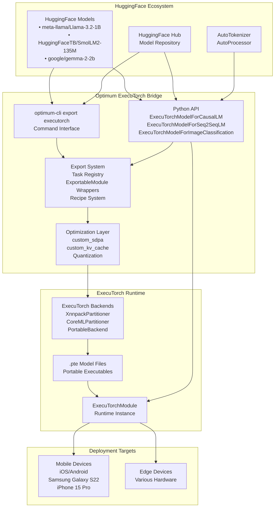
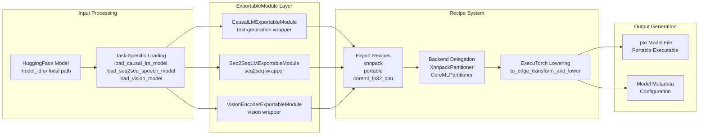
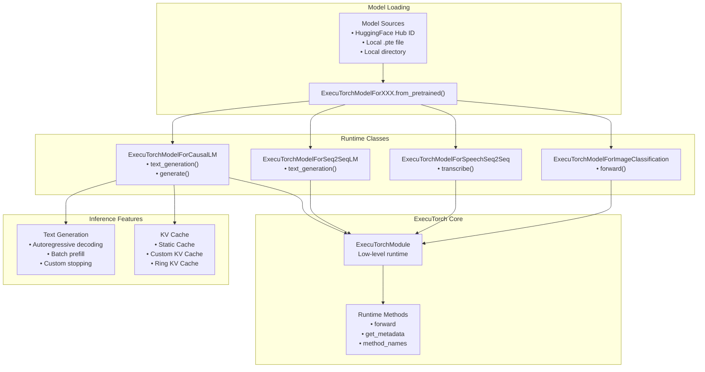

<!-- source: DeepWiki mcp.deepwiki.com · repo huggingface/optimum-executorch · page 1 Overview · fetched 2026-10-26 -->

# Overview

Relevant source files

The following files were used as context for generating this wiki page:

- [README.md](README.md)

## Purpose and Scope

Optimum ExecuTorch is a bridge library that enables conversion and deployment of HuggingFace models using Meta's ExecuTorch runtime framework. This document provides a comprehensive overview of the system's architecture, core components, and capabilities for optimizing transformer models for mobile and edge device deployment.

This overview covers the high-level system design and main workflows. For detailed installation instructions, see [Installation and Setup](#1.1). For step-by-step usage examples, see [Quick Start Guide](#1.2). For comprehensive model export details, see [Model Export System](#2). For inference and runtime information, see [Runtime and Inference](#3).

## System Architecture

The optimum-executorch system operates as a bridge between the HuggingFace ecosystem and ExecuTorch runtime, providing model conversion, optimization, and inference capabilities.

### High-Level Architecture

Sources: [README.md:1-233]()

### Core Components

The system consists of three primary layers:

| Component | Purpose | Key Classes/Functions |
|-----------|---------|----------------------|
| **Export Layer** | Convert HuggingFace models to ExecuTorch format | `CausalLMExportableModule`, `Seq2SeqLMExportableModule`, `VisionEncoderExportableModule` |
| **Optimization Layer** | Apply performance optimizations | `custom_sdpa`, `custom_kv_cache`, quantization schemes |
| **Runtime Layer** | Execute optimized models | `ExecuTorchModelForCausalLM`, `ExecuTorchModelForSeq2SeqLM`, `ExecuTorchModule` |

Sources: [README.md:15-19](), [README.md:54-116]()

## Key Capabilities

### Model Support

Optimum ExecuTorch supports a comprehensive range of transformer architectures:

- **Text Models**: Causal LM (Llama, Gemma, Qwen), Seq2Seq (T5), Masked LM (BERT, RoBERTa)
- **Vision Models**: Image classification (ViT, EfficientNet, Swin)
- **Audio Models**: Speech recognition (Whisper)

The system handles over 20 model families with variants, including popular models like `HuggingFaceTB/SmolLM2-135M`, `meta-llama/Llama-3.2-1B`, and `google/gemma-2-2b`.

Sources: [README.md:141-193]()

### Performance Optimizations

The library implements several key optimizations:

- **Custom SDPA**: 3x performance improvement over default attention
- **Custom KV Cache**: 2.5x improvement with in-place cache updates
- **Quantization**: int8 dynamic activations with int4 grouped weights (`8da4w`)
- **Batch Prefill**: 20x faster time-to-first-token processing

Sources: [README.md:121-139]()

## Export and Inference Workflow

### Model Export Pipeline

Sources: [README.md:84-96](), [README.md:128-131]()

### Runtime Inference System

Sources: [README.md:55-77](), [README.md:100-116]()

## Usage Patterns

The system supports two primary usage patterns:

1. **One-Step API**: Direct model loading with on-the-fly export using `ExecuTorchModelForCausalLM.from_pretrained()`
2. **Two-Step Process**: Separate export via CLI (`optimum-cli export executorch`) followed by runtime loading

Both approaches support the same optimization features including custom attention, quantization, and backend delegation.

Sources: [README.md:52-116]()

## Performance Characteristics

Optimum ExecuTorch achieves significant performance improvements on mobile devices:

| Device | SmolLM2-135M Performance |
|--------|-------------------------|
| Samsung Galaxy S22 5G | 202.28 tok/s |
| iPhone 15 Pro | 29.64 tok/s |
| iPhone 15 | 7.47 tok/s |

These benchmarks utilize custom SDPA, KV-cache optimization, and 8da4w quantization for optimal mobile performance.

Sources: [README.md:195-210]()

---

