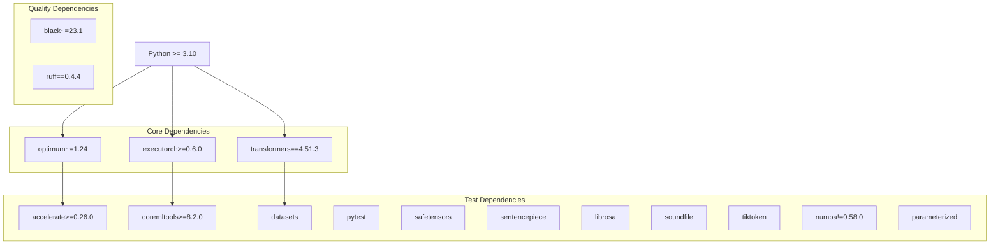
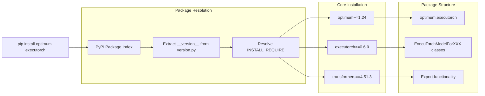
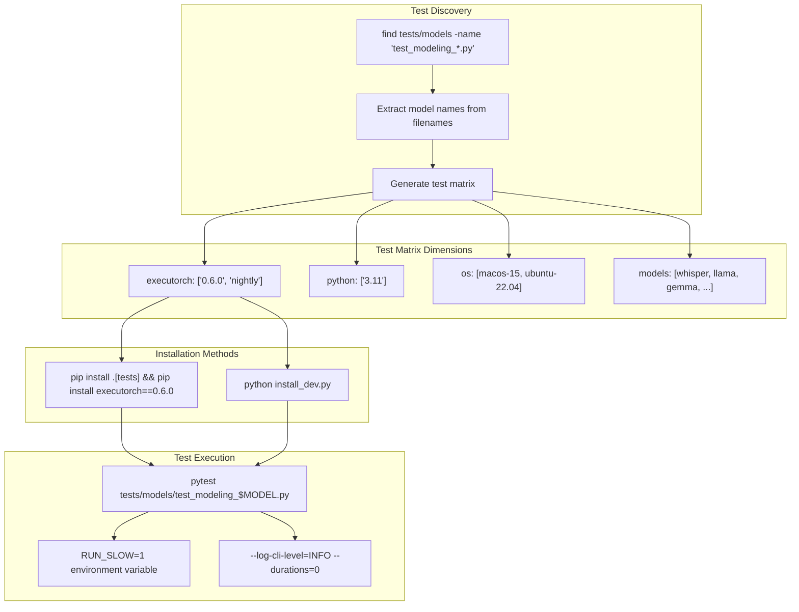

<!-- source: DeepWiki mcp.deepwiki.com · repo huggingface/optimum-executorch · page 1.1 Installation and Setup · fetched 2026-10-26 -->

# Installation and Setup

<details>
<summary>Relevant source files</summary>

The following files were used as context for generating this wiki page:

- [.github/workflows/test_models.yml](.github/workflows/test_models.yml)
- [install_dev.py](install_dev.py)
- [optimum/executorch/__init__.py](optimum/executorch/__init__.py)
- [optimum/exporters/executorch/tasks/__init__.py](optimum/exporters/executorch/tasks/__init__.py)
- [optimum/exporters/executorch/tasks/asr.py](optimum/exporters/executorch/tasks/asr.py)
- [setup.py](setup.py)
- [tests/models/test_modeling_whisper.py](tests/models/test_modeling_whisper.py)

</details>


This document covers how to install optimum-executorch for both end-users and developers. It includes standard installation methods, development setup procedures, and verification steps to ensure your installation is working correctly.

For information about using the installed package for model export, see [Quick Start Guide](#1.2). For details about setting up a development environment for contributing to the project, see [Development Environment](#7.1).

## Prerequisites

Before installing optimum-executorch, ensure your system meets the following requirements:

| Requirement | Specification |
|-------------|---------------|
| Python Version | 3.10 or higher |
| Operating Systems | Linux, macOS, Windows |
| Architecture | x86_64, ARM64 |

The package has been tested on the following platforms as shown in the CI configuration:

- **macOS-15** with Python 3.11
- **ubuntu-22.04** with Python 3.11

**Installation Dependencies Flow**



Sources: [setup.py:14-32](), [setup.py:58-61]()

## Standard Installation

### Basic Installation

Install the stable version of optimum-executorch from PyPI:

```bash
pip install optimum-executorch
```

This installs the core dependencies required for basic model export and inference functionality.

### Installation with Test Dependencies

For users who want to run the test suite or use additional model validation features:

```bash
pip install optimum-executorch[tests]
```

### Installation with Development Tools

For users contributing to the project or requiring code quality tools:

```bash
pip install optimum-executorch[dev]
```

This includes both test dependencies and quality tools like `black` and `ruff`.

**Standard Installation Process**



Sources: [setup.py:45-75]()

## Development Installation

For contributors or users requiring the latest features, use the development installation script that installs nightly builds and dependencies from source.

### Using the Development Script

The repository provides an `install_dev.py` script that automates the development setup:

```bash
python install_dev.py
```

This script performs the following operations:

1. **Installs package with development extras**: `pip install .[dev]`
2. **Installs nightly PyTorch ecosystem**: Pinned nightly versions of torch, executorch, torchao
3. **Installs dependencies from source**: Specific commits of transformers and tokenizers

### Development Installation Process

```mermaid
graph TD
    DevScript["python install_dev.py"]
    
    subgraph "Development Package Installation"
        DevInstall["pip install .[dev]"]
        TestDeps["Install TESTS_REQUIRE"]
        QualityDeps["Install QUALITY_REQUIRE"]
    end
    
    subgraph "Nightly Dependencies"
        NightlyCheck["install_torch_nightly_deps()"]
        ExecutorchNightly["executorch==0.7.0.dev20250625"]
        TorchNightly["torch==2.8.0.dev20250601"]
        TorchaudioNightly["torchaudio==2.8.0.dev20250601"]
        TorchvisionNightly["torchvision==0.23.0.dev20250601"] 
        TorchaoNightly["torchao==0.12.0.dev20250620"]
        NightlyIndex["--extra-index-url pytorch nightly"]
    end
    
    subgraph "Source Dependencies"
        SourceInstall["install_dep_from_source()"]
        TransformersSource["git+transformers@896e9cea1ade521b"]
        TokenizersSource["git+pytorch-labs/tokenizers@fc32028"]
    end
    
    DevScript --> DevInstall
    DevInstall --> TestDeps
    DevInstall --> QualityDeps
    
    DevScript --> NightlyCheck
    NightlyCheck --> ExecutorchNightly
    NightlyCheck --> TorchNightly
    NightlyCheck --> TorchaudioNightly
    NightlyCheck --> TorchvisionNightly
    NightlyCheck --> TorchaoNightly
    NightlyCheck --> NightlyIndex
    
    DevScript --> SourceInstall
    SourceInstall --> TransformersSource
    SourceInstall --> TokenizersSource
```



Sources: [install_dev.py:51-73](), [install_dev.py:6-26](), [install_dev.py:29-48]()

### Skipping Nightly Dependencies

To skip the nightly PyTorch dependencies installation (useful if you already have specific versions):

```bash
python install_dev.py --skip_override_torch
```

### Version Pinning in Development

The development script uses specific version pins for reproducibility:

| Component | Version Pin | Purpose |
|-----------|-------------|---------|
| ExecuTorch | `0.7.0.dev20250625` | Nightly build compatibility |
| Torch | `2.8.0.dev20250601` | Aligned with ExecuTorch requirements |
| TorchAO | `0.12.0.dev20250620` | Quantization support |
| Transformers | `896e9cea1ade521b` (4.53.1) | Source commit pin |
| Tokenizers | `fc32028858020c4fcafe37aaaeaf5d1b480336a2` | PyTorch Labs tokenizers |

Sources: [install_dev.py:8-11](), [install_dev.py:37-47]()

## Verifying Installation

After installation, verify that optimum-executorch is working correctly:

### Check Package Import

```python
from optimum.executorch import (
    ExecuTorchModelForCausalLM,
    ExecuTorchModelForImageClassification,
    ExecuTorchModelForMaskedLM,
    ExecuTorchModelForSeq2SeqLM,
    ExecuTorchModelForSpeechSeq2Seq,
)
```

### Verify ExecuTorch Backend

```python
from executorch.extension.pybindings.portable_lib import ExecuTorchModule
print("ExecuTorch backend available")
```

### Check CLI Availability

```bash
optimum-cli export executorch --help
```

### Run Test Suite

For development installations, run the test suite to ensure everything is working:

```bash
# Run all tests (slow)
RUN_SLOW=1 pytest tests/ -v

# Run specific model tests
RUN_SLOW=1 pytest tests/models/test_modeling_whisper.py -v
```

Sources: [optimum/executorch/__init__.py:20-28](), [tests/models/test_modeling_whisper.py:30]()

## CI/CD Testing Matrix

The project uses automated testing across multiple configurations to ensure installation stability:

**Testing Configuration Matrix**



Sources: [.github/workflows/test_models.yml:14-29](), [.github/workflows/test_models.yml:31-43](), [.github/workflows/test_models.yml:52-64]()

## Troubleshooting

### Common Installation Issues

| Issue | Symptoms | Solution |
|-------|----------|----------|
| Python Version | `python_requires>=3.10.0` error | Upgrade to Python 3.10+ |
| ExecuTorch Version | Import errors with `ExecuTorchModule` | Ensure executorch >= 0.6.0 |
| Numba Conflict | Runtime errors with numba | Avoid numba 0.58.0 (automatically excluded) |
| Transformers Version | Model loading issues | Use pinned transformers==4.51.3 |

### Development Setup Issues

- **Nightly dependency conflicts**: Use `--skip_override_torch` flag if you have custom PyTorch setup
- **Git access issues**: Ensure git credentials are configured for GitHub access when installing from source
- **Build failures**: Check that you have compatible C++ compiler for building dependencies

### Environment Isolation

For clean installations, consider using virtual environments:

```bash
# Create virtual environment
python -m venv optimum-executorch-env
source optimum-executorch-env/bin/activate  # Linux/macOS
# or optimum-executorch-env\Scripts\activate  # Windows

# Install in isolated environment
pip install optimum-executorch
```

Sources: [setup.py:28](), [setup.py:72](), [install_dev.py:55-58]()

---

