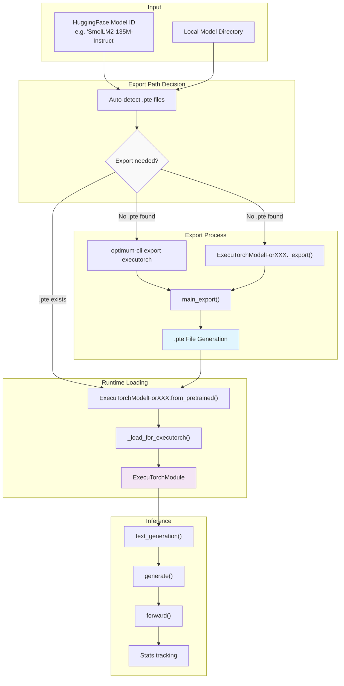
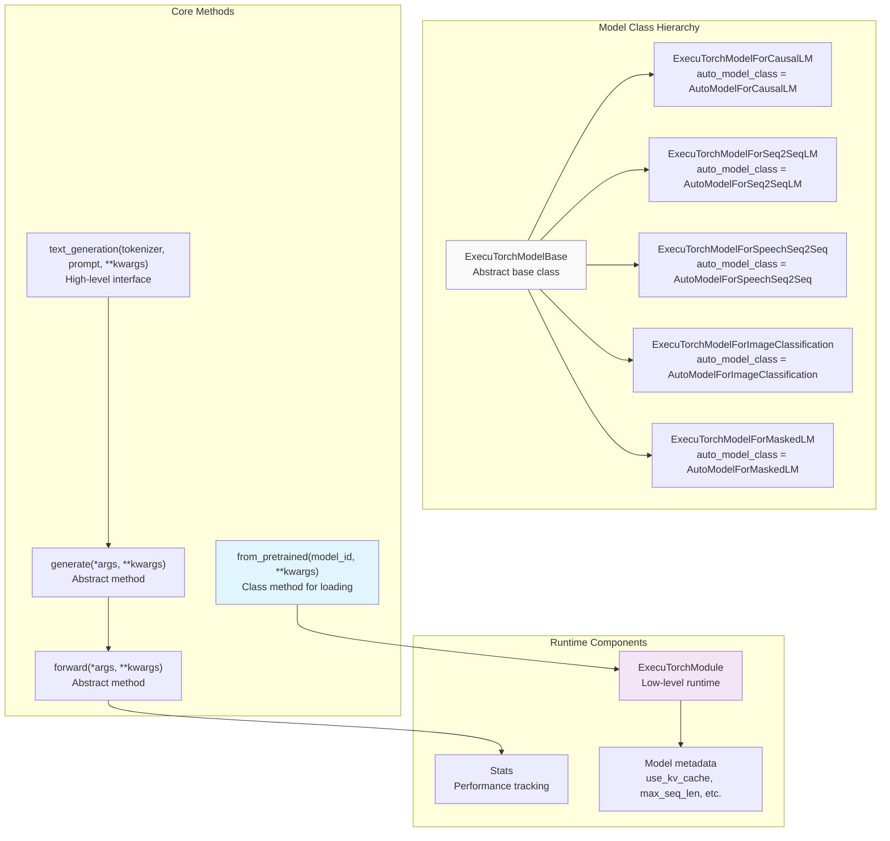
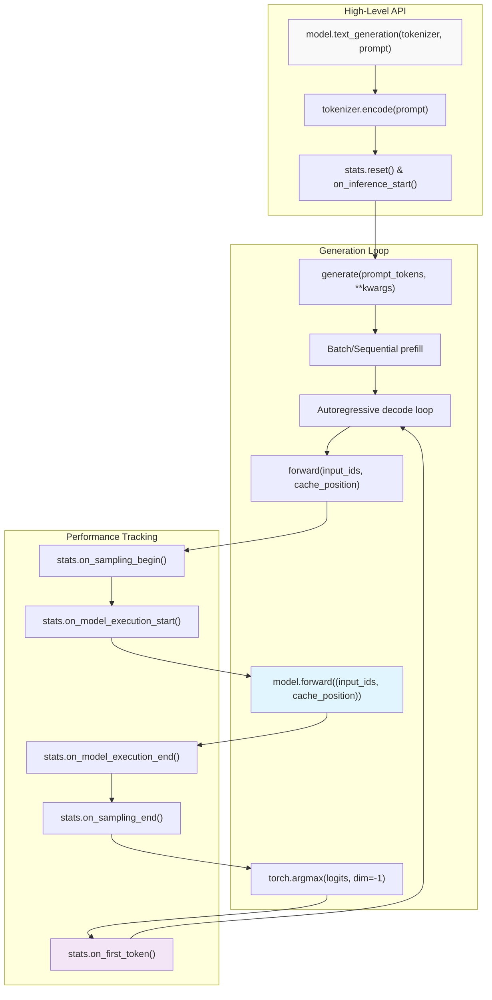

<!-- source: DeepWiki mcp.deepwiki.com · repo huggingface/optimum-executorch · page 1.2 Quick Start Guide · fetched 2026-10-26 -->

# Quick Start Guide

<details>
<summary>Relevant source files</summary>

The following files were used as context for generating this wiki page:

- [README.md](README.md)
- [optimum/executorch/modeling.py](optimum/executorch/modeling.py)
- [optimum/exporters/executorch/utils.py](optimum/exporters/executorch/utils.py)

</details>


This guide provides a practical walkthrough of the two main approaches for using optimum-executorch: exporting HuggingFace models to ExecuTorch format and running inference. It covers the essential steps from model loading to text generation using both the integrated Python API and the separate CLI export approach.

For detailed information about supported models, see [Supported Models](#5). For comprehensive export options and CLI reference, see [Command Line Interface](#6).

## Usage Patterns

Optimum-executorch provides two primary workflows for converting and running HuggingFace models with ExecuTorch:

### Pattern 1: Integrated Python API

The most streamlined approach uses the `ExecuTorchModelForXXX.from_pretrained()` method to handle export and loading in a single call:

```python
from optimum.executorch import ExecuTorchModelForCausalLM
from transformers import AutoTokenizer

# Load and export model automatically
model = ExecuTorchModelForCausalLM.from_pretrained(
    "HuggingFaceTB/SmolLM2-135M-Instruct",
    recipe="xnnpack",
    attn_implementation="custom_sdpa",
    use_custom_kv_cache=True,
    **{"qlinear": "8da4w", "qembedding": "8w"}
)

# Generate text immediately
tokenizer = AutoTokenizer.from_pretrained("HuggingFaceTB/SmolLM2-135M-Instruct")
generated_text = model.text_generation(
    tokenizer=tokenizer,
    prompt="Once upon a time",
    max_seq_len=128
)
```

### Pattern 2: CLI Export + Python Loading

For more control over the export process or for batch processing, use the CLI tool followed by Python loading:

**Step 1: Export via CLI**
```bash
optimum-cli export executorch \
    --model "HuggingFaceTB/SmolLM2-135M-Instruct" \
    --task "text-generation" \
    --recipe "xnnpack" \
    --use_custom_sdpa \
    --use_custom_kv_cache \
    --qlinear 8da4w \
    --qembedding 8w \
    --output_dir="./exported_model"
```

**Step 2: Load and run inference**
```python
from optimum.executorch import ExecuTorchModelForCausalLM
from transformers import AutoTokenizer

# Load pre-exported model
model = ExecuTorchModelForCausalLM.from_pretrained("./exported_model")
tokenizer = AutoTokenizer.from_pretrained("HuggingFaceTB/SmolLM2-135M-Instruct")

generated_text = model.text_generation(
    tokenizer=tokenizer,
    prompt="Once upon a time",
    max_seq_len=128
)
```

**Sources:** [README.md:50-116](), [optimum/executorch/modeling.py:278-372]()

## System Flow Overview



**Sources:** [optimum/executorch/modeling.py:278-372](), [README.md:82-116](), [optimum/exporters/executorch/__init__.py]()

## Core Model Classes

The system provides task-specific model classes that inherit from `ExecuTorchModelBase`:



**Sources:** [optimum/executorch/modeling.py:56-120](), [optimum/executorch/modeling.py:570-797](), [optimum/executorch/modeling.py:374-568]()

## Key Configuration Parameters

| Parameter | Purpose | Example Values | Applied At |
|-----------|---------|----------------|------------|
| `recipe` | Backend delegation strategy | `"xnnpack"`, `"portable"`, `"coreml"` | Export |
| `attn_implementation` | Attention mechanism | `"custom_sdpa"`, `"sdpa"`, `"eager"` | Export |
| `use_custom_kv_cache` | KV cache optimization | `True`, `False` | Export |
| `qlinear` | Linear layer quantization | `"8da4w"`, `"4w"`, `"8w"` | Export |
| `qembedding` | Embedding quantization | `"8w"`, `"4w"` | Export |
| `max_seq_len` | Maximum sequence length | `128`, `512`, `1024` | Runtime |
| `echo` | Include prompt in output | `True`, `False` | Runtime |

## Method Invocation Flow



**Sources:** [optimum/executorch/modeling.py:745-796](), [optimum/executorch/modeling.py:654-743](), [optimum/executorch/modeling.py:627-652]()

## Essential Import Statements

For typical usage, these imports are required:

```python
# Core model classes
from optimum.executorch import ExecuTorchModelForCausalLM
from optimum.executorch import ExecuTorchModelForSeq2SeqLM
from optimum.executorch import ExecuTorchModelForSpeechSeq2Seq

# HuggingFace components
from transformers import AutoTokenizer, AutoProcessor

# For lower-level access
from executorch.extension.pybindings.portable_lib import ExecuTorchModule
```

The `from_pretrained()` method automatically handles the detection of whether export is needed based on the presence of `.pte` files in the model directory, making it the recommended entry point for most use cases.

**Sources:** [optimum/executorch/modeling.py:15-48](), [optimum/executorch/modeling.py:278-372]()

---

