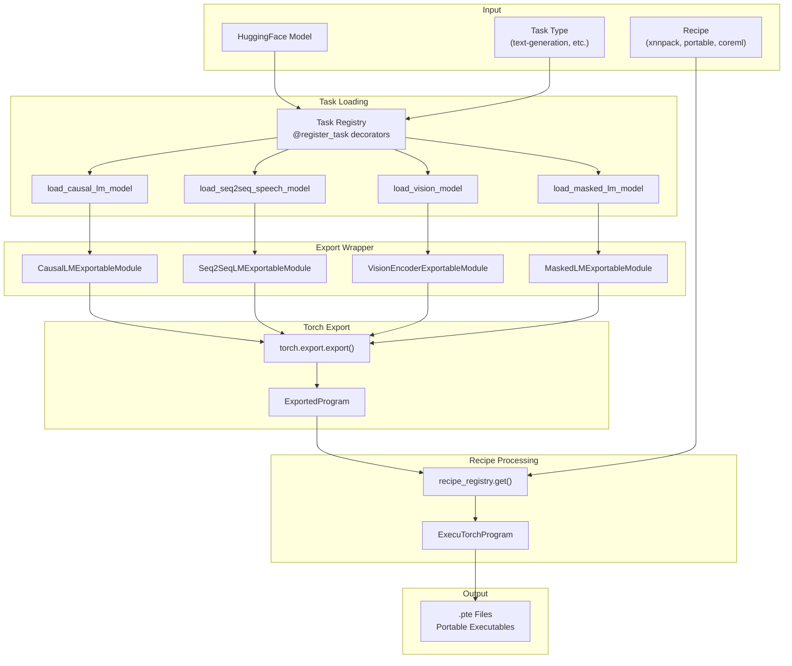
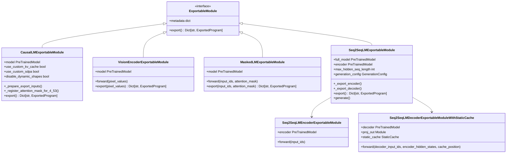
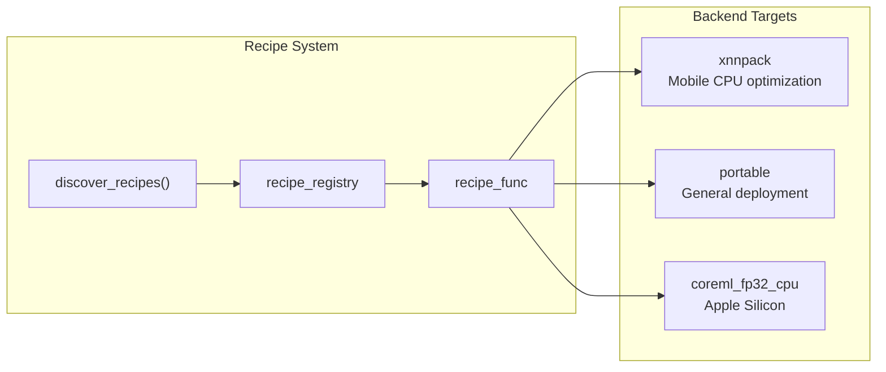

<!-- source: DeepWiki mcp.deepwiki.com · repo huggingface/optimum-executorch · page 2 Model Export System · fetched 2026-10-26 -->

# Model Export System

Relevant source files

The following files were used as context for generating this wiki page:

- [optimum/executorch/attentions/custom_kv_cache.py](optimum/executorch/attentions/custom_kv_cache.py)
- [optimum/exporters/executorch/convert.py](optimum/exporters/executorch/convert.py)
- [optimum/exporters/executorch/integrations.py](optimum/exporters/executorch/integrations.py)
- [tests/models/test_modeling_common.py](tests/models/test_modeling_common.py)
- [tests/models/test_modeling_qwen2.py](tests/models/test_modeling_qwen2.py)

## Purpose and Scope

The Model Export System is responsible for converting HuggingFace models into ExecuTorch-compatible `.pte` (Portable Executable) files. This system bridges the gap between HuggingFace's transformer models and ExecuTorch's optimized runtime environment, enabling deployment on mobile and edge devices.

This document covers the export pipeline, task-specific model handling, exportable module wrappers, and recipe integration. For information about loading and running exported models, see [Runtime and Inference](#3). For details about optimization techniques applied during export, see [Optimization Features](#4).

## Export Process Overview

The model export system follows a multi-stage pipeline that transforms HuggingFace models into optimized ExecuTorch programs:

**Export Pipeline Flow**

The export process begins with the `export_to_executorch` function which coordinates the entire pipeline. It uses dynamic recipe discovery to find the appropriate conversion strategy and produces serialized `.pte` files ready for deployment.

**Sources:** [optimum/exporters/executorch/convert.py:38-94]()

## ExportableModule System

The ExportableModule system provides task-specific wrappers that prepare HuggingFace models for `torch.export`. Each wrapper handles the unique requirements of different model architectures and tasks:

**ExportableModule Class Hierarchy**

Each exportable module handles specific model types and provides the necessary preprocessing and configuration for successful export:

| Module Type | Purpose | Key Features |
|-------------|---------|-------------|
| `CausalLMExportableModule` | Decoder-only models (GPT, Llama, etc.) | Custom KV cache, SDPA, dynamic shapes |
| `VisionEncoderExportableModule` | Vision models (ViT, etc.) | Pixel value preprocessing, image size handling |
| `MaskedLMExportableModule` | Masked language models (BERT, etc.) | Attention mask support, dynamic sequence lengths |
| `Seq2SeqLMExportableModule` | Encoder-decoder models (T5, Whisper) | Separate encoder/decoder export, static caching |

**Sources:** [optimum/exporters/executorch/integrations.py:37-504]()

## Task-Specific Export Features

### Causal Language Model Export

The `CausalLMExportableModule` provides the most sophisticated export handling, supporting advanced optimization features:

**Dynamic Shape Configuration**: The module automatically determines whether to use static or dynamic shapes based on model configuration and transformers version. Dynamic shapes are enabled when supported to allow variable sequence lengths during inference.

**Custom Attention Integration**: For models supporting sliding window attention or requiring custom SDPA implementations, the module configures appropriate attention mechanisms using the `_register_attention_mask_for_4_53` method.

**KV Cache Replacement**: When custom KV cache is enabled, the module replaces standard transformers caches with ExecuTorch-optimized implementations using `replace_with_et_custom_kv_cache`.

**Sources:** [optimum/exporters/executorch/integrations.py:37-173]()

### Vision Model Export

`VisionEncoderExportableModule` handles computer vision models by managing pixel value preprocessing and ensuring proper tensor shapes for image data.

**Sources:** [optimum/exporters/executorch/integrations.py:175-210]()

### Seq2Seq Model Export

The `Seq2SeqLMExportableModule` manages the complexity of encoder-decoder architectures by creating separate exportable modules for each component:

- **Encoder Export**: Handles variable-length input sequences with appropriate dynamic shape configuration
- **Decoder Export**: Integrates static caching for efficient autoregressive generation
- **Model-Specific Handling**: Provides specialized logic for T5 and Whisper model architectures

**Sources:** [optimum/exporters/executorch/integrations.py:327-504]()

## Recipe Integration and Backend Delegation

The export system integrates with ExecuTorch's recipe system through the `recipe_registry`. Recipes define the specific optimization passes, backend delegation strategies, and lowering procedures for different deployment targets.

**Recipe Discovery Process**

The `export_to_executorch` function coordinates recipe selection and execution, ensuring that the exported model is optimized for the target deployment environment.

**Sources:** [optimum/exporters/executorch/convert.py:74-82]()

## Export Configuration and Metadata

Each exportable module generates metadata that gets embedded into the resulting `.pte` file. This metadata includes model configuration, generation parameters, and deployment-specific settings that the runtime system uses for proper model execution.

The metadata system uses `save_config_to_constant_methods` to serialize configuration objects into a format that can be stored and retrieved by the ExecuTorch runtime.

**Sources:** [optimum/exporters/executorch/integrations.py:50-51](), [optimum/exporters/executorch/integrations.py:186](), [optimum/exporters/executorch/integrations.py:223](), [optimum/exporters/executorch/integrations.py:362-367]()

## Custom Optimization Integration

The export system integrates with custom optimization components including:

- **Custom KV Cache**: `ETCustomStaticCache` and `ETCustomHybridCache` implementations that replace standard transformers caching with ExecuTorch-optimized versions
- **Custom SDPA**: Integration with `custom_sdpa_with_start_pos_forward` for improved attention performance
- **Export Passes**: Application of optimization passes like `RemoveRedundantTransposes` to clean up the exported graph

**Sources:** [optimum/executorch/attentions/custom_kv_cache.py:27-406](), [optimum/exporters/executorch/integrations.py:152-156]()

---

