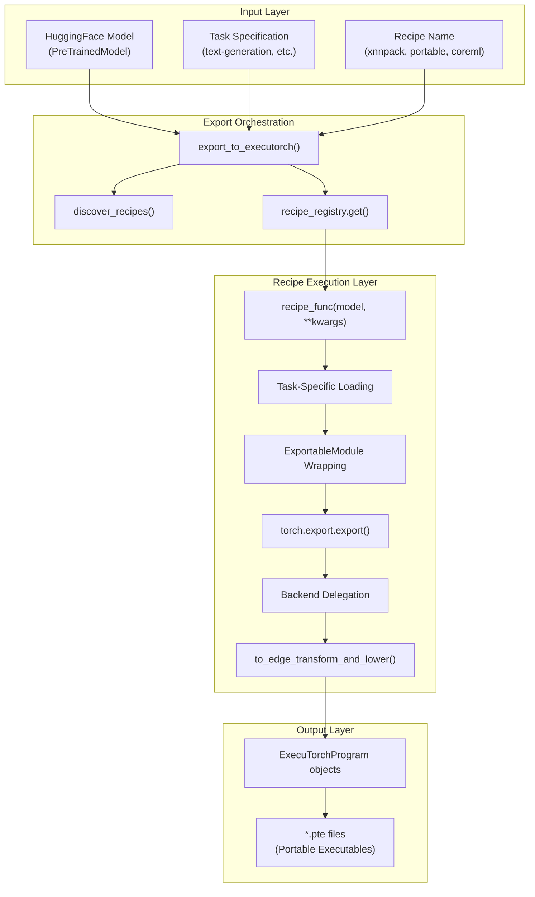
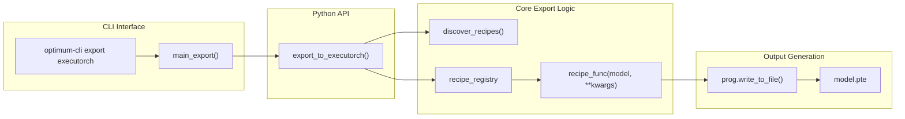
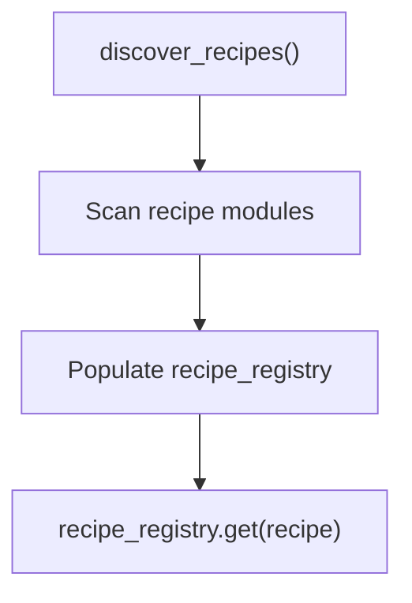
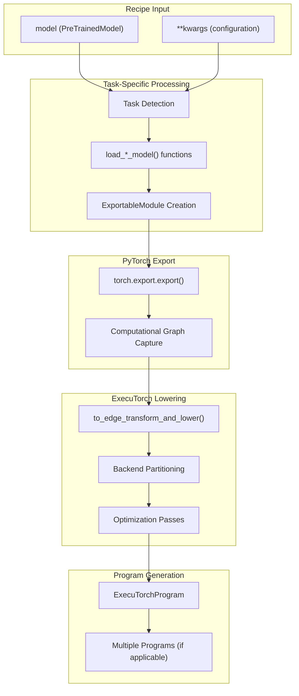
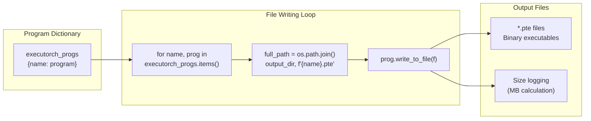

<!-- source: DeepWiki mcp.deepwiki.com · repo huggingface/optimum-executorch · page 2.1 Export Process Overview · fetched 2026-10-26 -->

# Export Process Overview

Relevant source files

The following files were used as context for generating this wiki page:

- [optimum/exporters/executorch/convert.py](optimum/exporters/executorch/convert.py)
- [tests/models/test_modeling_common.py](tests/models/test_modeling_common.py)
- [tests/models/test_modeling_qwen2.py](tests/models/test_modeling_qwen2.py)

This document explains the overall pipeline for converting HuggingFace models into ExecuTorch's optimized `.pte` (Portable Executable) format. The export process transforms models from PyTorch's eager execution format through multiple optimization stages to produce runtime-efficient executables suitable for edge deployment.

For specific details about task-specific model loading, see [Task-Specific Model Loading](#2.2). For implementation details of the wrapper system, see [ExportableModule System](#2.3). For recipe configurations and backend targeting, see [Recipes and Backend Delegation](#2.4).

## Pipeline Architecture

The export process follows a multi-stage pipeline that progressively transforms HuggingFace models into optimized ExecuTorch executables:

**Export Pipeline Architecture**

Sources: [optimum/exporters/executorch/convert.py:38-93]()

## Export Entry Points

The export process can be initiated through two primary interfaces:

| Interface | Function/Command | Purpose |
|-----------|------------------|---------|
| **Command Line** | `optimum-cli export executorch` | Batch export with subprocess isolation |
| **Python API** | `export_to_executorch()` | Programmatic export with fine-grained control |

**Code Entry Points**

Sources: [optimum/exporters/executorch/convert.py:38-93](), [tests/models/test_modeling_common.py:48-53](), [tests/models/test_modeling_qwen2.py:44-54]()

## Export Stages

### Stage 1: Recipe Discovery and Registration

The export process begins with dynamic recipe discovery, which scans for available export configurations:

The `discover_recipes()` function dynamically imports and registers all available export recipes, making them accessible through the `recipe_registry`.

Sources: [optimum/exporters/executorch/convert.py:74-82]()

### Stage 2: Recipe Execution Pipeline

Once a recipe is retrieved, it executes a standardized pipeline that varies by recipe type but follows consistent stages:

**Recipe Execution Flow**

Sources: [optimum/exporters/executorch/convert.py:83-93]()

### Stage 3: Program Serialization

The final stage serializes ExecuTorch programs to `.pte` files with standardized naming:

The serialization process creates binary `.pte` files in the specified output directory, with each program receiving its designated filename. Most recipes produce a single `model.pte` file, though some specialized recipes may generate multiple program files.

Sources: [optimum/exporters/executorch/convert.py:85-93]()

## Error Handling and Validation

The export process includes robust error handling at key stages:

| Error Type | Detection Point | Handling |
|------------|----------------|----------|
| **Invalid Recipe** | `recipe_registry.get()` | `RuntimeError` with available recipes list |
| **Export Failure** | Recipe execution | Exception propagation with context |
| **File I/O Errors** | Program serialization | Standard Python I/O exceptions |

The export function validates recipe availability before attempting execution and provides detailed error messages for troubleshooting.

Sources: [optimum/exporters/executorch/convert.py:78-82]()

## Integration Points

The export process integrates with several system components:

- **Task Registry**: Provides model loading functions for different task types
- **Recipe System**: Defines optimization and backend targeting strategies  
- **ExportableModule System**: Wraps models for PyTorch export compatibility
- **Custom Attention**: Registers optimized attention implementations
- **Quantization**: Applies model compression techniques during export

These integration points are coordinated through the recipe execution pipeline, with each recipe determining which optimizations and transformations to apply.

Sources: [optimum/exporters/executorch/convert.py:24-35](), [optimum/exporters/executorch/convert.py:27]()

---

