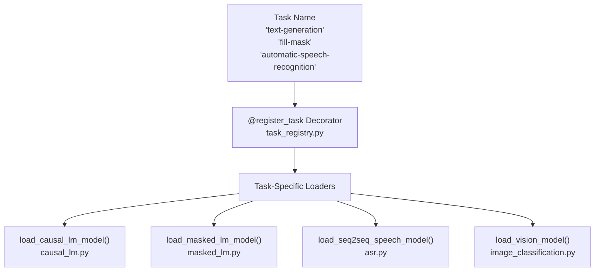
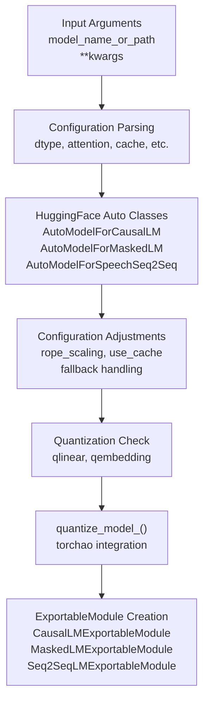
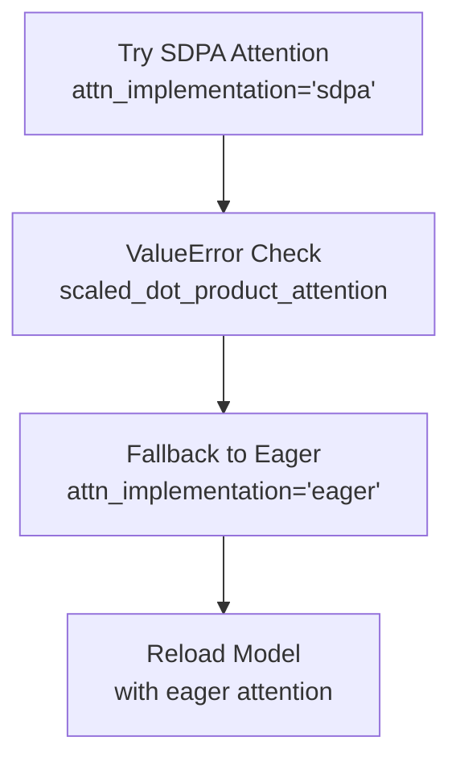

<!-- source: DeepWiki mcp.deepwiki.com · repo huggingface/optimum-executorch · page 2.2 Task-Specific Model Loading · fetched 2026-10-26 -->

# Task-Specific Model Loading

Relevant source files

The following files were used as context for generating this wiki page:

- [install_dev.py](install_dev.py)
- [optimum/executorch/__init__.py](optimum/executorch/__init__.py)
- [optimum/exporters/executorch/quantization.py](optimum/exporters/executorch/quantization.py)
- [optimum/exporters/executorch/tasks/__init__.py](optimum/exporters/executorch/tasks/__init__.py)
- [optimum/exporters/executorch/tasks/asr.py](optimum/exporters/executorch/tasks/asr.py)
- [optimum/exporters/executorch/tasks/causal_lm.py](optimum/exporters/executorch/tasks/causal_lm.py)
- [optimum/exporters/executorch/tasks/masked_lm.py](optimum/exporters/executorch/tasks/masked_lm.py)
- [tests/models/test_modeling_bert.py](tests/models/test_modeling_bert.py)
- [tests/models/test_modeling_whisper.py](tests/models/test_modeling_whisper.py)

The task-specific model loading system provides specialized loaders for different machine learning tasks, bridging HuggingFace models to ExecuTorch-compatible formats. This system maps task names (like "text-generation" or "fill-mask") to appropriate model loaders that handle task-specific configuration, quantization, and preparation for ExecuTorch export.

For information about the overall export pipeline, see [Export Process Overview](#2.1). For details about the wrapper system that prepares models for torch.export, see [ExportableModule System](#2.3).

## Task Registry Architecture

The task registry system uses a decorator-based approach to map task names to their corresponding model loading functions. Each task loader is registered using the `@register_task` decorator with a pipeline-compatible task name.

### Task Registry Flow

*Sources: [optimum/exporters/executorch/tasks/causal_lm.py:27](), [optimum/exporters/executorch/tasks/masked_lm.py:24](), [optimum/exporters/executorch/tasks/asr.py:23](), [optimum/exporters/executorch/tasks/__init__.py:15]()*

## Task-Specific Loaders

Each task loader handles the complexities of loading and configuring models for their specific use case, including attention mechanisms, caching strategies, and quantization.

### Causal Language Model Loader

The `load_causal_lm_model` function handles text generation models like Llama, Gemma, and Qwen:

| Configuration Option | Default | Description |
|---------------------|---------|-------------|
| `dtype` | `"float32"` | Model weight data type (`"float16"`, `"bfloat16"`) |
| `attn_implementation` | `"sdpa"` | Attention mechanism (`"sdpa"`, `"custom_sdpa"`, `"eager"`) |
| `cache_implementation` | `"static"` | Cache management strategy |
| `max_length` | `2048` | Maximum sequence length |
| `use_custom_sdpa` | `False` | Enable custom scaled dot-product attention |
| `use_custom_kv_cache` | `False` | Enable custom key-value cache |

The loader automatically handles configuration adjustments for exportability and falls back to eager attention when SDPA is not supported.

*Sources: [optimum/exporters/executorch/tasks/causal_lm.py:28-137]()*

### Masked Language Model Loader  

The `load_masked_lm_model` function supports models like BERT for fill-mask tasks:

*Sources: [optimum/exporters/executorch/tasks/masked_lm.py:25-48]()*

### Speech Recognition Loader

The `load_seq2seq_speech_model` function handles models like Whisper for automatic speech recognition:

| Configuration Option | Default | Description |
|---------------------|---------|-------------|
| `max_hidden_seq_length` | `4096` | Maximum hidden sequence length |
| `max_cache_length` | `1024` | Maximum cache length for generation |

*Sources: [optimum/exporters/executorch/tasks/asr.py:24-58]()*

## Model Preparation Pipeline

Each task loader follows a consistent pipeline for preparing models:

### Configuration and Loading Pipeline

*Sources: [optimum/exporters/executorch/tasks/causal_lm.py:53-137](), [optimum/exporters/executorch/tasks/masked_lm.py:42-47](), [optimum/exporters/executorch/quantization.py:23-82]()*

### Quantization Integration

The quantization system supports multiple schemes through `quantize_model_()`:

| Quantization Type | Schemes | Description |
|------------------|---------|-------------|
| `qlinear` | `8da4w`, `4w`, `8w` | Linear layer quantization |
| `qembedding` | `4w`, `8w` | Embedding layer quantization |

The quantization process uses torchao and requires version >= 0.11.0.dev0. It applies per-axis or per-group granularity depending on the scheme selected.

*Sources: [optimum/exporters/executorch/quantization.py:23-82](), [optimum/exporters/executorch/tasks/causal_lm.py:133-135]()*

## Error Handling and Fallbacks

The task loaders include robust error handling:

### Attention Implementation Fallback

*Sources: [optimum/exporters/executorch/tasks/causal_lm.py:102-126]()*

### RoPE Scaling Configuration

For models with RoPE scaling, the loader automatically adjusts the configuration to avoid data-dependent control flow issues during export by setting `rope_scaling["type"] = "default"`.

*Sources: [optimum/exporters/executorch/tasks/causal_lm.py:65-69]()*

---

