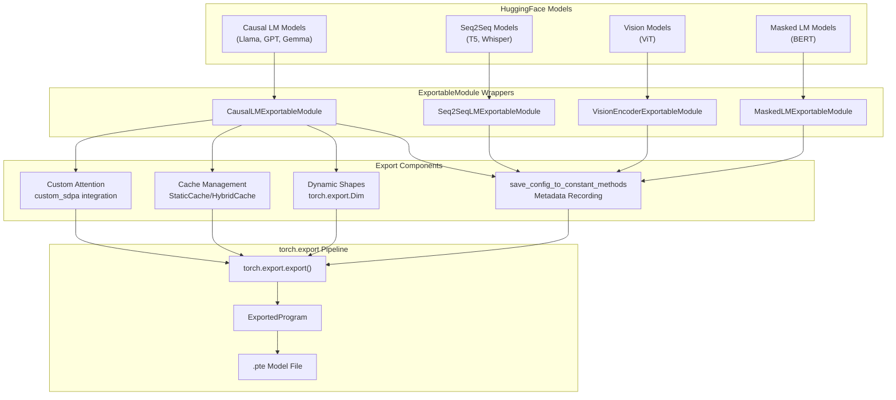
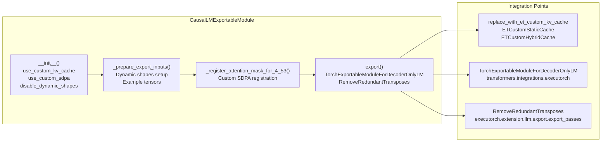
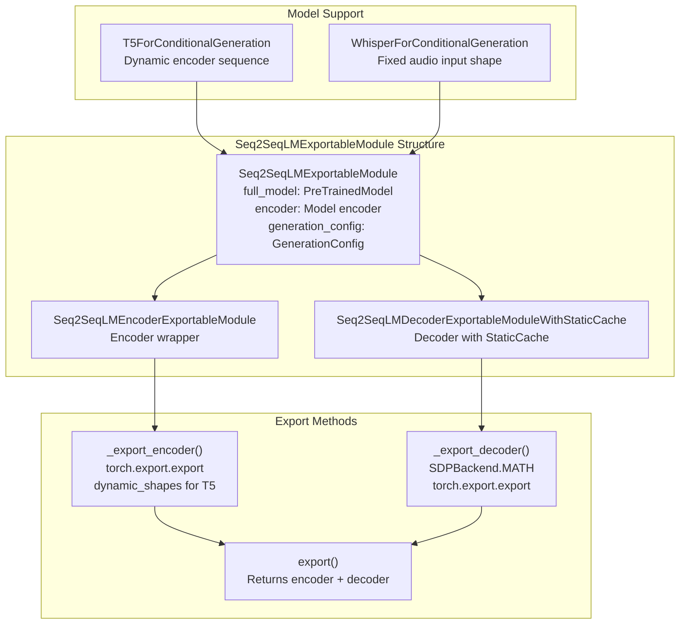
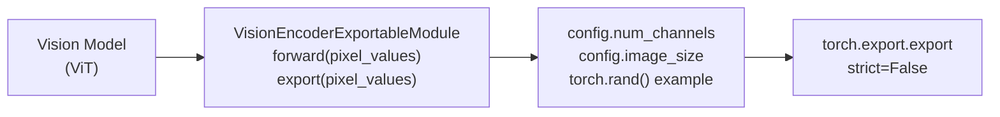
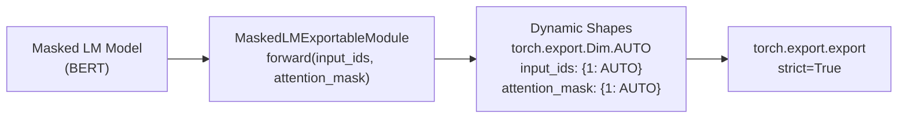
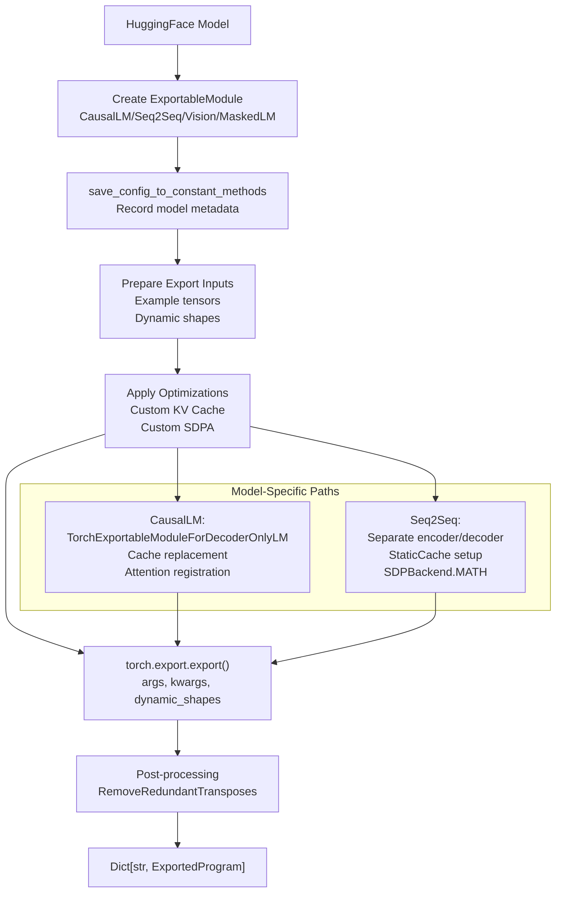
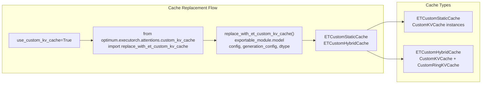
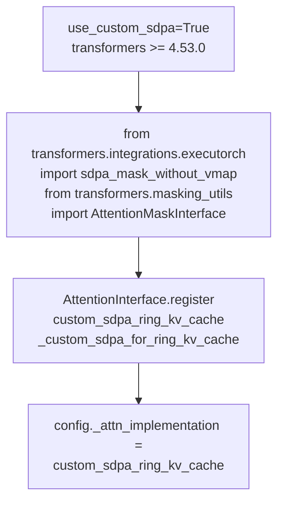

<!-- source: DeepWiki mcp.deepwiki.com · repo huggingface/optimum-executorch · page 2.3 ExportableModule System · fetched 2026-10-26 -->

# ExportableModule System

Relevant source files

The following files were used as context for generating this wiki page:

- [optimum/executorch/attentions/custom_kv_cache.py](optimum/executorch/attentions/custom_kv_cache.py)
- [optimum/exporters/executorch/integrations.py](optimum/exporters/executorch/integrations.py)

The ExportableModule system provides wrapper classes that prepare HuggingFace models for export to ExecuTorch format using `torch.export`. These modules handle export-specific concerns like dynamic shapes, caching configurations, and metadata preservation while ensuring compatibility with ExecuTorch's execution requirements.

For information about the broader export process and recipes, see [Recipes and Backend Delegation](#2.4). For details about runtime model loading, see [Model Loading and Configuration](#3.1).

## System Overview

The ExportableModule system serves as an adapter layer between HuggingFace's model interfaces and ExecuTorch's export requirements. Each wrapper class encapsulates a specific model architecture pattern and manages the complexities of making these models exportable.

### ExportableModule Architecture

Sources: [optimum/exporters/executorch/integrations.py:37-173]()

## ExportableModule Classes

### CausalLMExportableModule

The `CausalLMExportableModule` handles causal language models like Llama, GPT, and Gemma. It provides the most sophisticated export logic with support for custom KV caching, custom scaled dot-product attention (SDPA), and dynamic shapes.

Sources: [optimum/exporters/executorch/integrations.py:37-173]()

#### Dynamic Shapes Configuration

The `CausalLMExportableModule._prepare_export_inputs()` method configures dynamic shapes for flexible sequence length handling:

| Parameter | Purpose | Configuration |
|-----------|---------|---------------|
| `seq_length_dim` | Variable sequence length | `torch.export.Dim("seq_length_dim", max=max_dim)` |
| `max_dim` | Maximum sequence length | `min(max_seq_len, sliding_window) - 1` |
| `dynamic_shapes` | Shape specifications | `{"input_ids": {1: seq_len_dim}, "cache_position": {0: seq_len_dim}}` |

Sources: [optimum/exporters/executorch/integrations.py:53-94]()

### Seq2SeqLMExportableModule

The `Seq2SeqLMExportableModule` handles encoder-decoder models like T5 and Whisper by exporting separate encoder and decoder components with static caching.

Sources: [optimum/exporters/executorch/integrations.py:327-473]()

### VisionEncoderExportableModule

The `VisionEncoderExportableModule` provides a straightforward wrapper for vision models with minimal export complexity.

Sources: [optimum/exporters/executorch/integrations.py:175-210]()

### MaskedLMExportableModule

The `MaskedLMExportableModule` handles BERT-style masked language models with automatic dynamic shape configuration.

Sources: [optimum/exporters/executorch/integrations.py:212-263]()

## Export Process Flow

The export process follows a consistent pattern across all ExportableModule classes:

Sources: [optimum/exporters/executorch/integrations.py:115-173](), [optimum/exporters/executorch/integrations.py:436-472]()

## Integration with Custom Components

### Custom KV Cache Integration

The `CausalLMExportableModule` integrates with the custom KV cache system when `use_custom_kv_cache=True`:

Sources: [optimum/exporters/executorch/integrations.py:134-144](), [optimum/executorch/attentions/custom_kv_cache.py:309-405]()

### Custom SDPA Registration

For models using custom scaled dot-product attention, the system registers attention implementations:

Sources: [optimum/exporters/executorch/integrations.py:96-114]()

## Metadata Management

All ExportableModule classes use `save_config_to_constant_methods()` to preserve model configuration and generation parameters in the exported model:

| Metadata Type | Source | Purpose |
|---------------|--------|---------|
| Model config | `model.config` | Architecture parameters |
| Generation config | `model.generation_config` | Generation settings |
| Additional configs | Class-specific | Custom parameters like `max_hidden_seq_length` |

The metadata is accessible in the exported `.pte` file through constant methods, enabling runtime configuration without additional files.

Sources: [optimum/exporters/executorch/integrations.py:50](), [optimum/exporters/executorch/integrations.py:186](), [optimum/exporters/executorch/integrations.py:223](), [optimum/exporters/executorch/integrations.py:363-367]()

---

