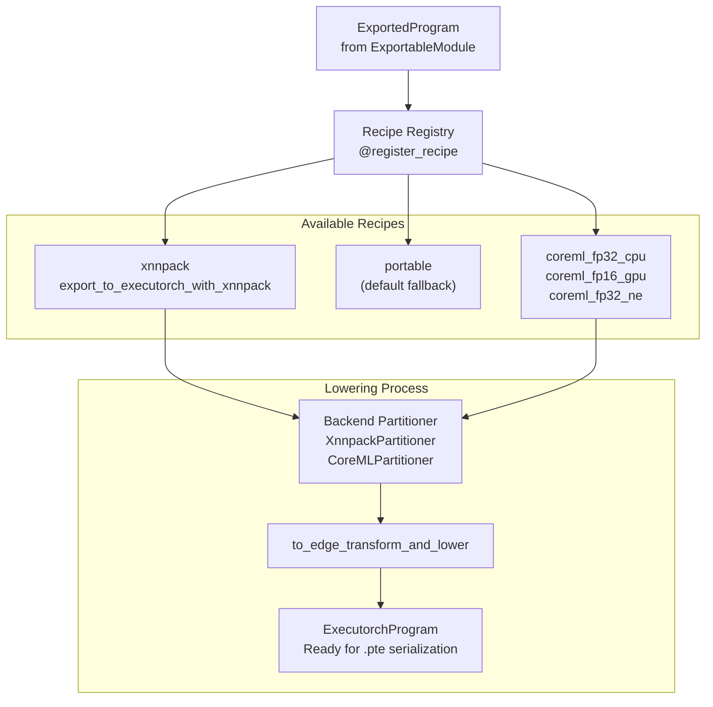
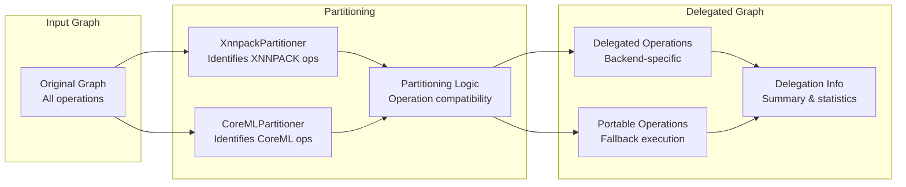
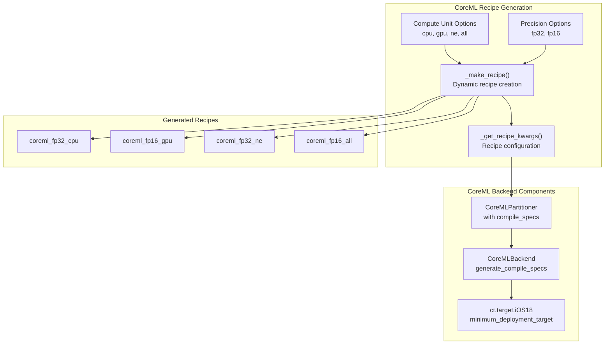

<!-- source: DeepWiki mcp.deepwiki.com · repo huggingface/optimum-executorch · page 2.4 Recipes and Backend Delegation · fetched 2026-10-26 -->

# Recipes and Backend Delegation

<details>
<summary>Relevant source files</summary>

The following files were used as context for generating this wiki page:

- [optimum/executorch/attentions/custom_sdpa.py](optimum/executorch/attentions/custom_sdpa.py)
- [optimum/exporters/executorch/__main__.py](optimum/exporters/executorch/__main__.py)
- [optimum/exporters/executorch/recipes/coreml.py](optimum/exporters/executorch/recipes/coreml.py)
- [optimum/exporters/executorch/recipes/xnnpack.py](optimum/exporters/executorch/recipes/xnnpack.py)
- [tests/models/test_modeling_vit.py](tests/models/test_modeling_vit.py)

</details>


This document covers the recipe system and backend delegation mechanisms in optimum-executorch. Recipes define how exported PyTorch models are lowered to ExecuTorch programs with delegation to specific hardware backends. Backend delegation enables operations to run on optimized backends like XNNPACK (mobile CPU), CoreML (Apple devices), or fall back to the portable backend.

For information about the model export process leading up to recipe application, see [Export Process Overview](#2.1). For details on the ExportableModule wrappers that prepare models for recipes, see [ExportableModule System](#2.3).

## Recipe System Overview

Recipes are registered functions that transform exported PyTorch programs into ExecuTorch programs optimized for specific backends. Each recipe handles the lowering process from `ExportedProgram` to `ExecutorchProgram` using backend-specific partitioners and configurations.



**Recipe Selection and Execution**
- Selected via CLI: `optimum-cli export executorch --recipe xnnpack`
- Or programmatically: `ExecuTorchModelForCausalLM.from_pretrained(model_id, recipe="xnnpack")`
- Recipe functions are discovered and registered in `recipe_registry`

*Sources: optimum/exporters/executorch/recipes/xnnpack.py:41-45, optimum/exporters/executorch/__main__.py:39-55*

## Backend Delegation Architecture

Backend delegation partitions the compute graph into segments that can run on specialized backends versus the portable ExecuTorch backend. Operations suitable for hardware acceleration are delegated while others remain on the portable backend.

### Delegation Flow



**Delegation Information**
Each recipe logs detailed delegation statistics showing which operations are handled by which backend:

*Sources: optimum/exporters/executorch/recipes/xnnpack.py:91-95, optimum/exporters/executorch/recipes/coreml.py:100-104*

## XNNPACK Recipe

The XNNPACK recipe targets mobile CPU optimization and is the most commonly used recipe for production deployments.

### Implementation Details

| Component | Purpose | Configuration |
|-----------|---------|---------------|
| `XnnpackPartitioner` | Identifies XNNPACK-compatible operations | Default partitioning rules |
| `EdgeCompileConfig` | Compilation settings | `_check_ir_validity=False`, `_skip_dim_order=True` |
| `ExecutorchBackendConfig` | Backend-specific options | `extract_delegate_segments=True`, quantization fusion |
| `RemovePaddingIdxEmbeddingPass` | Optimization pass | Removes padding indices from embeddings |

**Key Features:**
- Automatic quantization fusion and constant propagation (ExecuTorch >0.6.0)
- Custom SDPA operator validation for optimized attention
- Delegate segment extraction for performance analysis

```mermaid
graph TB
    subgraph "XNNPACK Recipe Process"
        ModelInput["CausalLMExportableModule<br/>Seq2SeqLMExportableModule<br/>MaskedLMExportableModule"]
        ExportStep["model.export()<br/>Returns Dict[str, ExportedProgram]"]
        
        subgraph "Lowering Pipeline"
            XNNPACKPartitioner["XnnpackPartitioner()<br/>Backend delegation"]
            EdgeConfig["EdgeCompileConfig<br/>_check_ir_validity=False<br/>_skip_dim_order=True"]
            TransformPasses["RemovePaddingIdxEmbeddingPass<br/>Optimization transforms"]
            ExecutorchConfig["ExecutorchBackendConfig<br/>extract_delegate_segments=True<br/>do_quant_fusion_and_const_prop=True"]
        end
        
        OutputPrograms["Dict[str, ExecutorchProgram]<br/>Ready for .pte serialization"]
    end
    
    ModelInput --> ExportStep
    ExportStep --> XNNPACKPartitioner
    XNNPACKPartitioner --> EdgeConfig
    EdgeConfig --> TransformPasses
    TransformPasses --> ExecutorchConfig
    ExecutorchConfig --> OutputPrograms
```



*Sources: optimum/exporters/executorch/recipes/xnnpack.py:41-113*

## CoreML Recipes

CoreML recipes target Apple devices with multiple variants for different compute units and precision levels.

### Recipe Variants

The CoreML backend generates multiple recipes programmatically:

| Recipe Name | Compute Unit | Precision | Target Hardware |
|-------------|-------------|-----------|-----------------|
| `coreml_fp32_cpu` | CPU_ONLY | FLOAT32 | Apple CPU only |
| `coreml_fp16_gpu` | CPU_AND_GPU | FLOAT16 | Apple GPU + CPU |
| `coreml_fp32_ne` | CPU_AND_NE | FLOAT32 | Neural Engine + CPU |
| `coreml_fp16_all` | ALL | FLOAT16 | All Apple compute units |

**Configuration Generation:**
- Recipes are dynamically registered using `product(["fp32", "fp16"], ["cpu", "gpu", "ne", "all"])`
- Each variant has specific `CoreMLPartitioner` compile specs
- Minimum deployment target set to iOS 18 for advanced features

### CoreML Backend Architecture



*Sources: optimum/exporters/executorch/recipes/coreml.py:145-151, optimum/exporters/executorch/recipes/coreml.py:111-131*

## Custom Operations and Backend Delegation

Certain optimizations like custom SDPA (Scaled Dot-Product Attention) require special handling in the delegation process.

### Custom SDPA Integration

The `custom_sdpa` operation provides significant performance improvements (3x faster) but requires verification during the export process:

**Validation Process:**
1. Check `_attn_implementation` configuration for `"custom_sdpa"` or `"custom_sdpa_ring_kv_cache"`
2. Scan exported program graph for `custom_sdpa` function calls
3. Raise error if custom SDPA is configured but not found in the graph

**Implementation Types:**
- `custom_sdpa_with_start_pos_forward`: Standard custom attention with start position calculation
- `get_custom_sdpa_for_ring_kv_cache`: Ring KV cache variant for sliding window attention

*Sources: optimum/exporters/executorch/recipes/xnnpack.py:100-111, optimum/executorch/attentions/custom_sdpa.py:21-77*

## Recipe Usage in Practice

### Command Line Interface

```bash
# XNNPACK recipe (most common)
optimum-cli export executorch --model meta-llama/Llama-3.2-1B --recipe xnnpack --task text-generation

# CoreML recipe for Apple devices
optimum-cli export executorch --model google/vit-base-patch16-224 --recipe coreml_fp32_cpu --task image-classification

# Portable fallback recipe
optimum-cli export executorch --model microsoft/phi-2 --recipe portable --task text-generation
```

### Python API Integration

```python
# Recipe selection in model loading
model = ExecuTorchModelForCausalLM.from_pretrained(
    model_id="meta-llama/Llama-3.2-1B",
    recipe="xnnpack"  # Recipe applied during export
)

# Recipe discovery and registration
from optimum.exporters.executorch import discover_tasks, task_registry
discover_tasks()  # Auto-discovers and registers recipes
```

**Recipe Resolution:**
- Recipes are resolved by name from the recipe registry
- Each recipe returns `Dict[str, ExecutorchProgram]` for multiple program variants
- Programs are serialized to `.pte` files for deployment

*Sources: optimum/exporters/executorch/__main__.py:117-146, tests/models/test_modeling_vit.py:42-52*

---

