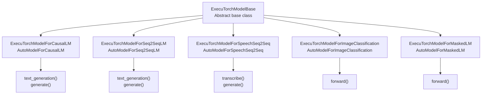
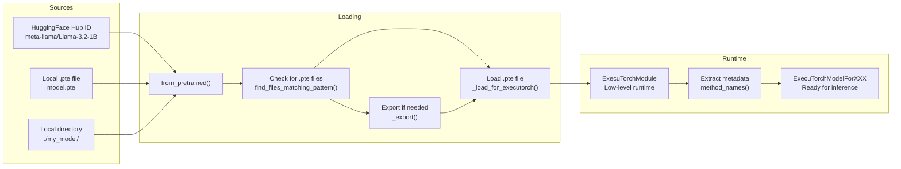
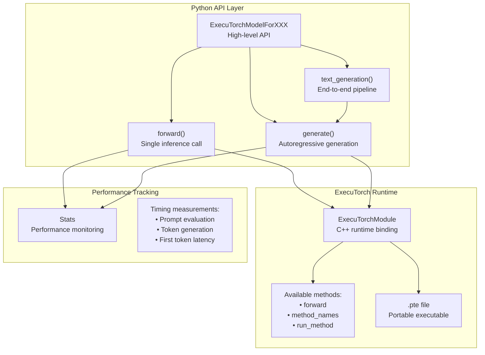
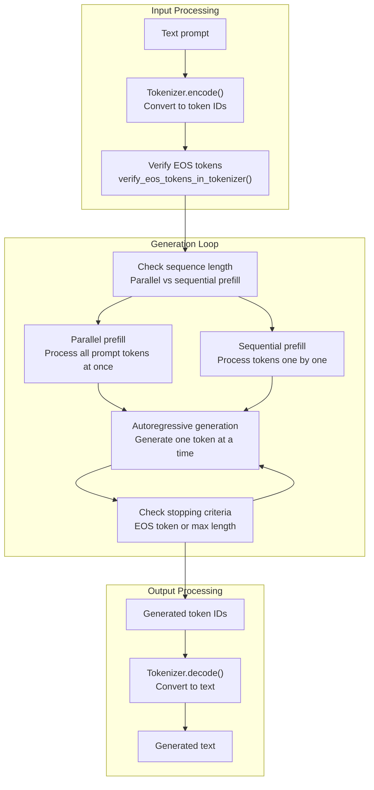
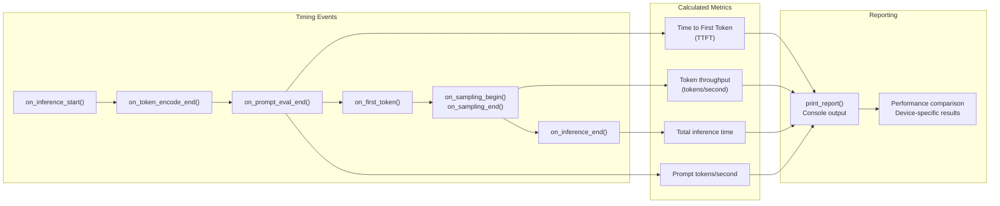

<!-- source: DeepWiki mcp.deepwiki.com · repo huggingface/optimum-executorch · page 3 Runtime and Inference · fetched 2026-10-26 -->

# Runtime and Inference

<details>
<summary>Relevant source files</summary>

The following files were used as context for generating this wiki page:

- [optimum/executorch/modeling.py](optimum/executorch/modeling.py)
- [optimum/exporters/executorch/utils.py](optimum/exporters/executorch/utils.py)

</details>


This document explains how to load and run ExecuTorch models for inference using the optimum-executorch runtime system. It covers the model loading process, inference execution, text generation capabilities, and performance monitoring features.

For information about exporting models to ExecuTorch format, see [Model Export System](#2). For details on optimization features like quantization and custom attention, see [Optimization Features](#4).

## Model Loading System

The runtime system provides task-specific model classes that wrap ExecuTorch's low-level runtime with a familiar HuggingFace-style API. All model classes inherit from `ExecuTorchModelBase` and provide a `from_pretrained()` method for loading models.

### Model Class Hierarchy



Sources: [optimum/executorch/modeling.py:56-370]()

### Loading Process

The model loading process supports multiple sources and automatically handles model export if needed:



Sources: [optimum/executorch/modeling.py:278-371](), [optimum/executorch/modeling.py:134-193]()

### Model Metadata Extraction

During initialization, models extract configuration metadata from the `.pte` file using ExecuTorch's method introspection:

| Metadata Method | Purpose | Example Value |
|----------------|---------|---------------|
| `use_kv_cache` | KV cache enabled | `True` |
| `get_max_seq_len` | Maximum sequence length | `2048` |
| `get_max_batch_size` | Maximum batch size | `1` |
| `get_dtype` | Model data type | `5` (float16) |
| `get_bos_id` | Beginning-of-sequence token | `1` |
| `get_eos_ids` | End-of-sequence tokens | `[2, 32000]` |
| `get_vocab_size` | Vocabulary size | `32000` |
| `use_sdpa_with_kv_cache` | Custom SDPA enabled | `True` |

Sources: [optimum/executorch/modeling.py:606-625](), [optimum/exporters/executorch/utils.py:21-66]()

## Inference Runtime Core

The runtime system uses ExecuTorch's `ExecuTorchModule` as the underlying inference engine, wrapped by task-specific model classes that provide familiar APIs.

### Runtime Architecture



Sources: [optimum/executorch/modeling.py:39](), [optimum/executorch/modeling.py:627-652](), [optimum/executorch/stats.py]()

### Forward Pass Execution

The `forward()` method provides direct access to model inference with minimal overhead:

For causal language models, the forward pass signature is:
```python
forward(input_ids: torch.Tensor, cache_position: torch.Tensor) -> torch.Tensor
```

For sequence-to-sequence models:
```python
forward(input_ids: torch.Tensor, decoder_input_ids: torch.Tensor, 
        cache_position: torch.Tensor, encoder_outputs: Optional[torch.Tensor]) -> Tuple
```

Sources: [optimum/executorch/modeling.py:627-652](), [optimum/executorch/modeling.py:432-448]()

## Text Generation Capabilities

The runtime provides sophisticated text generation capabilities with support for both causal and sequence-to-sequence models.

### Generation Flow



Sources: [optimum/executorch/modeling.py:654-743](), [optimum/executorch/modeling.py:745-796]()

### Dynamic Shape Support

The generation system supports two modes based on the exported model's capabilities:

**Parallel Prefill** (dynamic shapes enabled):
- Processes entire prompt in a single forward pass
- Significantly faster for long prompts (up to 20x speedup)
- Determined by checking `model.method_meta("forward").input_tensor_meta(1).sizes()[0] > 1`

**Sequential Prefill** (static shapes):
- Processes prompt tokens one by one
- Maintained for backward compatibility
- Used when model was exported without dynamic shapes

Sources: [optimum/executorch/modeling.py:693-714]()

### Speech-to-Text Generation

The `ExecuTorchModelForSpeechSeq2Seq` class provides specialized generation for audio transcription:

```python
transcribe(tokenizer, input_features, echo=True, max_seq_len=None)
```

Where `input_features` is a log-mel spectrogram tensor of shape `[1, 80, 3000]` or `[1, 128, 3000]` for 30-second audio chunks.

Sources: [optimum/executorch/modeling.py:1066-1100]()

## Performance Monitoring

The runtime includes comprehensive performance tracking through the `Stats` class, which measures inference timing and throughput.

### Performance Metrics



### Device Performance Examples

Performance metrics from real-world deployments show significant improvements with optimizations:

| Device | Model | Throughput | Notes |
|--------|--------|------------|-------|
| Samsung Galaxy S22 | Llama-3.2-1B | 202 tok/s | With custom SDPA |
| iPhone 15 Pro | Llama-3.2-1B | 29.6 tok/s | XNNPACK backend |
| Standard setup | Llama-3.2-1B | ~67 tok/s | Without custom SDPA |

The custom SDPA optimization provides approximately 3x speedup over standard attention mechanisms.

Sources: [optimum/executorch/modeling.py:103](), [optimum/executorch/modeling.py:441-447](), [optimum/executorch/modeling.py:642]()

---

