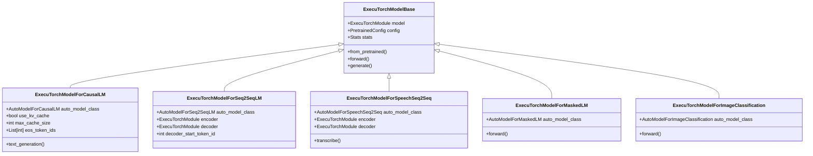
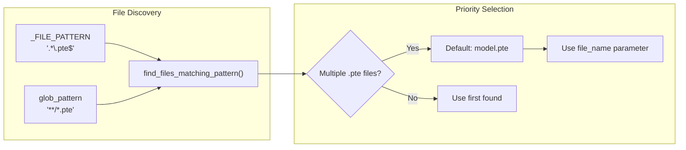
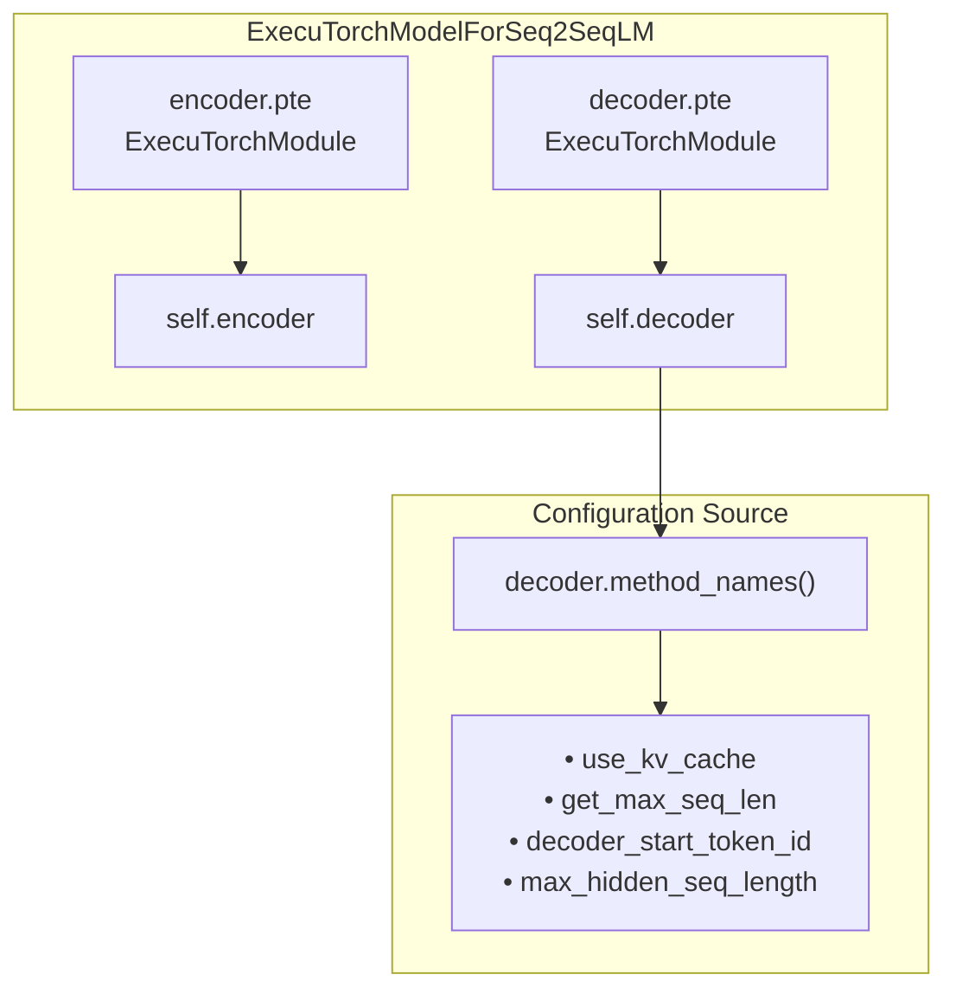

<!-- source: DeepWiki mcp.deepwiki.com · repo huggingface/optimum-executorch · page 3.1 Model Loading and Configuration · fetched 2026-10-26 -->

# Model Loading and Configuration

<details>
<summary>Relevant source files</summary>

The following files were used as context for generating this wiki page:

- [optimum/executorch/modeling.py](optimum/executorch/modeling.py)
- [optimum/exporters/executorch/utils.py](optimum/exporters/executorch/utils.py)
- [tests/models/test_modeling_gemma2.py](tests/models/test_modeling_gemma2.py)

</details>


This document covers how to load and configure ExecuTorch models for inference using the runtime classes provided by optimum-executorch. It explains the model loading process, configuration extraction from `.pte` files, and the relationship between different model classes.

For information about exporting models to ExecuTorch format, see [Model Export System](#2). For details about running inference with loaded models, see [Text Generation](#3.2) and [Vision and Audio Models](#3.3).

## Model Classes Overview

The optimum-executorch library provides task-specific model classes that wrap the underlying `ExecuTorchModule` runtime and provide high-level interfaces compatible with Transformers workflows.



**Sources:** [optimum/executorch/modeling.py:56-921]()

## Loading Process Flow

The model loading process involves several steps: detecting model sources, finding `.pte` files, loading the ExecuTorch runtime, and extracting configuration metadata.

```mermaid
flowgraph TD
    START["from_pretrained()"] --> CHECK_SOURCE{"Model Source Type"}
    
    CHECK_SOURCE --> HF_HUB["HuggingFace Hub<br/>model_id: str"]
    CHECK_SOURCE --> LOCAL_DIR["Local Directory<br/>Path with .pte files"]
    CHECK_SOURCE --> LOCAL_FILE["Local .pte File<br/>Direct file path"]
    
    HF_HUB --> FIND_PTE["find_files_matching_pattern()<br/>Pattern: *.pte"]
    LOCAL_DIR --> FIND_PTE
    LOCAL_FILE --> FIND_PTE
    
    FIND_PTE --> CHECK_EXPORT{"PTE Files Found?"}
    CHECK_EXPORT --> |No| EXPORT_MODEL["_export()<br/>Convert to ExecuTorch"]
    CHECK_EXPORT --> |Yes| LOAD_PTE["_load_for_executorch()<br/>Load .pte file"]
    
    EXPORT_MODEL --> LOAD_PTE
    
    LOAD_PTE --> EXTRACT_META["Extract Metadata<br/>run_method() calls"]
    EXTRACT_META --> CREATE_INSTANCE["Create Model Instance<br/>with ExecuTorchModule"]
    
    CREATE_INSTANCE --> READY["Model Ready for Inference"]
```

**Sources:** [optimum/executorch/modeling.py:278-371](), [optimum/executorch/modeling.py:134-193]()

## Model Sources and File Discovery

Models can be loaded from three different sources, each handled by the `from_pretrained()` method:

| Source Type | Example | File Discovery Method |
|-------------|---------|----------------------|
| HuggingFace Hub | `"microsoft/Phi-3.5-mini-instruct"` | Downloads via `hf_hub_download()` |
| Local Directory | `"/path/to/model"` | Scans for `**/*.pte` files |
| Local File | `"/path/to/model.pte"` | Direct file loading |

The file discovery process uses `find_files_matching_pattern()` with the pattern `.*\.pte$` to locate ExecuTorch model files. When multiple `.pte` files exist, the system prioritizes `model.pte` as the default.



**Sources:** [optimum/executorch/modeling.py:144-172](), [optimum/executorch/modeling.py:50]()

## Configuration and Metadata Extraction

Once the ExecuTorch model is loaded, configuration metadata is extracted from the `.pte` file using the model's available methods. This metadata configures the model instance with runtime parameters.

### Metadata Method Mapping

The following table shows how configuration attributes are extracted from ExecuTorch model methods:

| Model Attribute | ExecuTorch Method | Purpose |
|----------------|-------------------|---------|
| `use_kv_cache` | `use_kv_cache` | Enable KV caching |
| `max_cache_size` | `get_max_seq_len` | Maximum sequence length |
| `max_batch_size` | `get_max_batch_size` | Batch size limit |
| `dtype` | `get_dtype` | Model data type (5=fp16, 6=fp32) |
| `bos_token_id` | `get_bos_id` | Beginning of sequence token |
| `eos_token_ids` | `get_eos_id` or `get_eos_ids` | End of sequence tokens |
| `vocab_size` | `get_vocab_size` | Vocabulary size |
| `use_sdpa_with_kv_cache` | `use_sdpa_with_kv_cache` | Custom attention flag |

**Example Configuration Extraction:**

```python
# From ExecuTorchModelForCausalLM.__init__
metadata = self.model.method_names()
if "use_kv_cache" in metadata:
    self.use_kv_cache = self.model.run_method("use_kv_cache")[0]
if "get_max_seq_len" in metadata:
    self.max_cache_size = self.model.run_method("get_max_seq_len")[0]
```

**Sources:** [optimum/executorch/modeling.py:606-625](), [optimum/exporters/executorch/utils.py:21-65]()

## Multi-Component Models

For sequence-to-sequence and speech models, the system handles multiple ExecuTorch components (encoder/decoder) as separate `.pte` files:



**Sources:** [optimum/executorch/modeling.py:406-431](), [optimum/executorch/modeling.py:955-979]()

## Practical Loading Examples

### Loading a Causal Language Model

```python
from optimum.executorch import ExecuTorchModelForCausalLM

# Load from HuggingFace Hub with export
model = ExecuTorchModelForCausalLM.from_pretrained(
    "microsoft/Phi-3.5-mini-instruct",
    recipe="xnnpack",
    export=True,
    attn_implementation="custom_sdpa",
    qlinear="8da4w",
    qembedding="8w"
)

# Load existing .pte file
model = ExecuTorchModelForCausalLM.from_pretrained(
    "/path/to/model.pte",
    export=False
)
```

### Loading a Speech Model

```python
from optimum.executorch import ExecuTorchModelForSpeechSeq2Seq

# Multi-component model loading
model = ExecuTorchModelForSpeechSeq2Seq.from_pretrained(
    "openai/whisper-tiny",
    recipe="xnnpack",
    export=True
)

# Automatically discovers encoder.pte and decoder.pte
print(hasattr(model, 'encoder'))  # True
print(hasattr(model, 'decoder'))  # True
```

**Sources:** [tests/models/test_modeling_gemma2.py:85-91](), [optimum/executorch/modeling.py:279-371]()

## Error Handling and Validation

The loading process includes several validation steps to ensure model integrity:

- **File Existence**: Validates `.pte` files exist and are accessible
- **Required Attributes**: Checks for mandatory model components (e.g., `encoder`/`decoder` for seq2seq models)
- **Token Validation**: Verifies EOS tokens match between model and tokenizer using `verify_eos_tokens_in_tokenizer()`
- **Configuration Completeness**: Ensures required metadata methods are available

**Sources:** [optimum/executorch/modeling.py:153-157](), [optimum/executorch/modeling.py:408-411](), [optimum/exporters/executorch/utils.py:68-111]()

---

