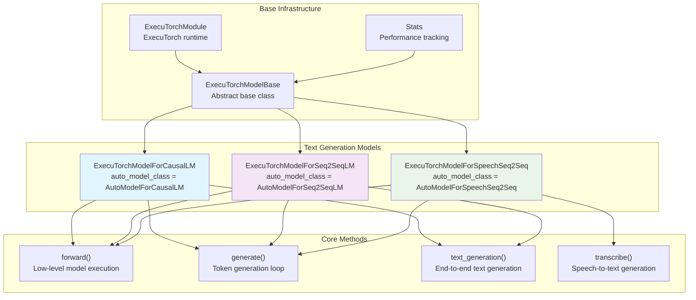
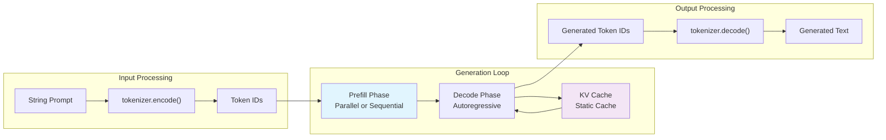

<!-- source: DeepWiki mcp.deepwiki.com · repo huggingface/optimum-executorch · page 3.2 Text Generation · fetched 2026-10-26 -->

# Text Generation

<details>
<summary>Relevant source files</summary>

The following files were used as context for generating this wiki page:

- [optimum/executorch/modeling.py](optimum/executorch/modeling.py)
- [optimum/exporters/executorch/utils.py](optimum/exporters/executorch/utils.py)
- [tests/models/test_modeling_gemma2.py](tests/models/test_modeling_gemma2.py)
- [tests/models/test_modeling_llama.py](tests/models/test_modeling_llama.py)

</details>


This document covers text generation capabilities for ExecuTorch models that have already been exported to `.pte` format. It details the runtime model classes, generation methods, and performance optimizations available for causal language models, sequence-to-sequence models, and speech-to-text models.

For information about exporting models to ExecuTorch format, see [Model Export System](#2). For vision and audio model inference beyond speech-to-text, see [Vision and Audio Models](#3.3).

## Text Generation Model Classes

The optimum-executorch library provides three main model classes for text generation tasks, each inheriting from the base `ExecuTorchModelBase` class and implementing task-specific generation logic.



**Sources:** [optimum/executorch/modeling.py:56-83](), [optimum/executorch/modeling.py:570-601](), [optimum/executorch/modeling.py:374-404](), [optimum/executorch/modeling.py:923-953]()

## Causal Language Models

The `ExecuTorchModelForCausalLM` class handles autoregressive text generation for models like Llama, Gemma, and GPT-style architectures. It supports both parallel prefill for dynamic shapes and sequential prefill for static shapes.

### Key Attributes

| Attribute | Description | Source Method |
|-----------|-------------|---------------|
| `use_kv_cache` | Whether KV caching is enabled | `run_method("use_kv_cache")` |
| `max_cache_size` | Maximum sequence length | `run_method("get_max_seq_len")` |
| `max_batch_size` | Maximum batch size | `run_method("get_max_batch_size")` |
| `eos_token_ids` | End-of-sequence token IDs | `run_method("get_eos_ids")` |
| `use_sdpa_with_kv_cache` | Custom SDPA usage | `run_method("use_sdpa_with_kv_cache")` |

### Text Generation Process

The `text_generation()` method provides the complete pipeline from string prompt to generated text:

1. **Tokenization**: Encodes the input prompt using the provided tokenizer
2. **Generation**: Calls the `generate()` method with token IDs
3. **Decoding**: Converts generated token IDs back to text
4. **Performance Tracking**: Reports generation statistics



**Sources:** [optimum/executorch/modeling.py:745-796](), [optimum/executorch/modeling.py:654-743](), [optimum/executorch/modeling.py:627-652]()

## Sequence-to-Sequence Models

The `ExecuTorchModelForSeq2SeqLM` class handles encoder-decoder architectures like T5. It manages separate encoder and decoder ExecuTorch modules and coordinates their execution during generation.

### Model Architecture

The class expects two separate `.pte` files:
- `encoder.pte`: Processes the input sequence
- `decoder.pte`: Generates the output sequence autoregressively

### Generation Process

1. **Encoding**: The encoder processes the input sequence once
2. **Decoding**: The decoder generates tokens autoregressively using encoder outputs
3. **Cache Management**: Maintains decoder KV cache across generation steps

**Sources:** [optimum/executorch/modeling.py:374-404](), [optimum/executorch/modeling.py:432-448](), [optimum/executorch/modeling.py:450-523]()

## Speech-to-Text Models

The `ExecuTorchModelForSpeechSeq2Seq` class extends sequence-to-sequence functionality for speech recognition tasks, primarily supporting Whisper-style models.

### Key Features

- Accepts log-mel spectrogram features as input
- Uses `transcribe()` method instead of `text_generation()`
- Supports decoder start token configuration
- Handles variable-length audio inputs

### Input Format

The model expects log-mel spectrograms with shapes:
- `[1, 80, 3000]` for standard Whisper models
- `[1, 128, 3000]` for some model variants

**Sources:** [optimum/executorch/modeling.py:923-953](), [optimum/executorch/modeling.py:1066-1100](), [optimum/executorch/modeling.py:998-1064]()

## Performance Optimizations

### Parallel vs Sequential Prefill

The generation logic automatically detects whether the exported model supports dynamic shapes:

```python
seq_len = self.model.method_meta("forward").input_tensor_meta(1).sizes()[0]

if seq_len > 1:
    # Parallel prefill - process all prompt tokens at once
    logits = self.forward(
        input_ids=torch.tensor(prompt_tokens, dtype=torch.long).unsqueeze(0),
        cache_position=torch.arange(len(prompt_tokens), dtype=torch.long),
    )
else:
    # Sequential prefill - process prompt tokens one by one
    for i, prompt_token in enumerate(prompt_tokens):
        logits = self.forward(
            input_ids=torch.tensor([prompt_token], dtype=torch.long).unsqueeze(0),
            cache_position=torch.tensor([i], dtype=torch.long),
        )
```

### Performance Statistics

All model classes integrate with the `Stats` class to track:

- Total inference time
- Time to first token
- Tokens per second
- Prompt evaluation time
- Model execution time

**Sources:** [optimum/executorch/modeling.py:694-714](), [optimum/executorch/stats.py]()

## Usage Examples

### Causal Language Model

```python
from optimum.executorch import ExecuTorchModelForCausalLM
from transformers import AutoTokenizer

# Load model and tokenizer
model = ExecuTorchModelForCausalLM.from_pretrained(
    "meta-llama/Llama-3.2-1B",
    recipe="xnnpack",
    attn_implementation="custom_sdpa",
    qlinear="8da4w",
    qembedding="8w"
)
tokenizer = AutoTokenizer.from_pretrained("meta-llama/Llama-3.2-1B")

# Generate text
generated_text = model.text_generation(
    tokenizer=tokenizer,
    prompt="Simply put, the theory of relativity states that",
    max_seq_len=32,
    echo=True
)
```

### Speech-to-Text Model

```python
from optimum.executorch import ExecuTorchModelForSpeechSeq2Seq
from transformers import AutoTokenizer

# Load speech model
model = ExecuTorchModelForSpeechSeq2Seq.from_pretrained(
    "openai/whisper-tiny",
    recipe="xnnpack"
)
tokenizer = AutoTokenizer.from_pretrained("openai/whisper-tiny")

# Transcribe audio (log_mel_features should be preprocessed)
transcription = model.transcribe(
    tokenizer=tokenizer,
    input_features=log_mel_features,
    max_seq_len=448
)
```

**Sources:** [tests/models/test_modeling_llama.py:74-100](), [tests/models/test_modeling_gemma2.py:79-108]()

---

