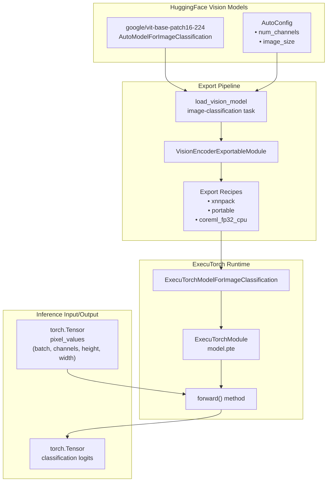
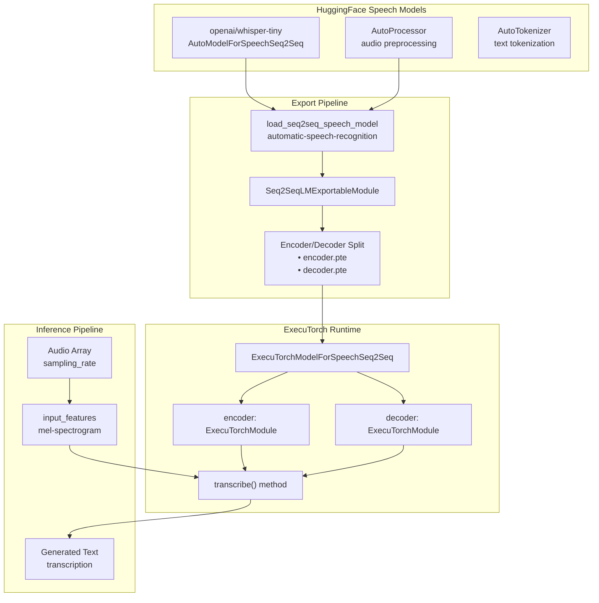
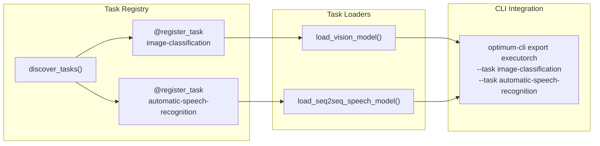

<!-- source: DeepWiki mcp.deepwiki.com · repo huggingface/optimum-executorch · page 3.3 Vision and Audio Models · fetched 2026-10-26 -->

# Vision and Audio Models

<details>
<summary>Relevant source files</summary>

The following files were used as context for generating this wiki page:

- [install_dev.py](install_dev.py)
- [optimum/executorch/__init__.py](optimum/executorch/__init__.py)
- [optimum/exporters/executorch/__main__.py](optimum/exporters/executorch/__main__.py)
- [optimum/exporters/executorch/recipes/coreml.py](optimum/exporters/executorch/recipes/coreml.py)
- [optimum/exporters/executorch/tasks/__init__.py](optimum/exporters/executorch/tasks/__init__.py)
- [optimum/exporters/executorch/tasks/asr.py](optimum/exporters/executorch/tasks/asr.py)
- [tests/models/test_modeling_vit.py](tests/models/test_modeling_vit.py)
- [tests/models/test_modeling_whisper.py](tests/models/test_modeling_whisper.py)

</details>


This document covers inference capabilities for vision and audio models in optimum-executorch. It focuses on image classification using Vision Transformers and automatic speech recognition using Whisper models. For text generation models, see [Text Generation](#3.2). For the general model loading process, see [Model Loading and Configuration](#3.1).

## Vision Models

optimum-executorch supports vision models for image classification tasks, primarily using Vision Transformer (ViT) architectures. The main class for vision inference is `ExecuTorchModelForImageClassification`.

### Vision Model Architecture



**Sources:** [tests/models/test_modeling_vit.py:42-93](), [optimum/executorch/__init__.py:20-41]()

### Vision Model Classes and Methods

| Class | Purpose | Key Methods |
|-------|---------|-------------|
| `ExecuTorchModelForImageClassification` | Main runtime class for vision models | `forward()`, `from_pretrained()` |
| `VisionEncoderExportableModule` | Export wrapper for vision models | `export()`, `metadata` |

The `ExecuTorchModelForImageClassification` class provides the primary interface for vision model inference. It loads the exported `.pte` file and provides a `forward()` method that accepts pixel values and returns classification logits.

**Sources:** [optimum/executorch/__init__.py:22-24](), [tests/models/test_modeling_vit.py:65-67]()

## Audio Models

optimum-executorch supports automatic speech recognition through Whisper models using the `ExecuTorchModelForSpeechSeq2Seq` class. Whisper models are encoder-decoder architectures that transcribe speech to text.

### Audio Model Architecture



**Sources:** [tests/models/test_modeling_whisper.py:47-86](), [optimum/exporters/executorch/tasks/asr.py:23-58]()

### Audio Model Components

| Component | File | Purpose |
|-----------|------|---------|
| `ExecuTorchModelForSpeechSeq2Seq` | Runtime class | Main interface for speech recognition |
| `load_seq2seq_speech_model` | Task loader | Loads Whisper models for ASR task |
| `Seq2SeqLMExportableModule` | Export wrapper | Handles encoder-decoder export |

The audio pipeline splits Whisper models into separate encoder and decoder components during export, creating `encoder.pte` and `decoder.pte` files. The runtime class manages both components and provides a unified `transcribe()` interface.

**Sources:** [optimum/exporters/executorch/tasks/asr.py:24-58](), [tests/models/test_modeling_whisper.py:67-70]()

## Model Loading and Inference

### Vision Model Example

```python
# Load exported vision model
model = ExecuTorchModelForImageClassification.from_pretrained(
    model_id="google/vit-base-patch16-224", 
    recipe="xnnpack"
)

# Prepare input (batch_size=1, channels=3, height=224, width=224)
pixel_values = torch.rand(1, 3, 224, 224)

# Run inference
logits = model.forward(pixel_values)
```

### Audio Model Example

```python
# Load exported speech model
model = ExecuTorchModelForSpeechSeq2Seq.from_pretrained(
    model_id="openai/whisper-tiny",
    recipe="xnnpack"
)

# Load tokenizer and processor
tokenizer = AutoTokenizer.from_pretrained("openai/whisper-tiny")
processor = AutoProcessor.from_pretrained("openai/whisper-tiny")

# Process audio input
input_features = processor(
    audio_array, 
    return_tensors="pt", 
    sampling_rate=sampling_rate
).input_features

# Generate transcription
transcription = model.transcribe(tokenizer, input_features)
```

**Sources:** [tests/models/test_modeling_vit.py:65-72](), [tests/models/test_modeling_whisper.py:81]()

## Supported Recipes and Backends

### Recipe Compatibility Matrix

| Model Type | xnnpack | portable | coreml_fp32_cpu |
|------------|---------|----------|-----------------|
| Vision (ViT) | ✅ | ✅ | ✅ (macOS only) |
| Audio (Whisper) | ✅ | ✅ | ❌ |

### Performance Considerations

- **Vision Models**: Static input shapes (224x224 for ViT) enable optimal XNNPACK acceleration
- **Audio Models**: 30-second audio limit in current transcribe implementation
- **Memory**: Audio models require separate encoder/decoder memory allocation

**Sources:** [tests/models/test_modeling_vit.py:79-92](), [tests/models/test_modeling_whisper.py:95-106](), [tests/models/test_modeling_whisper.py:78-79]()

## Task Registration System



The task registration system automatically discovers and registers vision and audio tasks, enabling seamless CLI export and runtime loading. Each task type has a dedicated loader function that handles model-specific configuration.

**Sources:** [optimum/exporters/executorch/tasks/asr.py:23](), [optimum/exporters/executorch/__main__.py:118-135]()

---

