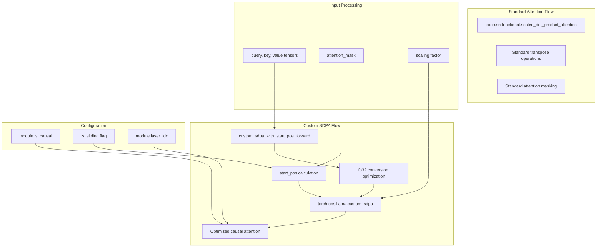
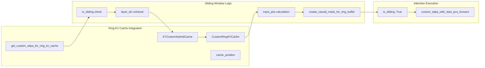
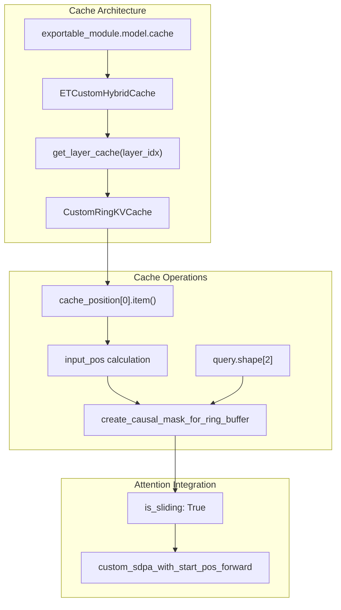
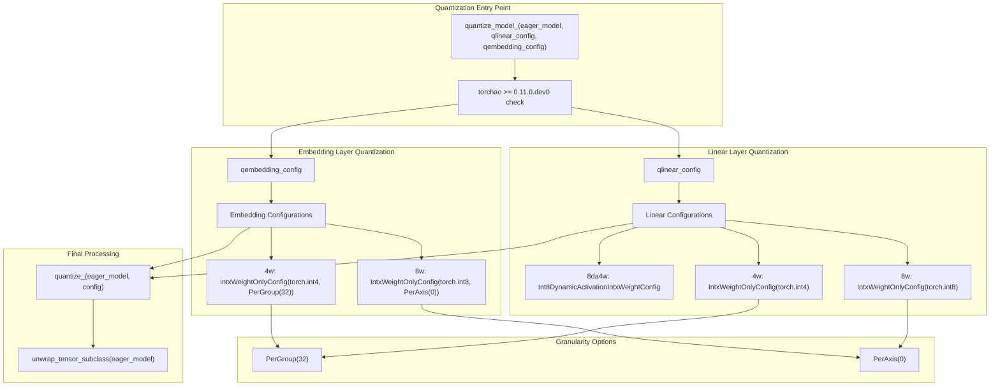
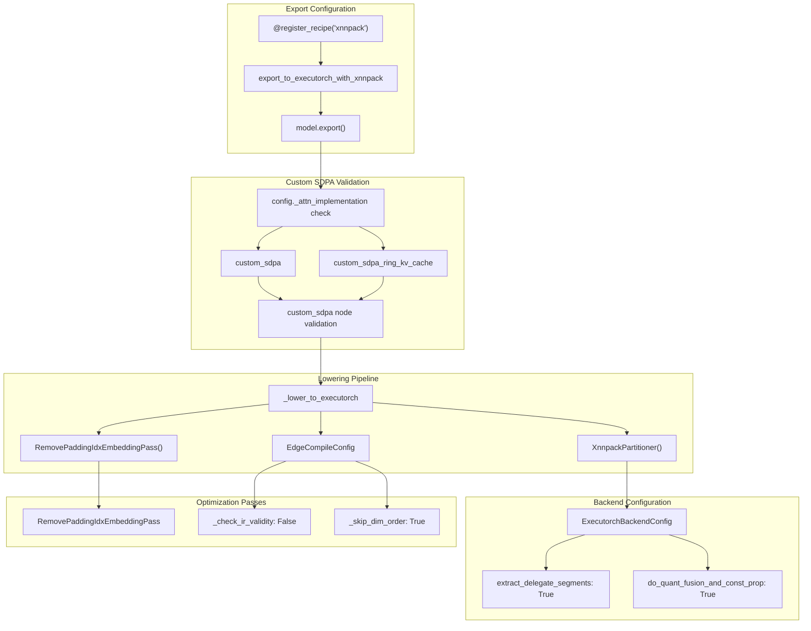

<!-- source: DeepWiki mcp.deepwiki.com · repo huggingface/optimum-executorch · page 4 Optimization Features · fetched 2026-10-26 -->

# Optimization Features

<details>
<summary>Relevant source files</summary>

The following files were used as context for generating this wiki page:

- [optimum/executorch/attentions/custom_sdpa.py](optimum/executorch/attentions/custom_sdpa.py)
- [optimum/exporters/executorch/quantization.py](optimum/exporters/executorch/quantization.py)
- [optimum/exporters/executorch/recipes/xnnpack.py](optimum/exporters/executorch/recipes/xnnpack.py)
- [optimum/exporters/executorch/tasks/masked_lm.py](optimum/exporters/executorch/tasks/masked_lm.py)
- [tests/models/test_modeling_bert.py](tests/models/test_modeling_bert.py)

</details>


This document covers the performance optimization features available in optimum-executorch that enhance model inference efficiency. These optimizations include custom attention mechanisms, KV cache management, quantization techniques, and backend-specific optimizations that can significantly improve inference speed and reduce memory usage.

For information about specific model runtime and inference APIs, see [Runtime and Inference](#3). For details on export recipes and backend delegation, see [Recipes and Backend Delegation](#2.4).

## Custom Attention Mechanisms

The library provides custom implementations of scaled dot product attention (SDPA) that offer substantial performance improvements over standard PyTorch attention mechanisms. The custom SDPA implementation can provide up to 3x faster inference compared to standard attention.

### Custom SDPA Implementation

The core custom attention functionality is implemented in the `custom_sdpa_with_start_pos_forward` function, which replaces standard PyTorch SDPA with an optimized ExecuTorch-specific implementation.



**Sources**: [optimum/executorch/attentions/custom_sdpa.py:21-77]()

The custom SDPA implementation includes several key optimizations:

| Optimization | Description | Implementation |
|--------------|-------------|----------------|
| **Start Position Calculation** | Calculates attention start position from mask | `torch.argmin(first_row_mask.to(torch.long)).item() - 1` |
| **Data Type Optimization** | Converts to fp32 for computation, back to original | `query.to(torch.float32)` → `output.to(input_dtype)` |
| **Causal Attention** | Optimized causal masking for autoregressive models | `is_causal=module.is_causal` |
| **Custom Operator** | Uses ExecuTorch's optimized SDPA operator | `torch.ops.llama.custom_sdpa` |

### Sliding Window Attention Integration

For models using sliding window attention, the custom SDPA integrates with ring KV cache through the `get_custom_sdpa_for_ring_kv_cache` function:



**Sources**: [optimum/executorch/attentions/custom_sdpa.py:80-144]()

## KV Cache Optimization

The library implements advanced KV cache management strategies to optimize memory usage and inference performance, particularly for long sequence generation and sliding window attention patterns.

### Custom KV Cache Types

The optimization system supports multiple KV cache implementations:

- **Static KV Cache**: Traditional fixed-size cache for standard attention
- **Custom KV Cache**: Enhanced cache with better memory management
- **Ring KV Cache**: Circular buffer cache for sliding window attention

The ring KV cache integration is specifically designed for sliding window attention models and provides efficient memory usage for long sequences:



**Sources**: [optimum/executorch/attentions/custom_sdpa.py:104-130]()

## Quantization

The quantization system provides comprehensive model compression through weight and activation quantization, supporting various precision levels and granularities.

### Quantization Configuration

The `quantize_model_` function supports two main quantization categories:



**Sources**: [optimum/exporters/executorch/quantization.py:23-82]()

### Quantization Schemes

The quantization system supports the following schemes:

| Scheme | Target | Weight Dtype | Granularity | Description |
|--------|--------|--------------|-------------|-------------|
| **8da4w** | Linear layers | `torch.int4` | `PerGroup(32)` | 8-bit dynamic activation, 4-bit weights |
| **4w** | Linear/Embedding | `torch.int4` | `PerGroup(32)` | 4-bit weight-only quantization |
| **8w** | Linear/Embedding | `torch.int8` | `PerAxis(0)` | 8-bit weight-only quantization |

### Integration with Export Pipeline

Quantization is integrated into the task-specific model loading pipeline. For example, in the masked language model task:

```python
qlinear_config = kwargs.get("qlinear", None)
qembedding_config = kwargs.get("qembedding", None)
quantize_model_(eager_model, qlinear_config=qlinear_config, qembedding_config=qembedding_config)
```

**Sources**: [optimum/exporters/executorch/tasks/masked_lm.py:44-46]()

## Backend-Specific Optimizations

The XNNPACK backend recipe provides additional optimization features that enhance performance during the export and lowering process.

### XNNPACK Optimization Pipeline

The XNNPACK export recipe implements a comprehensive optimization pipeline:



**Sources**: [optimum/exporters/executorch/recipes/xnnpack.py:41-112]()

### Optimization Features by ExecuTorch Version

The XNNPACK recipe adapts its optimization features based on the ExecuTorch version:

| Feature | Condition | Implementation |
|---------|-----------|----------------|
| **Quantization Fusion** | ExecuTorch > 0.6.0 | `do_quant_fusion_and_const_prop: True` |
| **Delegate Extraction** | Always enabled | `extract_delegate_segments: True` |
| **Padding Removal** | Always enabled | `RemovePaddingIdxEmbeddingPass()` |
| **IR Validity Skip** | Always enabled | `_check_ir_validity: False` |
| **Dimension Order Skip** | Always enabled | `_skip_dim_order: True` |

### Performance Monitoring

The XNNPACK recipe includes built-in delegation monitoring and debugging capabilities:

```python
delegation_info = get_delegation_info(et_progs[pte_name].exported_program().graph_module)
logging.debug(f"Delegation info Summary for {pte_name}.pte: {delegation_info.get_summary()}")
```

This provides detailed information about which operations are successfully delegated to the XNNPACK backend versus remaining on the portable backend.

**Sources**: [optimum/exporters/executorch/recipes/xnnpack.py:91-95]()

---

