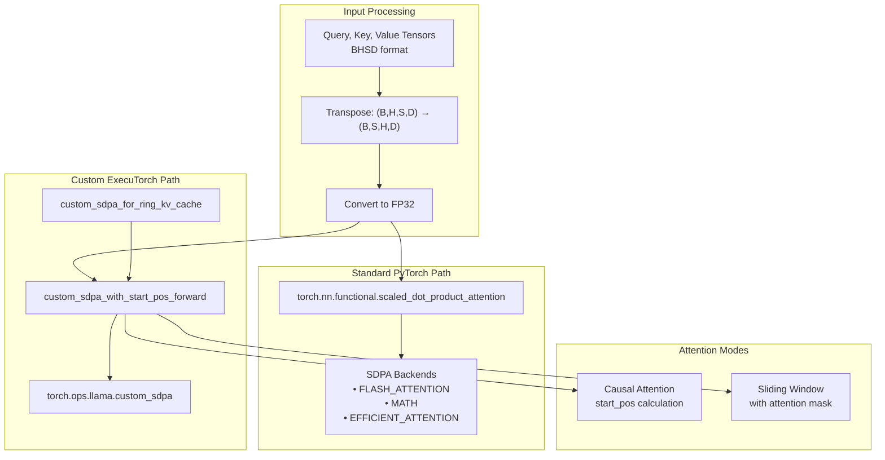
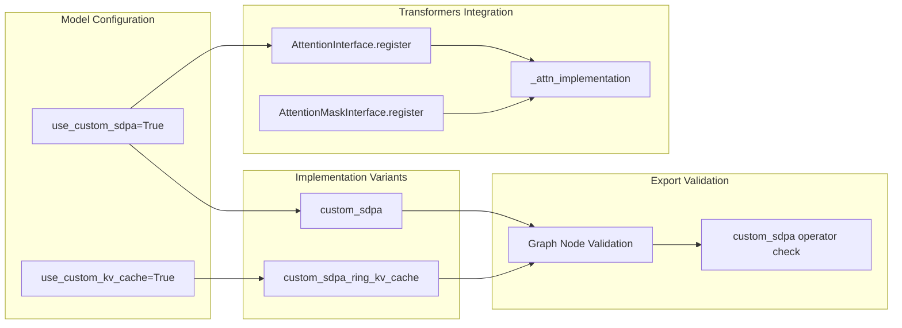
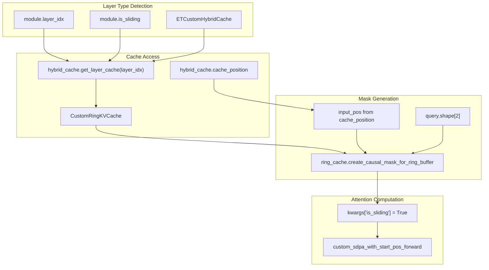

<!-- source: DeepWiki mcp.deepwiki.com · repo huggingface/optimum-executorch · page 4.1 Custom Attention Mechanisms · fetched 2026-10-26 -->

# Custom Attention Mechanisms

<details>
<summary>Relevant source files</summary>

The following files were used as context for generating this wiki page:

- [optimum/executorch/attentions/custom_kv_cache.py](optimum/executorch/attentions/custom_kv_cache.py)
- [optimum/executorch/attentions/custom_sdpa.py](optimum/executorch/attentions/custom_sdpa.py)
- [optimum/exporters/executorch/integrations.py](optimum/exporters/executorch/integrations.py)
- [optimum/exporters/executorch/recipes/xnnpack.py](optimum/exporters/executorch/recipes/xnnpack.py)

</details>


This document covers the custom attention implementations available in optimum-executorch that provide performance optimizations over standard PyTorch scaled dot-product attention (SDPA). These custom mechanisms are specifically designed for ExecuTorch deployment and offer significant speed improvements for inference on mobile and edge devices.

For information about KV cache optimizations that work alongside custom attention, see [KV Cache Optimization](#4.2). For general optimization strategies including quantization, see [Optimization Features](#4).

## Overview

The optimum-executorch library provides custom attention mechanisms that replace PyTorch's standard `torch.nn.functional.scaled_dot_product_attention` with optimized implementations designed for ExecuTorch runtime. The primary implementation is `custom_sdpa`, which can achieve up to 3x faster inference compared to standard SDPA implementations.

**Custom SDPA Architecture**



Sources: [optimum/executorch/attentions/custom_sdpa.py:21-77]()

## Custom SDPA Implementation

The core custom attention mechanism is implemented in `custom_sdpa_with_start_pos_forward`, which provides an optimized path for causal language model inference.

**Key Features:**

| Feature | Description | Implementation |
|---------|-------------|----------------|
| **FP32 Conversion** | Converts inputs to FP32 for numerical stability | [optimum/executorch/attentions/custom_sdpa.py:40-44]() |
| **Tensor Transpose** | Converts from BHSD to BSHD format for Flash Attention | [optimum/executorch/attentions/custom_sdpa.py:36-38]() |
| **Start Position Calculation** | Optimizes causal attention by calculating start position | [optimum/executorch/attentions/custom_sdpa.py:59-65]() |
| **Sliding Window Support** | Handles models with sliding window attention | [optimum/executorch/attentions/custom_sdpa.py:51-56]() |

**Custom SDPA Function Signature:**
```python
def custom_sdpa_with_start_pos_forward(
    module: torch.nn.Module,
    query: torch.Tensor,
    key: torch.Tensor, 
    value: torch.Tensor,
    attention_mask: Union[torch.Tensor, "BlockMask"],
    scaling: Optional[float] = None,
    softcap: Optional[float] = None,
    head_mask: Optional[torch.Tensor] = None,
    **kwargs,
) -> Tuple[torch.Tensor, None]
```

The function processes attention masks to calculate the optimal start position for causal attention, reducing computational overhead by avoiding unnecessary attention computations for masked positions.

Sources: [optimum/executorch/attentions/custom_sdpa.py:21-77]()

## Integration with Export System

Custom SDPA is integrated into the model export pipeline through the `CausalLMExportableModule` class, which provides configuration options for enabling custom attention mechanisms.

**Export Integration Flow**



The integration process involves:

1. **Configuration Setup**: Enable custom SDPA through `CausalLMExportableModule` constructor parameters
2. **Attention Registration**: Register custom attention implementations with transformers library
3. **Implementation Selection**: Choose between standard `custom_sdpa` or `custom_sdpa_ring_kv_cache` variants
4. **Export Validation**: Verify custom operators appear in the exported graph

Sources: [optimum/exporters/executorch/integrations.py:96-114](), [optimum/exporters/executorch/recipes/xnnpack.py:100-111]()

## Ring KV Cache Variant

For models with sliding window attention (like Qwen2.5), a specialized variant `custom_sdpa_for_ring_kv_cache` provides optimized attention computation with ring buffer KV caching.

**Ring KV Cache Integration**



The ring KV cache variant automatically detects sliding window layers and generates appropriate attention masks for efficient computation within the sliding window constraints.

**Key Implementation Details:**
- **Layer Detection**: Uses `module.layer_idx` and `module.is_sliding` to identify sliding window layers
- **Cache Access**: Retrieves `CustomRingKVCache` instances from `ETCustomHybridCache`
- **Mask Generation**: Creates causal masks specific to ring buffer positioning
- **Fallback**: Uses standard custom SDPA for non-sliding layers

Sources: [optimum/executorch/attentions/custom_sdpa.py:80-144]()

## Performance Considerations

Custom SDPA provides several performance optimizations:

**Optimization Strategies:**

| Optimization | Benefit | Implementation |
|--------------|---------|----------------|
| **Start Position Calculation** | Reduces attention computation overhead | Calculate from attention mask: `torch.argmin(first_row_mask) - 1` |
| **FP32 Precision** | Ensures numerical stability across backends | Convert inputs/outputs to/from FP32 |
| **Custom Operator** | Native ExecuTorch implementation | `torch.ops.llama.custom_sdpa` |
| **Mask Optimization** | Efficient sliding window handling | Ring buffer-specific causal masks |

**Performance Validation:**
The export system validates that custom SDPA operators are properly integrated by checking for `custom_sdpa` function calls in the exported graph:

```python
if not any(
    node.op == "call_function" and "custom_sdpa" in str(node.target)
    for exported_program in exported_progs.values()
    for node in exported_program.graph_module.graph.nodes
):
    raise ValueError("'custom_sdpa' not found in the graph.")
```

Sources: [optimum/exporters/executorch/recipes/xnnpack.py:105-110](), [optimum/executorch/attentions/custom_sdpa.py:59-76]()

## Usage Configuration

To enable custom SDPA in your model export:

**Basic Configuration:**
```python
exportable_module = CausalLMExportableModule(
    model, 
    use_custom_sdpa=True
)
```

**With Ring KV Cache:**
```python
exportable_module = CausalLMExportableModule(
    model,
    use_custom_sdpa=True,
    use_custom_kv_cache=True  # Enables ring KV cache variant
)
```

The system automatically selects the appropriate implementation (`custom_sdpa` or `custom_sdpa_ring_kv_cache`) based on the configuration and model architecture.

Sources: [optimum/exporters/executorch/integrations.py:43-49](), [optimum/exporters/executorch/integrations.py:103-109]()

---

