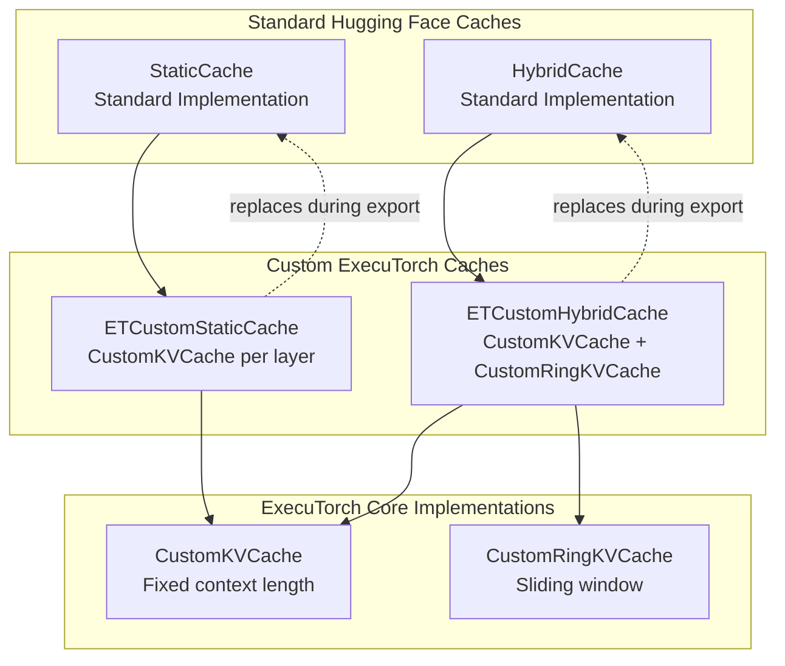
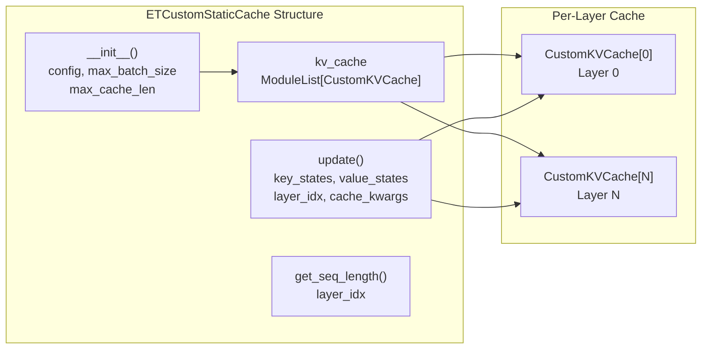
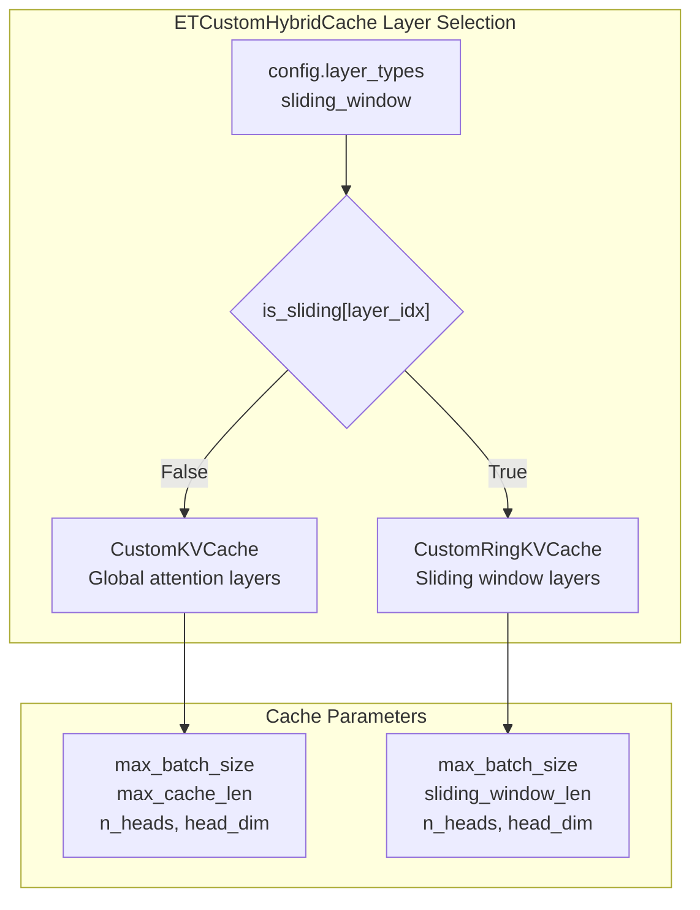
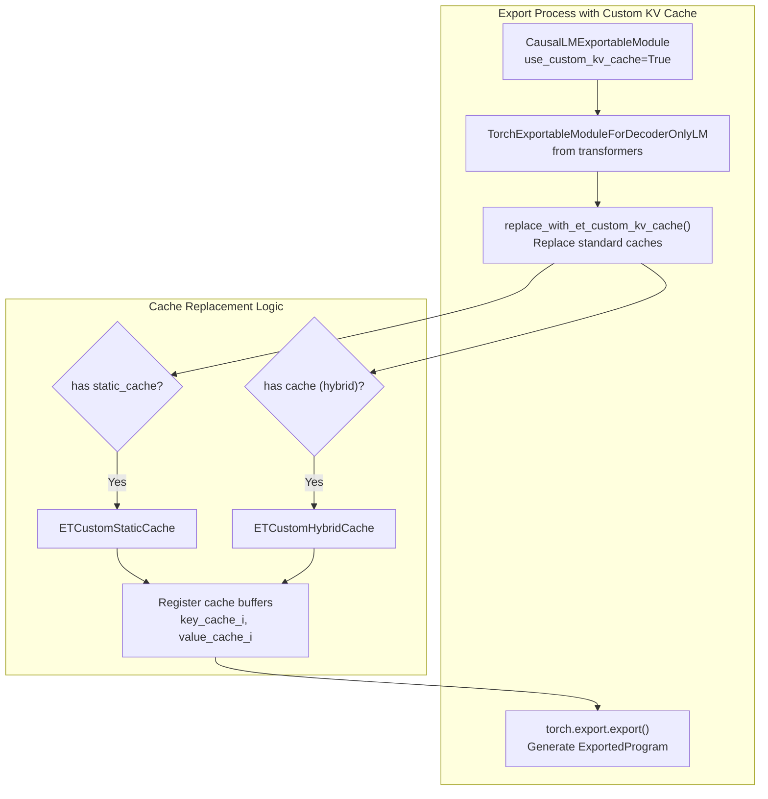
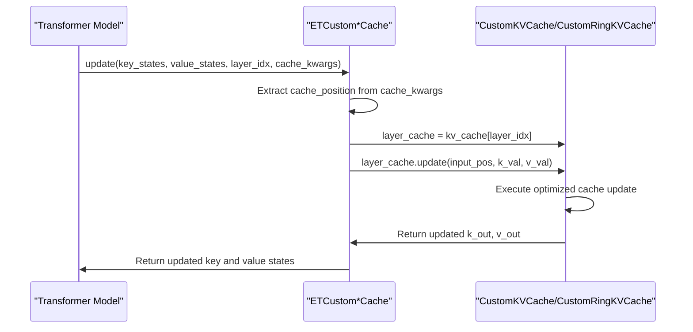
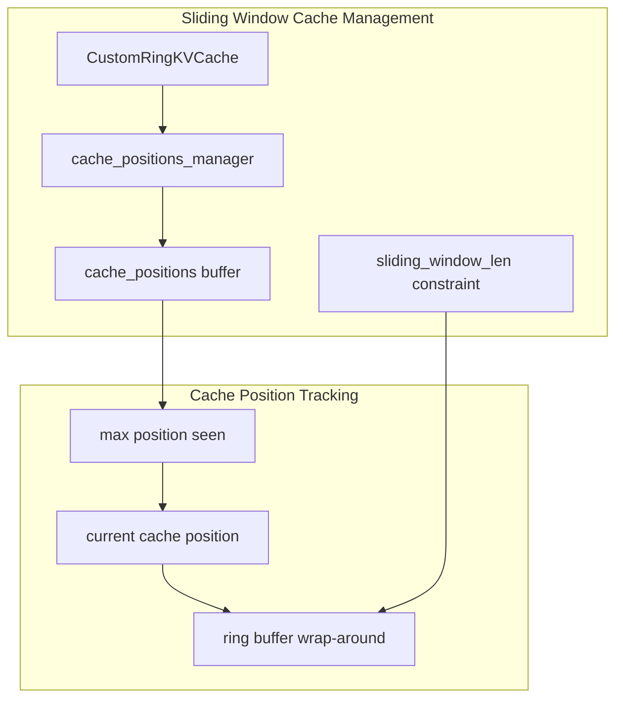

<!-- source: DeepWiki mcp.deepwiki.com · repo huggingface/optimum-executorch · page 4.2 KV Cache Optimization · fetched 2026-10-26 -->

# KV Cache Optimization

<details>
<summary>Relevant source files</summary>

The following files were used as context for generating this wiki page:

- [optimum/executorch/attentions/custom_kv_cache.py](optimum/executorch/attentions/custom_kv_cache.py)
- [optimum/exporters/executorch/integrations.py](optimum/exporters/executorch/integrations.py)
- [tests/models/test_modeling_qwen3.py](tests/models/test_modeling_qwen3.py)

</details>


This document covers the custom Key-Value (KV) cache implementations in optimum-executorch that provide significant performance improvements for transformer model inference on ExecuTorch. These optimizations are specifically designed to work with custom attention mechanisms and enable efficient deployment on mobile and edge devices.

For information about custom attention mechanisms that work in conjunction with KV cache optimization, see [Custom Attention Mechanisms](#4.1). For general model export processes, see [Model Export System](#2).

## Overview

KV cache optimization in optimum-executorch replaces the standard Hugging Face cache implementations with custom ExecuTorch-optimized versions. These custom caches provide better performance characteristics for mobile deployment by using specialized cache update operations and memory management strategies.

The optimization supports two main cache types:
- **Static Cache**: For models with fixed-size attention contexts
- **Hybrid Cache**: For models with sliding window attention (like Qwen, Mistral)



Sources: [optimum/executorch/attentions/custom_kv_cache.py:27-178](), [optimum/executorch/attentions/custom_kv_cache.py:181-307]()

## Custom Cache Implementations

### ETCustomStaticCache

The `ETCustomStaticCache` class provides a drop-in replacement for Hugging Face's `StaticCache` that uses ExecuTorch's `CustomKVCache` operations for improved performance.



Key features:
- One `CustomKVCache` instance per transformer layer
- Uses cache position from `cache_kwargs` for updates
- Maintains compatibility with Hugging Face's `StaticCache` interface

Sources: [optimum/executorch/attentions/custom_kv_cache.py:27-178]()

### ETCustomHybridCache

The `ETCustomHybridCache` handles models with mixed attention patterns, using different cache types for different layers based on the model's layer configuration.



Key features:
- Automatically selects cache type based on layer configuration
- `CustomRingKVCache` for sliding window attention layers
- `CustomKVCache` for global attention layers
- Maintains sequence length tracking across different cache types

Sources: [optimum/executorch/attentions/custom_kv_cache.py:181-307]()

## Export Integration

KV cache optimization is enabled during the model export process through the `CausalLMExportableModule` wrapper. The optimization is controlled by the `use_custom_kv_cache` parameter.



The integration process:

1. **Detection**: The system detects whether the model uses `static_cache` or `cache` (hybrid)
2. **Replacement**: Standard caches are replaced with custom implementations
3. **Registration**: Cache tensors are registered as module buffers for export compatibility
4. **Export**: The modified module is exported with custom cache operations

Sources: [optimum/exporters/executorch/integrations.py:134-144](), [optimum/executorch/attentions/custom_kv_cache.py:309-405]()

## Usage Patterns

### CLI Export with Custom KV Cache

```bash
optimum-cli export executorch \
    --model Qwen/Qwen3-0.6B \
    --task text-generation \
    --recipe xnnpack \
    --use_custom_kv_cache \
    --use_custom_sdpa \
    --output_dir ./exported_model
```

### Python API Usage

```python
from optimum.executorch import ExecuTorchModelForCausalLM

# Load model with custom KV cache optimization
model = ExecuTorchModelForCausalLM.from_pretrained(
    "Qwen/Qwen3-0.6B",
    recipe="xnnpack",
    attn_implementation="custom_sdpa",
    use_custom_kv_cache=True
)
```

Sources: [tests/models/test_modeling_qwen3.py:227-232](), [tests/models/test_modeling_qwen3.py:260-266]()

## Cache Update Process

The custom cache update process differs from standard implementations by using ExecuTorch's optimized cache operations:



Key differences from standard cache:
- Uses `input_pos` (cache position) for precise cache slot targeting
- Handles tensor transpose operations internally
- Optimized for ExecuTorch's execution model

Sources: [optimum/executorch/attentions/custom_kv_cache.py:67-109](), [optimum/executorch/attentions/custom_kv_cache.py:235-278]()

## Performance Considerations

### Memory Layout Optimization

Custom caches are optimized for CPU execution with specific memory layout requirements:

| Feature | Standard Cache | Custom Cache |
|---------|---------------|--------------|
| Device Support | Multi-device | CPU only |
| Memory Layout | Dynamic | Fixed, optimized |
| Update Operations | Generic tensor ops | Specialized cache ops |
| Sliding Window | Software implementation | Hardware-optimized ring buffer |

### Compatibility Requirements

- **Transformers Version**: Requires transformers >= 4.52.0 for full functionality
- **Device Constraint**: Custom caches only support CPU execution (`device="cpu"`)
- **Data Type**: Optimized for `torch.float32` precision
- **Batch Size**: Designed for single-batch inference (`max_batch_size=1`)

Sources: [optimum/executorch/attentions/custom_kv_cache.py:53](), [optimum/executorch/attentions/custom_kv_cache.py:207]()

## Integration with Sliding Window Attention

For models with sliding window attention (like Qwen, Mistral), the hybrid cache automatically uses `CustomRingKVCache` for sliding window layers:



The ring buffer mechanism ensures efficient memory usage for long sequences by automatically wrapping around when the cache reaches the sliding window limit.

Sources: [optimum/executorch/attentions/custom_kv_cache.py:218-224](), [optimum/executorch/attentions/custom_kv_cache.py:286-294]()

---

