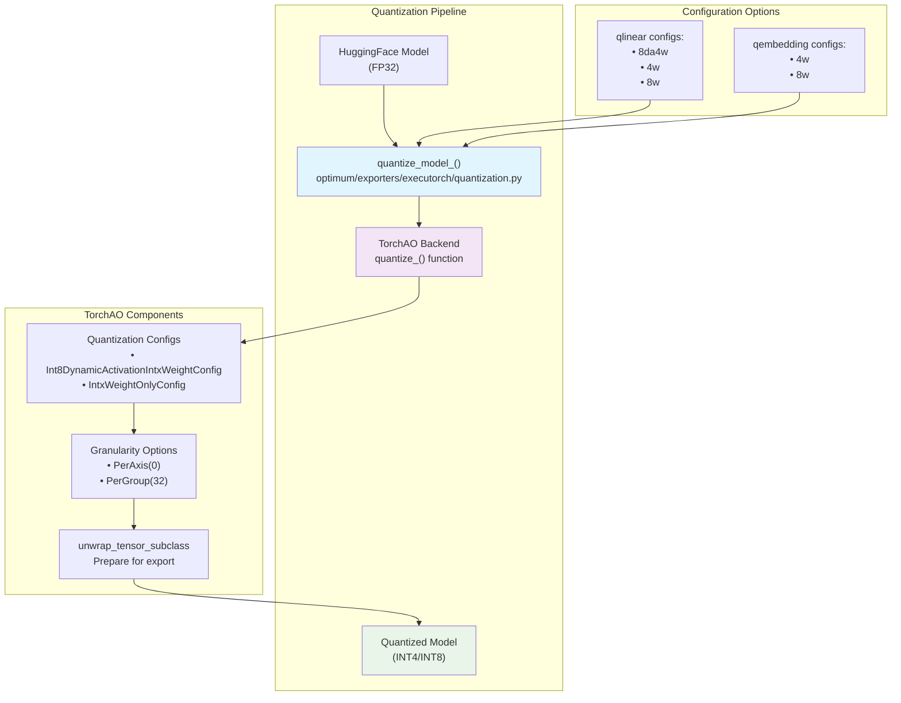
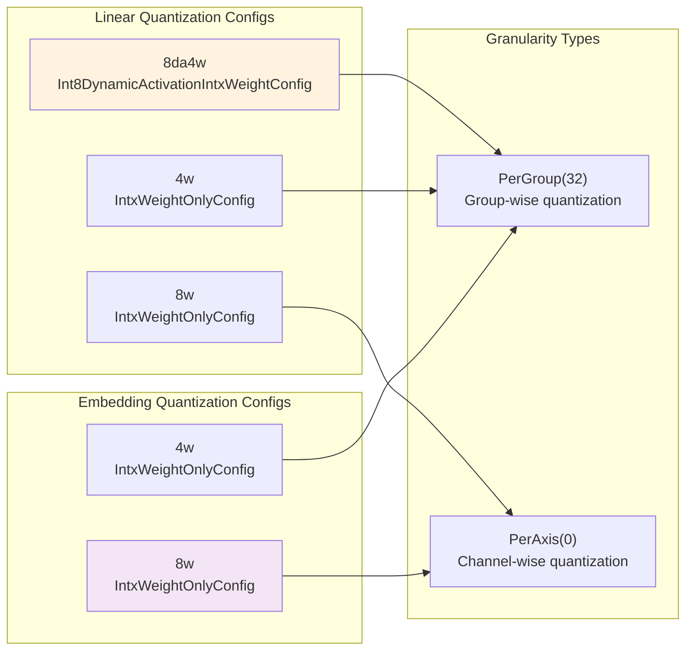
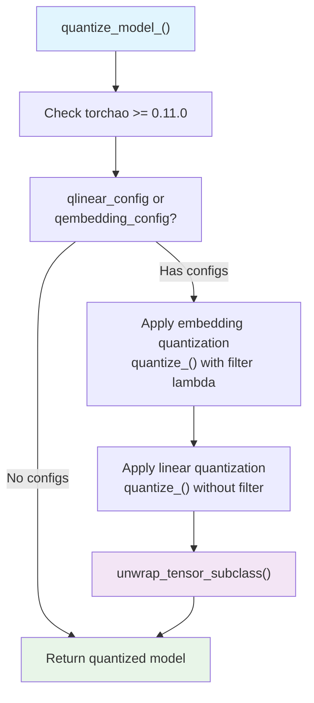
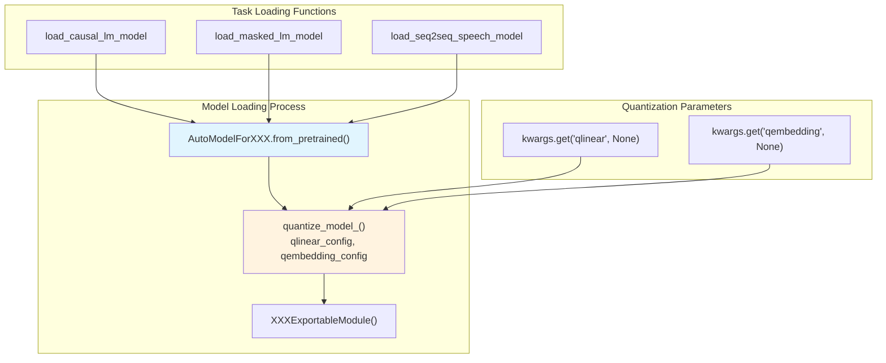
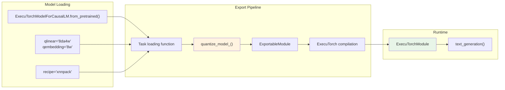

<!-- source: DeepWiki mcp.deepwiki.com · repo huggingface/optimum-executorch · page 4.3 Quantization · fetched 2026-10-26 -->

# Quantization

<details>
<summary>Relevant source files</summary>

The following files were used as context for generating this wiki page:

- [optimum/exporters/executorch/quantization.py](optimum/exporters/executorch/quantization.py)
- [optimum/exporters/executorch/tasks/masked_lm.py](optimum/exporters/executorch/tasks/masked_lm.py)
- [tests/models/test_modeling_bert.py](tests/models/test_modeling_bert.py)
- [tests/models/test_modeling_gemma2.py](tests/models/test_modeling_gemma2.py)
- [tests/models/test_modeling_phi4.py](tests/models/test_modeling_phi4.py)

</details>


This document covers the quantization capabilities in optimum-executorch, which provide model compression techniques to reduce memory usage and improve inference performance on resource-constrained devices. Quantization in optimum-executorch integrates with TorchAO to apply weight-only and dynamic activation quantization schemes to both linear and embedding layers.

For information about other optimization features like custom attention mechanisms, see [Custom Attention Mechanisms](#4.1). For KV cache optimizations, see [KV Cache Optimization](#4.2).

## Overview

The quantization system in optimum-executorch provides post-training quantization techniques that compress model weights from 32-bit floating point to lower precision integer formats. This reduces model size and can significantly improve inference speed on supported hardware backends like XNNPACK.

The quantization implementation is built on top of TorchAO and supports two main categories:
- **Linear layer quantization** (`qlinear`) - Quantizes weights in `torch.nn.Linear` layers
- **Embedding layer quantization** (`qembedding`) - Quantizes weights in `torch.nn.Embedding` layers



Sources: [optimum/exporters/executorch/quantization.py:23-82](), [optimum/exporters/executorch/tasks/masked_lm.py:44-46]()

## Quantization Schemes

The system supports multiple quantization schemes with different precision and performance trade-offs:

### Linear Layer Quantization

| Scheme | Description | Weight Dtype | Granularity | Activation |
|--------|------------|--------------|-------------|------------|
| `8da4w` | 8-bit dynamic activation, 4-bit weights | `torch.int4` | Per-group (32) | Dynamic INT8 |
| `4w` | 4-bit weight-only | `torch.int4` | Per-group (32) | FP32 |
| `8w` | 8-bit weight-only | `torch.int8` | Per-axis (0) | FP32 |

### Embedding Layer Quantization

| Scheme | Description | Weight Dtype | Granularity |
|--------|------------|--------------|-------------|
| `4w` | 4-bit weight-only | `torch.int4` | Per-group (32) |
| `8w` | 8-bit weight-only | `torch.int8` | Per-axis (0) |



Sources: [optimum/exporters/executorch/quantization.py:43-76]()

## Implementation Details

The core quantization logic is implemented in the `quantize_model_()` function, which applies TorchAO quantization schemes to the model in-place.

### Core Quantization Function

The `quantize_model_()` function performs the following steps:

1. **Version Check** - Ensures TorchAO >= 0.11.0 is installed
2. **Embedding Quantization** - Applies quantization to `torch.nn.Embedding` layers if configured
3. **Linear Quantization** - Applies quantization to `torch.nn.Linear` layers if configured  
4. **Tensor Unwrapping** - Calls `unwrap_tensor_subclass()` to prepare for ExecuTorch export



Sources: [optimum/exporters/executorch/quantization.py:23-82]()

### TorchAO Integration

The quantization system relies heavily on TorchAO components:

- **`Int8DynamicActivationIntxWeightConfig`** - For 8da4w scheme with dynamic activation quantization
- **`IntxWeightOnlyConfig`** - For weight-only quantization schemes (4w, 8w)
- **`PerAxis(0)`** - Channel-wise quantization granularity
- **`PerGroup(32)`** - Group-wise quantization with groups of 32 elements
- **`quantize_()`** - Core TorchAO function that applies quantization
- **`unwrap_tensor_subclass()`** - Converts quantized tensors to standard tensors for export

Sources: [optimum/exporters/executorch/quantization.py:33-39](), [optimum/exporters/executorch/quantization.py:55-82]()

## Integration with Export Pipeline

Quantization is integrated at multiple levels in the export pipeline:

### Task-Level Integration

Each task loading function can accept quantization parameters and apply them before wrapping the model:



Sources: [optimum/exporters/executorch/tasks/masked_lm.py:44-46]()

### CLI Integration

The command-line interface supports quantization through dedicated flags:

- `--qlinear` - Specifies linear layer quantization scheme
- `--qembedding` - Specifies embedding layer quantization scheme

These parameters are passed through the export pipeline to the task loading functions.

Sources: [tests/models/test_modeling_gemma2.py:64-65](), [tests/models/test_modeling_bert.py:62]()

### Runtime Integration

Quantized models can be loaded directly using the `ExecuTorchModelForXXX` classes with quantization parameters:



Sources: [tests/models/test_modeling_gemma2.py:84-90](), [tests/models/test_modeling_phi4.py:54-60]()

## Usage Examples

### Command Line Usage

Export a model with 8-bit dynamic activation 4-bit weight quantization and 8-bit embedding quantization:

```bash
optimum-cli export executorch \
    --model unsloth/gemma-2-2b-it \
    --task text-generation \
    --recipe xnnpack \
    --qlinear 8da4w \
    --qembedding 8w \
    --output_dir ./executorch
```

### Python API Usage

Load and use a quantized model programmatically:

```python
from optimum.executorch import ExecuTorchModelForCausalLM

model = ExecuTorchModelForCausalLM.from_pretrained(
    "microsoft/Phi-4-mini-instruct",
    recipe="xnnpack",
    qlinear="8da4w",
    qembedding="8w"
)
```

### Model-Specific Examples

Different model types support quantization:

| Model Type | Test Example | Quantization Used |
|------------|--------------|-------------------|
| Causal LM | Gemma-2, Phi-4 | `8da4w` + `8w` embedding |
| Masked LM | BERT | `8da4w` linear only |
| Speech Models | Whisper | Various schemes supported |

Sources: [tests/models/test_modeling_gemma2.py:84](), [tests/models/test_modeling_phi4.py:59](), [tests/models/test_modeling_bert.py:62]()

## Performance Considerations

### Memory Reduction

Quantization provides significant memory savings:

- **4-bit weights**: ~75% reduction in weight memory
- **8-bit weights**: ~50% reduction in weight memory  
- **Embedding quantization**: Additional savings for models with large vocabularies

### Inference Speed

The 8da4w scheme (8-bit dynamic activation, 4-bit weight) is particularly effective because:

- Dynamic activation quantization reduces computation overhead
- 4-bit weights enable vectorized operations on supported backends
- XNNPACK backend provides optimized kernels for these formats

### Quality Trade-offs

Weight-only quantization typically preserves model quality better than activation quantization, but dynamic activation schemes like 8da4w provide a good balance of performance and accuracy.

Sources: [tests/models/test_modeling_gemma2.py:79-108](), [tests/models/test_modeling_phi4.py:52-80]()

---

