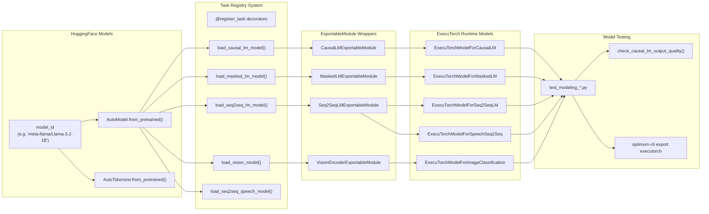
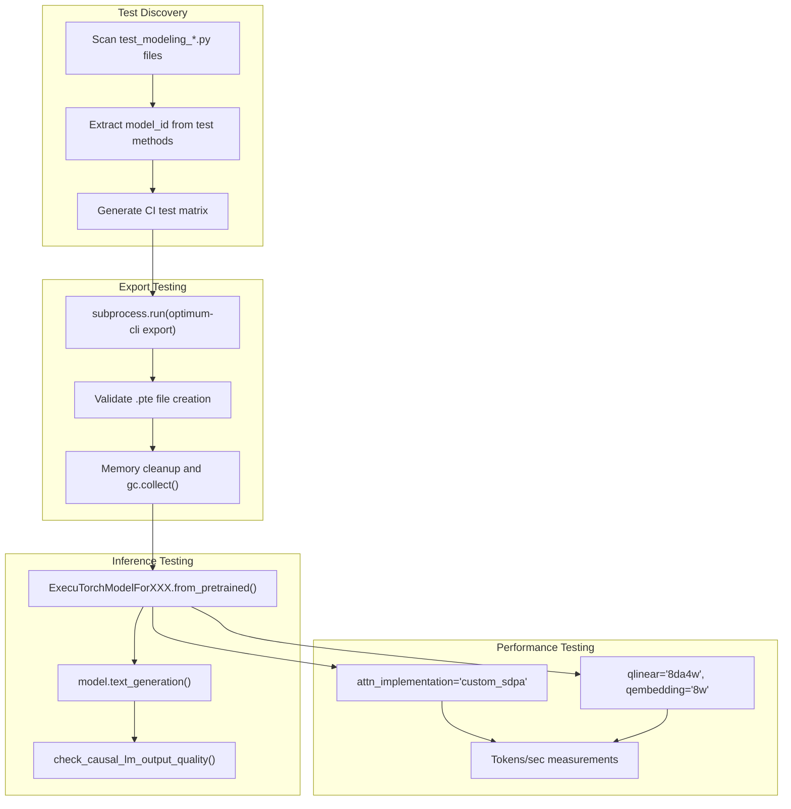

<!-- source: DeepWiki mcp.deepwiki.com · repo huggingface/optimum-executorch · page 5 Supported Models · fetched 2026-10-26 -->

# Supported Models

Relevant source files

The following files were used as context for generating this wiki page:

- [README.md](README.md)
- [tests/models/test_modeling_gemma2.py](tests/models/test_modeling_gemma2.py)

This document provides a comprehensive overview of the transformer models supported by optimum-executorch, including their specific architectures, implementation details, and usage patterns. The supported models span multiple domains including text generation, vision tasks, and audio processing, all optimized for deployment through the ExecuTorch runtime.

For detailed information about model export processes, see [Model Export System](#2). For runtime inference capabilities, see [Runtime and Inference](#3). For optimization features available for these models, see [Optimization Features](#4).

## Model Architecture Categories

The optimum-executorch library supports three primary categories of transformer architectures, each with specific implementation patterns and use cases:

```mermaid
graph TB
    subgraph "Encoder-Only Models"
        BERT["bert-base-uncased<br/>AutoModel"]
        ALBERT["albert-base-v2<br/>AutoModel"]
        DISTILBERT["distilbert-base-uncased<br/>AutoModel"]
        ROBERTA["xlm-roberta-base<br/>AutoModel"]
        EUROBERT["EuroBERT-210m<br/>AutoModel"]
    end
    
    subgraph "Decoder-Only Models"
        LLAMA["Llama-3.2-1B<br/>LlamaForCausalLM"]
        GEMMA["gemma-2-2b<br/>GemmaForCausalLM"]
        QWEN["Qwen2.5-0.5B<br/>Qwen2ForCausalLM"]
        PHI["Phi-4-mini-instruct<br/>PhiForCausalLM"]
        SMOLLM["SmolLM2-135M<br/>LlamaForCausalLM"]
        GPT2["gpt-sw3-126m<br/>GPT2LMHeadModel"]
    end
    
    subgraph "Encoder-Decoder Models"
        T5["t5-small<br/>T5ForConditionalGeneration"]
        WHISPER["whisper-tiny<br/>WhisperForConditionalGeneration"]
    end
    
    subgraph "Vision Models"
        VIT["deit-base-distilled-patch16-224<br/>DeiTForImageClassification"]
        EFFICIENTNET["efficientnet-b0<br/>EfficientNetForImageClassification"]
        SWIN["swin-tiny-patch4-window7-224<br/>SwinForImageClassification"]
        MOBILEVIT["mobilevit-xx-small<br/>MobileViTForImageClassification"]
    end
    
    subgraph "Task Implementations"
        CAUSAL_LM[ExecuTorchModelForCausalLM]
        MASKED_LM[ExecuTorchModelForMaskedLM]
        SEQ2SEQ_LM[ExecuTorchModelForSeq2SeqLM]
        SPEECH_SEQ2SEQ[ExecuTorchModelForSpeechSeq2Seq]
        IMAGE_CLASSIFICATION[ExecuTorchModelForImageClassification]
    end
    
    LLAMA --> CAUSAL_LM
    GEMMA --> CAUSAL_LM
    QWEN --> CAUSAL_LM
    PHI --> CAUSAL_LM
    SMOLLM --> CAUSAL_LM
    GPT2 --> CAUSAL_LM
    
    BERT --> MASKED_LM
    ALBERT --> MASKED_LM
    DISTILBERT --> MASKED_LM
    ROBERTA --> MASKED_LM
    EUROBERT --> MASKED_LM
    
    T5 --> SEQ2SEQ_LM
    WHISPER --> SPEECH_SEQ2SEQ
    
    VIT --> IMAGE_CLASSIFICATION
    EFFICIENTNET --> IMAGE_CLASSIFICATION
    SWIN --> IMAGE_CLASSIFICATION
    MOBILEVIT --> IMAGE_CLASSIFICATION
```

Sources: [README.md:141-193](), [tests/models/test_modeling_gemma2.py:1-137]()

## Implementation Framework

The model support in optimum-executorch is implemented through a structured framework that maps HuggingFace model architectures to ExecuTorch-compatible implementations:

Sources: [README.md:141-193](), [tests/models/test_modeling_gemma2.py:31-137]()

## Text Generation Models

### Large Language Models

The library supports major LLM families optimized for causal language modeling tasks:

| Model Family | Example Models | HuggingFace Class | Key Features |
|--------------|----------------|-------------------|--------------|
| **Llama** | `meta-llama/Llama-3.2-1B` | `LlamaForCausalLM` | RoPE, SiLU activation, RMSNorm |
| **Gemma** | `google/gemma-2-2b` | `GemmaForCausalLM` | RoPE, GeGLU, RMSNorm |
| **Qwen** | `Qwen/Qwen2.5-0.5B` | `Qwen2ForCausalLM` | Sliding window attention |
| **Phi** | `microsoft/Phi-4-mini-instruct` | `PhiForCausalLM` | Rotary embeddings |
| **SmolLM** | `HuggingFaceTB/SmolLM2-135M` | `LlamaForCausalLM` | Optimized for mobile deployment |

### Specialized Language Models

Additional specialized models for specific domains:

| Model Family | Example Models | Domain | Special Features |
|--------------|----------------|---------|------------------|
| **CodeGen** | `Salesforce/codegen-350M-mono` | Code Generation | Optimized for programming tasks |
| **StarCoder** | `bigcode/starcoder2-3b` | Code Generation | Multi-language code support |
| **Granite** | `ibm-granite/granite-3.3-2b-instruct` | Enterprise | IBM's enterprise-focused model |
| **OLMo** | `allenai/OLMo-1B-hf` | Research | Open Language Model from Allen AI |

Sources: [README.md:153-173]()

## Masked Language Models

Encoder-only models designed for fill-mask and classification tasks:

| Model Family | Example Models | Architecture | Use Cases |
|--------------|----------------|-------------|-----------|
| **BERT** | `google-bert/bert-base-uncased` | Bidirectional encoder | Text classification, NER |
| **Albert** | `albert/albert-base-v2` | Parameter sharing | Memory-efficient BERT variant |
| **DistilBERT** | `distilbert/distilbert-base-uncased` | Knowledge distillation | Faster inference |
| **RoBERTa** | `FacebookAI/xlm-roberta-base` | Optimized BERT | Multilingual support |
| **EuroBERT** | `EuroBERT/EuroBERT-210m` | European languages | Specialized for EU languages |

Sources: [README.md:147-152]()

## Sequence-to-Sequence Models

Encoder-decoder architectures for conditional generation tasks:

### Text-to-Text Models

| Model Family | Example Models | Architecture | Primary Tasks |
|--------------|----------------|-------------|---------------|
| **T5** | `google-t5/t5-small` | Encoder-decoder transformer | Text summarization, translation |

### Speech-to-Text Models

| Model Family | Example Models | Architecture | Primary Tasks |
|--------------|----------------|-------------|---------------|
| **Whisper** | `openai/whisper-tiny` | Encoder-decoder with audio preprocessing | Speech recognition, translation |

Sources: [README.md:174-191]()

## Vision Models

Computer vision models optimized for image classification and processing:

| Model Family | Example Models | Architecture | Key Features |
|--------------|----------------|-------------|--------------|
| **DeiT** | `facebook/deit-base-distilled-patch16-224` | Vision Transformer | Distilled ViT for efficiency |
| **EfficientNet** | `google/efficientnet-b0` | Convolutional | Scalable CNN architecture |
| **Swin** | `microsoft/swin-tiny-patch4-window7-224` | Hierarchical ViT | Shifted window attention |
| **MobileViT** | `apple/mobilevit-xx-small` | Hybrid CNN-ViT | Mobile-optimized vision |
| **CVT** | `microsoft/cvt-13` | Convolutional ViT | Combines convolution with attention |
| **FocalNet** | `microsoft/focalnet-tiny` | Focal attention | Alternative to self-attention |

Sources: [README.md:177-187]()

## Model Testing Framework

Each supported model is validated through a comprehensive testing framework:

Sources: [tests/models/test_modeling_gemma2.py:51-136]()

## Model Performance Benchmarks

The library maintains performance benchmarks across mobile devices for key models:

| Model | Samsung Galaxy S22 5G | iPhone 15 Pro | Key Optimizations |
|-------|:-------------------:|:-------------:|-------------------|
| **SmolLM2-135M** | 202.28 tok/s | 29.64 tok/s | Custom SDPA, 8da4w quantization |
| **Qwen3-0.6B** | 59.16 tok/s | 17.99 tok/s | Custom KV cache, quantization |
| **Gemma-3-1B** | 25.07 tok/s | 17.8 tok/s | XNNPACK backend delegation |
| **Llama-3.2-1B** | 44.91 tok/s | 25.78 tok/s | Batch prefill optimization |
| **OLMo-1B** | 44.98 tok/s | 20.24 tok/s | Custom SDPA implementation |

Sources: [README.md:195-209]()

## Model Registry and Task Mapping

The supported models are organized through a task registry system that maps model architectures to appropriate task implementations. Each model family is tested and validated for specific optimization patterns including custom attention mechanisms, quantization schemes, and backend delegation strategies.

For implementation details of specific model families, see [Large Language Models](#5.1), [Specialized Models](#5.2), and [Vision and Multimodal Models](#5.3).

Sources: [README.md:141-193](), [tests/models/test_modeling_gemma2.py:1-137]()

---

