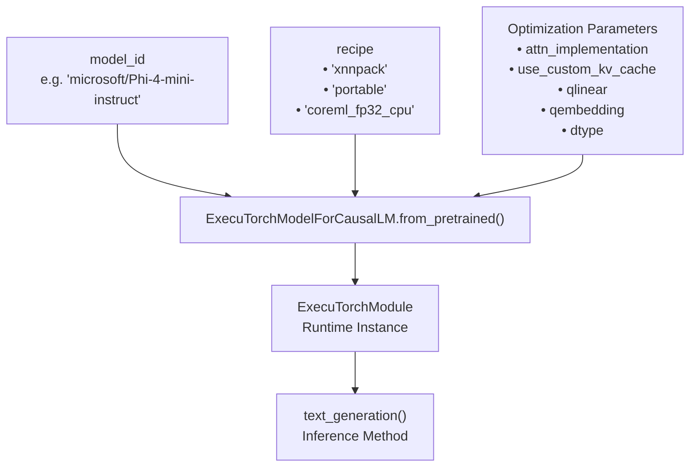
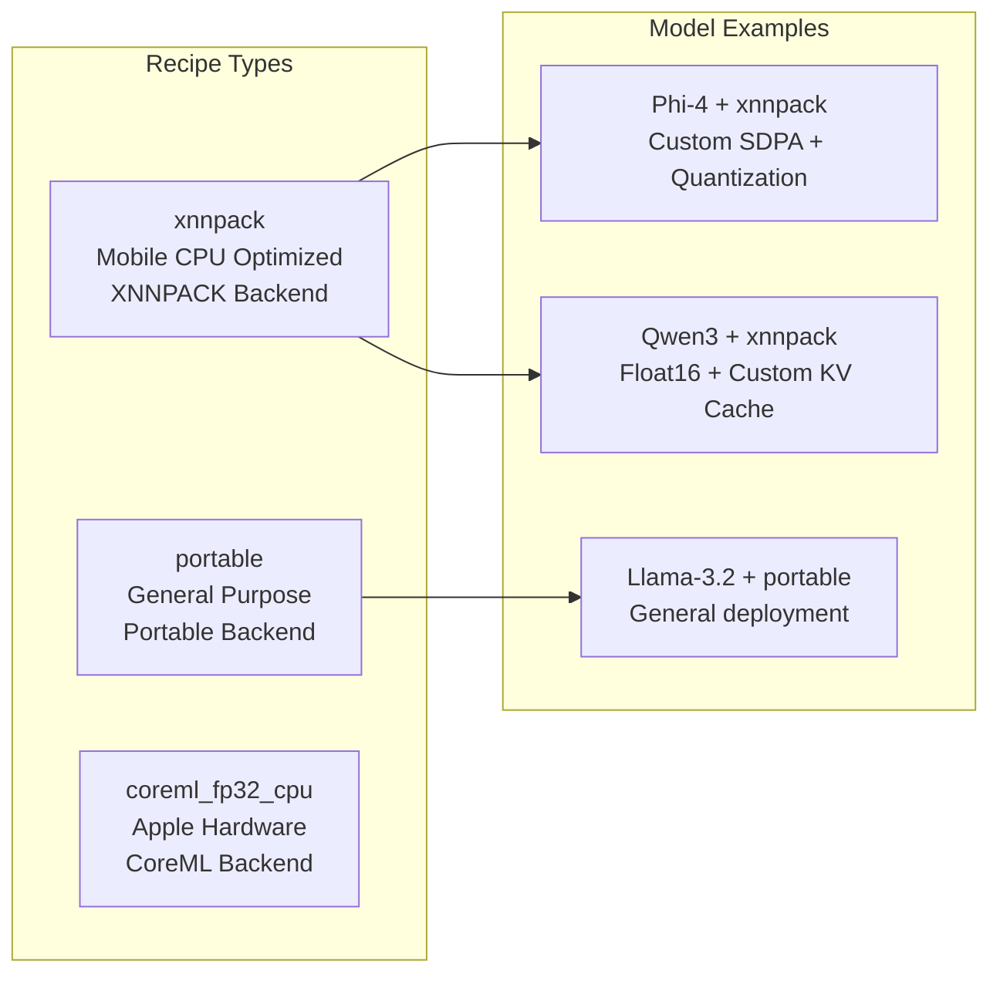
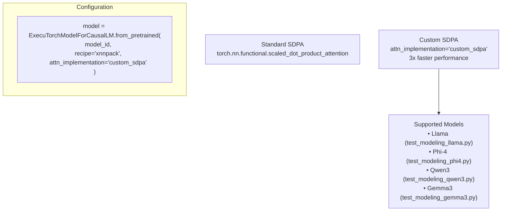
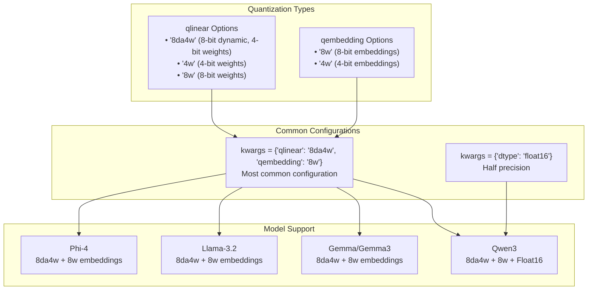
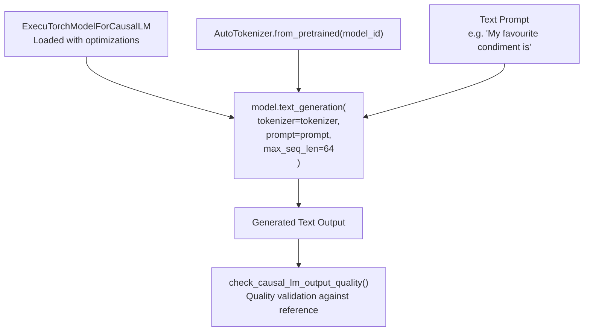
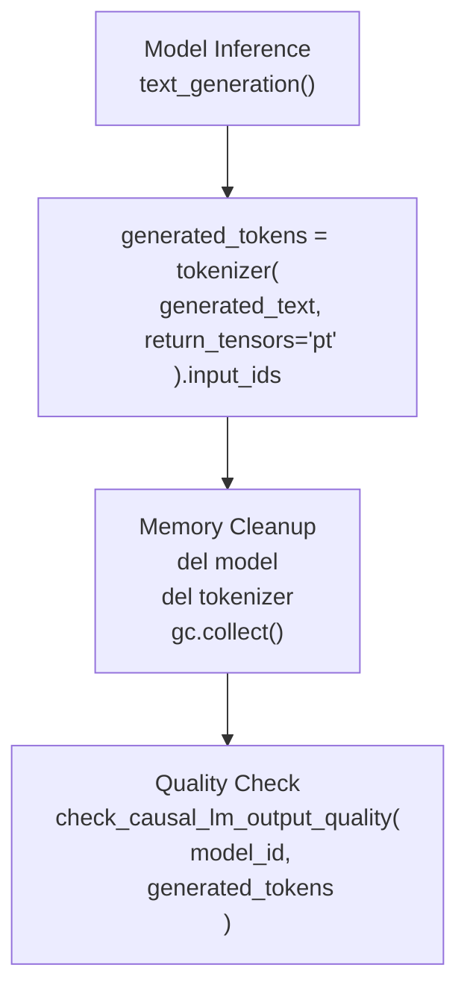

<!-- source: DeepWiki mcp.deepwiki.com · repo huggingface/optimum-executorch · page 5.1 Large Language Models · fetched 2026-10-26 -->

# Large Language Models

<details>
<summary>Relevant source files</summary>

The following files were used as context for generating this wiki page:

- [tests/models/test_modeling_gemma.py](tests/models/test_modeling_gemma.py)
- [tests/models/test_modeling_gemma3.py](tests/models/test_modeling_gemma3.py)
- [tests/models/test_modeling_llama.py](tests/models/test_modeling_llama.py)
- [tests/models/test_modeling_phi4.py](tests/models/test_modeling_phi4.py)
- [tests/models/test_modeling_qwen3.py](tests/models/test_modeling_qwen3.py)

</details>


This page documents the Large Language Model (LLM) families supported by optimum-executorch, including their specific configurations, optimization features, and usage patterns. These models are primarily used for text generation tasks and are accessed through the `ExecuTorchModelForCausalLM` class.

For information about specialized smaller models like SmolLM and OLMo, see [Specialized Models](#5.2). For vision and multimodal capabilities, see [Vision and Multimodal Models](#5.3).

## Supported LLM Families

The following table summarizes the major LLM families with verified support in optimum-executorch:

| Model Family | Example Models | Key Features | Version Requirements |
|--------------|----------------|--------------|---------------------|
| **Llama** | `NousResearch/Llama-3.2-1B` | Custom SDPA, KV Cache, Quantization | torchao >= 0.11.0 |
| **Phi** | `microsoft/Phi-4-mini-instruct` | Custom SDPA, KV Cache, Pre-quantized variants | transformers >= 4.52.0 |
| **Gemma** | `weqweasdas/RM-Gemma-2B` | Custom SDPA, 8da4w quantization | torchao >= 0.11.0 |
| **Gemma3** | `unsloth/gemma-3-1b-it` | Enhanced attention, Float16 support | transformers >= 4.52.0 |
| **Qwen3** | `Qwen/Qwen3-0.6B` | Custom SDPA, KV Cache, Float16 | transformers >= 4.52.0 |

## Model Loading and Configuration

### Basic Loading Pattern

All LLM models follow a consistent loading pattern using `ExecuTorchModelForCausalLM.from_pretrained()`:



Sources: [tests/models/test_modeling_phi4.py:54-60](), [tests/models/test_modeling_llama.py:78-83](), [tests/models/test_modeling_qwen3.py:125-129]()

### Recipe Selection

Models support different execution recipes with specific backend optimizations:



Sources: [tests/models/test_modeling_phi4.py:56](), [tests/models/test_modeling_llama.py:136](), [tests/models/test_modeling_qwen3.py:158]()

## Optimization Features

### Custom Attention Implementation

Most LLM families support `attn_implementation="custom_sdpa"` for improved performance:



Sources: [tests/models/test_modeling_phi4.py:57](), [tests/models/test_modeling_llama.py:81](), [tests/models/test_modeling_qwen3.py:128]()

### KV Cache Optimization

Advanced models support custom KV cache implementations with `use_custom_kv_cache=True`:

| Model | KV Cache Support | Requirements |
|-------|------------------|--------------|
| Phi-4 | ✅ Custom KV Cache | transformers >= 4.52.0, torchao >= 0.11.0 |
| Llama-3.2 | ✅ Custom KV Cache | torchao >= 0.11.0 |
| Qwen3 | ✅ Custom KV Cache | transformers >= 4.52.0 |
| Gemma3 | ✅ Custom KV Cache | transformers >= 4.53.0 |

Sources: [tests/models/test_modeling_phi4.py:58](), [tests/models/test_modeling_llama.py:111](), [tests/models/test_modeling_qwen3.py:231]()

### Quantization Support

LLM models support multiple quantization schemes for memory efficiency:



Sources: [tests/models/test_modeling_phi4.py:59](), [tests/models/test_modeling_llama.py:77](), [tests/models/test_modeling_gemma.py:79]()

## Text Generation Workflow

### Generation Process

All LLM models follow a consistent text generation workflow:



Sources: [tests/models/test_modeling_phi4.py:64-70](), [tests/models/test_modeling_llama.py:86-92](), [tests/models/test_modeling_qwen3.py:78-84]()

### Memory Management

Test implementations follow strict memory cleanup patterns:



Sources: [tests/models/test_modeling_phi4.py:76-80](), [tests/models/test_modeling_llama.py:95-100](), [tests/models/test_modeling_qwen3.py:87-92]()

## Pre-Quantized Model Support

Some model families provide pre-quantized variants on Hugging Face Hub:

| Model Hub ID | Base Model | Quantization | File Name |
|--------------|------------|--------------|-----------|
| `pytorch/Phi-4-mini-instruct-8da4w` | `microsoft/Phi-4-mini-instruct` | 8da4w | `phi4-mini-8da4w.pte` |

Configuration requires special handling for rope scaling:

```python
config = AutoConfig.from_pretrained(model_id)
if hasattr(config, "rope_scaling") and config.rope_scaling is not None:
    config.rope_scaling["type"] = "default"
```

Sources: [tests/models/test_modeling_phi4.py:89-98]()

## Performance Characteristics

### Benchmark Examples

Real-world performance examples from test cases:

| Model | Configuration | Use Case | Sequence Length |
|-------|---------------|----------|-----------------|
| Phi-4 | Custom SDPA + 8da4w | General text completion | 64 tokens |
| Llama-3.2-1B | Custom SDPA + KV Cache | Scientific text | 32 tokens |
| Qwen3-0.6B | Custom SDPA + Float16 | Technical explanation | 128 tokens |
| Gemma3-1B | Custom SDPA + Quantization | Creative writing | 64 tokens |

Sources: [tests/models/test_modeling_phi4.py:68](), [tests/models/test_modeling_llama.py:90](), [tests/models/test_modeling_qwen3.py:203](), [tests/models/test_modeling_gemma3.py:94]()

### CI/CD Considerations

Several models have specific CI environment limitations:

- **Linux CI OOM**: Phi-4, Qwen3, Gemma3 skip Linux runners due to memory constraints
- **Portable Recipe**: Larger models skip CI for portable recipe testing
- **Version Dependencies**: Strict version requirements for transformers and torchao libraries

Sources: [tests/models/test_modeling_phi4.py:47-51](), [tests/models/test_modeling_qwen3.py:101](), [tests/models/test_modeling_gemma3.py:108]()

---

