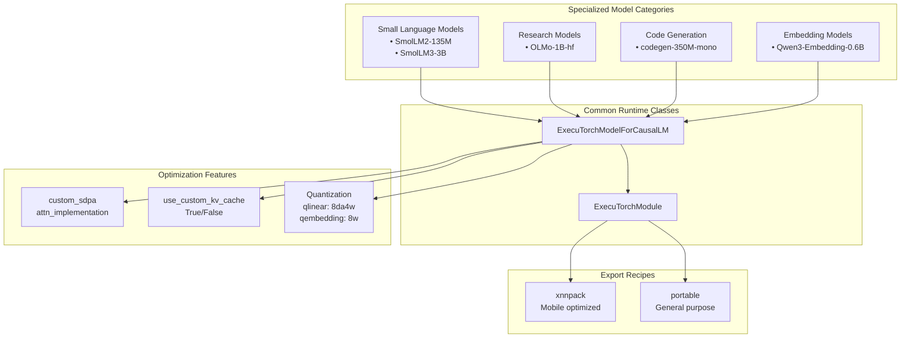
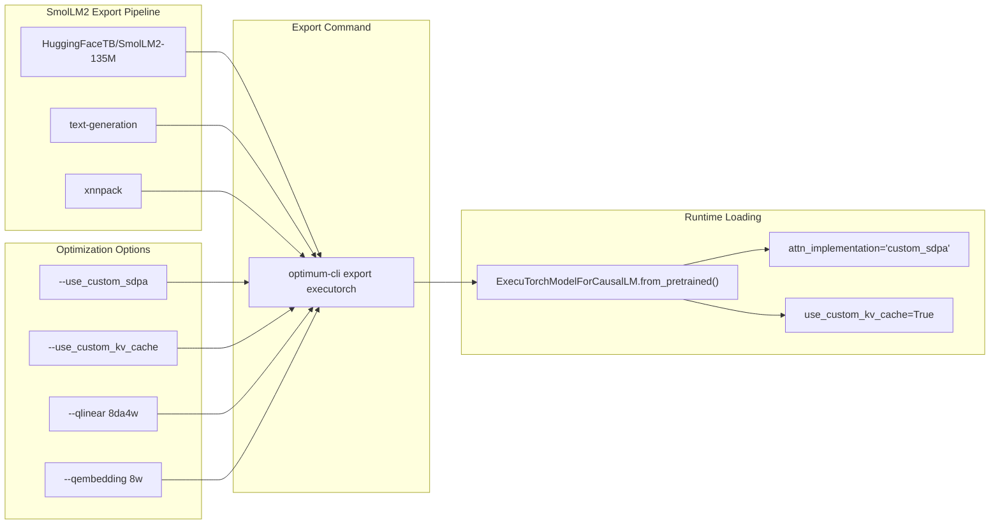
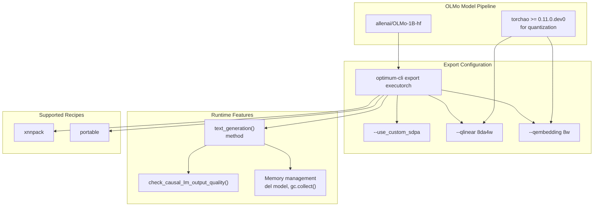
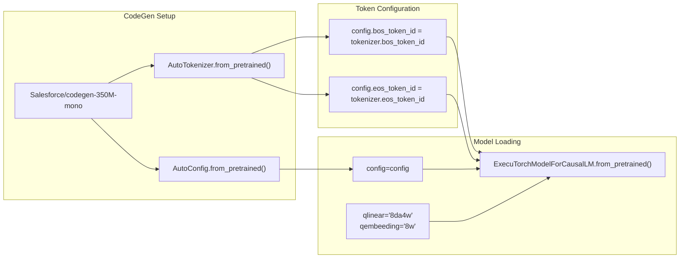
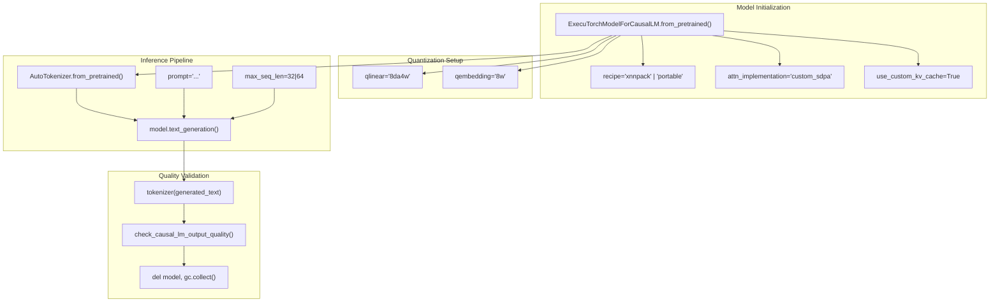

<!-- source: DeepWiki mcp.deepwiki.com · repo huggingface/optimum-executorch · page 5.2 Specialized Models · fetched 2026-10-26 -->

# Specialized Models

Relevant source files

The following files were used as context for generating this wiki page:

- [tests/models/test_modeling_codegen.py](tests/models/test_modeling_codegen.py)
- [tests/models/test_modeling_olmo.py](tests/models/test_modeling_olmo.py)
- [tests/models/test_modeling_qwen3_embedding.py](tests/models/test_modeling_qwen3_embedding.py)
- [tests/models/test_modeling_smollm.py](tests/models/test_modeling_smollm.py)
- [tests/models/test_modeling_smollm3.py](tests/models/test_modeling_smollm3.py)

This document covers the smaller and specialized models supported by optimum-executorch, including efficient small language models, code generation models, and embedding models. These models are typically optimized for resource-constrained environments and specialized tasks.

For information about larger language models like Llama, Gemma, and Qwen, see [Large Language Models](#5.1). For vision and multimodal models, see [Vision and Multimodal Models](#5.3).

## Overview

Specialized models in optimum-executorch focus on efficiency and task-specific optimization. These models are designed to run effectively on mobile devices and edge hardware while maintaining good performance for their intended use cases.

### Supported Model Categories

Sources: [tests/models/test_modeling_smollm.py:31-32](), [tests/models/test_modeling_olmo.py:31](), [tests/models/test_modeling_codegen.py:28](), [tests/models/test_modeling_qwen3_embedding.py:30]()

## SmolLM Family

The SmolLM models are compact language models designed for efficient inference while maintaining good performance. They support advanced optimization features including custom attention and quantization.

### SmolLM2

**Model ID**: `HuggingFaceTB/SmolLM2-135M`

SmolLM2-135M is a 135 million parameter model that demonstrates excellent performance with various optimization strategies.

Sources: [tests/models/test_modeling_smollm.py:46-61](), [tests/models/test_modeling_smollm.py:102-129]()

### SmolLM3

**Model ID**: `HuggingFaceTB/SmolLM3-3B`

SmolLM3-3B is a larger variant with 3 billion parameters, requiring Transformers >= 4.53.1.

The model follows the same optimization patterns as SmolLM2 but with increased capability due to its larger size.

Sources: [tests/models/test_modeling_smollm3.py:38-41](), [tests/models/test_modeling_smollm3.py:48-74]()

## OLMo Research Models

**Model ID**: `allenai/OLMo-1B-hf`

OLMo (Open Language Model) is a research-oriented language model from Allen Institute for AI. It supports comprehensive optimization features and requires TorchAO >= 0.11.0.dev0 for quantization.

### OLMo Optimization Features

Sources: [tests/models/test_modeling_olmo.py:39-42](), [tests/models/test_modeling_olmo.py:49-66](), [tests/models/test_modeling_olmo.py:95-121]()

## CodeGen Models

**Model ID**: `Salesforce/codegen-350M-mono`

CodeGen is a specialized model for code generation tasks. It requires specific configuration setup for proper tokenization behavior.

### CodeGen Configuration

The CodeGen model requires explicit BOS and EOS token configuration:

Sources: [tests/models/test_modeling_codegen.py:46-58]()

## Embedding Models

**Model ID**: `Qwen/Qwen3-Embedding-0.6B`

Qwen3-Embedding is a specialized embedding model that can also perform text generation. It requires Transformers >= 4.52.0 and TorchAO >= 0.11.0.

### Usage Pattern

| Feature | Support | Requirements |
|---------|---------|-------------|
| Custom SDPA | ✅ | Standard |
| Custom KV Cache | ✅ | Standard |
| 8da4w Quantization | ✅ | TorchAO >= 0.11.0 |
| 8w Embedding Quantization | ✅ | TorchAO >= 0.11.0 |
| Portable Recipe | ✅ | ExecuTorch >= 0.7.0 |
| XNNPACK Recipe | ✅ | Standard |

Sources: [tests/models/test_modeling_qwen3_embedding.py:44-47](), [tests/models/test_modeling_qwen3_embedding.py:48-74]()

## Common Optimization Patterns

All specialized models follow similar optimization patterns for maximum efficiency:

### Text Generation Flow

Sources: [tests/models/test_modeling_smollm.py:137-166](), [tests/models/test_modeling_olmo.py:95-121](), [tests/models/test_modeling_qwen3_embedding.py:48-74]()

### Performance Considerations

Specialized models benefit from several optimization strategies:

1. **Custom SDPA**: Provides approximately 3x performance improvement for attention computation
2. **Custom KV Cache**: Optimizes memory usage for autoregressive generation
3. **Quantization**: Reduces model size and improves inference speed
   - `8da4w`: 8-bit dynamic activation, 4-bit weight quantization
   - `8w`: 8-bit weight quantization for embeddings
4. **Recipe Selection**: Choose `xnnpack` for mobile deployment, `portable` for general compatibility

The combination of these optimizations makes specialized models highly efficient for deployment on resource-constrained devices while maintaining good output quality.

Sources: [tests/models/test_modeling_smollm.py:174-203](), [tests/models/test_modeling_olmo.py:125-150]()

---

