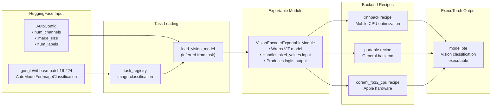
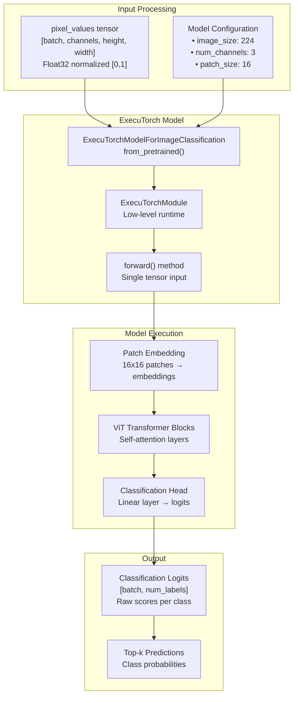
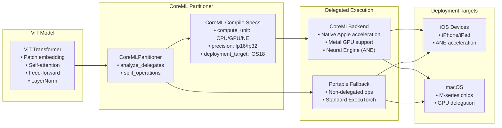

<!-- source: DeepWiki mcp.deepwiki.com · repo huggingface/optimum-executorch · page 5.3 Vision and Multimodal Models · fetched 2026-10-26 -->

# Vision and Multimodal Models

<details>
<summary>Relevant source files</summary>

The following files were used as context for generating this wiki page:

- [optimum/exporters/executorch/__main__.py](optimum/exporters/executorch/__main__.py)
- [optimum/exporters/executorch/quantization.py](optimum/exporters/executorch/quantization.py)
- [optimum/exporters/executorch/recipes/coreml.py](optimum/exporters/executorch/recipes/coreml.py)
- [optimum/exporters/executorch/tasks/masked_lm.py](optimum/exporters/executorch/tasks/masked_lm.py)
- [tests/models/test_modeling_bert.py](tests/models/test_modeling_bert.py)
- [tests/models/test_modeling_vit.py](tests/models/test_modeling_vit.py)

</details>


This page covers vision model support in optimum-executorch, focusing on image classification models like Vision Transformers (ViT). The library provides foundational infrastructure for vision models with backend optimization through XNNPACK, Portable, and CoreML delegates.

For text-based language models, see [Large Language Models](#5.1) and [Specialized Models](#5.2).

## Supported Vision Models

Currently, optimum-executorch primarily supports **Vision Transformer (ViT)** models for image classification tasks. The main supported model family is:

| Model Family | Task | Example Model ID | ExecuTorch Class |
|--------------|------|-----------------|-----------------|
| Vision Transformer | image-classification | `google/vit-base-patch16-224` | `ExecuTorchModelForImageClassification` |

### Vision Transformer Support

The library provides comprehensive support for ViT models through the `ExecuTorchModelForImageClassification` class. The export process follows the standard pipeline with vision-specific optimizations.

**Vision Model Export Pipeline**



Sources: [tests/models/test_modeling_vit.py:42-52](), [optimum/exporters/executorch/__main__.py:118-125]()

## Vision Model Export Configuration

### Command Line Export

Vision models can be exported using the standard CLI with the `image-classification` task:

```bash
optimum-cli export executorch \
    --model google/vit-base-patch16-224 \
    --task image-classification \
    --recipe xnnpack \
    --output_dir ./vision_model/
```

### Python API Export

```python
from optimum.executorch import ExecuTorchModelForImageClassification

# Direct model loading and export
model = ExecuTorchModelForImageClassification.from_pretrained(
    model_id="google/vit-base-patch16-224",
    recipe="xnnpack"
)
```

Sources: [tests/models/test_modeling_vit.py:65-66](), [optimum/exporters/executorch/__main__.py:39-55]()

## Runtime and Inference

### Input Preprocessing

Vision models expect preprocessed pixel values in the standard format:

```python
import torch
from transformers import AutoConfig

config = AutoConfig.from_pretrained("google/vit-base-patch16-224")
batch_size = 1
num_channels = config.num_channels  # Typically 3 for RGB
height = config.image_size         # 224 for ViT-base
width = config.image_size          # 224 for ViT-base

pixel_values = torch.rand(batch_size, num_channels, height, width)
```

### Inference Execution

**Vision Model Inference Flow**



Sources: [tests/models/test_modeling_vit.py:54-76]()

### Forward Pass Implementation

```python
# Standard inference pattern
et_model = ExecuTorchModelForImageClassification.from_pretrained(
    model_id="google/vit-base-patch16-224", 
    recipe="xnnpack"
)

# Direct forward pass
logits = et_model.forward(pixel_values)

# Compare with eager model for validation
eager_model = AutoModelForImageClassification.from_pretrained(model_id).eval()
eager_output = eager_model(pixel_values)

# Output comparison
assert torch.allclose(eager_output.logits, logits, atol=1e-3)
```

Sources: [tests/models/test_modeling_vit.py:69-75]()

## Backend Optimization

### Recipe Support

Vision models support multiple backend recipes for different deployment targets:

| Recipe | Target Platform | Optimization Features |
|--------|----------------|----------------------|
| `xnnpack` | Mobile CPU | Optimized convolutions, SIMD operations |
| `portable` | General | Cross-platform compatibility |
| `coreml_fp32_cpu` | Apple devices | CoreML delegation, Metal performance |

### CoreML Integration

The CoreML backend provides specialized optimization for Apple hardware:

**CoreML Vision Delegation**



Sources: [optimum/exporters/executorch/recipes/coreml.py:77-86](), [tests/models/test_modeling_vit.py:90-92]()

### Performance Considerations

Vision models benefit from backend-specific optimizations:

- **XNNPACK**: Optimized for mobile CPU inference with quantized operations
- **CoreML**: Hardware acceleration on Apple devices, especially for patch embedding and attention layers
- **Portable**: Baseline performance across all platforms

Sources: [tests/models/test_modeling_vit.py:79-86]()

## Current Limitations

### Multimodal Model Support

The current implementation focuses on single-modality vision classification. Complex multimodal architectures (vision-language models, vision-audio models) are not yet supported through dedicated exportable modules.

### Model Architecture Coverage

- **Supported**: Vision Transformer (ViT) for image classification
- **Limited**: Convolutional networks, object detection models
- **Not supported**: Vision-language models (CLIP, BLIP), generative vision models

### Input Format Requirements

Vision models currently require preprocessed tensors rather than raw images. Integration with image preprocessing pipelines is not automated in the export process.

Sources: [tests/models/test_modeling_vit.py:57-62](), [optimum/exporters/executorch/recipes/coreml.py:47-56]()

---

