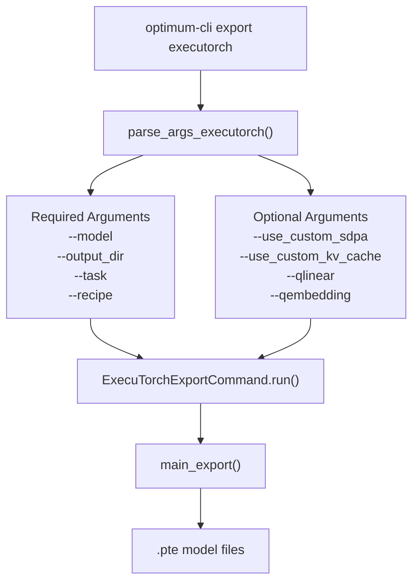
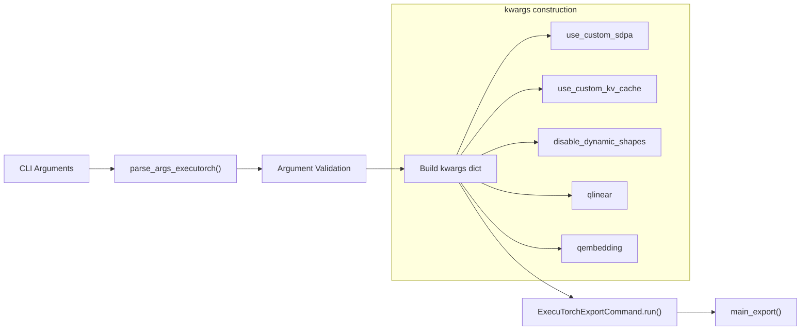

<!-- source: DeepWiki mcp.deepwiki.com · repo huggingface/optimum-executorch · page 6 Command Line Interface · fetched 2026-10-26 -->

# Command Line Interface

<details>
<summary>Relevant source files</summary>

The following files were used as context for generating this wiki page:

- [README.md](README.md)
- [optimum/commands/export/executorch.py](optimum/commands/export/executorch.py)

</details>


The Command Line Interface provides a convenient way to export HuggingFace models to ExecuTorch format using the `optimum-cli export executorch` command. This interface allows users to configure various optimization options and export parameters without writing Python code.

For information about loading and using exported models, see [Runtime and Inference](#3). For details about the underlying export process and optimization techniques, see [Model Export System](#2) and [Optimization Features](#4).

## Command Structure Overview

The CLI follows the standard optimum-cli pattern with a specific subcommand for ExecuTorch exports. The basic command structure is:

```bash
optimum-cli export executorch [arguments]
```

The CLI command is implemented through the `ExecuTorchExportCommand` class which extends `BaseOptimumCLICommand` and delegates the actual export work to the `main_export` function in the exporters module.

**CLI Command Flow**


Sources: [optimum/commands/export/executorch.py:28-131]()

## Required Arguments

The CLI requires several mandatory arguments to perform the model export:

| Argument | Short Form | Type | Description |
|----------|------------|------|-------------|
| `--model` | `-m` | str | Model ID on huggingface.co or path on disk to load model from |
| `--output_dir` | `-o` | Path | Directory where the generated ExecuTorch model will be stored |
| `--task` | | str | The task to export the model for (default: "text-generation") |
| `--recipe` | | str | Pre-defined recipe for export to ExecuTorch (default: "xnnpack") |

The `--task` parameter accepts values from `TasksManager.get_all_tasks()` which includes tasks like:
- `text-generation` (for causal language models)
- `automatic-speech-recognition` (for speech models)
- `image-classification` (for vision models)
- `fill-mask` (for masked language models)

The `--recipe` parameter determines the backend delegation and optimization strategy. Common recipes include `xnnpack`, `portable`, and `coreml_fp32_cpu`.

Sources: [optimum/commands/export/executorch.py:29-57]()

## Performance Optimization Arguments

The CLI provides several optional arguments for enabling performance optimizations:

### Attention and Cache Optimizations

| Argument | Type | Description |
|----------|------|-------------|
| `--use_custom_sdpa` | flag | Enable custom SDPA implementation for decoder-only models (3x performance boost) |
| `--use_custom_kv_cache` | flag | Enable custom KV cache for static cache with in-place updates (2.5x performance boost) |
| `--disable_dynamic_shapes` | flag | Disable dynamic shapes during export for decoder-only models |

### Quantization Options

| Argument | Choices | Description |
|----------|---------|-------------|
| `--qlinear` | `8da4w`, `4w`, `8w` | Quantization configuration for linear layers |
| `--qembedding` | `4w`, `8w` | Quantization configuration for embedding layers |

**Quantization Schemes Detail:**
- `8da4w`: 8-bit dynamic activation, 4-bit weight with group_size = 32
- `4w`: 4-bit weight only, per group with group_size = 32  
- `8w`: 8-bit weight only, per channel

Sources: [optimum/commands/export/executorch.py:58-100]()

## Argument Processing and Execution

The CLI processes arguments through a structured flow that validates inputs and passes them to the export system:

**Argument Processing Flow**


The `run()` method in `ExecuTorchExportCommand` conditionally builds a kwargs dictionary based on the provided arguments, ensuring only specified optimization flags are passed to the export function.

Sources: [optimum/commands/export/executorch.py:110-131]()

## Usage Examples

### Basic Model Export
Export a small language model with default settings:
```bash
optimum-cli export executorch \
    --model "HuggingFaceTB/SmolLM2-135M-Instruct" \
    --task "text-generation" \
    --output_dir "./exported_model"
```

### Optimized Export with Custom Operators
Export with performance optimizations enabled:
```bash
optimum-cli export executorch \
    --model "HuggingFaceTB/SmolLM2-135M-Instruct" \
    --task "text-generation" \
    --recipe "xnnpack" \
    --use_custom_sdpa \
    --use_custom_kv_cache \
    --output_dir "./optimized_model"
```

### Quantized Export
Export with quantization for reduced model size:
```bash
optimum-cli export executorch \
    --model "meta-llama/Llama-3.2-1B" \
    --task "text-generation" \
    --recipe "xnnpack" \
    --qlinear 8da4w \
    --qembedding 8w \
    --output_dir "./quantized_model"
```

### Vision Model Export
Export an image classification model:
```bash
optimum-cli export executorch \
    --model "microsoft/dit-base-finetuned-rvlcdip" \
    --task "image-classification" \
    --recipe "xnnpack" \
    --output_dir "./vision_model"
```

Sources: [README.md:86-96]()

## Help and Documentation

To see all available options and their descriptions:
```bash
optimum-cli export executorch --help
```

This displays the complete argument reference including all optimization flags, quantization options, and usage examples directly in the terminal.

Sources: [README.md:97]()

---

