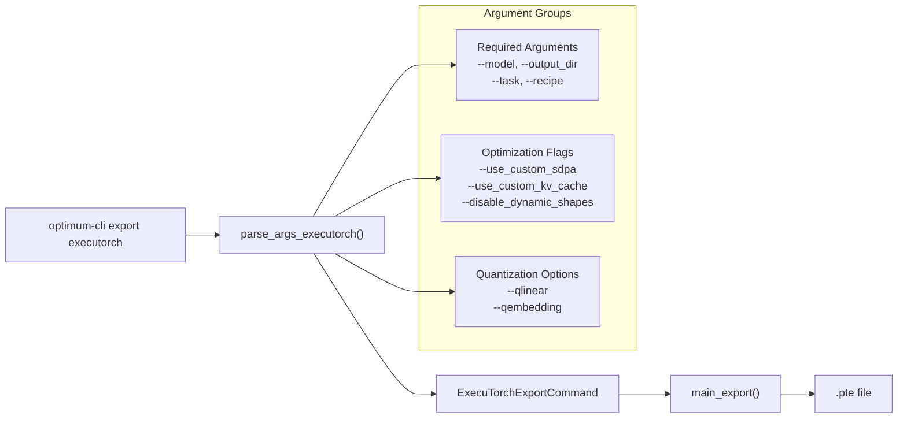
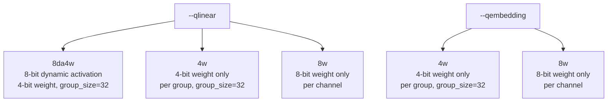

<!-- source: DeepWiki mcp.deepwiki.com · repo huggingface/optimum-executorch · page 6.1 Export Command Reference · fetched 2026-10-26 -->

# Export Command Reference

<details>
<summary>Relevant source files</summary>

The following files were used as context for generating this wiki page:

- [optimum/commands/export/executorch.py](optimum/commands/export/executorch.py)
- [tests/models/test_modeling_gemma2.py](tests/models/test_modeling_gemma2.py)

</details>


This document provides comprehensive reference documentation for the `optimum-cli export executorch` command, which converts HuggingFace models to ExecuTorch format for deployment on mobile and edge devices. The command-line interface provides control over model export configuration, optimization settings, and quantization options.

For information about the underlying export process and technical details, see [Model Export System](#2). For runtime usage of exported models, see [Runtime and Inference](#3).

## Command Overview

The `optimum-cli export executorch` command provides a unified interface for converting HuggingFace models to ExecuTorch `.pte` files. The command handles model loading, optimization application, and backend-specific compilation in a single step.



Sources: [optimum/commands/export/executorch.py:28-101]()

## Basic Command Structure

The basic command syntax follows this pattern:

```bash
optimum-cli export executorch --model MODEL_ID --output_dir OUTPUT_PATH [OPTIONS]
```

All arguments are processed by the `ExecuTorchExportCommand` class which implements the `BaseOptimumCLICommand` interface and delegates to the `main_export` function for actual export processing.

Sources: [optimum/commands/export/executorch.py:103-131]()

## Required Arguments

### Model Specification

| Argument | Short Form | Type | Description |
|----------|------------|------|-------------|
| `--model` | `-m` | `str` | Model ID on huggingface.co or path on disk to load model from |
| `--output_dir` | `-o` | `Path` | Path indicating the directory where to store the generated ExecuTorch model |

### Task and Recipe Configuration

| Argument | Type | Default | Description |
|----------|------|---------|-------------|
| `--task` | `str` | `"text-generation"` | The task to export the model for. Available tasks depend on the model |
| `--recipe` | `str` | `"xnnpack"` | Pre-defined recipes for export to ExecuTorch |

The `--task` argument accepts values from `TasksManager.get_all_tasks()`, which includes tasks like `text-generation`, `automatic-speech-recognition`, `image-classification`, and `fill-mask`.

Sources: [optimum/commands/export/executorch.py:29-57]()

## Optimization Arguments

### Attention Mechanism Options

| Argument | Type | Default | Description |
|----------|------|---------|-------------|
| `--use_custom_sdpa` | `action="store_true"` | `False` | For decoder-only models to use custom sdpa with static kv cache to boost performance |
| `--use_custom_kv_cache` | `action="store_true"` | `False` | For decoder-only models to use custom kv cache for static cache that updates cache using custom op |

### Shape Configuration

| Argument | Type | Default | Description |
|----------|------|---------|-------------|
| `--disable_dynamic_shapes` | `action="store_true"` | `False` | When this flag is set on decoder-only models, dynamic shapes are disabled during export |

These optimization flags are conditionally passed to `main_export` only when specified, allowing the export system to use appropriate defaults for unspecified options.

Sources: [optimum/commands/export/executorch.py:58-76](), [optimum/commands/export/executorch.py:114-119]()

## Quantization Arguments

### Linear Layer Quantization

The `--qlinear` argument controls quantization for linear layers:

| Option | Description |
|--------|-------------|
| `8da4w` | 8-bit dynamic activation, 4-bit weight with group_size = 32 |
| `4w` | 4-bit weight only, per group with group_size = 32 |
| `8w` | 8-bit weight only, per channel |

### Embedding Layer Quantization

The `--qembedding` argument controls quantization for embedding layers:

| Option | Description |
|--------|-------------|
| `4w` | 4-bit weight only, per group with group_size = 32 |
| `8w` | 8-bit weight only, per channel |



Sources: [optimum/commands/export/executorch.py:77-100]()

## Argument Processing Flow

The command line arguments are processed through a specific flow that validates and forwards options to the export system:

```mermaid
graph TD
    ARGS["Command Line Arguments"] --> PARSER["parse_args_executorch()"]
    PARSER --> VALIDATION["Argument Validation"]
    VALIDATION --> KWARGS["kwargs Dictionary"]
    
    subgraph "Conditional Processing"
        CHECK1["if self.args.use_custom_sdpa"]
        CHECK2["if self.args.use_custom_kv_cache"] 
        CHECK3["if self.args.disable_dynamic_shapes"]
        CHECK4["if self.args.qlinear"]
        CHECK5["if self.args.qembedding"]
    end
    
    KWARGS --> CHECK1
    KWARGS --> CHECK2
    KWARGS --> CHECK3
    KWARGS --> CHECK4
    KWARGS --> CHECK5
    
    CHECK1 --> EXPORT["main_export()"]
    CHECK2 --> EXPORT
    CHECK3 --> EXPORT
    CHECK4 --> EXPORT
    CHECK5 --> EXPORT
    
    EXPORT --> OUTPUT["model.pte file in output_dir"]
```



Sources: [optimum/commands/export/executorch.py:113-131]()

## Usage Examples

### Basic Export

```bash
optimum-cli export executorch \
    --model microsoft/DialoGPT-medium \
    --task text-generation \
    --output_dir ./executorch_output
```

### Optimized Export with Quantization

```bash
optimum-cli export executorch \
    --model unsloth/gemma-2-2b-it \
    --task text-generation \
    --recipe xnnpack \
    --output_dir ./executorch_output \
    --use_custom_sdpa \
    --qlinear 8da4w \
    --qembedding 8w
```

### Mobile-Optimized Export

```bash
optimum-cli export executorch \
    --model microsoft/phi-4 \
    --task text-generation \
    --recipe xnnpack \
    --output_dir ./mobile_deployment \
    --use_custom_sdpa \
    --use_custom_kv_cache \
    --disable_dynamic_shapes \
    --qlinear 4w
```

The exported model will be saved as `model.pte` in the specified output directory, along with configuration files and metadata required for runtime loading.

Sources: [tests/models/test_modeling_gemma2.py:57-68]()

---

