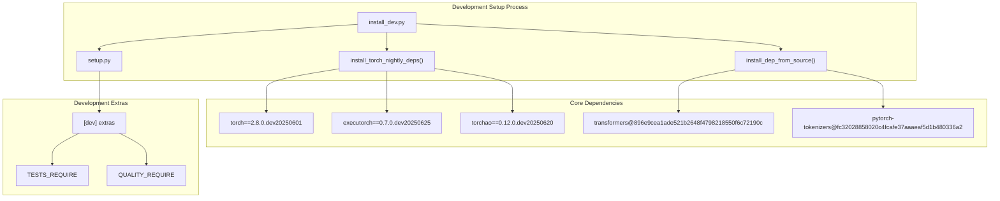
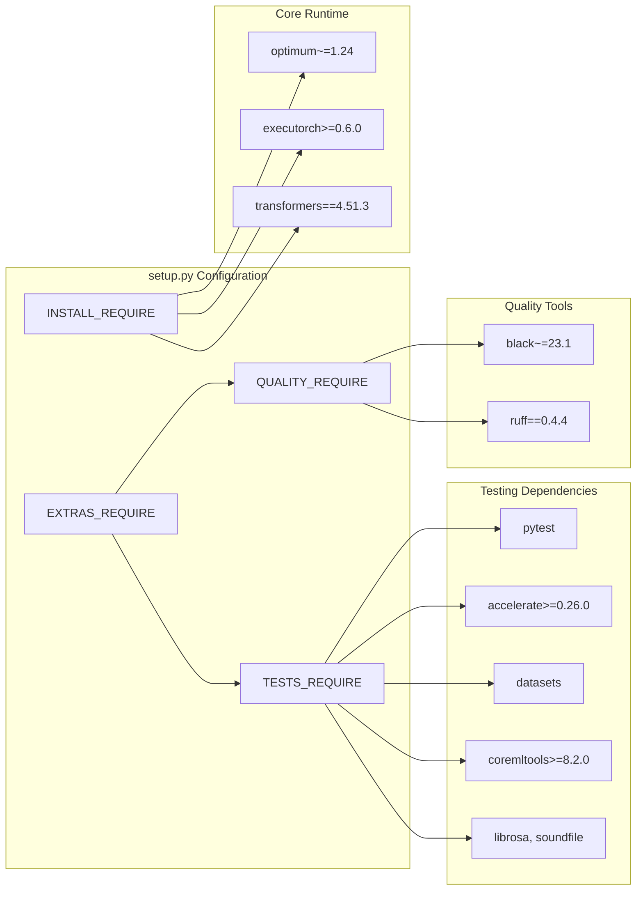
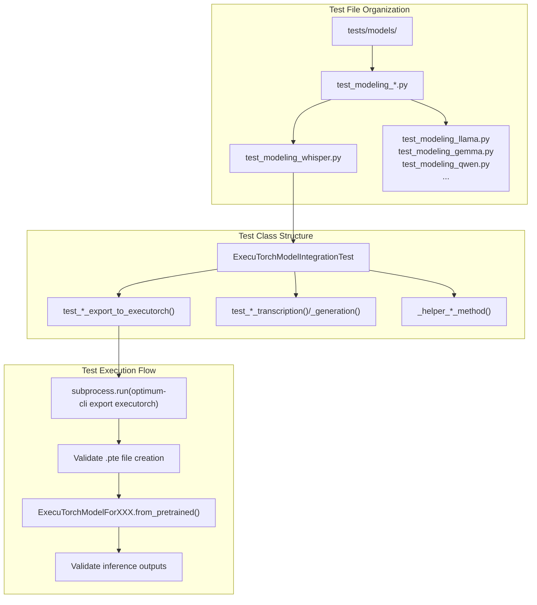
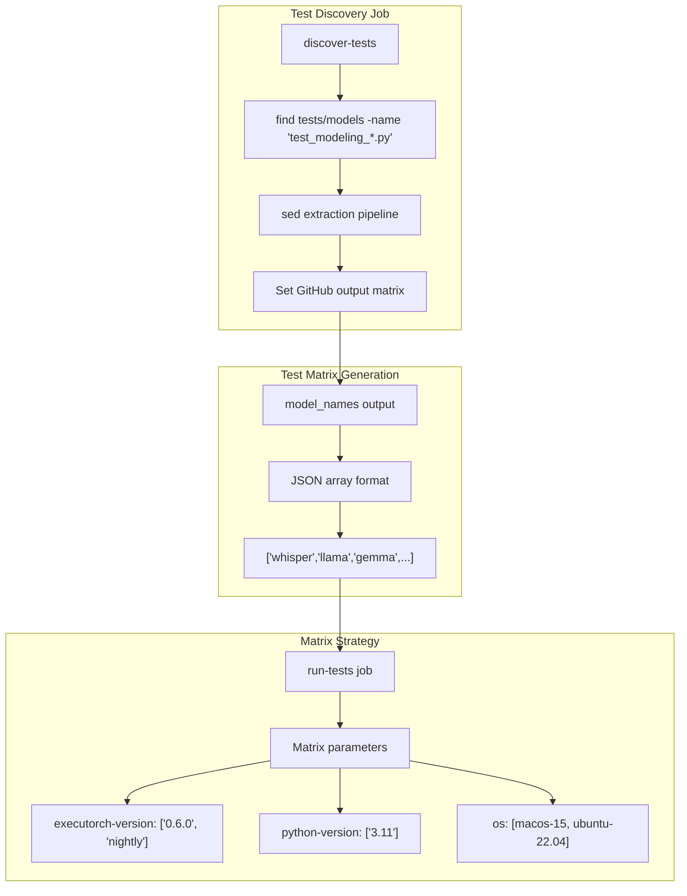
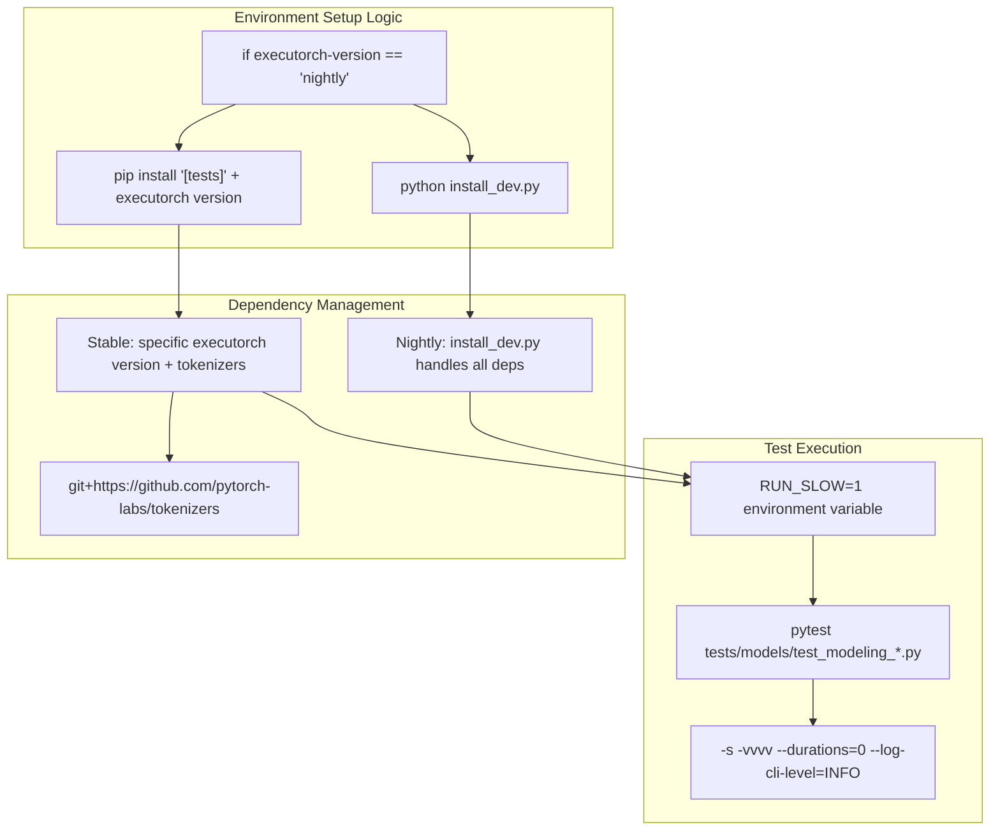

<!-- source: DeepWiki mcp.deepwiki.com · repo huggingface/optimum-executorch · page 7 Development and Contributing · fetched 2026-10-26 -->

# Development and Contributing

Relevant source files

The following files were used as context for generating this wiki page:

- [.github/workflows/test_models.yml](.github/workflows/test_models.yml)
- [install_dev.py](install_dev.py)
- [optimum/executorch/__init__.py](optimum/executorch/__init__.py)
- [optimum/exporters/executorch/tasks/__init__.py](optimum/exporters/executorch/tasks/__init__.py)
- [optimum/exporters/executorch/tasks/asr.py](optimum/exporters/executorch/tasks/asr.py)
- [setup.py](setup.py)
- [tests/models/test_modeling_whisper.py](tests/models/test_modeling_whisper.py)

This document provides comprehensive guidance for developers who want to contribute to or extend the optimum-executorch project. It covers the development environment setup, testing framework, CI/CD pipeline, and contribution guidelines.

For information about setting up optimum-executorch for regular usage, see [Installation and Setup](#1.1). For details about the specific testing commands and framework structure, see [Testing Framework](#7.2).

## Development Environment Setup

The optimum-executorch project requires a carefully configured development environment with specific versions of PyTorch, ExecuTorch, and related dependencies. The project provides automated tools to ensure consistency across development environments.

### Core Development Dependencies

The development setup is managed through two primary mechanisms: the package setup configuration and the development installation script.

**Sources:** [install_dev.py:1-74](), [setup.py:14-42]()

### Development Installation Process

The `install_dev.py` script provides the primary entry point for setting up a development environment. It orchestrates the installation of all required dependencies in the correct order:

| Function | Purpose | Key Dependencies |
|----------|---------|------------------|
| `install_torch_nightly_deps()` | Installs pinned nightly versions of PyTorch ecosystem | torch, executorch, torchvision, torchaudio, torchao |
| `install_dep_from_source()` | Installs dependencies from specific Git commits | transformers, pytorch-tokenizers |
| `main()` | Coordinates the full installation process | Calls pip install .[dev] and dependency functions |

The installation process supports the `--skip_override_torch` flag to allow developers to use their own PyTorch installation for specific testing scenarios.

**Sources:** [install_dev.py:6-73]()

### Package Configuration

The `setup.py` file defines the project structure and dependency requirements:

- **Python Version Support**: 3.10, 3.11, 3.12
- **Core Dependencies**: optimum~=1.24, executorch>=0.6.0, transformers==4.51.3
- **Development Extras**: Includes testing frameworks, quality tools, and specialized libraries

**Sources:** [setup.py:14-42]()

## Testing Framework

The optimum-executorch testing framework is designed to validate model export and inference capabilities across different ExecuTorch versions and operating systems. The testing system uses dynamic discovery to automatically detect and test all supported model families.

### Test Structure and Organization

The testing framework follows a consistent pattern where each model family has its own test file:

**Sources:** [tests/models/test_modeling_whisper.py:41-107]()

### Test Categories and Execution

The testing framework includes several categories of tests:

| Test Type | Decorator | Purpose | Example |
|-----------|-----------|---------|---------|
| Export Tests | No special decorator | Validate CLI export functionality | `test_whisper_export_to_executorch()` |
| Inference Tests | `@slow`, `@pytest.mark.run_slow` | Validate model inference quality | `test_whisper_transcription()` |
| Backend-Specific Tests | `@pytest.mark.portable` | Test specific ExecuTorch backends | `test_whisper_transcription_portable()` |
| Version-Specific Tests | `@pytest.mark.skipif` | Conditional tests based on versions | ExecuTorch >= 0.7.0 requirements |

**Sources:** [tests/models/test_modeling_whisper.py:93-107]()

### Test Implementation Pattern

Each model test follows a consistent implementation pattern demonstrated in the Whisper test:

1. **Export Test**: Uses `subprocess.run()` to call the CLI export command
2. **File Validation**: Checks for expected `.pte` file creation
3. **Model Loading**: Instantiates the appropriate `ExecuTorchModelForXXX` class
4. **Inference Validation**: Compares outputs against expected results

The test framework also includes environment setup with `os.environ["TOKENIZERS_PARALLELISM"] = "false"` to avoid parallelism issues during testing.

**Sources:** [tests/models/test_modeling_whisper.py:34-86]()

## CI/CD Pipeline

The continuous integration system is built around GitHub Actions and provides comprehensive testing across multiple ExecuTorch versions, Python versions, and operating systems.

### Dynamic Test Discovery

The CI pipeline uses a sophisticated test discovery mechanism to automatically identify and test all model families:

**Sources:** [.github/workflows/test_models.yml:14-29](), [.github/workflows/test_models.yml:32-42]()

### Test Execution Matrix

The CI system creates a comprehensive test matrix that ensures compatibility across different environments:

| Dimension | Values | Purpose |
|-----------|--------|---------|
| Model Types | Dynamically discovered from test files | Ensures all supported models are tested |
| ExecuTorch Versions | 0.6.0, nightly | Maintains compatibility across versions |
| Python Versions | 3.11 | Validates Python compatibility |
| Operating Systems | macos-15, ubuntu-22.04 | Cross-platform validation |

Each job in the matrix has a descriptive name format: `{model} (et={executorch-version}, py={python-version}, {os})`

**Sources:** [.github/workflows/test_models.yml:34-42]()

### Environment Setup and Test Execution

The CI pipeline handles environment setup differently based on the ExecuTorch version being tested:

**Sources:** [.github/workflows/test_models.yml:52-64]()

The test execution uses comprehensive logging and timing information to help diagnose issues and monitor performance across the test suite.

## Contributing Guidelines

### Code Quality Standards

The project maintains code quality through automated tools defined in the `QUALITY_REQUIRE` section:

- **Black**: Code formatting with version ~23.1
- **Ruff**: Linting with version 0.4.4

### Version Compatibility

The project supports multiple Python versions (3.10, 3.11, 3.12) and maintains compatibility with both stable and nightly ExecuTorch releases. Contributors should test changes against both the stable (0.6.0) and nightly ExecuTorch versions.

### Testing Requirements

All contributions must include appropriate tests following the established patterns:
- Export tests for new model families
- Inference validation tests
- Backend-specific tests where applicable
- Version compatibility checks using `@pytest.mark.skipif`

**Sources:** [setup.py:35-42](), [.github/workflows/test_models.yml:37-38]()

---

