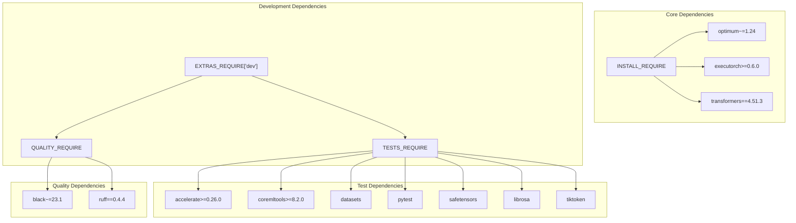
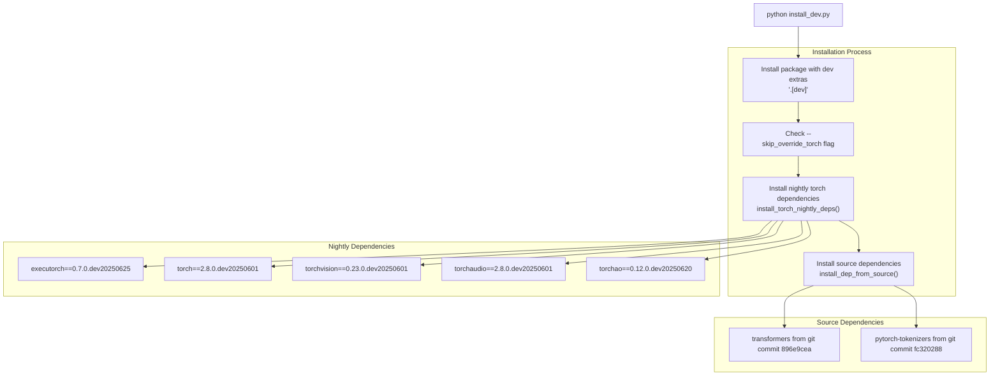
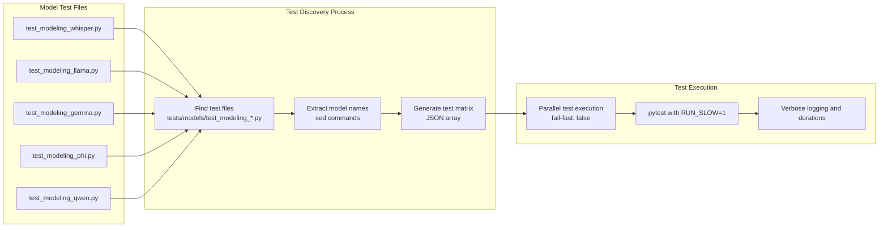
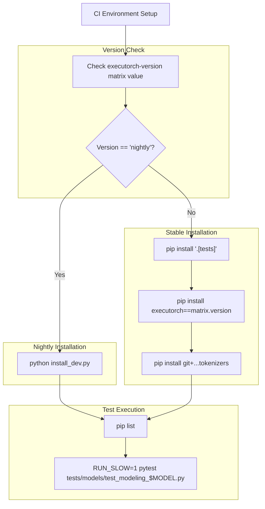
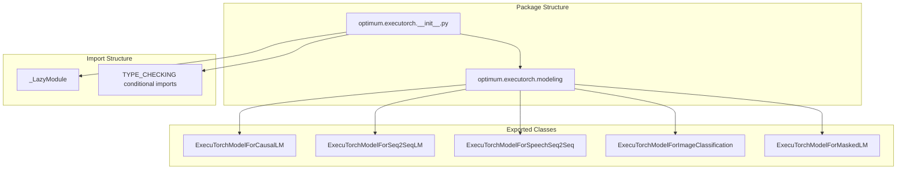

<!-- source: DeepWiki mcp.deepwiki.com · repo huggingface/optimum-executorch · page 7.1 Development Environment · fetched 2026-10-26 -->

# Development Environment

<details>
<summary>Relevant source files</summary>

The following files were used as context for generating this wiki page:

- [.github/workflows/test_models.yml](.github/workflows/test_models.yml)
- [install_dev.py](install_dev.py)
- [optimum/executorch/__init__.py](optimum/executorch/__init__.py)
- [optimum/exporters/executorch/tasks/__init__.py](optimum/exporters/executorch/tasks/__init__.py)
- [optimum/exporters/executorch/tasks/asr.py](optimum/exporters/executorch/tasks/asr.py)
- [setup.py](setup.py)
- [tests/models/test_modeling_whisper.py](tests/models/test_modeling_whisper.py)

</details>


This document covers the setup and configuration of a development environment for contributing to optimum-executorch. It includes system requirements, installation procedures, dependency management, and the continuous integration pipeline. For information about running tests, see [Testing Framework](#7.2). For documentation building, see [Documentation System](#7.3).

## System Requirements and Dependencies

The optimum-executorch project requires specific Python versions and dependencies to ensure compatibility with both the HuggingFace ecosystem and ExecuTorch runtime.

### Python Version Support

The project supports Python 3.10 through 3.12, with development and CI primarily focused on Python 3.11.

| Python Version | Support Level | CI Testing |
|----------------|---------------|------------|
| 3.10 | Minimum required | No |
| 3.11 | Primary development | Yes |
| 3.12 | Supported | No |

### Core Dependencies

The dependency structure is organized into multiple categories defined in `setup.py`:



**Sources:** [setup.py:14-42]()

## Development Installation Process

The project provides two installation methods: standard installation and development installation with nightly dependencies.

### Standard Installation

For basic development work:

```bash
pip install '.[dev]'
```

This installs the package in development mode with all testing and quality dependencies.

### Development Installation with Nightly Dependencies

For working with cutting-edge features, the `install_dev.py` script provides automated installation of nightly builds:



The nightly installation ensures compatibility with the latest ExecuTorch features and PyTorch developments. Specific version pinning prevents conflicts between nightly builds.

**Sources:** [install_dev.py:6-27](), [install_dev.py:29-49](), [install_dev.py:51-73]()

## Continuous Integration Environment

The CI pipeline uses GitHub Actions to test compatibility across multiple configurations and automatically discover new model tests.

### Test Matrix Configuration

The CI system tests against multiple combinations of environments:

| Parameter | Values | Purpose |
|-----------|--------|---------|
| `executorch-version` | `0.6.0`, `nightly` | Test stable and cutting-edge versions |
| `python-version` | `3.11` | Primary development Python version |
| `os` | `macos-15`, `ubuntu-22.04` | Cross-platform compatibility |

### Dynamic Test Discovery

The CI pipeline automatically discovers model tests using a systematic approach:



The discovery process uses shell commands to extract model names from test file paths, enabling automatic testing of newly added models without manual CI configuration updates.

**Sources:** [.github/workflows/test_models.yml:22-29](), [.github/workflows/test_models.yml:33-42]()

## Development Workflow Components

### Environment Setup Commands

The development environment supports different installation strategies based on development needs:

```bash
# Standard development installation
pip install '.[dev]'

# Nightly development installation
python install_dev.py

# Skip nightly torch installation
python install_dev.py --skip_override_torch
```

### CI Installation Process

The CI pipeline uses conditional logic to handle different ExecuTorch versions:



**Sources:** [.github/workflows/test_models.yml:52-64]()

### Testing Environment Variables

The development environment uses specific environment variables to control test behavior:

| Variable | Value | Purpose |
|----------|--------|---------|
| `RUN_SLOW` | `1` | Enable slow/integration tests |
| `TOKENIZERS_PARALLELISM` | `false` | Prevent tokenizer threading issues |
| `MODEL_NAME` | `${{ matrix.test-modeling }}` | Pass model name to test environment |

**Sources:** [.github/workflows/test_models.yml:44-45](), [tests/models/test_modeling_whisper.py:34]()

## Package Structure and Exports

The development environment exposes specific model classes through the main package interface:



The package uses lazy loading to optimize import time and support conditional imports for type checking.

**Sources:** [optimum/executorch/__init__.py:20-41]()

---

