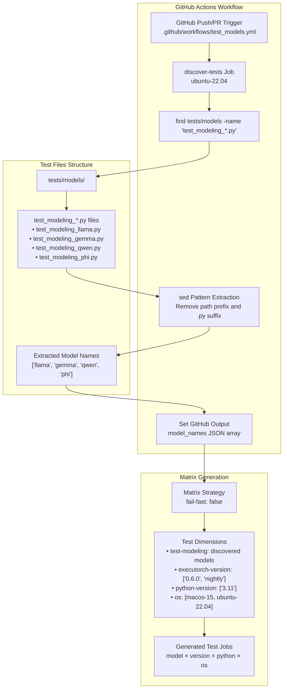
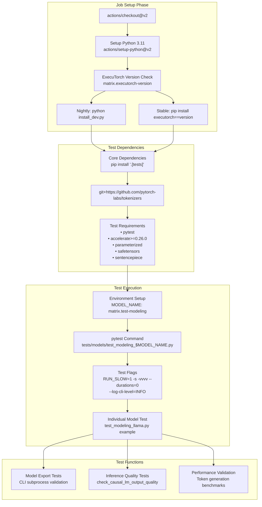
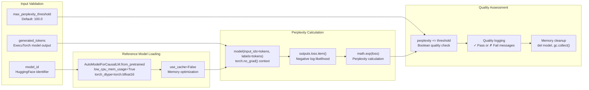
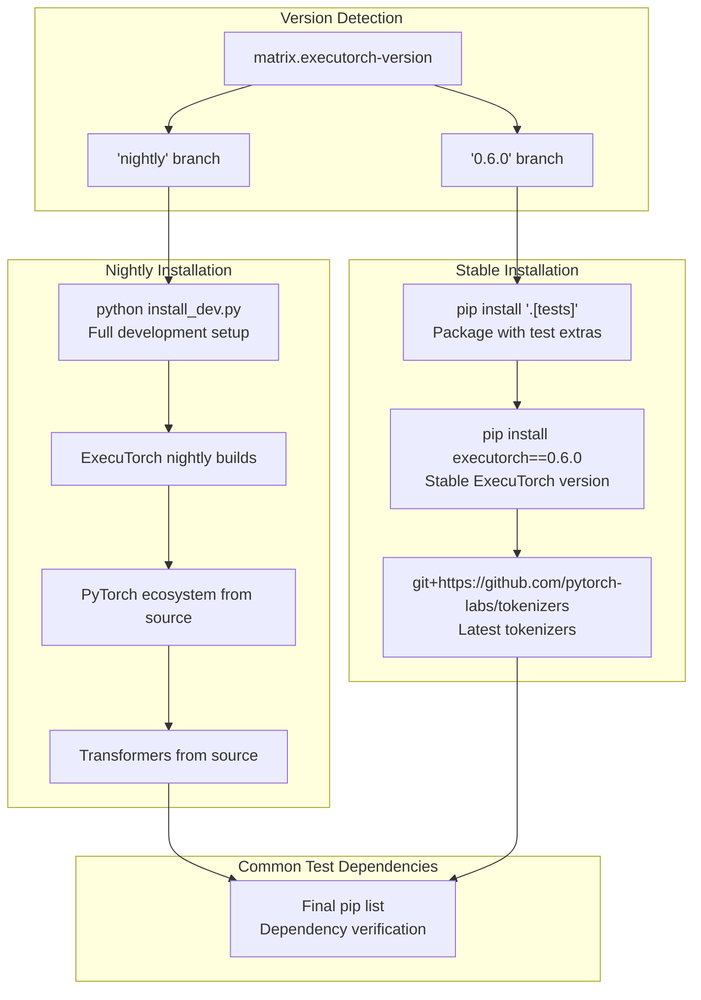
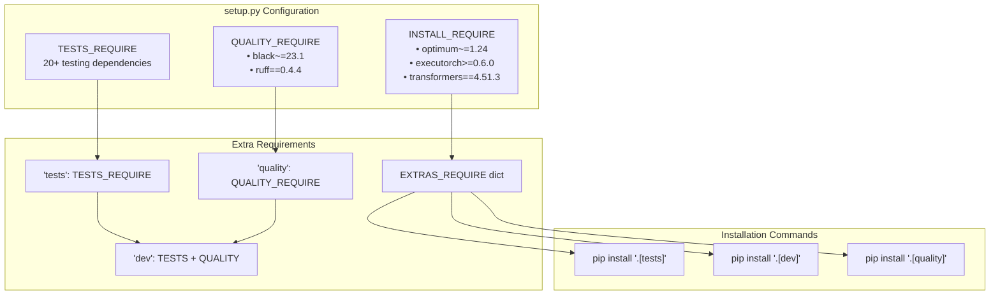

<!-- source: DeepWiki mcp.deepwiki.com · repo huggingface/optimum-executorch · page 7.2 Testing Framework · fetched 2026-10-26 -->

# Testing Framework

<details>
<summary>Relevant source files</summary>

The following files were used as context for generating this wiki page:

- [.github/workflows/test_models.yml](.github/workflows/test_models.yml)
- [setup.py](setup.py)
- [tests/utils.py](tests/utils.py)

</details>


This document covers the comprehensive testing infrastructure for optimum-executorch, including the CI/CD pipeline, test discovery mechanisms, quality validation utilities, and local development testing procedures. The testing framework ensures model export and inference functionality works correctly across different configurations and platforms.

For information about setting up the development environment, see [Development Environment](#7.1). For details about the documentation system, see [Documentation System](#7.3).

## Test Discovery and Execution Architecture

The testing framework uses a dynamic discovery system that automatically detects model test files and creates a comprehensive test matrix across multiple dimensions.

### Test Discovery Pipeline



Sources: [.github/workflows/test_models.yml:14-29]()

### Test Execution Flow



Sources: [.github/workflows/test_models.yml:46-64](), [setup.py:20-32]()

## Quality Validation Framework

The testing framework includes sophisticated quality validation mechanisms to ensure exported models maintain expected performance characteristics.

### Perplexity-Based Quality Validation

The core quality validation uses perplexity measurements to verify that exported models produce outputs comparable to the original HuggingFace models.

| Function | Purpose | Key Parameters |
|----------|---------|----------------|
| `check_causal_lm_output_quality` | Validates text generation quality | `model_id`, `generated_tokens`, `max_perplexity_threshold=100.0` |
| `check_close_recursively` | Compares tensor outputs recursively | `eager_outputs`, `exported_outputs`, `atol=1e-4`, `rtol=1e-4` |

### Quality Validation Process



Sources: [tests/utils.py:23-64]()

## Test Matrix Configuration

The CI/CD pipeline creates a comprehensive test matrix to validate functionality across multiple configurations:

### Matrix Dimensions

| Dimension | Values | Purpose |
|-----------|--------|---------|
| `test-modeling` | Dynamically discovered model names | Tests individual model families |
| `executorch-version` | `['0.6.0', 'nightly']` | Validates against stable and development ExecuTorch |
| `python-version` | `['3.11']` | Ensures Python compatibility |
| `os` | `['macos-15', 'ubuntu-22.04']` | Cross-platform validation |

### Installation Strategy by Version



Sources: [.github/workflows/test_models.yml:52-61]()

## Test Dependencies and Setup

The testing framework requires a comprehensive set of dependencies organized into logical groups.

### Dependency Categories

| Category | Dependencies | Purpose |
|----------|-------------|---------|
| **Core Testing** | `pytest`, `parameterized` | Test execution and parameterization |
| **Model Loading** | `accelerate>=0.26.0`, `safetensors`, `transformers==4.51.3` | Model handling and acceleration |
| **Audio Processing** | `librosa`, `soundfile` | Speech model testing |
| **Text Processing** | `sentencepiece`, `tiktoken` | Tokenization for various models |
| **Quality Assurance** | `datasets` | Dataset loading for validation |
| **Platform Specific** | `coremltools>=8.2.0` | macOS CoreML backend testing |

### Setup Configuration Structure



Sources: [setup.py:14-42]()

## Running Tests Locally

To execute the test suite locally, developers can use the same patterns as the CI/CD pipeline:

### Individual Model Testing
```bash
# Test a specific model with verbose output
RUN_SLOW=1 pytest tests/models/test_modeling_llama.py -s -vvvv --durations=0 --log-cli-level=INFO

# Test all models (long-running)
RUN_SLOW=1 pytest tests/models/ -s -vvvv --durations=0 --log-cli-level=INFO
```

### Environment Setup for Local Testing
```bash
# For development with nightly builds
python install_dev.py

# For stable testing
pip install '.[tests]'
pip install executorch==0.6.0
pip install git+https://github.com/pytorch-labs/tokenizers
```

### Test Flags and Options

| Flag | Purpose |
|------|---------|
| `RUN_SLOW=1` | Enables slow/comprehensive tests |
| `-s` | Disables output capturing for real-time logs |
| `-vvvv` | Maximum verbosity level |
| `--durations=0` | Shows timing for all tests |
| `--log-cli-level=INFO` | Sets logging level for CLI output |

Sources: [.github/workflows/test_models.yml:64]()

---

