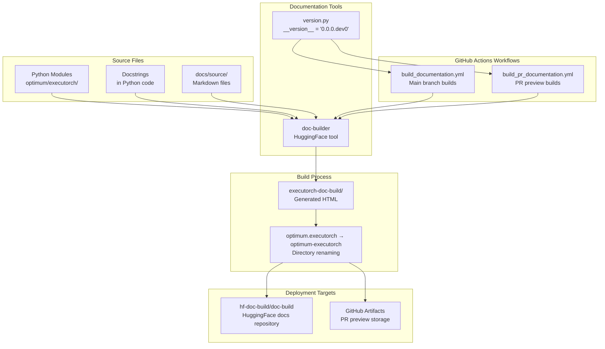
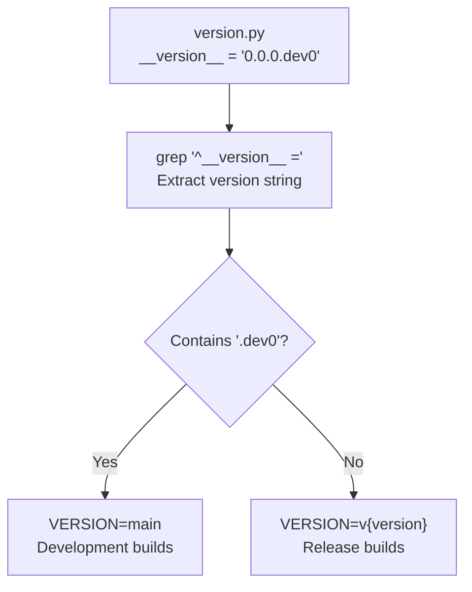

<!-- source: DeepWiki mcp.deepwiki.com · repo huggingface/optimum-executorch · page 7.3 Documentation System · fetched 2026-10-26 -->

# Documentation System

<details>
<summary>Relevant source files</summary>

The following files were used as context for generating this wiki page:

- [.github/workflows/build_documentation.yml](.github/workflows/build_documentation.yml)
- [.github/workflows/build_pr_documentation.yml](.github/workflows/build_pr_documentation.yml)
- [optimum/executorch/version.py](optimum/executorch/version.py)

</details>


## Purpose and Scope

This document covers the documentation generation, building, and deployment system used in optimum-executorch. It explains how documentation is automatically built from source files, deployed to hosting infrastructure, and managed across different versions and pull requests.

For information about the development environment setup, see [Development Environment](#7.1). For details about the testing framework, see [Testing Framework](#7.2).

## Documentation Architecture Overview

The documentation system in optimum-executorch uses HuggingFace's `doc-builder` tool to generate static HTML documentation from Python docstrings and markdown files. The system is integrated with GitHub Actions for automated building and deployment.



**Sources:** [.github/workflows/build_documentation.yml:1-71](), [.github/workflows/build_pr_documentation.yml:1-62](), [optimum/executorch/version.py:15]()

## Build Process Flow

The documentation build process follows a standardized pipeline that handles both main branch releases and pull request previews. The process uses the `doc-builder` command with specific parameters for the optimum-executorch repository.

```mermaid
graph LR
    subgraph "Environment Setup"
        PYTHON_SETUP["actions/setup-python@v4<br/>Python 3.11"]
        NODE_SETUP["actions/setup-node@v4<br/>Node.js 18"]
        PIP_INSTALL["pip install<br/>doc-builder + dependencies"]
    end
    
    subgraph "Version Detection"
        VERSION_CHECK["version.py parsing<br/>grep '^__version__'"]
        DEV_CHECK["*.dev0 detection<br/>main vs release"]
        ENV_VERSION["VERSION environment<br/>main or v{version}"]
    end
    
    subgraph "Doc Builder Command"
        BUILD_CMD["doc-builder build<br/>optimum.executorch docs/source/"]
        BUILD_PARAMS["Parameters:<br/>--repo_name optimum-executorch<br/>--build_dir executorch-doc-build/<br/>--html --clean"]
    end
    
    subgraph "Post-Processing"
        CHMOD["sudo chmod -R ugo+rwx<br/>Permission fix"]
        RENAME["mv optimum.executorch<br/>optimum-executorch"]
        COMMIT_SHA["Commit SHA tracking<br/>for deployment"]
    end
    
    subgraph "Deployment"
        MAIN_PUSH["doc-builder push<br/>to hf-doc-build"]
        PR_ARTIFACT["actions/upload-artifact@v4<br/>PR previews"]
    end
    
    PYTHON_SETUP --> PIP_INSTALL
    NODE_SETUP --> PIP_INSTALL
    PIP_INSTALL --> VERSION_CHECK
    
    VERSION_CHECK --> DEV_CHECK
    DEV_CHECK --> ENV_VERSION
    
    ENV_VERSION --> BUILD_CMD
    BUILD_CMD --> BUILD_PARAMS
    
    BUILD_PARAMS --> CHMOD
    CHMOD --> RENAME
    RENAME --> COMMIT_SHA
    
    COMMIT_SHA --> MAIN_PUSH
    COMMIT_SHA --> PR_ARTIFACT
```



**Sources:** [.github/workflows/build_documentation.yml:27-71](), [.github/workflows/build_pr_documentation.yml:28-62]()

## CI/CD Pipeline Configuration

### Main Documentation Workflow

The primary documentation build workflow [`build_documentation.yml`](.github/workflows/build_documentation.yml:1-71)() handles official documentation releases and is triggered on:

| Trigger | Condition | Version Strategy |
|---------|-----------|------------------|
| `push` to `main` | Development commits | Uses `main` if version contains `.dev0` |
| `tags` | Release tags matching `v[0-9]+.[0-9]+.[0-9]+` | Uses actual version from [`version.py`](optimum/executorch/version.py:15)() |
| `workflow_dispatch` | Manual trigger | Same logic as push |

The workflow performs version detection by parsing [`version.py`](optimum/executorch/version.py:15)():

```bash
version=`echo "$(grep '^__version__ =' executorch/version.py | cut -d '=' -f 2- | xargs)"`
if [[ $version == *.dev0 ]]
then
  echo "VERSION=main" >> $GITHUB_ENV
else
  echo "VERSION=v$version" >> $GITHUB_ENV
fi
```

### Pull Request Documentation Workflow

The PR preview workflow [`build_pr_documentation.yml`](.github/workflows/build_pr_documentation.yml:1-62)() provides documentation previews for pull requests:

- **Trigger**: Pull requests targeting `main` branch
- **Concurrency**: Cancels previous builds for the same PR using `${{ github.workflow }}-${{ github.head_ref || github.run_id }}`
- **Versioning**: Uses `pr_${{ env.PR_NUMBER }}` format
- **Output**: GitHub artifacts instead of direct deployment

**Sources:** [.github/workflows/build_documentation.yml:3-42](), [.github/workflows/build_pr_documentation.yml:4-46]()

## Doc-Builder Integration

The documentation system uses HuggingFace's `doc-builder` tool with the following configuration:

### Build Command Parameters

```bash
doc-builder build optimum.executorch docs/source/ \
  --repo_name optimum-executorch \
  --build_dir executorch-doc-build/ \
  --version ${{ env.VERSION }} \
  --version_tag_suffix "" \
  --html \
  --clean
```

### Key Parameters

| Parameter | Purpose | Value |
|-----------|---------|-------|
| `optimum.executorch` | Python package to document | Main package identifier |
| `docs/source/` | Source directory | Contains markdown and configuration |
| `--repo_name` | Repository identifier | `optimum-executorch` |
| `--build_dir` | Output directory | `executorch-doc-build/` |
| `--version` | Documentation version | Dynamic based on git context |
| `--html` | Output format | Generate HTML documentation |
| `--clean` | Build behavior | Clean previous builds |

### Directory Transformation

The build process includes a critical directory renaming step:

```bash
sudo mv optimum.executorch optimum-executorch
```

This aligns the build output directory name with the repository naming convention used by the HuggingFace documentation hosting system.

**Sources:** [.github/workflows/build_documentation.yml:57-63](), [.github/workflows/build_pr_documentation.yml:42-48]()

## Version Management System

The documentation versioning system is based on the [`__version__`](optimum/executorch/version.py:15)() variable in [`version.py`](optimum/executorch/version.py:1-16)():

### Version Detection Logic



### Version Scenarios

| Version in `version.py` | Detected VERSION | Documentation URL |
|------------------------|------------------|-------------------|
| `0.0.0.dev0` | `main` | `/main/` path |
| `1.0.0` | `v1.0.0` | `/v1.0.0/` path |
| `1.2.3` | `v1.2.3` | `/v1.2.3/` path |

**Sources:** [.github/workflows/build_documentation.yml:34-42](), [optimum/executorch/version.py:15]()

## Deployment and Hosting

### Main Branch Deployment

Main branch documentation is deployed to the `hf-doc-build/doc-build` repository using:

```bash
doc-builder push optimum-executorch \
  --doc_build_repo_id "hf-doc-build/doc-build" \
  --token "${{ secrets.HF_DOC_BUILD_PUSH }}" \
  --commit_msg "Updated with commit $COMMIT_SHA" \
  --n_retries 5
```

### PR Preview System

Pull request previews use GitHub's artifact system:

```bash
echo ${{ env.COMMIT_SHA }} > ./commit_sha
echo ${{ env.PR_NUMBER }} > ./pr_number
```

The artifacts include:
- Generated HTML documentation
- Commit SHA for tracking
- PR number for identification

### Permission Management

Both workflows include permission fixes for the build directory:

```bash
sudo chmod -R ugo+rwx executorch-doc-build
```

This ensures the generated files are accessible for subsequent processing steps.

**Sources:** [.github/workflows/build_documentation.yml:65-70](), [.github/workflows/build_pr_documentation.yml:50-61]()