# Page: Overview

# Overview

<details>
<summary>Relevant source files</summary>

The following files were used as context for generating this wiki page:

- [README.md](README.md)

</details>


## Purpose and Scope

Optimum ExecuTorch is a bridge library that enables conversion and deployment of HuggingFace models using Meta's ExecuTorch runtime framework. This document provides a comprehensive overview of the system's architecture, core components, and capabilities for optimizing transformer models for mobile and edge device deployment.

This overview covers the high-level system design and main workflows. For detailed installation instructions, see [Installation and Setup](#1.1). For step-by-step usage examples, see [Quick Start Guide](#1.2). For comprehensive model export details, see [Model Export System](#2). For inference and runtime information, see [Runtime and Inference](#3).

## System Architecture

The optimum-executorch system operates as a bridge between the HuggingFace ecosystem and ExecuTorch runtime, providing model conversion, optimization, and inference capabilities.

### High-Level Architecture

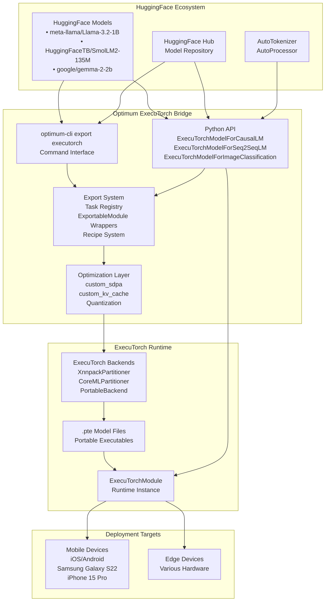

Sources: [README.md:1-233]()

### Core Components

The system consists of three primary layers:

| Component | Purpose | Key Classes/Functions |
|-----------|---------|----------------------|
| **Export Layer** | Convert HuggingFace models to ExecuTorch format | `CausalLMExportableModule`, `Seq2SeqLMExportableModule`, `VisionEncoderExportableModule` |
| **Optimization Layer** | Apply performance optimizations | `custom_sdpa`, `custom_kv_cache`, quantization schemes |
| **Runtime Layer** | Execute optimized models | `ExecuTorchModelForCausalLM`, `ExecuTorchModelForSeq2SeqLM`, `ExecuTorchModule` |

Sources: [README.md:15-19](), [README.md:54-116]()

## Key Capabilities

### Model Support

Optimum ExecuTorch supports a comprehensive range of transformer architectures:

- **Text Models**: Causal LM (Llama, Gemma, Qwen), Seq2Seq (T5), Masked LM (BERT, RoBERTa)
- **Vision Models**: Image classification (ViT, EfficientNet, Swin)
- **Audio Models**: Speech recognition (Whisper)

The system handles over 20 model families with variants, including popular models like `HuggingFaceTB/SmolLM2-135M`, `meta-llama/Llama-3.2-1B`, and `google/gemma-2-2b`.

Sources: [README.md:141-193]()

### Performance Optimizations

The library implements several key optimizations:

- **Custom SDPA**: 3x performance improvement over default attention
- **Custom KV Cache**: 2.5x improvement with in-place cache updates
- **Quantization**: int8 dynamic activations with int4 grouped weights (`8da4w`)
- **Batch Prefill**: 20x faster time-to-first-token processing

Sources: [README.md:121-139]()

## Export and Inference Workflow

### Model Export Pipeline

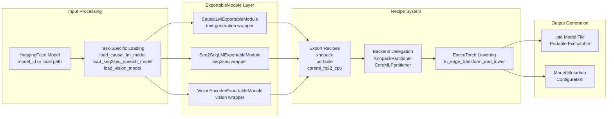

Sources: [README.md:84-96](), [README.md:128-131]()

### Runtime Inference System

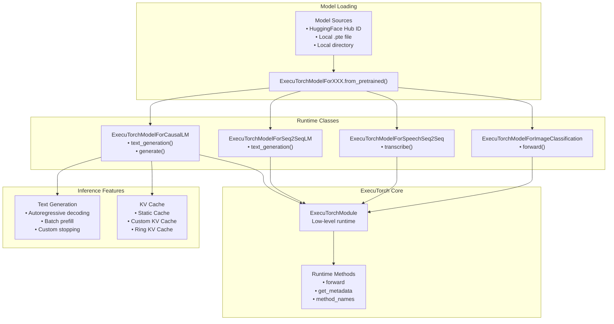

Sources: [README.md:55-77](), [README.md:100-116]()

## Usage Patterns

The system supports two primary usage patterns:

1. **One-Step API**: Direct model loading with on-the-fly export using `ExecuTorchModelForCausalLM.from_pretrained()`
2. **Two-Step Process**: Separate export via CLI (`optimum-cli export executorch`) followed by runtime loading

Both approaches support the same optimization features including custom attention, quantization, and backend delegation.

Sources: [README.md:52-116]()

## Performance Characteristics

Optimum ExecuTorch achieves significant performance improvements on mobile devices:

| Device | SmolLM2-135M Performance |
|--------|-------------------------|
| Samsung Galaxy S22 5G | 202.28 tok/s |
| iPhone 15 Pro | 29.64 tok/s |
| iPhone 15 | 7.47 tok/s |

These benchmarks utilize custom SDPA, KV-cache optimization, and 8da4w quantization for optimal mobile performance.

Sources: [README.md:195-210]()

---

# Page: Installation and Setup

# Installation and Setup

<details>
<summary>Relevant source files</summary>

The following files were used as context for generating this wiki page:

- [.github/workflows/test_models.yml](.github/workflows/test_models.yml)
- [install_dev.py](install_dev.py)
- [optimum/executorch/__init__.py](optimum/executorch/__init__.py)
- [optimum/exporters/executorch/tasks/__init__.py](optimum/exporters/executorch/tasks/__init__.py)
- [optimum/exporters/executorch/tasks/asr.py](optimum/exporters/executorch/tasks/asr.py)
- [setup.py](setup.py)
- [tests/models/test_modeling_whisper.py](tests/models/test_modeling_whisper.py)

</details>


This document covers how to install optimum-executorch for both end-users and developers. It includes standard installation methods, development setup procedures, and verification steps to ensure your installation is working correctly.

For information about using the installed package for model export, see [Quick Start Guide](#1.2). For details about setting up a development environment for contributing to the project, see [Development Environment](#7.1).

## Prerequisites

Before installing optimum-executorch, ensure your system meets the following requirements:

| Requirement | Specification |
|-------------|---------------|
| Python Version | 3.10 or higher |
| Operating Systems | Linux, macOS, Windows |
| Architecture | x86_64, ARM64 |

The package has been tested on the following platforms as shown in the CI configuration:

- **macOS-15** with Python 3.11
- **ubuntu-22.04** with Python 3.11

**Installation Dependencies Flow**

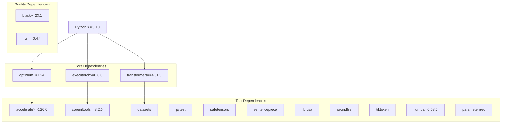

Sources: [setup.py:14-32](), [setup.py:58-61]()

## Standard Installation

### Basic Installation

Install the stable version of optimum-executorch from PyPI:

```bash
pip install optimum-executorch
```

This installs the core dependencies required for basic model export and inference functionality.

### Installation with Test Dependencies

For users who want to run the test suite or use additional model validation features:

```bash
pip install optimum-executorch[tests]
```

### Installation with Development Tools

For users contributing to the project or requiring code quality tools:

```bash
pip install optimum-executorch[dev]
```

This includes both test dependencies and quality tools like `black` and `ruff`.

**Standard Installation Process**

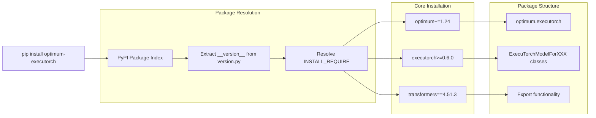

Sources: [setup.py:45-75]()

## Development Installation

For contributors or users requiring the latest features, use the development installation script that installs nightly builds and dependencies from source.

### Using the Development Script

The repository provides an `install_dev.py` script that automates the development setup:

```bash
python install_dev.py
```

This script performs the following operations:

1. **Installs package with development extras**: `pip install .[dev]`
2. **Installs nightly PyTorch ecosystem**: Pinned nightly versions of torch, executorch, torchao
3. **Installs dependencies from source**: Specific commits of transformers and tokenizers

### Development Installation Process

```mermaid
graph TD
    DevScript["python install_dev.py"]
    
    subgraph "Development Package Installation"
        DevInstall["pip install .[dev]"]
        TestDeps["Install TESTS_REQUIRE"]
        QualityDeps["Install QUALITY_REQUIRE"]
    end
    
    subgraph "Nightly Dependencies"
        NightlyCheck["install_torch_nightly_deps()"]
        ExecutorchNightly["executorch==0.7.0.dev20250625"]
        TorchNightly["torch==2.8.0.dev20250601"]
        TorchaudioNightly["torchaudio==2.8.0.dev20250601"]
        TorchvisionNightly["torchvision==0.23.0.dev20250601"] 
        TorchaoNightly["torchao==0.12.0.dev20250620"]
        NightlyIndex["--extra-index-url pytorch nightly"]
    end
    
    subgraph "Source Dependencies"
        SourceInstall["install_dep_from_source()"]
        TransformersSource["git+transformers@896e9cea1ade521b"]
        TokenizersSource["git+pytorch-labs/tokenizers@fc32028"]
    end
    
    DevScript --> DevInstall
    DevInstall --> TestDeps
    DevInstall --> QualityDeps
    
    DevScript --> NightlyCheck
    NightlyCheck --> ExecutorchNightly
    NightlyCheck --> TorchNightly
    NightlyCheck --> TorchaudioNightly
    NightlyCheck --> TorchvisionNightly
    NightlyCheck --> TorchaoNightly
    NightlyCheck --> NightlyIndex
    
    DevScript --> SourceInstall
    SourceInstall --> TransformersSource
    SourceInstall --> TokenizersSource
```

Sources: [install_dev.py:51-73](), [install_dev.py:6-26](), [install_dev.py:29-48]()

### Skipping Nightly Dependencies

To skip the nightly PyTorch dependencies installation (useful if you already have specific versions):

```bash
python install_dev.py --skip_override_torch
```

### Version Pinning in Development

The development script uses specific version pins for reproducibility:

| Component | Version Pin | Purpose |
|-----------|-------------|---------|
| ExecuTorch | `0.7.0.dev20250625` | Nightly build compatibility |
| Torch | `2.8.0.dev20250601` | Aligned with ExecuTorch requirements |
| TorchAO | `0.12.0.dev20250620` | Quantization support |
| Transformers | `896e9cea1ade521b` (4.53.1) | Source commit pin |
| Tokenizers | `fc32028858020c4fcafe37aaaeaf5d1b480336a2` | PyTorch Labs tokenizers |

Sources: [install_dev.py:8-11](), [install_dev.py:37-47]()

## Verifying Installation

After installation, verify that optimum-executorch is working correctly:

### Check Package Import

```python
from optimum.executorch import (
    ExecuTorchModelForCausalLM,
    ExecuTorchModelForImageClassification,
    ExecuTorchModelForMaskedLM,
    ExecuTorchModelForSeq2SeqLM,
    ExecuTorchModelForSpeechSeq2Seq,
)
```

### Verify ExecuTorch Backend

```python
from executorch.extension.pybindings.portable_lib import ExecuTorchModule
print("ExecuTorch backend available")
```

### Check CLI Availability

```bash
optimum-cli export executorch --help
```

### Run Test Suite

For development installations, run the test suite to ensure everything is working:

```bash
# Run all tests (slow)
RUN_SLOW=1 pytest tests/ -v

# Run specific model tests
RUN_SLOW=1 pytest tests/models/test_modeling_whisper.py -v
```

Sources: [optimum/executorch/__init__.py:20-28](), [tests/models/test_modeling_whisper.py:30]()

## CI/CD Testing Matrix

The project uses automated testing across multiple configurations to ensure installation stability:

**Testing Configuration Matrix**

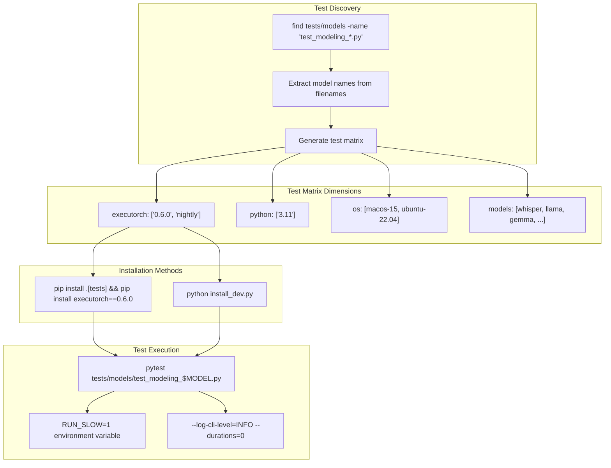

Sources: [.github/workflows/test_models.yml:14-29](), [.github/workflows/test_models.yml:31-43](), [.github/workflows/test_models.yml:52-64]()

## Troubleshooting

### Common Installation Issues

| Issue | Symptoms | Solution |
|-------|----------|----------|
| Python Version | `python_requires>=3.10.0` error | Upgrade to Python 3.10+ |
| ExecuTorch Version | Import errors with `ExecuTorchModule` | Ensure executorch >= 0.6.0 |
| Numba Conflict | Runtime errors with numba | Avoid numba 0.58.0 (automatically excluded) |
| Transformers Version | Model loading issues | Use pinned transformers==4.51.3 |

### Development Setup Issues

- **Nightly dependency conflicts**: Use `--skip_override_torch` flag if you have custom PyTorch setup
- **Git access issues**: Ensure git credentials are configured for GitHub access when installing from source
- **Build failures**: Check that you have compatible C++ compiler for building dependencies

### Environment Isolation

For clean installations, consider using virtual environments:

```bash
# Create virtual environment
python -m venv optimum-executorch-env
source optimum-executorch-env/bin/activate  # Linux/macOS
# or optimum-executorch-env\Scripts\activate  # Windows

# Install in isolated environment
pip install optimum-executorch
```

Sources: [setup.py:28](), [setup.py:72](), [install_dev.py:55-58]()

---

# Page: Quick Start Guide

# Quick Start Guide

<details>
<summary>Relevant source files</summary>

The following files were used as context for generating this wiki page:

- [README.md](README.md)
- [optimum/executorch/modeling.py](optimum/executorch/modeling.py)
- [optimum/exporters/executorch/utils.py](optimum/exporters/executorch/utils.py)

</details>


This guide provides a practical walkthrough of the two main approaches for using optimum-executorch: exporting HuggingFace models to ExecuTorch format and running inference. It covers the essential steps from model loading to text generation using both the integrated Python API and the separate CLI export approach.

For detailed information about supported models, see [Supported Models](#5). For comprehensive export options and CLI reference, see [Command Line Interface](#6).

## Usage Patterns

Optimum-executorch provides two primary workflows for converting and running HuggingFace models with ExecuTorch:

### Pattern 1: Integrated Python API

The most streamlined approach uses the `ExecuTorchModelForXXX.from_pretrained()` method to handle export and loading in a single call:

```python
from optimum.executorch import ExecuTorchModelForCausalLM
from transformers import AutoTokenizer

# Load and export model automatically
model = ExecuTorchModelForCausalLM.from_pretrained(
    "HuggingFaceTB/SmolLM2-135M-Instruct",
    recipe="xnnpack",
    attn_implementation="custom_sdpa",
    use_custom_kv_cache=True,
    **{"qlinear": "8da4w", "qembedding": "8w"}
)

# Generate text immediately
tokenizer = AutoTokenizer.from_pretrained("HuggingFaceTB/SmolLM2-135M-Instruct")
generated_text = model.text_generation(
    tokenizer=tokenizer,
    prompt="Once upon a time",
    max_seq_len=128
)
```

### Pattern 2: CLI Export + Python Loading

For more control over the export process or for batch processing, use the CLI tool followed by Python loading:

**Step 1: Export via CLI**
```bash
optimum-cli export executorch \
    --model "HuggingFaceTB/SmolLM2-135M-Instruct" \
    --task "text-generation" \
    --recipe "xnnpack" \
    --use_custom_sdpa \
    --use_custom_kv_cache \
    --qlinear 8da4w \
    --qembedding 8w \
    --output_dir="./exported_model"
```

**Step 2: Load and run inference**
```python
from optimum.executorch import ExecuTorchModelForCausalLM
from transformers import AutoTokenizer

# Load pre-exported model
model = ExecuTorchModelForCausalLM.from_pretrained("./exported_model")
tokenizer = AutoTokenizer.from_pretrained("HuggingFaceTB/SmolLM2-135M-Instruct")

generated_text = model.text_generation(
    tokenizer=tokenizer,
    prompt="Once upon a time",
    max_seq_len=128
)
```

**Sources:** [README.md:50-116](), [optimum/executorch/modeling.py:278-372]()

## System Flow Overview

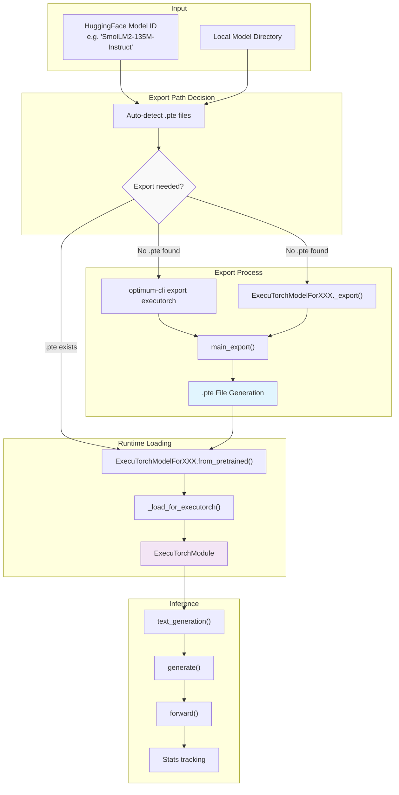

**Sources:** [optimum/executorch/modeling.py:278-372](), [README.md:82-116](), [optimum/exporters/executorch/__init__.py]()

## Core Model Classes

The system provides task-specific model classes that inherit from `ExecuTorchModelBase`:

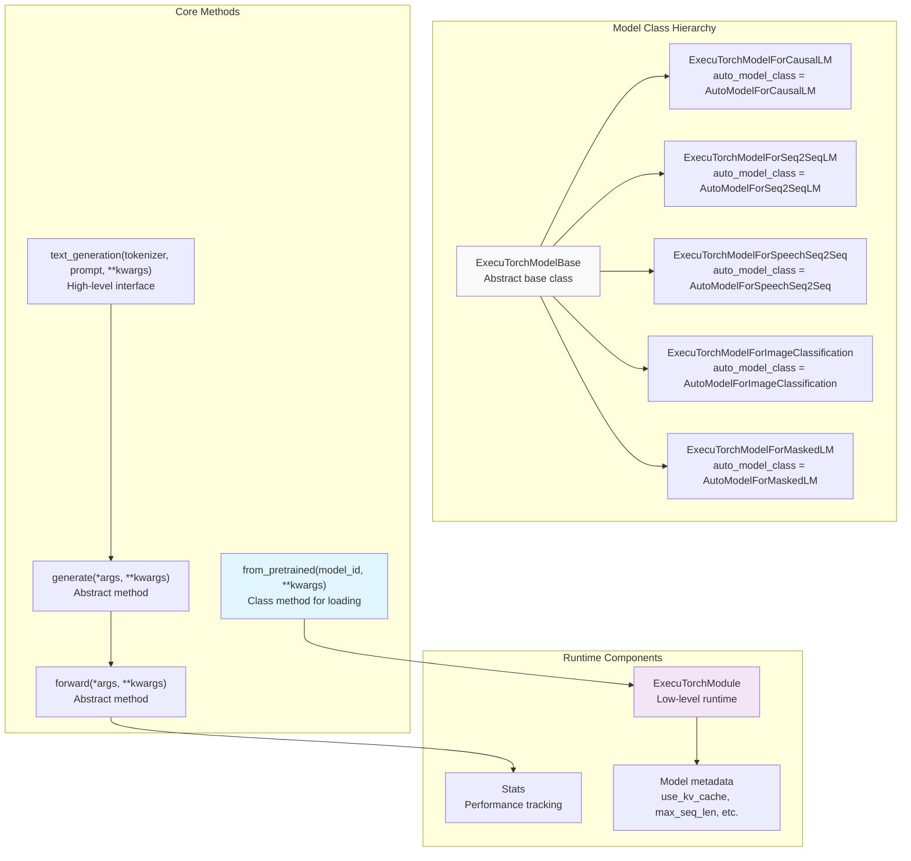

**Sources:** [optimum/executorch/modeling.py:56-120](), [optimum/executorch/modeling.py:570-797](), [optimum/executorch/modeling.py:374-568]()

## Key Configuration Parameters

| Parameter | Purpose | Example Values | Applied At |
|-----------|---------|----------------|------------|
| `recipe` | Backend delegation strategy | `"xnnpack"`, `"portable"`, `"coreml"` | Export |
| `attn_implementation` | Attention mechanism | `"custom_sdpa"`, `"sdpa"`, `"eager"` | Export |
| `use_custom_kv_cache` | KV cache optimization | `True`, `False` | Export |
| `qlinear` | Linear layer quantization | `"8da4w"`, `"4w"`, `"8w"` | Export |
| `qembedding` | Embedding quantization | `"8w"`, `"4w"` | Export |
| `max_seq_len` | Maximum sequence length | `128`, `512`, `1024` | Runtime |
| `echo` | Include prompt in output | `True`, `False` | Runtime |

## Method Invocation Flow

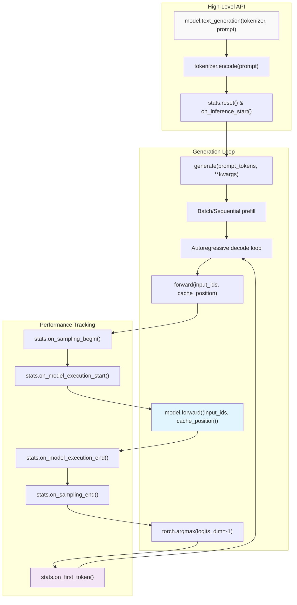

**Sources:** [optimum/executorch/modeling.py:745-796](), [optimum/executorch/modeling.py:654-743](), [optimum/executorch/modeling.py:627-652]()

## Essential Import Statements

For typical usage, these imports are required:

```python
# Core model classes
from optimum.executorch import ExecuTorchModelForCausalLM
from optimum.executorch import ExecuTorchModelForSeq2SeqLM
from optimum.executorch import ExecuTorchModelForSpeechSeq2Seq

# HuggingFace components
from transformers import AutoTokenizer, AutoProcessor

# For lower-level access
from executorch.extension.pybindings.portable_lib import ExecuTorchModule
```

The `from_pretrained()` method automatically handles the detection of whether export is needed based on the presence of `.pte` files in the model directory, making it the recommended entry point for most use cases.

**Sources:** [optimum/executorch/modeling.py:15-48](), [optimum/executorch/modeling.py:278-372]()

---

# Page: Model Export System

# Model Export System

<details>
<summary>Relevant source files</summary>

The following files were used as context for generating this wiki page:

- [optimum/executorch/attentions/custom_kv_cache.py](optimum/executorch/attentions/custom_kv_cache.py)
- [optimum/exporters/executorch/convert.py](optimum/exporters/executorch/convert.py)
- [optimum/exporters/executorch/integrations.py](optimum/exporters/executorch/integrations.py)
- [tests/models/test_modeling_common.py](tests/models/test_modeling_common.py)
- [tests/models/test_modeling_qwen2.py](tests/models/test_modeling_qwen2.py)

</details>


## Purpose and Scope

The Model Export System is responsible for converting HuggingFace models into ExecuTorch-compatible `.pte` (Portable Executable) files. This system bridges the gap between HuggingFace's transformer models and ExecuTorch's optimized runtime environment, enabling deployment on mobile and edge devices.

This document covers the export pipeline, task-specific model handling, exportable module wrappers, and recipe integration. For information about loading and running exported models, see [Runtime and Inference](#3). For details about optimization techniques applied during export, see [Optimization Features](#4).

## Export Process Overview

The model export system follows a multi-stage pipeline that transforms HuggingFace models into optimized ExecuTorch programs:

**Export Pipeline Flow**

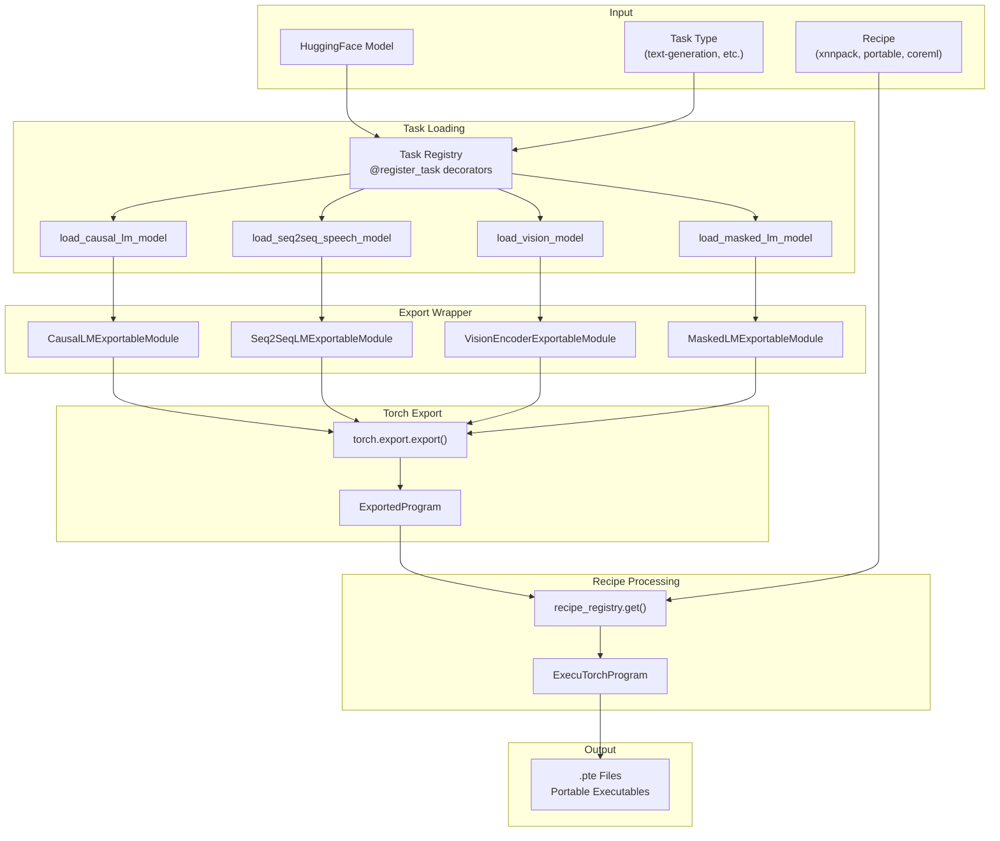

The export process begins with the `export_to_executorch` function which coordinates the entire pipeline. It uses dynamic recipe discovery to find the appropriate conversion strategy and produces serialized `.pte` files ready for deployment.

**Sources:** [optimum/exporters/executorch/convert.py:38-94]()

## ExportableModule System

The ExportableModule system provides task-specific wrappers that prepare HuggingFace models for `torch.export`. Each wrapper handles the unique requirements of different model architectures and tasks:

**ExportableModule Class Hierarchy**

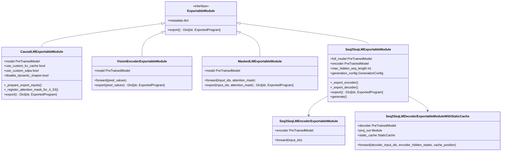

Each exportable module handles specific model types and provides the necessary preprocessing and configuration for successful export:

| Module Type | Purpose | Key Features |
|-------------|---------|-------------|
| `CausalLMExportableModule` | Decoder-only models (GPT, Llama, etc.) | Custom KV cache, SDPA, dynamic shapes |
| `VisionEncoderExportableModule` | Vision models (ViT, etc.) | Pixel value preprocessing, image size handling |
| `MaskedLMExportableModule` | Masked language models (BERT, etc.) | Attention mask support, dynamic sequence lengths |
| `Seq2SeqLMExportableModule` | Encoder-decoder models (T5, Whisper) | Separate encoder/decoder export, static caching |

**Sources:** [optimum/exporters/executorch/integrations.py:37-504]()

## Task-Specific Export Features

### Causal Language Model Export

The `CausalLMExportableModule` provides the most sophisticated export handling, supporting advanced optimization features:

**Dynamic Shape Configuration**: The module automatically determines whether to use static or dynamic shapes based on model configuration and transformers version. Dynamic shapes are enabled when supported to allow variable sequence lengths during inference.

**Custom Attention Integration**: For models supporting sliding window attention or requiring custom SDPA implementations, the module configures appropriate attention mechanisms using the `_register_attention_mask_for_4_53` method.

**KV Cache Replacement**: When custom KV cache is enabled, the module replaces standard transformers caches with ExecuTorch-optimized implementations using `replace_with_et_custom_kv_cache`.

**Sources:** [optimum/exporters/executorch/integrations.py:37-173]()

### Vision Model Export

`VisionEncoderExportableModule` handles computer vision models by managing pixel value preprocessing and ensuring proper tensor shapes for image data.

**Sources:** [optimum/exporters/executorch/integrations.py:175-210]()

### Seq2Seq Model Export

The `Seq2SeqLMExportableModule` manages the complexity of encoder-decoder architectures by creating separate exportable modules for each component:

- **Encoder Export**: Handles variable-length input sequences with appropriate dynamic shape configuration
- **Decoder Export**: Integrates static caching for efficient autoregressive generation
- **Model-Specific Handling**: Provides specialized logic for T5 and Whisper model architectures

**Sources:** [optimum/exporters/executorch/integrations.py:327-504]()

## Recipe Integration and Backend Delegation

The export system integrates with ExecuTorch's recipe system through the `recipe_registry`. Recipes define the specific optimization passes, backend delegation strategies, and lowering procedures for different deployment targets.

**Recipe Discovery Process**

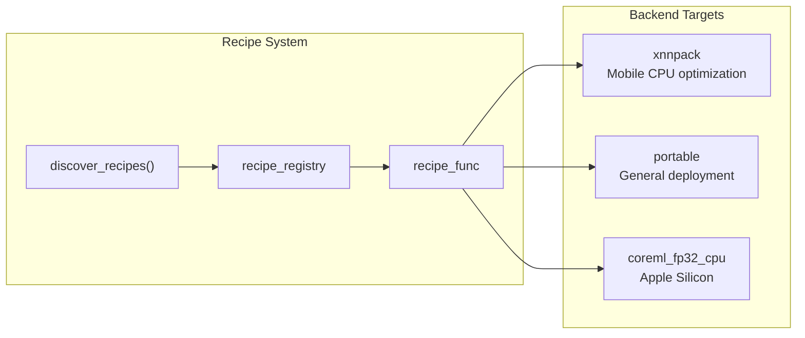

The `export_to_executorch` function coordinates recipe selection and execution, ensuring that the exported model is optimized for the target deployment environment.

**Sources:** [optimum/exporters/executorch/convert.py:74-82]()

## Export Configuration and Metadata

Each exportable module generates metadata that gets embedded into the resulting `.pte` file. This metadata includes model configuration, generation parameters, and deployment-specific settings that the runtime system uses for proper model execution.

The metadata system uses `save_config_to_constant_methods` to serialize configuration objects into a format that can be stored and retrieved by the ExecuTorch runtime.

**Sources:** [optimum/exporters/executorch/integrations.py:50-51](), [optimum/exporters/executorch/integrations.py:186](), [optimum/exporters/executorch/integrations.py:223](), [optimum/exporters/executorch/integrations.py:362-367]()

## Custom Optimization Integration

The export system integrates with custom optimization components including:

- **Custom KV Cache**: `ETCustomStaticCache` and `ETCustomHybridCache` implementations that replace standard transformers caching with ExecuTorch-optimized versions
- **Custom SDPA**: Integration with `custom_sdpa_with_start_pos_forward` for improved attention performance
- **Export Passes**: Application of optimization passes like `RemoveRedundantTransposes` to clean up the exported graph

**Sources:** [optimum/executorch/attentions/custom_kv_cache.py:27-406](), [optimum/exporters/executorch/integrations.py:152-156]()

---

# Page: Export Process Overview

# Export Process Overview

<details>
<summary>Relevant source files</summary>

The following files were used as context for generating this wiki page:

- [optimum/exporters/executorch/convert.py](optimum/exporters/executorch/convert.py)
- [tests/models/test_modeling_common.py](tests/models/test_modeling_common.py)
- [tests/models/test_modeling_qwen2.py](tests/models/test_modeling_qwen2.py)

</details>


This document explains the overall pipeline for converting HuggingFace models into ExecuTorch's optimized `.pte` (Portable Executable) format. The export process transforms models from PyTorch's eager execution format through multiple optimization stages to produce runtime-efficient executables suitable for edge deployment.

For specific details about task-specific model loading, see [Task-Specific Model Loading](#2.2). For implementation details of the wrapper system, see [ExportableModule System](#2.3). For recipe configurations and backend targeting, see [Recipes and Backend Delegation](#2.4).

## Pipeline Architecture

The export process follows a multi-stage pipeline that progressively transforms HuggingFace models into optimized ExecuTorch executables:

**Export Pipeline Architecture**
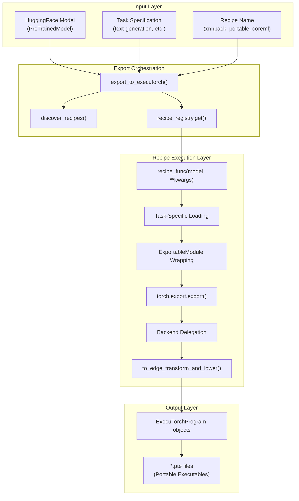

Sources: [optimum/exporters/executorch/convert.py:38-93]()

## Export Entry Points

The export process can be initiated through two primary interfaces:

| Interface | Function/Command | Purpose |
|-----------|------------------|---------|
| **Command Line** | `optimum-cli export executorch` | Batch export with subprocess isolation |
| **Python API** | `export_to_executorch()` | Programmatic export with fine-grained control |

**Code Entry Points**
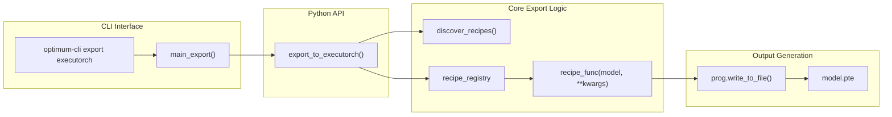

Sources: [optimum/exporters/executorch/convert.py:38-93](), [tests/models/test_modeling_common.py:48-53](), [tests/models/test_modeling_qwen2.py:44-54]()

## Export Stages

### Stage 1: Recipe Discovery and Registration

The export process begins with dynamic recipe discovery, which scans for available export configurations:

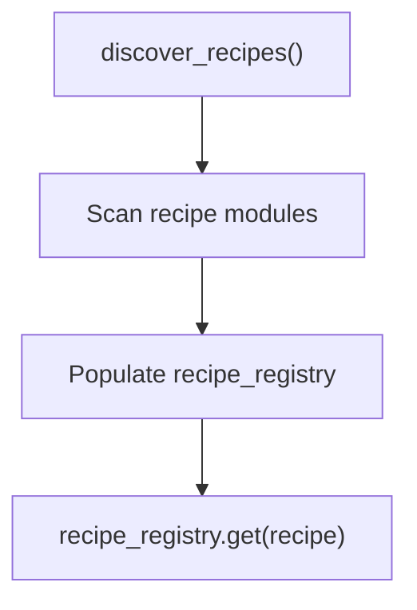

The `discover_recipes()` function dynamically imports and registers all available export recipes, making them accessible through the `recipe_registry`.

Sources: [optimum/exporters/executorch/convert.py:74-82]()

### Stage 2: Recipe Execution Pipeline

Once a recipe is retrieved, it executes a standardized pipeline that varies by recipe type but follows consistent stages:

**Recipe Execution Flow**
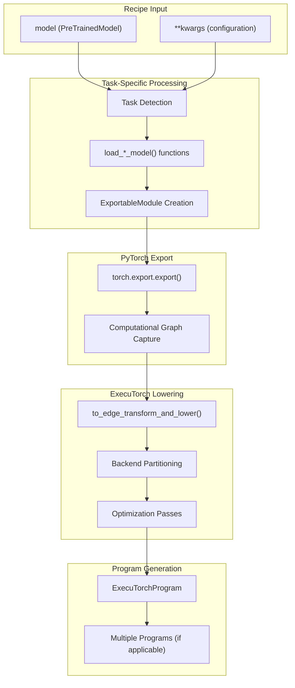

Sources: [optimum/exporters/executorch/convert.py:83-93]()

### Stage 3: Program Serialization

The final stage serializes ExecuTorch programs to `.pte` files with standardized naming:

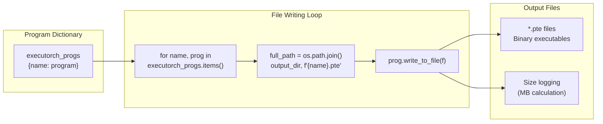

The serialization process creates binary `.pte` files in the specified output directory, with each program receiving its designated filename. Most recipes produce a single `model.pte` file, though some specialized recipes may generate multiple program files.

Sources: [optimum/exporters/executorch/convert.py:85-93]()

## Error Handling and Validation

The export process includes robust error handling at key stages:

| Error Type | Detection Point | Handling |
|------------|----------------|----------|
| **Invalid Recipe** | `recipe_registry.get()` | `RuntimeError` with available recipes list |
| **Export Failure** | Recipe execution | Exception propagation with context |
| **File I/O Errors** | Program serialization | Standard Python I/O exceptions |

The export function validates recipe availability before attempting execution and provides detailed error messages for troubleshooting.

Sources: [optimum/exporters/executorch/convert.py:78-82]()

## Integration Points

The export process integrates with several system components:

- **Task Registry**: Provides model loading functions for different task types
- **Recipe System**: Defines optimization and backend targeting strategies  
- **ExportableModule System**: Wraps models for PyTorch export compatibility
- **Custom Attention**: Registers optimized attention implementations
- **Quantization**: Applies model compression techniques during export

These integration points are coordinated through the recipe execution pipeline, with each recipe determining which optimizations and transformations to apply.

Sources: [optimum/exporters/executorch/convert.py:24-35](), [optimum/exporters/executorch/convert.py:27]()

---

# Page: Task-Specific Model Loading

# Task-Specific Model Loading

<details>
<summary>Relevant source files</summary>

The following files were used as context for generating this wiki page:

- [install_dev.py](install_dev.py)
- [optimum/executorch/__init__.py](optimum/executorch/__init__.py)
- [optimum/exporters/executorch/quantization.py](optimum/exporters/executorch/quantization.py)
- [optimum/exporters/executorch/tasks/__init__.py](optimum/exporters/executorch/tasks/__init__.py)
- [optimum/exporters/executorch/tasks/asr.py](optimum/exporters/executorch/tasks/asr.py)
- [optimum/exporters/executorch/tasks/causal_lm.py](optimum/exporters/executorch/tasks/causal_lm.py)
- [optimum/exporters/executorch/tasks/masked_lm.py](optimum/exporters/executorch/tasks/masked_lm.py)
- [tests/models/test_modeling_bert.py](tests/models/test_modeling_bert.py)
- [tests/models/test_modeling_whisper.py](tests/models/test_modeling_whisper.py)

</details>


The task-specific model loading system provides specialized loaders for different machine learning tasks, bridging HuggingFace models to ExecuTorch-compatible formats. This system maps task names (like "text-generation" or "fill-mask") to appropriate model loaders that handle task-specific configuration, quantization, and preparation for ExecuTorch export.

For information about the overall export pipeline, see [Export Process Overview](#2.1). For details about the wrapper system that prepares models for torch.export, see [ExportableModule System](#2.3).

## Task Registry Architecture

The task registry system uses a decorator-based approach to map task names to their corresponding model loading functions. Each task loader is registered using the `@register_task` decorator with a pipeline-compatible task name.

### Task Registry Flow

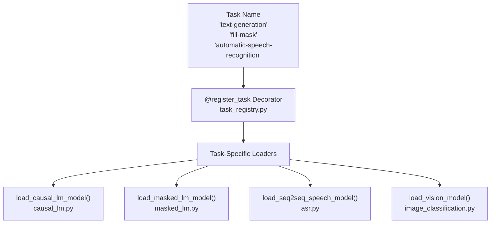

*Sources: [optimum/exporters/executorch/tasks/causal_lm.py:27](), [optimum/exporters/executorch/tasks/masked_lm.py:24](), [optimum/exporters/executorch/tasks/asr.py:23](), [optimum/exporters/executorch/tasks/__init__.py:15]()*

## Task-Specific Loaders

Each task loader handles the complexities of loading and configuring models for their specific use case, including attention mechanisms, caching strategies, and quantization.

### Causal Language Model Loader

The `load_causal_lm_model` function handles text generation models like Llama, Gemma, and Qwen:

| Configuration Option | Default | Description |
|---------------------|---------|-------------|
| `dtype` | `"float32"` | Model weight data type (`"float16"`, `"bfloat16"`) |
| `attn_implementation` | `"sdpa"` | Attention mechanism (`"sdpa"`, `"custom_sdpa"`, `"eager"`) |
| `cache_implementation` | `"static"` | Cache management strategy |
| `max_length` | `2048` | Maximum sequence length |
| `use_custom_sdpa` | `False` | Enable custom scaled dot-product attention |
| `use_custom_kv_cache` | `False` | Enable custom key-value cache |

The loader automatically handles configuration adjustments for exportability and falls back to eager attention when SDPA is not supported.

*Sources: [optimum/exporters/executorch/tasks/causal_lm.py:28-137]()*

### Masked Language Model Loader  

The `load_masked_lm_model` function supports models like BERT for fill-mask tasks:


*Sources: [optimum/exporters/executorch/tasks/masked_lm.py:25-48]()*

### Speech Recognition Loader

The `load_seq2seq_speech_model` function handles models like Whisper for automatic speech recognition:

| Configuration Option | Default | Description |
|---------------------|---------|-------------|
| `max_hidden_seq_length` | `4096` | Maximum hidden sequence length |
| `max_cache_length` | `1024` | Maximum cache length for generation |

*Sources: [optimum/exporters/executorch/tasks/asr.py:24-58]()*

## Model Preparation Pipeline

Each task loader follows a consistent pipeline for preparing models:

### Configuration and Loading Pipeline

```mermaid
graph TD
    INPUT_ARGS["Input Arguments<br/>model_name_or_path<br/>**kwargs"]
    
    CONFIG_PARSE["Configuration Parsing<br/>dtype, attention, cache, etc."]
    
    HF_AUTO["`HuggingFace Auto Classes
    AutoModelForCausalLM
    AutoModelForMaskedLM
    AutoModelForSpeechSeq2Seq`"]
    
    CONFIG_ADJ["Configuration Adjustments<br/>rope_scaling, use_cache<br/>fallback handling"]
    
    QUANT_CHECK["Quantization Check<br/>qlinear, qembedding"]
    
    QUANTIZE["`quantize_model_()
    torchao integration`"]
    
    WRAPPER_CREATE["ExportableModule Creation<br/>CausalLMExportableModule<br/>MaskedLMExportableModule<br/>Seq2SeqLMExportableModule"]
    
    INPUT_ARGS --> CONFIG_PARSE
    CONFIG_PARSE --> HF_AUTO
    HF_AUTO --> CONFIG_ADJ
    CONFIG_ADJ --> QUANT_CHECK
    QUANT_CHECK --> QUANTIZE
    QUANTIZE --> WRAPPER_CREATE
```

*Sources: [optimum/exporters/executorch/tasks/causal_lm.py:53-137](), [optimum/exporters/executorch/tasks/masked_lm.py:42-47](), [optimum/exporters/executorch/quantization.py:23-82]()*

### Quantization Integration

The quantization system supports multiple schemes through `quantize_model_()`:

| Quantization Type | Schemes | Description |
|------------------|---------|-------------|
| `qlinear` | `8da4w`, `4w`, `8w` | Linear layer quantization |
| `qembedding` | `4w`, `8w` | Embedding layer quantization |

The quantization process uses torchao and requires version >= 0.11.0.dev0. It applies per-axis or per-group granularity depending on the scheme selected.

*Sources: [optimum/exporters/executorch/quantization.py:23-82](), [optimum/exporters/executorch/tasks/causal_lm.py:133-135]()*

## Error Handling and Fallbacks

The task loaders include robust error handling:

### Attention Implementation Fallback

```mermaid
graph TD
    SDPA_TRY["Try SDPA Attention<br/>attn_implementation='sdpa'"]
    
    ERROR_CHECK["ValueError Check<br/>scaled_dot_product_attention"]
    
    EAGER_FALLBACK["Fallback to Eager<br/>attn_implementation='eager'"]
    
    RELOAD["Reload Model<br/>with eager attention"]
    
    SDPA_TRY --> ERROR_CHECK
    ERROR_CHECK --> EAGER_FALLBACK
    EAGER_FALLBACK --> RELOAD
```

*Sources: [optimum/exporters/executorch/tasks/causal_lm.py:102-126]()*

### RoPE Scaling Configuration

For models with RoPE scaling, the loader automatically adjusts the configuration to avoid data-dependent control flow issues during export by setting `rope_scaling["type"] = "default"`.

*Sources: [optimum/exporters/executorch/tasks/causal_lm.py:65-69]()*

---

# Page: ExportableModule System

# ExportableModule System

<details>
<summary>Relevant source files</summary>

The following files were used as context for generating this wiki page:

- [optimum/executorch/attentions/custom_kv_cache.py](optimum/executorch/attentions/custom_kv_cache.py)
- [optimum/exporters/executorch/integrations.py](optimum/exporters/executorch/integrations.py)

</details>


The ExportableModule system provides wrapper classes that prepare HuggingFace models for export to ExecuTorch format using `torch.export`. These modules handle export-specific concerns like dynamic shapes, caching configurations, and metadata preservation while ensuring compatibility with ExecuTorch's execution requirements.

For information about the broader export process and recipes, see [Recipes and Backend Delegation](#2.4). For details about runtime model loading, see [Model Loading and Configuration](#3.1).

## System Overview

The ExportableModule system serves as an adapter layer between HuggingFace's model interfaces and ExecuTorch's export requirements. Each wrapper class encapsulates a specific model architecture pattern and manages the complexities of making these models exportable.

### ExportableModule Architecture

```mermaid
graph TB
    subgraph "HuggingFace Models"
        HF_CAUSAL["Causal LM Models<br/>(Llama, GPT, Gemma)"]
        HF_SEQ2SEQ["Seq2Seq Models<br/>(T5, Whisper)"]
        HF_VISION["Vision Models<br/>(ViT)"]
        HF_MASKED["Masked LM Models<br/>(BERT)"]
    end
    
    subgraph "ExportableModule Wrappers"
        CAUSAL_WRAP["CausalLMExportableModule"]
        SEQ2SEQ_WRAP["Seq2SeqLMExportableModule"]
        VISION_WRAP["VisionEncoderExportableModule"]
        MASKED_WRAP["MaskedLMExportableModule"]
    end
    
    subgraph "Export Components"
        METADATA["save_config_to_constant_methods<br/>Metadata Recording"]
        SHAPES["Dynamic Shapes<br/>torch.export.Dim"]
        CACHE["Cache Management<br/>StaticCache/HybridCache"]
        SDPA["Custom Attention<br/>custom_sdpa integration"]
    end
    
    subgraph "torch.export Pipeline"
        EXPORT_FUNC["torch.export.export()"]
        EXPORTED_PROG["ExportedProgram"]
        PTE_OUTPUT[".pte Model File"]
    end
    
    HF_CAUSAL --> CAUSAL_WRAP
    HF_SEQ2SEQ --> SEQ2SEQ_WRAP
    HF_VISION --> VISION_WRAP
    HF_MASKED --> MASKED_WRAP
    
    CAUSAL_WRAP --> METADATA
    CAUSAL_WRAP --> SHAPES
    CAUSAL_WRAP --> CACHE
    CAUSAL_WRAP --> SDPA
    
    SEQ2SEQ_WRAP --> METADATA
    VISION_WRAP --> METADATA
    MASKED_WRAP --> METADATA
    
    METADATA --> EXPORT_FUNC
    SHAPES --> EXPORT_FUNC
    CACHE --> EXPORT_FUNC
    SDPA --> EXPORT_FUNC
    
    EXPORT_FUNC --> EXPORTED_PROG
    EXPORTED_PROG --> PTE_OUTPUT
```

Sources: [optimum/exporters/executorch/integrations.py:37-173]()

## ExportableModule Classes

### CausalLMExportableModule

The `CausalLMExportableModule` handles causal language models like Llama, GPT, and Gemma. It provides the most sophisticated export logic with support for custom KV caching, custom scaled dot-product attention (SDPA), and dynamic shapes.

```mermaid
graph LR
    subgraph "CausalLMExportableModule"
        INIT["__init__()<br/>use_custom_kv_cache<br/>use_custom_sdpa<br/>disable_dynamic_shapes"]
        PREPARE["_prepare_export_inputs()<br/>Dynamic shapes setup<br/>Example tensors"]
        REGISTER["_register_attention_mask_for_4_53()<br/>Custom SDPA registration"]
        EXPORT["export()<br/>TorchExportableModuleForDecoderOnlyLM<br/>RemoveRedundantTransposes"]
    end
    
    subgraph "Integration Points"
        KV_CACHE["replace_with_et_custom_kv_cache<br/>ETCustomStaticCache<br/>ETCustomHybridCache"]
        TRANSFORMERS["TorchExportableModuleForDecoderOnlyLM<br/>transformers.integrations.executorch"]
        PASSES["RemoveRedundantTransposes<br/>executorch.extension.llm.export.export_passes"]
    end
    
    INIT --> PREPARE
    PREPARE --> REGISTER
    REGISTER --> EXPORT
    EXPORT --> KV_CACHE
    EXPORT --> TRANSFORMERS
    EXPORT --> PASSES
```

Sources: [optimum/exporters/executorch/integrations.py:37-173]()

#### Dynamic Shapes Configuration

The `CausalLMExportableModule._prepare_export_inputs()` method configures dynamic shapes for flexible sequence length handling:

| Parameter | Purpose | Configuration |
|-----------|---------|---------------|
| `seq_length_dim` | Variable sequence length | `torch.export.Dim("seq_length_dim", max=max_dim)` |
| `max_dim` | Maximum sequence length | `min(max_seq_len, sliding_window) - 1` |
| `dynamic_shapes` | Shape specifications | `{"input_ids": {1: seq_len_dim}, "cache_position": {0: seq_len_dim}}` |

Sources: [optimum/exporters/executorch/integrations.py:53-94]()

### Seq2SeqLMExportableModule

The `Seq2SeqLMExportableModule` handles encoder-decoder models like T5 and Whisper by exporting separate encoder and decoder components with static caching.

```mermaid
graph TB
    subgraph "Seq2SeqLMExportableModule Structure"
        MAIN["Seq2SeqLMExportableModule<br/>full_model: PreTrainedModel<br/>encoder: Model encoder<br/>generation_config: GenerationConfig"]
        ENC_WRAP["Seq2SeqLMEncoderExportableModule<br/>Encoder wrapper"]
        DEC_WRAP["Seq2SeqLMDecoderExportableModuleWithStaticCache<br/>Decoder with StaticCache"]
    end
    
    subgraph "Export Methods"
        EXP_ENC["_export_encoder()<br/>torch.export.export<br/>dynamic_shapes for T5"]
        EXP_DEC["_export_decoder()<br/>SDPBackend.MATH<br/>torch.export.export"]
        EXP_MAIN["export()<br/>Returns encoder + decoder"]
    end
    
    subgraph "Model Support"
        T5["T5ForConditionalGeneration<br/>Dynamic encoder sequence"]
        WHISPER["WhisperForConditionalGeneration<br/>Fixed audio input shape"]
    end
    
    MAIN --> ENC_WRAP
    MAIN --> DEC_WRAP
    ENC_WRAP --> EXP_ENC
    DEC_WRAP --> EXP_DEC
    EXP_ENC --> EXP_MAIN
    EXP_DEC --> EXP_MAIN
    
    T5 --> MAIN
    WHISPER --> MAIN
```

Sources: [optimum/exporters/executorch/integrations.py:327-473]()

### VisionEncoderExportableModule

The `VisionEncoderExportableModule` provides a straightforward wrapper for vision models with minimal export complexity.

```mermaid
graph LR
    VISION_MODEL["Vision Model<br/>(ViT)"] --> VISION_WRAP["VisionEncoderExportableModule<br/>forward(pixel_values)<br/>export(pixel_values)"]
    VISION_WRAP --> CONFIG["config.num_channels<br/>config.image_size<br/>torch.rand() example"]
    CONFIG --> EXPORT["torch.export.export<br/>strict=False"]
```

Sources: [optimum/exporters/executorch/integrations.py:175-210]()

### MaskedLMExportableModule

The `MaskedLMExportableModule` handles BERT-style masked language models with automatic dynamic shape configuration.

```mermaid
graph LR
    MASKED_MODEL["Masked LM Model<br/>(BERT)"] --> MASKED_WRAP["MaskedLMExportableModule<br/>forward(input_ids, attention_mask)"]
    MASKED_WRAP --> SHAPES["Dynamic Shapes<br/>torch.export.Dim.AUTO<br/>input_ids: {1: AUTO}<br/>attention_mask: {1: AUTO}"]
    SHAPES --> EXPORT["torch.export.export<br/>strict=True"]
```

Sources: [optimum/exporters/executorch/integrations.py:212-263]()

## Export Process Flow

The export process follows a consistent pattern across all ExportableModule classes:

```mermaid
flowchart TD
    START["HuggingFace Model"] --> WRAP["Create ExportableModule<br/>CausalLM/Seq2Seq/Vision/MaskedLM"]
    WRAP --> META["save_config_to_constant_methods<br/>Record model metadata"]
    META --> PREP["Prepare Export Inputs<br/>Example tensors<br/>Dynamic shapes"]
    PREP --> OPTS["Apply Optimizations<br/>Custom KV Cache<br/>Custom SDPA"]
    OPTS --> EXPORT_CALL["torch.export.export()<br/>args, kwargs, dynamic_shapes"]
    EXPORT_CALL --> POST["Post-processing<br/>RemoveRedundantTransposes"]
    POST --> RESULT["Dict[str, ExportedProgram]"]
    
    subgraph "Model-Specific Paths"
        CAUSAL_PATH["CausalLM:<br/>TorchExportableModuleForDecoderOnlyLM<br/>Cache replacement<br/>Attention registration"]
        SEQ2SEQ_PATH["Seq2Seq:<br/>Separate encoder/decoder<br/>StaticCache setup<br/>SDPBackend.MATH"]
    end
    
    OPTS --> CAUSAL_PATH
    OPTS --> SEQ2SEQ_PATH
    CAUSAL_PATH --> EXPORT_CALL
    SEQ2SEQ_PATH --> EXPORT_CALL
```

Sources: [optimum/exporters/executorch/integrations.py:115-173](), [optimum/exporters/executorch/integrations.py:436-472]()

## Integration with Custom Components

### Custom KV Cache Integration

The `CausalLMExportableModule` integrates with the custom KV cache system when `use_custom_kv_cache=True`:

```mermaid
graph LR
    subgraph "Cache Replacement Flow"
        CHECK["use_custom_kv_cache=True"] --> IMPORT["from optimum.executorch.attentions.custom_kv_cache<br/>import replace_with_et_custom_kv_cache"]
        IMPORT --> REPLACE["replace_with_et_custom_kv_cache()<br/>exportable_module.model<br/>config, generation_config, dtype"]
        REPLACE --> ET_CACHE["ETCustomStaticCache<br/>ETCustomHybridCache"]
    end
    
    subgraph "Cache Types"
        STATIC["ETCustomStaticCache<br/>CustomKVCache instances"]
        HYBRID["ETCustomHybridCache<br/>CustomKVCache + CustomRingKVCache"]
    end
    
    ET_CACHE --> STATIC
    ET_CACHE --> HYBRID
```

Sources: [optimum/exporters/executorch/integrations.py:134-144](), [optimum/executorch/attentions/custom_kv_cache.py:309-405]()

### Custom SDPA Registration

For models using custom scaled dot-product attention, the system registers attention implementations:

```mermaid
graph TB
    SDPA_CHECK["use_custom_sdpa=True<br/>transformers >= 4.53.0"] --> IMPORT_SDPA["from transformers.integrations.executorch<br/>import sdpa_mask_without_vmap<br/>from transformers.masking_utils<br/>import AttentionMaskInterface"]
    IMPORT_SDPA --> REGISTER["AttentionInterface.register<br/>custom_sdpa_ring_kv_cache<br/>_custom_sdpa_for_ring_kv_cache"]
    REGISTER --> SET_IMPL["config._attn_implementation =<br/>custom_sdpa_ring_kv_cache"]
```

Sources: [optimum/exporters/executorch/integrations.py:96-114]()

## Metadata Management

All ExportableModule classes use `save_config_to_constant_methods()` to preserve model configuration and generation parameters in the exported model:

| Metadata Type | Source | Purpose |
|---------------|--------|---------|
| Model config | `model.config` | Architecture parameters |
| Generation config | `model.generation_config` | Generation settings |
| Additional configs | Class-specific | Custom parameters like `max_hidden_seq_length` |

The metadata is accessible in the exported `.pte` file through constant methods, enabling runtime configuration without additional files.

Sources: [optimum/exporters/executorch/integrations.py:50](), [optimum/exporters/executorch/integrations.py:186](), [optimum/exporters/executorch/integrations.py:223](), [optimum/exporters/executorch/integrations.py:363-367]()

---

# Page: Recipes and Backend Delegation

# Recipes and Backend Delegation

<details>
<summary>Relevant source files</summary>

The following files were used as context for generating this wiki page:

- [optimum/executorch/attentions/custom_sdpa.py](optimum/executorch/attentions/custom_sdpa.py)
- [optimum/exporters/executorch/__main__.py](optimum/exporters/executorch/__main__.py)
- [optimum/exporters/executorch/recipes/coreml.py](optimum/exporters/executorch/recipes/coreml.py)
- [optimum/exporters/executorch/recipes/xnnpack.py](optimum/exporters/executorch/recipes/xnnpack.py)
- [tests/models/test_modeling_vit.py](tests/models/test_modeling_vit.py)

</details>


This document covers the recipe system and backend delegation mechanisms in optimum-executorch. Recipes define how exported PyTorch models are lowered to ExecuTorch programs with delegation to specific hardware backends. Backend delegation enables operations to run on optimized backends like XNNPACK (mobile CPU), CoreML (Apple devices), or fall back to the portable backend.

For information about the model export process leading up to recipe application, see [Export Process Overview](#2.1). For details on the ExportableModule wrappers that prepare models for recipes, see [ExportableModule System](#2.3).

## Recipe System Overview

Recipes are registered functions that transform exported PyTorch programs into ExecuTorch programs optimized for specific backends. Each recipe handles the lowering process from `ExportedProgram` to `ExecutorchProgram` using backend-specific partitioners and configurations.

```mermaid
graph TD
    ExportedProgram["ExportedProgram<br/>from ExportableModule"]
    RecipeRegistry["Recipe Registry<br/>@register_recipe"]
    
    subgraph "Available Recipes"
        XNNPACKRecipe["xnnpack<br/>export_to_executorch_with_xnnpack"]
        PortableRecipe["portable<br/>(default fallback)"]
        CoreMLRecipes["coreml_fp32_cpu<br/>coreml_fp16_gpu<br/>coreml_fp32_ne"]
    end
    
    subgraph "Lowering Process"
        Partitioner["Backend Partitioner<br/>XnnpackPartitioner<br/>CoreMLPartitioner"]
        EdgeTransform["to_edge_transform_and_lower"]
        ExecutorchProgram["ExecutorchProgram<br/>Ready for .pte serialization"]
    end
    
    ExportedProgram --> RecipeRegistry
    RecipeRegistry --> XNNPACKRecipe
    RecipeRegistry --> PortableRecipe
    RecipeRegistry --> CoreMLRecipes
    
    XNNPACKRecipe --> Partitioner
    CoreMLRecipes --> Partitioner
    Partitioner --> EdgeTransform
    EdgeTransform --> ExecutorchProgram
```

**Recipe Selection and Execution**
- Selected via CLI: `optimum-cli export executorch --recipe xnnpack`
- Or programmatically: `ExecuTorchModelForCausalLM.from_pretrained(model_id, recipe="xnnpack")`
- Recipe functions are discovered and registered in `recipe_registry`

*Sources: optimum/exporters/executorch/recipes/xnnpack.py:41-45, optimum/exporters/executorch/__main__.py:39-55*

## Backend Delegation Architecture

Backend delegation partitions the compute graph into segments that can run on specialized backends versus the portable ExecuTorch backend. Operations suitable for hardware acceleration are delegated while others remain on the portable backend.

### Delegation Flow

```mermaid
graph LR
    subgraph "Input Graph"
        OrigGraph["Original Graph<br/>All operations"]
    end
    
    subgraph "Partitioning"
        XNNPACKPart["XnnpackPartitioner<br/>Identifies XNNPACK ops"]
        CoreMLPart["CoreMLPartitioner<br/>Identifies CoreML ops"]
        PartitionLogic["Partitioning Logic<br/>Operation compatibility"]
    end
    
    subgraph "Delegated Graph"
        DelegatedOps["Delegated Operations<br/>Backend-specific"]
        PortableOps["Portable Operations<br/>Fallback execution"]
        DelegationInfo["Delegation Info<br/>Summary & statistics"]
    end
    
    OrigGraph --> XNNPACKPart
    OrigGraph --> CoreMLPart
    XNNPACKPart --> PartitionLogic
    CoreMLPart --> PartitionLogic
    
    PartitionLogic --> DelegatedOps
    PartitionLogic --> PortableOps
    DelegatedOps --> DelegationInfo
    PortableOps --> DelegationInfo
```

**Delegation Information**
Each recipe logs detailed delegation statistics showing which operations are handled by which backend:

*Sources: optimum/exporters/executorch/recipes/xnnpack.py:91-95, optimum/exporters/executorch/recipes/coreml.py:100-104*

## XNNPACK Recipe

The XNNPACK recipe targets mobile CPU optimization and is the most commonly used recipe for production deployments.

### Implementation Details

| Component | Purpose | Configuration |
|-----------|---------|---------------|
| `XnnpackPartitioner` | Identifies XNNPACK-compatible operations | Default partitioning rules |
| `EdgeCompileConfig` | Compilation settings | `_check_ir_validity=False`, `_skip_dim_order=True` |
| `ExecutorchBackendConfig` | Backend-specific options | `extract_delegate_segments=True`, quantization fusion |
| `RemovePaddingIdxEmbeddingPass` | Optimization pass | Removes padding indices from embeddings |

**Key Features:**
- Automatic quantization fusion and constant propagation (ExecuTorch >0.6.0)
- Custom SDPA operator validation for optimized attention
- Delegate segment extraction for performance analysis

```mermaid
graph TB
    subgraph "XNNPACK Recipe Process"
        ModelInput["CausalLMExportableModule<br/>Seq2SeqLMExportableModule<br/>MaskedLMExportableModule"]
        ExportStep["model.export()<br/>Returns Dict[str, ExportedProgram]"]
        
        subgraph "Lowering Pipeline"
            XNNPACKPartitioner["XnnpackPartitioner()<br/>Backend delegation"]
            EdgeConfig["EdgeCompileConfig<br/>_check_ir_validity=False<br/>_skip_dim_order=True"]
            TransformPasses["RemovePaddingIdxEmbeddingPass<br/>Optimization transforms"]
            ExecutorchConfig["ExecutorchBackendConfig<br/>extract_delegate_segments=True<br/>do_quant_fusion_and_const_prop=True"]
        end
        
        OutputPrograms["Dict[str, ExecutorchProgram]<br/>Ready for .pte serialization"]
    end
    
    ModelInput --> ExportStep
    ExportStep --> XNNPACKPartitioner
    XNNPACKPartitioner --> EdgeConfig
    EdgeConfig --> TransformPasses
    TransformPasses --> ExecutorchConfig
    ExecutorchConfig --> OutputPrograms
```

*Sources: optimum/exporters/executorch/recipes/xnnpack.py:41-113*

## CoreML Recipes

CoreML recipes target Apple devices with multiple variants for different compute units and precision levels.

### Recipe Variants

The CoreML backend generates multiple recipes programmatically:

| Recipe Name | Compute Unit | Precision | Target Hardware |
|-------------|-------------|-----------|-----------------|
| `coreml_fp32_cpu` | CPU_ONLY | FLOAT32 | Apple CPU only |
| `coreml_fp16_gpu` | CPU_AND_GPU | FLOAT16 | Apple GPU + CPU |
| `coreml_fp32_ne` | CPU_AND_NE | FLOAT32 | Neural Engine + CPU |
| `coreml_fp16_all` | ALL | FLOAT16 | All Apple compute units |

**Configuration Generation:**
- Recipes are dynamically registered using `product(["fp32", "fp16"], ["cpu", "gpu", "ne", "all"])`
- Each variant has specific `CoreMLPartitioner` compile specs
- Minimum deployment target set to iOS 18 for advanced features

### CoreML Backend Architecture

```mermaid
graph TD
    subgraph "CoreML Recipe Generation"
        RecipeFactory["_make_recipe()<br/>Dynamic recipe creation"]
        ComputeUnits["Compute Unit Options<br/>cpu, gpu, ne, all"]
        Precisions["Precision Options<br/>fp32, fp16"]
        RecipeKwargs["_get_recipe_kwargs()<br/>Recipe configuration"]
    end
    
    subgraph "CoreML Backend Components"
        CoreMLPartitioner["CoreMLPartitioner<br/>with compile_specs"]
        CoreMLBackend["CoreMLBackend<br/>generate_compile_specs"]
        CoreMLTarget["ct.target.iOS18<br/>minimum_deployment_target"]
    end
    
    subgraph "Generated Recipes"
        CPURecipe["coreml_fp32_cpu"]
        GPURecipe["coreml_fp16_gpu"]
        NERecipe["coreml_fp32_ne"]
        AllRecipe["coreml_fp16_all"]
    end
    
    ComputeUnits --> RecipeFactory
    Precisions --> RecipeFactory
    RecipeFactory --> RecipeKwargs
    
    RecipeKwargs --> CoreMLPartitioner
    CoreMLPartitioner --> CoreMLBackend
    CoreMLBackend --> CoreMLTarget
    
    RecipeFactory --> CPURecipe
    RecipeFactory --> GPURecipe
    RecipeFactory --> NERecipe
    RecipeFactory --> AllRecipe
```

*Sources: optimum/exporters/executorch/recipes/coreml.py:145-151, optimum/exporters/executorch/recipes/coreml.py:111-131*

## Custom Operations and Backend Delegation

Certain optimizations like custom SDPA (Scaled Dot-Product Attention) require special handling in the delegation process.

### Custom SDPA Integration

The `custom_sdpa` operation provides significant performance improvements (3x faster) but requires verification during the export process:

**Validation Process:**
1. Check `_attn_implementation` configuration for `"custom_sdpa"` or `"custom_sdpa_ring_kv_cache"`
2. Scan exported program graph for `custom_sdpa` function calls
3. Raise error if custom SDPA is configured but not found in the graph

**Implementation Types:**
- `custom_sdpa_with_start_pos_forward`: Standard custom attention with start position calculation
- `get_custom_sdpa_for_ring_kv_cache`: Ring KV cache variant for sliding window attention

*Sources: optimum/exporters/executorch/recipes/xnnpack.py:100-111, optimum/executorch/attentions/custom_sdpa.py:21-77*

## Recipe Usage in Practice

### Command Line Interface

```bash
# XNNPACK recipe (most common)
optimum-cli export executorch --model meta-llama/Llama-3.2-1B --recipe xnnpack --task text-generation

# CoreML recipe for Apple devices
optimum-cli export executorch --model google/vit-base-patch16-224 --recipe coreml_fp32_cpu --task image-classification

# Portable fallback recipe
optimum-cli export executorch --model microsoft/phi-2 --recipe portable --task text-generation
```

### Python API Integration

```python
# Recipe selection in model loading
model = ExecuTorchModelForCausalLM.from_pretrained(
    model_id="meta-llama/Llama-3.2-1B",
    recipe="xnnpack"  # Recipe applied during export
)

# Recipe discovery and registration
from optimum.exporters.executorch import discover_tasks, task_registry
discover_tasks()  # Auto-discovers and registers recipes
```

**Recipe Resolution:**
- Recipes are resolved by name from the recipe registry
- Each recipe returns `Dict[str, ExecutorchProgram]` for multiple program variants
- Programs are serialized to `.pte` files for deployment

*Sources: optimum/exporters/executorch/__main__.py:117-146, tests/models/test_modeling_vit.py:42-52*

---

# Page: Runtime and Inference

# Runtime and Inference

<details>
<summary>Relevant source files</summary>

The following files were used as context for generating this wiki page:

- [optimum/executorch/modeling.py](optimum/executorch/modeling.py)
- [optimum/exporters/executorch/utils.py](optimum/exporters/executorch/utils.py)

</details>


This document explains how to load and run ExecuTorch models for inference using the optimum-executorch runtime system. It covers the model loading process, inference execution, text generation capabilities, and performance monitoring features.

For information about exporting models to ExecuTorch format, see [Model Export System](#2). For details on optimization features like quantization and custom attention, see [Optimization Features](#4).

## Model Loading System

The runtime system provides task-specific model classes that wrap ExecuTorch's low-level runtime with a familiar HuggingFace-style API. All model classes inherit from `ExecuTorchModelBase` and provide a `from_pretrained()` method for loading models.

### Model Class Hierarchy

```mermaid
graph TD
    Base["ExecuTorchModelBase<br/>Abstract base class"]
    CausalLM["ExecuTorchModelForCausalLM<br/>AutoModelForCausalLM"]
    Seq2Seq["ExecuTorchModelForSeq2SeqLM<br/>AutoModelForSeq2SeqLM"] 
    Speech["ExecuTorchModelForSpeechSeq2Seq<br/>AutoModelForSpeechSeq2Seq"]
    Vision["ExecuTorchModelForImageClassification<br/>AutoModelForImageClassification"]
    MaskedLM["ExecuTorchModelForMaskedLM<br/>AutoModelForMaskedLM"]
    
    Base --> CausalLM
    Base --> Seq2Seq
    Base --> Speech
    Base --> Vision
    Base --> MaskedLM
    
    CausalLM --> CausalMethods["text_generation()<br/>generate()"]
    Seq2Seq --> Seq2SeqMethods["text_generation()<br/>generate()"]
    Speech --> SpeechMethods["transcribe()<br/>generate()"]
    Vision --> VisionMethods["forward()"]
    MaskedLM --> MaskedMethods["forward()"]
```

Sources: [optimum/executorch/modeling.py:56-370]()

### Loading Process

The model loading process supports multiple sources and automatically handles model export if needed:

```mermaid
graph LR
    subgraph Sources
        HubID["HuggingFace Hub ID<br/>meta-llama/Llama-3.2-1B"]
        LocalPTE["Local .pte file<br/>model.pte"]
        LocalDir["Local directory<br/>./my_model/"]
    end
    
    subgraph Loading
        FromPretrained["from_pretrained()"]
        CheckPTE["Check for .pte files<br/>find_files_matching_pattern()"]
        Export["Export if needed<br/>_export()"]
        LoadPTE["Load .pte file<br/>_load_for_executorch()"]
    end
    
    subgraph Runtime
        ETModule["ExecuTorchModule<br/>Low-level runtime"]
        Metadata["Extract metadata<br/>method_names()"]
        ModelInstance["ExecuTorchModelForXXX<br/>Ready for inference"]
    end
    
    HubID --> FromPretrained
    LocalPTE --> FromPretrained
    LocalDir --> FromPretrained
    
    FromPretrained --> CheckPTE
    CheckPTE --> Export
    CheckPTE --> LoadPTE
    Export --> LoadPTE
    LoadPTE --> ETModule
    ETModule --> Metadata
    Metadata --> ModelInstance
```

Sources: [optimum/executorch/modeling.py:278-371](), [optimum/executorch/modeling.py:134-193]()

### Model Metadata Extraction

During initialization, models extract configuration metadata from the `.pte` file using ExecuTorch's method introspection:

| Metadata Method | Purpose | Example Value |
|----------------|---------|---------------|
| `use_kv_cache` | KV cache enabled | `True` |
| `get_max_seq_len` | Maximum sequence length | `2048` |
| `get_max_batch_size` | Maximum batch size | `1` |
| `get_dtype` | Model data type | `5` (float16) |
| `get_bos_id` | Beginning-of-sequence token | `1` |
| `get_eos_ids` | End-of-sequence tokens | `[2, 32000]` |
| `get_vocab_size` | Vocabulary size | `32000` |
| `use_sdpa_with_kv_cache` | Custom SDPA enabled | `True` |

Sources: [optimum/executorch/modeling.py:606-625](), [optimum/exporters/executorch/utils.py:21-66]()

## Inference Runtime Core

The runtime system uses ExecuTorch's `ExecuTorchModule` as the underlying inference engine, wrapped by task-specific model classes that provide familiar APIs.

### Runtime Architecture

```mermaid
graph TD
    subgraph "Python API Layer"
        ModelAPI["ExecuTorchModelForXXX<br/>High-level API"]
        Forward["forward()<br/>Single inference call"]
        Generate["generate()<br/>Autoregressive generation"]
        TextGen["text_generation()<br/>End-to-end pipeline"]
    end
    
    subgraph "ExecuTorch Runtime"
        ETModule["ExecuTorchModule<br/>C++ runtime binding"]
        Methods["Available methods:<br/>• forward<br/>• method_names<br/>• run_method"]
        PTEFile[".pte file<br/>Portable executable"]
    end
    
    subgraph "Performance Tracking"
        Stats["Stats<br/>Performance monitoring"]
        Timing["Timing measurements:<br/>• Prompt evaluation<br/>• Token generation<br/>• First token latency"]
    end
    
    ModelAPI --> Forward
    ModelAPI --> Generate
    ModelAPI --> TextGen
    
    Forward --> ETModule
    Generate --> ETModule
    TextGen --> Generate
    
    ETModule --> Methods
    ETModule --> PTEFile
    
    Forward --> Stats
    Generate --> Stats
```

Sources: [optimum/executorch/modeling.py:39](), [optimum/executorch/modeling.py:627-652](), [optimum/executorch/stats.py]()

### Forward Pass Execution

The `forward()` method provides direct access to model inference with minimal overhead:

For causal language models, the forward pass signature is:
```python
forward(input_ids: torch.Tensor, cache_position: torch.Tensor) -> torch.Tensor
```

For sequence-to-sequence models:
```python
forward(input_ids: torch.Tensor, decoder_input_ids: torch.Tensor, 
        cache_position: torch.Tensor, encoder_outputs: Optional[torch.Tensor]) -> Tuple
```

Sources: [optimum/executorch/modeling.py:627-652](), [optimum/executorch/modeling.py:432-448]()

## Text Generation Capabilities

The runtime provides sophisticated text generation capabilities with support for both causal and sequence-to-sequence models.

### Generation Flow

```mermaid
graph TD
    subgraph "Input Processing"
        Prompt["Text prompt"]
        Tokenize["Tokenizer.encode()<br/>Convert to token IDs"]
        ValidateTokens["Verify EOS tokens<br/>verify_eos_tokens_in_tokenizer()"]
    end
    
    subgraph "Generation Loop"
        PrefillCheck["Check sequence length<br/>Parallel vs sequential prefill"]
        ParallelPrefill["Parallel prefill<br/>Process all prompt tokens at once"]
        SeqPrefill["Sequential prefill<br/>Process tokens one by one"]
        AutoRegressive["Autoregressive generation<br/>Generate one token at a time"]
        StopCheck["Check stopping criteria<br/>EOS token or max length"]
    end
    
    subgraph "Output Processing"
        TokenList["Generated token IDs"]
        Decode["Tokenizer.decode()<br/>Convert to text"]
        Result["Generated text"]
    end
    
    Prompt --> Tokenize
    Tokenize --> ValidateTokens
    ValidateTokens --> PrefillCheck
    
    PrefillCheck --> ParallelPrefill
    PrefillCheck --> SeqPrefill
    
    ParallelPrefill --> AutoRegressive
    SeqPrefill --> AutoRegressive
    
    AutoRegressive --> StopCheck
    StopCheck --> AutoRegressive
    StopCheck --> TokenList
    
    TokenList --> Decode
    Decode --> Result
```

Sources: [optimum/executorch/modeling.py:654-743](), [optimum/executorch/modeling.py:745-796]()

### Dynamic Shape Support

The generation system supports two modes based on the exported model's capabilities:

**Parallel Prefill** (dynamic shapes enabled):
- Processes entire prompt in a single forward pass
- Significantly faster for long prompts (up to 20x speedup)
- Determined by checking `model.method_meta("forward").input_tensor_meta(1).sizes()[0] > 1`

**Sequential Prefill** (static shapes):
- Processes prompt tokens one by one
- Maintained for backward compatibility
- Used when model was exported without dynamic shapes

Sources: [optimum/executorch/modeling.py:693-714]()

### Speech-to-Text Generation

The `ExecuTorchModelForSpeechSeq2Seq` class provides specialized generation for audio transcription:

```python
transcribe(tokenizer, input_features, echo=True, max_seq_len=None)
```

Where `input_features` is a log-mel spectrogram tensor of shape `[1, 80, 3000]` or `[1, 128, 3000]` for 30-second audio chunks.

Sources: [optimum/executorch/modeling.py:1066-1100]()

## Performance Monitoring

The runtime includes comprehensive performance tracking through the `Stats` class, which measures inference timing and throughput.

### Performance Metrics

```mermaid
graph LR
    subgraph "Timing Events"
        InferStart["on_inference_start()"]
        TokenEncode["on_token_encode_end()"]
        PromptEval["on_prompt_eval_end()"]
        FirstToken["on_first_token()"]
        SamplingLoop["on_sampling_begin()<br/>on_sampling_end()"]
        InferEnd["on_inference_end()"]
    end
    
    subgraph "Calculated Metrics"
        TTFT["Time to First Token<br/>(TTFT)"]
        Throughput["Token throughput<br/>(tokens/second)"]
        TotalTime["Total inference time"]
        PromptTok["Prompt tokens/second"]
    end
    
    subgraph "Reporting"
        PrintReport["print_report()<br/>Console output"]
        Benchmarks["Performance comparison<br/>Device-specific results"]
    end
    
    InferStart --> TokenEncode
    TokenEncode --> PromptEval
    PromptEval --> FirstToken
    FirstToken --> SamplingLoop
    SamplingLoop --> InferEnd
    
    PromptEval --> TTFT
    SamplingLoop --> Throughput
    InferEnd --> TotalTime
    PromptEval --> PromptTok
    
    TTFT --> PrintReport
    Throughput --> PrintReport
    TotalTime --> PrintReport
    PromptTok --> PrintReport
    
    PrintReport --> Benchmarks
```

### Device Performance Examples

Performance metrics from real-world deployments show significant improvements with optimizations:

| Device | Model | Throughput | Notes |
|--------|--------|------------|-------|
| Samsung Galaxy S22 | Llama-3.2-1B | 202 tok/s | With custom SDPA |
| iPhone 15 Pro | Llama-3.2-1B | 29.6 tok/s | XNNPACK backend |
| Standard setup | Llama-3.2-1B | ~67 tok/s | Without custom SDPA |

The custom SDPA optimization provides approximately 3x speedup over standard attention mechanisms.

Sources: [optimum/executorch/modeling.py:103](), [optimum/executorch/modeling.py:441-447](), [optimum/executorch/modeling.py:642]()

---

# Page: Model Loading and Configuration

# Model Loading and Configuration

<details>
<summary>Relevant source files</summary>

The following files were used as context for generating this wiki page:

- [optimum/executorch/modeling.py](optimum/executorch/modeling.py)
- [optimum/exporters/executorch/utils.py](optimum/exporters/executorch/utils.py)
- [tests/models/test_modeling_gemma2.py](tests/models/test_modeling_gemma2.py)

</details>


This document covers how to load and configure ExecuTorch models for inference using the runtime classes provided by optimum-executorch. It explains the model loading process, configuration extraction from `.pte` files, and the relationship between different model classes.

For information about exporting models to ExecuTorch format, see [Model Export System](#2). For details about running inference with loaded models, see [Text Generation](#3.2) and [Vision and Audio Models](#3.3).

## Model Classes Overview

The optimum-executorch library provides task-specific model classes that wrap the underlying `ExecuTorchModule` runtime and provide high-level interfaces compatible with Transformers workflows.

```mermaid
classDiagram
    class ExecuTorchModelBase {
        +ExecuTorchModule model
        +PretrainedConfig config
        +Stats stats
        +from_pretrained()
        +forward()
        +generate()
    }
    
    class ExecuTorchModelForCausalLM {
        +AutoModelForCausalLM auto_model_class
        +bool use_kv_cache
        +int max_cache_size
        +List[int] eos_token_ids
        +text_generation()
    }
    
    class ExecuTorchModelForSeq2SeqLM {
        +AutoModelForSeq2SeqLM auto_model_class
        +ExecuTorchModule encoder
        +ExecuTorchModule decoder
        +int decoder_start_token_id
    }
    
    class ExecuTorchModelForSpeechSeq2Seq {
        +AutoModelForSpeechSeq2Seq auto_model_class
        +ExecuTorchModule encoder
        +ExecuTorchModule decoder
        +transcribe()
    }
    
    class ExecuTorchModelForMaskedLM {
        +AutoModelForMaskedLM auto_model_class
        +forward()
    }
    
    class ExecuTorchModelForImageClassification {
        +AutoModelForImageClassification auto_model_class
        +forward()
    }
    
    ExecuTorchModelBase <|-- ExecuTorchModelForCausalLM
    ExecuTorchModelBase <|-- ExecuTorchModelForSeq2SeqLM
    ExecuTorchModelBase <|-- ExecuTorchModelForSpeechSeq2Seq
    ExecuTorchModelBase <|-- ExecuTorchModelForMaskedLM
    ExecuTorchModelBase <|-- ExecuTorchModelForImageClassification
```

**Sources:** [optimum/executorch/modeling.py:56-921]()

## Loading Process Flow

The model loading process involves several steps: detecting model sources, finding `.pte` files, loading the ExecuTorch runtime, and extracting configuration metadata.

```mermaid
flowgraph TD
    START["from_pretrained()"] --> CHECK_SOURCE{"Model Source Type"}
    
    CHECK_SOURCE --> HF_HUB["HuggingFace Hub<br/>model_id: str"]
    CHECK_SOURCE --> LOCAL_DIR["Local Directory<br/>Path with .pte files"]
    CHECK_SOURCE --> LOCAL_FILE["Local .pte File<br/>Direct file path"]
    
    HF_HUB --> FIND_PTE["find_files_matching_pattern()<br/>Pattern: *.pte"]
    LOCAL_DIR --> FIND_PTE
    LOCAL_FILE --> FIND_PTE
    
    FIND_PTE --> CHECK_EXPORT{"PTE Files Found?"}
    CHECK_EXPORT --> |No| EXPORT_MODEL["_export()<br/>Convert to ExecuTorch"]
    CHECK_EXPORT --> |Yes| LOAD_PTE["_load_for_executorch()<br/>Load .pte file"]
    
    EXPORT_MODEL --> LOAD_PTE
    
    LOAD_PTE --> EXTRACT_META["Extract Metadata<br/>run_method() calls"]
    EXTRACT_META --> CREATE_INSTANCE["Create Model Instance<br/>with ExecuTorchModule"]
    
    CREATE_INSTANCE --> READY["Model Ready for Inference"]
```

**Sources:** [optimum/executorch/modeling.py:278-371](), [optimum/executorch/modeling.py:134-193]()

## Model Sources and File Discovery

Models can be loaded from three different sources, each handled by the `from_pretrained()` method:

| Source Type | Example | File Discovery Method |
|-------------|---------|----------------------|
| HuggingFace Hub | `"microsoft/Phi-3.5-mini-instruct"` | Downloads via `hf_hub_download()` |
| Local Directory | `"/path/to/model"` | Scans for `**/*.pte` files |
| Local File | `"/path/to/model.pte"` | Direct file loading |

The file discovery process uses `find_files_matching_pattern()` with the pattern `.*\.pte$` to locate ExecuTorch model files. When multiple `.pte` files exist, the system prioritizes `model.pte` as the default.

```mermaid
flowchart LR
    subgraph "File Discovery"
        PATTERN["_FILE_PATTERN<br/>'.*\.pte$'"]
        GLOB["glob_pattern<br/>'**/*.pte'"]
        FIND["find_files_matching_pattern()"]
    end
    
    subgraph "Priority Selection"
        MULTIPLE{"Multiple .pte files?"}
        DEFAULT["Default: model.pte"]
        FIRST["Use first found"]
        SPECIFIED["Use file_name parameter"]
    end
    
    PATTERN --> FIND
    GLOB --> FIND
    FIND --> MULTIPLE
    MULTIPLE --> |Yes| DEFAULT
    MULTIPLE --> |No| FIRST
    DEFAULT --> SPECIFIED
```

**Sources:** [optimum/executorch/modeling.py:144-172](), [optimum/executorch/modeling.py:50]()

## Configuration and Metadata Extraction

Once the ExecuTorch model is loaded, configuration metadata is extracted from the `.pte` file using the model's available methods. This metadata configures the model instance with runtime parameters.

### Metadata Method Mapping

The following table shows how configuration attributes are extracted from ExecuTorch model methods:

| Model Attribute | ExecuTorch Method | Purpose |
|----------------|-------------------|---------|
| `use_kv_cache` | `use_kv_cache` | Enable KV caching |
| `max_cache_size` | `get_max_seq_len` | Maximum sequence length |
| `max_batch_size` | `get_max_batch_size` | Batch size limit |
| `dtype` | `get_dtype` | Model data type (5=fp16, 6=fp32) |
| `bos_token_id` | `get_bos_id` | Beginning of sequence token |
| `eos_token_ids` | `get_eos_id` or `get_eos_ids` | End of sequence tokens |
| `vocab_size` | `get_vocab_size` | Vocabulary size |
| `use_sdpa_with_kv_cache` | `use_sdpa_with_kv_cache` | Custom attention flag |

**Example Configuration Extraction:**

```python
# From ExecuTorchModelForCausalLM.__init__
metadata = self.model.method_names()
if "use_kv_cache" in metadata:
    self.use_kv_cache = self.model.run_method("use_kv_cache")[0]
if "get_max_seq_len" in metadata:
    self.max_cache_size = self.model.run_method("get_max_seq_len")[0]
```

**Sources:** [optimum/executorch/modeling.py:606-625](), [optimum/exporters/executorch/utils.py:21-65]()

## Multi-Component Models

For sequence-to-sequence and speech models, the system handles multiple ExecuTorch components (encoder/decoder) as separate `.pte` files:

```mermaid
graph TB
    subgraph "ExecuTorchModelForSeq2SeqLM"
        ENCODER_PTE["encoder.pte<br/>ExecuTorchModule"]
        DECODER_PTE["decoder.pte<br/>ExecuTorchModule"]
        
        ENCODER_PTE --> ENCODER_ATTR["self.encoder"]
        DECODER_PTE --> DECODER_ATTR["self.decoder"]
    end
    
    subgraph "Configuration Source"
        DECODER_META["decoder.method_names()"]
        DECODER_METHODS["• use_kv_cache<br/>• get_max_seq_len<br/>• decoder_start_token_id<br/>• max_hidden_seq_length"]
    end
    
    DECODER_ATTR --> DECODER_META
    DECODER_META --> DECODER_METHODS
```

**Sources:** [optimum/executorch/modeling.py:406-431](), [optimum/executorch/modeling.py:955-979]()

## Practical Loading Examples

### Loading a Causal Language Model

```python
from optimum.executorch import ExecuTorchModelForCausalLM

# Load from HuggingFace Hub with export
model = ExecuTorchModelForCausalLM.from_pretrained(
    "microsoft/Phi-3.5-mini-instruct",
    recipe="xnnpack",
    export=True,
    attn_implementation="custom_sdpa",
    qlinear="8da4w",
    qembedding="8w"
)

# Load existing .pte file
model = ExecuTorchModelForCausalLM.from_pretrained(
    "/path/to/model.pte",
    export=False
)
```

### Loading a Speech Model

```python
from optimum.executorch import ExecuTorchModelForSpeechSeq2Seq

# Multi-component model loading
model = ExecuTorchModelForSpeechSeq2Seq.from_pretrained(
    "openai/whisper-tiny",
    recipe="xnnpack",
    export=True
)

# Automatically discovers encoder.pte and decoder.pte
print(hasattr(model, 'encoder'))  # True
print(hasattr(model, 'decoder'))  # True
```

**Sources:** [tests/models/test_modeling_gemma2.py:85-91](), [optimum/executorch/modeling.py:279-371]()

## Error Handling and Validation

The loading process includes several validation steps to ensure model integrity:

- **File Existence**: Validates `.pte` files exist and are accessible
- **Required Attributes**: Checks for mandatory model components (e.g., `encoder`/`decoder` for seq2seq models)
- **Token Validation**: Verifies EOS tokens match between model and tokenizer using `verify_eos_tokens_in_tokenizer()`
- **Configuration Completeness**: Ensures required metadata methods are available

**Sources:** [optimum/executorch/modeling.py:153-157](), [optimum/executorch/modeling.py:408-411](), [optimum/exporters/executorch/utils.py:68-111]()

---

# Page: Text Generation

# Text Generation

<details>
<summary>Relevant source files</summary>

The following files were used as context for generating this wiki page:

- [optimum/executorch/modeling.py](optimum/executorch/modeling.py)
- [optimum/exporters/executorch/utils.py](optimum/exporters/executorch/utils.py)
- [tests/models/test_modeling_gemma2.py](tests/models/test_modeling_gemma2.py)
- [tests/models/test_modeling_llama.py](tests/models/test_modeling_llama.py)

</details>


This document covers text generation capabilities for ExecuTorch models that have already been exported to `.pte` format. It details the runtime model classes, generation methods, and performance optimizations available for causal language models, sequence-to-sequence models, and speech-to-text models.

For information about exporting models to ExecuTorch format, see [Model Export System](#2). For vision and audio model inference beyond speech-to-text, see [Vision and Audio Models](#3.3).

## Text Generation Model Classes

The optimum-executorch library provides three main model classes for text generation tasks, each inheriting from the base `ExecuTorchModelBase` class and implementing task-specific generation logic.

```mermaid
graph TB
    subgraph "Base Infrastructure"
        BASE["ExecuTorchModelBase<br/>Abstract base class"]
        ET_MODULE["ExecuTorchModule<br/>ExecuTorch runtime"]
        STATS["Stats<br/>Performance tracking"]
    end
    
    subgraph "Text Generation Models"
        CLM["ExecuTorchModelForCausalLM<br/>auto_model_class = AutoModelForCausalLM"]
        S2S["ExecuTorchModelForSeq2SeqLM<br/>auto_model_class = AutoModelForSeq2SeqLM"] 
        SPEECH["ExecuTorchModelForSpeechSeq2Seq<br/>auto_model_class = AutoModelForSpeechSeq2Seq"]
    end
    
    subgraph "Core Methods"
        FORWARD["forward()<br/>Low-level model execution"]
        GENERATE["generate()<br/>Token generation loop"]
        TEXT_GEN["text_generation()<br/>End-to-end text generation"]
        TRANSCRIBE["transcribe()<br/>Speech-to-text generation"]
    end
    
    BASE --> CLM
    BASE --> S2S
    BASE --> SPEECH
    
    ET_MODULE --> BASE
    STATS --> BASE
    
    CLM --> FORWARD
    CLM --> GENERATE
    CLM --> TEXT_GEN
    
    S2S --> FORWARD
    S2S --> GENERATE
    S2S --> TEXT_GEN
    
    SPEECH --> FORWARD
    SPEECH --> GENERATE
    SPEECH --> TRANSCRIBE
    
    style CLM fill:#e1f5fe
    style S2S fill:#f3e5f5
    style SPEECH fill:#e8f5e8
```

**Sources:** [optimum/executorch/modeling.py:56-83](), [optimum/executorch/modeling.py:570-601](), [optimum/executorch/modeling.py:374-404](), [optimum/executorch/modeling.py:923-953]()

## Causal Language Models

The `ExecuTorchModelForCausalLM` class handles autoregressive text generation for models like Llama, Gemma, and GPT-style architectures. It supports both parallel prefill for dynamic shapes and sequential prefill for static shapes.

### Key Attributes

| Attribute | Description | Source Method |
|-----------|-------------|---------------|
| `use_kv_cache` | Whether KV caching is enabled | `run_method("use_kv_cache")` |
| `max_cache_size` | Maximum sequence length | `run_method("get_max_seq_len")` |
| `max_batch_size` | Maximum batch size | `run_method("get_max_batch_size")` |
| `eos_token_ids` | End-of-sequence token IDs | `run_method("get_eos_ids")` |
| `use_sdpa_with_kv_cache` | Custom SDPA usage | `run_method("use_sdpa_with_kv_cache")` |

### Text Generation Process

The `text_generation()` method provides the complete pipeline from string prompt to generated text:

1. **Tokenization**: Encodes the input prompt using the provided tokenizer
2. **Generation**: Calls the `generate()` method with token IDs
3. **Decoding**: Converts generated token IDs back to text
4. **Performance Tracking**: Reports generation statistics

```mermaid
graph LR
    subgraph "Input Processing"
        PROMPT["String Prompt"]
        TOKENIZE["tokenizer.encode()"]
        TOKENS["Token IDs"]
    end
    
    subgraph "Generation Loop"
        PREFILL["Prefill Phase<br/>Parallel or Sequential"]
        DECODE["Decode Phase<br/>Autoregressive"]
        KV_CACHE["KV Cache<br/>Static Cache"]
    end
    
    subgraph "Output Processing"
        GEN_TOKENS["Generated Token IDs"]
        DETOKENIZE["tokenizer.decode()"]
        OUTPUT["Generated Text"]
    end
    
    PROMPT --> TOKENIZE
    TOKENIZE --> TOKENS
    TOKENS --> PREFILL
    PREFILL --> DECODE
    DECODE --> KV_CACHE
    KV_CACHE --> DECODE
    DECODE --> GEN_TOKENS
    GEN_TOKENS --> DETOKENIZE
    DETOKENIZE --> OUTPUT
    
    style PREFILL fill:#e1f5fe
    style KV_CACHE fill:#f3e5f5
```

**Sources:** [optimum/executorch/modeling.py:745-796](), [optimum/executorch/modeling.py:654-743](), [optimum/executorch/modeling.py:627-652]()

## Sequence-to-Sequence Models

The `ExecuTorchModelForSeq2SeqLM` class handles encoder-decoder architectures like T5. It manages separate encoder and decoder ExecuTorch modules and coordinates their execution during generation.

### Model Architecture

The class expects two separate `.pte` files:
- `encoder.pte`: Processes the input sequence
- `decoder.pte`: Generates the output sequence autoregressively

### Generation Process

1. **Encoding**: The encoder processes the input sequence once
2. **Decoding**: The decoder generates tokens autoregressively using encoder outputs
3. **Cache Management**: Maintains decoder KV cache across generation steps

**Sources:** [optimum/executorch/modeling.py:374-404](), [optimum/executorch/modeling.py:432-448](), [optimum/executorch/modeling.py:450-523]()

## Speech-to-Text Models

The `ExecuTorchModelForSpeechSeq2Seq` class extends sequence-to-sequence functionality for speech recognition tasks, primarily supporting Whisper-style models.

### Key Features

- Accepts log-mel spectrogram features as input
- Uses `transcribe()` method instead of `text_generation()`
- Supports decoder start token configuration
- Handles variable-length audio inputs

### Input Format

The model expects log-mel spectrograms with shapes:
- `[1, 80, 3000]` for standard Whisper models
- `[1, 128, 3000]` for some model variants

**Sources:** [optimum/executorch/modeling.py:923-953](), [optimum/executorch/modeling.py:1066-1100](), [optimum/executorch/modeling.py:998-1064]()

## Performance Optimizations

### Parallel vs Sequential Prefill

The generation logic automatically detects whether the exported model supports dynamic shapes:

```python
seq_len = self.model.method_meta("forward").input_tensor_meta(1).sizes()[0]

if seq_len > 1:
    # Parallel prefill - process all prompt tokens at once
    logits = self.forward(
        input_ids=torch.tensor(prompt_tokens, dtype=torch.long).unsqueeze(0),
        cache_position=torch.arange(len(prompt_tokens), dtype=torch.long),
    )
else:
    # Sequential prefill - process prompt tokens one by one
    for i, prompt_token in enumerate(prompt_tokens):
        logits = self.forward(
            input_ids=torch.tensor([prompt_token], dtype=torch.long).unsqueeze(0),
            cache_position=torch.tensor([i], dtype=torch.long),
        )
```

### Performance Statistics

All model classes integrate with the `Stats` class to track:

- Total inference time
- Time to first token
- Tokens per second
- Prompt evaluation time
- Model execution time

**Sources:** [optimum/executorch/modeling.py:694-714](), [optimum/executorch/stats.py]()

## Usage Examples

### Causal Language Model

```python
from optimum.executorch import ExecuTorchModelForCausalLM
from transformers import AutoTokenizer

# Load model and tokenizer
model = ExecuTorchModelForCausalLM.from_pretrained(
    "meta-llama/Llama-3.2-1B",
    recipe="xnnpack",
    attn_implementation="custom_sdpa",
    qlinear="8da4w",
    qembedding="8w"
)
tokenizer = AutoTokenizer.from_pretrained("meta-llama/Llama-3.2-1B")

# Generate text
generated_text = model.text_generation(
    tokenizer=tokenizer,
    prompt="Simply put, the theory of relativity states that",
    max_seq_len=32,
    echo=True
)
```

### Speech-to-Text Model

```python
from optimum.executorch import ExecuTorchModelForSpeechSeq2Seq
from transformers import AutoTokenizer

# Load speech model
model = ExecuTorchModelForSpeechSeq2Seq.from_pretrained(
    "openai/whisper-tiny",
    recipe="xnnpack"
)
tokenizer = AutoTokenizer.from_pretrained("openai/whisper-tiny")

# Transcribe audio (log_mel_features should be preprocessed)
transcription = model.transcribe(
    tokenizer=tokenizer,
    input_features=log_mel_features,
    max_seq_len=448
)
```

**Sources:** [tests/models/test_modeling_llama.py:74-100](), [tests/models/test_modeling_gemma2.py:79-108]()

---

# Page: Vision and Audio Models

# Vision and Audio Models

<details>
<summary>Relevant source files</summary>

The following files were used as context for generating this wiki page:

- [install_dev.py](install_dev.py)
- [optimum/executorch/__init__.py](optimum/executorch/__init__.py)
- [optimum/exporters/executorch/__main__.py](optimum/exporters/executorch/__main__.py)
- [optimum/exporters/executorch/recipes/coreml.py](optimum/exporters/executorch/recipes/coreml.py)
- [optimum/exporters/executorch/tasks/__init__.py](optimum/exporters/executorch/tasks/__init__.py)
- [optimum/exporters/executorch/tasks/asr.py](optimum/exporters/executorch/tasks/asr.py)
- [tests/models/test_modeling_vit.py](tests/models/test_modeling_vit.py)
- [tests/models/test_modeling_whisper.py](tests/models/test_modeling_whisper.py)

</details>


This document covers inference capabilities for vision and audio models in optimum-executorch. It focuses on image classification using Vision Transformers and automatic speech recognition using Whisper models. For text generation models, see [Text Generation](#3.2). For the general model loading process, see [Model Loading and Configuration](#3.1).

## Vision Models

optimum-executorch supports vision models for image classification tasks, primarily using Vision Transformer (ViT) architectures. The main class for vision inference is `ExecuTorchModelForImageClassification`.

### Vision Model Architecture

```mermaid
graph TB
    subgraph "HuggingFace Vision Models"
        VIT_HF["google/vit-base-patch16-224<br/>AutoModelForImageClassification"]
        CONFIG["AutoConfig<br/>• num_channels<br/>• image_size"]
    end
    
    subgraph "Export Pipeline"
        VISION_TASK["load_vision_model<br/>image-classification task"]
        VIT_WRAPPER["VisionEncoderExportableModule"]
        RECIPES["Export Recipes<br/>• xnnpack<br/>• portable<br/>• coreml_fp32_cpu"]
    end
    
    subgraph "ExecuTorch Runtime"
        VIT_MODEL["ExecuTorchModelForImageClassification"]
        ET_MODULE["ExecuTorchModule<br/>model.pte"]
        FORWARD_METHOD["forward() method"]
    end
    
    subgraph "Inference Input/Output"
        PIXEL_VALUES["torch.Tensor<br/>pixel_values<br/>(batch, channels, height, width)"]
        LOGITS["torch.Tensor<br/>classification logits"]
    end
    
    VIT_HF --> VISION_TASK
    CONFIG --> VISION_TASK
    VISION_TASK --> VIT_WRAPPER
    VIT_WRAPPER --> RECIPES
    RECIPES --> VIT_MODEL
    VIT_MODEL --> ET_MODULE
    ET_MODULE --> FORWARD_METHOD
    
    PIXEL_VALUES --> FORWARD_METHOD
    FORWARD_METHOD --> LOGITS
```

**Sources:** [tests/models/test_modeling_vit.py:42-93](), [optimum/executorch/__init__.py:20-41]()

### Vision Model Classes and Methods

| Class | Purpose | Key Methods |
|-------|---------|-------------|
| `ExecuTorchModelForImageClassification` | Main runtime class for vision models | `forward()`, `from_pretrained()` |
| `VisionEncoderExportableModule` | Export wrapper for vision models | `export()`, `metadata` |

The `ExecuTorchModelForImageClassification` class provides the primary interface for vision model inference. It loads the exported `.pte` file and provides a `forward()` method that accepts pixel values and returns classification logits.

**Sources:** [optimum/executorch/__init__.py:22-24](), [tests/models/test_modeling_vit.py:65-67]()

## Audio Models

optimum-executorch supports automatic speech recognition through Whisper models using the `ExecuTorchModelForSpeechSeq2Seq` class. Whisper models are encoder-decoder architectures that transcribe speech to text.

### Audio Model Architecture

```mermaid
graph TB
    subgraph "HuggingFace Speech Models"
        WHISPER_HF["openai/whisper-tiny<br/>AutoModelForSpeechSeq2Seq"]
        PROCESSOR["AutoProcessor<br/>audio preprocessing"]
        TOKENIZER["AutoTokenizer<br/>text tokenization"]
    end
    
    subgraph "Export Pipeline"
        ASR_TASK["load_seq2seq_speech_model<br/>automatic-speech-recognition"]
        S2S_WRAPPER["Seq2SeqLMExportableModule"]
        SPLIT_EXPORT["Encoder/Decoder Split<br/>• encoder.pte<br/>• decoder.pte"]
    end
    
    subgraph "ExecuTorch Runtime"
        SPEECH_MODEL["ExecuTorchModelForSpeechSeq2Seq"]
        ENCODER_MODULE["encoder: ExecuTorchModule"]
        DECODER_MODULE["decoder: ExecuTorchModule"]
        TRANSCRIBE_METHOD["transcribe() method"]
    end
    
    subgraph "Inference Pipeline"
        AUDIO_INPUT["Audio Array<br/>sampling_rate"]
        INPUT_FEATURES["input_features<br/>mel-spectrogram"]
        TRANSCRIPTION["Generated Text<br/>transcription"]
    end
    
    WHISPER_HF --> ASR_TASK
    PROCESSOR --> ASR_TASK
    ASR_TASK --> S2S_WRAPPER
    S2S_WRAPPER --> SPLIT_EXPORT
    SPLIT_EXPORT --> SPEECH_MODEL
    SPEECH_MODEL --> ENCODER_MODULE
    SPEECH_MODEL --> DECODER_MODULE
    ENCODER_MODULE --> TRANSCRIBE_METHOD
    DECODER_MODULE --> TRANSCRIBE_METHOD
    
    AUDIO_INPUT --> INPUT_FEATURES
    INPUT_FEATURES --> TRANSCRIBE_METHOD
    TRANSCRIBE_METHOD --> TRANSCRIPTION
```

**Sources:** [tests/models/test_modeling_whisper.py:47-86](), [optimum/exporters/executorch/tasks/asr.py:23-58]()

### Audio Model Components

| Component | File | Purpose |
|-----------|------|---------|
| `ExecuTorchModelForSpeechSeq2Seq` | Runtime class | Main interface for speech recognition |
| `load_seq2seq_speech_model` | Task loader | Loads Whisper models for ASR task |
| `Seq2SeqLMExportableModule` | Export wrapper | Handles encoder-decoder export |

The audio pipeline splits Whisper models into separate encoder and decoder components during export, creating `encoder.pte` and `decoder.pte` files. The runtime class manages both components and provides a unified `transcribe()` interface.

**Sources:** [optimum/exporters/executorch/tasks/asr.py:24-58](), [tests/models/test_modeling_whisper.py:67-70]()

## Model Loading and Inference

### Vision Model Example

```python
# Load exported vision model
model = ExecuTorchModelForImageClassification.from_pretrained(
    model_id="google/vit-base-patch16-224", 
    recipe="xnnpack"
)

# Prepare input (batch_size=1, channels=3, height=224, width=224)
pixel_values = torch.rand(1, 3, 224, 224)

# Run inference
logits = model.forward(pixel_values)
```

### Audio Model Example

```python
# Load exported speech model
model = ExecuTorchModelForSpeechSeq2Seq.from_pretrained(
    model_id="openai/whisper-tiny",
    recipe="xnnpack"
)

# Load tokenizer and processor
tokenizer = AutoTokenizer.from_pretrained("openai/whisper-tiny")
processor = AutoProcessor.from_pretrained("openai/whisper-tiny")

# Process audio input
input_features = processor(
    audio_array, 
    return_tensors="pt", 
    sampling_rate=sampling_rate
).input_features

# Generate transcription
transcription = model.transcribe(tokenizer, input_features)
```

**Sources:** [tests/models/test_modeling_vit.py:65-72](), [tests/models/test_modeling_whisper.py:81]()

## Supported Recipes and Backends

### Recipe Compatibility Matrix

| Model Type | xnnpack | portable | coreml_fp32_cpu |
|------------|---------|----------|-----------------|
| Vision (ViT) | ✅ | ✅ | ✅ (macOS only) |
| Audio (Whisper) | ✅ | ✅ | ❌ |

### Performance Considerations

- **Vision Models**: Static input shapes (224x224 for ViT) enable optimal XNNPACK acceleration
- **Audio Models**: 30-second audio limit in current transcribe implementation
- **Memory**: Audio models require separate encoder/decoder memory allocation

**Sources:** [tests/models/test_modeling_vit.py:79-92](), [tests/models/test_modeling_whisper.py:95-106](), [tests/models/test_modeling_whisper.py:78-79]()

## Task Registration System

```mermaid
graph LR
    subgraph "Task Registry"
        DISCOVER["discover_tasks()"]
        IMAGE_TASK["@register_task<br/>image-classification"]
        ASR_TASK["@register_task<br/>automatic-speech-recognition"]
    end
    
    subgraph "Task Loaders"
        VISION_LOADER["load_vision_model()"]
        SPEECH_LOADER["load_seq2seq_speech_model()"]
    end
    
    subgraph "CLI Integration"
        CLI_EXPORT["optimum-cli export executorch<br/>--task image-classification<br/>--task automatic-speech-recognition"]
    end
    
    DISCOVER --> IMAGE_TASK
    DISCOVER --> ASR_TASK
    IMAGE_TASK --> VISION_LOADER
    ASR_TASK --> SPEECH_LOADER
    VISION_LOADER --> CLI_EXPORT
    SPEECH_LOADER --> CLI_EXPORT
```

The task registration system automatically discovers and registers vision and audio tasks, enabling seamless CLI export and runtime loading. Each task type has a dedicated loader function that handles model-specific configuration.

**Sources:** [optimum/exporters/executorch/tasks/asr.py:23](), [optimum/exporters/executorch/__main__.py:118-135]()

---

# Page: Optimization Features

# Optimization Features

<details>
<summary>Relevant source files</summary>

The following files were used as context for generating this wiki page:

- [optimum/executorch/attentions/custom_sdpa.py](optimum/executorch/attentions/custom_sdpa.py)
- [optimum/exporters/executorch/quantization.py](optimum/exporters/executorch/quantization.py)
- [optimum/exporters/executorch/recipes/xnnpack.py](optimum/exporters/executorch/recipes/xnnpack.py)
- [optimum/exporters/executorch/tasks/masked_lm.py](optimum/exporters/executorch/tasks/masked_lm.py)
- [tests/models/test_modeling_bert.py](tests/models/test_modeling_bert.py)

</details>


This document covers the performance optimization features available in optimum-executorch that enhance model inference efficiency. These optimizations include custom attention mechanisms, KV cache management, quantization techniques, and backend-specific optimizations that can significantly improve inference speed and reduce memory usage.

For information about specific model runtime and inference APIs, see [Runtime and Inference](#3). For details on export recipes and backend delegation, see [Recipes and Backend Delegation](#2.4).

## Custom Attention Mechanisms

The library provides custom implementations of scaled dot product attention (SDPA) that offer substantial performance improvements over standard PyTorch attention mechanisms. The custom SDPA implementation can provide up to 3x faster inference compared to standard attention.

### Custom SDPA Implementation

The core custom attention functionality is implemented in the `custom_sdpa_with_start_pos_forward` function, which replaces standard PyTorch SDPA with an optimized ExecuTorch-specific implementation.

```mermaid
graph TB
    subgraph "Standard Attention Flow"
        STD_SDPA["torch.nn.functional.scaled_dot_product_attention"]
        STD_TRANSPOSE["Standard transpose operations"]
        STD_MASK["Standard attention masking"]
    end
    
    subgraph "Custom SDPA Flow"
        CUSTOM_SDPA["custom_sdpa_with_start_pos_forward"]
        ET_CUSTOM_OP["torch.ops.llama.custom_sdpa"]
        START_POS["start_pos calculation"]
        DTYPE_CONV["fp32 conversion optimization"]
        CAUSAL_OPT["Optimized causal attention"]
    end
    
    subgraph "Input Processing"
        QKV_INPUT["query, key, value tensors"]
        ATTN_MASK["attention_mask"]
        SCALING["scaling factor"]
    end
    
    subgraph "Configuration"
        IS_CAUSAL["module.is_causal"]
        IS_SLIDING["is_sliding flag"]
        LAYER_IDX["module.layer_idx"]
    end
    
    QKV_INPUT --> CUSTOM_SDPA
    ATTN_MASK --> START_POS
    SCALING --> ET_CUSTOM_OP
    
    CUSTOM_SDPA --> DTYPE_CONV
    DTYPE_CONV --> ET_CUSTOM_OP
    START_POS --> ET_CUSTOM_OP
    
    IS_CAUSAL --> CAUSAL_OPT
    IS_SLIDING --> START_POS
    LAYER_IDX --> CAUSAL_OPT
    
    ET_CUSTOM_OP --> CAUSAL_OPT
```

**Sources**: [optimum/executorch/attentions/custom_sdpa.py:21-77]()

The custom SDPA implementation includes several key optimizations:

| Optimization | Description | Implementation |
|--------------|-------------|----------------|
| **Start Position Calculation** | Calculates attention start position from mask | `torch.argmin(first_row_mask.to(torch.long)).item() - 1` |
| **Data Type Optimization** | Converts to fp32 for computation, back to original | `query.to(torch.float32)` → `output.to(input_dtype)` |
| **Causal Attention** | Optimized causal masking for autoregressive models | `is_causal=module.is_causal` |
| **Custom Operator** | Uses ExecuTorch's optimized SDPA operator | `torch.ops.llama.custom_sdpa` |

### Sliding Window Attention Integration

For models using sliding window attention, the custom SDPA integrates with ring KV cache through the `get_custom_sdpa_for_ring_kv_cache` function:

```mermaid
graph LR
    subgraph "Ring KV Cache Integration"
        GET_CUSTOM["get_custom_sdpa_for_ring_kv_cache"]
        RING_CACHE["CustomRingKVCache"]
        HYBRID_CACHE["ETCustomHybridCache"]
        CACHE_POS["cache_position"]
    end
    
    subgraph "Sliding Window Logic"
        IS_SLIDING["is_sliding check"]
        LAYER_IDX["layer_idx retrieval"]
        INPUT_POS["input_pos calculation"]
        CAUSAL_MASK["create_causal_mask_for_ring_buffer"]
    end
    
    subgraph "Attention Execution"
        CUSTOM_FORWARD["custom_sdpa_with_start_pos_forward"]
        SLIDING_KWARGS["is_sliding: True"]
    end
    
    GET_CUSTOM --> IS_SLIDING
    IS_SLIDING --> LAYER_IDX
    LAYER_IDX --> HYBRID_CACHE
    HYBRID_CACHE --> RING_CACHE
    RING_CACHE --> INPUT_POS
    INPUT_POS --> CAUSAL_MASK
    CAUSAL_MASK --> SLIDING_KWARGS
    SLIDING_KWARGS --> CUSTOM_FORWARD
```

**Sources**: [optimum/executorch/attentions/custom_sdpa.py:80-144]()

## KV Cache Optimization

The library implements advanced KV cache management strategies to optimize memory usage and inference performance, particularly for long sequence generation and sliding window attention patterns.

### Custom KV Cache Types

The optimization system supports multiple KV cache implementations:

- **Static KV Cache**: Traditional fixed-size cache for standard attention
- **Custom KV Cache**: Enhanced cache with better memory management
- **Ring KV Cache**: Circular buffer cache for sliding window attention

The ring KV cache integration is specifically designed for sliding window attention models and provides efficient memory usage for long sequences:

```mermaid
graph TB
    subgraph "Cache Architecture"
        EXPORTABLE_MODULE["exportable_module.model.cache"]
        HYBRID_CACHE["ETCustomHybridCache"]
        LAYER_CACHE["get_layer_cache(layer_idx)"]
        RING_BUFFER["CustomRingKVCache"]
    end
    
    subgraph "Cache Operations"
        CACHE_POSITION["cache_position[0].item()"]
        INPUT_POS_CALC["input_pos calculation"]
        SEQLEN["query.shape[2]"]
        MASK_CREATION["create_causal_mask_for_ring_buffer"]
    end
    
    subgraph "Attention Integration"
        SLIDING_FLAG["is_sliding: True"]
        CUSTOM_SDPA_CALL["custom_sdpa_with_start_pos_forward"]
    end
    
    EXPORTABLE_MODULE --> HYBRID_CACHE
    HYBRID_CACHE --> LAYER_CACHE
    LAYER_CACHE --> RING_BUFFER
    
    RING_BUFFER --> CACHE_POSITION
    CACHE_POSITION --> INPUT_POS_CALC
    INPUT_POS_CALC --> MASK_CREATION
    SEQLEN --> MASK_CREATION
    
    MASK_CREATION --> SLIDING_FLAG
    SLIDING_FLAG --> CUSTOM_SDPA_CALL
```

**Sources**: [optimum/executorch/attentions/custom_sdpa.py:104-130]()

## Quantization

The quantization system provides comprehensive model compression through weight and activation quantization, supporting various precision levels and granularities.

### Quantization Configuration

The `quantize_model_` function supports two main quantization categories:

```mermaid
graph TB
    subgraph "Quantization Entry Point"
        QUANTIZE_MODEL["quantize_model_(eager_model, qlinear_config, qembedding_config)"]
        TORCHAO_CHECK["torchao >= 0.11.0.dev0 check"]
    end
    
    subgraph "Linear Layer Quantization"
        QLINEAR_CONFIG["qlinear_config"]
        LINEAR_CONFIGS["Linear Configurations"]
        EIGHTDA4W["8da4w: Int8DynamicActivationIntxWeightConfig"]
        FOURW["4w: IntxWeightOnlyConfig(torch.int4)"]
        EIGHTW["8w: IntxWeightOnlyConfig(torch.int8)"]
    end
    
    subgraph "Embedding Layer Quantization"
        QEMBEDDING_CONFIG["qembedding_config"]
        EMBEDDING_CONFIGS["Embedding Configurations"]
        EMB_4W["4w: IntxWeightOnlyConfig(torch.int4, PerGroup(32))"]
        EMB_8W["8w: IntxWeightOnlyConfig(torch.int8, PerAxis(0))"]
    end
    
    subgraph "Granularity Options"
        PERGROUP["PerGroup(32)"]
        PERAXIS["PerAxis(0)"]
    end
    
    subgraph "Final Processing"
        QUANTIZE_CALL["quantize_(eager_model, config)"]
        UNWRAP["unwrap_tensor_subclass(eager_model)"]
    end
    
    QUANTIZE_MODEL --> TORCHAO_CHECK
    TORCHAO_CHECK --> QLINEAR_CONFIG
    TORCHAO_CHECK --> QEMBEDDING_CONFIG
    
    QLINEAR_CONFIG --> LINEAR_CONFIGS
    LINEAR_CONFIGS --> EIGHTDA4W
    LINEAR_CONFIGS --> FOURW
    LINEAR_CONFIGS --> EIGHTW
    
    QEMBEDDING_CONFIG --> EMBEDDING_CONFIGS
    EMBEDDING_CONFIGS --> EMB_4W
    EMBEDDING_CONFIGS --> EMB_8W
    
    FOURW --> PERGROUP
    EMB_4W --> PERGROUP
    EIGHTW --> PERAXIS
    EMB_8W --> PERAXIS
    
    LINEAR_CONFIGS --> QUANTIZE_CALL
    EMBEDDING_CONFIGS --> QUANTIZE_CALL
    QUANTIZE_CALL --> UNWRAP
```

**Sources**: [optimum/exporters/executorch/quantization.py:23-82]()

### Quantization Schemes

The quantization system supports the following schemes:

| Scheme | Target | Weight Dtype | Granularity | Description |
|--------|--------|--------------|-------------|-------------|
| **8da4w** | Linear layers | `torch.int4` | `PerGroup(32)` | 8-bit dynamic activation, 4-bit weights |
| **4w** | Linear/Embedding | `torch.int4` | `PerGroup(32)` | 4-bit weight-only quantization |
| **8w** | Linear/Embedding | `torch.int8` | `PerAxis(0)` | 8-bit weight-only quantization |

### Integration with Export Pipeline

Quantization is integrated into the task-specific model loading pipeline. For example, in the masked language model task:

```python
qlinear_config = kwargs.get("qlinear", None)
qembedding_config = kwargs.get("qembedding", None)
quantize_model_(eager_model, qlinear_config=qlinear_config, qembedding_config=qembedding_config)
```

**Sources**: [optimum/exporters/executorch/tasks/masked_lm.py:44-46]()

## Backend-Specific Optimizations

The XNNPACK backend recipe provides additional optimization features that enhance performance during the export and lowering process.

### XNNPACK Optimization Pipeline

The XNNPACK export recipe implements a comprehensive optimization pipeline:

```mermaid
graph TB
    subgraph "Export Configuration"
        XNNPACK_RECIPE["@register_recipe('xnnpack')"]
        EXPORT_FUNC["export_to_executorch_with_xnnpack"]
        MODEL_EXPORT["model.export()"]
    end
    
    subgraph "Custom SDPA Validation"
        ATTN_CHECK["config._attn_implementation check"]
        CUSTOM_SDPA_IMPL["custom_sdpa"]
        RING_KV_IMPL["custom_sdpa_ring_kv_cache"]
        GRAPH_VALIDATION["custom_sdpa node validation"]
    end
    
    subgraph "Lowering Pipeline"
        LOWER_FUNC["_lower_to_executorch"]
        XNNPACK_PARTITIONER["XnnpackPartitioner()"]
        EDGE_CONFIG["EdgeCompileConfig"]
        TRANSFORM_PASSES["RemovePaddingIdxEmbeddingPass()"]
    end
    
    subgraph "Backend Configuration"
        BACKEND_CONFIG["ExecutorchBackendConfig"]
        EXTRACT_DELEGATES["extract_delegate_segments: True"]
        QUANT_FUSION["do_quant_fusion_and_const_prop: True"]
    end
    
    subgraph "Optimization Passes"
        REMOVE_PADDING["RemovePaddingIdxEmbeddingPass"]
        IR_VALIDITY["_check_ir_validity: False"]
        DIM_ORDER["_skip_dim_order: True"]
    end
    
    XNNPACK_RECIPE --> EXPORT_FUNC
    EXPORT_FUNC --> MODEL_EXPORT
    MODEL_EXPORT --> ATTN_CHECK
    
    ATTN_CHECK --> CUSTOM_SDPA_IMPL
    ATTN_CHECK --> RING_KV_IMPL
    CUSTOM_SDPA_IMPL --> GRAPH_VALIDATION
    RING_KV_IMPL --> GRAPH_VALIDATION
    
    GRAPH_VALIDATION --> LOWER_FUNC
    LOWER_FUNC --> XNNPACK_PARTITIONER
    LOWER_FUNC --> EDGE_CONFIG
    LOWER_FUNC --> TRANSFORM_PASSES
    
    EDGE_CONFIG --> IR_VALIDITY
    EDGE_CONFIG --> DIM_ORDER
    TRANSFORM_PASSES --> REMOVE_PADDING
    
    XNNPACK_PARTITIONER --> BACKEND_CONFIG
    BACKEND_CONFIG --> EXTRACT_DELEGATES
    BACKEND_CONFIG --> QUANT_FUSION
```

**Sources**: [optimum/exporters/executorch/recipes/xnnpack.py:41-112]()

### Optimization Features by ExecuTorch Version

The XNNPACK recipe adapts its optimization features based on the ExecuTorch version:

| Feature | Condition | Implementation |
|---------|-----------|----------------|
| **Quantization Fusion** | ExecuTorch > 0.6.0 | `do_quant_fusion_and_const_prop: True` |
| **Delegate Extraction** | Always enabled | `extract_delegate_segments: True` |
| **Padding Removal** | Always enabled | `RemovePaddingIdxEmbeddingPass()` |
| **IR Validity Skip** | Always enabled | `_check_ir_validity: False` |
| **Dimension Order Skip** | Always enabled | `_skip_dim_order: True` |

### Performance Monitoring

The XNNPACK recipe includes built-in delegation monitoring and debugging capabilities:

```python
delegation_info = get_delegation_info(et_progs[pte_name].exported_program().graph_module)
logging.debug(f"Delegation info Summary for {pte_name}.pte: {delegation_info.get_summary()}")
```

This provides detailed information about which operations are successfully delegated to the XNNPACK backend versus remaining on the portable backend.

**Sources**: [optimum/exporters/executorch/recipes/xnnpack.py:91-95]()

---

# Page: Custom Attention Mechanisms

# Custom Attention Mechanisms

<details>
<summary>Relevant source files</summary>

The following files were used as context for generating this wiki page:

- [optimum/executorch/attentions/custom_kv_cache.py](optimum/executorch/attentions/custom_kv_cache.py)
- [optimum/executorch/attentions/custom_sdpa.py](optimum/executorch/attentions/custom_sdpa.py)
- [optimum/exporters/executorch/integrations.py](optimum/exporters/executorch/integrations.py)
- [optimum/exporters/executorch/recipes/xnnpack.py](optimum/exporters/executorch/recipes/xnnpack.py)

</details>


This document covers the custom attention implementations available in optimum-executorch that provide performance optimizations over standard PyTorch scaled dot-product attention (SDPA). These custom mechanisms are specifically designed for ExecuTorch deployment and offer significant speed improvements for inference on mobile and edge devices.

For information about KV cache optimizations that work alongside custom attention, see [KV Cache Optimization](#4.2). For general optimization strategies including quantization, see [Optimization Features](#4).

## Overview

The optimum-executorch library provides custom attention mechanisms that replace PyTorch's standard `torch.nn.functional.scaled_dot_product_attention` with optimized implementations designed for ExecuTorch runtime. The primary implementation is `custom_sdpa`, which can achieve up to 3x faster inference compared to standard SDPA implementations.

**Custom SDPA Architecture**

```mermaid
graph TB
    subgraph "Standard PyTorch Path"
        TORCH_SDPA["torch.nn.functional.scaled_dot_product_attention"]
        TORCH_BACKENDS["SDPA Backends<br/>• FLASH_ATTENTION<br/>• MATH<br/>• EFFICIENT_ATTENTION"]
    end
    
    subgraph "Custom ExecuTorch Path"
        CUSTOM_SDPA["custom_sdpa_with_start_pos_forward"]
        CUSTOM_OP["torch.ops.llama.custom_sdpa"]
        RING_VARIANT["custom_sdpa_for_ring_kv_cache"]
    end
    
    subgraph "Input Processing"
        QKV_INPUT["Query, Key, Value Tensors<br/>BHSD format"]
        TRANSPOSE["Transpose: (B,H,S,D) → (B,S,H,D)"]
        FP32_CONV["Convert to FP32"]
    end
    
    subgraph "Attention Modes"
        CAUSAL["Causal Attention<br/>start_pos calculation"]
        SLIDING["Sliding Window<br/>with attention mask"]
    end
    
    QKV_INPUT --> TRANSPOSE
    TRANSPOSE --> FP32_CONV
    
    FP32_CONV --> TORCH_SDPA
    FP32_CONV --> CUSTOM_SDPA
    
    TORCH_SDPA --> TORCH_BACKENDS
    
    CUSTOM_SDPA --> CUSTOM_OP
    CUSTOM_SDPA --> CAUSAL
    CUSTOM_SDPA --> SLIDING
    
    RING_VARIANT --> CUSTOM_SDPA
```

Sources: [optimum/executorch/attentions/custom_sdpa.py:21-77]()

## Custom SDPA Implementation

The core custom attention mechanism is implemented in `custom_sdpa_with_start_pos_forward`, which provides an optimized path for causal language model inference.

**Key Features:**

| Feature | Description | Implementation |
|---------|-------------|----------------|
| **FP32 Conversion** | Converts inputs to FP32 for numerical stability | [optimum/executorch/attentions/custom_sdpa.py:40-44]() |
| **Tensor Transpose** | Converts from BHSD to BSHD format for Flash Attention | [optimum/executorch/attentions/custom_sdpa.py:36-38]() |
| **Start Position Calculation** | Optimizes causal attention by calculating start position | [optimum/executorch/attentions/custom_sdpa.py:59-65]() |
| **Sliding Window Support** | Handles models with sliding window attention | [optimum/executorch/attentions/custom_sdpa.py:51-56]() |

**Custom SDPA Function Signature:**
```python
def custom_sdpa_with_start_pos_forward(
    module: torch.nn.Module,
    query: torch.Tensor,
    key: torch.Tensor, 
    value: torch.Tensor,
    attention_mask: Union[torch.Tensor, "BlockMask"],
    scaling: Optional[float] = None,
    softcap: Optional[float] = None,
    head_mask: Optional[torch.Tensor] = None,
    **kwargs,
) -> Tuple[torch.Tensor, None]
```

The function processes attention masks to calculate the optimal start position for causal attention, reducing computational overhead by avoiding unnecessary attention computations for masked positions.

Sources: [optimum/executorch/attentions/custom_sdpa.py:21-77]()

## Integration with Export System

Custom SDPA is integrated into the model export pipeline through the `CausalLMExportableModule` class, which provides configuration options for enabling custom attention mechanisms.

**Export Integration Flow**

```mermaid
graph LR
    subgraph "Model Configuration"
        USE_CUSTOM_SDPA["use_custom_sdpa=True"]
        USE_CUSTOM_KV["use_custom_kv_cache=True"]
    end
    
    subgraph "Transformers Integration"
        ATTENTION_INTERFACE["AttentionInterface.register"]
        MASK_INTERFACE["AttentionMaskInterface.register"]
        ATTN_IMPL["_attn_implementation"]
    end
    
    subgraph "Implementation Variants"
        CUSTOM_SDPA_IMPL["custom_sdpa"]
        RING_KV_IMPL["custom_sdpa_ring_kv_cache"]
    end
    
    subgraph "Export Validation"
        GRAPH_CHECK["Graph Node Validation"]
        CUSTOM_OP_CHECK["custom_sdpa operator check"]
    end
    
    USE_CUSTOM_SDPA --> ATTENTION_INTERFACE
    USE_CUSTOM_KV --> RING_KV_IMPL
    USE_CUSTOM_SDPA --> CUSTOM_SDPA_IMPL
    
    ATTENTION_INTERFACE --> ATTN_IMPL
    MASK_INTERFACE --> ATTN_IMPL
    
    CUSTOM_SDPA_IMPL --> GRAPH_CHECK
    RING_KV_IMPL --> GRAPH_CHECK
    
    GRAPH_CHECK --> CUSTOM_OP_CHECK
```

The integration process involves:

1. **Configuration Setup**: Enable custom SDPA through `CausalLMExportableModule` constructor parameters
2. **Attention Registration**: Register custom attention implementations with transformers library
3. **Implementation Selection**: Choose between standard `custom_sdpa` or `custom_sdpa_ring_kv_cache` variants
4. **Export Validation**: Verify custom operators appear in the exported graph

Sources: [optimum/exporters/executorch/integrations.py:96-114](), [optimum/exporters/executorch/recipes/xnnpack.py:100-111]()

## Ring KV Cache Variant

For models with sliding window attention (like Qwen2.5), a specialized variant `custom_sdpa_for_ring_kv_cache` provides optimized attention computation with ring buffer KV caching.

**Ring KV Cache Integration**

```mermaid
graph TB
    subgraph "Layer Type Detection"
        LAYER_IDX["module.layer_idx"]
        IS_SLIDING["module.is_sliding"]
        HYBRID_CACHE["ETCustomHybridCache"]
    end
    
    subgraph "Cache Access"
        GET_LAYER_CACHE["hybrid_cache.get_layer_cache(layer_idx)"]
        RING_CACHE["CustomRingKVCache"]
        CACHE_POSITION["hybrid_cache.cache_position"]
    end
    
    subgraph "Mask Generation"
        CREATE_MASK["ring_cache.create_causal_mask_for_ring_buffer"]
        INPUT_POS["input_pos from cache_position"]
        SEQLEN["query.shape[2]"]
    end
    
    subgraph "Attention Computation"
        CUSTOM_SDPA_CALL["custom_sdpa_with_start_pos_forward"]
        IS_SLIDING_FLAG["kwargs['is_sliding'] = True"]
    end
    
    LAYER_IDX --> GET_LAYER_CACHE
    IS_SLIDING --> GET_LAYER_CACHE
    HYBRID_CACHE --> GET_LAYER_CACHE
    
    GET_LAYER_CACHE --> RING_CACHE
    CACHE_POSITION --> INPUT_POS
    
    RING_CACHE --> CREATE_MASK
    INPUT_POS --> CREATE_MASK
    SEQLEN --> CREATE_MASK
    
    CREATE_MASK --> IS_SLIDING_FLAG
    IS_SLIDING_FLAG --> CUSTOM_SDPA_CALL
```

The ring KV cache variant automatically detects sliding window layers and generates appropriate attention masks for efficient computation within the sliding window constraints.

**Key Implementation Details:**
- **Layer Detection**: Uses `module.layer_idx` and `module.is_sliding` to identify sliding window layers
- **Cache Access**: Retrieves `CustomRingKVCache` instances from `ETCustomHybridCache`
- **Mask Generation**: Creates causal masks specific to ring buffer positioning
- **Fallback**: Uses standard custom SDPA for non-sliding layers

Sources: [optimum/executorch/attentions/custom_sdpa.py:80-144]()

## Performance Considerations

Custom SDPA provides several performance optimizations:

**Optimization Strategies:**

| Optimization | Benefit | Implementation |
|--------------|---------|----------------|
| **Start Position Calculation** | Reduces attention computation overhead | Calculate from attention mask: `torch.argmin(first_row_mask) - 1` |
| **FP32 Precision** | Ensures numerical stability across backends | Convert inputs/outputs to/from FP32 |
| **Custom Operator** | Native ExecuTorch implementation | `torch.ops.llama.custom_sdpa` |
| **Mask Optimization** | Efficient sliding window handling | Ring buffer-specific causal masks |

**Performance Validation:**
The export system validates that custom SDPA operators are properly integrated by checking for `custom_sdpa` function calls in the exported graph:

```python
if not any(
    node.op == "call_function" and "custom_sdpa" in str(node.target)
    for exported_program in exported_progs.values()
    for node in exported_program.graph_module.graph.nodes
):
    raise ValueError("'custom_sdpa' not found in the graph.")
```

Sources: [optimum/exporters/executorch/recipes/xnnpack.py:105-110](), [optimum/executorch/attentions/custom_sdpa.py:59-76]()

## Usage Configuration

To enable custom SDPA in your model export:

**Basic Configuration:**
```python
exportable_module = CausalLMExportableModule(
    model, 
    use_custom_sdpa=True
)
```

**With Ring KV Cache:**
```python
exportable_module = CausalLMExportableModule(
    model,
    use_custom_sdpa=True,
    use_custom_kv_cache=True  # Enables ring KV cache variant
)
```

The system automatically selects the appropriate implementation (`custom_sdpa` or `custom_sdpa_ring_kv_cache`) based on the configuration and model architecture.

Sources: [optimum/exporters/executorch/integrations.py:43-49](), [optimum/exporters/executorch/integrations.py:103-109]()

---

# Page: KV Cache Optimization

# KV Cache Optimization

<details>
<summary>Relevant source files</summary>

The following files were used as context for generating this wiki page:

- [optimum/executorch/attentions/custom_kv_cache.py](optimum/executorch/attentions/custom_kv_cache.py)
- [optimum/exporters/executorch/integrations.py](optimum/exporters/executorch/integrations.py)
- [tests/models/test_modeling_qwen3.py](tests/models/test_modeling_qwen3.py)

</details>


This document covers the custom Key-Value (KV) cache implementations in optimum-executorch that provide significant performance improvements for transformer model inference on ExecuTorch. These optimizations are specifically designed to work with custom attention mechanisms and enable efficient deployment on mobile and edge devices.

For information about custom attention mechanisms that work in conjunction with KV cache optimization, see [Custom Attention Mechanisms](#4.1). For general model export processes, see [Model Export System](#2).

## Overview

KV cache optimization in optimum-executorch replaces the standard Hugging Face cache implementations with custom ExecuTorch-optimized versions. These custom caches provide better performance characteristics for mobile deployment by using specialized cache update operations and memory management strategies.

The optimization supports two main cache types:
- **Static Cache**: For models with fixed-size attention contexts
- **Hybrid Cache**: For models with sliding window attention (like Qwen, Mistral)

```mermaid
graph TB
    subgraph "Standard Hugging Face Caches"
        HF_STATIC["StaticCache<br/>Standard Implementation"]
        HF_HYBRID["HybridCache<br/>Standard Implementation"]
    end
    
    subgraph "Custom ExecuTorch Caches"
        ET_STATIC["ETCustomStaticCache<br/>CustomKVCache per layer"]
        ET_HYBRID["ETCustomHybridCache<br/>CustomKVCache + CustomRingKVCache"]
    end
    
    subgraph "ExecuTorch Core Implementations"
        CUSTOM_KV["CustomKVCache<br/>Fixed context length"]
        CUSTOM_RING["CustomRingKVCache<br/>Sliding window"]
    end
    
    HF_STATIC --> ET_STATIC
    HF_HYBRID --> ET_HYBRID
    ET_STATIC --> CUSTOM_KV
    ET_HYBRID --> CUSTOM_KV
    ET_HYBRID --> CUSTOM_RING
    
    ET_STATIC -.->|"replaces during export"| HF_STATIC
    ET_HYBRID -.->|"replaces during export"| HF_HYBRID
```

Sources: [optimum/executorch/attentions/custom_kv_cache.py:27-178](), [optimum/executorch/attentions/custom_kv_cache.py:181-307]()

## Custom Cache Implementations

### ETCustomStaticCache

The `ETCustomStaticCache` class provides a drop-in replacement for Hugging Face's `StaticCache` that uses ExecuTorch's `CustomKVCache` operations for improved performance.

```mermaid
graph LR
    subgraph "ETCustomStaticCache Structure"
        INIT["__init__()<br/>config, max_batch_size<br/>max_cache_len"]
        KV_LIST["kv_cache<br/>ModuleList[CustomKVCache]"]
        UPDATE["update()<br/>key_states, value_states<br/>layer_idx, cache_kwargs"]
        GET_SEQ["get_seq_length()<br/>layer_idx"]
    end
    
    subgraph "Per-Layer Cache"
        LAYER_0["CustomKVCache[0]<br/>Layer 0"]
        LAYER_N["CustomKVCache[N]<br/>Layer N"]
    end
    
    INIT --> KV_LIST
    KV_LIST --> LAYER_0
    KV_LIST --> LAYER_N
    UPDATE --> LAYER_0
    UPDATE --> LAYER_N
```

Key features:
- One `CustomKVCache` instance per transformer layer
- Uses cache position from `cache_kwargs` for updates
- Maintains compatibility with Hugging Face's `StaticCache` interface

Sources: [optimum/executorch/attentions/custom_kv_cache.py:27-178]()

### ETCustomHybridCache

The `ETCustomHybridCache` handles models with mixed attention patterns, using different cache types for different layers based on the model's layer configuration.

```mermaid
graph TB
    subgraph "ETCustomHybridCache Layer Selection"
        CONFIG["config.layer_types<br/>sliding_window"]
        IS_SLIDING{"is_sliding[layer_idx]"}
        CUSTOM_KV["CustomKVCache<br/>Global attention layers"]
        CUSTOM_RING["CustomRingKVCache<br/>Sliding window layers"]
    end
    
    CONFIG --> IS_SLIDING
    IS_SLIDING -->|"False"| CUSTOM_KV
    IS_SLIDING -->|"True"| CUSTOM_RING
    
    subgraph "Cache Parameters"
        STATIC_PARAMS["max_batch_size<br/>max_cache_len<br/>n_heads, head_dim"]
        RING_PARAMS["max_batch_size<br/>sliding_window_len<br/>n_heads, head_dim"]
    end
    
    CUSTOM_KV --> STATIC_PARAMS
    CUSTOM_RING --> RING_PARAMS
```

Key features:
- Automatically selects cache type based on layer configuration
- `CustomRingKVCache` for sliding window attention layers
- `CustomKVCache` for global attention layers
- Maintains sequence length tracking across different cache types

Sources: [optimum/executorch/attentions/custom_kv_cache.py:181-307]()

## Export Integration

KV cache optimization is enabled during the model export process through the `CausalLMExportableModule` wrapper. The optimization is controlled by the `use_custom_kv_cache` parameter.

```mermaid
graph TD
    subgraph "Export Process with Custom KV Cache"
        EXPORTABLE["CausalLMExportableModule<br/>use_custom_kv_cache=True"]
        TORCH_EXPORTABLE["TorchExportableModuleForDecoderOnlyLM<br/>from transformers"]
        REPLACE_CACHE["replace_with_et_custom_kv_cache()<br/>Replace standard caches"]
        EXPORT["torch.export.export()<br/>Generate ExportedProgram"]
    end
    
    subgraph "Cache Replacement Logic"
        HAS_STATIC{"has static_cache?"}
        HAS_HYBRID{"has cache (hybrid)?"}
        CREATE_STATIC["ETCustomStaticCache"]
        CREATE_HYBRID["ETCustomHybridCache"]
        REGISTER_BUFFERS["Register cache buffers<br/>key_cache_i, value_cache_i"]
    end
    
    EXPORTABLE --> TORCH_EXPORTABLE
    TORCH_EXPORTABLE --> REPLACE_CACHE
    REPLACE_CACHE --> HAS_STATIC
    REPLACE_CACHE --> HAS_HYBRID
    HAS_STATIC -->|"Yes"| CREATE_STATIC
    HAS_HYBRID -->|"Yes"| CREATE_HYBRID
    CREATE_STATIC --> REGISTER_BUFFERS
    CREATE_HYBRID --> REGISTER_BUFFERS
    REGISTER_BUFFERS --> EXPORT
```

The integration process:

1. **Detection**: The system detects whether the model uses `static_cache` or `cache` (hybrid)
2. **Replacement**: Standard caches are replaced with custom implementations
3. **Registration**: Cache tensors are registered as module buffers for export compatibility
4. **Export**: The modified module is exported with custom cache operations

Sources: [optimum/exporters/executorch/integrations.py:134-144](), [optimum/executorch/attentions/custom_kv_cache.py:309-405]()

## Usage Patterns

### CLI Export with Custom KV Cache

```bash
optimum-cli export executorch \
    --model Qwen/Qwen3-0.6B \
    --task text-generation \
    --recipe xnnpack \
    --use_custom_kv_cache \
    --use_custom_sdpa \
    --output_dir ./exported_model
```

### Python API Usage

```python
from optimum.executorch import ExecuTorchModelForCausalLM

# Load model with custom KV cache optimization
model = ExecuTorchModelForCausalLM.from_pretrained(
    "Qwen/Qwen3-0.6B",
    recipe="xnnpack",
    attn_implementation="custom_sdpa",
    use_custom_kv_cache=True
)
```

Sources: [tests/models/test_modeling_qwen3.py:227-232](), [tests/models/test_modeling_qwen3.py:260-266]()

## Cache Update Process

The custom cache update process differs from standard implementations by using ExecuTorch's optimized cache operations:

```mermaid
sequenceDiagram
    participant Model as "Transformer Model"
    participant Cache as "ETCustom*Cache"
    participant Layer as "CustomKVCache/CustomRingKVCache"
    
    Model->>Cache: update(key_states, value_states, layer_idx, cache_kwargs)
    Cache->>Cache: Extract cache_position from cache_kwargs
    Cache->>Layer: layer_cache = kv_cache[layer_idx]
    Cache->>Layer: layer_cache.update(input_pos, k_val, v_val)
    Layer->>Layer: Execute optimized cache update
    Layer->>Cache: Return updated k_out, v_out
    Cache->>Model: Return updated key and value states
```

Key differences from standard cache:
- Uses `input_pos` (cache position) for precise cache slot targeting
- Handles tensor transpose operations internally
- Optimized for ExecuTorch's execution model

Sources: [optimum/executorch/attentions/custom_kv_cache.py:67-109](), [optimum/executorch/attentions/custom_kv_cache.py:235-278]()

## Performance Considerations

### Memory Layout Optimization

Custom caches are optimized for CPU execution with specific memory layout requirements:

| Feature | Standard Cache | Custom Cache |
|---------|---------------|--------------|
| Device Support | Multi-device | CPU only |
| Memory Layout | Dynamic | Fixed, optimized |
| Update Operations | Generic tensor ops | Specialized cache ops |
| Sliding Window | Software implementation | Hardware-optimized ring buffer |

### Compatibility Requirements

- **Transformers Version**: Requires transformers >= 4.52.0 for full functionality
- **Device Constraint**: Custom caches only support CPU execution (`device="cpu"`)
- **Data Type**: Optimized for `torch.float32` precision
- **Batch Size**: Designed for single-batch inference (`max_batch_size=1`)

Sources: [optimum/executorch/attentions/custom_kv_cache.py:53](), [optimum/executorch/attentions/custom_kv_cache.py:207]()

## Integration with Sliding Window Attention

For models with sliding window attention (like Qwen, Mistral), the hybrid cache automatically uses `CustomRingKVCache` for sliding window layers:

```mermaid
graph TB
    subgraph "Sliding Window Cache Management"
        RING_CACHE["CustomRingKVCache"]
        CACHE_POS_MGR["cache_positions_manager"]
        CACHE_POSITIONS["cache_positions buffer"]
        SLIDING_WINDOW["sliding_window_len constraint"]
    end
    
    subgraph "Cache Position Tracking"
        MAX_POS["max position seen"]
        CURRENT_POS["current cache position"]
        WRAP_AROUND["ring buffer wrap-around"]
    end
    
    RING_CACHE --> CACHE_POS_MGR
    CACHE_POS_MGR --> CACHE_POSITIONS
    CACHE_POSITIONS --> MAX_POS
    MAX_POS --> CURRENT_POS
    CURRENT_POS --> WRAP_AROUND
    SLIDING_WINDOW --> WRAP_AROUND
```

The ring buffer mechanism ensures efficient memory usage for long sequences by automatically wrapping around when the cache reaches the sliding window limit.

Sources: [optimum/executorch/attentions/custom_kv_cache.py:218-224](), [optimum/executorch/attentions/custom_kv_cache.py:286-294]()

---

# Page: Quantization

# Quantization

<details>
<summary>Relevant source files</summary>

The following files were used as context for generating this wiki page:

- [optimum/exporters/executorch/quantization.py](optimum/exporters/executorch/quantization.py)
- [optimum/exporters/executorch/tasks/masked_lm.py](optimum/exporters/executorch/tasks/masked_lm.py)
- [tests/models/test_modeling_bert.py](tests/models/test_modeling_bert.py)
- [tests/models/test_modeling_gemma2.py](tests/models/test_modeling_gemma2.py)
- [tests/models/test_modeling_phi4.py](tests/models/test_modeling_phi4.py)

</details>


This document covers the quantization capabilities in optimum-executorch, which provide model compression techniques to reduce memory usage and improve inference performance on resource-constrained devices. Quantization in optimum-executorch integrates with TorchAO to apply weight-only and dynamic activation quantization schemes to both linear and embedding layers.

For information about other optimization features like custom attention mechanisms, see [Custom Attention Mechanisms](#4.1). For KV cache optimizations, see [KV Cache Optimization](#4.2).

## Overview

The quantization system in optimum-executorch provides post-training quantization techniques that compress model weights from 32-bit floating point to lower precision integer formats. This reduces model size and can significantly improve inference speed on supported hardware backends like XNNPACK.

The quantization implementation is built on top of TorchAO and supports two main categories:
- **Linear layer quantization** (`qlinear`) - Quantizes weights in `torch.nn.Linear` layers
- **Embedding layer quantization** (`qembedding`) - Quantizes weights in `torch.nn.Embedding` layers

```mermaid
graph TB
    subgraph "Quantization Pipeline"
        MODEL["HuggingFace Model<br/>(FP32)"]
        QUANT_FUNC["quantize_model_()<br/>optimum/exporters/executorch/quantization.py"]
        TORCHAO["TorchAO Backend<br/>quantize_() function"]
        QUANTIZED["Quantized Model<br/>(INT4/INT8)"]
    end
    
    subgraph "Configuration Options"
        QLINEAR["qlinear configs:<br/>• 8da4w<br/>• 4w<br/>• 8w"]
        QEMBED["qembedding configs:<br/>• 4w<br/>• 8w"]
    end
    
    subgraph "TorchAO Components"
        CONFIGS["Quantization Configs<br/>• Int8DynamicActivationIntxWeightConfig<br/>• IntxWeightOnlyConfig"]
        GRANULARITY["Granularity Options<br/>• PerAxis(0)<br/>• PerGroup(32)"]
        UNWRAP["unwrap_tensor_subclass<br/>Prepare for export"]
    end
    
    MODEL --> QUANT_FUNC
    QLINEAR --> QUANT_FUNC
    QEMBED --> QUANT_FUNC
    QUANT_FUNC --> TORCHAO
    TORCHAO --> CONFIGS
    CONFIGS --> GRANULARITY
    GRANULARITY --> UNWRAP
    UNWRAP --> QUANTIZED
    
    style QUANT_FUNC fill:#e1f5fe
    style TORCHAO fill:#f3e5f5
    style QUANTIZED fill:#e8f5e8
```

Sources: [optimum/exporters/executorch/quantization.py:23-82](), [optimum/exporters/executorch/tasks/masked_lm.py:44-46]()

## Quantization Schemes

The system supports multiple quantization schemes with different precision and performance trade-offs:

### Linear Layer Quantization

| Scheme | Description | Weight Dtype | Granularity | Activation |
|--------|------------|--------------|-------------|------------|
| `8da4w` | 8-bit dynamic activation, 4-bit weights | `torch.int4` | Per-group (32) | Dynamic INT8 |
| `4w` | 4-bit weight-only | `torch.int4` | Per-group (32) | FP32 |
| `8w` | 8-bit weight-only | `torch.int8` | Per-axis (0) | FP32 |

### Embedding Layer Quantization

| Scheme | Description | Weight Dtype | Granularity |
|--------|------------|--------------|-------------|
| `4w` | 4-bit weight-only | `torch.int4` | Per-group (32) |
| `8w` | 8-bit weight-only | `torch.int8` | Per-axis (0) |

```mermaid
graph LR
    subgraph "Linear Quantization Configs"
        CONFIG_8DA4W["8da4w<br/>Int8DynamicActivationIntxWeightConfig"]
        CONFIG_4W["4w<br/>IntxWeightOnlyConfig"]
        CONFIG_8W["8w<br/>IntxWeightOnlyConfig"]
    end
    
    subgraph "Embedding Quantization Configs"
        EMBED_4W["4w<br/>IntxWeightOnlyConfig"]
        EMBED_8W["8w<br/>IntxWeightOnlyConfig"]
    end
    
    subgraph "Granularity Types"
        PER_GROUP["PerGroup(32)<br/>Group-wise quantization"]
        PER_AXIS["PerAxis(0)<br/>Channel-wise quantization"]
    end
    
    CONFIG_8DA4W --> PER_GROUP
    CONFIG_4W --> PER_GROUP
    CONFIG_8W --> PER_AXIS
    EMBED_4W --> PER_GROUP
    EMBED_8W --> PER_AXIS
    
    style CONFIG_8DA4W fill:#fff3e0
    style EMBED_8W fill:#f3e5f5
```

Sources: [optimum/exporters/executorch/quantization.py:43-76]()

## Implementation Details

The core quantization logic is implemented in the `quantize_model_()` function, which applies TorchAO quantization schemes to the model in-place.

### Core Quantization Function

The `quantize_model_()` function performs the following steps:

1. **Version Check** - Ensures TorchAO >= 0.11.0 is installed
2. **Embedding Quantization** - Applies quantization to `torch.nn.Embedding` layers if configured
3. **Linear Quantization** - Applies quantization to `torch.nn.Linear` layers if configured  
4. **Tensor Unwrapping** - Calls `unwrap_tensor_subclass()` to prepare for ExecuTorch export

```mermaid
flowchart TD
    START["quantize_model_()"]
    CHECK_VERSION["Check torchao >= 0.11.0"]
    CHECK_CONFIGS["qlinear_config or<br/>qembedding_config?"]
    
    EMBED_QUANT["Apply embedding quantization<br/>quantize_() with filter lambda"]
    LINEAR_QUANT["Apply linear quantization<br/>quantize_() without filter"]
    UNWRAP["unwrap_tensor_subclass()"]
    END["Return quantized model"]
    
    START --> CHECK_VERSION
    CHECK_VERSION --> CHECK_CONFIGS
    CHECK_CONFIGS -->|"No configs"| END
    CHECK_CONFIGS -->|"Has configs"| EMBED_QUANT
    EMBED_QUANT --> LINEAR_QUANT
    LINEAR_QUANT --> UNWRAP
    UNWRAP --> END
    
    style START fill:#e1f5fe
    style UNWRAP fill:#f3e5f5
    style END fill:#e8f5e8
```

Sources: [optimum/exporters/executorch/quantization.py:23-82]()

### TorchAO Integration

The quantization system relies heavily on TorchAO components:

- **`Int8DynamicActivationIntxWeightConfig`** - For 8da4w scheme with dynamic activation quantization
- **`IntxWeightOnlyConfig`** - For weight-only quantization schemes (4w, 8w)
- **`PerAxis(0)`** - Channel-wise quantization granularity
- **`PerGroup(32)`** - Group-wise quantization with groups of 32 elements
- **`quantize_()`** - Core TorchAO function that applies quantization
- **`unwrap_tensor_subclass()`** - Converts quantized tensors to standard tensors for export

Sources: [optimum/exporters/executorch/quantization.py:33-39](), [optimum/exporters/executorch/quantization.py:55-82]()

## Integration with Export Pipeline

Quantization is integrated at multiple levels in the export pipeline:

### Task-Level Integration

Each task loading function can accept quantization parameters and apply them before wrapping the model:

```mermaid
graph TB
    subgraph "Task Loading Functions"
        LOAD_CLM["load_causal_lm_model"]
        LOAD_MLM["load_masked_lm_model"] 
        LOAD_S2S["load_seq2seq_speech_model"]
    end
    
    subgraph "Model Loading Process"
        AUTO_MODEL["AutoModelForXXX.from_pretrained()"]
        QUANT_CALL["quantize_model_()<br/>qlinear_config, qembedding_config"]
        WRAP["XXXExportableModule()"]
    end
    
    subgraph "Quantization Parameters"
        QLINEAR_PARAM["kwargs.get('qlinear', None)"]
        QEMBED_PARAM["kwargs.get('qembedding', None)"]
    end
    
    LOAD_CLM --> AUTO_MODEL
    LOAD_MLM --> AUTO_MODEL
    LOAD_S2S --> AUTO_MODEL
    
    AUTO_MODEL --> QUANT_CALL
    QLINEAR_PARAM --> QUANT_CALL
    QEMBED_PARAM --> QUANT_CALL
    QUANT_CALL --> WRAP
    
    style QUANT_CALL fill:#fff3e0
    style AUTO_MODEL fill:#e1f5fe
```

Sources: [optimum/exporters/executorch/tasks/masked_lm.py:44-46]()

### CLI Integration

The command-line interface supports quantization through dedicated flags:

- `--qlinear` - Specifies linear layer quantization scheme
- `--qembedding` - Specifies embedding layer quantization scheme

These parameters are passed through the export pipeline to the task loading functions.

Sources: [tests/models/test_modeling_gemma2.py:64-65](), [tests/models/test_modeling_bert.py:62]()

### Runtime Integration

Quantized models can be loaded directly using the `ExecuTorchModelForXXX` classes with quantization parameters:

```mermaid
graph LR
    subgraph "Model Loading"
        FROM_PRETRAINED["ExecuTorchModelForCausalLM.from_pretrained()"]
        QUANT_KWARGS["qlinear='8da4w'<br/>qembedding='8w'"]
        RECIPE["recipe='xnnpack'"]
    end
    
    subgraph "Export Pipeline"
        TASK_LOAD["Task loading function"]
        QUANTIZE["quantize_model_()"]
        EXPORT_MODULE["ExportableModule"]
        EXECUTORCH["ExecuTorch compilation"]
    end
    
    subgraph "Runtime"
        ET_MODULE["ExecuTorchModule"]
        INFERENCE["text_generation()"]
    end
    
    FROM_PRETRAINED --> TASK_LOAD
    QUANT_KWARGS --> TASK_LOAD
    RECIPE --> TASK_LOAD
    
    TASK_LOAD --> QUANTIZE
    QUANTIZE --> EXPORT_MODULE
    EXPORT_MODULE --> EXECUTORCH
    EXECUTORCH --> ET_MODULE
    ET_MODULE --> INFERENCE
    
    style QUANTIZE fill:#fff3e0
    style ET_MODULE fill:#e8f5e8
```

Sources: [tests/models/test_modeling_gemma2.py:84-90](), [tests/models/test_modeling_phi4.py:54-60]()

## Usage Examples

### Command Line Usage

Export a model with 8-bit dynamic activation 4-bit weight quantization and 8-bit embedding quantization:

```bash
optimum-cli export executorch \
    --model unsloth/gemma-2-2b-it \
    --task text-generation \
    --recipe xnnpack \
    --qlinear 8da4w \
    --qembedding 8w \
    --output_dir ./executorch
```

### Python API Usage

Load and use a quantized model programmatically:

```python
from optimum.executorch import ExecuTorchModelForCausalLM

model = ExecuTorchModelForCausalLM.from_pretrained(
    "microsoft/Phi-4-mini-instruct",
    recipe="xnnpack",
    qlinear="8da4w",
    qembedding="8w"
)
```

### Model-Specific Examples

Different model types support quantization:

| Model Type | Test Example | Quantization Used |
|------------|--------------|-------------------|
| Causal LM | Gemma-2, Phi-4 | `8da4w` + `8w` embedding |
| Masked LM | BERT | `8da4w` linear only |
| Speech Models | Whisper | Various schemes supported |

Sources: [tests/models/test_modeling_gemma2.py:84](), [tests/models/test_modeling_phi4.py:59](), [tests/models/test_modeling_bert.py:62]()

## Performance Considerations

### Memory Reduction

Quantization provides significant memory savings:

- **4-bit weights**: ~75% reduction in weight memory
- **8-bit weights**: ~50% reduction in weight memory  
- **Embedding quantization**: Additional savings for models with large vocabularies

### Inference Speed

The 8da4w scheme (8-bit dynamic activation, 4-bit weight) is particularly effective because:

- Dynamic activation quantization reduces computation overhead
- 4-bit weights enable vectorized operations on supported backends
- XNNPACK backend provides optimized kernels for these formats

### Quality Trade-offs

Weight-only quantization typically preserves model quality better than activation quantization, but dynamic activation schemes like 8da4w provide a good balance of performance and accuracy.

Sources: [tests/models/test_modeling_gemma2.py:79-108](), [tests/models/test_modeling_phi4.py:52-80]()

---

# Page: Supported Models

# Supported Models

<details>
<summary>Relevant source files</summary>

The following files were used as context for generating this wiki page:

- [README.md](README.md)
- [tests/models/test_modeling_gemma2.py](tests/models/test_modeling_gemma2.py)

</details>


This document provides a comprehensive overview of the transformer models supported by optimum-executorch, including their specific architectures, implementation details, and usage patterns. The supported models span multiple domains including text generation, vision tasks, and audio processing, all optimized for deployment through the ExecuTorch runtime.

For detailed information about model export processes, see [Model Export System](#2). For runtime inference capabilities, see [Runtime and Inference](#3). For optimization features available for these models, see [Optimization Features](#4).

## Model Architecture Categories

The optimum-executorch library supports three primary categories of transformer architectures, each with specific implementation patterns and use cases:

```mermaid
graph TB
    subgraph "Encoder-Only Models"
        BERT["bert-base-uncased<br/>AutoModel"]
        ALBERT["albert-base-v2<br/>AutoModel"]
        DISTILBERT["distilbert-base-uncased<br/>AutoModel"]
        ROBERTA["xlm-roberta-base<br/>AutoModel"]
        EUROBERT["EuroBERT-210m<br/>AutoModel"]
    end
    
    subgraph "Decoder-Only Models"
        LLAMA["Llama-3.2-1B<br/>LlamaForCausalLM"]
        GEMMA["gemma-2-2b<br/>GemmaForCausalLM"]
        QWEN["Qwen2.5-0.5B<br/>Qwen2ForCausalLM"]
        PHI["Phi-4-mini-instruct<br/>PhiForCausalLM"]
        SMOLLM["SmolLM2-135M<br/>LlamaForCausalLM"]
        GPT2["gpt-sw3-126m<br/>GPT2LMHeadModel"]
    end
    
    subgraph "Encoder-Decoder Models"
        T5["t5-small<br/>T5ForConditionalGeneration"]
        WHISPER["whisper-tiny<br/>WhisperForConditionalGeneration"]
    end
    
    subgraph "Vision Models"
        VIT["deit-base-distilled-patch16-224<br/>DeiTForImageClassification"]
        EFFICIENTNET["efficientnet-b0<br/>EfficientNetForImageClassification"]
        SWIN["swin-tiny-patch4-window7-224<br/>SwinForImageClassification"]
        MOBILEVIT["mobilevit-xx-small<br/>MobileViTForImageClassification"]
    end
    
    subgraph "Task Implementations"
        CAUSAL_LM[ExecuTorchModelForCausalLM]
        MASKED_LM[ExecuTorchModelForMaskedLM]
        SEQ2SEQ_LM[ExecuTorchModelForSeq2SeqLM]
        SPEECH_SEQ2SEQ[ExecuTorchModelForSpeechSeq2Seq]
        IMAGE_CLASSIFICATION[ExecuTorchModelForImageClassification]
    end
    
    LLAMA --> CAUSAL_LM
    GEMMA --> CAUSAL_LM
    QWEN --> CAUSAL_LM
    PHI --> CAUSAL_LM
    SMOLLM --> CAUSAL_LM
    GPT2 --> CAUSAL_LM
    
    BERT --> MASKED_LM
    ALBERT --> MASKED_LM
    DISTILBERT --> MASKED_LM
    ROBERTA --> MASKED_LM
    EUROBERT --> MASKED_LM
    
    T5 --> SEQ2SEQ_LM
    WHISPER --> SPEECH_SEQ2SEQ
    
    VIT --> IMAGE_CLASSIFICATION
    EFFICIENTNET --> IMAGE_CLASSIFICATION
    SWIN --> IMAGE_CLASSIFICATION
    MOBILEVIT --> IMAGE_CLASSIFICATION
```

Sources: [README.md:141-193](), [tests/models/test_modeling_gemma2.py:1-137]()

## Implementation Framework

The model support in optimum-executorch is implemented through a structured framework that maps HuggingFace model architectures to ExecuTorch-compatible implementations:

```mermaid
graph LR
    subgraph "HuggingFace Models"
        HF_MODEL_ID["model_id<br/>(e.g. 'meta-llama/Llama-3.2-1B')"]
        AUTO_MODEL["AutoModel.from_pretrained()"]
        AUTO_TOKENIZER["AutoTokenizer.from_pretrained()"]
    end
    
    subgraph "Task Registry System"
        TASK_REGISTRY["@register_task decorators"]
        LOAD_CAUSAL_LM["load_causal_lm_model()"]
        LOAD_MASKED_LM["load_masked_lm_model()"]
        LOAD_SEQ2SEQ["load_seq2seq_lm_model()"]
        LOAD_VISION["load_vision_model()"]
        LOAD_SPEECH["load_seq2seq_speech_model()"]
    end
    
    subgraph "ExportableModule Wrappers"
        CAUSAL_WRAPPER["CausalLMExportableModule"]
        MASKED_WRAPPER["MaskedLMExportableModule"]
        SEQ2SEQ_WRAPPER["Seq2SeqLMExportableModule"]
        VISION_WRAPPER["VisionEncoderExportableModule"]
    end
    
    subgraph "ExecuTorch Runtime Models"
        ET_CAUSAL["ExecuTorchModelForCausalLM"]
        ET_MASKED["ExecuTorchModelForMaskedLM"]
        ET_SEQ2SEQ["ExecuTorchModelForSeq2SeqLM"]
        ET_SPEECH["ExecuTorchModelForSpeechSeq2Seq"]
        ET_VISION["ExecuTorchModelForImageClassification"]
    end
    
    subgraph "Model Testing"
        TEST_FILES["test_modeling_*.py"]
        QUALITY_CHECK["check_causal_lm_output_quality()"]
        CLI_EXPORT["optimum-cli export executorch"]
    end
    
    HF_MODEL_ID --> AUTO_MODEL
    HF_MODEL_ID --> AUTO_TOKENIZER
    
    AUTO_MODEL --> LOAD_CAUSAL_LM
    AUTO_MODEL --> LOAD_MASKED_LM
    AUTO_MODEL --> LOAD_SEQ2SEQ
    AUTO_MODEL --> LOAD_VISION
    AUTO_MODEL --> LOAD_SPEECH
    
    LOAD_CAUSAL_LM --> CAUSAL_WRAPPER
    LOAD_MASKED_LM --> MASKED_WRAPPER
    LOAD_SEQ2SEQ --> SEQ2SEQ_WRAPPER
    LOAD_VISION --> VISION_WRAPPER
    
    CAUSAL_WRAPPER --> ET_CAUSAL
    MASKED_WRAPPER --> ET_MASKED
    SEQ2SEQ_WRAPPER --> ET_SEQ2SEQ
    SEQ2SEQ_WRAPPER --> ET_SPEECH
    VISION_WRAPPER --> ET_VISION
    
    ET_CAUSAL --> TEST_FILES
    ET_MASKED --> TEST_FILES
    ET_SEQ2SEQ --> TEST_FILES
    ET_SPEECH --> TEST_FILES
    ET_VISION --> TEST_FILES
    
    TEST_FILES --> QUALITY_CHECK
    TEST_FILES --> CLI_EXPORT
```

Sources: [README.md:141-193](), [tests/models/test_modeling_gemma2.py:31-137]()

## Text Generation Models

### Large Language Models

The library supports major LLM families optimized for causal language modeling tasks:

| Model Family | Example Models | HuggingFace Class | Key Features |
|--------------|----------------|-------------------|--------------|
| **Llama** | `meta-llama/Llama-3.2-1B` | `LlamaForCausalLM` | RoPE, SiLU activation, RMSNorm |
| **Gemma** | `google/gemma-2-2b` | `GemmaForCausalLM` | RoPE, GeGLU, RMSNorm |
| **Qwen** | `Qwen/Qwen2.5-0.5B` | `Qwen2ForCausalLM` | Sliding window attention |
| **Phi** | `microsoft/Phi-4-mini-instruct` | `PhiForCausalLM` | Rotary embeddings |
| **SmolLM** | `HuggingFaceTB/SmolLM2-135M` | `LlamaForCausalLM` | Optimized for mobile deployment |

### Specialized Language Models

Additional specialized models for specific domains:

| Model Family | Example Models | Domain | Special Features |
|--------------|----------------|---------|------------------|
| **CodeGen** | `Salesforce/codegen-350M-mono` | Code Generation | Optimized for programming tasks |
| **StarCoder** | `bigcode/starcoder2-3b` | Code Generation | Multi-language code support |
| **Granite** | `ibm-granite/granite-3.3-2b-instruct` | Enterprise | IBM's enterprise-focused model |
| **OLMo** | `allenai/OLMo-1B-hf` | Research | Open Language Model from Allen AI |

Sources: [README.md:153-173]()

## Masked Language Models

Encoder-only models designed for fill-mask and classification tasks:

| Model Family | Example Models | Architecture | Use Cases |
|--------------|----------------|-------------|-----------|
| **BERT** | `google-bert/bert-base-uncased` | Bidirectional encoder | Text classification, NER |
| **Albert** | `albert/albert-base-v2` | Parameter sharing | Memory-efficient BERT variant |
| **DistilBERT** | `distilbert/distilbert-base-uncased` | Knowledge distillation | Faster inference |
| **RoBERTa** | `FacebookAI/xlm-roberta-base` | Optimized BERT | Multilingual support |
| **EuroBERT** | `EuroBERT/EuroBERT-210m` | European languages | Specialized for EU languages |

Sources: [README.md:147-152]()

## Sequence-to-Sequence Models

Encoder-decoder architectures for conditional generation tasks:

### Text-to-Text Models

| Model Family | Example Models | Architecture | Primary Tasks |
|--------------|----------------|-------------|---------------|
| **T5** | `google-t5/t5-small` | Encoder-decoder transformer | Text summarization, translation |

### Speech-to-Text Models

| Model Family | Example Models | Architecture | Primary Tasks |
|--------------|----------------|-------------|---------------|
| **Whisper** | `openai/whisper-tiny` | Encoder-decoder with audio preprocessing | Speech recognition, translation |

Sources: [README.md:174-191]()

## Vision Models

Computer vision models optimized for image classification and processing:

| Model Family | Example Models | Architecture | Key Features |
|--------------|----------------|-------------|--------------|
| **DeiT** | `facebook/deit-base-distilled-patch16-224` | Vision Transformer | Distilled ViT for efficiency |
| **EfficientNet** | `google/efficientnet-b0` | Convolutional | Scalable CNN architecture |
| **Swin** | `microsoft/swin-tiny-patch4-window7-224` | Hierarchical ViT | Shifted window attention |
| **MobileViT** | `apple/mobilevit-xx-small` | Hybrid CNN-ViT | Mobile-optimized vision |
| **CVT** | `microsoft/cvt-13` | Convolutional ViT | Combines convolution with attention |
| **FocalNet** | `microsoft/focalnet-tiny` | Focal attention | Alternative to self-attention |

Sources: [README.md:177-187]()

## Model Testing Framework

Each supported model is validated through a comprehensive testing framework:

```mermaid
graph TD
    subgraph "Test Discovery"
        SCAN_TESTS["Scan test_modeling_*.py files"]
        EXTRACT_MODELS["Extract model_id from test methods"]
        GENERATE_MATRIX["Generate CI test matrix"]
    end
    
    subgraph "Export Testing"
        CLI_SUBPROCESS["subprocess.run(optimum-cli export)"]
        PTE_VALIDATION["Validate .pte file creation"]
        MEMORY_CLEANUP["Memory cleanup and gc.collect()"]
    end
    
    subgraph "Inference Testing"
        LOAD_MODEL["ExecuTorchModelForXXX.from_pretrained()"]
        TEXT_GENERATION["model.text_generation()"]
        QUALITY_VALIDATION["check_causal_lm_output_quality()"]
    end
    
    subgraph "Performance Testing"
        CUSTOM_SDPA["attn_implementation='custom_sdpa'"]
        QUANTIZATION["qlinear='8da4w', qembedding='8w'"]
        BENCHMARK_RESULTS["Tokens/sec measurements"]
    end
    
    SCAN_TESTS --> EXTRACT_MODELS
    EXTRACT_MODELS --> GENERATE_MATRIX
    GENERATE_MATRIX --> CLI_SUBPROCESS
    
    CLI_SUBPROCESS --> PTE_VALIDATION
    PTE_VALIDATION --> MEMORY_CLEANUP
    MEMORY_CLEANUP --> LOAD_MODEL
    
    LOAD_MODEL --> TEXT_GENERATION
    TEXT_GENERATION --> QUALITY_VALIDATION
    
    LOAD_MODEL --> CUSTOM_SDPA
    LOAD_MODEL --> QUANTIZATION
    CUSTOM_SDPA --> BENCHMARK_RESULTS
    QUANTIZATION --> BENCHMARK_RESULTS
```

Sources: [tests/models/test_modeling_gemma2.py:51-136]()

## Model Performance Benchmarks

The library maintains performance benchmarks across mobile devices for key models:

| Model | Samsung Galaxy S22 5G | iPhone 15 Pro | Key Optimizations |
|-------|:-------------------:|:-------------:|-------------------|
| **SmolLM2-135M** | 202.28 tok/s | 29.64 tok/s | Custom SDPA, 8da4w quantization |
| **Qwen3-0.6B** | 59.16 tok/s | 17.99 tok/s | Custom KV cache, quantization |
| **Gemma-3-1B** | 25.07 tok/s | 17.8 tok/s | XNNPACK backend delegation |
| **Llama-3.2-1B** | 44.91 tok/s | 25.78 tok/s | Batch prefill optimization |
| **OLMo-1B** | 44.98 tok/s | 20.24 tok/s | Custom SDPA implementation |

Sources: [README.md:195-209]()

## Model Registry and Task Mapping

The supported models are organized through a task registry system that maps model architectures to appropriate task implementations. Each model family is tested and validated for specific optimization patterns including custom attention mechanisms, quantization schemes, and backend delegation strategies.

For implementation details of specific model families, see [Large Language Models](#5.1), [Specialized Models](#5.2), and [Vision and Multimodal Models](#5.3).

Sources: [README.md:141-193](), [tests/models/test_modeling_gemma2.py:1-137]()

---

# Page: Large Language Models

# Large Language Models

<details>
<summary>Relevant source files</summary>

The following files were used as context for generating this wiki page:

- [tests/models/test_modeling_gemma.py](tests/models/test_modeling_gemma.py)
- [tests/models/test_modeling_gemma3.py](tests/models/test_modeling_gemma3.py)
- [tests/models/test_modeling_llama.py](tests/models/test_modeling_llama.py)
- [tests/models/test_modeling_phi4.py](tests/models/test_modeling_phi4.py)
- [tests/models/test_modeling_qwen3.py](tests/models/test_modeling_qwen3.py)

</details>


This page documents the Large Language Model (LLM) families supported by optimum-executorch, including their specific configurations, optimization features, and usage patterns. These models are primarily used for text generation tasks and are accessed through the `ExecuTorchModelForCausalLM` class.

For information about specialized smaller models like SmolLM and OLMo, see [Specialized Models](#5.2). For vision and multimodal capabilities, see [Vision and Multimodal Models](#5.3).

## Supported LLM Families

The following table summarizes the major LLM families with verified support in optimum-executorch:

| Model Family | Example Models | Key Features | Version Requirements |
|--------------|----------------|--------------|---------------------|
| **Llama** | `NousResearch/Llama-3.2-1B` | Custom SDPA, KV Cache, Quantization | torchao >= 0.11.0 |
| **Phi** | `microsoft/Phi-4-mini-instruct` | Custom SDPA, KV Cache, Pre-quantized variants | transformers >= 4.52.0 |
| **Gemma** | `weqweasdas/RM-Gemma-2B` | Custom SDPA, 8da4w quantization | torchao >= 0.11.0 |
| **Gemma3** | `unsloth/gemma-3-1b-it` | Enhanced attention, Float16 support | transformers >= 4.52.0 |
| **Qwen3** | `Qwen/Qwen3-0.6B` | Custom SDPA, KV Cache, Float16 | transformers >= 4.52.0 |

## Model Loading and Configuration

### Basic Loading Pattern

All LLM models follow a consistent loading pattern using `ExecuTorchModelForCausalLM.from_pretrained()`:

```mermaid
graph TD
    MODEL_ID["model_id<br/>e.g. 'microsoft/Phi-4-mini-instruct'"]
    RECIPE["recipe<br/>• 'xnnpack'<br/>• 'portable'<br/>• 'coreml_fp32_cpu'"]
    OPTIMIZATIONS["Optimization Parameters<br/>• attn_implementation<br/>• use_custom_kv_cache<br/>• qlinear<br/>• qembedding<br/>• dtype"]
    
    FROM_PRETRAINED["ExecuTorchModelForCausalLM.from_pretrained()"]
    EXECUTORCH_MODULE["ExecuTorchModule<br/>Runtime Instance"]
    TEXT_GENERATION["text_generation()<br/>Inference Method"]
    
    MODEL_ID --> FROM_PRETRAINED
    RECIPE --> FROM_PRETRAINED
    OPTIMIZATIONS --> FROM_PRETRAINED
    FROM_PRETRAINED --> EXECUTORCH_MODULE
    EXECUTORCH_MODULE --> TEXT_GENERATION
```

Sources: [tests/models/test_modeling_phi4.py:54-60](), [tests/models/test_modeling_llama.py:78-83](), [tests/models/test_modeling_qwen3.py:125-129]()

### Recipe Selection

Models support different execution recipes with specific backend optimizations:

```mermaid
graph LR
    subgraph "Recipe Types"
        XNNPACK["xnnpack<br/>Mobile CPU Optimized<br/>XNNPACK Backend"]
        PORTABLE["portable<br/>General Purpose<br/>Portable Backend"] 
        COREML["coreml_fp32_cpu<br/>Apple Hardware<br/>CoreML Backend"]
    end
    
    subgraph "Model Examples"
        PHI4_XNNPACK["Phi-4 + xnnpack<br/>Custom SDPA + Quantization"]
        LLAMA_PORTABLE["Llama-3.2 + portable<br/>General deployment"]
        QWEN3_XNNPACK["Qwen3 + xnnpack<br/>Float16 + Custom KV Cache"]
    end
    
    XNNPACK --> PHI4_XNNPACK
    PORTABLE --> LLAMA_PORTABLE
    XNNPACK --> QWEN3_XNNPACK
```

Sources: [tests/models/test_modeling_phi4.py:56](), [tests/models/test_modeling_llama.py:136](), [tests/models/test_modeling_qwen3.py:158]()

## Optimization Features

### Custom Attention Implementation

Most LLM families support `attn_implementation="custom_sdpa"` for improved performance:

```mermaid
graph TD
    STANDARD_SDPA["Standard SDPA<br/>torch.nn.functional.scaled_dot_product_attention"]
    CUSTOM_SDPA["Custom SDPA<br/>attn_implementation='custom_sdpa'<br/>3x faster performance"]
    
    MODELS["Supported Models<br/>• Llama (test_modeling_llama.py)<br/>• Phi-4 (test_modeling_phi4.py)<br/>• Qwen3 (test_modeling_qwen3.py)<br/>• Gemma3 (test_modeling_gemma3.py)"]
    
    CUSTOM_SDPA --> MODELS
    
    subgraph "Configuration"
        CONFIG["model = ExecuTorchModelForCausalLM.from_pretrained(<br/>    model_id,<br/>    recipe='xnnpack',<br/>    attn_implementation='custom_sdpa'<br/>)"]
    end
```

Sources: [tests/models/test_modeling_phi4.py:57](), [tests/models/test_modeling_llama.py:81](), [tests/models/test_modeling_qwen3.py:128]()

### KV Cache Optimization

Advanced models support custom KV cache implementations with `use_custom_kv_cache=True`:

| Model | KV Cache Support | Requirements |
|-------|------------------|--------------|
| Phi-4 | ✅ Custom KV Cache | transformers >= 4.52.0, torchao >= 0.11.0 |
| Llama-3.2 | ✅ Custom KV Cache | torchao >= 0.11.0 |
| Qwen3 | ✅ Custom KV Cache | transformers >= 4.52.0 |
| Gemma3 | ✅ Custom KV Cache | transformers >= 4.53.0 |

Sources: [tests/models/test_modeling_phi4.py:58](), [tests/models/test_modeling_llama.py:111](), [tests/models/test_modeling_qwen3.py:231]()

### Quantization Support

LLM models support multiple quantization schemes for memory efficiency:

```mermaid
graph TD
    subgraph "Quantization Types"
        QLINEAR["qlinear Options<br/>• '8da4w' (8-bit dynamic, 4-bit weights)<br/>• '4w' (4-bit weights)<br/>• '8w' (8-bit weights)"]
        QEMBEDDING["qembedding Options<br/>• '8w' (8-bit embeddings)<br/>• '4w' (4-bit embeddings)"]
    end
    
    subgraph "Common Configurations"
        CONFIG_8DA4W["kwargs = {'qlinear': '8da4w', 'qembedding': '8w'}<br/>Most common configuration"]
        CONFIG_FLOAT16["kwargs = {'dtype': 'float16'}<br/>Half precision"]
    end
    
    subgraph "Model Support"
        PHI4["Phi-4<br/>8da4w + 8w embeddings"]
        LLAMA["Llama-3.2<br/>8da4w + 8w embeddings"] 
        GEMMA["Gemma/Gemma3<br/>8da4w + 8w embeddings"]
        QWEN3["Qwen3<br/>8da4w + 8w + Float16"]
    end
    
    QLINEAR --> CONFIG_8DA4W
    QEMBEDDING --> CONFIG_8DA4W
    CONFIG_8DA4W --> PHI4
    CONFIG_8DA4W --> LLAMA
    CONFIG_8DA4W --> GEMMA
    CONFIG_8DA4W --> QWEN3
    CONFIG_FLOAT16 --> QWEN3
```

Sources: [tests/models/test_modeling_phi4.py:59](), [tests/models/test_modeling_llama.py:77](), [tests/models/test_modeling_gemma.py:79]()

## Text Generation Workflow

### Generation Process

All LLM models follow a consistent text generation workflow:

```mermaid
graph TD
    MODEL["ExecuTorchModelForCausalLM<br/>Loaded with optimizations"]
    TOKENIZER["AutoTokenizer.from_pretrained(model_id)"]
    PROMPT["Text Prompt<br/>e.g. 'My favourite condiment is'"]
    
    TEXT_GENERATION["model.text_generation(<br/>    tokenizer=tokenizer,<br/>    prompt=prompt,<br/>    max_seq_len=64<br/>)"]
    
    GENERATED_TEXT["Generated Text Output"]
    QUALITY_CHECK["check_causal_lm_output_quality()<br/>Quality validation against reference"]
    
    MODEL --> TEXT_GENERATION
    TOKENIZER --> TEXT_GENERATION
    PROMPT --> TEXT_GENERATION
    TEXT_GENERATION --> GENERATED_TEXT
    GENERATED_TEXT --> QUALITY_CHECK
```

Sources: [tests/models/test_modeling_phi4.py:64-70](), [tests/models/test_modeling_llama.py:86-92](), [tests/models/test_modeling_qwen3.py:78-84]()

### Memory Management

Test implementations follow strict memory cleanup patterns:

```mermaid
graph TD
    INFERENCE["Model Inference<br/>text_generation()"]
    TOKENIZE["generated_tokens = tokenizer(<br/>    generated_text,<br/>    return_tensors='pt'<br/>).input_ids"]
    
    CLEANUP["Memory Cleanup<br/>del model<br/>del tokenizer<br/>gc.collect()"]
    
    QUALITY["Quality Check<br/>check_causal_lm_output_quality(<br/>    model_id,<br/>    generated_tokens<br/>)"]
    
    INFERENCE --> TOKENIZE
    TOKENIZE --> CLEANUP
    CLEANUP --> QUALITY
```

Sources: [tests/models/test_modeling_phi4.py:76-80](), [tests/models/test_modeling_llama.py:95-100](), [tests/models/test_modeling_qwen3.py:87-92]()

## Pre-Quantized Model Support

Some model families provide pre-quantized variants on Hugging Face Hub:

| Model Hub ID | Base Model | Quantization | File Name |
|--------------|------------|--------------|-----------|
| `pytorch/Phi-4-mini-instruct-8da4w` | `microsoft/Phi-4-mini-instruct` | 8da4w | `phi4-mini-8da4w.pte` |

Configuration requires special handling for rope scaling:

```python
config = AutoConfig.from_pretrained(model_id)
if hasattr(config, "rope_scaling") and config.rope_scaling is not None:
    config.rope_scaling["type"] = "default"
```

Sources: [tests/models/test_modeling_phi4.py:89-98]()

## Performance Characteristics

### Benchmark Examples

Real-world performance examples from test cases:

| Model | Configuration | Use Case | Sequence Length |
|-------|---------------|----------|-----------------|
| Phi-4 | Custom SDPA + 8da4w | General text completion | 64 tokens |
| Llama-3.2-1B | Custom SDPA + KV Cache | Scientific text | 32 tokens |
| Qwen3-0.6B | Custom SDPA + Float16 | Technical explanation | 128 tokens |
| Gemma3-1B | Custom SDPA + Quantization | Creative writing | 64 tokens |

Sources: [tests/models/test_modeling_phi4.py:68](), [tests/models/test_modeling_llama.py:90](), [tests/models/test_modeling_qwen3.py:203](), [tests/models/test_modeling_gemma3.py:94]()

### CI/CD Considerations

Several models have specific CI environment limitations:

- **Linux CI OOM**: Phi-4, Qwen3, Gemma3 skip Linux runners due to memory constraints
- **Portable Recipe**: Larger models skip CI for portable recipe testing
- **Version Dependencies**: Strict version requirements for transformers and torchao libraries

Sources: [tests/models/test_modeling_phi4.py:47-51](), [tests/models/test_modeling_qwen3.py:101](), [tests/models/test_modeling_gemma3.py:108]()

---

# Page: Specialized Models

# Specialized Models

<details>
<summary>Relevant source files</summary>

The following files were used as context for generating this wiki page:

- [tests/models/test_modeling_codegen.py](tests/models/test_modeling_codegen.py)
- [tests/models/test_modeling_olmo.py](tests/models/test_modeling_olmo.py)
- [tests/models/test_modeling_qwen3_embedding.py](tests/models/test_modeling_qwen3_embedding.py)
- [tests/models/test_modeling_smollm.py](tests/models/test_modeling_smollm.py)
- [tests/models/test_modeling_smollm3.py](tests/models/test_modeling_smollm3.py)

</details>


This document covers the smaller and specialized models supported by optimum-executorch, including efficient small language models, code generation models, and embedding models. These models are typically optimized for resource-constrained environments and specialized tasks.

For information about larger language models like Llama, Gemma, and Qwen, see [Large Language Models](#5.1). For vision and multimodal models, see [Vision and Multimodal Models](#5.3).

## Overview

Specialized models in optimum-executorch focus on efficiency and task-specific optimization. These models are designed to run effectively on mobile devices and edge hardware while maintaining good performance for their intended use cases.

### Supported Model Categories

```mermaid
graph TB
    subgraph "Specialized Model Categories"
        SMALL_LM["Small Language Models<br/>• SmolLM2-135M<br/>• SmolLM3-3B"]
        RESEARCH["Research Models<br/>• OLMo-1B-hf"]
        CODE["Code Generation<br/>• codegen-350M-mono"]
        EMBEDDING["Embedding Models<br/>• Qwen3-Embedding-0.6B"]
    end
    
    subgraph "Common Runtime Classes"
        CAUSAL_LM["ExecuTorchModelForCausalLM"]
        ET_MODULE["ExecuTorchModule"]
    end
    
    subgraph "Optimization Features"
        CUSTOM_SDPA["custom_sdpa<br/>attn_implementation"]
        CUSTOM_KV["use_custom_kv_cache<br/>True/False"]
        QUANT["Quantization<br/>qlinear: 8da4w<br/>qembedding: 8w"]
    end
    
    subgraph "Export Recipes"
        XNNPACK["xnnpack<br/>Mobile optimized"]
        PORTABLE["portable<br/>General purpose"]
    end
    
    SMALL_LM --> CAUSAL_LM
    RESEARCH --> CAUSAL_LM
    CODE --> CAUSAL_LM
    EMBEDDING --> CAUSAL_LM
    
    CAUSAL_LM --> ET_MODULE
    
    CAUSAL_LM --> CUSTOM_SDPA
    CAUSAL_LM --> CUSTOM_KV
    CAUSAL_LM --> QUANT
    
    ET_MODULE --> XNNPACK
    ET_MODULE --> PORTABLE
```

Sources: [tests/models/test_modeling_smollm.py:31-32](), [tests/models/test_modeling_olmo.py:31](), [tests/models/test_modeling_codegen.py:28](), [tests/models/test_modeling_qwen3_embedding.py:30]()

## SmolLM Family

The SmolLM models are compact language models designed for efficient inference while maintaining good performance. They support advanced optimization features including custom attention and quantization.

### SmolLM2

**Model ID**: `HuggingFaceTB/SmolLM2-135M`

SmolLM2-135M is a 135 million parameter model that demonstrates excellent performance with various optimization strategies.

```mermaid
graph LR
    subgraph "SmolLM2 Export Pipeline"
        MODEL_ID["HuggingFaceTB/SmolLM2-135M"]
        TASK["text-generation"]
        RECIPE["xnnpack"]
    end
    
    subgraph "Optimization Options"
        SDPA["--use_custom_sdpa"]
        KV_CACHE["--use_custom_kv_cache"]
        QLINEAR["--qlinear 8da4w"]
        QEMBED["--qembedding 8w"]
    end
    
    subgraph "Export Command"
        CLI["optimum-cli export executorch"]
    end
    
    subgraph "Runtime Loading"
        FROM_PRETRAINED["ExecuTorchModelForCausalLM.from_pretrained()"]
        ATTN_IMPL["attn_implementation='custom_sdpa'"]
        USE_KV["use_custom_kv_cache=True"]
    end
    
    MODEL_ID --> CLI
    TASK --> CLI
    RECIPE --> CLI
    SDPA --> CLI
    KV_CACHE --> CLI
    QLINEAR --> CLI
    QEMBED --> CLI
    
    CLI --> FROM_PRETRAINED
    FROM_PRETRAINED --> ATTN_IMPL
    FROM_PRETRAINED --> USE_KV
```

Sources: [tests/models/test_modeling_smollm.py:46-61](), [tests/models/test_modeling_smollm.py:102-129]()

### SmolLM3

**Model ID**: `HuggingFaceTB/SmolLM3-3B`

SmolLM3-3B is a larger variant with 3 billion parameters, requiring Transformers >= 4.53.1.

The model follows the same optimization patterns as SmolLM2 but with increased capability due to its larger size.

Sources: [tests/models/test_modeling_smollm3.py:38-41](), [tests/models/test_modeling_smollm3.py:48-74]()

## OLMo Research Models

**Model ID**: `allenai/OLMo-1B-hf`

OLMo (Open Language Model) is a research-oriented language model from Allen Institute for AI. It supports comprehensive optimization features and requires TorchAO >= 0.11.0.dev0 for quantization.

### OLMo Optimization Features

```mermaid
graph TD
    subgraph "OLMo Model Pipeline"
        OLMO_ID["allenai/OLMo-1B-hf"]
        TORCHAO_REQ["torchao >= 0.11.0.dev0<br/>for quantization"]
    end
    
    subgraph "Export Configuration"
        EXPORT_CMD["optimum-cli export executorch"]
        CUSTOM_SDPA_FLAG["--use_custom_sdpa"]
        QUANT_LINEAR["--qlinear 8da4w"]
        QUANT_EMBED["--qembedding 8w"]
    end
    
    subgraph "Runtime Features"
        TEXT_GEN["text_generation()<br/>method"]
        QUALITY_CHECK["check_causal_lm_output_quality()"]
        MEMORY_MGMT["Memory management<br/>del model, gc.collect()"]
    end
    
    subgraph "Supported Recipes"
        XNNPACK_RECIPE["xnnpack"]
        PORTABLE_RECIPE["portable"]
    end
    
    OLMO_ID --> EXPORT_CMD
    TORCHAO_REQ --> QUANT_LINEAR
    TORCHAO_REQ --> QUANT_EMBED
    
    EXPORT_CMD --> CUSTOM_SDPA_FLAG
    EXPORT_CMD --> QUANT_LINEAR
    EXPORT_CMD --> QUANT_EMBED
    
    EXPORT_CMD --> TEXT_GEN
    TEXT_GEN --> QUALITY_CHECK
    TEXT_GEN --> MEMORY_MGMT
    
    EXPORT_CMD --> XNNPACK_RECIPE
    EXPORT_CMD --> PORTABLE_RECIPE
```

Sources: [tests/models/test_modeling_olmo.py:39-42](), [tests/models/test_modeling_olmo.py:49-66](), [tests/models/test_modeling_olmo.py:95-121]()

## CodeGen Models

**Model ID**: `Salesforce/codegen-350M-mono`

CodeGen is a specialized model for code generation tasks. It requires specific configuration setup for proper tokenization behavior.

### CodeGen Configuration

The CodeGen model requires explicit BOS and EOS token configuration:

```mermaid
graph LR
    subgraph "CodeGen Setup"
        MODEL_ID["Salesforce/codegen-350M-mono"]
        TOKENIZER["AutoTokenizer.from_pretrained()"]
        CONFIG["AutoConfig.from_pretrained()"]
    end
    
    subgraph "Token Configuration"
        BOS_TOKEN["config.bos_token_id = tokenizer.bos_token_id"]
        EOS_TOKEN["config.eos_token_id = tokenizer.eos_token_id"]
    end
    
    subgraph "Model Loading"
        FROM_PRETRAINED["ExecuTorchModelForCausalLM.from_pretrained()"]
        CONFIG_PARAM["config=config"]
        QUANTIZATION["qlinear='8da4w'<br/>qembeeding='8w'"]
    end
    
    MODEL_ID --> TOKENIZER
    MODEL_ID --> CONFIG
    
    TOKENIZER --> BOS_TOKEN
    TOKENIZER --> EOS_TOKEN
    
    CONFIG --> CONFIG_PARAM
    BOS_TOKEN --> FROM_PRETRAINED
    EOS_TOKEN --> FROM_PRETRAINED
    CONFIG_PARAM --> FROM_PRETRAINED
    QUANTIZATION --> FROM_PRETRAINED
```

Sources: [tests/models/test_modeling_codegen.py:46-58]()

## Embedding Models

**Model ID**: `Qwen/Qwen3-Embedding-0.6B`

Qwen3-Embedding is a specialized embedding model that can also perform text generation. It requires Transformers >= 4.52.0 and TorchAO >= 0.11.0.

### Usage Pattern

| Feature | Support | Requirements |
|---------|---------|-------------|
| Custom SDPA | ✅ | Standard |
| Custom KV Cache | ✅ | Standard |
| 8da4w Quantization | ✅ | TorchAO >= 0.11.0 |
| 8w Embedding Quantization | ✅ | TorchAO >= 0.11.0 |
| Portable Recipe | ✅ | ExecuTorch >= 0.7.0 |
| XNNPACK Recipe | ✅ | Standard |

Sources: [tests/models/test_modeling_qwen3_embedding.py:44-47](), [tests/models/test_modeling_qwen3_embedding.py:48-74]()

## Common Optimization Patterns

All specialized models follow similar optimization patterns for maximum efficiency:

### Text Generation Flow

```mermaid
graph TD
    subgraph "Model Initialization"
        LOAD["ExecuTorchModelForCausalLM.from_pretrained()"]
        RECIPE_SELECT["recipe='xnnpack' | 'portable'"]
        ATTN_CONFIG["attn_implementation='custom_sdpa'"]
        KV_CONFIG["use_custom_kv_cache=True"]
    end
    
    subgraph "Quantization Setup"
        QLINEAR_CONFIG["qlinear='8da4w'"]
        QEMBED_CONFIG["qembedding='8w'"]
    end
    
    subgraph "Inference Pipeline"
        TOKENIZER_LOAD["AutoTokenizer.from_pretrained()"]
        TEXT_GEN_CALL["model.text_generation()"]
        PROMPT_INPUT["prompt='...'"]
        MAX_LEN["max_seq_len=32|64"]
    end
    
    subgraph "Quality Validation"
        TOKEN_EXTRACT["tokenizer(generated_text)"]
        QUALITY_CHECK["check_causal_lm_output_quality()"]
        MEMORY_CLEANUP["del model, gc.collect()"]
    end
    
    LOAD --> RECIPE_SELECT
    LOAD --> ATTN_CONFIG
    LOAD --> KV_CONFIG
    LOAD --> QLINEAR_CONFIG
    LOAD --> QEMBED_CONFIG
    
    LOAD --> TOKENIZER_LOAD
    TOKENIZER_LOAD --> TEXT_GEN_CALL
    PROMPT_INPUT --> TEXT_GEN_CALL
    MAX_LEN --> TEXT_GEN_CALL
    
    TEXT_GEN_CALL --> TOKEN_EXTRACT
    TOKEN_EXTRACT --> QUALITY_CHECK
    QUALITY_CHECK --> MEMORY_CLEANUP
```

Sources: [tests/models/test_modeling_smollm.py:137-166](), [tests/models/test_modeling_olmo.py:95-121](), [tests/models/test_modeling_qwen3_embedding.py:48-74]()

### Performance Considerations

Specialized models benefit from several optimization strategies:

1. **Custom SDPA**: Provides approximately 3x performance improvement for attention computation
2. **Custom KV Cache**: Optimizes memory usage for autoregressive generation
3. **Quantization**: Reduces model size and improves inference speed
   - `8da4w`: 8-bit dynamic activation, 4-bit weight quantization
   - `8w`: 8-bit weight quantization for embeddings
4. **Recipe Selection**: Choose `xnnpack` for mobile deployment, `portable` for general compatibility

The combination of these optimizations makes specialized models highly efficient for deployment on resource-constrained devices while maintaining good output quality.

Sources: [tests/models/test_modeling_smollm.py:174-203](), [tests/models/test_modeling_olmo.py:125-150]()

---

# Page: Vision and Multimodal Models

# Vision and Multimodal Models

<details>
<summary>Relevant source files</summary>

The following files were used as context for generating this wiki page:

- [optimum/exporters/executorch/__main__.py](optimum/exporters/executorch/__main__.py)
- [optimum/exporters/executorch/quantization.py](optimum/exporters/executorch/quantization.py)
- [optimum/exporters/executorch/recipes/coreml.py](optimum/exporters/executorch/recipes/coreml.py)
- [optimum/exporters/executorch/tasks/masked_lm.py](optimum/exporters/executorch/tasks/masked_lm.py)
- [tests/models/test_modeling_bert.py](tests/models/test_modeling_bert.py)
- [tests/models/test_modeling_vit.py](tests/models/test_modeling_vit.py)

</details>


This page covers vision model support in optimum-executorch, focusing on image classification models like Vision Transformers (ViT). The library provides foundational infrastructure for vision models with backend optimization through XNNPACK, Portable, and CoreML delegates.

For text-based language models, see [Large Language Models](#5.1) and [Specialized Models](#5.2).

## Supported Vision Models

Currently, optimum-executorch primarily supports **Vision Transformer (ViT)** models for image classification tasks. The main supported model family is:

| Model Family | Task | Example Model ID | ExecuTorch Class |
|--------------|------|-----------------|-----------------|
| Vision Transformer | image-classification | `google/vit-base-patch16-224` | `ExecuTorchModelForImageClassification` |

### Vision Transformer Support

The library provides comprehensive support for ViT models through the `ExecuTorchModelForImageClassification` class. The export process follows the standard pipeline with vision-specific optimizations.

**Vision Model Export Pipeline**

```mermaid
graph LR
    subgraph "HuggingFace Input"
        VIT_HF["google/vit-base-patch16-224<br/>AutoModelForImageClassification"]
        CONFIG["AutoConfig<br/>• num_channels<br/>• image_size<br/>• num_labels"]
    end
    
    subgraph "Task Loading"
        TASK_REG["task_registry<br/>image-classification"]
        LOAD_VISION["load_vision_model<br/>(inferred from task)"]
    end
    
    subgraph "Exportable Module"
        VIT_EXPORTABLE["VisionEncoderExportableModule<br/>• Wraps ViT model<br/>• Handles pixel_values input<br/>• Produces logits output"]
    end
    
    subgraph "Backend Recipes"
        XNNPACK_VIT["xnnpack recipe<br/>Mobile CPU optimization"]
        PORTABLE_VIT["portable recipe<br/>General backend"]
        COREML_VIT["coreml_fp32_cpu recipe<br/>Apple hardware"]
    end
    
    subgraph "ExecuTorch Output"
        PTE_VIT["model.pte<br/>Vision classification<br/>executable"]
    end
    
    VIT_HF --> TASK_REG
    CONFIG --> LOAD_VISION
    TASK_REG --> LOAD_VISION
    LOAD_VISION --> VIT_EXPORTABLE
    
    VIT_EXPORTABLE --> XNNPACK_VIT
    VIT_EXPORTABLE --> PORTABLE_VIT
    VIT_EXPORTABLE --> COREML_VIT
    
    XNNPACK_VIT --> PTE_VIT
    PORTABLE_VIT --> PTE_VIT
    COREML_VIT --> PTE_VIT
```

Sources: [tests/models/test_modeling_vit.py:42-52](), [optimum/exporters/executorch/__main__.py:118-125]()

## Vision Model Export Configuration

### Command Line Export

Vision models can be exported using the standard CLI with the `image-classification` task:

```bash
optimum-cli export executorch \
    --model google/vit-base-patch16-224 \
    --task image-classification \
    --recipe xnnpack \
    --output_dir ./vision_model/
```

### Python API Export

```python
from optimum.executorch import ExecuTorchModelForImageClassification

# Direct model loading and export
model = ExecuTorchModelForImageClassification.from_pretrained(
    model_id="google/vit-base-patch16-224",
    recipe="xnnpack"
)
```

Sources: [tests/models/test_modeling_vit.py:65-66](), [optimum/exporters/executorch/__main__.py:39-55]()

## Runtime and Inference

### Input Preprocessing

Vision models expect preprocessed pixel values in the standard format:

```python
import torch
from transformers import AutoConfig

config = AutoConfig.from_pretrained("google/vit-base-patch16-224")
batch_size = 1
num_channels = config.num_channels  # Typically 3 for RGB
height = config.image_size         # 224 for ViT-base
width = config.image_size          # 224 for ViT-base

pixel_values = torch.rand(batch_size, num_channels, height, width)
```

### Inference Execution

**Vision Model Inference Flow**

```mermaid
graph TD
    subgraph "Input Processing"
        PIXEL_VALUES["pixel_values tensor<br/>[batch, channels, height, width]<br/>Float32 normalized [0,1]"]
        CONFIG_SHAPE["Model Configuration<br/>• image_size: 224<br/>• num_channels: 3<br/>• patch_size: 16"]
    end
    
    subgraph "ExecuTorch Model"
        ET_MODEL["ExecuTorchModelForImageClassification<br/>from_pretrained()"]
        ET_MODULE["ExecuTorchModule<br/>Low-level runtime"]
        FORWARD_METHOD["forward() method<br/>Single tensor input"]
    end
    
    subgraph "Model Execution"
        PATCH_EMBED["Patch Embedding<br/>16x16 patches → embeddings"]
        TRANSFORMER["ViT Transformer Blocks<br/>Self-attention layers"]
        CLASSIFIER["Classification Head<br/>Linear layer → logits"]
    end
    
    subgraph "Output"
        LOGITS["Classification Logits<br/>[batch, num_labels]<br/>Raw scores per class"]
        PREDICTIONS["Top-k Predictions<br/>Class probabilities"]
    end
    
    PIXEL_VALUES --> ET_MODEL
    CONFIG_SHAPE --> ET_MODEL
    ET_MODEL --> ET_MODULE
    ET_MODULE --> FORWARD_METHOD
    
    FORWARD_METHOD --> PATCH_EMBED
    PATCH_EMBED --> TRANSFORMER
    TRANSFORMER --> CLASSIFIER
    
    CLASSIFIER --> LOGITS
    LOGITS --> PREDICTIONS
```

Sources: [tests/models/test_modeling_vit.py:54-76]()

### Forward Pass Implementation

```python
# Standard inference pattern
et_model = ExecuTorchModelForImageClassification.from_pretrained(
    model_id="google/vit-base-patch16-224", 
    recipe="xnnpack"
)

# Direct forward pass
logits = et_model.forward(pixel_values)

# Compare with eager model for validation
eager_model = AutoModelForImageClassification.from_pretrained(model_id).eval()
eager_output = eager_model(pixel_values)

# Output comparison
assert torch.allclose(eager_output.logits, logits, atol=1e-3)
```

Sources: [tests/models/test_modeling_vit.py:69-75]()

## Backend Optimization

### Recipe Support

Vision models support multiple backend recipes for different deployment targets:

| Recipe | Target Platform | Optimization Features |
|--------|----------------|----------------------|
| `xnnpack` | Mobile CPU | Optimized convolutions, SIMD operations |
| `portable` | General | Cross-platform compatibility |
| `coreml_fp32_cpu` | Apple devices | CoreML delegation, Metal performance |

### CoreML Integration

The CoreML backend provides specialized optimization for Apple hardware:

**CoreML Vision Delegation**

```mermaid
graph LR
    subgraph "ViT Model"
        VIT_LAYERS["ViT Transformer<br/>• Patch embedding<br/>• Self-attention<br/>• Feed-forward<br/>• LayerNorm"]
    end
    
    subgraph "CoreML Partitioner"
        COREML_PART["CoreMLPartitioner<br/>• analyze_delegates<br/>• split_operations"]
        COMPILE_SPECS["CoreML Compile Specs<br/>• compute_unit: CPU/GPU/NE<br/>• precision: fp16/fp32<br/>• deployment_target: iOS18"]
    end
    
    subgraph "Delegated Execution"
        COREML_BACKEND["CoreMLBackend<br/>• Native Apple acceleration<br/>• Metal GPU support<br/>• Neural Engine (ANE)"]
        PORTABLE_FALLBACK["Portable Fallback<br/>• Non-delegated ops<br/>• Standard ExecuTorch"]
    end
    
    subgraph "Deployment Targets"
        IOS["iOS Devices<br/>• iPhone/iPad<br/>• ANE acceleration"]
        MACOS["macOS<br/>• M-series chips<br/>• GPU delegation"]
    end
    
    VIT_LAYERS --> COREML_PART
    COREML_PART --> COMPILE_SPECS
    COMPILE_SPECS --> COREML_BACKEND
    COREML_PART --> PORTABLE_FALLBACK
    
    COREML_BACKEND --> IOS
    COREML_BACKEND --> MACOS
    PORTABLE_FALLBACK --> IOS
    PORTABLE_FALLBACK --> MACOS
```

Sources: [optimum/exporters/executorch/recipes/coreml.py:77-86](), [tests/models/test_modeling_vit.py:90-92]()

### Performance Considerations

Vision models benefit from backend-specific optimizations:

- **XNNPACK**: Optimized for mobile CPU inference with quantized operations
- **CoreML**: Hardware acceleration on Apple devices, especially for patch embedding and attention layers
- **Portable**: Baseline performance across all platforms

Sources: [tests/models/test_modeling_vit.py:79-86]()

## Current Limitations

### Multimodal Model Support

The current implementation focuses on single-modality vision classification. Complex multimodal architectures (vision-language models, vision-audio models) are not yet supported through dedicated exportable modules.

### Model Architecture Coverage

- **Supported**: Vision Transformer (ViT) for image classification
- **Limited**: Convolutional networks, object detection models
- **Not supported**: Vision-language models (CLIP, BLIP), generative vision models

### Input Format Requirements

Vision models currently require preprocessed tensors rather than raw images. Integration with image preprocessing pipelines is not automated in the export process.

Sources: [tests/models/test_modeling_vit.py:57-62](), [optimum/exporters/executorch/recipes/coreml.py:47-56]()

---

# Page: Command Line Interface

# Command Line Interface

<details>
<summary>Relevant source files</summary>

The following files were used as context for generating this wiki page:

- [README.md](README.md)
- [optimum/commands/export/executorch.py](optimum/commands/export/executorch.py)

</details>


The Command Line Interface provides a convenient way to export HuggingFace models to ExecuTorch format using the `optimum-cli export executorch` command. This interface allows users to configure various optimization options and export parameters without writing Python code.

For information about loading and using exported models, see [Runtime and Inference](#3). For details about the underlying export process and optimization techniques, see [Model Export System](#2) and [Optimization Features](#4).

## Command Structure Overview

The CLI follows the standard optimum-cli pattern with a specific subcommand for ExecuTorch exports. The basic command structure is:

```bash
optimum-cli export executorch [arguments]
```

The CLI command is implemented through the `ExecuTorchExportCommand` class which extends `BaseOptimumCLICommand` and delegates the actual export work to the `main_export` function in the exporters module.

**CLI Command Flow**
```mermaid
graph TD
    CLI["optimum-cli export executorch"] --> Parser["parse_args_executorch()"]
    Parser --> Required["Required Arguments<br/>--model<br/>--output_dir<br/>--task<br/>--recipe"]
    Parser --> Optional["Optional Arguments<br/>--use_custom_sdpa<br/>--use_custom_kv_cache<br/>--qlinear<br/>--qembedding"]
    Required --> Command["ExecuTorchExportCommand.run()"]
    Optional --> Command
    Command --> MainExport["main_export()"]
    MainExport --> PTE[".pte model files"]
```

Sources: [optimum/commands/export/executorch.py:28-131]()

## Required Arguments

The CLI requires several mandatory arguments to perform the model export:

| Argument | Short Form | Type | Description |
|----------|------------|------|-------------|
| `--model` | `-m` | str | Model ID on huggingface.co or path on disk to load model from |
| `--output_dir` | `-o` | Path | Directory where the generated ExecuTorch model will be stored |
| `--task` | | str | The task to export the model for (default: "text-generation") |
| `--recipe` | | str | Pre-defined recipe for export to ExecuTorch (default: "xnnpack") |

The `--task` parameter accepts values from `TasksManager.get_all_tasks()` which includes tasks like:
- `text-generation` (for causal language models)
- `automatic-speech-recognition` (for speech models)
- `image-classification` (for vision models)
- `fill-mask` (for masked language models)

The `--recipe` parameter determines the backend delegation and optimization strategy. Common recipes include `xnnpack`, `portable`, and `coreml_fp32_cpu`.

Sources: [optimum/commands/export/executorch.py:29-57]()

## Performance Optimization Arguments

The CLI provides several optional arguments for enabling performance optimizations:

### Attention and Cache Optimizations

| Argument | Type | Description |
|----------|------|-------------|
| `--use_custom_sdpa` | flag | Enable custom SDPA implementation for decoder-only models (3x performance boost) |
| `--use_custom_kv_cache` | flag | Enable custom KV cache for static cache with in-place updates (2.5x performance boost) |
| `--disable_dynamic_shapes` | flag | Disable dynamic shapes during export for decoder-only models |

### Quantization Options

| Argument | Choices | Description |
|----------|---------|-------------|
| `--qlinear` | `8da4w`, `4w`, `8w` | Quantization configuration for linear layers |
| `--qembedding` | `4w`, `8w` | Quantization configuration for embedding layers |

**Quantization Schemes Detail:**
- `8da4w`: 8-bit dynamic activation, 4-bit weight with group_size = 32
- `4w`: 4-bit weight only, per group with group_size = 32  
- `8w`: 8-bit weight only, per channel

Sources: [optimum/commands/export/executorch.py:58-100]()

## Argument Processing and Execution

The CLI processes arguments through a structured flow that validates inputs and passes them to the export system:

**Argument Processing Flow**
```mermaid
graph LR
    Args["CLI Arguments"] --> Parse["parse_args_executorch()"]
    Parse --> Validate["Argument Validation"]
    Validate --> Build["Build kwargs dict"]
    Build --> Execute["ExecuTorchExportCommand.run()"]
    Execute --> Export["main_export()"]
    
    subgraph "kwargs construction"
        Build --> CustomSDPA["use_custom_sdpa"]
        Build --> CustomKV["use_custom_kv_cache"] 
        Build --> DynShapes["disable_dynamic_shapes"]
        Build --> QLinear["qlinear"]
        Build --> QEmbed["qembedding"]
    end
```

The `run()` method in `ExecuTorchExportCommand` conditionally builds a kwargs dictionary based on the provided arguments, ensuring only specified optimization flags are passed to the export function.

Sources: [optimum/commands/export/executorch.py:110-131]()

## Usage Examples

### Basic Model Export
Export a small language model with default settings:
```bash
optimum-cli export executorch \
    --model "HuggingFaceTB/SmolLM2-135M-Instruct" \
    --task "text-generation" \
    --output_dir "./exported_model"
```

### Optimized Export with Custom Operators
Export with performance optimizations enabled:
```bash
optimum-cli export executorch \
    --model "HuggingFaceTB/SmolLM2-135M-Instruct" \
    --task "text-generation" \
    --recipe "xnnpack" \
    --use_custom_sdpa \
    --use_custom_kv_cache \
    --output_dir "./optimized_model"
```

### Quantized Export
Export with quantization for reduced model size:
```bash
optimum-cli export executorch \
    --model "meta-llama/Llama-3.2-1B" \
    --task "text-generation" \
    --recipe "xnnpack" \
    --qlinear 8da4w \
    --qembedding 8w \
    --output_dir "./quantized_model"
```

### Vision Model Export
Export an image classification model:
```bash
optimum-cli export executorch \
    --model "microsoft/dit-base-finetuned-rvlcdip" \
    --task "image-classification" \
    --recipe "xnnpack" \
    --output_dir "./vision_model"
```

Sources: [README.md:86-96]()

## Help and Documentation

To see all available options and their descriptions:
```bash
optimum-cli export executorch --help
```

This displays the complete argument reference including all optimization flags, quantization options, and usage examples directly in the terminal.

Sources: [README.md:97]()

---

# Page: Export Command Reference

# Export Command Reference

<details>
<summary>Relevant source files</summary>

The following files were used as context for generating this wiki page:

- [optimum/commands/export/executorch.py](optimum/commands/export/executorch.py)
- [tests/models/test_modeling_gemma2.py](tests/models/test_modeling_gemma2.py)

</details>


This document provides comprehensive reference documentation for the `optimum-cli export executorch` command, which converts HuggingFace models to ExecuTorch format for deployment on mobile and edge devices. The command-line interface provides control over model export configuration, optimization settings, and quantization options.

For information about the underlying export process and technical details, see [Model Export System](#2). For runtime usage of exported models, see [Runtime and Inference](#3).

## Command Overview

The `optimum-cli export executorch` command provides a unified interface for converting HuggingFace models to ExecuTorch `.pte` files. The command handles model loading, optimization application, and backend-specific compilation in a single step.

```mermaid
graph LR
    CLI["optimum-cli export executorch"] --> PARSER["parse_args_executorch()"]
    PARSER --> COMMAND["ExecuTorchExportCommand"]
    COMMAND --> EXPORT["main_export()"]
    EXPORT --> PTE[".pte file"]
    
    subgraph "Argument Groups"
        REQUIRED["Required Arguments<br/>--model, --output_dir<br/>--task, --recipe"]
        OPTIMIZATION["Optimization Flags<br/>--use_custom_sdpa<br/>--use_custom_kv_cache<br/>--disable_dynamic_shapes"]
        QUANTIZATION["Quantization Options<br/>--qlinear<br/>--qembedding"]
    end
    
    PARSER --> REQUIRED
    PARSER --> OPTIMIZATION
    PARSER --> QUANTIZATION
```

Sources: [optimum/commands/export/executorch.py:28-101]()

## Basic Command Structure

The basic command syntax follows this pattern:

```bash
optimum-cli export executorch --model MODEL_ID --output_dir OUTPUT_PATH [OPTIONS]
```

All arguments are processed by the `ExecuTorchExportCommand` class which implements the `BaseOptimumCLICommand` interface and delegates to the `main_export` function for actual export processing.

Sources: [optimum/commands/export/executorch.py:103-131]()

## Required Arguments

### Model Specification

| Argument | Short Form | Type | Description |
|----------|------------|------|-------------|
| `--model` | `-m` | `str` | Model ID on huggingface.co or path on disk to load model from |
| `--output_dir` | `-o` | `Path` | Path indicating the directory where to store the generated ExecuTorch model |

### Task and Recipe Configuration

| Argument | Type | Default | Description |
|----------|------|---------|-------------|
| `--task` | `str` | `"text-generation"` | The task to export the model for. Available tasks depend on the model |
| `--recipe` | `str` | `"xnnpack"` | Pre-defined recipes for export to ExecuTorch |

The `--task` argument accepts values from `TasksManager.get_all_tasks()`, which includes tasks like `text-generation`, `automatic-speech-recognition`, `image-classification`, and `fill-mask`.

Sources: [optimum/commands/export/executorch.py:29-57]()

## Optimization Arguments

### Attention Mechanism Options

| Argument | Type | Default | Description |
|----------|------|---------|-------------|
| `--use_custom_sdpa` | `action="store_true"` | `False` | For decoder-only models to use custom sdpa with static kv cache to boost performance |
| `--use_custom_kv_cache` | `action="store_true"` | `False` | For decoder-only models to use custom kv cache for static cache that updates cache using custom op |

### Shape Configuration

| Argument | Type | Default | Description |
|----------|------|---------|-------------|
| `--disable_dynamic_shapes` | `action="store_true"` | `False` | When this flag is set on decoder-only models, dynamic shapes are disabled during export |

These optimization flags are conditionally passed to `main_export` only when specified, allowing the export system to use appropriate defaults for unspecified options.

Sources: [optimum/commands/export/executorch.py:58-76](), [optimum/commands/export/executorch.py:114-119]()

## Quantization Arguments

### Linear Layer Quantization

The `--qlinear` argument controls quantization for linear layers:

| Option | Description |
|--------|-------------|
| `8da4w` | 8-bit dynamic activation, 4-bit weight with group_size = 32 |
| `4w` | 4-bit weight only, per group with group_size = 32 |
| `8w` | 8-bit weight only, per channel |

### Embedding Layer Quantization

The `--qembedding` argument controls quantization for embedding layers:

| Option | Description |
|--------|-------------|
| `4w` | 4-bit weight only, per group with group_size = 32 |
| `8w` | 8-bit weight only, per channel |

```mermaid
graph TD
    QLINEAR["--qlinear"] --> OPT1["8da4w<br/>8-bit dynamic activation<br/>4-bit weight, group_size=32"]
    QLINEAR --> OPT2["4w<br/>4-bit weight only<br/>per group, group_size=32"]
    QLINEAR --> OPT3["8w<br/>8-bit weight only<br/>per channel"]
    
    QEMBEDDING["--qembedding"] --> EOPT1["4w<br/>4-bit weight only<br/>per group, group_size=32"]
    QEMBEDDING --> EOPT2["8w<br/>8-bit weight only<br/>per channel"]
```

Sources: [optimum/commands/export/executorch.py:77-100]()

## Argument Processing Flow

The command line arguments are processed through a specific flow that validates and forwards options to the export system:

```mermaid
graph TD
    ARGS["Command Line Arguments"] --> PARSER["parse_args_executorch()"]
    PARSER --> VALIDATION["Argument Validation"]
    VALIDATION --> KWARGS["kwargs Dictionary"]
    
    subgraph "Conditional Processing"
        CHECK1["if self.args.use_custom_sdpa"]
        CHECK2["if self.args.use_custom_kv_cache"] 
        CHECK3["if self.args.disable_dynamic_shapes"]
        CHECK4["if self.args.qlinear"]
        CHECK5["if self.args.qembedding"]
    end
    
    KWARGS --> CHECK1
    KWARGS --> CHECK2
    KWARGS --> CHECK3
    KWARGS --> CHECK4
    KWARGS --> CHECK5
    
    CHECK1 --> EXPORT["main_export()"]
    CHECK2 --> EXPORT
    CHECK3 --> EXPORT
    CHECK4 --> EXPORT
    CHECK5 --> EXPORT
    
    EXPORT --> OUTPUT["model.pte file in output_dir"]
```

Sources: [optimum/commands/export/executorch.py:113-131]()

## Usage Examples

### Basic Export

```bash
optimum-cli export executorch \
    --model microsoft/DialoGPT-medium \
    --task text-generation \
    --output_dir ./executorch_output
```

### Optimized Export with Quantization

```bash
optimum-cli export executorch \
    --model unsloth/gemma-2-2b-it \
    --task text-generation \
    --recipe xnnpack \
    --output_dir ./executorch_output \
    --use_custom_sdpa \
    --qlinear 8da4w \
    --qembedding 8w
```

### Mobile-Optimized Export

```bash
optimum-cli export executorch \
    --model microsoft/phi-4 \
    --task text-generation \
    --recipe xnnpack \
    --output_dir ./mobile_deployment \
    --use_custom_sdpa \
    --use_custom_kv_cache \
    --disable_dynamic_shapes \
    --qlinear 4w
```

The exported model will be saved as `model.pte` in the specified output directory, along with configuration files and metadata required for runtime loading.

Sources: [tests/models/test_modeling_gemma2.py:57-68]()

---

# Page: Development and Contributing

# Development and Contributing

<details>
<summary>Relevant source files</summary>

The following files were used as context for generating this wiki page:

- [.github/workflows/test_models.yml](.github/workflows/test_models.yml)
- [install_dev.py](install_dev.py)
- [optimum/executorch/__init__.py](optimum/executorch/__init__.py)
- [optimum/exporters/executorch/tasks/__init__.py](optimum/exporters/executorch/tasks/__init__.py)
- [optimum/exporters/executorch/tasks/asr.py](optimum/exporters/executorch/tasks/asr.py)
- [setup.py](setup.py)
- [tests/models/test_modeling_whisper.py](tests/models/test_modeling_whisper.py)

</details>


This document provides comprehensive guidance for developers who want to contribute to or extend the optimum-executorch project. It covers the development environment setup, testing framework, CI/CD pipeline, and contribution guidelines.

For information about setting up optimum-executorch for regular usage, see [Installation and Setup](#1.1). For details about the specific testing commands and framework structure, see [Testing Framework](#7.2).

## Development Environment Setup

The optimum-executorch project requires a carefully configured development environment with specific versions of PyTorch, ExecuTorch, and related dependencies. The project provides automated tools to ensure consistency across development environments.

### Core Development Dependencies

The development setup is managed through two primary mechanisms: the package setup configuration and the development installation script.

```mermaid
graph TB
    subgraph "Development Setup Process"
        INSTALL_DEV["install_dev.py"]
        SETUP_PY["setup.py"]
        NIGHTLY_DEPS["install_torch_nightly_deps()"]
        SOURCE_DEPS["install_dep_from_source()"]
    end
    
    subgraph "Core Dependencies"
        TORCH_NIGHTLY["torch==2.8.0.dev20250601"]
        ET_NIGHTLY["executorch==0.7.0.dev20250625"]
        TORCHAO_NIGHTLY["torchao==0.12.0.dev20250620"]
        TRANSFORMERS_SOURCE["transformers@896e9cea1ade521b2648f4798218550f6c72190c"]
        TOKENIZERS_SOURCE["pytorch-tokenizers@fc32028858020c4fcafe37aaaeaf5d1b480336a2"]
    end
    
    subgraph "Development Extras"
        DEV_EXTRAS["[dev] extras"]
        TEST_DEPS["TESTS_REQUIRE"]
        QUALITY_DEPS["QUALITY_REQUIRE"]
    end
    
    INSTALL_DEV --> SETUP_PY
    INSTALL_DEV --> NIGHTLY_DEPS
    INSTALL_DEV --> SOURCE_DEPS
    
    NIGHTLY_DEPS --> TORCH_NIGHTLY
    NIGHTLY_DEPS --> ET_NIGHTLY
    NIGHTLY_DEPS --> TORCHAO_NIGHTLY
    
    SOURCE_DEPS --> TRANSFORMERS_SOURCE
    SOURCE_DEPS --> TOKENIZERS_SOURCE
    
    SETUP_PY --> DEV_EXTRAS
    DEV_EXTRAS --> TEST_DEPS
    DEV_EXTRAS --> QUALITY_DEPS
```

**Sources:** [install_dev.py:1-74](), [setup.py:14-42]()

### Development Installation Process

The `install_dev.py` script provides the primary entry point for setting up a development environment. It orchestrates the installation of all required dependencies in the correct order:

| Function | Purpose | Key Dependencies |
|----------|---------|------------------|
| `install_torch_nightly_deps()` | Installs pinned nightly versions of PyTorch ecosystem | torch, executorch, torchvision, torchaudio, torchao |
| `install_dep_from_source()` | Installs dependencies from specific Git commits | transformers, pytorch-tokenizers |
| `main()` | Coordinates the full installation process | Calls pip install .[dev] and dependency functions |

The installation process supports the `--skip_override_torch` flag to allow developers to use their own PyTorch installation for specific testing scenarios.

**Sources:** [install_dev.py:6-73]()

### Package Configuration

The `setup.py` file defines the project structure and dependency requirements:

- **Python Version Support**: 3.10, 3.11, 3.12
- **Core Dependencies**: optimum~=1.24, executorch>=0.6.0, transformers==4.51.3
- **Development Extras**: Includes testing frameworks, quality tools, and specialized libraries

```mermaid
graph LR
    subgraph "setup.py Configuration"
        INSTALL_REQUIRE["INSTALL_REQUIRE"]
        TESTS_REQUIRE["TESTS_REQUIRE"] 
        QUALITY_REQUIRE["QUALITY_REQUIRE"]
        EXTRAS_REQUIRE["EXTRAS_REQUIRE"]
    end
    
    subgraph "Core Runtime"
        OPTIMUM["optimum~=1.24"]
        EXECUTORCH["executorch>=0.6.0"]
        TRANSFORMERS["transformers==4.51.3"]
    end
    
    subgraph "Testing Dependencies"
        PYTEST["pytest"]
        ACCELERATE["accelerate>=0.26.0"]
        DATASETS["datasets"]
        COREML["coremltools>=8.2.0"]
        AUDIO_LIBS["librosa, soundfile"]
    end
    
    subgraph "Quality Tools"
        BLACK["black~=23.1"]
        RUFF["ruff==0.4.4"]
    end
    
    INSTALL_REQUIRE --> OPTIMUM
    INSTALL_REQUIRE --> EXECUTORCH
    INSTALL_REQUIRE --> TRANSFORMERS
    
    TESTS_REQUIRE --> PYTEST
    TESTS_REQUIRE --> ACCELERATE
    TESTS_REQUIRE --> DATASETS
    TESTS_REQUIRE --> COREML
    TESTS_REQUIRE --> AUDIO_LIBS
    
    QUALITY_REQUIRE --> BLACK
    QUALITY_REQUIRE --> RUFF
    
    EXTRAS_REQUIRE --> TESTS_REQUIRE
    EXTRAS_REQUIRE --> QUALITY_REQUIRE
```

**Sources:** [setup.py:14-42]()

## Testing Framework

The optimum-executorch testing framework is designed to validate model export and inference capabilities across different ExecuTorch versions and operating systems. The testing system uses dynamic discovery to automatically detect and test all supported model families.

### Test Structure and Organization

The testing framework follows a consistent pattern where each model family has its own test file:

```mermaid
graph TB
    subgraph "Test File Organization"
        TEST_DIR["tests/models/"]
        TEST_PATTERN["test_modeling_*.py"]
        WHISPER_TEST["test_modeling_whisper.py"]
        OTHER_TESTS["test_modeling_llama.py<br/>test_modeling_gemma.py<br/>test_modeling_qwen.py<br/>..."]
    end
    
    subgraph "Test Class Structure"
        BASE_CLASS["ExecuTorchModelIntegrationTest"]
        EXPORT_METHOD["test_*_export_to_executorch()"]
        INFERENCE_METHOD["test_*_transcription()/_generation()"]
        HELPER_METHOD["_helper_*_method()"]
    end
    
    subgraph "Test Execution Flow"
        CLI_SUBPROCESS["subprocess.run(optimum-cli export executorch)"]
        PTE_VALIDATION["Validate .pte file creation"]
        MODEL_LOADING["ExecuTorchModelForXXX.from_pretrained()"]
        INFERENCE_VALIDATION["Validate inference outputs"]
    end
    
    TEST_DIR --> TEST_PATTERN
    TEST_PATTERN --> WHISPER_TEST
    TEST_PATTERN --> OTHER_TESTS
    
    WHISPER_TEST --> BASE_CLASS
    BASE_CLASS --> EXPORT_METHOD
    BASE_CLASS --> INFERENCE_METHOD
    BASE_CLASS --> HELPER_METHOD
    
    EXPORT_METHOD --> CLI_SUBPROCESS
    CLI_SUBPROCESS --> PTE_VALIDATION
    PTE_VALIDATION --> MODEL_LOADING
    MODEL_LOADING --> INFERENCE_VALIDATION
```

**Sources:** [tests/models/test_modeling_whisper.py:41-107]()

### Test Categories and Execution

The testing framework includes several categories of tests:

| Test Type | Decorator | Purpose | Example |
|-----------|-----------|---------|---------|
| Export Tests | No special decorator | Validate CLI export functionality | `test_whisper_export_to_executorch()` |
| Inference Tests | `@slow`, `@pytest.mark.run_slow` | Validate model inference quality | `test_whisper_transcription()` |
| Backend-Specific Tests | `@pytest.mark.portable` | Test specific ExecuTorch backends | `test_whisper_transcription_portable()` |
| Version-Specific Tests | `@pytest.mark.skipif` | Conditional tests based on versions | ExecuTorch >= 0.7.0 requirements |

**Sources:** [tests/models/test_modeling_whisper.py:93-107]()

### Test Implementation Pattern

Each model test follows a consistent implementation pattern demonstrated in the Whisper test:

1. **Export Test**: Uses `subprocess.run()` to call the CLI export command
2. **File Validation**: Checks for expected `.pte` file creation
3. **Model Loading**: Instantiates the appropriate `ExecuTorchModelForXXX` class
4. **Inference Validation**: Compares outputs against expected results

The test framework also includes environment setup with `os.environ["TOKENIZERS_PARALLELISM"] = "false"` to avoid parallelism issues during testing.

**Sources:** [tests/models/test_modeling_whisper.py:34-86]()

## CI/CD Pipeline

The continuous integration system is built around GitHub Actions and provides comprehensive testing across multiple ExecuTorch versions, Python versions, and operating systems.

### Dynamic Test Discovery

The CI pipeline uses a sophisticated test discovery mechanism to automatically identify and test all model families:

```mermaid
graph TB
    subgraph "Test Discovery Job"
        DISCOVER_JOB["discover-tests"]
        FIND_CMD["find tests/models -name 'test_modeling_*.py'"]
        EXTRACT_NAMES["sed extraction pipeline"]
        SET_MATRIX["Set GitHub output matrix"]
    end
    
    subgraph "Test Matrix Generation"
        MODEL_NAMES["model_names output"]
        JSON_ARRAY["JSON array format"]
        EXAMPLE_OUTPUT["['whisper','llama','gemma',...]"]
    end
    
    subgraph "Matrix Strategy"
        RUN_TESTS_JOB["run-tests job"]
        MATRIX_PARAMS["Matrix parameters"]
        EXECUTORCH_VERSIONS["executorch-version: ['0.6.0', 'nightly']"]
        PYTHON_VERSIONS["python-version: ['3.11']"]
        OS_VERSIONS["os: [macos-15, ubuntu-22.04]"]
    end
    
    DISCOVER_JOB --> FIND_CMD
    FIND_CMD --> EXTRACT_NAMES
    EXTRACT_NAMES --> SET_MATRIX
    
    SET_MATRIX --> MODEL_NAMES
    MODEL_NAMES --> JSON_ARRAY
    JSON_ARRAY --> EXAMPLE_OUTPUT
    
    EXAMPLE_OUTPUT --> RUN_TESTS_JOB
    RUN_TESTS_JOB --> MATRIX_PARAMS
    MATRIX_PARAMS --> EXECUTORCH_VERSIONS
    MATRIX_PARAMS --> PYTHON_VERSIONS
    MATRIX_PARAMS --> OS_VERSIONS
```

**Sources:** [.github/workflows/test_models.yml:14-29](), [.github/workflows/test_models.yml:32-42]()

### Test Execution Matrix

The CI system creates a comprehensive test matrix that ensures compatibility across different environments:

| Dimension | Values | Purpose |
|-----------|--------|---------|
| Model Types | Dynamically discovered from test files | Ensures all supported models are tested |
| ExecuTorch Versions | 0.6.0, nightly | Maintains compatibility across versions |
| Python Versions | 3.11 | Validates Python compatibility |
| Operating Systems | macos-15, ubuntu-22.04 | Cross-platform validation |

Each job in the matrix has a descriptive name format: `{model} (et={executorch-version}, py={python-version}, {os})`

**Sources:** [.github/workflows/test_models.yml:34-42]()

### Environment Setup and Test Execution

The CI pipeline handles environment setup differently based on the ExecuTorch version being tested:

```mermaid
graph TB
    subgraph "Environment Setup Logic"
        VERSION_CHECK["if executorch-version == 'nightly'"]
        NIGHTLY_PATH["python install_dev.py"]
        STABLE_PATH["pip install '[tests]' + executorch version"]
    end
    
    subgraph "Test Execution"
        RUN_SLOW["RUN_SLOW=1 environment variable"]
        PYTEST_CMD["pytest tests/models/test_modeling_*.py"]
        VERBOSE_FLAGS["-s -vvvv --durations=0 --log-cli-level=INFO"]
    end
    
    subgraph "Dependency Management"
        NIGHTLY_DEPS["Nightly: install_dev.py handles all deps"]
        STABLE_DEPS["Stable: specific executorch version + tokenizers"]
        TOKENIZERS_GIT["git+https://github.com/pytorch-labs/tokenizers"]
    end
    
    VERSION_CHECK --> NIGHTLY_PATH
    VERSION_CHECK --> STABLE_PATH
    
    NIGHTLY_PATH --> NIGHTLY_DEPS
    STABLE_PATH --> STABLE_DEPS
    STABLE_DEPS --> TOKENIZERS_GIT
    
    NIGHTLY_DEPS --> RUN_SLOW
    STABLE_DEPS --> RUN_SLOW
    RUN_SLOW --> PYTEST_CMD
    PYTEST_CMD --> VERBOSE_FLAGS
```

**Sources:** [.github/workflows/test_models.yml:52-64]()

The test execution uses comprehensive logging and timing information to help diagnose issues and monitor performance across the test suite.

## Contributing Guidelines

### Code Quality Standards

The project maintains code quality through automated tools defined in the `QUALITY_REQUIRE` section:

- **Black**: Code formatting with version ~23.1
- **Ruff**: Linting with version 0.4.4

### Version Compatibility

The project supports multiple Python versions (3.10, 3.11, 3.12) and maintains compatibility with both stable and nightly ExecuTorch releases. Contributors should test changes against both the stable (0.6.0) and nightly ExecuTorch versions.

### Testing Requirements

All contributions must include appropriate tests following the established patterns:
- Export tests for new model families
- Inference validation tests
- Backend-specific tests where applicable
- Version compatibility checks using `@pytest.mark.skipif`

**Sources:** [setup.py:35-42](), [.github/workflows/test_models.yml:37-38]()

---

# Page: Development Environment

# Development Environment

<details>
<summary>Relevant source files</summary>

The following files were used as context for generating this wiki page:

- [.github/workflows/test_models.yml](.github/workflows/test_models.yml)
- [install_dev.py](install_dev.py)
- [optimum/executorch/__init__.py](optimum/executorch/__init__.py)
- [optimum/exporters/executorch/tasks/__init__.py](optimum/exporters/executorch/tasks/__init__.py)
- [optimum/exporters/executorch/tasks/asr.py](optimum/exporters/executorch/tasks/asr.py)
- [setup.py](setup.py)
- [tests/models/test_modeling_whisper.py](tests/models/test_modeling_whisper.py)

</details>


This document covers the setup and configuration of a development environment for contributing to optimum-executorch. It includes system requirements, installation procedures, dependency management, and the continuous integration pipeline. For information about running tests, see [Testing Framework](#7.2). For documentation building, see [Documentation System](#7.3).

## System Requirements and Dependencies

The optimum-executorch project requires specific Python versions and dependencies to ensure compatibility with both the HuggingFace ecosystem and ExecuTorch runtime.

### Python Version Support

The project supports Python 3.10 through 3.12, with development and CI primarily focused on Python 3.11.

| Python Version | Support Level | CI Testing |
|----------------|---------------|------------|
| 3.10 | Minimum required | No |
| 3.11 | Primary development | Yes |
| 3.12 | Supported | No |

### Core Dependencies

The dependency structure is organized into multiple categories defined in `setup.py`:

```mermaid
graph TB
    subgraph "Core Dependencies"
        CORE["INSTALL_REQUIRE"]
        OPTIMUM["optimum~=1.24"]
        EXECUTORCH["executorch>=0.6.0"]
        TRANSFORMERS["transformers==4.51.3"]
    end
    
    subgraph "Development Dependencies"
        DEV["EXTRAS_REQUIRE['dev']"]
        TESTS["TESTS_REQUIRE"]
        QUALITY["QUALITY_REQUIRE"]
    end
    
    subgraph "Test Dependencies"
        ACCELERATE["accelerate>=0.26.0"]
        COREML["coremltools>=8.2.0"]
        DATASETS["datasets"]
        PYTEST["pytest"]
        SAFETENSORS["safetensors"]
        LIBROSA["librosa"]
        TIKTOKEN["tiktoken"]
    end
    
    subgraph "Quality Dependencies"
        BLACK["black~=23.1"]
        RUFF["ruff==0.4.4"]
    end
    
    CORE --> OPTIMUM
    CORE --> EXECUTORCH
    CORE --> TRANSFORMERS
    
    DEV --> TESTS
    DEV --> QUALITY
    
    TESTS --> ACCELERATE
    TESTS --> COREML
    TESTS --> DATASETS
    TESTS --> PYTEST
    TESTS --> SAFETENSORS
    TESTS --> LIBROSA
    TESTS --> TIKTOKEN
    
    QUALITY --> BLACK
    QUALITY --> RUFF
```

**Sources:** [setup.py:14-42]()

## Development Installation Process

The project provides two installation methods: standard installation and development installation with nightly dependencies.

### Standard Installation

For basic development work:

```bash
pip install '.[dev]'
```

This installs the package in development mode with all testing and quality dependencies.

### Development Installation with Nightly Dependencies

For working with cutting-edge features, the `install_dev.py` script provides automated installation of nightly builds:

```mermaid
graph TD
    START["python install_dev.py"]
    
    subgraph "Installation Process"
        STEP1["Install package with dev extras<br/>'.[dev]'"]
        STEP2["Check --skip_override_torch flag"]
        STEP3["Install nightly torch dependencies<br/>install_torch_nightly_deps()"]
        STEP4["Install source dependencies<br/>install_dep_from_source()"]
    end
    
    subgraph "Nightly Dependencies"
        EXECUTORCH_NIGHTLY["executorch==0.7.0.dev20250625"]
        TORCH_NIGHTLY["torch==2.8.0.dev20250601"]
        TORCHVISION_NIGHTLY["torchvision==0.23.0.dev20250601"]
        TORCHAUDIO_NIGHTLY["torchaudio==2.8.0.dev20250601"]
        TORCHAO_NIGHTLY["torchao==0.12.0.dev20250620"]
    end
    
    subgraph "Source Dependencies"
        TRANSFORMERS_SOURCE["transformers from git commit 896e9cea"]
        TOKENIZERS_SOURCE["pytorch-tokenizers from git commit fc320288"]
    end
    
    START --> STEP1
    STEP1 --> STEP2
    STEP2 --> STEP3
    STEP3 --> STEP4
    
    STEP3 --> EXECUTORCH_NIGHTLY
    STEP3 --> TORCH_NIGHTLY
    STEP3 --> TORCHVISION_NIGHTLY
    STEP3 --> TORCHAUDIO_NIGHTLY
    STEP3 --> TORCHAO_NIGHTLY
    
    STEP4 --> TRANSFORMERS_SOURCE
    STEP4 --> TOKENIZERS_SOURCE
```

The nightly installation ensures compatibility with the latest ExecuTorch features and PyTorch developments. Specific version pinning prevents conflicts between nightly builds.

**Sources:** [install_dev.py:6-27](), [install_dev.py:29-49](), [install_dev.py:51-73]()

## Continuous Integration Environment

The CI pipeline uses GitHub Actions to test compatibility across multiple configurations and automatically discover new model tests.

### Test Matrix Configuration

The CI system tests against multiple combinations of environments:

| Parameter | Values | Purpose |
|-----------|--------|---------|
| `executorch-version` | `0.6.0`, `nightly` | Test stable and cutting-edge versions |
| `python-version` | `3.11` | Primary development Python version |
| `os` | `macos-15`, `ubuntu-22.04` | Cross-platform compatibility |

### Dynamic Test Discovery

The CI pipeline automatically discovers model tests using a systematic approach:

```mermaid
graph LR
    subgraph "Test Discovery Process"
        SCAN["Find test files<br/>tests/models/test_modeling_*.py"]
        EXTRACT["Extract model names<br/>sed commands"]
        MATRIX["Generate test matrix<br/>JSON array"]
    end
    
    subgraph "Model Test Files"
        WHISPER["test_modeling_whisper.py"]
        LLAMA["test_modeling_llama.py"]
        GEMMA["test_modeling_gemma.py"]
        PHI["test_modeling_phi.py"]
        QWEN["test_modeling_qwen.py"]
    end
    
    subgraph "Test Execution"
        PARALLEL["Parallel test execution<br/>fail-fast: false"]
        PYTEST["pytest with RUN_SLOW=1"]
        LOGGING["Verbose logging and durations"]
    end
    
    SCAN --> EXTRACT
    EXTRACT --> MATRIX
    
    WHISPER --> SCAN
    LLAMA --> SCAN
    GEMMA --> SCAN
    PHI --> SCAN
    QWEN --> SCAN
    
    MATRIX --> PARALLEL
    PARALLEL --> PYTEST
    PYTEST --> LOGGING
```

The discovery process uses shell commands to extract model names from test file paths, enabling automatic testing of newly added models without manual CI configuration updates.

**Sources:** [.github/workflows/test_models.yml:22-29](), [.github/workflows/test_models.yml:33-42]()

## Development Workflow Components

### Environment Setup Commands

The development environment supports different installation strategies based on development needs:

```bash
# Standard development installation
pip install '.[dev]'

# Nightly development installation
python install_dev.py

# Skip nightly torch installation
python install_dev.py --skip_override_torch
```

### CI Installation Process

The CI pipeline uses conditional logic to handle different ExecuTorch versions:

```mermaid
graph TD
    CI_START["CI Environment Setup"]
    
    subgraph "Version Check"
        VERSION_CHECK["Check executorch-version matrix value"]
        IS_NIGHTLY{"Version == 'nightly'?"}
    end
    
    subgraph "Nightly Installation"
        NIGHTLY_INSTALL["python install_dev.py"]
    end
    
    subgraph "Stable Installation"
        STABLE_INSTALL["pip install '.[tests]'"]
        EXECUTORCH_VERSION["pip install executorch==matrix.version"]
        TOKENIZERS_INSTALL["pip install git+...tokenizers"]
    end
    
    subgraph "Test Execution"
        LIST_DEPS["pip list"]
        RUN_TESTS["RUN_SLOW=1 pytest tests/models/test_modeling_$MODEL.py"]
    end
    
    CI_START --> VERSION_CHECK
    VERSION_CHECK --> IS_NIGHTLY
    
    IS_NIGHTLY -->|Yes| NIGHTLY_INSTALL
    IS_NIGHTLY -->|No| STABLE_INSTALL
    
    STABLE_INSTALL --> EXECUTORCH_VERSION
    EXECUTORCH_VERSION --> TOKENIZERS_INSTALL
    
    NIGHTLY_INSTALL --> LIST_DEPS
    TOKENIZERS_INSTALL --> LIST_DEPS
    LIST_DEPS --> RUN_TESTS
```

**Sources:** [.github/workflows/test_models.yml:52-64]()

### Testing Environment Variables

The development environment uses specific environment variables to control test behavior:

| Variable | Value | Purpose |
|----------|--------|---------|
| `RUN_SLOW` | `1` | Enable slow/integration tests |
| `TOKENIZERS_PARALLELISM` | `false` | Prevent tokenizer threading issues |
| `MODEL_NAME` | `${{ matrix.test-modeling }}` | Pass model name to test environment |

**Sources:** [.github/workflows/test_models.yml:44-45](), [tests/models/test_modeling_whisper.py:34]()

## Package Structure and Exports

The development environment exposes specific model classes through the main package interface:

```mermaid
graph TB
    subgraph "Package Structure"
        INIT["optimum.executorch.__init__.py"]
        MODELING["optimum.executorch.modeling"]
    end
    
    subgraph "Exported Classes"
        CAUSAL["ExecuTorchModelForCausalLM"]
        SEQ2SEQ["ExecuTorchModelForSeq2SeqLM"]
        SPEECH["ExecuTorchModelForSpeechSeq2Seq"]
        VISION["ExecuTorchModelForImageClassification"]
        MASKED["ExecuTorchModelForMaskedLM"]
    end
    
    subgraph "Import Structure"
        LAZY["_LazyModule"]
        TYPE_CHECKING["TYPE_CHECKING conditional imports"]
    end
    
    INIT --> MODELING
    MODELING --> CAUSAL
    MODELING --> SEQ2SEQ
    MODELING --> SPEECH
    MODELING --> VISION
    MODELING --> MASKED
    
    INIT --> LAZY
    INIT --> TYPE_CHECKING
```

The package uses lazy loading to optimize import time and support conditional imports for type checking.

**Sources:** [optimum/executorch/__init__.py:20-41]()

---

# Page: Testing Framework

# Testing Framework

<details>
<summary>Relevant source files</summary>

The following files were used as context for generating this wiki page:

- [.github/workflows/test_models.yml](.github/workflows/test_models.yml)
- [setup.py](setup.py)
- [tests/utils.py](tests/utils.py)

</details>


This document covers the comprehensive testing infrastructure for optimum-executorch, including the CI/CD pipeline, test discovery mechanisms, quality validation utilities, and local development testing procedures. The testing framework ensures model export and inference functionality works correctly across different configurations and platforms.

For information about setting up the development environment, see [Development Environment](#7.1). For details about the documentation system, see [Documentation System](#7.3).

## Test Discovery and Execution Architecture

The testing framework uses a dynamic discovery system that automatically detects model test files and creates a comprehensive test matrix across multiple dimensions.

### Test Discovery Pipeline

```mermaid
graph TB
    subgraph "GitHub Actions Workflow"
        TRIGGER["GitHub Push/PR Trigger<br/>.github/workflows/test_models.yml"]
        DISCOVER["discover-tests Job<br/>ubuntu-22.04"]
        FIND_SCRIPT["find tests/models -name 'test_modeling_*.py'"]
        EXTRACT["sed Pattern Extraction<br/>Remove path prefix and .py suffix"]
        MATRIX_OUTPUT["Set GitHub Output<br/>model_names JSON array"]
    end
    
    subgraph "Test Files Structure"
        TEST_DIR["tests/models/"]
        MODEL_TESTS["test_modeling_*.py files<br/>• test_modeling_llama.py<br/>• test_modeling_gemma.py<br/>• test_modeling_qwen.py<br/>• test_modeling_phi.py"]
        EXTRACTED_NAMES["Extracted Model Names<br/>['llama', 'gemma', 'qwen', 'phi']"]
    end
    
    subgraph "Matrix Generation"
        STRATEGY["Matrix Strategy<br/>fail-fast: false"]
        DIMENSIONS["Test Dimensions<br/>• test-modeling: discovered models<br/>• executorch-version: ['0.6.0', 'nightly']<br/>• python-version: ['3.11']<br/>• os: [macos-15, ubuntu-22.04]"]
        JOB_INSTANCES["Generated Test Jobs<br/>model × version × python × os"]
    end
    
    TRIGGER --> DISCOVER
    DISCOVER --> FIND_SCRIPT
    FIND_SCRIPT --> TEST_DIR
    TEST_DIR --> MODEL_TESTS
    MODEL_TESTS --> EXTRACT
    EXTRACT --> EXTRACTED_NAMES
    EXTRACTED_NAMES --> MATRIX_OUTPUT
    MATRIX_OUTPUT --> STRATEGY
    STRATEGY --> DIMENSIONS
    DIMENSIONS --> JOB_INSTANCES
```

Sources: [.github/workflows/test_models.yml:14-29]()

### Test Execution Flow

```mermaid
graph TB
    subgraph "Job Setup Phase"
        CHECKOUT["actions/checkout@v2"]
        PYTHON_SETUP["Setup Python 3.11<br/>actions/setup-python@v2"]
        DEPS_CHECK["ExecuTorch Version Check<br/>matrix.executorch-version"]
        NIGHTLY_INSTALL["Nightly: python install_dev.py"]
        STABLE_INSTALL["Stable: pip install executorch==version"]
    end
    
    subgraph "Test Dependencies"
        CORE_DEPS["Core Dependencies<br/>pip install '.[tests]'"]
        TOKENIZERS["git+https://github.com/pytorch-labs/tokenizers"]
        TEST_PACKAGES["Test Requirements<br/>• pytest<br/>• accelerate>=0.26.0<br/>• parameterized<br/>• safetensors<br/>• sentencepiece"]
    end
    
    subgraph "Test Execution"
        ENV_VAR["Environment Setup<br/>MODEL_NAME: matrix.test-modeling"]
        PYTEST_CMD["pytest Command<br/>tests/models/test_modeling_$MODEL_NAME.py"]
        TEST_FLAGS["Test Flags<br/>RUN_SLOW=1 -s -vvvv --durations=0<br/>--log-cli-level=INFO"]
        INDIVIDUAL_TEST["Individual Model Test<br/>test_modeling_llama.py example"]
    end
    
    subgraph "Test Functions"
        EXPORT_TEST["Model Export Tests<br/>CLI subprocess validation"]
        INFERENCE_TEST["Inference Quality Tests<br/>check_causal_lm_output_quality"]
        PERF_TEST["Performance Validation<br/>Token generation benchmarks"]
    end
    
    CHECKOUT --> PYTHON_SETUP
    PYTHON_SETUP --> DEPS_CHECK
    DEPS_CHECK --> NIGHTLY_INSTALL
    DEPS_CHECK --> STABLE_INSTALL
    NIGHTLY_INSTALL --> CORE_DEPS
    STABLE_INSTALL --> CORE_DEPS
    CORE_DEPS --> TOKENIZERS
    TOKENIZERS --> TEST_PACKAGES
    TEST_PACKAGES --> ENV_VAR
    ENV_VAR --> PYTEST_CMD
    PYTEST_CMD --> TEST_FLAGS
    TEST_FLAGS --> INDIVIDUAL_TEST
    INDIVIDUAL_TEST --> EXPORT_TEST
    INDIVIDUAL_TEST --> INFERENCE_TEST
    INDIVIDUAL_TEST --> PERF_TEST
```

Sources: [.github/workflows/test_models.yml:46-64](), [setup.py:20-32]()

## Quality Validation Framework

The testing framework includes sophisticated quality validation mechanisms to ensure exported models maintain expected performance characteristics.

### Perplexity-Based Quality Validation

The core quality validation uses perplexity measurements to verify that exported models produce outputs comparable to the original HuggingFace models.

| Function | Purpose | Key Parameters |
|----------|---------|----------------|
| `check_causal_lm_output_quality` | Validates text generation quality | `model_id`, `generated_tokens`, `max_perplexity_threshold=100.0` |
| `check_close_recursively` | Compares tensor outputs recursively | `eager_outputs`, `exported_outputs`, `atol=1e-4`, `rtol=1e-4` |

### Quality Validation Process

```mermaid
graph LR
    subgraph "Input Validation"
        MODEL_ID["model_id<br/>HuggingFace identifier"]
        GENERATED["generated_tokens<br/>ExecuTorch model output"]
        THRESHOLD["max_perplexity_threshold<br/>Default: 100.0"]
    end
    
    subgraph "Reference Model Loading"
        LOAD_REF["AutoModelForCausalLM.from_pretrained<br/>low_cpu_mem_usage=True<br/>torch_dtype=torch.bfloat16"]
        NO_CACHE["use_cache=False<br/>Memory optimization"]
    end
    
    subgraph "Perplexity Calculation"
        FORWARD["model(input_ids=tokens, labels=tokens)<br/>torch.no_grad() context"]
        LOSS_EXTRACT["outputs.loss.item()<br/>Negative log-likelihood"]
        PERPLEXITY["math.exp(loss)<br/>Perplexity calculation"]
    end
    
    subgraph "Quality Assessment"
        COMPARISON["perplexity <= threshold<br/>Boolean quality check"]
        LOGGING["Quality logging<br/>✓ Pass or ✗ Fail messages"]
        CLEANUP["Memory cleanup<br/>del model, gc.collect()"]
    end
    
    MODEL_ID --> LOAD_REF
    GENERATED --> FORWARD
    THRESHOLD --> COMPARISON
    LOAD_REF --> NO_CACHE
    NO_CACHE --> FORWARD
    FORWARD --> LOSS_EXTRACT
    LOSS_EXTRACT --> PERPLEXITY
    PERPLEXITY --> COMPARISON
    COMPARISON --> LOGGING
    LOGGING --> CLEANUP
```

Sources: [tests/utils.py:23-64]()

## Test Matrix Configuration

The CI/CD pipeline creates a comprehensive test matrix to validate functionality across multiple configurations:

### Matrix Dimensions

| Dimension | Values | Purpose |
|-----------|--------|---------|
| `test-modeling` | Dynamically discovered model names | Tests individual model families |
| `executorch-version` | `['0.6.0', 'nightly']` | Validates against stable and development ExecuTorch |
| `python-version` | `['3.11']` | Ensures Python compatibility |
| `os` | `['macos-15', 'ubuntu-22.04']` | Cross-platform validation |

### Installation Strategy by Version

```mermaid
graph TD
    subgraph "Version Detection"
        VERSION_CHECK["matrix.executorch-version"]
        NIGHTLY_BRANCH["'nightly' branch"]
        STABLE_BRANCH["'0.6.0' branch"]
    end
    
    subgraph "Nightly Installation"
        DEV_SCRIPT["python install_dev.py<br/>Full development setup"]
        ET_NIGHTLY["ExecuTorch nightly builds"]
        TORCH_ECOSYSTEM["PyTorch ecosystem from source"]
        TRANSFORMERS_SOURCE["Transformers from source"]
    end
    
    subgraph "Stable Installation"
        PIP_EXTRAS["pip install '.[tests]'<br/>Package with test extras"]
        ET_STABLE["pip install executorch==0.6.0<br/>Stable ExecuTorch version"]
        TOKENIZERS_GIT["git+https://github.com/pytorch-labs/tokenizers<br/>Latest tokenizers"]
    end
    
    subgraph "Common Test Dependencies"
        FINAL_DEPS["Final pip list<br/>Dependency verification"]
    end
    
    VERSION_CHECK --> NIGHTLY_BRANCH
    VERSION_CHECK --> STABLE_BRANCH
    NIGHTLY_BRANCH --> DEV_SCRIPT
    DEV_SCRIPT --> ET_NIGHTLY
    ET_NIGHTLY --> TORCH_ECOSYSTEM
    TORCH_ECOSYSTEM --> TRANSFORMERS_SOURCE
    STABLE_BRANCH --> PIP_EXTRAS
    PIP_EXTRAS --> ET_STABLE
    ET_STABLE --> TOKENIZERS_GIT
    TRANSFORMERS_SOURCE --> FINAL_DEPS
    TOKENIZERS_GIT --> FINAL_DEPS
```

Sources: [.github/workflows/test_models.yml:52-61]()

## Test Dependencies and Setup

The testing framework requires a comprehensive set of dependencies organized into logical groups.

### Dependency Categories

| Category | Dependencies | Purpose |
|----------|-------------|---------|
| **Core Testing** | `pytest`, `parameterized` | Test execution and parameterization |
| **Model Loading** | `accelerate>=0.26.0`, `safetensors`, `transformers==4.51.3` | Model handling and acceleration |
| **Audio Processing** | `librosa`, `soundfile` | Speech model testing |
| **Text Processing** | `sentencepiece`, `tiktoken` | Tokenization for various models |
| **Quality Assurance** | `datasets` | Dataset loading for validation |
| **Platform Specific** | `coremltools>=8.2.0` | macOS CoreML backend testing |

### Setup Configuration Structure

```mermaid
graph TB
    subgraph "setup.py Configuration"
        INSTALL_REQ["INSTALL_REQUIRE<br/>• optimum~=1.24<br/>• executorch>=0.6.0<br/>• transformers==4.51.3"]
        TESTS_REQ["TESTS_REQUIRE<br/>20+ testing dependencies"]
        QUALITY_REQ["QUALITY_REQUIRE<br/>• black~=23.1<br/>• ruff==0.4.4"]
    end
    
    subgraph "Extra Requirements"
        EXTRAS["EXTRAS_REQUIRE dict"]
        TESTS_EXTRA["'tests': TESTS_REQUIRE"]
        QUALITY_EXTRA["'quality': QUALITY_REQUIRE"] 
        DEV_EXTRA["'dev': TESTS + QUALITY"]
    end
    
    subgraph "Installation Commands"
        TEST_INSTALL["pip install '.[tests]'"]
        DEV_INSTALL["pip install '.[dev]'"]
        QUALITY_INSTALL["pip install '.[quality]'"]
    end
    
    INSTALL_REQ --> EXTRAS
    TESTS_REQ --> TESTS_EXTRA
    QUALITY_REQ --> QUALITY_EXTRA
    TESTS_EXTRA --> DEV_EXTRA
    QUALITY_EXTRA --> DEV_EXTRA
    EXTRAS --> TEST_INSTALL
    EXTRAS --> DEV_INSTALL
    EXTRAS --> QUALITY_INSTALL
```

Sources: [setup.py:14-42]()

## Running Tests Locally

To execute the test suite locally, developers can use the same patterns as the CI/CD pipeline:

### Individual Model Testing
```bash
# Test a specific model with verbose output
RUN_SLOW=1 pytest tests/models/test_modeling_llama.py -s -vvvv --durations=0 --log-cli-level=INFO

# Test all models (long-running)
RUN_SLOW=1 pytest tests/models/ -s -vvvv --durations=0 --log-cli-level=INFO
```

### Environment Setup for Local Testing
```bash
# For development with nightly builds
python install_dev.py

# For stable testing
pip install '.[tests]'
pip install executorch==0.6.0
pip install git+https://github.com/pytorch-labs/tokenizers
```

### Test Flags and Options

| Flag | Purpose |
|------|---------|
| `RUN_SLOW=1` | Enables slow/comprehensive tests |
| `-s` | Disables output capturing for real-time logs |
| `-vvvv` | Maximum verbosity level |
| `--durations=0` | Shows timing for all tests |
| `--log-cli-level=INFO` | Sets logging level for CLI output |

Sources: [.github/workflows/test_models.yml:64]()

---

# Page: Documentation System

# Documentation System

<details>
<summary>Relevant source files</summary>

The following files were used as context for generating this wiki page:

- [.github/workflows/build_documentation.yml](.github/workflows/build_documentation.yml)
- [.github/workflows/build_pr_documentation.yml](.github/workflows/build_pr_documentation.yml)
- [optimum/executorch/version.py](optimum/executorch/version.py)

</details>


## Purpose and Scope

This document covers the documentation generation, building, and deployment system used in optimum-executorch. It explains how documentation is automatically built from source files, deployed to hosting infrastructure, and managed across different versions and pull requests.

For information about the development environment setup, see [Development Environment](#7.1). For details about the testing framework, see [Testing Framework](#7.2).

## Documentation Architecture Overview

The documentation system in optimum-executorch uses HuggingFace's `doc-builder` tool to generate static HTML documentation from Python docstrings and markdown files. The system is integrated with GitHub Actions for automated building and deployment.

```mermaid
graph TB
    subgraph "Source Files"
        PYTHON_CODE["Python Modules<br/>optimum/executorch/"]
        DOCSTRINGS["Docstrings<br/>in Python code"]
        DOCS_SOURCE["docs/source/<br/>Markdown files"]
    end
    
    subgraph "Documentation Tools"
        DOC_BUILDER["doc-builder<br/>HuggingFace tool"]
        VERSION_PY["version.py<br/>__version__ = '0.0.0.dev0'"]
    end
    
    subgraph "GitHub Actions Workflows"
        MAIN_WORKFLOW["build_documentation.yml<br/>Main branch builds"]
        PR_WORKFLOW["build_pr_documentation.yml<br/>PR preview builds"]
    end
    
    subgraph "Build Process"
        BUILD_DIR["executorch-doc-build/<br/>Generated HTML"]
        REPO_RENAME["optimum.executorch → optimum-executorch<br/>Directory renaming"]
    end
    
    subgraph "Deployment Targets"
        HF_DOC_BUILD["hf-doc-build/doc-build<br/>HuggingFace docs repository"]
        PR_ARTIFACTS["GitHub Artifacts<br/>PR preview storage"]
    end
    
    PYTHON_CODE --> DOC_BUILDER
    DOCSTRINGS --> DOC_BUILDER
    DOCS_SOURCE --> DOC_BUILDER
    VERSION_PY --> MAIN_WORKFLOW
    VERSION_PY --> PR_WORKFLOW
    
    MAIN_WORKFLOW --> DOC_BUILDER
    PR_WORKFLOW --> DOC_BUILDER
    
    DOC_BUILDER --> BUILD_DIR
    BUILD_DIR --> REPO_RENAME
    
    REPO_RENAME --> HF_DOC_BUILD
    REPO_RENAME --> PR_ARTIFACTS
```

**Sources:** [.github/workflows/build_documentation.yml:1-71](), [.github/workflows/build_pr_documentation.yml:1-62](), [optimum/executorch/version.py:15]()

## Build Process Flow

The documentation build process follows a standardized pipeline that handles both main branch releases and pull request previews. The process uses the `doc-builder` command with specific parameters for the optimum-executorch repository.

```mermaid
graph LR
    subgraph "Environment Setup"
        PYTHON_SETUP["actions/setup-python@v4<br/>Python 3.11"]
        NODE_SETUP["actions/setup-node@v4<br/>Node.js 18"]
        PIP_INSTALL["pip install<br/>doc-builder + dependencies"]
    end
    
    subgraph "Version Detection"
        VERSION_CHECK["version.py parsing<br/>grep '^__version__'"]
        DEV_CHECK["*.dev0 detection<br/>main vs release"]
        ENV_VERSION["VERSION environment<br/>main or v{version}"]
    end
    
    subgraph "Doc Builder Command"
        BUILD_CMD["doc-builder build<br/>optimum.executorch docs/source/"]
        BUILD_PARAMS["Parameters:<br/>--repo_name optimum-executorch<br/>--build_dir executorch-doc-build/<br/>--html --clean"]
    end
    
    subgraph "Post-Processing"
        CHMOD["sudo chmod -R ugo+rwx<br/>Permission fix"]
        RENAME["mv optimum.executorch<br/>optimum-executorch"]
        COMMIT_SHA["Commit SHA tracking<br/>for deployment"]
    end
    
    subgraph "Deployment"
        MAIN_PUSH["doc-builder push<br/>to hf-doc-build"]
        PR_ARTIFACT["actions/upload-artifact@v4<br/>PR previews"]
    end
    
    PYTHON_SETUP --> PIP_INSTALL
    NODE_SETUP --> PIP_INSTALL
    PIP_INSTALL --> VERSION_CHECK
    
    VERSION_CHECK --> DEV_CHECK
    DEV_CHECK --> ENV_VERSION
    
    ENV_VERSION --> BUILD_CMD
    BUILD_CMD --> BUILD_PARAMS
    
    BUILD_PARAMS --> CHMOD
    CHMOD --> RENAME
    RENAME --> COMMIT_SHA
    
    COMMIT_SHA --> MAIN_PUSH
    COMMIT_SHA --> PR_ARTIFACT
```

**Sources:** [.github/workflows/build_documentation.yml:27-71](), [.github/workflows/build_pr_documentation.yml:28-62]()

## CI/CD Pipeline Configuration

### Main Documentation Workflow

The primary documentation build workflow [`build_documentation.yml`](.github/workflows/build_documentation.yml:1-71)() handles official documentation releases and is triggered on:

| Trigger | Condition | Version Strategy |
|---------|-----------|------------------|
| `push` to `main` | Development commits | Uses `main` if version contains `.dev0` |
| `tags` | Release tags matching `v[0-9]+.[0-9]+.[0-9]+` | Uses actual version from [`version.py`](optimum/executorch/version.py:15)() |
| `workflow_dispatch` | Manual trigger | Same logic as push |

The workflow performs version detection by parsing [`version.py`](optimum/executorch/version.py:15)():

```bash
version=`echo "$(grep '^__version__ =' executorch/version.py | cut -d '=' -f 2- | xargs)"`
if [[ $version == *.dev0 ]]
then
  echo "VERSION=main" >> $GITHUB_ENV
else
  echo "VERSION=v$version" >> $GITHUB_ENV
fi
```

### Pull Request Documentation Workflow

The PR preview workflow [`build_pr_documentation.yml`](.github/workflows/build_pr_documentation.yml:1-62)() provides documentation previews for pull requests:

- **Trigger**: Pull requests targeting `main` branch
- **Concurrency**: Cancels previous builds for the same PR using `${{ github.workflow }}-${{ github.head_ref || github.run_id }}`
- **Versioning**: Uses `pr_${{ env.PR_NUMBER }}` format
- **Output**: GitHub artifacts instead of direct deployment

**Sources:** [.github/workflows/build_documentation.yml:3-42](), [.github/workflows/build_pr_documentation.yml:4-46]()

## Doc-Builder Integration

The documentation system uses HuggingFace's `doc-builder` tool with the following configuration:

### Build Command Parameters

```bash
doc-builder build optimum.executorch docs/source/ \
  --repo_name optimum-executorch \
  --build_dir executorch-doc-build/ \
  --version ${{ env.VERSION }} \
  --version_tag_suffix "" \
  --html \
  --clean
```

### Key Parameters

| Parameter | Purpose | Value |
|-----------|---------|-------|
| `optimum.executorch` | Python package to document | Main package identifier |
| `docs/source/` | Source directory | Contains markdown and configuration |
| `--repo_name` | Repository identifier | `optimum-executorch` |
| `--build_dir` | Output directory | `executorch-doc-build/` |
| `--version` | Documentation version | Dynamic based on git context |
| `--html` | Output format | Generate HTML documentation |
| `--clean` | Build behavior | Clean previous builds |

### Directory Transformation

The build process includes a critical directory renaming step:

```bash
sudo mv optimum.executorch optimum-executorch
```

This aligns the build output directory name with the repository naming convention used by the HuggingFace documentation hosting system.

**Sources:** [.github/workflows/build_documentation.yml:57-63](), [.github/workflows/build_pr_documentation.yml:42-48]()

## Version Management System

The documentation versioning system is based on the [`__version__`](optimum/executorch/version.py:15)() variable in [`version.py`](optimum/executorch/version.py:1-16)():

### Version Detection Logic

```mermaid
graph TD
    VERSION_PY["version.py<br/>__version__ = '0.0.0.dev0'"]
    GREP_CMD["grep '^__version__ ='<br/>Extract version string"]
    DEV_CHECK{"Contains '.dev0'?"}
    MAIN_VERSION["VERSION=main<br/>Development builds"]
    RELEASE_VERSION["VERSION=v{version}<br/>Release builds"]
    
    VERSION_PY --> GREP_CMD
    GREP_CMD --> DEV_CHECK
    DEV_CHECK -->|Yes| MAIN_VERSION
    DEV_CHECK -->|No| RELEASE_VERSION
```

### Version Scenarios

| Version in `version.py` | Detected VERSION | Documentation URL |
|------------------------|------------------|-------------------|
| `0.0.0.dev0` | `main` | `/main/` path |
| `1.0.0` | `v1.0.0` | `/v1.0.0/` path |
| `1.2.3` | `v1.2.3` | `/v1.2.3/` path |

**Sources:** [.github/workflows/build_documentation.yml:34-42](), [optimum/executorch/version.py:15]()

## Deployment and Hosting

### Main Branch Deployment

Main branch documentation is deployed to the `hf-doc-build/doc-build` repository using:

```bash
doc-builder push optimum-executorch \
  --doc_build_repo_id "hf-doc-build/doc-build" \
  --token "${{ secrets.HF_DOC_BUILD_PUSH }}" \
  --commit_msg "Updated with commit $COMMIT_SHA" \
  --n_retries 5
```

### PR Preview System

Pull request previews use GitHub's artifact system:

```bash
echo ${{ env.COMMIT_SHA }} > ./commit_sha
echo ${{ env.PR_NUMBER }} > ./pr_number
```

The artifacts include:
- Generated HTML documentation
- Commit SHA for tracking
- PR number for identification

### Permission Management

Both workflows include permission fixes for the build directory:

```bash
sudo chmod -R ugo+rwx executorch-doc-build
```

This ensures the generated files are accessible for subsequent processing steps.

**Sources:** [.github/workflows/build_documentation.yml:65-70](), [.github/workflows/build_pr_documentation.yml:50-61]()