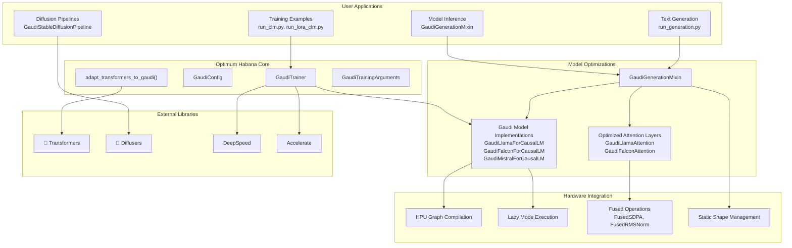
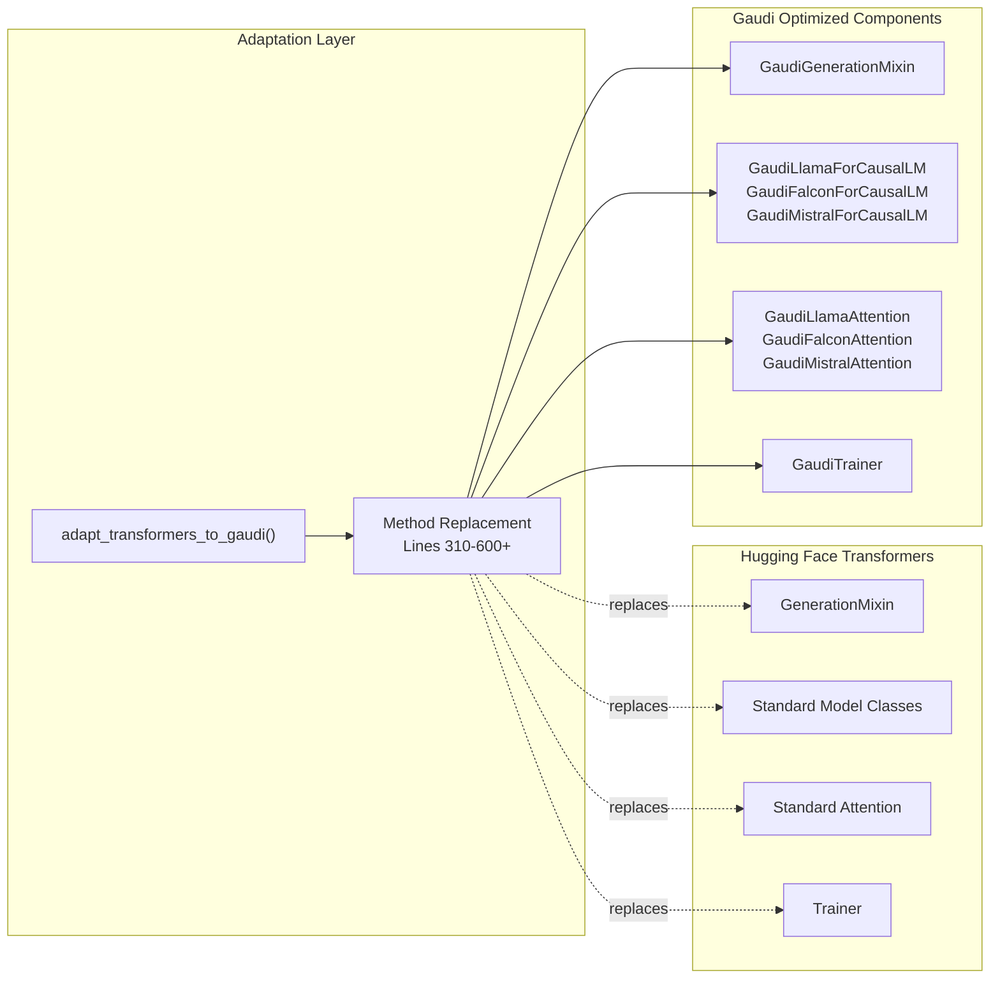
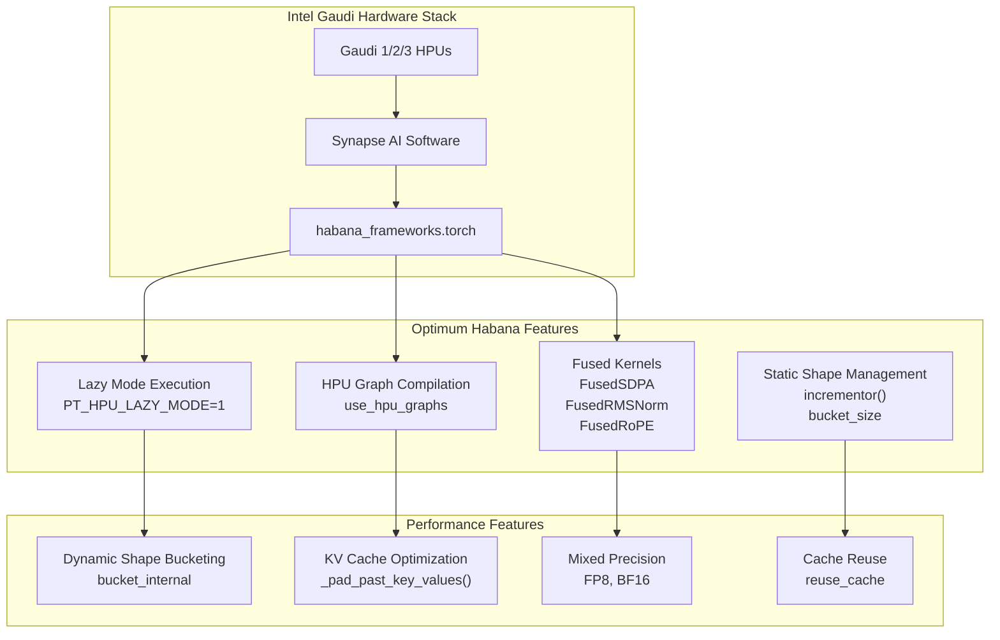

<!-- source: DeepWiki mcp.deepwiki.com · repo huggingface/optimum-habana · page 1 Overview · fetched 2026-10-26 -->

# Overview

Relevant source files

The following files were used as context for generating this wiki page:

- [Makefile](Makefile)
- [README.md](README.md)
- [docs/source/_toctree.yml](docs/source/_toctree.yml)
- [docs/source/index.mdx](docs/source/index.mdx)
- [docs/source/quickstart.mdx](docs/source/quickstart.mdx)
- [optimum/habana/__init__.py](optimum/habana/__init__.py)
- [optimum/habana/transformers/generation/utils.py](optimum/habana/transformers/generation/utils.py)
- [optimum/habana/transformers/modeling_utils.py](optimum/habana/transformers/modeling_utils.py)
- [optimum/habana/transformers/models/__init__.py](optimum/habana/transformers/models/__init__.py)
- [optimum/habana/version.py](optimum/habana/version.py)
- [tests/test_text_generation_example.py](tests/test_text_generation_example.py)

## Purpose and Scope

Optimum Habana is a comprehensive optimization library that serves as the interface between Hugging Face libraries (Transformers, Diffusers, Accelerate) and Intel Gaudi AI Accelerators (HPUs). The library enables efficient model loading, training, and inference on single and multi-HPU configurations through hardware-specific optimizations, static shape management, and specialized model implementations.

This document covers the high-level architecture and core systems of optimum-habana. For specific training configurations, see [Gaudi Trainer](#2.2). For generation-specific optimizations, see [Generation System](#2.1). For application examples, see [Applications and Examples](#3).

## System Architecture

### High-Level Component Overview

**Sources:** [README.md:26-32](), [optimum/habana/transformers/modeling_utils.py:304-308](), [optimum/habana/transformers/generation/utils.py:178-184]()

### Core Adaptation System

**Sources:** [optimum/habana/transformers/modeling_utils.py:304-700](), [optimum/habana/transformers/models/__init__.py:1-353]()

## Core System Components

### Generation System

The generation system centers around `GaudiGenerationMixin`, which replaces the standard Transformers `GenerationMixin` with HPU-optimized implementations. Key optimizations include:

- **Static Shape Management**: The `incrementor()` function [optimum/habana/transformers/generation/utils.py:144-167]() manages dynamic shape bucketing to maintain static shapes during generation
- **KV Cache Optimization**: Methods like `_pad_past_key_values()` [optimum/habana/transformers/generation/utils.py:511-543]() handle efficient key-value cache management
- **HPU Graph Integration**: `_get_hpu_graphs_kwargs()` [optimum/habana/transformers/generation/utils.py:340-347]() controls graph compilation for performance

### Training System

The training infrastructure builds on `GaudiTrainer` and `GaudiTrainingArguments` classes that extend Transformers' training capabilities:

- **Multi-Device Support**: Integration with `gaudi_spawn.py` for distributed training
- **DeepSpeed Integration**: Native support for DeepSpeed on HPUs
- **Mixed Precision**: FP8 and BF16 support through `GaudiConfig`

### Model Implementations

The library provides HPU-optimized implementations for major model architectures:

| Model Family | Implementation Class | Key Optimizations |
|--------------|---------------------|-------------------|
| Llama | `GaudiLlamaForCausalLM` | Fused RMSNorm, optimized attention |
| Falcon | `GaudiFalconForCausalLM` | Flash attention, linear layer optimization |
| Mistral | `GaudiMistralForCausalLM` | Sliding window attention optimization |
| Gemma | `GaudiGemmaForCausalLM` | RoPE optimization, attention scaling |

**Sources:** [optimum/habana/transformers/models/__init__.py:163-196]()

## Hardware Integration

### HPU-Specific Optimizations

**Sources:** [README.md:196-211](), [optimum/habana/transformers/generation/utils.py:92-136]()

### Supported Model List

The library maintains a curated list of models optimized for static shapes in `MODELS_OPTIMIZED_WITH_STATIC_SHAPES` [optimum/habana/transformers/generation/utils.py:92-136](), including:

- **Language Models**: `llama`, `falcon`, `mistral`, `mixtral`, `gemma`, `qwen2`
- **Code Models**: `gpt_bigcode`, `starcoder2`, `codegen`
- **Multimodal**: `llava`, `paligemma`, `idefics2`, `mllama`
- **Audio**: `whisper`, `seamless_m4t`

## Application Examples

### Text Generation Workflow

1. **Model Loading**: Use `adapt_transformers_to_gaudi()` to replace standard components
2. **Configuration**: Apply `GaudiConfig` for hardware-specific settings
3. **Generation**: Leverage `GaudiGenerationMixin` methods for optimized inference
4. **Bucketing**: Employ static shape management for consistent performance

### Training Workflow

1. **Script Adaptation**: Replace `Trainer` with `GaudiTrainer`
2. **Arguments Setup**: Use `GaudiTrainingArguments` with HPU-specific flags
3. **Distributed Setup**: Utilize `gaudi_spawn.py` for multi-device training
4. **Optimization**: Apply lazy mode and HPU graphs for acceleration

### Diffusion Workflow

1. **Pipeline Setup**: Use `GaudiStableDiffusionPipeline` instead of standard pipeline
2. **Scheduler**: Apply `GaudiDDIMScheduler` for HPU optimization
3. **Configuration**: Set `use_habana=True` and `use_hpu_graphs=True`
4. **Batching**: Optimize batch sizes for HPU memory characteristics

**Sources:** [README.md:107-193](), [docs/source/quickstart.mdx:91-289](), [tests/test_text_generation_example.py:156-392]()

---

