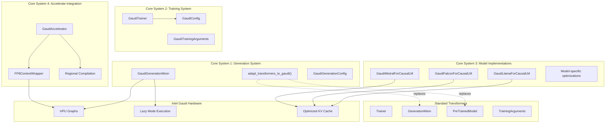
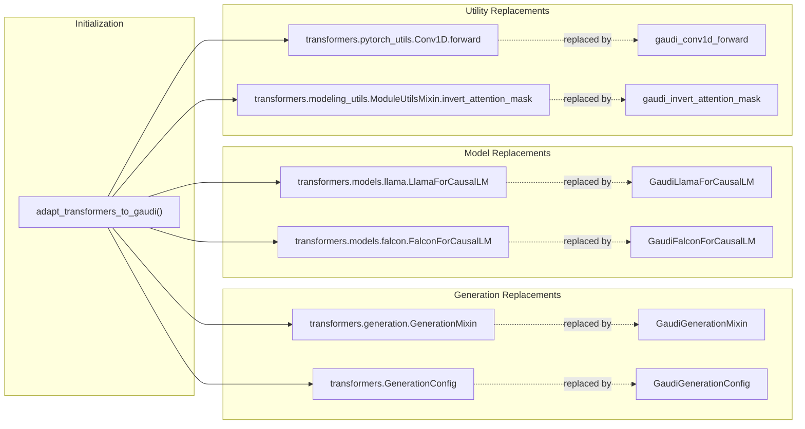
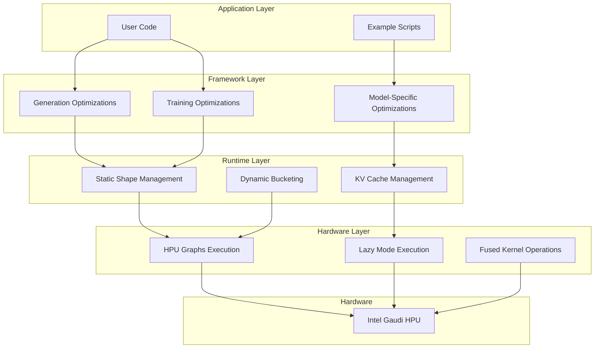

<!-- source: DeepWiki mcp.deepwiki.com · repo huggingface/optimum-habana · page 2 Core Systems · fetched 2026-10-26 -->

# Core Systems

Relevant source files

The following files were used as context for generating this wiki page:

- [Makefile](Makefile)
- [README.md](README.md)
- [docs/source/index.mdx](docs/source/index.mdx)
- [optimum/habana/transformers/generation/utils.py](optimum/habana/transformers/generation/utils.py)
- [optimum/habana/transformers/modeling_utils.py](optimum/habana/transformers/modeling_utils.py)
- [optimum/habana/transformers/models/__init__.py](optimum/habana/transformers/models/__init__.py)
- [optimum/habana/transformers/models/bart/modeling_bart.py](optimum/habana/transformers/models/bart/modeling_bart.py)
- [optimum/habana/transformers/trainer.py](optimum/habana/transformers/trainer.py)
- [optimum/habana/transformers/trainer_seq2seq.py](optimum/habana/transformers/trainer_seq2seq.py)
- [optimum/habana/transformers/training_args.py](optimum/habana/transformers/training_args.py)
- [optimum/habana/utils.py](optimum/habana/utils.py)
- [setup.py](setup.py)
- [tests/test_text_generation_example.py](tests/test_text_generation_example.py)
- [tests/test_trainer.py](tests/test_trainer.py)

This document provides an overview of the fundamental components that enable Gaudi optimization in optimum-habana. These core systems work together to seamlessly integrate Intel Gaudi HPUs with Hugging Face models while providing significant performance improvements through hardware-specific optimizations.

The core systems consist of four main components: the Generation System for optimized text generation, the Training System for efficient model training, Model Implementations for architecture-specific optimizations, and Accelerate Integration for advanced features like mixed precision and distributed training.

For detailed information about text generation workflows, see [Text Generation](#3.1). For application-specific examples, see [Applications and Examples](#3).

## System Architecture Overview

The optimum-habana architecture centers around a patching mechanism that replaces standard Transformers components with Gaudi-optimized equivalents. This design allows existing code to work with minimal changes while gaining significant performance benefits.

### Core Systems Architecture

**Sources:** [optimum/habana/transformers/modeling_utils.py:304-700](), [optimum/habana/transformers/generation/utils.py:178-184](), [optimum/habana/transformers/trainer.py:213-217]()

## Component Replacement System

The core mechanism that enables Gaudi optimization is the `adapt_transformers_to_gaudi()` function, which systematically replaces Transformers components with Gaudi-optimized versions. This patching approach ensures compatibility while enabling hardware-specific optimizations.

### Patching and Replacement Mechanism

**Sources:** [optimum/habana/transformers/modeling_utils.py:304-700](), [optimum/habana/transformers/models/__init__.py:1-353]()

## System Integration Points

The four core systems integrate through several key interfaces and shared components that enable seamless operation across the optimum-habana stack.

### Integration Architecture

| Component | Purpose | Key Classes | Integration Points |
|-----------|---------|-------------|-------------------|
| **Generation System** | Text generation optimization | `GaudiGenerationMixin`, `GaudiGenerationConfig` | Replaces standard generation classes, integrates with HPU graphs and static shapes |
| **Training System** | Training infrastructure | `GaudiTrainer`, `GaudiTrainingArguments`, `GaudiConfig` | Extends Transformers trainer, integrates with accelerate and deepspeed |
| **Model Implementations** | Architecture-specific optimizations | `GaudiLlamaForCausalLM`, `GaudiFalconForCausalLM`, etc. | Replaces model classes, implements fused kernels and optimized attention |
| **Accelerate Integration** | Advanced training features | `GaudiAccelerator`, `FP8ContextWrapper` | Provides distributed training, mixed precision, and compilation features |

### Optimization Features Matrix

The core systems enable various optimization features that work together to improve performance on Gaudi hardware:

| Optimization | Generation System | Training System | Model Implementations | Accelerate Integration |
|--------------|------------------|-----------------|----------------------|----------------------|
| **HPU Graphs** | ✓ (via `use_hpu_graphs`) | ✓ (via `use_hpu_graphs_for_training`) | ✓ (graph compilation) | ✓ (graph caching) |
| **Lazy Mode** | ✓ (default execution) | ✓ (via `use_lazy_mode`) | ✓ (model execution) | ✓ (accelerator setup) |
| **Static Shapes** | ✓ (bucketing system) | ✓ (tensor shapes) | ✓ (attention masks) | ✓ (compilation) |
| **KV Cache** | ✓ (cache management) | - | ✓ (optimized storage) | - |
| **Fused Kernels** | ✓ (SDPA, RMSNorm) | - | ✓ (attention, MLP) | - |
| **Mixed Precision** | - | ✓ (BF16, FP8) | ✓ (layer precision) | ✓ (FP8 wrapper) |

**Sources:** [optimum/habana/transformers/generation/utils.py:92-136](), [optimum/habana/transformers/training_args.py:144-280](), [optimum/habana/transformers/trainer.py:244-316]()

## Performance Optimization Strategy

The core systems implement a multi-layered optimization strategy that addresses different aspects of model execution on Gaudi hardware:

### Optimization Layers

**Sources:** [optimum/habana/transformers/generation/utils.py:640-726](), [optimum/habana/transformers/trainer.py:459-502]()

For detailed information about each core system:
- Generation System: see [Generation System](#2.1)
- Training System: see [Training System](#2.2) 
- Model Implementations: see [Model Implementations](#2.3)
- Accelerate Integration: see [Accelerate Integration](#2.4)

For practical usage examples, see [Applications and Examples](#3) and [Getting Started](#6).

---

