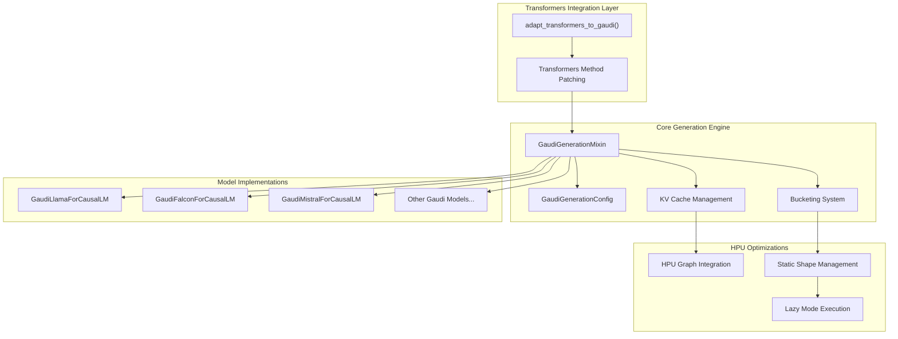
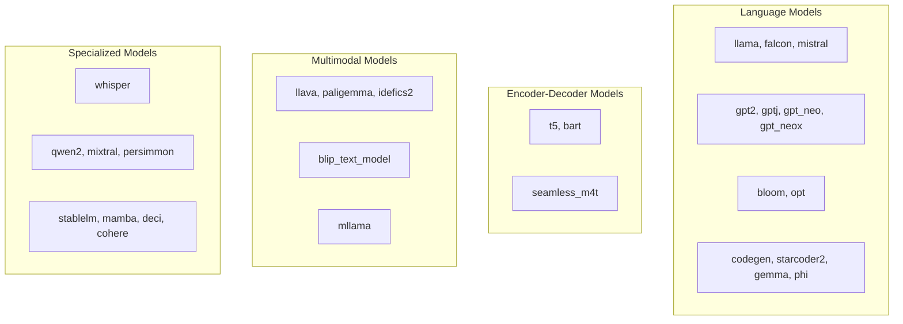
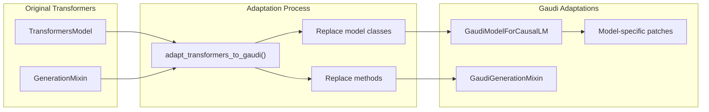
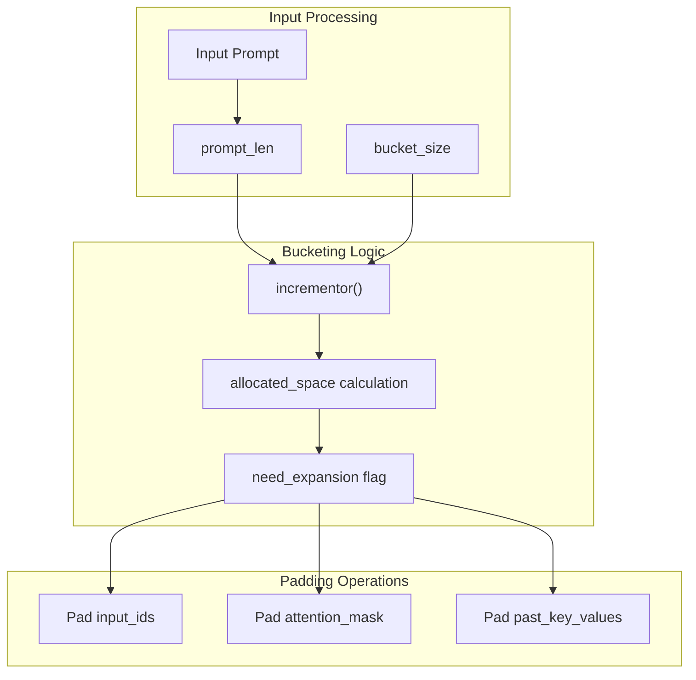
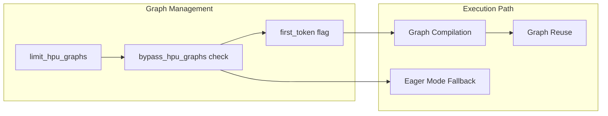
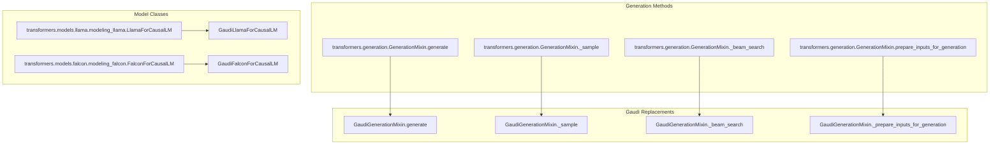

<!-- source: DeepWiki mcp.deepwiki.com · repo huggingface/optimum-habana · page 2.1 Generation System · fetched 2026-10-26 -->

# Generation System

Relevant source files

The following files were used as context for generating this wiki page:

- [Makefile](Makefile)
- [README.md](README.md)
- [docs/source/index.mdx](docs/source/index.mdx)
- [optimum/habana/transformers/generation/utils.py](optimum/habana/transformers/generation/utils.py)
- [optimum/habana/transformers/modeling_utils.py](optimum/habana/transformers/modeling_utils.py)
- [optimum/habana/transformers/models/__init__.py](optimum/habana/transformers/models/__init__.py)
- [tests/test_text_generation_example.py](tests/test_text_generation_example.py)

## Purpose and Scope

The Generation System is the core component that enables optimized text generation on Intel Gaudi processors. It provides a complete replacement for Hugging Face Transformers' generation functionality, specifically designed to leverage Gaudi's lazy mode execution and HPU graphs for maximum performance. The system maintains compatibility with the Transformers API while introducing Gaudi-specific optimizations like static shapes, advanced KV caching, and bucketing strategies.

For information about training models, see [Training System](#2.2). For details about specific model implementations, see [Model Implementations](#2.3).

## Core Architecture

The Generation System consists of three primary components that work together to optimize text generation on Gaudi processors:

### System Architecture Overview

**Sources:** [optimum/habana/transformers/modeling_utils.py:304-393](), [optimum/habana/transformers/generation/utils.py:178-185]()

### Core Components

The system is built around three main classes:

- **`GaudiGenerationMixin`** - The primary generation class that replaces `GenerationMixin` from Transformers
- **`GaudiGenerationConfig`** - Configuration class for Gaudi-specific generation parameters  
- **`adapt_transformers_to_gaudi()`** - Function that patches Transformers to use Gaudi optimizations

## Generation Pipeline

The generation process follows a carefully orchestrated pipeline optimized for Gaudi's architecture:

### Generation Flow Diagram

```mermaid
graph LR
    subgraph "Input Processing"
        INPUT_IDS["input_ids"]
        PREP_INPUTS["_prepare_inputs_for_generation()"]
        TOKEN_IDX["token_idx initialization"]
    end
    
    subgraph "Generation Loop"
        FORWARD["Model Forward Pass"]
        LOGITS["Logit Processing"]
        SAMPLING["Token Sampling"]
        UPDATE_CACHE["_update_model_kwargs_for_generation()"]
        BUCKETING_CHECK["Bucketing Check"]
        PAD_INPUTS["update_model_kwargs_for_bucketing()"]
    end
    
    subgraph "HPU Optimizations"
        HPU_GRAPHS_CHECK["_get_hpu_graphs_kwargs()"]
        STATIC_SHAPES_MGT["Static Shape Management"]
        KV_PADDING["_pad_past_key_values()"]
    end
    
    INPUT_IDS --> PREP_INPUTS
    PREP_INPUTS --> TOKEN_IDX
    TOKEN_IDX --> FORWARD
    FORWARD --> LOGITS
    LOGITS --> SAMPLING
    SAMPLING --> UPDATE_CACHE
    UPDATE_CACHE --> BUCKETING_CHECK
    BUCKETING_CHECK --> PAD_INPUTS
    PAD_INPUTS --> HPU_GRAPHS_CHECK
    HPU_GRAPHS_CHECK --> STATIC_SHAPES_MGT
    STATIC_SHAPES_MGT --> KV_PADDING
    KV_PADDING --> FORWARD
```

**Sources:** [optimum/habana/transformers/generation/utils.py:186-338](), [optimum/habana/transformers/generation/utils.py:562-637](), [optimum/habana/transformers/generation/utils.py:640-726]()

### Key Generation Methods

The system implements several generation strategies:

- **`_sample()`** - Sampling-based generation with temperature and top-k/top-p
- **`_beam_search()`** - Beam search decoding for higher quality outputs
- **`_contrastive_search()`** - Contrastive search for reducing repetition
- **`_assisted_decoding()`** - Speculative decoding with assistant models

## Model Adaptations

The system supports a comprehensive list of models optimized for static shapes:

### Supported Models

The following models are optimized with static shape management:

**Sources:** [optimum/habana/transformers/generation/utils.py:92-136]()

### Model Integration Pattern

**Sources:** [optimum/habana/transformers/modeling_utils.py:394-700]()

## Optimization Features

### Static Shape Management

The system enforces constant sequence lengths to maximize HPU graph efficiency:

#### Bucketing System

**Sources:** [optimum/habana/transformers/generation/utils.py:144-167](), [optimum/habana/transformers/generation/utils.py:640-726]()

### KV Cache Optimization

The system implements sophisticated KV cache management for both MQA and standard attention:

| Cache Type | Storage Format | Padding Strategy |
|------------|----------------|------------------|
| Standard Attention | `List[List[Tensor]]` | Per-layer, per-head padding |
| MQA (Multi-Query Attention) | `List[Tensor]` | Concatenated key-value padding |
| Static Cache | `StaticCache` | Pre-allocated fixed-size cache |

**Sources:** [optimum/habana/transformers/generation/utils.py:511-543]()

### HPU Graph Integration

The system automatically manages HPU graph compilation and execution:

**Sources:** [optimum/habana/transformers/generation/utils.py:340-347]()

## Integration Mechanism

### Transformers Patching Process

The `adapt_transformers_to_gaudi()` function systematically replaces Transformers components:

#### Core Replacements

**Sources:** [optimum/habana/transformers/modeling_utils.py:343-393](), [optimum/habana/transformers/modeling_utils.py:492-700]()

### Configuration Integration

The system provides Gaudi-specific configuration through `GaudiGenerationConfig`:

| Parameter | Purpose | Default Behavior |
|-----------|---------|------------------|
| `static_shapes` | Enable static shape optimization | Automatic based on model |
| `bucket_size` | Bucketing increment size | Model-dependent |
| `bucket_internal` | Internal bucketing strategy | Disabled |
| `limit_hpu_graphs` | HPU graph usage control | Enabled |
| `reuse_cache` | KV cache reuse strategy | Model-dependent |

**Sources:** [optimum/habana/transformers/generation/configuration_utils.py]()

### Performance Integration

The system integrates with various Gaudi-specific features:

- **Lazy Mode Execution** - Deferred computation for graph optimization
- **Flash Attention** - Optimized attention kernels for specific models  
- **FP8 Quantization** - Mixed precision support for memory efficiency
- **Regional Compilation** - Partial graph compilation for faster iteration

**Sources:** [tests/test_text_generation_example.py:200-355]()

---

