<!-- source: DeepWiki mcp.deepwiki.com · repo huggingface/optimum-habana · page 2.2 Training System · fetched 2026-10-26 -->

# Training System

Relevant source files

The following files were used as context for generating this wiki page:

- [optimum/habana/transformers/models/bart/modeling_bart.py](optimum/habana/transformers/models/bart/modeling_bart.py)
- [optimum/habana/transformers/trainer.py](optimum/habana/transformers/trainer.py)
- [optimum/habana/transformers/trainer_seq2seq.py](optimum/habana/transformers/trainer_seq2seq.py)
- [optimum/habana/transformers/training_args.py](optimum/habana/transformers/training_args.py)
- [optimum/habana/utils.py](optimum/habana/utils.py)
- [setup.py](setup.py)
- [tests/test_trainer.py](tests/test_trainer.py)

## Purpose and Scope

The Training System provides Habana Gaudi-optimized training capabilities for Hugging Face Transformers models. It extends the standard HuggingFace Trainer infrastructure with HPU-specific optimizations including lazy mode execution, HPU graphs, mixed precision training, and distributed training support. This system enables efficient training of language models, sequence-to-sequence models, and other transformer architectures on Intel Habana Gaudi processors.

For information about text generation and inference, see [Generation System](#2.1). For model-specific implementations and optimizations, see [Model Implementations](#2.3).

## Core Training Architecture

The training system is built around three main components that extend HuggingFace's training infrastructure:

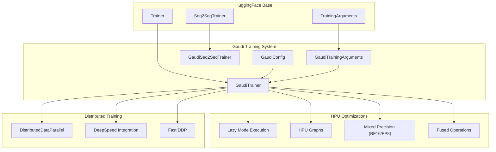

**Training System Class Hierarchy**

Sources: [optimum/habana/transformers/trainer.py:213-270](), [optimum/habana/transformers/training_args.py:89-142](), [optimum/habana/transformers/trainer_seq2seq.py:58-92]()

## Main Training Classes

### GaudiTrainer

The `GaudiTrainer` class is the central component that extends HuggingFace's `Trainer` with HPU-specific optimizations:

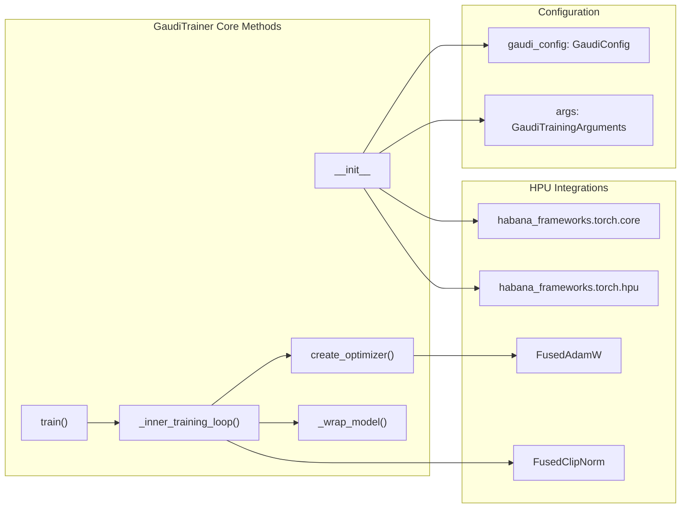

**GaudiTrainer Key Features**

The `GaudiTrainer` initializes with HPU-specific configurations and optimizations:

| Feature | Configuration | Purpose |
|---------|--------------|---------|
| Mixed Precision | `use_hpu_amp`, `use_cpu_amp` | BF16/FP8 training optimization |
| Lazy Mode | `use_lazy_mode` | Deferred execution for better performance |
| HPU Graphs | `use_hpu_graphs_for_training` | Graph compilation for training |
| Fused Operations | `use_fused_adam`, `use_fused_clip_norm` | Optimized operations |

Sources: [optimum/habana/transformers/trainer.py:244-323](), [optimum/habana/transformers/trainer.py:383-446]()

### GaudiTrainingArguments

`GaudiTrainingArguments` extends the base `TrainingArguments` with HPU-specific parameters:

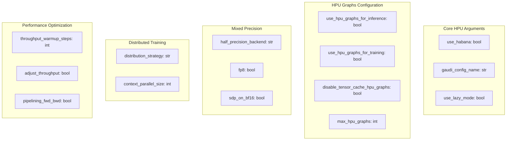

**HPU-Specific Training Arguments**

Sources: [optimum/habana/transformers/training_args.py:144-302]()

### GaudiSeq2SeqTrainer

For sequence-to-sequence tasks, `GaudiSeq2SeqTrainer` provides additional generation capabilities:

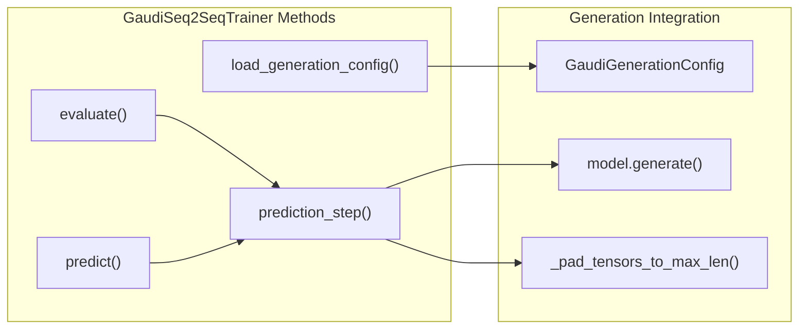

**Seq2Seq Training Features**

Sources: [optimum/habana/transformers/trainer_seq2seq.py:100-147](), [optimum/habana/transformers/trainer_seq2seq.py:258-403]()

## HPU Optimization Features

### Lazy Mode Execution

Lazy mode defers operations to optimize memory usage and performance:

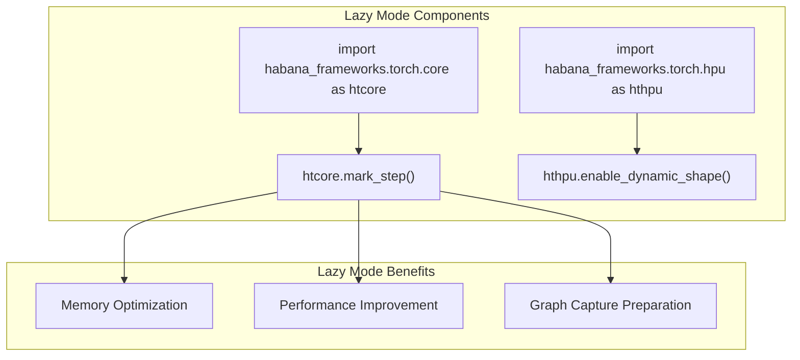

**Lazy Mode Implementation**

Sources: [optimum/habana/transformers/trainer.py:300-317]()

### Mixed Precision Training

The training system supports multiple mixed precision backends:

| Backend | Configuration | Use Case |
|---------|--------------|----------|
| HPU AMP | `half_precision_backend="hpu_amp"` | Default BF16 training |
| CPU AMP | `half_precision_backend="cpu_amp"` | CPU-based mixed precision |
| FP8 | `fp8=True` | Ultra-low precision training |

**Mixed Precision Setup**

Sources: [optimum/habana/transformers/trainer.py:244-255](), [optimum/habana/transformers/training_args.py:354-379]()

### HPU Graphs

HPU graphs provide compiled execution for improved performance:

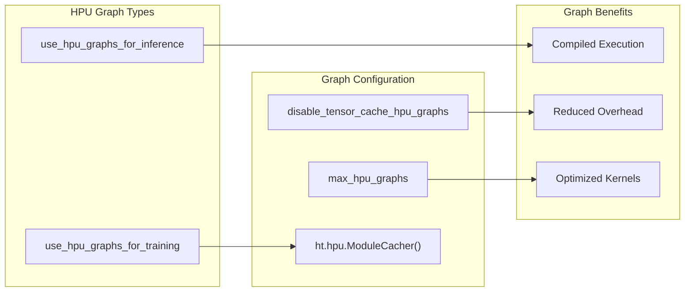

**HPU Graph Implementation**

Sources: [optimum/habana/transformers/trainer.py:497-501](), [optimum/habana/transformers/training_args.py:159-234]()

## Distributed Training Support

### Distribution Strategies

The training system supports multiple distributed training approaches:

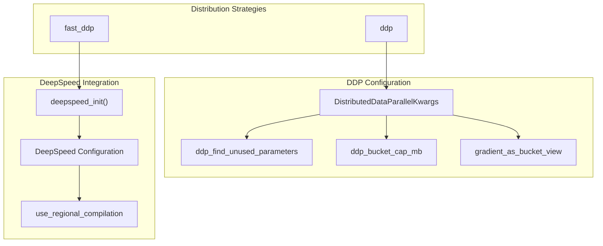

**Distributed Training Implementation**

Sources: [optimum/habana/transformers/trainer.py:469-496](), [optimum/habana/transformers/training_args.py:236-244]()

### Context Parallelism

For large sequence lengths, context parallelism distributes attention computation:

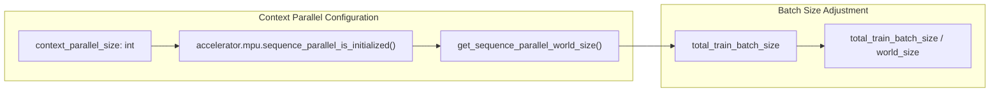

**Context Parallelism Implementation**

Sources: [optimum/habana/transformers/trainer.py:661-665](), [optimum/habana/transformers/training_args.py:246-249]()

## Optimizer Integration

### Fused Optimizers

The training system integrates with HPU-optimized optimizers:

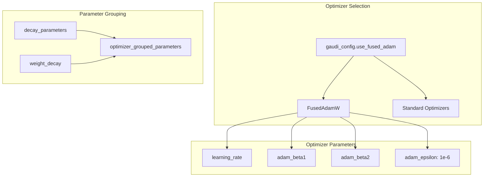

**Optimizer Implementation**

Sources: [optimum/habana/transformers/trainer.py:410-446](), [optimum/habana/transformers/training_args.py:314-324]()

### Gradient Clipping

Fused gradient clipping provides efficient gradient normalization:

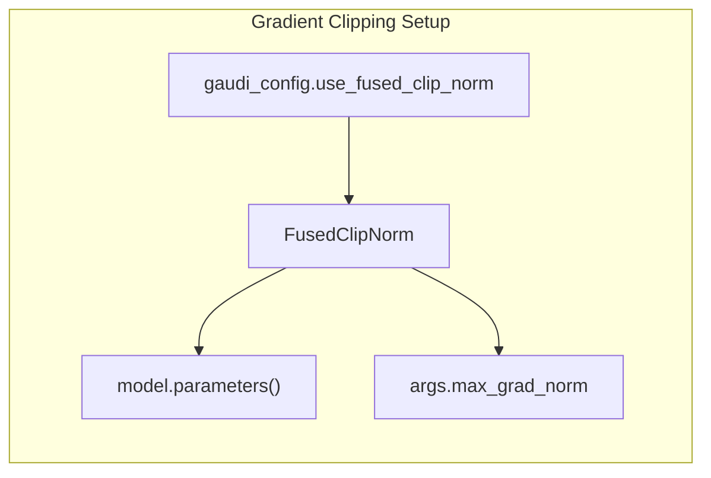

**Gradient Clipping Implementation**

Sources: [optimum/habana/transformers/trainer.py:812-821]()

## Performance Monitoring

### Throughput Metrics

The training system provides detailed performance monitoring:

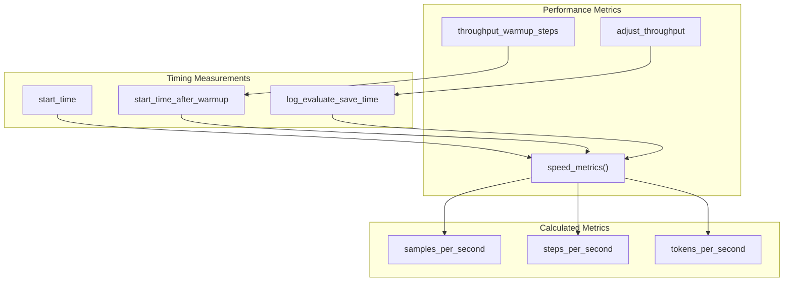

**Performance Monitoring Implementation**

Sources: [optimum/habana/utils.py:65-117](), [optimum/habana/transformers/training_args.py:256-273]()

## Integration Points

### HuggingFace Ecosystem Integration

The training system maintains compatibility with the broader HuggingFace ecosystem:

| Component | Integration Point | Purpose |
|-----------|------------------|---------|
| Transformers | Extends `Trainer` | Core training functionality |
| Accelerate | `GaudiAccelerator` | Device management and optimization |
| Datasets | Native support | Data loading and processing |
| Hub | Model upload/download | Model sharing and versioning |
| DeepSpeed | `deepspeed_init()` | Large model training |

**Ecosystem Integration**

Sources: [optimum/habana/transformers/trainer.py:49-108](), [optimum/habana/transformers/trainer.py:692-693]()

---

