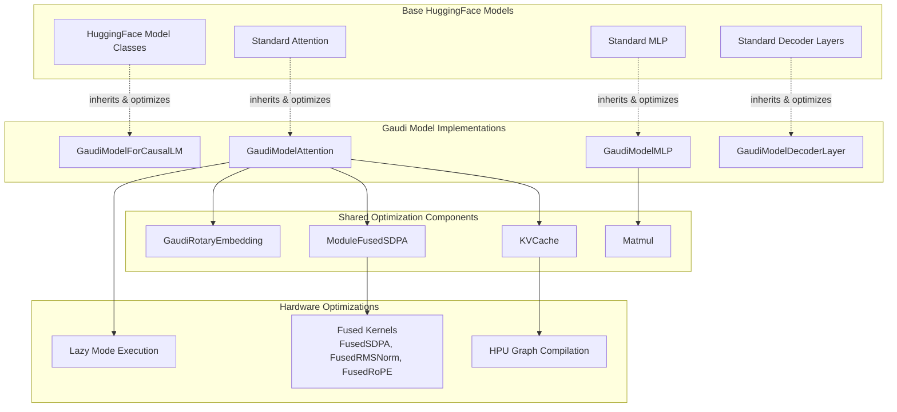
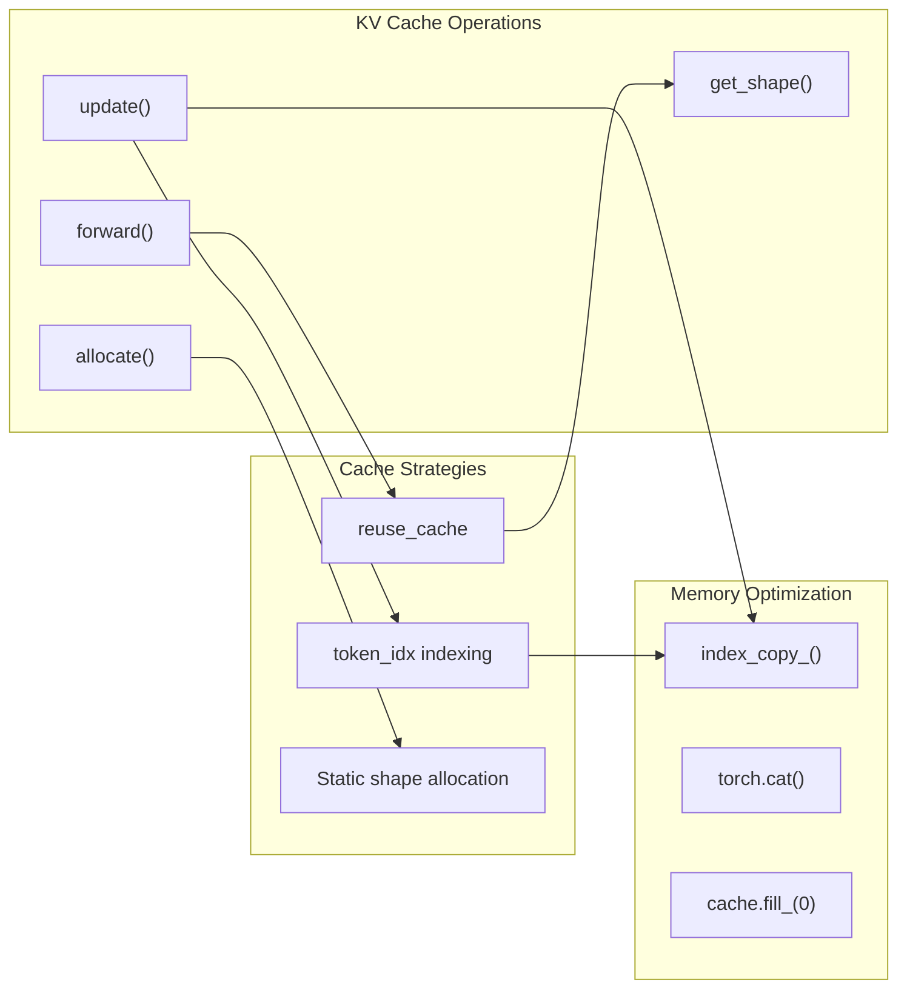
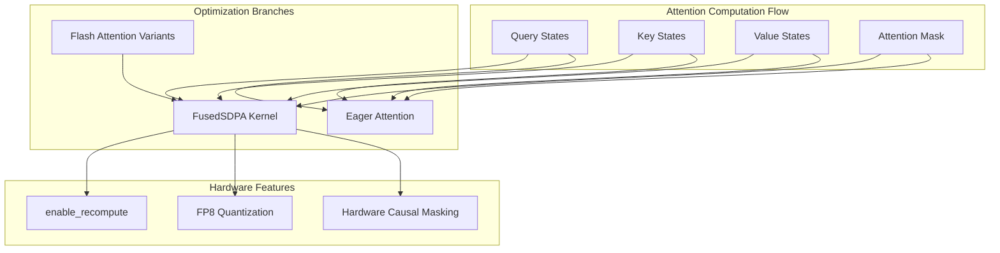
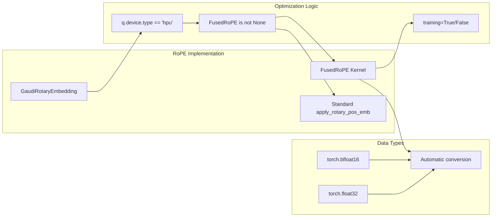
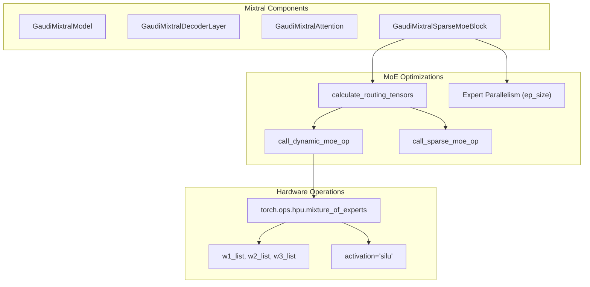
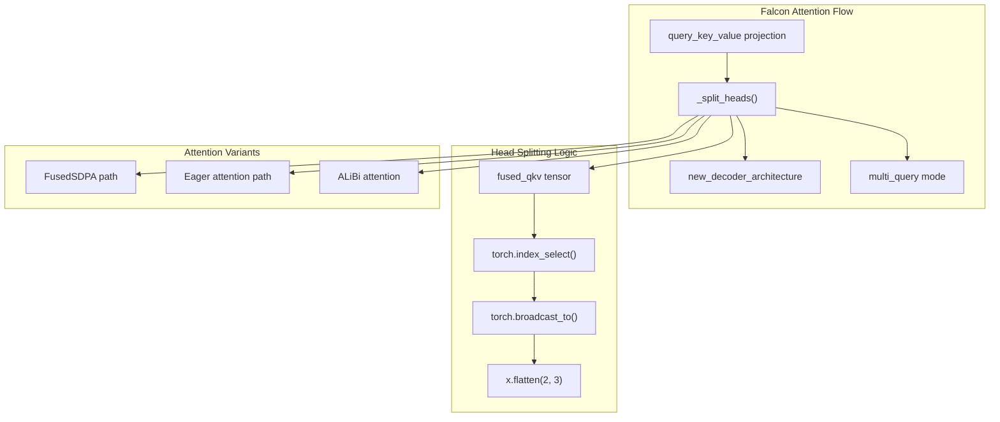
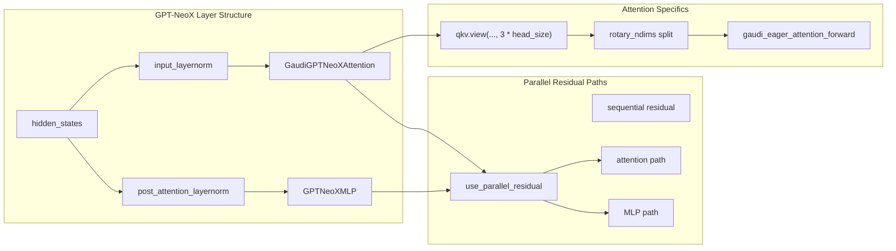
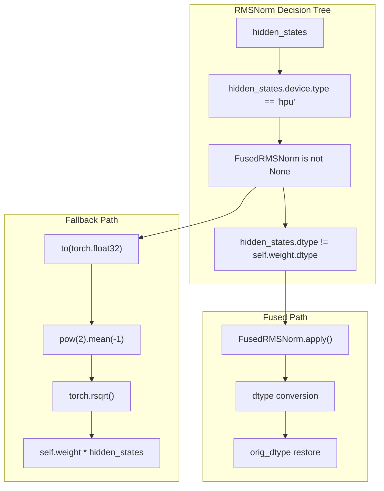
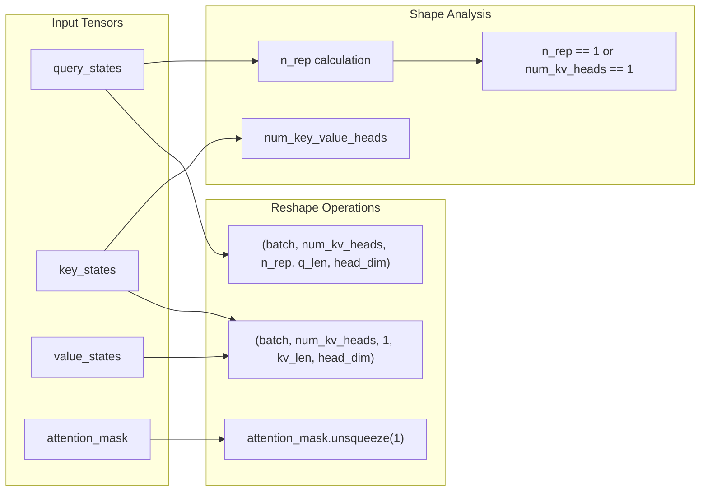
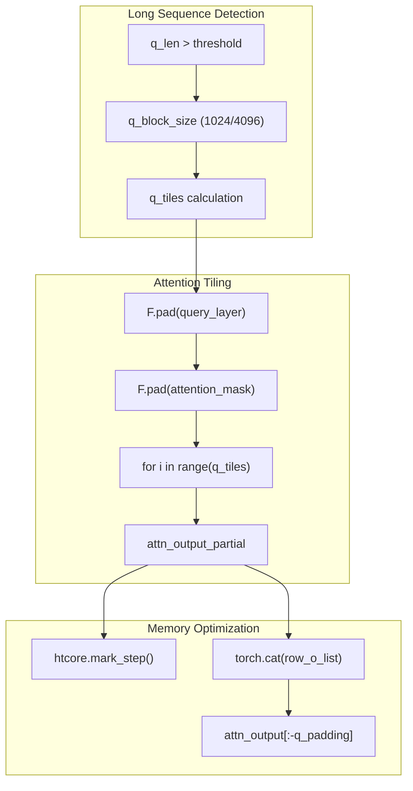

<!-- source: DeepWiki mcp.deepwiki.com · repo huggingface/optimum-habana · page 2.3 Model Implementations · fetched 2026-10-26 -->

# Model Implementations

Relevant source files

The following files were used as context for generating this wiki page:

- [examples/language-modeling/ops_bf16.txt](examples/language-modeling/ops_bf16.txt)
- [examples/text-generation/quantization_config/maxabs_quant_mixtral.json](examples/text-generation/quantization_config/maxabs_quant_mixtral.json)
- [optimum/habana/transformers/models/albert/modeling_albert.py](optimum/habana/transformers/models/albert/modeling_albert.py)
- [optimum/habana/transformers/models/falcon/__init__.py](optimum/habana/transformers/models/falcon/__init__.py)
- [optimum/habana/transformers/models/falcon/modeling_falcon.py](optimum/habana/transformers/models/falcon/modeling_falcon.py)
- [optimum/habana/transformers/models/gemma/modeling_gemma.py](optimum/habana/transformers/models/gemma/modeling_gemma.py)
- [optimum/habana/transformers/models/gpt2/modeling_gpt2.py](optimum/habana/transformers/models/gpt2/modeling_gpt2.py)
- [optimum/habana/transformers/models/gpt_neox/modeling_gpt_neox.py](optimum/habana/transformers/models/gpt_neox/modeling_gpt_neox.py)
- [optimum/habana/transformers/models/gptj/__init__.py](optimum/habana/transformers/models/gptj/__init__.py)
- [optimum/habana/transformers/models/gptj/modeling_gptj.py](optimum/habana/transformers/models/gptj/modeling_gptj.py)
- [optimum/habana/transformers/models/mistral/__init__.py](optimum/habana/transformers/models/mistral/__init__.py)
- [optimum/habana/transformers/models/mistral/configuration_mistral.py](optimum/habana/transformers/models/mistral/configuration_mistral.py)
- [optimum/habana/transformers/models/mistral/modeling_mistral.py](optimum/habana/transformers/models/mistral/modeling_mistral.py)
- [optimum/habana/transformers/models/mixtral/__init__.py](optimum/habana/transformers/models/mixtral/__init__.py)
- [optimum/habana/transformers/models/mixtral/configuration_mixtral.py](optimum/habana/transformers/models/mixtral/configuration_mixtral.py)
- [optimum/habana/transformers/models/mixtral/modeling_mixtral.py](optimum/habana/transformers/models/mixtral/modeling_mixtral.py)
- [optimum/habana/transformers/models/modeling_all_models.py](optimum/habana/transformers/models/modeling_all_models.py)
- [optimum/habana/transformers/models/opt/modeling_opt.py](optimum/habana/transformers/models/opt/modeling_opt.py)
- [optimum/habana/transformers/models/persimmon/modeling_persimmon.py](optimum/habana/transformers/models/persimmon/modeling_persimmon.py)
- [optimum/habana/transformers/models/phi/modeling_phi.py](optimum/habana/transformers/models/phi/modeling_phi.py)
- [optimum/habana/transformers/models/qwen2/modeling_qwen2.py](optimum/habana/transformers/models/qwen2/modeling_qwen2.py)
- [optimum/habana/transformers/models/qwen2_moe/modeling_qwen2_moe.py](optimum/habana/transformers/models/qwen2_moe/modeling_qwen2_moe.py)
- [optimum/habana/transformers/models/stablelm/modeling_stablelm.py](optimum/habana/transformers/models/stablelm/modeling_stablelm.py)
- [optimum/habana/transformers/models/starcoder2/modeling_starcoder2.py](optimum/habana/transformers/models/starcoder2/modeling_starcoder2.py)
- [tests/baselines/fixture/tests/test_encoder_decoder.json](tests/baselines/fixture/tests/test_encoder_decoder.json)
- [tests/baselines/fixture/tests/test_text_generation_example.json](tests/baselines/fixture/tests/test_text_generation_example.json)

This document covers the Gaudi-optimized model implementations in optimum-habana, which provide Intel Habana processor-specific adaptations of popular transformer models. These implementations replace standard HuggingFace transformer components with optimized versions that leverage Habana's specialized hardware features including fused kernels, optimized attention mechanisms, and efficient KV cache management.

For information about the generation system that coordinates these model implementations, see [Generation System](#2.1). For training-specific optimizations, see [Training System](#2.2).

## Architecture Overview

The model implementations follow a consistent pattern where standard transformer components are replaced with Gaudi-optimized equivalents. Each model family has its own implementation module that extends the base HuggingFace classes while adding Habana-specific optimizations.

### Model Implementation Structure

Sources: [optimum/habana/transformers/models/modeling_all_models.py:1-253](), [optimum/habana/transformers/models/mixtral/modeling_mixtral.py:1-50](), [optimum/habana/transformers/models/mistral/modeling_mistral.py:1-50]()

### Supported Model Families

The codebase provides optimized implementations for multiple model architectures:

| Model Family | Implementation Class | Key Features |
|--------------|---------------------|--------------|
| Mixtral | `GaudiMixtralForCausalLM` | Mixture of Experts, Sparse MoE optimization |
| Falcon | `GaudiFalconForCausalLM` | Multi-query attention, ALiBi positional encoding |
| Mistral | `GaudiMistralForCausalLM` | Sliding window attention, RMSNorm optimization |
| Gemma | `GaudiGemmaForCausalLM` | Flash attention variants, long sequence support |
| Qwen2 | `GaudiQwen2ForCausalLM` | Distributed attention, FP8 support |
| GPT-J | `GaudiGPTJForCausalLM` | Rotary position embeddings, parallel residuals |
| GPT-NeoX | `GaudiGPTNeoXForCausalLM` | Parallel attention and MLP |

Sources: [optimum/habana/transformers/models/mixtral/__init__.py:1-10](), [optimum/habana/transformers/models/falcon/__init__.py:1-9](), [optimum/habana/transformers/models/mistral/__init__.py:1-9]()

## Common Optimization Patterns

### KV Cache Management

All model implementations utilize a shared `KVCache` class that provides efficient key-value cache management optimized for Habana hardware:

The `KVCache` class at [optimum/habana/transformers/models/modeling_all_models.py:40-80]() provides methods for allocating cache tensors with fixed shapes, updating cache contents using token indexing, and managing cache reuse across generation steps.

Sources: [optimum/habana/transformers/models/modeling_all_models.py:40-80](), [optimum/habana/transformers/models/mixtral/modeling_mixtral.py:374-387]()

### Fused Attention Operations

Models utilize `ModuleFusedSDPA` to wrap Habana's fused scaled dot-product attention kernel:

The `ModuleFusedSDPA` wrapper at [optimum/habana/transformers/models/mixtral/modeling_mixtral.py:84-116]() enables hardware-accelerated attention computation with support for recompute modes and quantization.

Sources: [optimum/habana/transformers/models/mixtral/modeling_mixtral.py:84-116](), [optimum/habana/transformers/models/mistral/modeling_mistral.py:74-81]()

### Rotary Position Embeddings

Custom rotary embedding implementations leverage Habana's fused RoPE kernel:

The `apply_customized_rope` function at [optimum/habana/transformers/models/modeling_all_models.py:82-106]() automatically selects between fused and standard implementations based on device type and kernel availability.

Sources: [optimum/habana/transformers/models/modeling_all_models.py:82-106](), [optimum/habana/transformers/models/mixtral/modeling_mixtral.py:118-123]()

## Model-Specific Implementations

### Mixtral (Mixture of Experts)

Mixtral implementation includes specialized handling for the sparse MoE architecture:

The `GaudiMixtralSparseMoeBlock` at [optimum/habana/transformers/models/mixtral/modeling_mixtral.py:182-313]() implements optimized expert routing with support for both dynamic and sparse MoE operations using Habana's custom operators.

Sources: [optimum/habana/transformers/models/mixtral/modeling_mixtral.py:182-313](), [optimum/habana/transformers/models/mixtral/modeling_mixtral.py:520-528]()

### Falcon (Multi-Query Attention)

Falcon implementation handles the unique multi-query attention architecture:

The `_split_heads` method at [optimum/habana/transformers/models/falcon/modeling_falcon.py:211-251]() handles the complex tensor reshaping required for Falcon's multi-query attention mechanism.

Sources: [optimum/habana/transformers/models/falcon/modeling_falcon.py:211-251](), [optimum/habana/transformers/models/falcon/modeling_falcon.py:174-514]()

### GPT-NeoX (Parallel Architecture)

GPT-NeoX implementation optimizes the parallel attention and MLP architecture:

The `GaudiGPTNeoXLayer` at [optimum/habana/transformers/models/gpt_neox/modeling_gpt_neox.py:192-256]() implements both parallel and sequential residual connection modes with optimized attention computation.

Sources: [optimum/habana/transformers/models/gpt_neox/modeling_gpt_neox.py:192-256](), [optimum/habana/transformers/models/gpt_neox/modeling_gpt_neox.py:82-177]()

## Key Optimization Components

### RMSNorm Optimization

Models using RMSNorm (Mistral, Mixtral, Qwen2) leverage fused implementations:

The `gaudi_mistral_rmsnorm_forward` function at [optimum/habana/transformers/models/mistral/modeling_mistral.py:117-137]() demonstrates the pattern used across models for optimized normalization.

Sources: [optimum/habana/transformers/models/mistral/modeling_mistral.py:117-137](), [optimum/habana/transformers/models/mixtral/modeling_mixtral.py:125-145]()

### Repeat KV Optimization

Models with grouped-query attention use optimized KV repetition:

The `gaudi_mistral_repeat_kv` function at [optimum/habana/transformers/models/mistral/modeling_mistral.py:83-114]() provides efficient tensor reshaping for grouped-query attention patterns.

Sources: [optimum/habana/transformers/models/mistral/modeling_mistral.py:83-114](), [optimum/habana/transformers/models/mixtral/modeling_mixtral.py:148-179]()

### Long Sequence Support

Several models implement optimized handling for long sequences:

The `GaudiMixtralAttentionLongSequence.forward` method at [optimum/habana/transformers/models/mixtral/modeling_mixtral.py:315-338]() demonstrates the tiling approach used for sequences exceeding 8192 tokens.

Sources: [optimum/habana/transformers/models/mixtral/modeling_mixtral.py:315-338](), [optimum/habana/transformers/models/gemma/modeling_gemma.py:244-272]()

---

