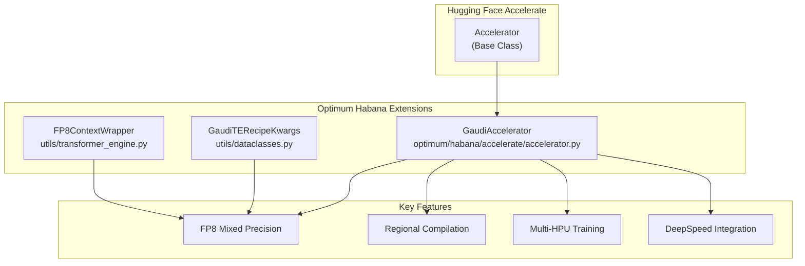
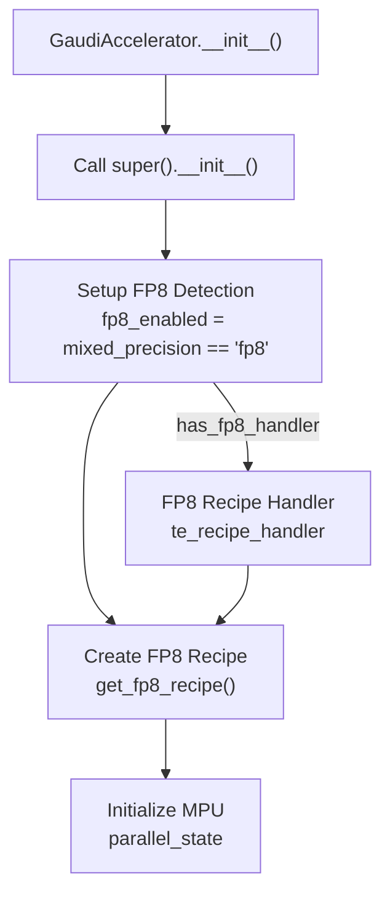
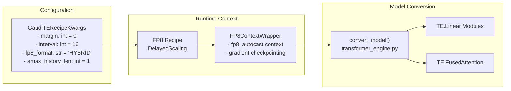
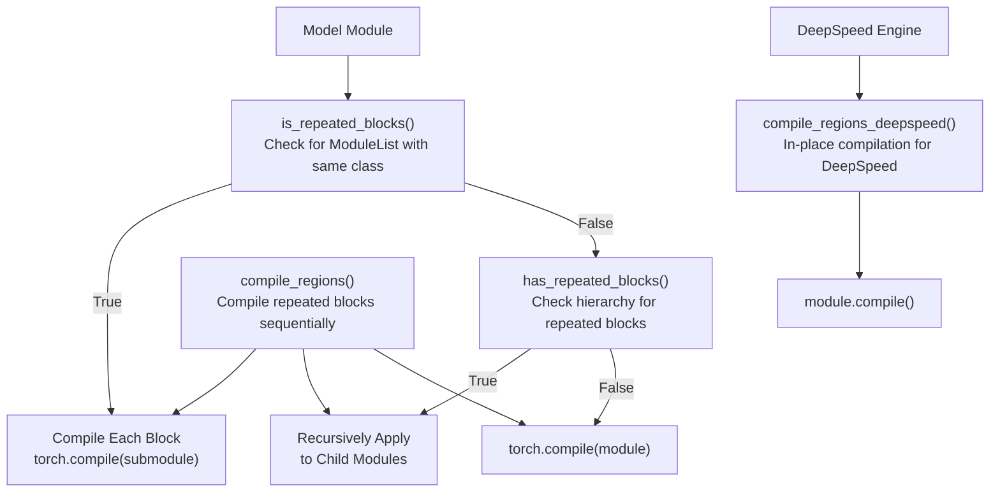
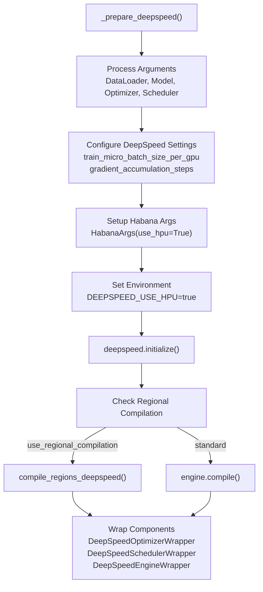
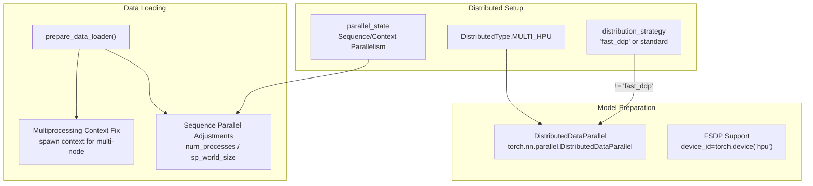
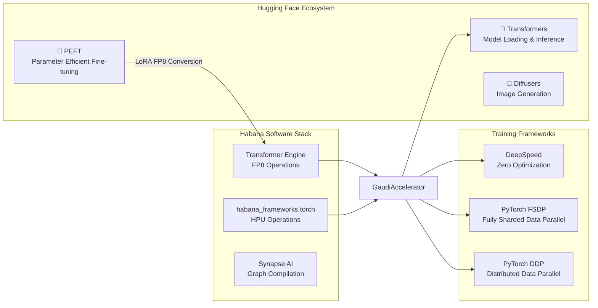

<!-- source: DeepWiki mcp.deepwiki.com · repo huggingface/optimum-habana · page 2.4 Accelerate Integration · fetched 2026-10-26 -->

# Accelerate Integration

<details>
<summary>Relevant source files</summary>

The following files were used as context for generating this wiki page:

- [optimum/habana/accelerate/__init__.py](optimum/habana/accelerate/__init__.py)
- [optimum/habana/accelerate/accelerator.py](optimum/habana/accelerate/accelerator.py)
- [optimum/habana/accelerate/state.py](optimum/habana/accelerate/state.py)
- [optimum/habana/accelerate/utils/__init__.py](optimum/habana/accelerate/utils/__init__.py)
- [optimum/habana/accelerate/utils/dataclasses.py](optimum/habana/accelerate/utils/dataclasses.py)
- [optimum/habana/accelerate/utils/other.py](optimum/habana/accelerate/utils/other.py)
- [optimum/habana/accelerate/utils/transformer_engine.py](optimum/habana/accelerate/utils/transformer_engine.py)
- [optimum/habana/transformers/models/llama/configuration_llama.py](optimum/habana/transformers/models/llama/configuration_llama.py)

</details>


This document covers the Habana Gaudi integration with Hugging Face Accelerate library, providing specialized acceleration features for training and inference on Intel Habana processors. The system extends the standard Accelerate framework with Gaudi-specific optimizations including FP8 mixed precision, regional compilation, and multi-HPU distributed training capabilities.

For general training system documentation, see [Training System](#2.2). For model-specific optimizations, see [Model Implementations](#2.3).

## Core Architecture

The Accelerate integration is built around the `GaudiAccelerator` class, which extends the standard Accelerate `Accelerator` with Gaudi-specific functionality. The system provides seamless integration with existing Accelerate workflows while adding hardware-specific optimizations.

**GaudiAccelerator Class Hierarchy**


Sources: [optimum/habana/accelerate/accelerator.py:82-142](), [optimum/habana/accelerate/utils/dataclasses.py:6-46](), [optimum/habana/accelerate/utils/transformer_engine.py:188-238]()

## GaudiAccelerator Features

The `GaudiAccelerator` class provides several key enhancements over the standard Accelerator:

| Feature | Description | Configuration |
|---------|-------------|---------------|
| `force_autocast` | Forces autocast wrapping for mixed precision | `force_autocast=True` |
| `use_regional_compilation` | Enables regional compilation optimization | `use_regional_compilation=True` |
| `compiled_autograd_enable` | Enables compiled autograd for performance | `compiled_autograd_enable=True` |
| `distribution_strategy` | Configures distributed training strategy | `distribution_strategy="fast_ddp"` |
| `fp8_enabled` | Automatic FP8 detection and setup | Set via `mixed_precision="fp8"` |

**GaudiAccelerator Initialization Flow**


Sources: [optimum/habana/accelerate/accelerator.py:110-156]()

## FP8 Mixed Precision Training

The system provides comprehensive FP8 mixed precision support through integration with Habana's Transformer Engine. This enables significant memory savings and performance improvements for large model training.

**FP8 Integration Components**


The FP8 conversion process automatically transforms `torch.nn.Linear` modules to Transformer Engine equivalents:

```python
# Key conversion logic in convert_model()
# optimum/habana/accelerate/utils/transformer_engine.py:161-170
```

**FP8 Recipe Configuration**

The `GaudiTERecipeKwargs` class configures FP8 training parameters:

| Parameter | Default | Description |
|-----------|---------|-------------|
| `margin` | 0 | Scaling factor computation margin |
| `interval` | 16 | Scaling factor recomputation frequency |
| `fp8_format` | "HYBRID" | FP8 format (E5M2 or HYBRID) |
| `amax_history_len` | 1 | History length for scaling computation |
| `amax_compute_algo` | "most_recent" | Algorithm for scaling computation |
| `reduce_amax` | False | Whether to reduce amax across processes |

Sources: [optimum/habana/accelerate/utils/dataclasses.py:6-46](), [optimum/habana/accelerate/utils/transformer_engine.py:48-171]()

## Regional Compilation

Regional compilation is an advanced optimization technique that compiles repeated model blocks separately to improve compilation efficiency and reduce cold start times.

**Regional Compilation Process**


The regional compilation system identifies patterns like transformer blocks and compiles them efficiently:

```python
# Regional compilation detection logic
# optimum/habana/accelerate/utils/other.py:29-49
```

**Regional Compilation Usage**

Regional compilation is automatically applied when `use_regional_compilation=True` is set:

```python
# In prepare_model() method
if self.use_regional_compilation:
    model = compile_regions(model, **compile_kwargs)
else:
    model = torch.compile(model, **compile_kwargs)
```

Sources: [optimum/habana/accelerate/utils/other.py:52-146](), [optimum/habana/accelerate/accelerator.py:380-384]()

## DeepSpeed Integration

The system provides enhanced DeepSpeed integration with Gaudi-specific optimizations, including FP8 support and regional compilation within DeepSpeed workflows.

**DeepSpeed Integration Flow**


**DeepSpeed Configuration**

The system automatically configures DeepSpeed with Gaudi-specific settings:

| Setting | Configuration | Purpose |
|---------|---------------|---------|
| `DEEPSPEED_USE_HPU` | `"true"` | Enable HPU support in DeepSpeed |
| `train_micro_batch_size_per_gpu` | Auto-detected from DataLoader | Batch size configuration |
| `zero_allow_untested_optimizer` | `True` | Allow custom optimizers |
| `gradient_clipping` | `1.0` | Default gradient clipping |

Sources: [optimum/habana/accelerate/accelerator.py:388-639]()

## Multi-HPU Distributed Training

The system supports distributed training across multiple Habana Gaudi devices with specialized data loading and synchronization features.

**Multi-HPU Training Architecture**


**Sequence Parallelism Support**

The system includes specialized support for sequence parallelism:

```python
# Sequence parallelism adjustments in prepare_data_loader()
if parallel_state.sequence_parallel_is_initialized():
    num_processes = int(num_processes / parallel_state.get_sequence_parallel_world_size())
    process_index = int(process_index / parallel_state.get_sequence_parallel_world_size())
```

**Multi-node Training Optimizations**

For multi-node training with more than 8 processes, the system applies multiprocessing context fixes:

```python
# Multi-node training optimization
if int(os.environ.get("WORLD_SIZE", 1)) > 8 and data_loader.num_workers > 0:
    multiprocessing_context = multiprocessing.get_context("spawn")
    data_loader.multiprocessing_context = multiprocessing_context
```

Sources: [optimum/habana/accelerate/accelerator.py:642-718](), [optimum/habana/accelerate/accelerator.py:680-690](), [optimum/habana/accelerate/accelerator.py:693-698]()

## Integration with External Libraries

The Accelerate integration seamlessly works with external libraries by providing compatibility layers and optimizations.

**Library Integration Map**


Sources: [optimum/habana/accelerate/accelerator.py:1-79](), [optimum/habana/accelerate/utils/transformer_engine.py:24-26](), [optimum/habana/accelerate/utils/transformer_engine.py:60-82]()

---

