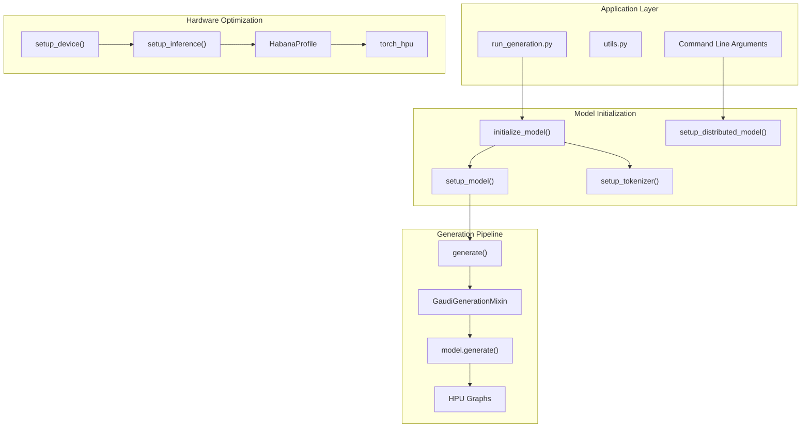
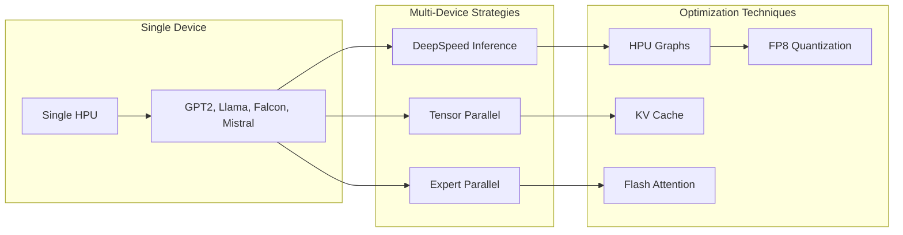
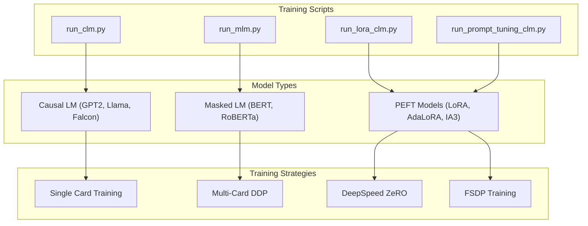
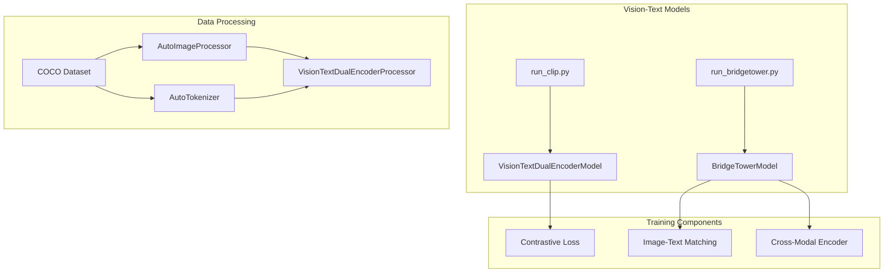
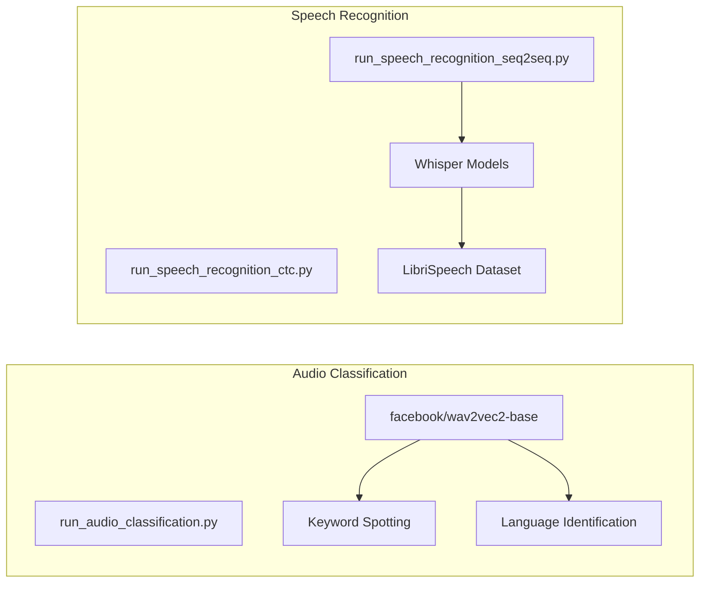
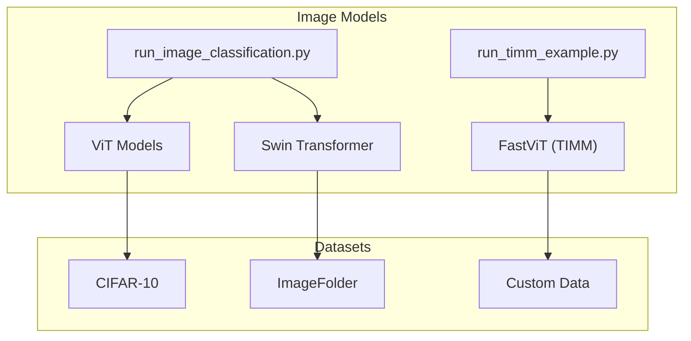

<!-- source: DeepWiki mcp.deepwiki.com · repo huggingface/optimum-habana · page 3 Applications and Examples · fetched 2026-10-26 -->

# Applications and Examples

Relevant source files

The following files were used as context for generating this wiki page:

- [examples/audio-classification/README.md](examples/audio-classification/README.md)
- [examples/contrastive-image-text/README.md](examples/contrastive-image-text/README.md)
- [examples/image-classification/README.md](examples/image-classification/README.md)
- [examples/language-modeling/README.md](examples/language-modeling/README.md)
- [examples/question-answering/README.md](examples/question-answering/README.md)
- [examples/speech-recognition/README.md](examples/speech-recognition/README.md)
- [examples/summarization/README.md](examples/summarization/README.md)
- [examples/text-classification/README.md](examples/text-classification/README.md)
- [examples/text-generation/README.md](examples/text-generation/README.md)
- [examples/text-generation/run_generation.py](examples/text-generation/run_generation.py)
- [examples/text-generation/utils.py](examples/text-generation/utils.py)
- [examples/translation/README.md](examples/translation/README.md)
- [optimum/habana/transformers/generation/configuration_utils.py](optimum/habana/transformers/generation/configuration_utils.py)
- [optimum/habana/transformers/models/llama/modeling_llama.py](optimum/habana/transformers/models/llama/modeling_llama.py)

This page provides practical guides for using optimum-habana across different machine learning tasks and applications. It covers the comprehensive set of example scripts and workflows that demonstrate how to leverage Intel Habana Gaudi processors for various AI workloads, from text generation to multimodal tasks.

For information about the core systems that power these applications, see [Core Systems](#2). For advanced features like quantization and PEFT, see [Advanced Features](#4).

## Text Generation Applications

The text generation examples demonstrate how to run inference and benchmarking with large language models on Gaudi processors. The primary entry point is the `run_generation.py` script which supports a wide range of models and optimization techniques.

### Core Text Generation Architecture

**Sources:** [examples/text-generation/run_generation.py:478-910](), [examples/text-generation/utils.py:255-361]()

### Text Generation Features and Arguments

The `run_generation.py` script supports extensive configuration through command-line arguments that control model behavior, hardware optimizations, and generation parameters:

| Feature Category | Key Arguments | Description |
|------------------|---------------|-------------|
| Model Loading | `--model_name_or_path`, `--peft_model`, `--assistant_model` | Model selection and PEFT/assisted decoding |
| Hardware Optimization | `--use_hpu_graphs`, `--use_kv_cache`, `--reuse_cache` | HPU-specific optimizations |
| Generation Control | `--max_new_tokens`, `--do_sample`, `--num_beams` | Text generation parameters |
| Memory Management | `--bucket_size`, `--bucket_internal`, `--limit_hpu_graphs` | Memory and shape optimization |
| Precision | `--bf16`, `--attn_softmax_bf16`, `--use_flash_attention` | Mixed precision settings |
| Quantization | `--quant_config`, `--load_quantized_model_with_inc` | FP8 and other quantization |

**Sources:** [examples/text-generation/run_generation.py:51-431]()

### Model Support and Deployment Patterns

**Sources:** [examples/text-generation/README.md:44-178](), [examples/text-generation/utils.py:469-557]()

## Language Modeling Applications

Language modeling examples cover both causal language modeling (CLM) for GPT-style models and masked language modeling (MLM) for BERT-style models, with extensive support for parameter-efficient fine-tuning (PEFT) techniques.

### Language Modeling Task Structure

**Sources:** [examples/language-modeling/README.md:32-166](), [examples/language-modeling/README.md:254-483]()

### PEFT Training Configuration

The language modeling examples provide comprehensive support for parameter-efficient fine-tuning with detailed configuration options:

| PEFT Method | Script | Key Parameters | Use Cases |
|-------------|---------|----------------|-----------|
| LoRA | `run_lora_clm.py` | `--lora_rank`, `--lora_alpha`, `--lora_target_modules` | General fine-tuning |
| AdaLoRA | `run_lora_clm.py` | `--peft_type adalora` | Adaptive rank adjustment |
| IA3 | `run_lora_clm.py` | `--peft_type ia3` | Activation-based adaptation |
| Prompt Tuning | `run_prompt_tuning_clm.py` | `--num_virtual_tokens`, `--prompt_tuning_init` | Prompt-based learning |

**Sources:** [examples/language-modeling/README.md:255-485]()

## Multimodal Applications

The multimodal examples demonstrate training and inference with vision-language models, including CLIP-like dual encoders and advanced architectures like BridgeTower.

### Multimodal Model Architecture

**Sources:** [examples/contrastive-image-text/README.md:58-159](), [examples/contrastive-image-text/README.md:171-197]()

### Audio and Speech Processing

The framework includes comprehensive support for audio tasks including speech recognition and audio classification:

**Sources:** [examples/audio-classification/README.md:33-110](), [examples/speech-recognition/README.md:59-143]()

## Other NLP Task Applications

### Text Classification and Question Answering

The framework supports standard NLP benchmarks with optimized implementations:

| Task | Script | Models | Datasets |
|------|--------|--------|----------|
| Text Classification | `run_glue.py` | BERT, LlamaGuard | GLUE benchmark |
| Question Answering | `run_qa.py` | Llama, BERT | SQuAD |
| Summarization | `run_summarization.py` | T5, BART | CNN/DailyMail, XSum |
| Translation | `run_translation.py` | T5, mBART | WMT datasets |

**Sources:** [examples/text-classification/README.md:43-227](), [examples/question-answering/README.md:36-64]()

### Image Classification

Vision tasks are supported with both transformers and TIMM models:

**Sources:** [examples/image-classification/README.md:33-328]()

### Common Execution Patterns

All examples follow consistent patterns for multi-device execution and optimization:

1. **Single Device:** Direct script execution with `PT_HPU_LAZY_MODE=1`
2. **Multi-Device:** Using `gaudi_spawn.py` with `--world_size` and `--use_mpi`
3. **DeepSpeed:** Using `gaudi_spawn.py` with `--use_deepspeed` and config files
4. **Quantization:** Environment variables like `QUANT_CONFIG` for FP8 optimization

**Sources:** [examples/text-generation/README.md:44-60](), [examples/language-modeling/README.md:79-129]()

---

