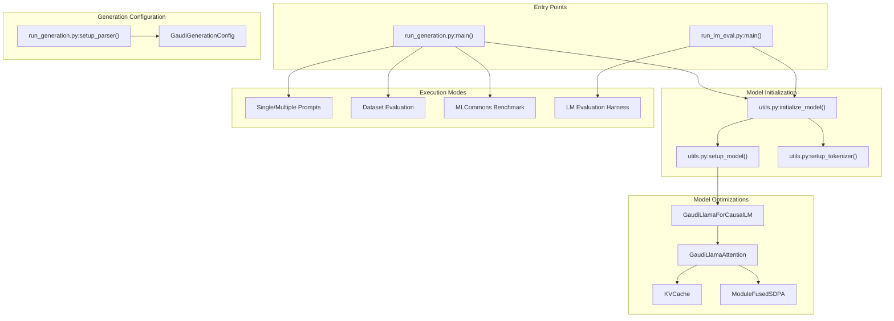
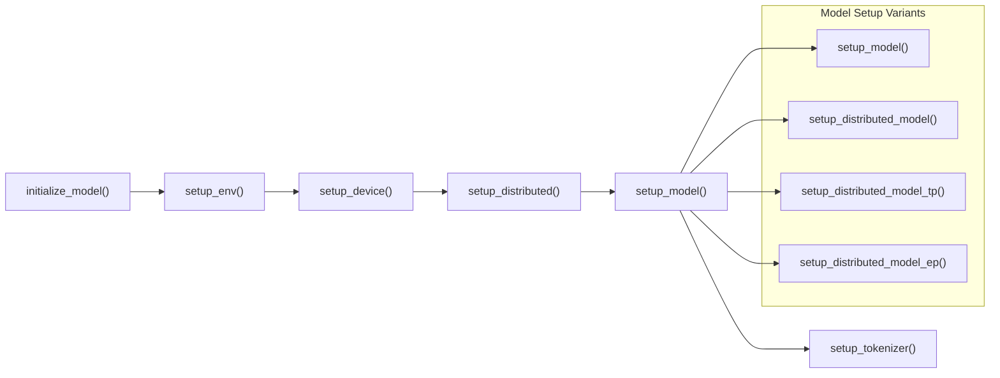
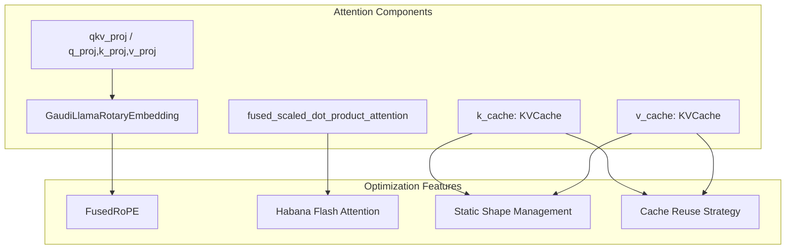
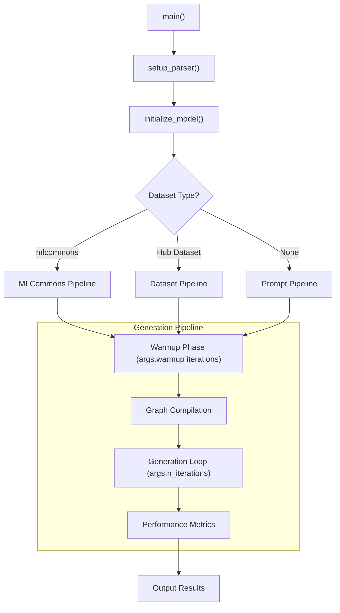

<!-- source: DeepWiki mcp.deepwiki.com · repo huggingface/optimum-habana · page 3.1 Text Generation · fetched 2026-10-26 -->

# Text Generation

<details>
<summary>Relevant source files</summary>

The following files were used as context for generating this wiki page:

- [examples/text-generation/README.md](examples/text-generation/README.md)
- [examples/text-generation/quantization_tools/pt2e.py](examples/text-generation/quantization_tools/pt2e.py)
- [examples/text-generation/requirements.txt](examples/text-generation/requirements.txt)
- [examples/text-generation/requirements_lm_eval.txt](examples/text-generation/requirements_lm_eval.txt)
- [examples/text-generation/run_generation.py](examples/text-generation/run_generation.py)
- [examples/text-generation/run_lm_eval.py](examples/text-generation/run_lm_eval.py)
- [examples/text-generation/utils.py](examples/text-generation/utils.py)
- [optimum/habana/transformers/generation/configuration_utils.py](optimum/habana/transformers/generation/configuration_utils.py)
- [optimum/habana/transformers/models/llama/modeling_llama.py](optimum/habana/transformers/models/llama/modeling_llama.py)

</details>


This document covers the text generation system in optimum-habana, which provides comprehensive support for running language model inference on Intel Habana Gaudi processors. The system includes the main generation script, model optimizations, benchmarking capabilities, and evaluation tools.

For information about training language models, see [Language Modeling](#3.2). For distributed training setup, see [Distributed Training](#4.3).

## Architecture Overview

The text generation system is built around the main `run_generation.py` script, which orchestrates model loading, optimization, and inference execution. The system supports various generation modes, optimization techniques, and evaluation frameworks.

### System Architecture



Sources: [examples/text-generation/run_generation.py:1-1504](), [examples/text-generation/utils.py:1-1116](), [optimum/habana/transformers/generation/configuration_utils.py:1-68]()

## Core Components

### Main Generation Script

The `run_generation.py` script serves as the primary interface for text generation. It provides extensive configuration options and supports multiple execution modes:

| Component | Function | Purpose |
|-----------|----------|---------|
| `setup_parser()` | Argument parsing | Configures 80+ command-line arguments for generation |
| `main()` | Entry point | Orchestrates model initialization and generation |
| `generate()` | Generation loop | Executes text generation with timing and profiling |

The script supports three main execution paths:
- **MLCommons dataset**: Uses `args.dataset_name == "mlcommons"` for standardized benchmarking
- **Hub datasets**: Processes datasets from Hugging Face Hub with `args.dataset_name`
- **Custom prompts**: Generates from user-provided prompts via `args.prompt`

Sources: [examples/text-generation/run_generation.py:51-463](), [examples/text-generation/run_generation.py:478-1504]()

### Model Initialization Pipeline

The model initialization follows a structured pipeline through utility functions:



Key initialization steps include:
- **Environment setup**: Sets environment variables for HPU optimization
- **Transformer adaptation**: Calls `adapt_transformers_to_gaudi()` to replace standard implementations
- **Model wrapping**: Applies HPU graphs via `wrap_in_hpu_graph()` when enabled
- **Quantization**: Supports FP8, AutoGPTQ, AutoAWQ, and Intel Neural Compressor

Sources: [examples/text-generation/utils.py:824-879](), [examples/text-generation/utils.py:255-361](), [examples/text-generation/utils.py:469-557]()

### Generation Configuration

The `GaudiGenerationConfig` class extends the standard Transformers generation configuration with HPU-specific optimizations:

| Parameter | Purpose | Default |
|-----------|---------|---------|
| `use_hpu_graphs` | Enable HPU graph compilation | `False` |
| `use_kv_cache` | Enable key-value cache optimization | `False` |
| `reuse_cache` | Reuse cache across generation steps | `False` |
| `bucket_size` | Static shape bucketing size | `-1` |
| `use_flash_attention` | Enable Habana Flash Attention | `False` |
| `attn_softmax_bf16` | Run attention softmax in BF16 | `False` |
| `trim_logits` | Calculate logits only for last token | `False` |

Sources: [optimum/habana/transformers/generation/configuration_utils.py:4-68]()

## Model Optimizations

### Gaudi-Optimized Attention

The `GaudiLlamaAttention` class provides HPU-specific optimizations for the attention mechanism:



Key optimization techniques:
- **Fused operations**: Uses `FusedRoPE` and `FusedSDPA` for efficient computation
- **KV cache management**: Implements `KVCache.update()` and `KVCache.allocate()` for memory optimization
- **Static shapes**: Supports bucketing with `allocate_kv_cache()` for consistent tensor shapes
- **Flash attention**: Integrates Habana's fused attention kernels via `ModuleFusedSDPA`

Sources: [optimum/habana/transformers/models/llama/modeling_llama.py:460-825](), [optimum/habana/transformers/models/llama/modeling_llama.py:315-357]()

### Memory and Performance Optimizations

The system implements several memory and performance optimizations:

| Optimization | Implementation | Benefit |
|--------------|----------------|---------|
| HPU Graphs | `wrap_in_hpu_graph()` | Reduces kernel launch overhead |
| Static Shapes | `bucket_size` parameter | Eliminates recompilation |
| KV Cache Reuse | `reuse_cache=True` | Reduces memory allocation |
| Torch Compile | `get_torch_compiled_model()` | Graph-level optimizations |
| FP8 Quantization | `setup_quantization()` | Reduces memory footprint |

Sources: [examples/text-generation/utils.py:334-347](), [examples/text-generation/utils.py:200-226](), [examples/text-generation/utils.py:228-243]()

## Generation Workflow

### Execution Flow

The generation process follows a structured workflow with warmup, compilation, and execution phases:



Key phases include:
- **Warmup**: Runs `args.warmup` iterations to compile graphs and stabilize performance
- **Compilation**: Measures graph compilation time via `HabanaGenerationTime`
- **Generation**: Executes `args.n_iterations` with performance tracking
- **Metrics**: Calculates throughput, latency, and memory statistics

Sources: [examples/text-generation/run_generation.py:552-647](), [examples/text-generation/run_generation.py:795-909]()

### Benchmarking and Evaluation

The system supports multiple evaluation modes:

| Mode | Script | Purpose |
|------|--------|---------|
| Performance Benchmark | `run_generation.py` | Measures throughput and latency |
| LM Evaluation | `run_lm_eval.py` | Evaluates model accuracy on tasks |
| MLCommons | `run_generation.py --dataset_name mlcommons` | Standardized benchmarking |

The `HabanaModelAdapter` class integrates with the LM Evaluation Harness:
- Implements static shape bucketing via `find_bucket()`
- Handles HPU-specific model calls through `_model_call()`
- Supports warmup and caching optimizations

Sources: [examples/text-generation/run_lm_eval.py:104-258](), [examples/text-generation/run_generation.py:494-647]()

## Configuration and Usage

### Command Line Interface

The `setup_parser()` function provides comprehensive configuration options:

```python
# Core generation parameters
--model_name_or_path          # Model path or HF Hub identifier
--max_new_tokens             # Number of tokens to generate
--batch_size                 # Input batch size
--bf16                       # Use bfloat16 precision

# HPU optimizations
--use_hpu_graphs             # Enable HPU graph compilation
--use_kv_cache              # Enable KV cache optimization
--reuse_cache               # Reuse cache across steps
--bucket_size               # Static shape bucket size
--use_flash_attention       # Enable Habana Flash Attention

# Generation strategies
--do_sample                 # Use sampling instead of greedy
--num_beams                 # Beam search width
--temperature               # Sampling temperature
--top_p                     # Nucleus sampling parameter
```

### Distributed Execution

The system supports multiple distributed strategies:

| Strategy | Command | Purpose |
|----------|---------|---------|
| DeepSpeed | `gaudi_spawn.py --use_deepspeed` | Multi-device inference |
| Tensor Parallel | `--parallel_strategy tp` | Model parallelism |
| Expert Parallel | `--parallel_strategy ep` | Expert-level parallelism |

Sources: [examples/text-generation/run_generation.py:51-431](), [examples/text-generation/utils.py:364-427](), [examples/text-generation/utils.py:430-466]()

### Performance Optimization Features

The system includes advanced optimization features:

- **Dynamic prompt simulation**: `--simulate_dyn_prompt` for testing variable input lengths
- **Regional compilation**: `--regional_compile` for fine-grained torch.compile control
- **Memory optimization**: `--disk_offload` for large model support
- **Quantization**: FP8, AutoGPTQ, AutoAWQ, and Intel Neural Compressor integration
- **Profiling**: Built-in performance profiling with `--profiling_steps`

Sources: [examples/text-generation/run_generation.py:259-380](), [examples/text-generation/utils.py:176-197](), [examples/text-generation/utils.py:228-253]()

---

