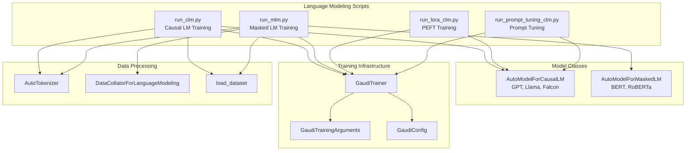
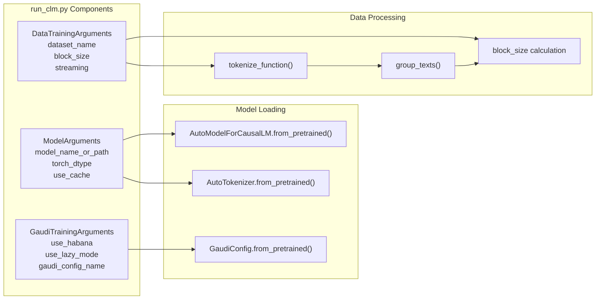
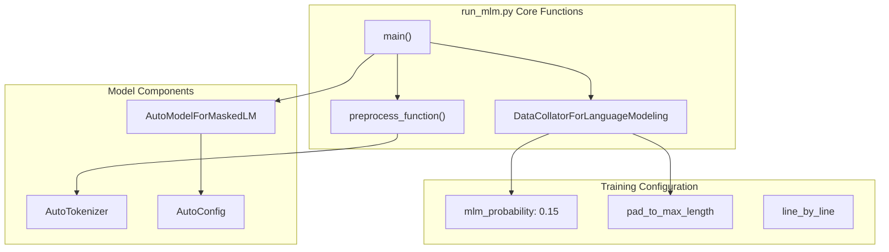
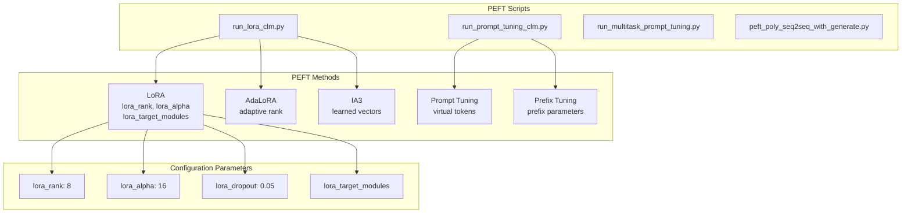
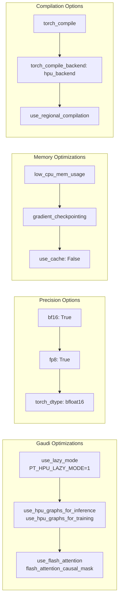

<!-- source: DeepWiki mcp.deepwiki.com · repo huggingface/optimum-habana · page 3.2 Language Modeling · fetched 2026-10-26 -->

# Language Modeling

<details>
<summary>Relevant source files</summary>

The following files were used as context for generating this wiki page:

- [examples/audio-classification/README.md](examples/audio-classification/README.md)
- [examples/audio-classification/run_audio_classification.py](examples/audio-classification/run_audio_classification.py)
- [examples/contrastive-image-text/README.md](examples/contrastive-image-text/README.md)
- [examples/image-classification/README.md](examples/image-classification/README.md)
- [examples/image-classification/run_image_classification.py](examples/image-classification/run_image_classification.py)
- [examples/language-modeling/README.md](examples/language-modeling/README.md)
- [examples/language-modeling/run_clm.py](examples/language-modeling/run_clm.py)
- [examples/language-modeling/run_mlm.py](examples/language-modeling/run_mlm.py)
- [examples/question-answering/README.md](examples/question-answering/README.md)
- [examples/question-answering/run_qa.py](examples/question-answering/run_qa.py)
- [examples/speech-recognition/README.md](examples/speech-recognition/README.md)
- [examples/speech-recognition/run_speech_recognition_ctc.py](examples/speech-recognition/run_speech_recognition_ctc.py)
- [examples/summarization/README.md](examples/summarization/README.md)
- [examples/summarization/run_summarization.py](examples/summarization/run_summarization.py)
- [examples/text-classification/README.md](examples/text-classification/README.md)
- [examples/text-classification/run_glue.py](examples/text-classification/run_glue.py)
- [examples/translation/README.md](examples/translation/README.md)
- [examples/translation/run_translation.py](examples/translation/run_translation.py)

</details>


This document covers training examples for causal and masked language modeling on Intel Habana Gaudi processors, including support for various model architectures, Parameter-Efficient Fine-Tuning (PEFT) methods, and advanced training configurations. 

For text generation inference workflows, see [Text Generation](#3.1). For general training system components, see [Training System](#2.2).

## Overview

The language modeling system in optimum-habana provides comprehensive support for two primary approaches: Causal Language Modeling (CLM) for autoregressive models like GPT, and Masked Language Modeling (MLM) for bidirectional models like BERT. The system integrates with Hugging Face Transformers while providing Gaudi-specific optimizations.

### Architecture Components



Sources: [examples/language-modeling/README.md:1-718](), [examples/language-modeling/run_clm.py:1-741](), [examples/language-modeling/run_mlm.py:1-741]()

## Causal Language Modeling (CLM)

Causal Language Modeling trains autoregressive models to predict the next token in a sequence. The system supports various model architectures including GPT-2, GPT-J, GPT-NeoX, and modern LLMs like Llama and Falcon.

### Core Implementation



The main training script [`run_clm.py`](examples/language-modeling/run_clm.py:284-741)() implements the complete CLM training pipeline:

| Component | Purpose | Key Parameters |
|-----------|---------|----------------|
| `ModelArguments` | Model configuration | `model_name_or_path`, `torch_dtype`, `use_cache` |
| `DataTrainingArguments` | Dataset configuration | `dataset_name`, `block_size`, `streaming` |
| `GaudiTrainingArguments` | Gaudi-specific training | `use_habana`, `use_lazy_mode`, `gaudi_config_name` |

### Training Examples

**Single-card GPT-2 Training:**
```bash
PT_HPU_LAZY_MODE=1 python run_clm.py \
    --model_name_or_path gpt2 \
    --dataset_name wikitext \
    --dataset_config_name wikitext-2-raw-v1 \
    --per_device_train_batch_size 4 \
    --gaudi_config_name Habana/gpt2 \
    --use_habana \
    --use_lazy_mode \
    --use_hpu_graphs_for_inference
```

**Multi-card Training with DeepSpeed:**
The system supports distributed training using [`gaudi_spawn.py`](examples/language-modeling/README.md:112-129)() for model parallelism and DeepSpeed for memory optimization.

Sources: [examples/language-modeling/README.md:32-103](), [examples/language-modeling/run_clm.py:75-200](), [examples/language-modeling/run_clm.py:284-351]()

## Masked Language Modeling (MLM)

Masked Language Modeling trains bidirectional models by randomly masking tokens and predicting them from context. This approach is used for BERT, RoBERTa, and similar encoder-only architectures.

### MLM Implementation Details



The [`run_mlm.py`](examples/language-modeling/run_mlm.py:284-741)() script provides MLM-specific functionality:

- **Dynamic Masking**: Tokens are masked randomly during training rather than pre-processing
- **MLM Probability**: Configurable ratio of tokens to mask (default 0.15)
- **Data Collation**: [`DataCollatorForLanguageModeling`](examples/language-modeling/run_mlm.py:42)() handles masking and padding

### RoBERTa Training Example

```bash
PT_HPU_LAZY_MODE=1 python ../gaudi_spawn.py \
    --world_size 8 --use_mpi run_mlm.py \
    --model_name_or_path roberta-base \
    --dataset_name wikitext \
    --dataset_config_name wikitext-2-raw-v1 \
    --gaudi_config_name Habana/roberta-base \
    --use_habana \
    --use_lazy_mode \
    --bf16
```

Sources: [examples/language-modeling/README.md:168-194](), [examples/language-modeling/run_mlm.py:165-220](), [examples/language-modeling/run_mlm.py:284-351]()

## Parameter-Efficient Fine-Tuning (PEFT)

The system provides comprehensive PEFT support through multiple specialized scripts, enabling efficient adaptation of large language models with minimal parameter updates.

### PEFT Architecture



### LoRA Configuration

The system supports extensive LoRA configurations through command-line arguments:

| Parameter | Purpose | Default Value |
|-----------|---------|---------------|
| `lora_rank` | Low-rank decomposition rank | 8 |
| `lora_alpha` | Scaling parameter | 16 |
| `lora_dropout` | Dropout probability | 0.05 |
| `lora_target_modules` | Target layers for adaptation | Model-specific |

### Advanced PEFT Features

**Multi-card LoRA with DeepSpeed ZeRO-3:**
```bash
PT_HPU_LAZY_MODE=1 python3 ../gaudi_spawn.py \
    --use_deepspeed --world_size 8 run_lora_clm.py \
    --model_name_or_path meta-llama/Llama-2-70b-hf \
    --deepspeed llama2_ds_zero3_config.json \
    --lora_rank 4 \
    --lora_target_modules "q_proj" "v_proj" "k_proj" "o_proj" \
    --fp8 True
```

**Long Sequence Training with Deepspeed Ulysses:**
The system supports training with very long sequences using context parallelism through [`context_parallel_size`](examples/language-modeling/README.md:618-660)() parameter.

Sources: [examples/language-modeling/README.md:253-484](), [examples/language-modeling/README.md:529-566](), [examples/language-modeling/README.md:615-660]()

## Training Configurations

### Hardware Optimization Features



### Distributed Training Options

The system provides multiple distributed training approaches:

| Method | Script | Use Case |
|--------|--------|----------|
| Multi-Processing | `gaudi_spawn.py --use_mpi` | Standard multi-card training |
| DeepSpeed | `gaudi_spawn.py --use_deepspeed` | Memory-efficient large model training |
| FSDP | `--fsdp auto_wrap` | Fully Sharded Data Parallel |

### Streaming and Advanced Features

**Streaming Datasets:**
Large datasets can be processed in streaming mode using the [`--streaming`](examples/language-modeling/README.md:662-684)() flag with `--max_steps` to avoid loading entire datasets into memory.

**Model Creation from Scratch:**
The system supports training models from scratch using [`--config_overrides`](examples/language-modeling/README.md:687-710)() to customize model architecture parameters.

Sources: [examples/language-modeling/README.md:79-99](), [examples/language-modeling/README.md:359-401](), [examples/language-modeling/README.md:662-718](), [examples/language-modeling/run_clm.py:150-194]()

---

