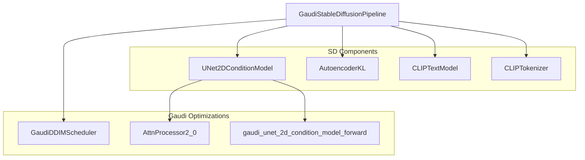
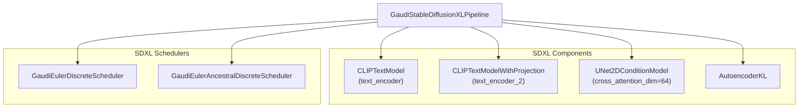
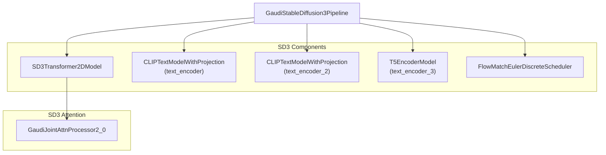
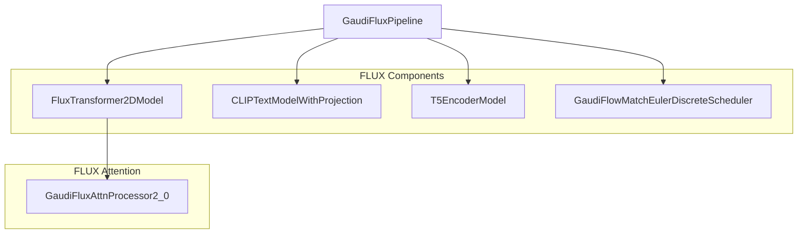
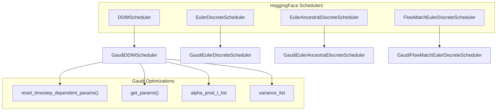
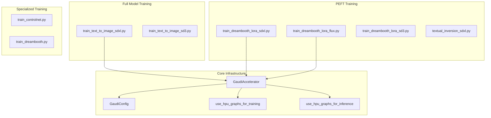
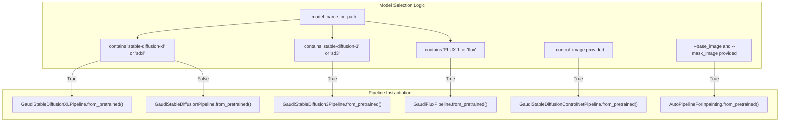

<!-- source: DeepWiki mcp.deepwiki.com · repo huggingface/optimum-habana · page 3.3 Diffusion Models · fetched 2026-10-26 -->

# Diffusion Models

<details>
<summary>Relevant source files</summary>

The following files were used as context for generating this wiki page:

- [examples/stable-diffusion/README.md](examples/stable-diffusion/README.md)
- [examples/stable-diffusion/text_to_image_generation.py](examples/stable-diffusion/text_to_image_generation.py)
- [examples/stable-diffusion/training/README.md](examples/stable-diffusion/training/README.md)
- [examples/stable-diffusion/training/requirements.txt](examples/stable-diffusion/training/requirements.txt)
- [examples/stable-diffusion/training/train_dreambooth.py](examples/stable-diffusion/training/train_dreambooth.py)
- [examples/stable-diffusion/training/train_dreambooth_lora_flux.py](examples/stable-diffusion/training/train_dreambooth_lora_flux.py)
- [examples/stable-diffusion/training/train_dreambooth_lora_sd3.py](examples/stable-diffusion/training/train_dreambooth_lora_sd3.py)
- [examples/stable-diffusion/training/train_dreambooth_lora_sdxl.py](examples/stable-diffusion/training/train_dreambooth_lora_sdxl.py)
- [examples/stable-diffusion/training/train_text_to_image_sd3.py](examples/stable-diffusion/training/train_text_to_image_sd3.py)
- [examples/stable-diffusion/training/train_text_to_image_sdxl.py](examples/stable-diffusion/training/train_text_to_image_sdxl.py)
- [optimum/habana/diffusers/__init__.py](optimum/habana/diffusers/__init__.py)
- [optimum/habana/diffusers/models/attention_processor.py](optimum/habana/diffusers/models/attention_processor.py)
- [optimum/habana/diffusers/pipelines/pipeline_utils.py](optimum/habana/diffusers/pipelines/pipeline_utils.py)
- [optimum/habana/diffusers/pipelines/stable_diffusion/pipeline_stable_diffusion.py](optimum/habana/diffusers/pipelines/stable_diffusion/pipeline_stable_diffusion.py)
- [optimum/habana/diffusers/pipelines/stable_diffusion/pipeline_stable_diffusion_image_variation.py](optimum/habana/diffusers/pipelines/stable_diffusion/pipeline_stable_diffusion_image_variation.py)
- [optimum/habana/diffusers/pipelines/stable_diffusion/pipeline_stable_diffusion_inpaint.py](optimum/habana/diffusers/pipelines/stable_diffusion/pipeline_stable_diffusion_inpaint.py)
- [optimum/habana/diffusers/pipelines/stable_diffusion/pipeline_stable_diffusion_instruct_pix2pix.py](optimum/habana/diffusers/pipelines/stable_diffusion/pipeline_stable_diffusion_instruct_pix2pix.py)
- [optimum/habana/diffusers/pipelines/stable_diffusion_3/pipeline_stable_diffusion_3.py](optimum/habana/diffusers/pipelines/stable_diffusion_3/pipeline_stable_diffusion_3.py)
- [optimum/habana/diffusers/pipelines/stable_diffusion_xl/pipeline_stable_diffusion_xl.py](optimum/habana/diffusers/pipelines/stable_diffusion_xl/pipeline_stable_diffusion_xl.py)
- [optimum/habana/diffusers/pipelines/stable_diffusion_xl/pipeline_stable_diffusion_xl_img2img.py](optimum/habana/diffusers/pipelines/stable_diffusion_xl/pipeline_stable_diffusion_xl_img2img.py)
- [optimum/habana/diffusers/pipelines/stable_diffusion_xl/pipeline_stable_diffusion_xl_inpaint.py](optimum/habana/diffusers/pipelines/stable_diffusion_xl/pipeline_stable_diffusion_xl_inpaint.py)
- [optimum/habana/diffusers/pipelines/stable_diffusion_xl/pipeline_stable_diffusion_xl_mlperf.py](optimum/habana/diffusers/pipelines/stable_diffusion_xl/pipeline_stable_diffusion_xl_mlperf.py)
- [optimum/habana/diffusers/schedulers/scheduling_ddim.py](optimum/habana/diffusers/schedulers/scheduling_ddim.py)
- [tests/test_diffusers.py](tests/test_diffusers.py)

</details>


This document covers the diffusion model capabilities in optimum-habana, including text-to-image generation, training, and various diffusion-based applications optimized for Intel Habana Gaudi processors. The system provides Gaudi-optimized implementations of popular diffusion models including Stable Diffusion, SDXL, SD3, and FLUX.

For general model implementations and attention optimizations, see [Model Implementations](#2.3). For training infrastructure, see [Training System](#2.2).

## Core Pipeline Architecture

The diffusion system is built around `GaudiDiffusionPipeline`, which extends HuggingFace Diffusers with Gaudi-specific optimizations including HPU graphs, lazy mode execution, and batched generation.

### Pipeline Hierarchy

```mermaid
graph TB
    subgraph "Base Classes"
        DiffusionPipeline["diffusers.DiffusionPipeline"]
        GaudiDiffusionPipeline["GaudiDiffusionPipeline"]
    end
    
    subgraph "Text-to-Image Pipelines"
        GaudiStableDiffusionPipeline["GaudiStableDiffusionPipeline"]
        GaudiStableDiffusionXLPipeline["GaudiStableDiffusionXLPipeline"]
        GaudiStableDiffusion3Pipeline["GaudiStableDiffusion3Pipeline"]
        GaudiFluxPipeline["GaudiFluxPipeline"]
    end
    
    subgraph "Specialized Pipelines"
        GaudiStableDiffusionImg2ImgPipeline["GaudiStableDiffusionImg2ImgPipeline"]
        GaudiStableDiffusionInpaintPipeline["GaudiStableDiffusionInpaintPipeline"]
        GaudiStableDiffusionControlNetPipeline["GaudiStableDiffusionControlNetPipeline"]
        GaudiStableDiffusionXLInpaintPipeline["GaudiStableDiffusionXLInpaintPipeline"]
    end
    
    subgraph "Video Pipelines"
        GaudiTextToVideoSDPipeline["GaudiTextToVideoSDPipeline"]
        GaudiStableVideoDiffusionPipeline["GaudiStableVideoDiffusionPipeline"]
        GaudiCogVideoXPipeline["GaudiCogVideoXPipeline"]
        GaudiI2VGenXLPipeline["GaudiI2VGenXLPipeline"]
    end
    
    DiffusionPipeline --> GaudiDiffusionPipeline
    GaudiDiffusionPipeline --> GaudiStableDiffusionPipeline
    GaudiDiffusionPipeline --> GaudiStableDiffusionXLPipeline
    GaudiDiffusionPipeline --> GaudiStableDiffusion3Pipeline
    GaudiDiffusionPipeline --> GaudiFluxPipeline
    
    GaudiStableDiffusionPipeline --> GaudiStableDiffusionImg2ImgPipeline
    GaudiStableDiffusionPipeline --> GaudiStableDiffusionInpaintPipeline
    GaudiStableDiffusionPipeline --> GaudiStableDiffusionControlNetPipeline
    
    GaudiStableDiffusionXLPipeline --> GaudiStableDiffusionXLInpaintPipeline
    
    GaudiDiffusionPipeline --> GaudiTextToVideoSDPipeline
    GaudiDiffusionPipeline --> GaudiStableVideoDiffusionPipeline
    GaudiDiffusionPipeline --> GaudiCogVideoXPipeline
    GaudiDiffusionPipeline --> GaudiI2VGenXLPipeline
```



**Sources:** [optimum/habana/diffusers/__init__.py:1-36](), [optimum/habana/diffusers/pipelines/pipeline_utils.py:99-210]()

### Key Gaudi Optimizations

The `GaudiDiffusionPipeline` base class implements several optimizations:

| Feature | Description | Implementation |
|---------|-------------|----------------|
| **HPU Graphs** | Captures computation graphs for faster execution | [optimum/habana/diffusers/pipelines/pipeline_utils.py:182-191]() |
| **Lazy Mode** | Deferred execution with `mark_step()` synchronization | [optimum/habana/diffusers/pipelines/pipeline_utils.py:192-197]() |
| **Batched Generation** | Process multiple images simultaneously | [optimum/habana/diffusers/pipelines/stable_diffusion/pipeline_stable_diffusion.py:213-254]() |
| **BF16 Support** | Mixed precision and full BF16 execution | [optimum/habana/diffusers/pipelines/pipeline_utils.py:162-181]() |
| **Static Shapes** | Optimized tensor shapes for consistent performance | [optimum/habana/diffusers/pipelines/stable_diffusion/pipeline_stable_diffusion.py:183-210]() |

**Sources:** [optimum/habana/diffusers/pipelines/pipeline_utils.py:120-210]()

## Supported Model Families

### Stable Diffusion 1.x/2.x

Traditional Stable Diffusion models using UNet2DConditionModel architecture.



**Sources:** [optimum/habana/diffusers/pipelines/stable_diffusion/pipeline_stable_diffusion.py:99-182]()

### Stable Diffusion XL (SDXL)

Enhanced architecture with dual text encoders and higher resolution support.



**Sources:** [optimum/habana/diffusers/pipelines/stable_diffusion_xl/pipeline_stable_diffusion_xl.py:54-148]()

### Stable Diffusion 3 (SD3)

Diffusion Transformer architecture with three text encoders.



**Sources:** [optimum/habana/diffusers/pipelines/stable_diffusion_3/pipeline_stable_diffusion_3.py:82-177]()

### FLUX

Latest generation diffusion model with flow matching scheduler.



**Sources:** [examples/stable-diffusion/training/train_dreambooth_lora_flux.py:72-76]()

## Schedulers and Optimization

### Gaudi-Optimized Schedulers

All schedulers are optimized for Gaudi with time-dependent parameter pre-computation:

| Scheduler | Use Case | Optimization |
|-----------|----------|--------------|
| `GaudiDDIMScheduler` | General-purpose, stable generation | Pre-computed timestep parameters |
| `GaudiEulerDiscreteScheduler` | Fast generation, SDXL | HPU-optimized step computation |
| `GaudiEulerAncestralDiscreteScheduler` | High-quality generation | Stochastic sampling optimization |
| `GaudiFlowMatchEulerDiscreteScheduler` | SD3/FLUX models | Flow matching optimization |

**Sources:** [optimum/habana/diffusers/schedulers/scheduling_ddim.py:28-122]()

### Scheduler Architecture



**Sources:** [optimum/habana/diffusers/schedulers/scheduling_ddim.py:117-145]()

## Training and Fine-tuning

### Training Script Organization



**Sources:** [examples/stable-diffusion/training/train_text_to_image_sdxl.py:63-72](), [examples/stable-diffusion/training/train_dreambooth_lora_flux.py:71-77]()

### Training Configuration

Training scripts use consistent configuration patterns:

```bash
# Common training arguments
--use_hpu_graphs_for_training      # Enable HPU graphs during training
--use_hpu_graphs_for_inference     # Enable HPU graphs during validation
--gaudi_config_name "Habana/stable-diffusion"  # Gaudi configuration
--mixed_precision "bf16"           # Use bfloat16 precision
--sdp_on_bf16                      # Enable scaled dot product attention optimization
```

**Sources:** [examples/stable-diffusion/training/README.md:174-180]()

## Applications and Examples

### Text-to-Image Generation

The main inference script `text_to_image_generation.py` supports all model families:



**Sources:** [examples/stable-diffusion/text_to_image_generation.py:319-602]()

### Specialized Applications

| Application | Pipeline | Example |
|-------------|----------|---------|
| **ControlNet** | `GaudiStableDiffusionControlNetPipeline` | Canny edge conditioning |
| **Inpainting** | `AutoPipelineForInpainting` | SDXL inpainting |
| **Image-to-Image** | `GaudiStableDiffusionXLImg2ImgPipeline` | Style transfer |
| **Video Generation** | `GaudiTextToVideoSDPipeline` | Text-to-video synthesis |
| **Video from Image** | `GaudiStableVideoDiffusionPipeline` | Image-to-video |

**Sources:** [examples/stable-diffusion/README.md:153-448]()

### Performance Features

Key features for production deployment:

- **Batch Processing**: Generate multiple images simultaneously with configurable `batch_size`
- **HPU Graphs**: First-batch compilation penalty, subsequent batches run faster
- **Throughput Optimization**: `throughput_warmup_steps` for accurate performance measurement
- **Memory Efficiency**: BF16 precision and optimized tensor shapes
- **Distributed Inference**: Multi-HPU generation with `gaudi_spawn.py`

**Sources:** [examples/stable-diffusion/README.md:59-73](), [optimum/habana/diffusers/pipelines/stable_diffusion/pipeline_stable_diffusion.py:485-549]()

---

