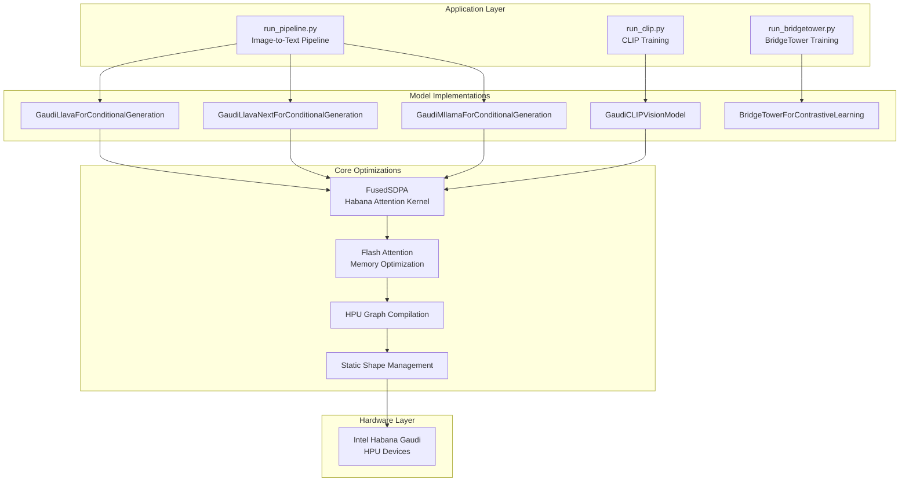
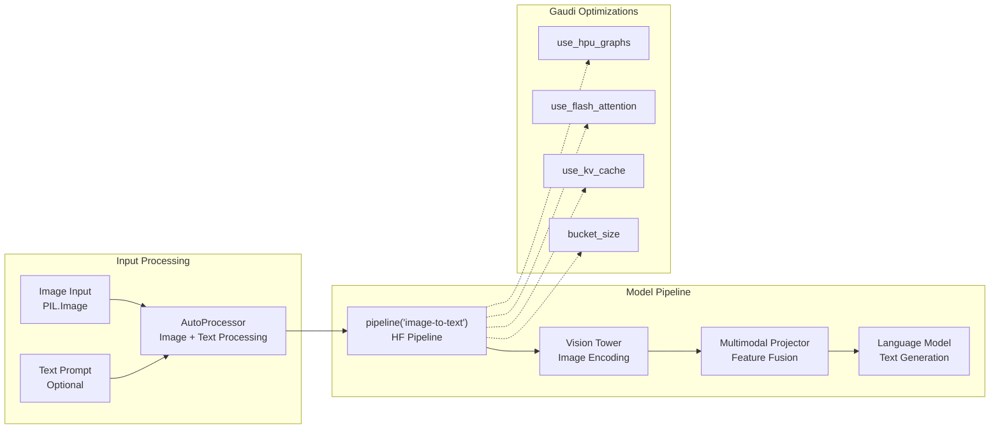
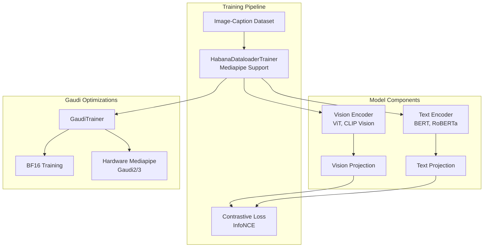
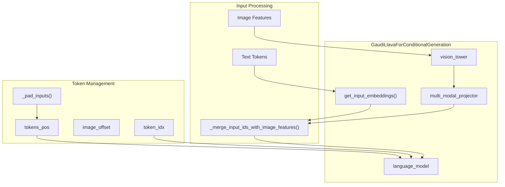
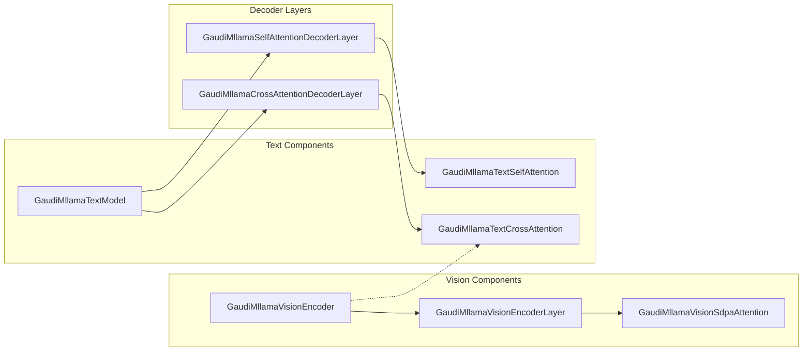

<!-- source: DeepWiki mcp.deepwiki.com · repo huggingface/optimum-habana · page 3.4 Multimodal Tasks · fetched 2026-10-26 -->

# Multimodal Tasks

<details>
<summary>Relevant source files</summary>

The following files were used as context for generating this wiki page:

- [examples/contrastive-image-text/run_bridgetower.py](examples/contrastive-image-text/run_bridgetower.py)
- [examples/contrastive-image-text/run_clip.py](examples/contrastive-image-text/run_clip.py)
- [examples/image-to-text/README.md](examples/image-to-text/README.md)
- [examples/image-to-text/run_pipeline.py](examples/image-to-text/run_pipeline.py)
- [examples/question-answering/run_seq2seq_qa.py](examples/question-answering/run_seq2seq_qa.py)
- [optimum/habana/transformers/models/clip/modeling_clip.py](optimum/habana/transformers/models/clip/modeling_clip.py)
- [optimum/habana/transformers/models/llava/modeling_llava.py](optimum/habana/transformers/models/llava/modeling_llava.py)
- [optimum/habana/transformers/models/llava_next/modeling_llava_next.py](optimum/habana/transformers/models/llava_next/modeling_llava_next.py)
- [optimum/habana/transformers/models/mllama/__init__.py](optimum/habana/transformers/models/mllama/__init__.py)
- [optimum/habana/transformers/models/mllama/modeling_mllama.py](optimum/habana/transformers/models/mllama/modeling_mllama.py)
- [tests/test_image_to_text_example.py](tests/test_image_to_text_example.py)

</details>


This document covers multimodal machine learning capabilities in optimum-habana, focusing on tasks that combine vision and text modalities. The system provides optimized implementations for image-to-text generation, contrastive image-text learning, and vision-language models running on Intel Habana Gaudi processors.

For text-only generation tasks, see [Text Generation](#3.1). For pure image generation with diffusion models, see [Diffusion Models](#3.3).

## Overview

Optimum-habana supports several categories of multimodal tasks:

| Task Category | Models Supported | Primary Use Cases |
|---------------|------------------|-------------------|
| Image-to-Text Generation | LLaVA, LLaVA-Next, Llama-3.2-Vision, Qwen2-VL, GLM-4V, PaliGemma, Idefics2 | Visual question answering, image captioning |
| Contrastive Learning | CLIP, BridgeTower | Image-text representation learning, zero-shot classification |
| Vision-Language Understanding | Multimodal Llama (MLlama) | Advanced reasoning over images and text |

The system leverages Gaudi-specific optimizations including FusedSDPA, flash attention, and HPU graphs to achieve optimal performance for these computationally intensive multimodal workloads.

## Multimodal System Architecture



Sources: [examples/image-to-text/run_pipeline.py:1-527](), [examples/contrastive-image-text/run_clip.py:1-567](), [optimum/habana/transformers/models/mllama/modeling_mllama.py:1-50](), [optimum/habana/transformers/models/llava/modeling_llava.py:1-382]()

## Image-to-Text Generation Pipeline

The `run_pipeline.py` script provides a comprehensive image-to-text generation system supporting multiple vision-language models with Gaudi optimizations.

### Pipeline Architecture



### Supported Models

The pipeline supports multiple model architectures with model-specific optimizations:

```python
# Key models tested in examples/image-to-text/run_pipeline.py
SUPPORTED_MODELS = [
    "llava-hf/llava-v1.6-mistral-7b-hf",
    "llava-hf/llava-v1.6-vicuna-7b-hf", 
    "llava-hf/llava-onevision-qwen2-7b-ov-hf",
    "meta-llama/Llama-3.2-11B-Vision-Instruct",
    "meta-llama/Llama-3.2-90B-Vision-Instruct",
    "Qwen/Qwen2-VL-2B-Instruct",
    "Qwen/Qwen2-VL-7B-Instruct", 
    "google/paligemma-3b-mix-224",
    "HuggingFaceM4/idefics2-8b",
    "THUDM/glm-4v-9b"
]
```

### Key Generation Parameters

The pipeline provides extensive configuration options for optimization:

| Parameter | Purpose | Usage |
|-----------|---------|-------|
| `use_hpu_graphs` | Enable HPU graph compilation | Better latency for static shapes |
| `use_flash_attention` | Enable Habana FusedSDPA | Memory and compute optimization |
| `flash_attention_recompute` | Recompute mode for first token | Reduce memory consumption |
| `bucket_size` | Static shape bucketing | Efficient batching for variable lengths |
| `use_kv_cache` | Key-value caching | Faster autoregressive generation |
| `trim_logits` | Calculate logits only for last token | Memory optimization for prefill |

Sources: [examples/image-to-text/run_pipeline.py:131-233](), [examples/image-to-text/run_pipeline.py:391-418](), [tests/test_image_to_text_example.py:16-51]()

## Contrastive Image-Text Learning

Optimum-habana supports training contrastive models that learn joint representations of images and text.

### CLIP Training

The CLIP training implementation supports various vision and text encoder combinations:



### BridgeTower Training

BridgeTower provides a more sophisticated architecture for cross-modal learning with dedicated cross-attention mechanisms:

```python
# Key configuration from run_bridgetower.py
model = BridgeTowerForContrastiveLearning.from_pretrained(model_name)
trainer = HabanaDataloaderTrainer(
    model=model,
    gaudi_config=gaudi_config,
    data_collator=collate_fn,
    mediapipe_dataloader=True  # Hardware acceleration
)
```

Sources: [examples/contrastive-image-text/run_clip.py:515-524](), [examples/contrastive-image-text/run_bridgetower.py:540-550](), [examples/contrastive-image-text/run_clip.py:186-191]()

## Vision-Language Model Implementations

Optimum-habana provides Gaudi-optimized implementations of major vision-language models with specialized attention mechanisms and memory optimizations.

### LLaVA Model Architecture



The LLaVA implementation includes several Gaudi-specific optimizations:

- **Static Shape Management**: `_pad_inputs()` function handles variable-length sequences for HPU graph compatibility
- **Token Position Tracking**: Maintains `tokens_pos` to correctly index text tokens after image insertion
- **Efficient Image-Text Fusion**: `_merge_input_ids_with_image_features()` optimizes memory usage during multimodal fusion

### Multimodal Llama (MLlama) Optimizations

The MLlama implementation provides the most advanced multimodal capabilities with specialized attention layers:



### Key Attention Optimizations

All multimodal models leverage Habana's FusedSDPA for optimized attention computation:

```python
# Common pattern across all models
class ModuleFusedSDPA(torch.nn.Module):
    def __init__(self, fusedSDPA):
        super().__init__()
        self._hpu_kernel_fsdpa = fusedSDPA

    def forward(self, query, key, value, attn_mask, dropout_p, is_casual, scale):
        return self._hpu_kernel_fsdpa.apply(query, key, value, attn_mask, dropout_p, is_casual, scale)
```

Sources: [optimum/habana/transformers/models/llava/modeling_llava.py:34-93](), [optimum/habana/transformers/models/llava/modeling_llava.py:95-106](), [optimum/habana/transformers/models/mllama/modeling_mllama.py:103-111](), [optimum/habana/transformers/models/clip/modeling_clip.py:50-57]()

## Performance Optimizations

### Memory Management

Multimodal models require careful memory management due to large image features and attention matrices:

| Optimization | Implementation | Benefit |
|--------------|----------------|---------|
| `trim_logits` | Calculate logits only for last token in prefill | Reduces memory usage |
| `flash_attention_recompute` | Recompute attention in first token generation | Lower peak memory |
| `bucket_internal` | Split KV sequences into buckets | Better throughput for long sequences |
| Static shape bucketing | Align sequence lengths to bucket boundaries | HPU graph efficiency |

### Quantization Support

The system supports FP8 quantization for memory and compute efficiency:

```python
# From run_pipeline.py quantization setup
def setup_quantization(model, args):
    from neural_compressor.torch.quantization import FP8Config, convert, prepare
    
    config = FP8Config.from_json_file(args.quant_config)
    if config.measure:
        model = prepare(model, config)
    elif config.quantize:
        model = convert(model, config)
    return model
```

### Multi-Device Support

For large models, the system supports distributed inference using DeepSpeed:

```python
# Multi-device initialization pattern
def initialize_distributed_model(args, model, logger, model_dtype):
    import deepspeed
    deepspeed.init_distributed(dist_backend="hccl")
    
    ds_inference_kwargs = {
        "dtype": model_dtype,
        "tensor_parallel": {"tp_size": args.world_size},
        "enable_cuda_graph": args.use_hpu_graphs
    }
    return deepspeed.init_inference(model, **ds_inference_kwargs).module
```

Sources: [examples/image-to-text/run_pipeline.py:90-99](), [examples/image-to-text/run_pipeline.py:67-87](), [examples/image-to-text/run_pipeline.py:228-232](), [tests/test_image_to_text_example.py:87-104]()

---

