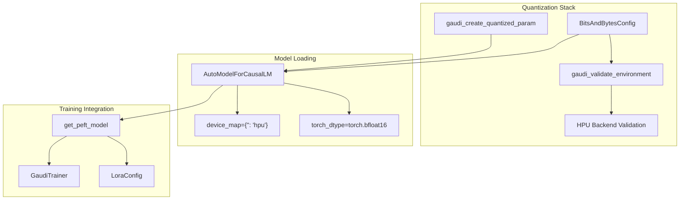
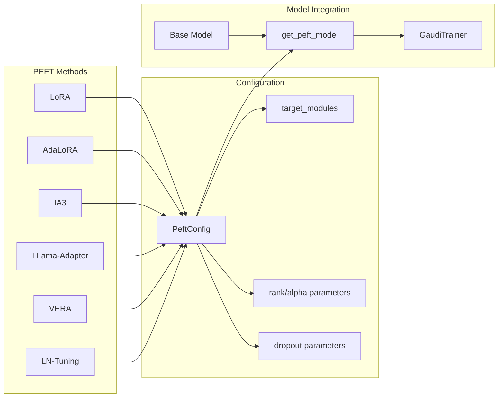
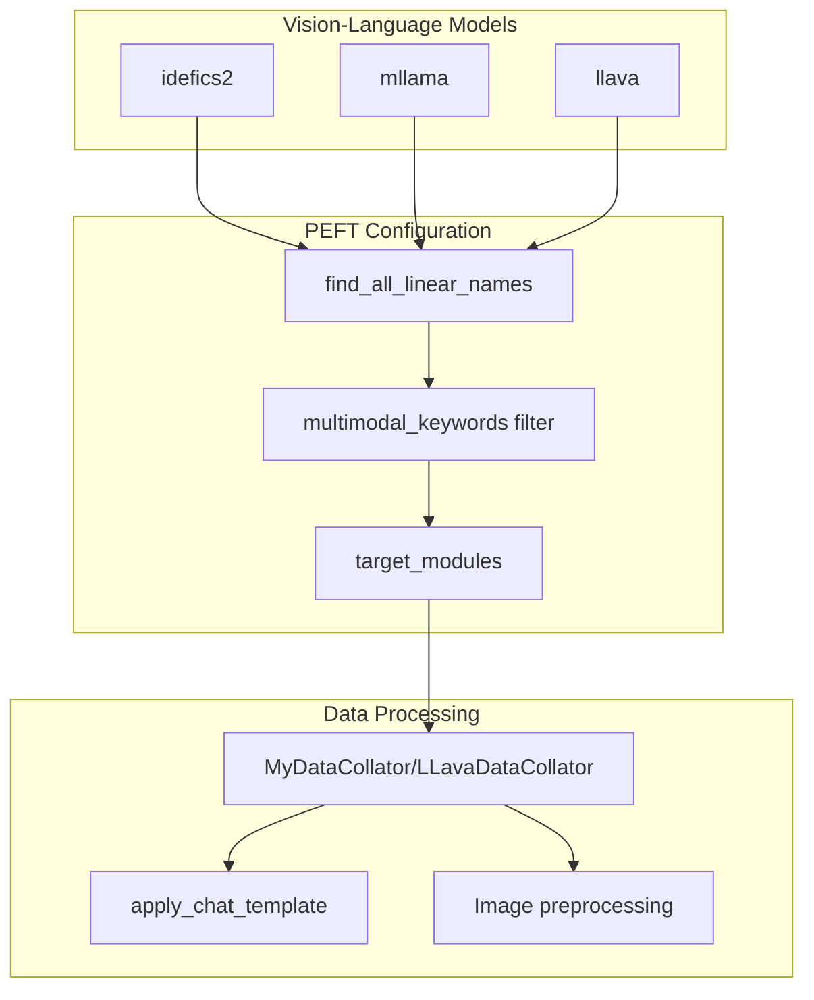
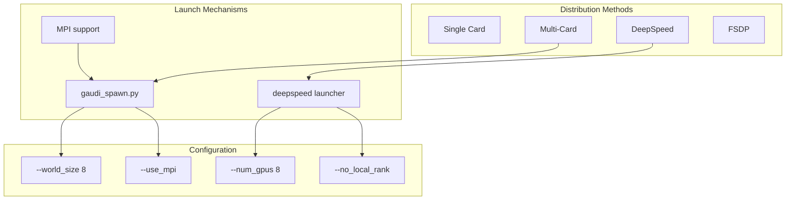
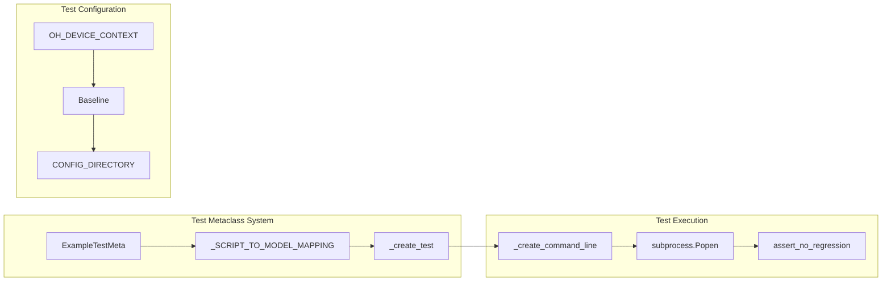
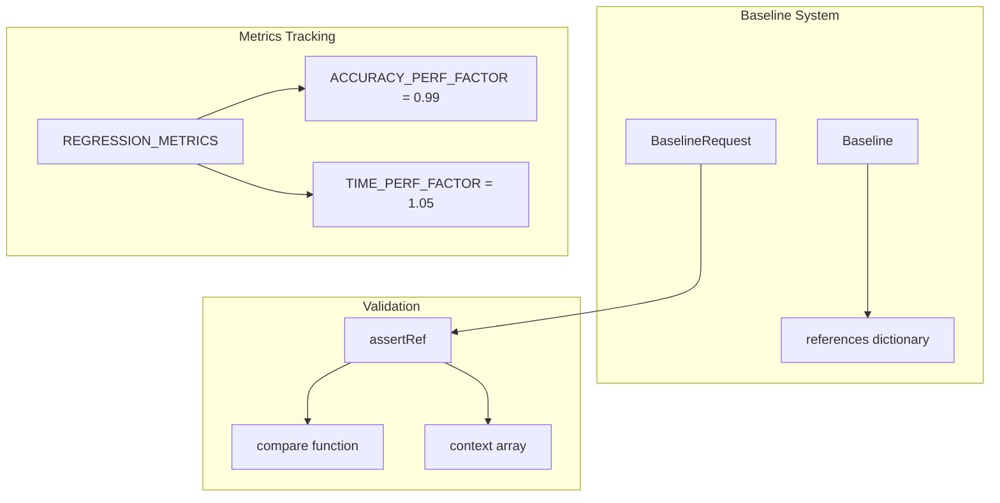
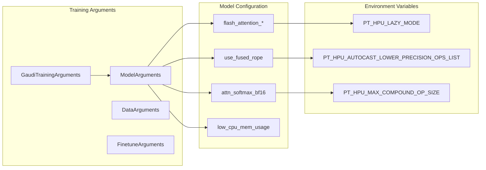

<!-- source: DeepWiki mcp.deepwiki.com · repo huggingface/optimum-habana · page 4 Advanced Features · fetched 2026-10-26 -->

# Advanced Features

<details>
<summary>Relevant source files</summary>

The following files were used as context for generating this wiki page:

- [conftest.py](conftest.py)
- [examples/image-to-text/run_image2text_lora_finetune.py](examples/image-to-text/run_image2text_lora_finetune.py)
- [examples/language-modeling/run_lora_clm.py](examples/language-modeling/run_lora_clm.py)
- [optimum/habana/quantizers/bitsandbytes.py](optimum/habana/quantizers/bitsandbytes.py)
- [tests/baselines/fixture/tests/test_bnb_inference.json](tests/baselines/fixture/tests/test_bnb_inference.json)
- [tests/baselines/fixture/tests/test_bnb_qlora.json](tests/baselines/fixture/tests/test_bnb_qlora.json)
- [tests/test_bnb_inference.py](tests/test_bnb_inference.py)
- [tests/test_bnb_qlora.py](tests/test_bnb_qlora.py)
- [tests/test_custom_file_input.py](tests/test_custom_file_input.py)
- [tests/test_examples.py](tests/test_examples.py)
- [tests/utils.py](tests/utils.py)

</details>


This document covers specialized functionality in optimum-habana for advanced users, including quantization techniques, parameter-efficient fine-tuning (PEFT), distributed training strategies, and comprehensive testing frameworks. These features enable sophisticated model optimization and deployment scenarios on Intel Habana Gaudi processors.

For basic training and inference workflows, see [Core Systems](#2). For specific application examples, see [Applications and Examples](#3).

## Quantization Support

Optimum-habana provides comprehensive quantization support through integration with the BitsAndBytes library, enabling efficient model compression while maintaining performance on Gaudi devices.

### BitsAndBytes Integration

The library supports NF4 (Normal Float 4-bit) quantization through a custom HPU-compatible implementation:



**Sources:** [tests/test_bnb_qlora.py:68-78](), [tests/test_bnb_inference.py:29-41](), [optimum/habana/quantizers/bitsandbytes.py:26-58]()

### Quantization Configuration

The quantization system supports multiple precision formats and backend validation:

| Feature | Implementation | Purpose |
|---------|----------------|---------|
| NF4 Quantization | `bnb_4bit_quant_type="nf4"` | 4-bit normal float quantization |
| Compute Dtype | `bnb_4bit_compute_dtype=torch.bfloat16` | Computation precision control |
| HPU Device Mapping | `device_map={"": "hpu"}` | Direct HPU placement |
| Backend Validation | `gaudi_validate_bnb_backend_availability` | HPU compatibility checking |

**Sources:** [tests/test_bnb_qlora.py:68-78](), [optimum/habana/quantizers/bitsandbytes.py:72-127]()

## Parameter-Efficient Fine-Tuning (PEFT)

Optimum-habana supports multiple PEFT techniques for efficient model adaptation with minimal parameter updates.

### PEFT Method Support



**Sources:** [examples/language-modeling/run_lora_clm.py:33-43](), [examples/language-modeling/run_lora_clm.py:362-393]()

### LoRA Implementation

The LoRA (Low-Rank Adaptation) implementation provides comprehensive parameter control:

```python
# Configuration from FinetuneArguments
lora_rank: int = 8                    # Rank parameter
lora_alpha: int = 16                  # Alpha scaling parameter  
lora_dropout: float = 0.05            # Dropout rate
lora_target_modules: List[str]        # Target module specification
```

**Sources:** [examples/language-modeling/run_lora_clm.py:316-331]()

### Advanced PEFT Features

The system supports sophisticated PEFT configurations:

| Method | Key Parameters | Use Case |
|--------|----------------|----------|
| AdaLoRA | `init_r`, `target_r`, `tinit`, `tfinal` | Dynamic rank adaptation |
| IA3 | `target_modules`, `feedforward_modules` | Infused adapter by inhibiting and amplifying |
| LLama-Adapter | `adapter_layers`, `adapter_len` | Prompt-based adaptation |
| VERA | `vera_target_modules` | Vector-based rare-expert adaptation |

**Sources:** [examples/language-modeling/run_lora_clm.py:336-393]()

### Multimodal PEFT

For vision-language models, specialized PEFT implementations handle multimodal architectures:



**Sources:** [examples/image-to-text/run_image2text_lora_finetune.py:416-430](), [examples/image-to-text/run_image2text_lora_finetune.py:253-350]()

## Distributed Training

Optimum-habana provides comprehensive distributed training support through multiple parallelization strategies.

### Distribution Strategies



**Sources:** [tests/test_examples.py:665-675](), [tests/test_examples.py:484-487]()

### Environment Configuration

Distributed training requires specific environment variable management:

| Variable | Purpose | Models |
|----------|---------|---------|
| `PT_HPU_AUTOCAST_LOWER_PRECISION_OPS_LIST` | BF16 operations control | Falcon, LLama |
| `PT_HPU_MAX_COMPOUND_OP_SIZE` | Compound operation sizing | Flan-T5 |
| `DEEPSPEED_HPU_ZERO3_SYNC_MARK_STEP_REQUIRED` | ZeRO-3 synchronization | Bloom, Qwen2-72B |
| `PT_HPU_LAZY_MODE` | Execution mode control | FSDP configurations |

**Sources:** [tests/test_examples.py:490-508]()

## Testing and Validation Framework

The advanced testing framework provides comprehensive validation across different hardware configurations and model types.

### Test Generation System



**Sources:** [tests/test_examples.py:217-223](), [tests/test_examples.py:103-214](), [tests/test_examples.py:644-724]()

### Baseline Management

The baseline system tracks performance metrics across different device contexts:



**Sources:** [conftest.py:27-58](), [conftest.py:60-78](), [tests/test_examples.py:625-634]()

### Device-Specific Testing

The testing framework adapts test execution based on device capabilities:

| Device Context | Supported Features | Excluded Tests |
|----------------|-------------------|----------------|
| `gaudi1` | Basic training, inference | FSDP, FP8, Advanced PEFT methods |
| `gaudi2` | All features | None |
| `gaudi3` | All features + FP8 | None |

The `to_test` method in `ExampleTestMeta` implements device-specific logic:

**Sources:** [tests/test_examples.py:224-340](), [tests/test_examples.py:264-270]()

### Performance Regression Testing

The framework validates multiple performance dimensions:

```python
REGRESSION_METRICS = {
    "eval_f1": (operator.ge, ACCURACY_PERF_FACTOR),
    "eval_accuracy": (operator.ge, ACCURACY_PERF_FACTOR), 
    "perplexity": (operator.le, 2 - ACCURACY_PERF_FACTOR),
    "train_runtime": (operator.le, TIME_PERF_FACTOR),
    "train_samples_per_second": (operator.ge, 2 - TIME_PERF_FACTOR),
    "eval_samples_per_second": (operator.ge, 2 - TIME_PERF_FACTOR),
}
```

**Sources:** [tests/test_examples.py:625-634](), [tests/test_examples.py:738-788]()

## Advanced Configuration

### Custom Arguments and Environment

The system provides specialized training arguments and environment management for advanced scenarios:



**Sources:** [examples/language-modeling/run_lora_clm.py:76-194](), [examples/language-modeling/run_lora_clm.py:708-721]()

### Custom Dataset Processing

Advanced dataset processing supports multiple prompt formats and concatenation strategies:

| Feature | Implementation | Purpose |
|---------|----------------|---------|
| SQL Prompts | `create_sql_prompts` | Text-to-SQL training |
| Chat Prompts | `create_chat_prompts` | Conversational fine-tuning | 
| Dataset Concatenation | `dataset_concatenation` | Efficient sequence packing |
| Custom File Input | JSON/JSONL/TXT support | Flexible data ingestion |

**Sources:** [examples/language-modeling/run_lora_clm.py:395-458](), [tests/test_custom_file_input.py:19-119]()

---

