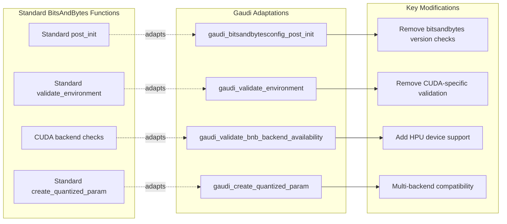

<!-- source: DeepWiki mcp.deepwiki.com · repo huggingface/optimum-habana · page 4.1 Quantization · fetched 2026-10-26 -->

# Quantization

<details>
<summary>Relevant source files</summary>

The following files were used as context for generating this wiki page:

- [conftest.py](conftest.py)
- [optimum/habana/quantizers/bitsandbytes.py](optimum/habana/quantizers/bitsandbytes.py)
- [tests/baselines/fixture/tests/test_bnb_inference.json](tests/baselines/fixture/tests/test_bnb_inference.json)
- [tests/baselines/fixture/tests/test_bnb_qlora.json](tests/baselines/fixture/tests/test_bnb_qlora.json)
- [tests/test_bnb_inference.py](tests/test_bnb_inference.py)
- [tests/test_bnb_qlora.py](tests/test_bnb_qlora.py)
- [tests/test_custom_file_input.py](tests/test_custom_file_input.py)

</details>


This document covers quantization support in optimum-habana, specifically the integration with BitsAndBytes for 4-bit and 8-bit quantization on Intel Habana Gaudi processors. Quantization reduces model memory usage and can improve inference performance by using lower-precision representations of model weights.

For parameter-efficient fine-tuning techniques that work with quantized models, see [PEFT and Fine-tuning](#4.2). For general training configurations, see [Training System](#2.2).

## BitsAndBytes Integration

Optimum-habana provides Gaudi-specific adaptations of the BitsAndBytes quantization library, enabling 4-bit and 8-bit quantization on HPU devices. The implementation removes CUDA-specific requirements and adds HPU backend support.

### Core Components

The quantization system consists of several key components that adapt standard BitsAndBytes functionality for Habana devices:

```mermaid
graph TB
    subgraph "HuggingFace Transformers"
        BNB_CONFIG["BitsAndBytesConfig"]
        BNB_QUANTIZER["Bnb4BitHfQuantizer"]
        STANDARD_BNB["Standard BitsAndBytes"]
    end
    
    subgraph "Optimum Habana Quantization"
        GAUDI_QUANTIZER["optimum.habana.quantizers.bitsandbytes"]
        POST_INIT["gaudi_bitsandbytesconfig_post_init"]
        VALIDATE_ENV["gaudi_validate_environment"]
        BACKEND_CHECK["gaudi_validate_bnb_backend_availability"]
        CREATE_PARAM["gaudi_create_quantized_param"]
    end
    
    subgraph "HPU Device Integration"
        HPU_DEVICE['"hpu" device mapping']
        MULTI_BACKEND["Multi-backend BitsAndBytes"]
        HPU_SUPPORT["HPU Backend Support"]
    end
    
    BNB_CONFIG --> POST_INIT
    BNB_QUANTIZER --> VALIDATE_ENV
    STANDARD_BNB --> GAUDI_QUANTIZER
    
    GAUDI_QUANTIZER --> POST_INIT
    GAUDI_QUANTIZER --> VALIDATE_ENV
    GAUDI_QUANTIZER --> BACKEND_CHECK
    GAUDI_QUANTIZER --> CREATE_PARAM
    
    BACKEND_CHECK --> MULTI_BACKEND
    CREATE_PARAM --> HPU_DEVICE
    MULTI_BACKEND --> HPU_SUPPORT
    
    style GAUDI_QUANTIZER fill:#f9f,stroke:#333,stroke-width:2px
    style HPU_DEVICE fill:#bbf,stroke:#333,stroke-width:2px
```

**Sources:** [optimum/habana/quantizers/bitsandbytes.py:1-266](), [tests/test_bnb_qlora.py:67-78](), [tests/test_bnb_inference.py:29-40]()

## Supported Quantization Methods

### NF4 Quantization

The primary quantization method supported is NF4 (Normal Float 4-bit), which provides efficient 4-bit quantization while maintaining model quality:

| Parameter | Value | Description |
|-----------|--------|-------------|
| `load_in_4bit` | `True` | Enables 4-bit quantization |
| `bnb_4bit_quant_type` | `"nf4"` | Uses NF4 quantization algorithm |
| `bnb_4bit_compute_dtype` | `torch.bfloat16` | Computation dtype for quantized layers |
| `bnb_4bit_use_double_quant` | `False` (default) | Optional double quantization |

### Device Mapping

Models must be explicitly mapped to HPU devices using the `device_map` parameter:

```python
device_map={"": "hpu"}  # Maps entire model to HPU
```

**Sources:** [tests/test_bnb_qlora.py:68-72](), [tests/test_bnb_inference.py:30-34]()

## Implementation Details

### Gaudi-Specific Adaptations

The quantization implementation includes several Gaudi-specific modifications to standard BitsAndBytes functionality:



**Sources:** [optimum/habana/quantizers/bitsandbytes.py:26-58](), [optimum/habana/quantizers/bitsandbytes.py:129-172](), [optimum/habana/quantizers/bitsandbytes.py:252-253]()

### Backend Validation

The system validates HPU backend availability through multi-backend BitsAndBytes support:

| Function | Purpose | Key Changes |
|----------|---------|-------------|
| `gaudi_validate_bnb_backend_availability` | Checks if HPU is supported | Adds `"hpu"` to supported devices |
| `_gaudi_validate_bnb_multi_backend_availability` | Multi-backend validation | Removes CUDA-specific checks |
| `gaudi_is_bitsandbytes_available` | Availability check | Removes CUDA dependency |

**Sources:** [optimum/habana/quantizers/bitsandbytes.py:72-126](), [optimum/habana/quantizers/bitsandbytes.py:82-126]()

## Hardware Requirements

### Device Compatibility

Quantization support is limited to specific Gaudi generations:

| Device | Support Status | Reason |
|--------|----------------|---------|
| Gaudi1 | Not Supported | Hardware limitations |
| Gaudi2 | Supported | Full BitsAndBytes compatibility |
| Gaudi3 | Supported | Enhanced performance |

### Memory Requirements

Quantized models significantly reduce memory usage:

- **4-bit NF4**: Approximately 25% of original model size
- **Mixed precision**: Further memory optimization with `torch.bfloat16`

**Sources:** [tests/test_bnb_qlora.py:81](), [tests/test_bnb_inference.py:43]()

## Usage Examples

### Inference with Quantization

Loading a quantized model for inference:

```python
nf4_config = BitsAndBytesConfig(
    load_in_4bit=True,
    bnb_4bit_quant_type="nf4",
    bnb_4bit_compute_dtype=torch.bfloat16,
)

model = AutoModelForCausalLM.from_pretrained(
    model_id,
    quantization_config=nf4_config,
    device_map={"": "hpu"},
    torch_dtype=torch.bfloat16
)
```

### Fine-tuning with LoRA

Combining quantization with parameter-efficient fine-tuning:

```python
# Prepare quantized model for training
model = prepare_model_for_kbit_training(model)

# Configure LoRA
lora_config = LoraConfig(
    r=4,
    lora_alpha=64,
    target_modules=["q_proj", "v_proj", "k_proj", "o_proj"],
    lora_dropout=0.05,
    bias="none",
    task_type="CAUSAL_LM",
)

model = get_peft_model(model, lora_config)
```

**Sources:** [tests/test_bnb_qlora.py:92-107](), [tests/test_bnb_inference.py:52-63]()

## Environment Configuration

### Required Settings

Quantization requires specific environment and training configurations:

| Setting | Value | Purpose |
|---------|-------|---------|
| `PT_HPU_LAZY_MODE` | `"0"` | Disables lazy mode for quantization |
| `use_lazy_mode` | `False` | Training argument for non-lazy execution |
| `use_torch_autocast` | `True` | Enables mixed precision |

### Integration with GaudiTrainer

Quantized models work with standard Gaudi training configurations:

```python
gaudi_config = GaudiConfig(
    use_fused_adam=True,
    use_fused_clip_norm=True,
    use_torch_autocast=True,
)

training_args = GaudiTrainingArguments(
    use_habana=True,
    use_lazy_mode=False,
    pipelining_fwd_bwd=True,
)
```

**Sources:** [tests/test_bnb_qlora.py:83](), [tests/test_bnb_qlora.py:114-137](), [tests/test_bnb_inference.py:45]()

---

