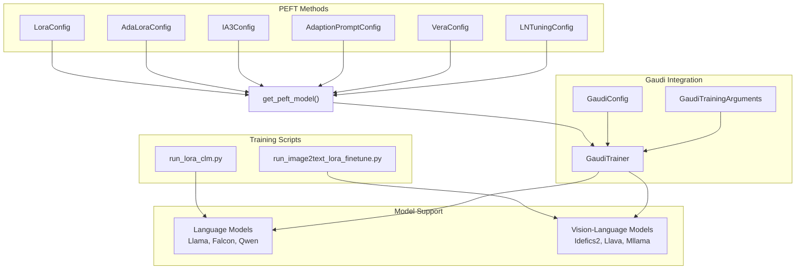
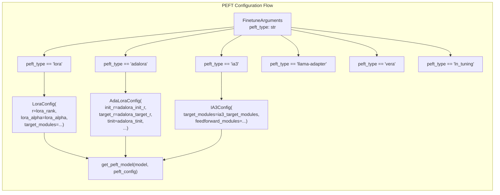
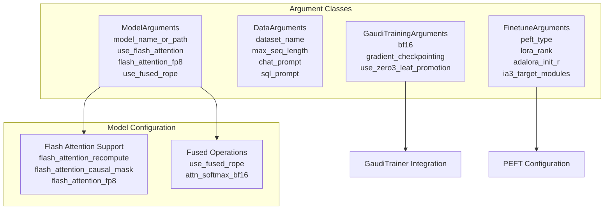
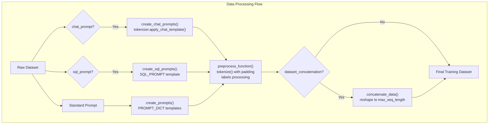
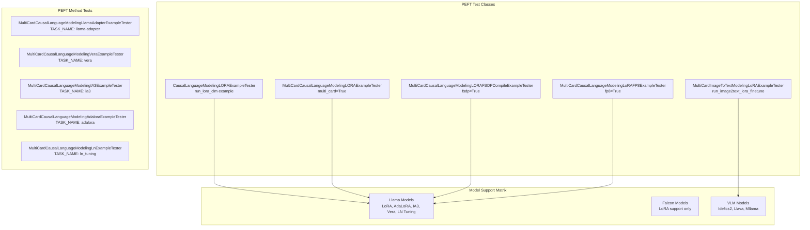

<!-- source: DeepWiki mcp.deepwiki.com · repo huggingface/optimum-habana · page 4.2 PEFT and Fine-tuning · fetched 2026-10-26 -->

# PEFT and Fine-tuning

<details>
<summary>Relevant source files</summary>

The following files were used as context for generating this wiki page:

- [examples/image-to-text/run_image2text_lora_finetune.py](examples/image-to-text/run_image2text_lora_finetune.py)
- [examples/language-modeling/run_lora_clm.py](examples/language-modeling/run_lora_clm.py)
- [tests/test_examples.py](tests/test_examples.py)
- [tests/utils.py](tests/utils.py)

</details>


This document covers Parameter-Efficient Fine-Tuning (PEFT) methods and fine-tuning capabilities in optimum-habana. It details the supported PEFT techniques, their configurations, and integration with Gaudi hardware optimization for both language modeling and multimodal tasks.

For general training infrastructure, see [Training System](#2.2). For quantization techniques that can be combined with PEFT, see [Quantization](#4.1).

## Overview

Optimum-habana provides comprehensive support for Parameter-Efficient Fine-Tuning (PEFT) methods that enable fine-tuning large models with reduced computational requirements while maintaining performance. The framework integrates with the PEFT library and extends it with Gaudi-specific optimizations.



Sources: [examples/language-modeling/run_lora_clm.py:33-43](), [examples/image-to-text/run_image2text_lora_finetune.py:33-34](), [tests/test_examples.py:159-163]()

## Supported PEFT Methods

Optimum-habana supports six PEFT methods, each with specific configurations and optimizations for Gaudi hardware:

| Method | Config Class | Target Use Case | Key Parameters |
|--------|-------------|----------------|----------------|
| LoRA | `LoraConfig` | General fine-tuning | `r`, `lora_alpha`, `lora_dropout` |
| AdaLoRA | `AdaLoraConfig` | Adaptive rank optimization | `init_r`, `target_r`, `tinit`, `tfinal` |
| IA3 | `IA3Config` | Activation scaling | `target_modules`, `feedforward_modules` |
| LLama-Adapter | `AdaptionPromptConfig` | Prompt-based adaptation | `adapter_layers`, `adapter_len` |
| VeRA | `VeraConfig` | Vector-based adaptation | `target_modules` |
| LN Tuning | `LNTuningConfig` | LayerNorm-only tuning | `target_modules` |



Sources: [examples/language-modeling/run_lora_clm.py:310-393](), [examples/language-modeling/run_lora_clm.py:874-927]()

## Language Model Fine-tuning

The `run_lora_clm.py` script provides comprehensive PEFT support for causal language modeling with extensive configuration options and Gaudi-specific optimizations.

### Configuration Structure

The script uses four main argument classes:



Sources: [examples/language-modeling/run_lora_clm.py:76-141](), [examples/language-modeling/run_lora_clm.py:196-308](), [examples/language-modeling/run_lora_clm.py:310-393]()

### PEFT Method Implementation

Each PEFT method has specific implementation details and Gaudi optimizations:

#### LoRA Configuration
```python
peft_config = LoraConfig(
    r=finetune_args.lora_rank,
    lora_alpha=finetune_args.lora_alpha,
    lora_dropout=finetune_args.lora_dropout,
    target_modules=finetune_args.lora_target_modules,
    bias="none",
    task_type=TaskType.CAUSAL_LM,
)
```

#### AdaLoRA with Gaudi Optimization
```python
from optimum.habana.peft.layer import GaudiAdaloraLayerSVDLinearForward
tuners.adalora.layer.SVDLinear.forward = GaudiAdaloraLayerSVDLinearForward
```

#### LLama-Adapter with Custom Attention
```python
from optimum.habana.peft.layer import (
    GaudiAdaptedAttention_getattr,
    GaudiAdaptedAttentionPreAttnForward,
)
tuners.adaption_prompt.layer.AdaptedAttention.pre_attn_forward = GaudiAdaptedAttentionPreAttnForward
```

Sources: [examples/language-modeling/run_lora_clm.py:874-882](), [examples/language-modeling/run_lora_clm.py:897-899](), [examples/language-modeling/run_lora_clm.py:912-918]()

### Data Processing Pipeline

The script supports multiple prompt formats and data processing strategies:



Sources: [examples/language-modeling/run_lora_clm.py:416-457](), [examples/language-modeling/run_lora_clm.py:673-682](), [examples/language-modeling/run_lora_clm.py:779-797](), [examples/language-modeling/run_lora_clm.py:806-832]()

## Multimodal PEFT Fine-tuning

The `run_image2text_lora_finetune.py` script extends PEFT support to vision-language models with specialized data collators and evaluation metrics.

### Supported Vision-Language Models

The script supports multiple VLM architectures with model-specific optimizations:

| Model Type | Key Features | Data Collator |
|------------|-------------|---------------|
| Idefics2 | `image_token_id` handling | `MyDataCollator` |
| Llava | Patch-based processing | `LLavaDataCollator` |
| Mllama | `image_token_index` support | `MyDataCollator` |

### Target Module Discovery

The script includes automatic target module discovery for LoRA application:

```python
def find_all_linear_names(model):
    cls = torch.nn.Linear
    lora_module_names = set()
    multimodal_keywords = ["mm_projector", "vision_tower", "vision_resampler"]
    for name, module in model.named_modules():
        if any(mm_keyword in name for mm_keyword in multimodal_keywords):
            continue
        if isinstance(module, cls):
            names = name.split(".")
            lora_module_names.add(names[0] if len(names) == 1 else names[-1])
    return list(lora_module_names)
```

Sources: [examples/image-to-text/run_image2text_lora_finetune.py:416-429](), [examples/image-to-text/run_image2text_lora_finetune.py:553-567]()

## Training Integration

PEFT fine-tuning integrates seamlessly with `GaudiTrainer` and includes specific optimizations for distributed training:

### GaudiConfig Optimization
```python
gaudi_config = GaudiConfig()
gaudi_config.use_fused_adam = True
gaudi_config.use_fused_clip_norm = True
```

### DeepSpeed Integration
```python
if training_args.use_zero3_leaf_promotion and model.config.model_type == "llama":
    from deepspeed.utils import set_z3_leaf_modules
    from optimum.habana.transformers.models.llama.modeling_llama import GaudiLlamaDecoderLayer
    set_z3_leaf_modules(lora_model, [GaudiLlamaDecoderLayer])
```

### FSDP Support
```python
if training_args.fsdp and training_args.fsdp_config["auto_wrap_policy"] == "TRANSFORMER_BASED_WRAP":
    trainer.accelerator.state.fsdp_plugin.auto_wrap_policy = fsdp_auto_wrap_policy(lora_model)
```

Sources: [examples/language-modeling/run_lora_clm.py:934-936](), [examples/language-modeling/run_lora_clm.py:938-943](), [examples/language-modeling/run_lora_clm.py:959-960]()

## Testing Framework

The testing framework validates PEFT functionality across different models and configurations through the `ExampleTestMeta` metaclass:

### PEFT Test Configuration



### Test Execution Flow

Tests are automatically generated based on model compatibility:

```python
case_only_in_gaudi2 = [
    "sft", "dpo", "reward_modeling", "ppo", "prompt_tuning", 
    "peft_poly", "run_sequence_classification", "run_image2text_lora_finetune"
]

if any(case in example_name for case in case_only_in_gaudi2) and IS_GAUDI1:
    return False
```

Sources: [tests/test_examples.py:918-934](), [tests/test_examples.py:1038-1087](), [tests/test_examples.py:251-270]()

### Supported Model Configurations

| Model Family | PEFT Methods | Hardware Support | Notes |
|-------------|-------------|------------------|-------|
| Llama | All methods | Gaudi1/2 | Full feature support |
| Falcon | LoRA only | Gaudi2+ | Limited PEFT method support |
| Qwen2 | LoRA | Gaudi2+ | TRL integration |
| Vision Models | LoRA | Gaudi2+ | Multimodal fine-tuning |

Sources: [tests/test_examples.py:159-163](), [tests/utils.py:56-68](), [tests/test_examples.py:284-292]()

---

