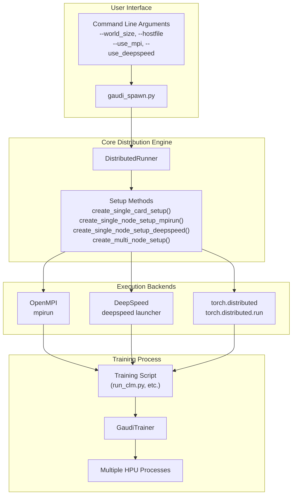
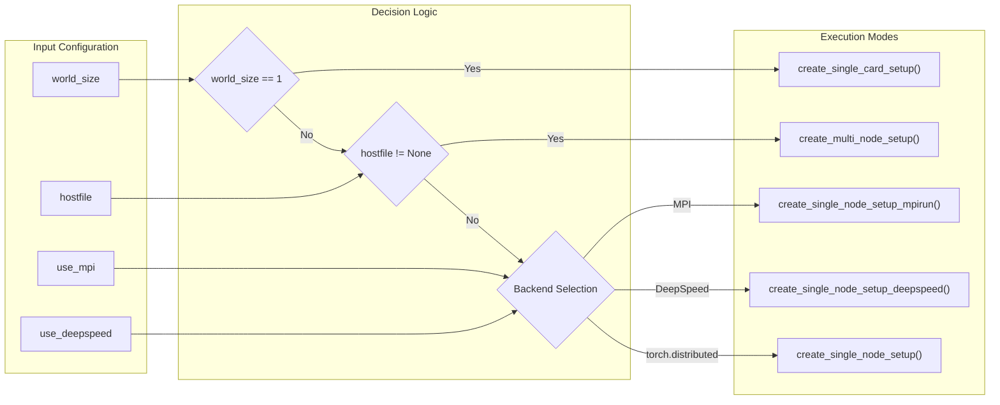
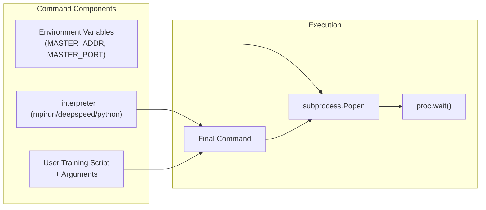

<!-- source: DeepWiki mcp.deepwiki.com · repo huggingface/optimum-habana · page 4.3 Distributed Training · fetched 2026-10-26 -->

# Distributed Training

<details>
<summary>Relevant source files</summary>

The following files were used as context for generating this wiki page:

- [examples/gaudi_spawn.py](examples/gaudi_spawn.py)
- [optimum/habana/distributed/distributed_runner.py](optimum/habana/distributed/distributed_runner.py)
- [tests/test_trainer_distributed.py](tests/test_trainer_distributed.py)

</details>


This document covers the distributed training capabilities in optimum-habana, which enable multi-device and multi-node training on Intel Habana Gaudi processors. The system provides a unified interface for launching distributed training using MPI, DeepSpeed, or PyTorch's native distributed training mechanisms.

For information about the core training infrastructure that these distributed capabilities build upon, see [Training System](#2.2). For details about PEFT methods that can be used in distributed settings, see [PEFT and Fine-tuning](#4.2).

## System Architecture

The distributed training system consists of two main components: a user-facing launcher script and a backend execution engine that handles the complexities of distributed process management.

### Distributed Training Architecture



Sources: [examples/gaudi_spawn.py:1-111](), [optimum/habana/distributed/distributed_runner.py:32-265]()

## Launch Interface

### gaudi_spawn.py

The `gaudi_spawn.py` script provides the primary entry point for distributed training. It accepts training scripts and their arguments, then delegates execution to the `DistributedRunner` class.

#### Key Arguments

| Argument | Type | Default | Description |
|----------|------|---------|-------------|
| `world_size` | int | 1 | Number of HPUs to use (1 or 8) |
| `hostfile` | str | None | Path to hostfile for multi-node training |
| `use_mpi` | bool | False | Use MPI for distributed training |
| `use_deepspeed` | bool | False | Use DeepSpeed for distributed training |
| `master_port` | int | 29500 | Master port for communication |

#### Usage Examples

Single node with MPI:
```bash
python gaudi_spawn.py --world_size=8 --use_mpi \
    YOUR_TRAINING_SCRIPT.py --arg1 --arg2
```

Multi-node with DeepSpeed:
```bash
python gaudi_spawn.py --hostfile=PATH_TO_HOSTFILE --use_deepspeed \
    YOUR_TRAINING_SCRIPT.py --arg1 --arg2
```

Sources: [examples/gaudi_spawn.py:18-28](), [examples/gaudi_spawn.py:54-59]()

### Argument Processing

The launcher processes arguments by patching `sys.argv` and constructing command lists for the `DistributedRunner`. Arguments containing whitespaces are automatically quoted to prevent shell parsing issues.

```python
# Handle the case where arguments contain whitespaces
argv = ['"{}"'.format(arg) if " " in arg and arg[0] != '"' and arg[-1] != '"' else arg for arg in sys.argv]
command_list = [" ".join(argv)]
```

Sources: [examples/gaudi_spawn.py:91-94]()

## DistributedRunner

The `DistributedRunner` class is the core engine that manages distributed execution across different backends and configurations.

### Execution Modes



Sources: [optimum/habana/distributed/distributed_runner.py:82-115]()

### Configuration Methods

#### Single Node MPI Setup

For single-node multi-device training with MPI, the system configures OpenMPI with CPU core binding and process mapping:

- Uses `setup_config_env_mpirun()` to determine optimal process mapping
- Calculates PE (Processing Elements) based on CPU topology
- Sets up environment variables for master address and port

Sources: [optimum/habana/distributed/distributed_runner.py:157-166](), [optimum/habana/distributed/distributed_runner.py:143-145]()

#### DeepSpeed Integration

DeepSpeed support includes both single-node and multi-node configurations:

**Single Node**: Uses `deepspeed --num_nodes 1 --num_gpus {world_size}`

**Multi Node**: Processes hostfile to determine master address and node configuration

Sources: [optimum/habana/distributed/distributed_runner.py:168-175](), [optimum/habana/distributed/distributed_runner.py:188-194]()

#### CPU Topology Detection

The system automatically detects CPU topology to optimize process placement:

```python
def get_peval(self):
    cmd1 = r"lscpu 2>/dev/null | awk '/Socket\(s\)/  { print $2 }'"
    cmd2 = r"lscpu 2>/dev/null | awk '/Core\(s\) per socket/  { print $4 }'"
    # ... calculate optimal PE value
    peval = (sockets * corespsocket) // self._world_size
    return peval, sockets, corespsocket
```

Sources: [optimum/habana/distributed/distributed_runner.py:117-141]()

## Process Execution

### Command Construction

The `DistributedRunner` constructs execution commands by combining the appropriate interpreter prefix with user-provided training scripts:



Sources: [optimum/habana/distributed/distributed_runner.py:212-223]()

### Environment Management

The system manages environment variables for distributed training, including special handling for `LD_PRELOAD` variables that may need to be appended rather than replaced.

Sources: [optimum/habana/distributed/distributed_runner.py:202-211](), [optimum/habana/distributed/distributed_runner.py:224-226]()

## Multi-Node Configuration

### Hostfile Processing

For multi-node training, the system processes hostfiles to extract node information and determine the master address:

```python
def process_hostfile(self) -> str:
    # Parse hostfile format: hostname slots=N
    # Return master address (first node)
    with self._hostfile.open("r") as file:
        for line in file.readlines():
            hostname, slots = line.split()
            _, slot_count = slots.split("=")
            if master_addr is None:
                master_addr = hostname
```

Expected hostfile format:
```
worker-0 slots=8
worker-1 slots=8
worker-2 slots=8
```

Sources: [optimum/habana/distributed/distributed_runner.py:230-264]()

## Integration with Training System

### GaudiTrainer Integration

The distributed system integrates seamlessly with `GaudiTrainer` through standard PyTorch distributed training patterns. The trainer automatically detects distributed environments and configures itself accordingly.

Key integration points:
- Process rank detection through `training_args.local_rank`
- Device assignment based on local rank
- Gradient synchronization across processes
- Evaluation data distribution and collection

Sources: [tests/test_trainer_distributed.py:128-131]()

### Testing Framework

The distributed training system includes comprehensive tests that verify:
- Correct data distribution across processes
- Proper gradient synchronization
- Evaluation metric aggregation
- Prediction ordering preservation

The test framework uses dummy models and datasets to validate distributed behavior without requiring large models or datasets.

Sources: [tests/test_trainer_distributed.py:37-77](), [tests/test_trainer_distributed.py:135-182]()

## Error Handling and Validation

### Configuration Validation

The system validates configuration combinations to prevent invalid setups:

- Prevents simultaneous use of MPI and DeepSpeed
- Requires DeepSpeed for multi-node training
- Validates hostfile format and accessibility

Sources: [optimum/habana/distributed/distributed_runner.py:82-95]()

### Process Management

The execution system monitors subprocess return codes and propagates errors appropriately, ensuring that failed distributed training runs are properly reported.

Sources: [optimum/habana/distributed/distributed_runner.py:217-223]()

---

