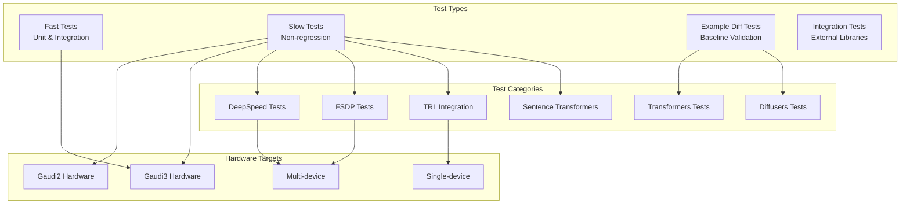
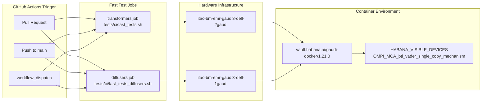
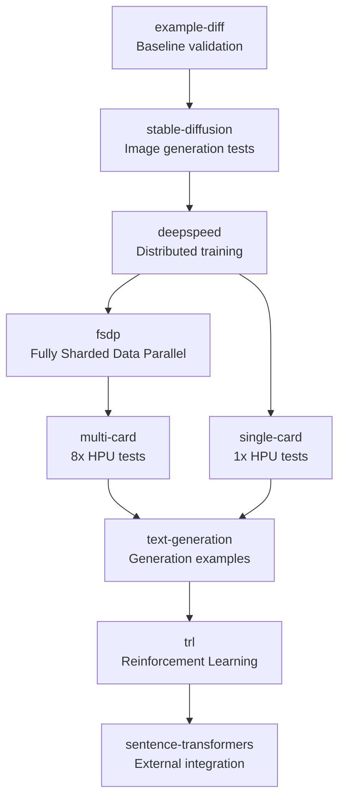
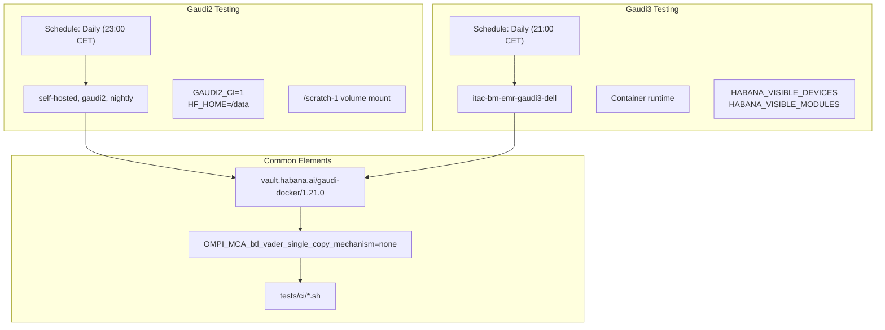
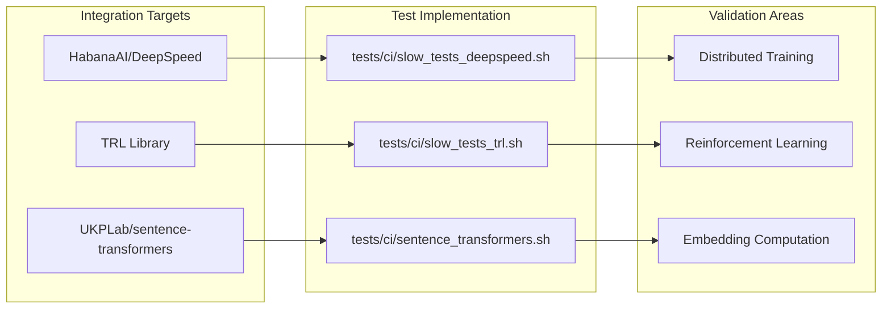
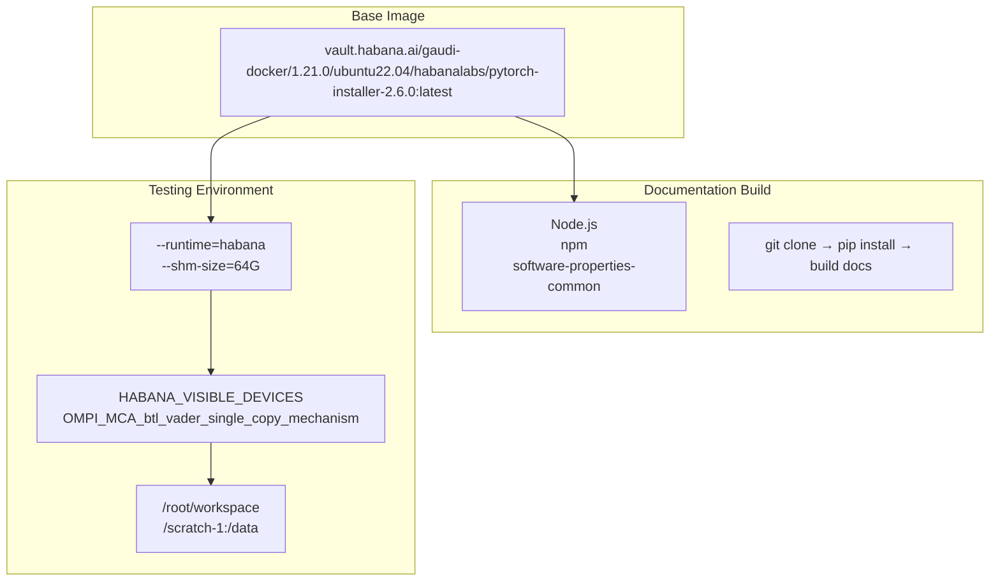

<!-- source: DeepWiki mcp.deepwiki.com · repo huggingface/optimum-habana · page 5 Development and Testing · fetched 2026-10-26 -->

# Development and Testing

Relevant source files

The following files were used as context for generating this wiki page:

- [.github/workflows/fast_tests.yml](.github/workflows/fast_tests.yml)
- [.github/workflows/slow_tests.yml](.github/workflows/slow_tests.yml)
- [.github/workflows/slow_tests_gaudi2.yml](.github/workflows/slow_tests_gaudi2.yml)
- [.github/workflows/slow_tests_gaudi3.yml](.github/workflows/slow_tests_gaudi3.yml)
- [docs/Dockerfile](docs/Dockerfile)
- [docs/source/installation.mdx](docs/source/installation.mdx)
- [docs/source/usage_guides/deepspeed.mdx](docs/source/usage_guides/deepspeed.mdx)
- [notebooks/AI_HW_Summit_2022.ipynb](notebooks/AI_HW_Summit_2022.ipynb)
- [tests/ci/sentence_transformers.sh](tests/ci/sentence_transformers.sh)
- [tests/example_diff/run_audio_classification.txt](tests/example_diff/run_audio_classification.txt)
- [tests/example_diff/run_clip.txt](tests/example_diff/run_clip.txt)
- [tests/example_diff/run_clm.txt](tests/example_diff/run_clm.txt)
- [tests/example_diff/run_generation.txt](tests/example_diff/run_generation.txt)
- [tests/example_diff/run_glue.txt](tests/example_diff/run_glue.txt)
- [tests/example_diff/run_image_classification.txt](tests/example_diff/run_image_classification.txt)
- [tests/example_diff/run_mlm.txt](tests/example_diff/run_mlm.txt)
- [tests/example_diff/run_qa.txt](tests/example_diff/run_qa.txt)
- [tests/example_diff/run_seq2seq_qa.txt](tests/example_diff/run_seq2seq_qa.txt)
- [tests/example_diff/run_speech_recognition_ctc.txt](tests/example_diff/run_speech_recognition_ctc.txt)
- [tests/example_diff/run_summarization.txt](tests/example_diff/run_summarization.txt)
- [tests/example_diff/run_translation.txt](tests/example_diff/run_translation.txt)

This document covers the development infrastructure and testing frameworks used in optimum-habana, including the CI/CD pipeline, testing methodologies, and tools for contributors and maintainers. For information about using the library itself, see the application guides in [section 3](#3). For advanced features like quantization and distributed training, see [section 4](#4).

## Overview

The optimum-habana project maintains a comprehensive testing and development infrastructure to ensure reliable operation across Intel Gaudi hardware generations and integration with the broader Hugging Face ecosystem. The testing framework validates both functional correctness and performance characteristics across different model types, hardware configurations, and integration scenarios.

## Testing Architecture

The testing system is organized into multiple layers with different execution frequencies and hardware requirements:

Sources: [.github/workflows/fast_tests.yml:1-64](), [.github/workflows/slow_tests.yml:1-280](), [.github/workflows/slow_tests_gaudi2.yml:1-279](), [.github/workflows/slow_tests_gaudi3.yml:1-224]()

## Fast Testing Pipeline

The fast testing pipeline provides immediate feedback on pull requests and code changes through unit and integration tests that run on every commit:

### Test Execution Flow

The fast tests execute within Docker containers that provide a consistent environment with Intel Gaudi software stack version 1.21.0 and PyTorch 2.6.0. The `hl-smi` command is run at the beginning of each job to verify hardware availability and configuration.

Sources: [.github/workflows/fast_tests.yml:14-63]()

## Slow Testing Pipeline

The slow testing pipeline runs comprehensive non-regression tests on a scheduled basis to validate the entire system across different configurations:

### Test Job Dependencies

The pipeline is designed with sequential execution to maximize hardware utilization while ensuring test isolation. Jobs use conditional execution with `if: ${{ !cancelled() && (success() || failure()) }}` to continue even if previous jobs fail, allowing comprehensive test coverage reporting.

Sources: [.github/workflows/slow_tests.yml:36-279]()

## Example Validation System

The example validation system ensures that optimum-habana adaptations of Hugging Face examples maintain compatibility and expected behavior changes:

### Example Diff Structure

| Example Script | Validation File | Key Changes |
|---|---|---|
| `run_generation.py` | `tests/example_diff/run_generation.txt` | `GaudiGenerationMixin`, HPU graphs, device management |
| `run_clm.py` | `tests/example_diff/run_clm.txt` | `GaudiTrainer`, `GaudiTrainingArguments`, flash attention |
| `run_glue.py` | `tests/example_diff/run_glue.txt` | Gaudi configuration, mixed precision training |
| `run_summarization.py` | `tests/example_diff/run_summarization.txt` | `GaudiSeq2SeqTrainer`, bucketing, compiled autograd |

The diff files capture the precise modifications needed to adapt standard Transformers examples for Gaudi hardware. These include:

- Replacing `Trainer` with `GaudiTrainer` classes
- Adding `GaudiConfig` loading and configuration
- Implementing Gaudi-specific optimizations like flash attention
- Managing mixed precision with `bf16` instead of `fp16`

Sources: [tests/example_diff/run_generation.txt:1-28](), [tests/example_diff/run_clm.txt:1-213](), [tests/example_diff/run_glue.txt:1-87]()

## Hardware-Specific Testing

### Gaudi2 vs Gaudi3 Test Configuration

The testing infrastructure supports both Gaudi2 and Gaudi3 hardware with different scheduling and resource allocation:

Gaudi3 testing uses containerized execution within GitHub Actions runners, while Gaudi2 testing uses direct Docker execution on self-hosted infrastructure. Both configurations validate the same test suites but with hardware-appropriate optimizations.

Sources: [.github/workflows/slow_tests_gaudi2.yml:5-7](), [.github/workflows/slow_tests_gaudi3.yml:5-6]()

## Integration Testing

### External Library Integration

The testing framework validates integration with external libraries that extend optimum-habana functionality:

The sentence transformers integration includes both repository checkout and local testing:

- Checkout of the upstream `UKPLab/sentence-transformers` repository
- Installation and execution of specific test modules: `test_cmnrl.py`, `test_multi_process.py`, `test_compute_embeddings.py`, `test_model_card_data.py`, `test_util.py`
- Local optimum-habana integration tests in `test_sentence_transformers.py`

Sources: [tests/ci/sentence_transformers.sh:3-12](), [.github/workflows/slow_tests.yml:254-279]()

## Development Environment

### Docker Infrastructure

The development and testing environment is standardized using Docker containers based on Intel Gaudi software stack:

The documentation build process requires Node.js for building HTML documentation from source. The testing environment uses specific runtime configurations for Habana hardware access and shared memory allocation.

Sources: [docs/Dockerfile:1-16](), [.github/workflows/slow_tests.yml:22-34]()

## Test Execution Patterns

### Baseline Management

The example diff testing system maintains baselines that capture expected differences between standard Transformers examples and their Gaudi adaptations. Key patterns include:

| Pattern Type | Example | Purpose |
|---|---|---|
| Import Changes | `from optimum.habana import GaudiTrainer` | Replace standard classes with Gaudi equivalents |
| Configuration | `gaudi_config = GaudiConfig.from_pretrained()` | Load Gaudi-specific settings |
| Precision Handling | `mixed_precision = training_args.bf16 or gaudi_config.use_torch_autocast` | Use bf16 instead of fp16 |
| Device Management | `model.to("hpu")` | Target Habana Processing Units |
| Optimization Features | `use_flash_attention`, `flash_attention_recompute` | Enable Gaudi-specific optimizations |

These baselines are validated during the `example-diff` job in the CI pipeline using the script [tests/ci/example_diff_tests.sh]().

Sources: [tests/example_diff/run_clm.txt:25-26](), [tests/example_diff/run_qa.txt:66-76](), [tests/example_diff/run_speech_recognition_ctc.txt:44-70]()

---

