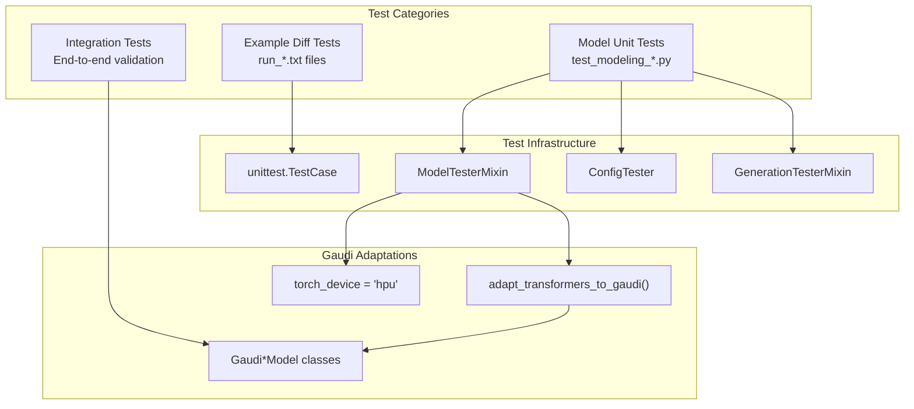
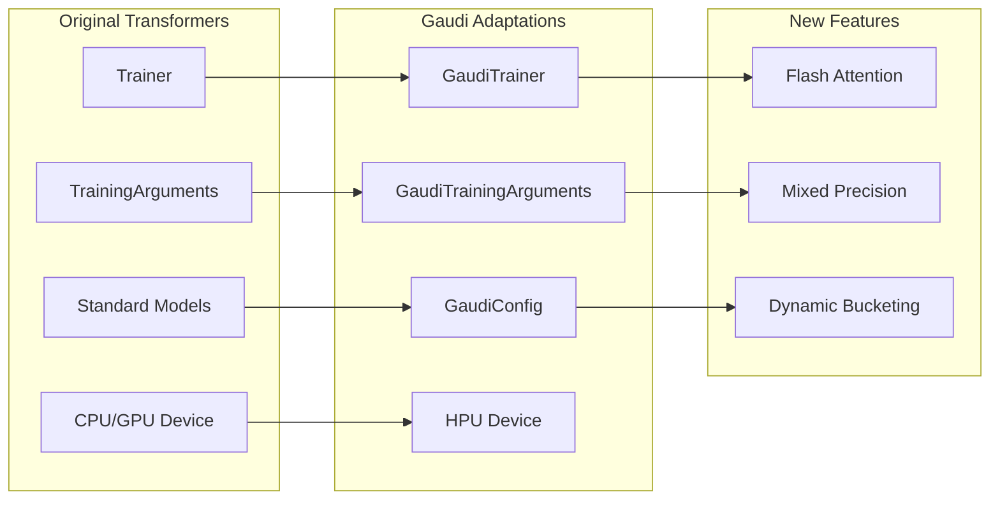
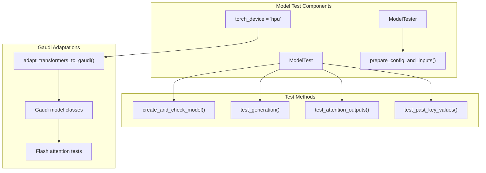
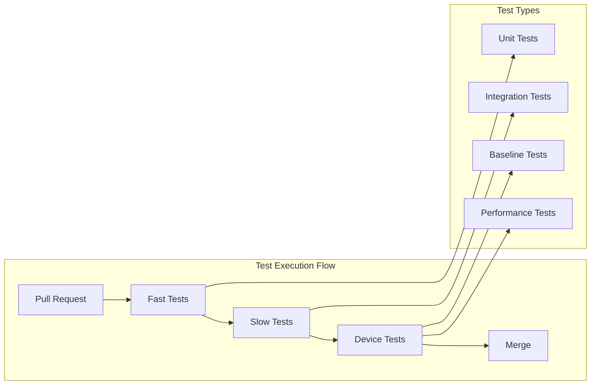

<!-- source: DeepWiki mcp.deepwiki.com · repo huggingface/optimum-habana · page 5.1 Testing Framework · fetched 2026-10-26 -->

# Testing Framework

<details>
<summary>Relevant source files</summary>

The following files were used as context for generating this wiki page:

- [tests/example_diff/run_audio_classification.txt](tests/example_diff/run_audio_classification.txt)
- [tests/example_diff/run_clip.txt](tests/example_diff/run_clip.txt)
- [tests/example_diff/run_clm.txt](tests/example_diff/run_clm.txt)
- [tests/example_diff/run_generation.txt](tests/example_diff/run_generation.txt)
- [tests/example_diff/run_glue.txt](tests/example_diff/run_glue.txt)
- [tests/example_diff/run_image_classification.txt](tests/example_diff/run_image_classification.txt)
- [tests/example_diff/run_mlm.txt](tests/example_diff/run_mlm.txt)
- [tests/example_diff/run_qa.txt](tests/example_diff/run_qa.txt)
- [tests/example_diff/run_seq2seq_qa.txt](tests/example_diff/run_seq2seq_qa.txt)
- [tests/example_diff/run_speech_recognition_ctc.txt](tests/example_diff/run_speech_recognition_ctc.txt)
- [tests/example_diff/run_summarization.txt](tests/example_diff/run_summarization.txt)
- [tests/example_diff/run_translation.txt](tests/example_diff/run_translation.txt)
- [tests/transformers/tests/models/falcon/test_modeling_falcon.py](tests/transformers/tests/models/falcon/test_modeling_falcon.py)
- [tests/transformers/tests/models/gpt2/test_modeling_gpt2.py](tests/transformers/tests/models/gpt2/test_modeling_gpt2.py)
- [tests/transformers/tests/models/llama/test_modeling_llama.py](tests/transformers/tests/models/llama/test_modeling_llama.py)
- [tests/transformers/tests/models/swin/__init__.py](tests/transformers/tests/models/swin/__init__.py)
- [tests/transformers/tests/models/wav2vec2/__init__.py](tests/transformers/tests/models/wav2vec2/__init__.py)
- [tests/transformers/tests/models/wav2vec2/test_modeling_wav2vec2.py](tests/transformers/tests/models/wav2vec2/test_modeling_wav2vec2.py)

</details>


The testing framework in optimum-habana provides comprehensive validation for Gaudi-optimized Hugging Face models and example scripts. This system ensures that all adaptations and optimizations for Intel Habana Gaudi processors maintain correctness and performance standards across different model architectures and use cases.

For information about CI/CD pipeline configuration and automated workflows, see [CI/CD Pipeline](#5.2).

## Test Architecture Overview

The testing framework consists of three main components: example diff validation, model-specific unit tests, and integration tests that verify end-to-end functionality on Gaudi hardware.



**Test Framework Architecture**

Sources: [tests/transformers/tests/models/wav2vec2/test_modeling_wav2vec2.py:47-48](), [tests/transformers/tests/models/falcon/test_modeling_falcon.py:36-37](), [tests/transformers/tests/models/gpt2/test_modeling_gpt2.py:29-30]()

## Example Diff Testing

Example diff tests validate that training and inference scripts are correctly adapted for Gaudi by comparing the differences between original Transformers examples and Gaudi-optimized versions. These tests are stored as diff files in `tests/example_diff/`.

### Key Diff Categories

| Script Type | Example File | Key Changes Validated |
|-------------|--------------|----------------------|
| Generation | `run_generation.txt` | HPU device setup, generation parameters, memory optimization |
| Language Modeling | `run_clm.txt`, `run_mlm.txt` | GaudiTrainer integration, mixed precision, flash attention |
| Sequence-to-Sequence | `run_summarization.txt`, `run_translation.txt` | GaudiSeq2SeqTrainer, bucketing, generation config |
| Audio Tasks | `run_speech_recognition_ctc.txt`, `run_audio_classification.txt` | Audio processing optimizations, flash attention |
| Vision Tasks | `run_image_classification.txt`, `run_clip.txt` | Image processing, MediaPipe dataloader |
| Question Answering | `run_qa.txt`, `run_seq2seq_qa.txt` | Model adaptations, HPU-specific configurations |

### Example Script Adaptations

The diff files show consistent patterns of adaptation:



**Script Adaptation Pattern**

Sources: [tests/example_diff/run_clm.txt:25-26](), [tests/example_diff/run_generation.txt:56-57](), [tests/example_diff/run_summarization.txt:25-26]()

## Model-Specific Testing

Model-specific tests validate that individual model implementations work correctly on Gaudi hardware. These tests follow a standardized pattern using test classes that inherit from `ModelTesterMixin`.

### Test Class Structure

Each model test file contains:

- **ModelTester class**: Defines test configurations and input preparation
- **ModelTest class**: Inherits from `ModelTesterMixin` and `unittest.TestCase`
- **Gaudi-specific setup**: Device configuration and model adaptation



**Model Test Structure**

### Supported Model Types

The framework tests various model architectures:

| Model Family | Test File | Key Test Areas |
|--------------|-----------|----------------|
| LLaMA | `test_modeling_llama.py` | Causal LM, sequence classification, RoPE scaling |
| Falcon | `test_modeling_falcon.py` | Multi-query attention, new decoder architecture |
| GPT-2 | `test_modeling_gpt2.py` | Past key values, attention masking, double heads |
| Wav2Vec2 | `test_modeling_wav2vec2.py` | Audio processing, CTC loss, sequence classification |

### Test Execution Pattern

All model tests follow this pattern:

1. **Setup Phase**: Initialize `ModelTester` with test parameters
2. **Adaptation Phase**: Call `adapt_transformers_to_gaudi()` 
3. **Device Setup**: Set `torch_device = "hpu"`
4. **Model Creation**: Instantiate model and move to HPU
5. **Validation**: Run forward pass and check outputs

Sources: [tests/transformers/tests/models/llama/test_modeling_llama.py:44-45](), [tests/transformers/tests/models/wav2vec2/test_modeling_wav2vec2.py:90-91](), [tests/transformers/tests/models/falcon/test_modeling_falcon.py:43-44]()

## Test Execution and Configuration

### HPU Device Configuration

All tests are configured to run on Habana Processing Units (HPUs):

```python
torch_device = "hpu"
adapt_transformers_to_gaudi()
```

This setup ensures that all models and operations are executed on Gaudi hardware with the appropriate optimizations applied.

### Test Categories and Mixins

The framework uses several mixin classes to provide standardized test functionality:

| Mixin Class | Purpose | Key Methods |
|-------------|---------|-------------|
| `ModelTesterMixin` | Core model testing | `test_config()`, `test_model()`, `test_inputs_embeds()` |
| `GenerationTesterMixin` | Text generation testing | `test_generate_from_inputs_embeds()`, `test_beam_search()` |
| `ConfigTester` | Configuration validation | `run_common_tests()` |

### Integration with CI/CD

The testing framework integrates with GitHub Actions workflows to provide:

- **Fast Tests**: Unit tests and basic model validation
- **Slow Tests**: End-to-end integration tests with large models
- **Device-Specific Tests**: Gaudi2 and Gaudi3 specific validations
- **Non-regression Tests**: Baseline comparison and performance validation



**Test Execution Pipeline**

Sources: [tests/transformers/tests/models/gpt2/test_modeling_gpt2.py:36-37](), [tests/transformers/tests/models/llama/test_modeling_llama.py:272-297]()

## Baseline Management

The testing framework includes baseline management for regression testing, comparing current outputs against known good results. This ensures that optimizations and changes don't introduce correctness issues.

### Test Data and Fixtures

Test fixtures provide consistent input data across different test runs:

- **Tensor Generation**: `ids_tensor()`, `floats_tensor()`, `random_attention_mask()`
- **Configuration Setup**: Model-specific configs with test parameters
- **Device Placement**: Automatic tensor movement to HPU device

The framework ensures reproducibility through consistent random seed management and standardized test inputs across all model types.

Sources: [tests/transformers/tests/models/falcon/test_modeling_falcon.py:270-297](), [tests/example_diff/run_generation.txt:1-50](), [tests/transformers/tests/models/wav2vec2/test_modeling_wav2vec2.py:427-443]()

---

