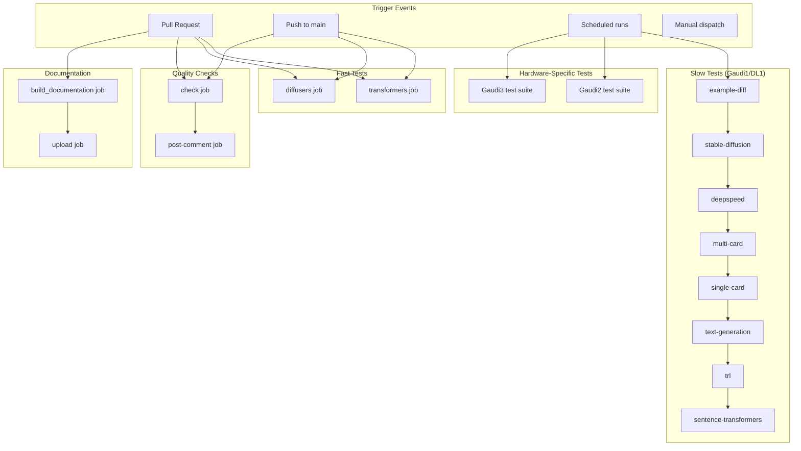
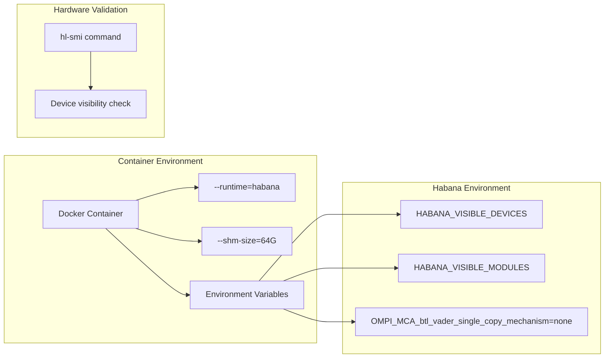
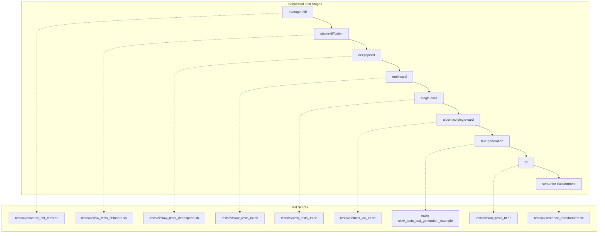
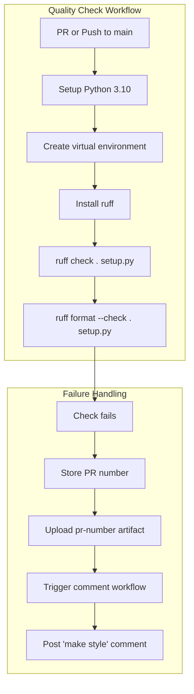
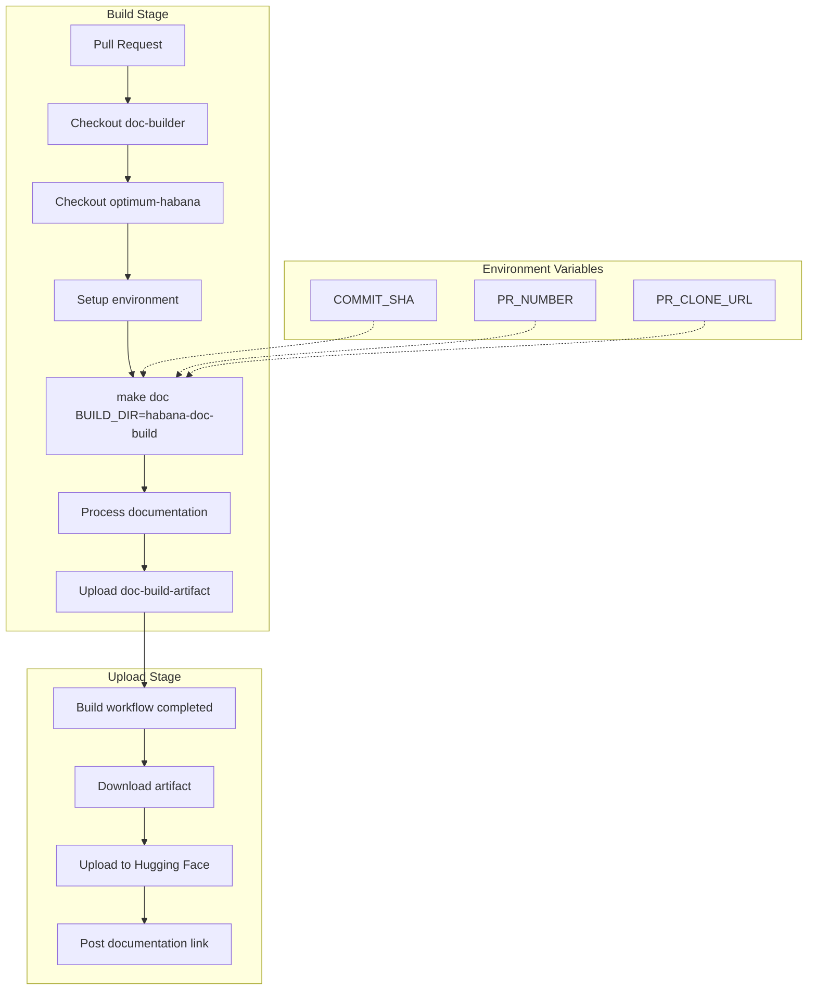
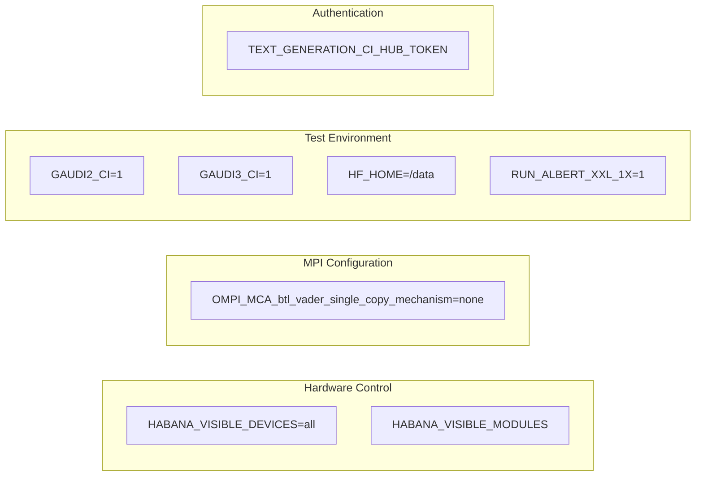
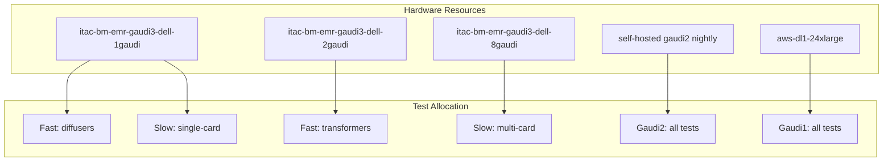

<!-- source: DeepWiki mcp.deepwiki.com · repo huggingface/optimum-habana · page 5.2 CI/CD Pipeline · fetched 2026-10-26 -->

# CI/CD Pipeline

Relevant source files

The following files were used as context for generating this wiki page:

- [.github/workflows/build_pr_documentation.yml](.github/workflows/build_pr_documentation.yml)
- [.github/workflows/check_code_quality.yml](.github/workflows/check_code_quality.yml)
- [.github/workflows/failed_code_quality_check_comment.yml](.github/workflows/failed_code_quality_check_comment.yml)
- [.github/workflows/fast_tests.yml](.github/workflows/fast_tests.yml)
- [.github/workflows/slow_tests.yml](.github/workflows/slow_tests.yml)
- [.github/workflows/slow_tests_gaudi2.yml](.github/workflows/slow_tests_gaudi2.yml)
- [.github/workflows/slow_tests_gaudi3.yml](.github/workflows/slow_tests_gaudi3.yml)
- [.github/workflows/upload_pr_documentation.yml](.github/workflows/upload_pr_documentation.yml)
- [docs/Dockerfile](docs/Dockerfile)
- [docs/source/installation.mdx](docs/source/installation.mdx)
- [docs/source/usage_guides/deepspeed.mdx](docs/source/usage_guides/deepspeed.mdx)
- [notebooks/AI_HW_Summit_2022.ipynb](notebooks/AI_HW_Summit_2022.ipynb)
- [tests/ci/sentence_transformers.sh](tests/ci/sentence_transformers.sh)

The CI/CD pipeline for optimum-habana provides automated testing, quality checks, and documentation building to ensure code quality and compatibility across different Intel Gaudi hardware configurations. The pipeline includes fast unit tests, comprehensive non-regression testing on actual Gaudi hardware, code quality enforcement, and automated documentation generation.

For information about the testing framework structure and baseline management, see [Testing Framework](#5.1).

## Pipeline Architecture

The CI/CD system consists of multiple GitHub Actions workflows that handle different aspects of continuous integration and deployment:

Sources: [.github/workflows/fast_tests.yml:1-64](), [.github/workflows/slow_tests.yml:1-280](), [.github/workflows/check_code_quality.yml:1-48](), [.github/workflows/build_pr_documentation.yml:1-58]()

## Fast Tests Workflow

The fast tests provide immediate feedback on pull requests and main branch pushes by running unit and integration tests on Gaudi3 hardware.

### Test Jobs Configuration

| Job | Hardware | Container Image | Test Script |
|-----|----------|-----------------|-------------|
| `transformers` | `itac-bm-emr-gaudi3-dell-2gaudi` | `gaudi-docker/1.21.0/ubuntu22.04/habanalabs/pytorch-installer-2.6.0:latest` | `tests/ci/fast_tests.sh` |
| `diffusers` | `itac-bm-emr-gaudi3-dell-1gaudi` | `gaudi-docker/1.21.0/ubuntu22.04/habanalabs/pytorch-installer-2.6.0:latest` | `tests/ci/fast_tests_diffusers.sh` |

### Container Configuration

Sources: [.github/workflows/fast_tests.yml:20-32](), [.github/workflows/fast_tests.yml:46-56]()

## Slow Tests (Non-Regression) Workflow

The slow tests run comprehensive non-regression testing on a scheduled basis using different hardware configurations and test categories.

### Test Execution Flow

### Hardware Platform Variations

The slow tests run on three different hardware configurations:

| Platform | Workflow | Hardware | Schedule |
|----------|----------|----------|----------|
| Gaudi1 | `slow_tests.yml` | `aws-dl1-24xlarge` | Sunday-Friday 11pm CET, Saturday 1am CET |
| Gaudi2 | `slow_tests_gaudi2.yml` | `self-hosted, gaudi2, nightly` | Daily 1am CET |
| Gaudi3 | `slow_tests_gaudi3.yml` | `itac-bm-emr-gaudi3-dell-*` | Daily 11pm CET |

Sources: [.github/workflows/slow_tests.yml:5-7](), [.github/workflows/slow_tests_gaudi2.yml:5-6](), [.github/workflows/slow_tests_gaudi3.yml:5-6]()

## Code Quality Enforcement

The code quality system uses `ruff` for linting and formatting checks, with automated feedback mechanisms.

### Quality Check Process

Sources: [.github/workflows/check_code_quality.yml:9-48](), [.github/workflows/failed_code_quality_check_comment.yml:1-37]()

## Documentation Pipeline

The documentation system automatically builds and uploads documentation for pull requests using the Hugging Face doc-builder.

### Documentation Build Flow

### Documentation Environment Setup

The documentation builds using a specialized Docker container that includes the Intel Gaudi software stack and Node.js for HTML generation:

Sources: [.github/workflows/build_pr_documentation.yml:12-58](), [.github/workflows/upload_pr_documentation.yml:1-17](), [docs/Dockerfile:1-16]()

## Test Environment Configuration

All test jobs use containerized environments with the Intel Gaudi software stack. The configuration ensures proper access to Habana hardware and optimized performance settings.

### Common Container Settings

| Setting | Value | Purpose |
|---------|-------|---------|
| `--runtime=habana` | Habana container runtime | Access to Gaudi hardware |
| `--shm-size=64G` | 64GB shared memory | Large model memory requirements |
| `--cap-add=sys_nice` | Nice capability | Process priority control |
| `--net=host --ipc=host` | Host networking/IPC | Distributed training communication |

### Environment Variables

Sources: [.github/workflows/slow_tests.yml:28-31](), [.github/workflows/slow_tests_gaudi2.yml:84-87](), [.github/workflows/slow_tests_gaudi3.yml:19-21]()

## Concurrency and Resource Management

The CI/CD system implements concurrency controls to manage resource usage and prevent conflicts:

### Concurrency Groups

- **Fast tests**: `${{ github.workflow }}-${{ github.head_ref || github.run_id }}` with `cancel-in-progress: true`
- **Slow tests**: `${{ github.workflow }}` (single instance per workflow)
- **Quality checks**: No concurrency limits (lightweight checks)

### Resource Allocation

Sources: [.github/workflows/fast_tests.yml:10-12](), [.github/workflows/slow_tests.yml:9-10](), [.github/workflows/slow_tests_gaudi2.yml:8-9]()

---

