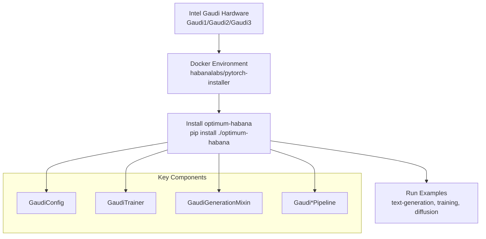
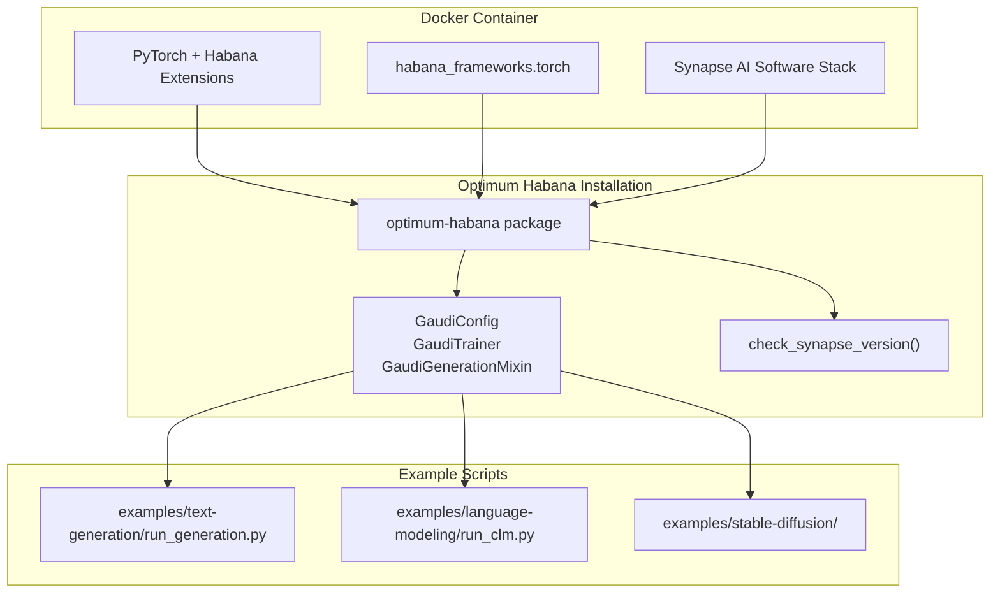
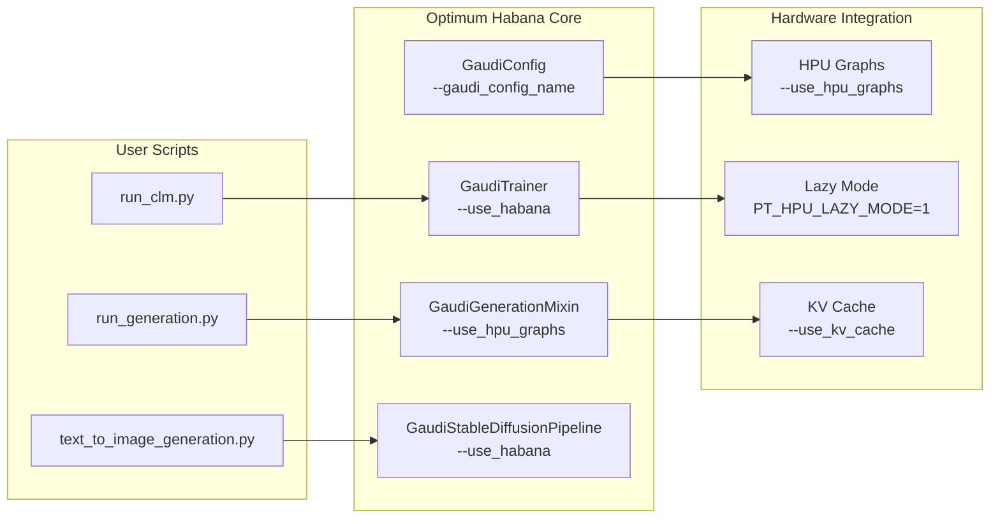

<!-- source: DeepWiki mcp.deepwiki.com · repo huggingface/optimum-habana · page 6 Getting Started · fetched 2026-10-26 -->

# Getting Started

<details>
<summary>Relevant source files</summary>

The following files were used as context for generating this wiki page:

- [docs/source/_toctree.yml](docs/source/_toctree.yml)
- [docs/source/quickstart.mdx](docs/source/quickstart.mdx)
- [optimum/habana/__init__.py](optimum/habana/__init__.py)
- [optimum/habana/version.py](optimum/habana/version.py)

</details>


This document provides a comprehensive guide for new users to install, configure, and run their first workloads using 🤗 Optimum for Intel Gaudi. It covers hardware setup, software installation, and basic usage patterns for inference and training on Intel Habana Gaudi processors.

For detailed information about specific systems and advanced configurations, see the Core Systems documentation ([#2](#2)) and Applications and Examples ([#3](#3)).

## Overview

🤗 Optimum for Intel Gaudi enables running Hugging Face models optimized for Intel Habana Gaudi accelerators. The library provides drop-in replacements for standard Transformers and Diffusers components, with hardware-specific optimizations for HPU (Habana Processing Unit) devices.

### Setup Flow



Sources: [docs/source/quickstart.mdx:20-30](), [optimum/habana/__init__.py:19-32]()

## Prerequisites

### Hardware Requirements

- Intel Gaudi AI accelerator (Gaudi1, Gaudi2, or Gaudi3)
- Access to Intel® Tiber™ AI Cloud or on-premises Gaudi system
- Multi-device systems support distributed workloads (typically 8 HPU configurations)

### Software Requirements

- Docker runtime with Habana support (`--runtime=habana`)
- Intel Gaudi Software Suite (version 1.21.0 or compatible)
- Python 3.8+ environment within the Gaudi docker container

Sources: [docs/source/quickstart.mdx:27-63]()

## Installation

### Step 1: Docker Environment Setup

Use the official Intel Gaudi docker images with the following configuration:

```bash
release=1.21.0
os=ubuntu22.04
torch=2.6.0
docker_image=vault.habana.ai/gaudi-docker/$release/$os/habanalabs/pytorch-installer-$torch:latest

docker run -itd \
    --name Gaudi_Docker \
    --runtime=habana \
    -e HABANA_VISIBLE_DEVICES=all \
    -e OMPI_MCA_btl_vader_single_copy_mechanism=none \
    --cap-add=sys_nice \
    --net=host \
    --ipc=host \
    ${docker_image}
```

### Step 2: Install Optimum for Intel Gaudi

```bash
git clone -b v1.18.0 https://github.com/huggingface/optimum-habana
pip install ./optimum-habana
```

The library version is tracked in [optimum/habana/version.py:16]() and should be compatible with your Gaudi software stack version.

Sources: [docs/source/quickstart.mdx:52-74]()

### Installation Architecture



Sources: [optimum/habana/__init__.py:19-34](), [docs/source/quickstart.mdx:65-83]()

## Basic Usage

### Single Device Inference

The simplest way to get started is with single-device text generation using the `run_generation.py` script:

```bash
cd ~/optimum-habana/examples/text-generation
pip install -r requirements.txt

PT_HPU_LAZY_MODE=1 python run_generation.py \
    --model_name_or_path meta-llama/Llama-2-7b-hf \
    --use_hpu_graphs \
    --use_kv_cache \
    --max_new_tokens 100 \
    --do_sample \
    --prompt "Here is my prompt"
```

### Key Environment Variables and Arguments

| Component | Purpose | Code Reference |
|-----------|---------|----------------|
| `PT_HPU_LAZY_MODE=1` | Enables lazy execution mode for HPU optimization | Environment variable |
| `--use_hpu_graphs` | Enables HPU graph compilation for better performance | Command line argument |
| `--use_kv_cache` | Activates KV cache optimization for generation | Command line argument |
| `--gaudi_config_name` | Specifies Gaudi configuration profile | Training scripts |

Sources: [docs/source/quickstart.mdx:91-108]()

### Multi-Device Distributed Inference

For systems with multiple HPUs, use the `gaudi_spawn.py` distributed launcher with DeepSpeed:

```bash
# Install DeepSpeed for Gaudi
pip install git+https://github.com/HabanaAI/DeepSpeed.git@1.21.0

# Run distributed inference
number_of_devices=8
PT_HPU_LAZY_MODE=1 python ../gaudi_spawn.py --use_deepspeed --world_size ${number_of_devices} \
    run_generation.py \
    --model_name_or_path meta-llama/Llama-2-7b-hf \
    --use_hpu_graphs \
    --use_kv_cache \
    --max_new_tokens=100
```

Sources: [docs/source/quickstart.mdx:110-133]()

### Training Workloads

Basic single-device training using `GaudiTrainer`:

```bash
cd ~/optimum-habana/examples/language-modeling
pip install -r requirements.txt

PT_HPU_LAZY_MODE=1 python run_clm.py \
    --model_name_or_path gpt2 \
    --dataset_name wikitext \
    --dataset_config_name wikitext-2-raw-v1 \
    --gaudi_config_name Habana/gpt2 \
    --use_habana \
    --use_lazy_mode \
    --use_hpu_graphs_for_inference
```

Sources: [docs/source/quickstart.mdx:149-165]()

## Core Component Usage

### Essential Classes and Functions



Sources: [optimum/habana/__init__.py:19-25](), [docs/source/quickstart.mdx:95-101](), [docs/source/quickstart.mdx:151-164]()

## Available Examples

The library provides ready-to-use examples across multiple domains:

### Text Processing Examples

| Example Category | Directory | Key Scripts |
|------------------|-----------|-------------|
| Text Generation | `examples/text-generation/` | `run_generation.py` |
| Language Modeling | `examples/language-modeling/` | `run_clm.py`, `run_mlm.py` |
| Question Answering | `examples/question-answering/` | `run_qa.py` |
| Text Classification | `examples/text-classification/` | `run_glue.py` |
| Summarization | `examples/summarization/` | `run_summarization.py` |

### Multimodal Examples

| Example Category | Directory | Key Scripts |
|------------------|-----------|-------------|
| Stable Diffusion | `examples/stable-diffusion/` | `text_to_image_generation.py` |
| Image Classification | `examples/image-classification/` | `run_image_classification.py` |
| Image-to-Text | `examples/image-to-text/` | `run_image_to_text.py` |
| Audio Classification | `examples/audio-classification/` | `run_audio_classification.py` |

### Advanced Examples

| Example Category | Directory | Purpose |
|------------------|-----------|---------|
| Multi-node Training | `examples/multi-node-training/` | Distributed training across nodes |
| PEFT Methods | `examples/language-modeling/` | LoRA, AdaLoRA fine-tuning |
| TRL Integration | `examples/trl/` | Reinforcement learning from human feedback |

Sources: [docs/source/quickstart.mdx:247-287]()

## Next Steps

After completing the basic setup and running your first examples, consider exploring:

1. **Advanced Training Techniques**: See the Training System documentation ([#2.2](#2.2)) for `GaudiTrainer` and `GaudiTrainingArguments` details
2. **Model-Specific Optimizations**: Review Model Implementations ([#2.3](#2.3)) for Gaudi-optimized attention and MLP layers
3. **Distributed Training**: Explore Distributed Training ([#4.3](#4.3)) for multi-device and multi-node setups
4. **Quantization**: Learn about Quantization ([#4.1](#4.1)) for BitsAndBytes and FP8 optimization
5. **Production Deployment**: Check Advanced Features ([#4](#4)) for production-ready configurations

For troubleshooting and development, refer to the Testing Framework ([#5.1](#5.1)) and CI/CD Pipeline ([#5.2](#5.2)) documentation.

Sources: [docs/source/quickstart.mdx:288-290](), [docs/source/_toctree.yml:8-39]()