# Page: Overview

# Overview

<details>
<summary>Relevant source files</summary>

The following files were used as context for generating this wiki page:

- [Makefile](Makefile)
- [README.md](README.md)
- [docs/source/_toctree.yml](docs/source/_toctree.yml)
- [docs/source/index.mdx](docs/source/index.mdx)
- [docs/source/quickstart.mdx](docs/source/quickstart.mdx)
- [optimum/habana/__init__.py](optimum/habana/__init__.py)
- [optimum/habana/transformers/generation/utils.py](optimum/habana/transformers/generation/utils.py)
- [optimum/habana/transformers/modeling_utils.py](optimum/habana/transformers/modeling_utils.py)
- [optimum/habana/transformers/models/__init__.py](optimum/habana/transformers/models/__init__.py)
- [optimum/habana/version.py](optimum/habana/version.py)
- [tests/test_text_generation_example.py](tests/test_text_generation_example.py)

</details>


## Purpose and Scope

Optimum Habana is a comprehensive optimization library that serves as the interface between Hugging Face libraries (Transformers, Diffusers, Accelerate) and Intel Gaudi AI Accelerators (HPUs). The library enables efficient model loading, training, and inference on single and multi-HPU configurations through hardware-specific optimizations, static shape management, and specialized model implementations.

This document covers the high-level architecture and core systems of optimum-habana. For specific training configurations, see [Gaudi Trainer](#2.2). For generation-specific optimizations, see [Generation System](#2.1). For application examples, see [Applications and Examples](#3).

## System Architecture

### High-Level Component Overview

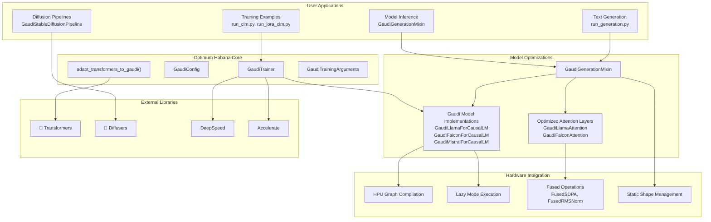

**Sources:** [README.md:26-32](), [optimum/habana/transformers/modeling_utils.py:304-308](), [optimum/habana/transformers/generation/utils.py:178-184]()

### Core Adaptation System

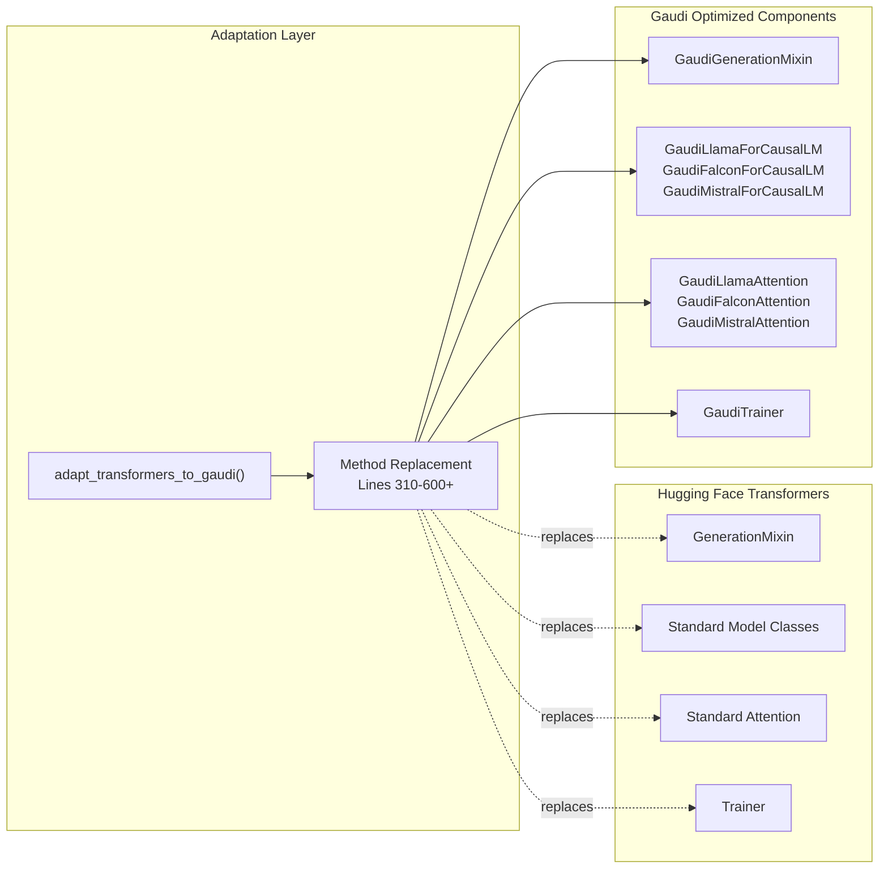

**Sources:** [optimum/habana/transformers/modeling_utils.py:304-700](), [optimum/habana/transformers/models/__init__.py:1-353]()

## Core System Components

### Generation System

The generation system centers around `GaudiGenerationMixin`, which replaces the standard Transformers `GenerationMixin` with HPU-optimized implementations. Key optimizations include:

- **Static Shape Management**: The `incrementor()` function [optimum/habana/transformers/generation/utils.py:144-167]() manages dynamic shape bucketing to maintain static shapes during generation
- **KV Cache Optimization**: Methods like `_pad_past_key_values()` [optimum/habana/transformers/generation/utils.py:511-543]() handle efficient key-value cache management
- **HPU Graph Integration**: `_get_hpu_graphs_kwargs()` [optimum/habana/transformers/generation/utils.py:340-347]() controls graph compilation for performance

### Training System

The training infrastructure builds on `GaudiTrainer` and `GaudiTrainingArguments` classes that extend Transformers' training capabilities:

- **Multi-Device Support**: Integration with `gaudi_spawn.py` for distributed training
- **DeepSpeed Integration**: Native support for DeepSpeed on HPUs
- **Mixed Precision**: FP8 and BF16 support through `GaudiConfig`

### Model Implementations

The library provides HPU-optimized implementations for major model architectures:

| Model Family | Implementation Class | Key Optimizations |
|--------------|---------------------|-------------------|
| Llama | `GaudiLlamaForCausalLM` | Fused RMSNorm, optimized attention |
| Falcon | `GaudiFalconForCausalLM` | Flash attention, linear layer optimization |
| Mistral | `GaudiMistralForCausalLM` | Sliding window attention optimization |
| Gemma | `GaudiGemmaForCausalLM` | RoPE optimization, attention scaling |

**Sources:** [optimum/habana/transformers/models/__init__.py:163-196]()

## Hardware Integration

### HPU-Specific Optimizations

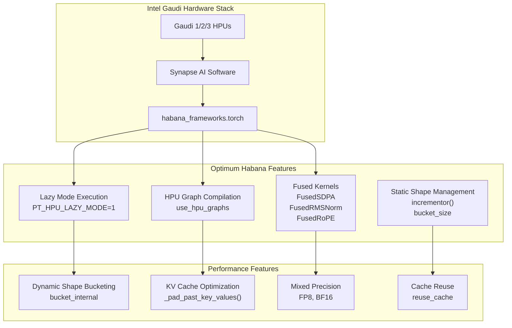

**Sources:** [README.md:196-211](), [optimum/habana/transformers/generation/utils.py:92-136]()

### Supported Model List

The library maintains a curated list of models optimized for static shapes in `MODELS_OPTIMIZED_WITH_STATIC_SHAPES` [optimum/habana/transformers/generation/utils.py:92-136](), including:

- **Language Models**: `llama`, `falcon`, `mistral`, `mixtral`, `gemma`, `qwen2`
- **Code Models**: `gpt_bigcode`, `starcoder2`, `codegen`
- **Multimodal**: `llava`, `paligemma`, `idefics2`, `mllama`
- **Audio**: `whisper`, `seamless_m4t`

## Application Examples

### Text Generation Workflow

1. **Model Loading**: Use `adapt_transformers_to_gaudi()` to replace standard components
2. **Configuration**: Apply `GaudiConfig` for hardware-specific settings
3. **Generation**: Leverage `GaudiGenerationMixin` methods for optimized inference
4. **Bucketing**: Employ static shape management for consistent performance

### Training Workflow

1. **Script Adaptation**: Replace `Trainer` with `GaudiTrainer`
2. **Arguments Setup**: Use `GaudiTrainingArguments` with HPU-specific flags
3. **Distributed Setup**: Utilize `gaudi_spawn.py` for multi-device training
4. **Optimization**: Apply lazy mode and HPU graphs for acceleration

### Diffusion Workflow

1. **Pipeline Setup**: Use `GaudiStableDiffusionPipeline` instead of standard pipeline
2. **Scheduler**: Apply `GaudiDDIMScheduler` for HPU optimization
3. **Configuration**: Set `use_habana=True` and `use_hpu_graphs=True`
4. **Batching**: Optimize batch sizes for HPU memory characteristics

**Sources:** [README.md:107-193](), [docs/source/quickstart.mdx:91-289](), [tests/test_text_generation_example.py:156-392]()

---

# Page: Core Systems

# Core Systems

<details>
<summary>Relevant source files</summary>

The following files were used as context for generating this wiki page:

- [Makefile](Makefile)
- [README.md](README.md)
- [docs/source/index.mdx](docs/source/index.mdx)
- [optimum/habana/transformers/generation/utils.py](optimum/habana/transformers/generation/utils.py)
- [optimum/habana/transformers/modeling_utils.py](optimum/habana/transformers/modeling_utils.py)
- [optimum/habana/transformers/models/__init__.py](optimum/habana/transformers/models/__init__.py)
- [optimum/habana/transformers/models/bart/modeling_bart.py](optimum/habana/transformers/models/bart/modeling_bart.py)
- [optimum/habana/transformers/trainer.py](optimum/habana/transformers/trainer.py)
- [optimum/habana/transformers/trainer_seq2seq.py](optimum/habana/transformers/trainer_seq2seq.py)
- [optimum/habana/transformers/training_args.py](optimum/habana/transformers/training_args.py)
- [optimum/habana/utils.py](optimum/habana/utils.py)
- [setup.py](setup.py)
- [tests/test_text_generation_example.py](tests/test_text_generation_example.py)
- [tests/test_trainer.py](tests/test_trainer.py)

</details>


This document provides an overview of the fundamental components that enable Gaudi optimization in optimum-habana. These core systems work together to seamlessly integrate Intel Gaudi HPUs with Hugging Face models while providing significant performance improvements through hardware-specific optimizations.

The core systems consist of four main components: the Generation System for optimized text generation, the Training System for efficient model training, Model Implementations for architecture-specific optimizations, and Accelerate Integration for advanced features like mixed precision and distributed training.

For detailed information about text generation workflows, see [Text Generation](#3.1). For application-specific examples, see [Applications and Examples](#3).

## System Architecture Overview

The optimum-habana architecture centers around a patching mechanism that replaces standard Transformers components with Gaudi-optimized equivalents. This design allows existing code to work with minimal changes while gaining significant performance benefits.

### Core Systems Architecture

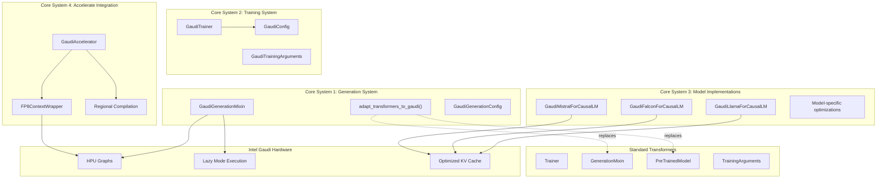

**Sources:** [optimum/habana/transformers/modeling_utils.py:304-700](), [optimum/habana/transformers/generation/utils.py:178-184](), [optimum/habana/transformers/trainer.py:213-217]()

## Component Replacement System

The core mechanism that enables Gaudi optimization is the `adapt_transformers_to_gaudi()` function, which systematically replaces Transformers components with Gaudi-optimized versions. This patching approach ensures compatibility while enabling hardware-specific optimizations.

### Patching and Replacement Mechanism

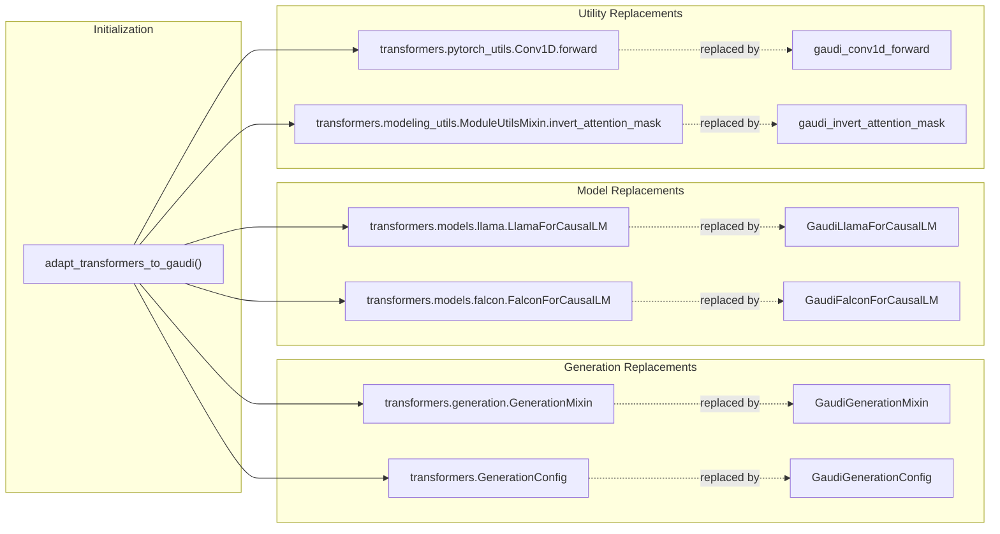

**Sources:** [optimum/habana/transformers/modeling_utils.py:304-700](), [optimum/habana/transformers/models/__init__.py:1-353]()

## System Integration Points

The four core systems integrate through several key interfaces and shared components that enable seamless operation across the optimum-habana stack.

### Integration Architecture

| Component | Purpose | Key Classes | Integration Points |
|-----------|---------|-------------|-------------------|
| **Generation System** | Text generation optimization | `GaudiGenerationMixin`, `GaudiGenerationConfig` | Replaces standard generation classes, integrates with HPU graphs and static shapes |
| **Training System** | Training infrastructure | `GaudiTrainer`, `GaudiTrainingArguments`, `GaudiConfig` | Extends Transformers trainer, integrates with accelerate and deepspeed |
| **Model Implementations** | Architecture-specific optimizations | `GaudiLlamaForCausalLM`, `GaudiFalconForCausalLM`, etc. | Replaces model classes, implements fused kernels and optimized attention |
| **Accelerate Integration** | Advanced training features | `GaudiAccelerator`, `FP8ContextWrapper` | Provides distributed training, mixed precision, and compilation features |

### Optimization Features Matrix

The core systems enable various optimization features that work together to improve performance on Gaudi hardware:

| Optimization | Generation System | Training System | Model Implementations | Accelerate Integration |
|--------------|------------------|-----------------|----------------------|----------------------|
| **HPU Graphs** | ✓ (via `use_hpu_graphs`) | ✓ (via `use_hpu_graphs_for_training`) | ✓ (graph compilation) | ✓ (graph caching) |
| **Lazy Mode** | ✓ (default execution) | ✓ (via `use_lazy_mode`) | ✓ (model execution) | ✓ (accelerator setup) |
| **Static Shapes** | ✓ (bucketing system) | ✓ (tensor shapes) | ✓ (attention masks) | ✓ (compilation) |
| **KV Cache** | ✓ (cache management) | - | ✓ (optimized storage) | - |
| **Fused Kernels** | ✓ (SDPA, RMSNorm) | - | ✓ (attention, MLP) | - |
| **Mixed Precision** | - | ✓ (BF16, FP8) | ✓ (layer precision) | ✓ (FP8 wrapper) |

**Sources:** [optimum/habana/transformers/generation/utils.py:92-136](), [optimum/habana/transformers/training_args.py:144-280](), [optimum/habana/transformers/trainer.py:244-316]()

## Performance Optimization Strategy

The core systems implement a multi-layered optimization strategy that addresses different aspects of model execution on Gaudi hardware:

### Optimization Layers

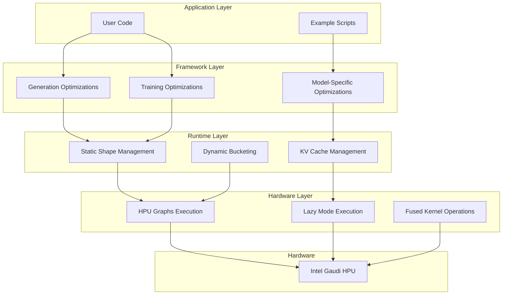

**Sources:** [optimum/habana/transformers/generation/utils.py:640-726](), [optimum/habana/transformers/trainer.py:459-502]()

For detailed information about each core system:
- Generation System: see [Generation System](#2.1)
- Training System: see [Training System](#2.2) 
- Model Implementations: see [Model Implementations](#2.3)
- Accelerate Integration: see [Accelerate Integration](#2.4)

For practical usage examples, see [Applications and Examples](#3) and [Getting Started](#6).

---

# Page: Generation System

# Generation System

<details>
<summary>Relevant source files</summary>

The following files were used as context for generating this wiki page:

- [Makefile](Makefile)
- [README.md](README.md)
- [docs/source/index.mdx](docs/source/index.mdx)
- [optimum/habana/transformers/generation/utils.py](optimum/habana/transformers/generation/utils.py)
- [optimum/habana/transformers/modeling_utils.py](optimum/habana/transformers/modeling_utils.py)
- [optimum/habana/transformers/models/__init__.py](optimum/habana/transformers/models/__init__.py)
- [tests/test_text_generation_example.py](tests/test_text_generation_example.py)

</details>


## Purpose and Scope

The Generation System is the core component that enables optimized text generation on Intel Gaudi processors. It provides a complete replacement for Hugging Face Transformers' generation functionality, specifically designed to leverage Gaudi's lazy mode execution and HPU graphs for maximum performance. The system maintains compatibility with the Transformers API while introducing Gaudi-specific optimizations like static shapes, advanced KV caching, and bucketing strategies.

For information about training models, see [Training System](#2.2). For details about specific model implementations, see [Model Implementations](#2.3).

## Core Architecture

The Generation System consists of three primary components that work together to optimize text generation on Gaudi processors:

### System Architecture Overview

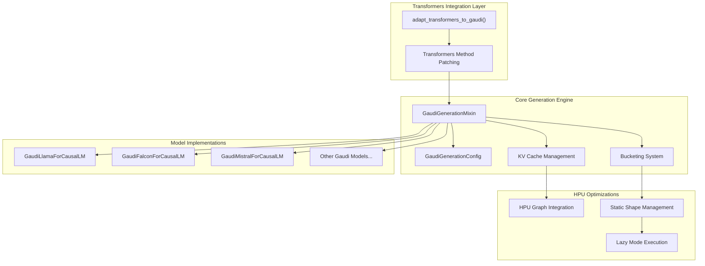

**Sources:** [optimum/habana/transformers/modeling_utils.py:304-393](), [optimum/habana/transformers/generation/utils.py:178-185]()

### Core Components

The system is built around three main classes:

- **`GaudiGenerationMixin`** - The primary generation class that replaces `GenerationMixin` from Transformers
- **`GaudiGenerationConfig`** - Configuration class for Gaudi-specific generation parameters  
- **`adapt_transformers_to_gaudi()`** - Function that patches Transformers to use Gaudi optimizations

## Generation Pipeline

The generation process follows a carefully orchestrated pipeline optimized for Gaudi's architecture:

### Generation Flow Diagram

```mermaid
graph LR
    subgraph "Input Processing"
        INPUT_IDS["input_ids"]
        PREP_INPUTS["_prepare_inputs_for_generation()"]
        TOKEN_IDX["token_idx initialization"]
    end
    
    subgraph "Generation Loop"
        FORWARD["Model Forward Pass"]
        LOGITS["Logit Processing"]
        SAMPLING["Token Sampling"]
        UPDATE_CACHE["_update_model_kwargs_for_generation()"]
        BUCKETING_CHECK["Bucketing Check"]
        PAD_INPUTS["update_model_kwargs_for_bucketing()"]
    end
    
    subgraph "HPU Optimizations"
        HPU_GRAPHS_CHECK["_get_hpu_graphs_kwargs()"]
        STATIC_SHAPES_MGT["Static Shape Management"]
        KV_PADDING["_pad_past_key_values()"]
    end
    
    INPUT_IDS --> PREP_INPUTS
    PREP_INPUTS --> TOKEN_IDX
    TOKEN_IDX --> FORWARD
    FORWARD --> LOGITS
    LOGITS --> SAMPLING
    SAMPLING --> UPDATE_CACHE
    UPDATE_CACHE --> BUCKETING_CHECK
    BUCKETING_CHECK --> PAD_INPUTS
    PAD_INPUTS --> HPU_GRAPHS_CHECK
    HPU_GRAPHS_CHECK --> STATIC_SHAPES_MGT
    STATIC_SHAPES_MGT --> KV_PADDING
    KV_PADDING --> FORWARD
```

**Sources:** [optimum/habana/transformers/generation/utils.py:186-338](), [optimum/habana/transformers/generation/utils.py:562-637](), [optimum/habana/transformers/generation/utils.py:640-726]()

### Key Generation Methods

The system implements several generation strategies:

- **`_sample()`** - Sampling-based generation with temperature and top-k/top-p
- **`_beam_search()`** - Beam search decoding for higher quality outputs
- **`_contrastive_search()`** - Contrastive search for reducing repetition
- **`_assisted_decoding()`** - Speculative decoding with assistant models

## Model Adaptations

The system supports a comprehensive list of models optimized for static shapes:

### Supported Models

The following models are optimized with static shape management:

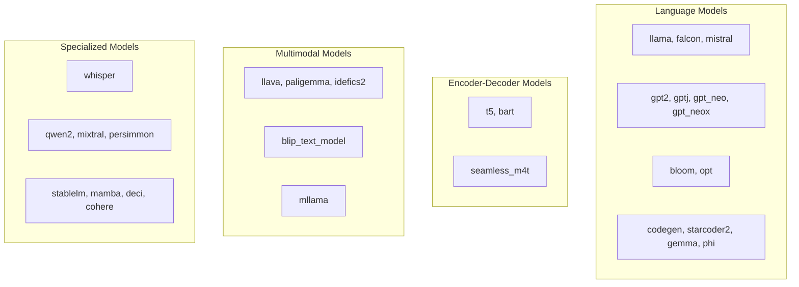

**Sources:** [optimum/habana/transformers/generation/utils.py:92-136]()

### Model Integration Pattern

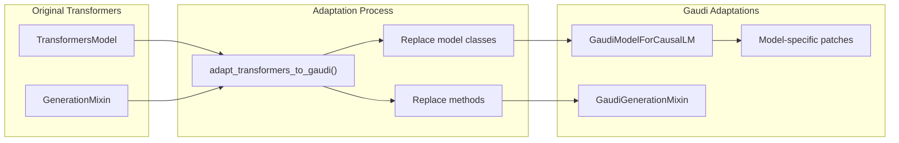

**Sources:** [optimum/habana/transformers/modeling_utils.py:394-700]()

## Optimization Features

### Static Shape Management

The system enforces constant sequence lengths to maximize HPU graph efficiency:

#### Bucketing System

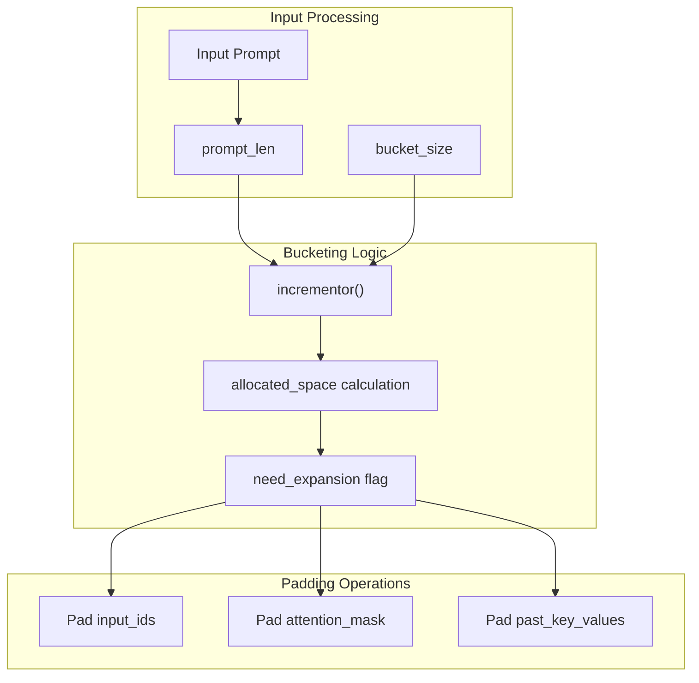

**Sources:** [optimum/habana/transformers/generation/utils.py:144-167](), [optimum/habana/transformers/generation/utils.py:640-726]()

### KV Cache Optimization

The system implements sophisticated KV cache management for both MQA and standard attention:

| Cache Type | Storage Format | Padding Strategy |
|------------|----------------|------------------|
| Standard Attention | `List[List[Tensor]]` | Per-layer, per-head padding |
| MQA (Multi-Query Attention) | `List[Tensor]` | Concatenated key-value padding |
| Static Cache | `StaticCache` | Pre-allocated fixed-size cache |

**Sources:** [optimum/habana/transformers/generation/utils.py:511-543]()

### HPU Graph Integration

The system automatically manages HPU graph compilation and execution:

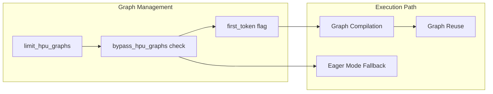

**Sources:** [optimum/habana/transformers/generation/utils.py:340-347]()

## Integration Mechanism

### Transformers Patching Process

The `adapt_transformers_to_gaudi()` function systematically replaces Transformers components:

#### Core Replacements

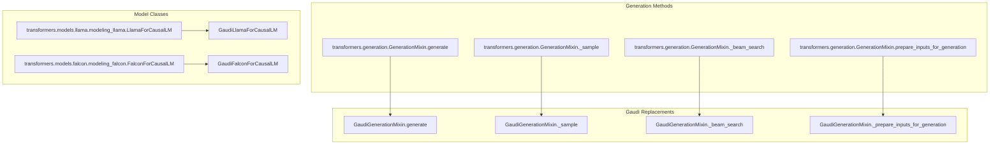

**Sources:** [optimum/habana/transformers/modeling_utils.py:343-393](), [optimum/habana/transformers/modeling_utils.py:492-700]()

### Configuration Integration

The system provides Gaudi-specific configuration through `GaudiGenerationConfig`:

| Parameter | Purpose | Default Behavior |
|-----------|---------|------------------|
| `static_shapes` | Enable static shape optimization | Automatic based on model |
| `bucket_size` | Bucketing increment size | Model-dependent |
| `bucket_internal` | Internal bucketing strategy | Disabled |
| `limit_hpu_graphs` | HPU graph usage control | Enabled |
| `reuse_cache` | KV cache reuse strategy | Model-dependent |

**Sources:** [optimum/habana/transformers/generation/configuration_utils.py]()

### Performance Integration

The system integrates with various Gaudi-specific features:

- **Lazy Mode Execution** - Deferred computation for graph optimization
- **Flash Attention** - Optimized attention kernels for specific models  
- **FP8 Quantization** - Mixed precision support for memory efficiency
- **Regional Compilation** - Partial graph compilation for faster iteration

**Sources:** [tests/test_text_generation_example.py:200-355]()

---

# Page: Training System

# Training System

<details>
<summary>Relevant source files</summary>

The following files were used as context for generating this wiki page:

- [optimum/habana/transformers/models/bart/modeling_bart.py](optimum/habana/transformers/models/bart/modeling_bart.py)
- [optimum/habana/transformers/trainer.py](optimum/habana/transformers/trainer.py)
- [optimum/habana/transformers/trainer_seq2seq.py](optimum/habana/transformers/trainer_seq2seq.py)
- [optimum/habana/transformers/training_args.py](optimum/habana/transformers/training_args.py)
- [optimum/habana/utils.py](optimum/habana/utils.py)
- [setup.py](setup.py)
- [tests/test_trainer.py](tests/test_trainer.py)

</details>


## Purpose and Scope

The Training System provides Habana Gaudi-optimized training capabilities for Hugging Face Transformers models. It extends the standard HuggingFace Trainer infrastructure with HPU-specific optimizations including lazy mode execution, HPU graphs, mixed precision training, and distributed training support. This system enables efficient training of language models, sequence-to-sequence models, and other transformer architectures on Intel Habana Gaudi processors.

For information about text generation and inference, see [Generation System](#2.1). For model-specific implementations and optimizations, see [Model Implementations](#2.3).

## Core Training Architecture

The training system is built around three main components that extend HuggingFace's training infrastructure:

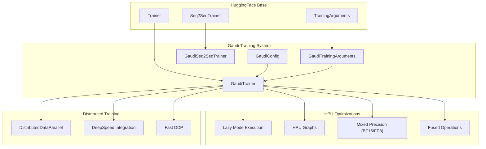

**Training System Class Hierarchy**

Sources: [optimum/habana/transformers/trainer.py:213-270](), [optimum/habana/transformers/training_args.py:89-142](), [optimum/habana/transformers/trainer_seq2seq.py:58-92]()

## Main Training Classes

### GaudiTrainer

The `GaudiTrainer` class is the central component that extends HuggingFace's `Trainer` with HPU-specific optimizations:

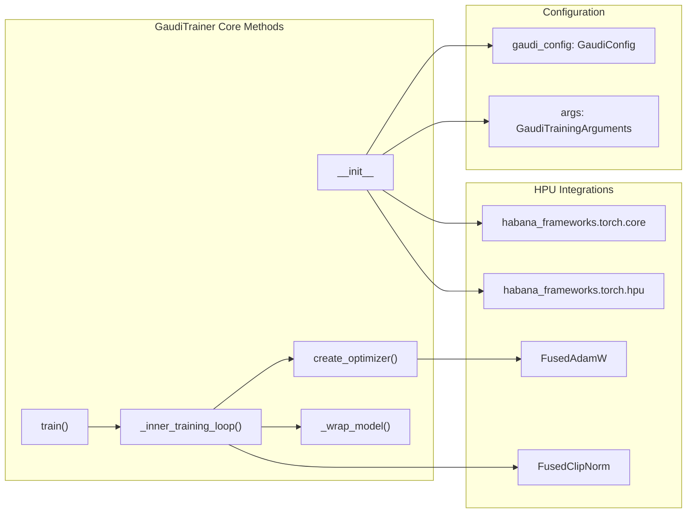

**GaudiTrainer Key Features**

The `GaudiTrainer` initializes with HPU-specific configurations and optimizations:

| Feature | Configuration | Purpose |
|---------|--------------|---------|
| Mixed Precision | `use_hpu_amp`, `use_cpu_amp` | BF16/FP8 training optimization |
| Lazy Mode | `use_lazy_mode` | Deferred execution for better performance |
| HPU Graphs | `use_hpu_graphs_for_training` | Graph compilation for training |
| Fused Operations | `use_fused_adam`, `use_fused_clip_norm` | Optimized operations |

Sources: [optimum/habana/transformers/trainer.py:244-323](), [optimum/habana/transformers/trainer.py:383-446]()

### GaudiTrainingArguments

`GaudiTrainingArguments` extends the base `TrainingArguments` with HPU-specific parameters:

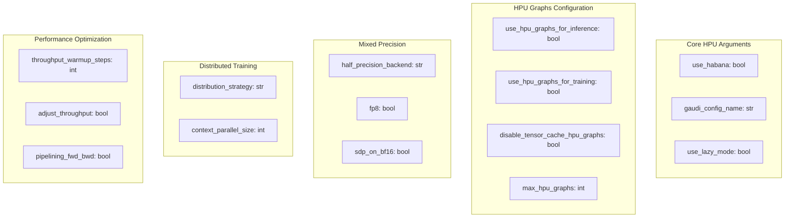

**HPU-Specific Training Arguments**

Sources: [optimum/habana/transformers/training_args.py:144-302]()

### GaudiSeq2SeqTrainer

For sequence-to-sequence tasks, `GaudiSeq2SeqTrainer` provides additional generation capabilities:

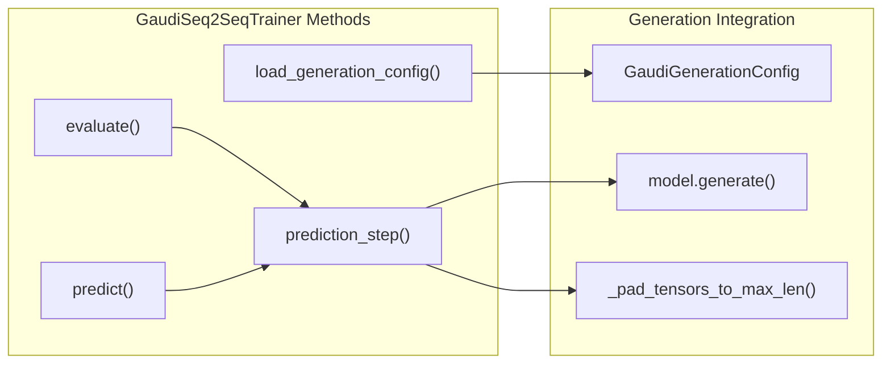

**Seq2Seq Training Features**

Sources: [optimum/habana/transformers/trainer_seq2seq.py:100-147](), [optimum/habana/transformers/trainer_seq2seq.py:258-403]()

## HPU Optimization Features

### Lazy Mode Execution

Lazy mode defers operations to optimize memory usage and performance:

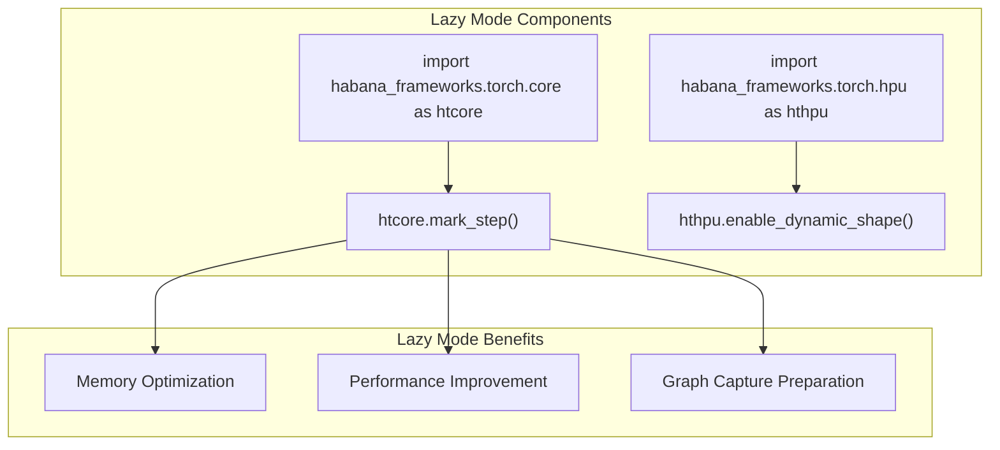

**Lazy Mode Implementation**

Sources: [optimum/habana/transformers/trainer.py:300-317]()

### Mixed Precision Training

The training system supports multiple mixed precision backends:

| Backend | Configuration | Use Case |
|---------|--------------|----------|
| HPU AMP | `half_precision_backend="hpu_amp"` | Default BF16 training |
| CPU AMP | `half_precision_backend="cpu_amp"` | CPU-based mixed precision |
| FP8 | `fp8=True` | Ultra-low precision training |

**Mixed Precision Setup**

Sources: [optimum/habana/transformers/trainer.py:244-255](), [optimum/habana/transformers/training_args.py:354-379]()

### HPU Graphs

HPU graphs provide compiled execution for improved performance:

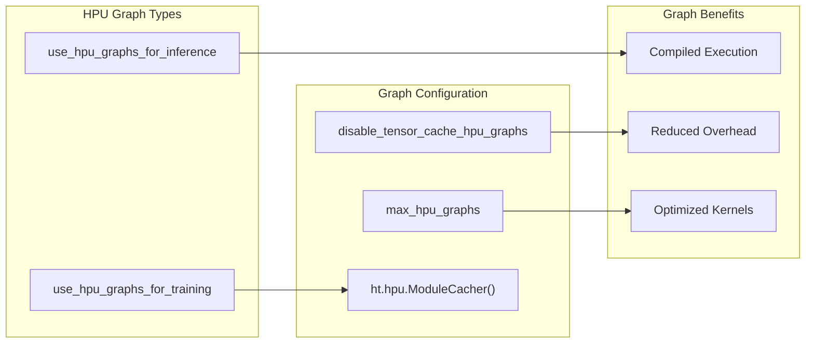

**HPU Graph Implementation**

Sources: [optimum/habana/transformers/trainer.py:497-501](), [optimum/habana/transformers/training_args.py:159-234]()

## Distributed Training Support

### Distribution Strategies

The training system supports multiple distributed training approaches:

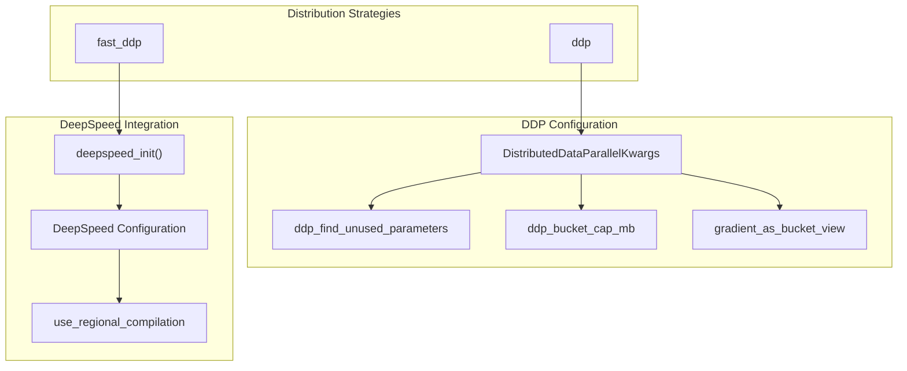

**Distributed Training Implementation**

Sources: [optimum/habana/transformers/trainer.py:469-496](), [optimum/habana/transformers/training_args.py:236-244]()

### Context Parallelism

For large sequence lengths, context parallelism distributes attention computation:

```mermaid
graph LR
    subgraph "Context Parallel Configuration"
        CONTEXT_PARALLEL_SIZE["context_parallel_size: int"]
        MPU_INIT["accelerator.mpu.sequence_parallel_is_initialized()"]
        WORLD_SIZE["get_sequence_parallel_world_size()"]
    end
    
    subgraph "Batch Size Adjustment"
        TOTAL_BATCH_SIZE["total_train_batch_size"]
        ADJUSTED_BATCH_SIZE["total_train_batch_size / world_size"]
    end
    
    CONTEXT_PARALLEL_SIZE --> MPU_INIT
    MPU_INIT --> WORLD_SIZE
    WORLD_SIZE --> TOTAL_BATCH_SIZE
    TOTAL_BATCH_SIZE --> ADJUSTED_BATCH_SIZE
```

**Context Parallelism Implementation**

Sources: [optimum/habana/transformers/trainer.py:661-665](), [optimum/habana/transformers/training_args.py:246-249]()

## Optimizer Integration

### Fused Optimizers

The training system integrates with HPU-optimized optimizers:

```mermaid
graph TB
    subgraph "Optimizer Selection"
        USE_FUSED_ADAM["gaudi_config.use_fused_adam"]
        FUSEDADAMW["FusedAdamW"]
        STANDARD_OPTS["Standard Optimizers"]
    end
    
    subgraph "Optimizer Parameters"
        LEARNING_RATE["learning_rate"]
        ADAM_BETA1["adam_beta1"]
        ADAM_BETA2["adam_beta2"]
        ADAM_EPSILON["adam_epsilon: 1e-6"]
    end
    
    subgraph "Parameter Grouping"
        DECAY_PARAMS["decay_parameters"]
        WEIGHT_DECAY["weight_decay"]
        OPTIMIZER_GROUPS["optimizer_grouped_parameters"]
    end
    
    USE_FUSED_ADAM --> FUSEDADAMW
    USE_FUSED_ADAM --> STANDARD_OPTS
    
    FUSEDADAMW --> LEARNING_RATE
    FUSEDADAMW --> ADAM_BETA1
    FUSEDADAMW --> ADAM_BETA2
    FUSEDADAMW --> ADAM_EPSILON
    
    DECAY_PARAMS --> OPTIMIZER_GROUPS
    WEIGHT_DECAY --> OPTIMIZER_GROUPS
```

**Optimizer Implementation**

Sources: [optimum/habana/transformers/trainer.py:410-446](), [optimum/habana/transformers/training_args.py:314-324]()

### Gradient Clipping

Fused gradient clipping provides efficient gradient normalization:

```mermaid
graph LR
    subgraph "Gradient Clipping Setup"
        USE_FUSED_CLIP["gaudi_config.use_fused_clip_norm"]
        FUSEDCLIPNORM["FusedClipNorm"]
        MODEL_PARAMS["model.parameters()"]
        MAX_GRAD_NORM["args.max_grad_norm"]
    end
    
    USE_FUSED_CLIP --> FUSEDCLIPNORM
    FUSEDCLIPNORM --> MODEL_PARAMS
    FUSEDCLIPNORM --> MAX_GRAD_NORM
```

**Gradient Clipping Implementation**

Sources: [optimum/habana/transformers/trainer.py:812-821]()

## Performance Monitoring

### Throughput Metrics

The training system provides detailed performance monitoring:

```mermaid
graph TB
    subgraph "Performance Metrics"
        THROUGHPUT_WARMUP["throughput_warmup_steps"]
        ADJUST_THROUGHPUT["adjust_throughput"]
        SPEED_METRICS["speed_metrics()"]
    end
    
    subgraph "Timing Measurements"
        START_TIME["start_time"]
        START_AFTER_WARMUP["start_time_after_warmup"]
        LOG_EVAL_SAVE_TIME["log_evaluate_save_time"]
    end
    
    subgraph "Calculated Metrics"
        SAMPLES_PER_SEC["samples_per_second"]
        STEPS_PER_SEC["steps_per_second"]
        TOKENS_PER_SEC["tokens_per_second"]
    end
    
    THROUGHPUT_WARMUP --> START_AFTER_WARMUP
    ADJUST_THROUGHPUT --> LOG_EVAL_SAVE_TIME
    
    START_TIME --> SPEED_METRICS
    START_AFTER_WARMUP --> SPEED_METRICS
    LOG_EVAL_SAVE_TIME --> SPEED_METRICS
    
    SPEED_METRICS --> SAMPLES_PER_SEC
    SPEED_METRICS --> STEPS_PER_SEC
    SPEED_METRICS --> TOKENS_PER_SEC
```

**Performance Monitoring Implementation**

Sources: [optimum/habana/utils.py:65-117](), [optimum/habana/transformers/training_args.py:256-273]()

## Integration Points

### HuggingFace Ecosystem Integration

The training system maintains compatibility with the broader HuggingFace ecosystem:

| Component | Integration Point | Purpose |
|-----------|------------------|---------|
| Transformers | Extends `Trainer` | Core training functionality |
| Accelerate | `GaudiAccelerator` | Device management and optimization |
| Datasets | Native support | Data loading and processing |
| Hub | Model upload/download | Model sharing and versioning |
| DeepSpeed | `deepspeed_init()` | Large model training |

**Ecosystem Integration**

Sources: [optimum/habana/transformers/trainer.py:49-108](), [optimum/habana/transformers/trainer.py:692-693]()

---

# Page: Model Implementations

# Model Implementations

<details>
<summary>Relevant source files</summary>

The following files were used as context for generating this wiki page:

- [examples/language-modeling/ops_bf16.txt](examples/language-modeling/ops_bf16.txt)
- [examples/text-generation/quantization_config/maxabs_quant_mixtral.json](examples/text-generation/quantization_config/maxabs_quant_mixtral.json)
- [optimum/habana/transformers/models/albert/modeling_albert.py](optimum/habana/transformers/models/albert/modeling_albert.py)
- [optimum/habana/transformers/models/falcon/__init__.py](optimum/habana/transformers/models/falcon/__init__.py)
- [optimum/habana/transformers/models/falcon/modeling_falcon.py](optimum/habana/transformers/models/falcon/modeling_falcon.py)
- [optimum/habana/transformers/models/gemma/modeling_gemma.py](optimum/habana/transformers/models/gemma/modeling_gemma.py)
- [optimum/habana/transformers/models/gpt2/modeling_gpt2.py](optimum/habana/transformers/models/gpt2/modeling_gpt2.py)
- [optimum/habana/transformers/models/gpt_neox/modeling_gpt_neox.py](optimum/habana/transformers/models/gpt_neox/modeling_gpt_neox.py)
- [optimum/habana/transformers/models/gptj/__init__.py](optimum/habana/transformers/models/gptj/__init__.py)
- [optimum/habana/transformers/models/gptj/modeling_gptj.py](optimum/habana/transformers/models/gptj/modeling_gptj.py)
- [optimum/habana/transformers/models/mistral/__init__.py](optimum/habana/transformers/models/mistral/__init__.py)
- [optimum/habana/transformers/models/mistral/configuration_mistral.py](optimum/habana/transformers/models/mistral/configuration_mistral.py)
- [optimum/habana/transformers/models/mistral/modeling_mistral.py](optimum/habana/transformers/models/mistral/modeling_mistral.py)
- [optimum/habana/transformers/models/mixtral/__init__.py](optimum/habana/transformers/models/mixtral/__init__.py)
- [optimum/habana/transformers/models/mixtral/configuration_mixtral.py](optimum/habana/transformers/models/mixtral/configuration_mixtral.py)
- [optimum/habana/transformers/models/mixtral/modeling_mixtral.py](optimum/habana/transformers/models/mixtral/modeling_mixtral.py)
- [optimum/habana/transformers/models/modeling_all_models.py](optimum/habana/transformers/models/modeling_all_models.py)
- [optimum/habana/transformers/models/opt/modeling_opt.py](optimum/habana/transformers/models/opt/modeling_opt.py)
- [optimum/habana/transformers/models/persimmon/modeling_persimmon.py](optimum/habana/transformers/models/persimmon/modeling_persimmon.py)
- [optimum/habana/transformers/models/phi/modeling_phi.py](optimum/habana/transformers/models/phi/modeling_phi.py)
- [optimum/habana/transformers/models/qwen2/modeling_qwen2.py](optimum/habana/transformers/models/qwen2/modeling_qwen2.py)
- [optimum/habana/transformers/models/qwen2_moe/modeling_qwen2_moe.py](optimum/habana/transformers/models/qwen2_moe/modeling_qwen2_moe.py)
- [optimum/habana/transformers/models/stablelm/modeling_stablelm.py](optimum/habana/transformers/models/stablelm/modeling_stablelm.py)
- [optimum/habana/transformers/models/starcoder2/modeling_starcoder2.py](optimum/habana/transformers/models/starcoder2/modeling_starcoder2.py)
- [tests/baselines/fixture/tests/test_encoder_decoder.json](tests/baselines/fixture/tests/test_encoder_decoder.json)
- [tests/baselines/fixture/tests/test_text_generation_example.json](tests/baselines/fixture/tests/test_text_generation_example.json)

</details>


This document covers the Gaudi-optimized model implementations in optimum-habana, which provide Intel Habana processor-specific adaptations of popular transformer models. These implementations replace standard HuggingFace transformer components with optimized versions that leverage Habana's specialized hardware features including fused kernels, optimized attention mechanisms, and efficient KV cache management.

For information about the generation system that coordinates these model implementations, see [Generation System](#2.1). For training-specific optimizations, see [Training System](#2.2).

## Architecture Overview

The model implementations follow a consistent pattern where standard transformer components are replaced with Gaudi-optimized equivalents. Each model family has its own implementation module that extends the base HuggingFace classes while adding Habana-specific optimizations.

### Model Implementation Structure

```mermaid
graph TB
    subgraph "Base HuggingFace Models"
        HF_MODEL["HuggingFace Model Classes"]
        HF_ATTN["Standard Attention"]
        HF_MLP["Standard MLP"]
        HF_DECODER["Standard Decoder Layers"]
    end
    
    subgraph "Gaudi Model Implementations"
        GAUDI_MODEL["GaudiModelForCausalLM"]
        GAUDI_ATTN["GaudiModelAttention"]
        GAUDI_MLP["GaudiModelMLP"]
        GAUDI_DECODER["GaudiModelDecoderLayer"]
    end
    
    subgraph "Shared Optimization Components"
        KV_CACHE["KVCache"]
        MATMUL["Matmul"]
        FUSED_SDPA["ModuleFusedSDPA"]
        ROPE_EMB["GaudiRotaryEmbedding"]
    end
    
    subgraph "Hardware Optimizations"
        FUSED_OPS["Fused Kernels<br/>FusedSDPA, FusedRMSNorm, FusedRoPE"]
        HPU_GRAPHS["HPU Graph Compilation"]
        LAZY_MODE["Lazy Mode Execution"]
    end
    
    HF_MODEL -.->|"inherits & optimizes"| GAUDI_MODEL
    HF_ATTN -.->|"inherits & optimizes"| GAUDI_ATTN
    HF_MLP -.->|"inherits & optimizes"| GAUDI_MLP
    HF_DECODER -.->|"inherits & optimizes"| GAUDI_DECODER
    
    GAUDI_ATTN --> KV_CACHE
    GAUDI_ATTN --> FUSED_SDPA
    GAUDI_ATTN --> ROPE_EMB
    GAUDI_MLP --> MATMUL
    
    FUSED_SDPA --> FUSED_OPS
    KV_CACHE --> HPU_GRAPHS
    GAUDI_ATTN --> LAZY_MODE
```

Sources: [optimum/habana/transformers/models/modeling_all_models.py:1-253](), [optimum/habana/transformers/models/mixtral/modeling_mixtral.py:1-50](), [optimum/habana/transformers/models/mistral/modeling_mistral.py:1-50]()

### Supported Model Families

The codebase provides optimized implementations for multiple model architectures:

| Model Family | Implementation Class | Key Features |
|--------------|---------------------|--------------|
| Mixtral | `GaudiMixtralForCausalLM` | Mixture of Experts, Sparse MoE optimization |
| Falcon | `GaudiFalconForCausalLM` | Multi-query attention, ALiBi positional encoding |
| Mistral | `GaudiMistralForCausalLM` | Sliding window attention, RMSNorm optimization |
| Gemma | `GaudiGemmaForCausalLM` | Flash attention variants, long sequence support |
| Qwen2 | `GaudiQwen2ForCausalLM` | Distributed attention, FP8 support |
| GPT-J | `GaudiGPTJForCausalLM` | Rotary position embeddings, parallel residuals |
| GPT-NeoX | `GaudiGPTNeoXForCausalLM` | Parallel attention and MLP |

Sources: [optimum/habana/transformers/models/mixtral/__init__.py:1-10](), [optimum/habana/transformers/models/falcon/__init__.py:1-9](), [optimum/habana/transformers/models/mistral/__init__.py:1-9]()

## Common Optimization Patterns

### KV Cache Management

All model implementations utilize a shared `KVCache` class that provides efficient key-value cache management optimized for Habana hardware:

```mermaid
graph LR
    subgraph "KV Cache Operations"
        ALLOCATE["allocate()"]
        UPDATE["update()"]
        FORWARD["forward()"]
        GET_SHAPE["get_shape()"]
    end
    
    subgraph "Cache Strategies"
        REUSE["reuse_cache"]
        TOKEN_IDX["token_idx indexing"]
        STATIC_SHAPES["Static shape allocation"]
    end
    
    subgraph "Memory Optimization"
        INDEX_COPY["index_copy_()"]
        CONCAT["torch.cat()"]
        ZERO_FILL["cache.fill_(0)"]
    end
    
    ALLOCATE --> STATIC_SHAPES
    UPDATE --> TOKEN_IDX
    UPDATE --> INDEX_COPY
    FORWARD --> REUSE
    
    TOKEN_IDX --> INDEX_COPY
    REUSE --> GET_SHAPE
```

The `KVCache` class at [optimum/habana/transformers/models/modeling_all_models.py:40-80]() provides methods for allocating cache tensors with fixed shapes, updating cache contents using token indexing, and managing cache reuse across generation steps.

Sources: [optimum/habana/transformers/models/modeling_all_models.py:40-80](), [optimum/habana/transformers/models/mixtral/modeling_mixtral.py:374-387]()

### Fused Attention Operations

Models utilize `ModuleFusedSDPA` to wrap Habana's fused scaled dot-product attention kernel:

```mermaid
graph TB
    subgraph "Attention Computation Flow"
        QUERY["Query States"]
        KEY["Key States"] 
        VALUE["Value States"]
        MASK["Attention Mask"]
    end
    
    subgraph "Optimization Branches"
        FUSED_PATH["FusedSDPA Kernel"]
        EAGER_PATH["Eager Attention"]
        FLASH_ATTN["Flash Attention Variants"]
    end
    
    subgraph "Hardware Features"
        RECOMPUTE["enable_recompute"]
        FP8_MODE["FP8 Quantization"]
        CAUSAL_MASK["Hardware Causal Masking"]
    end
    
    QUERY --> FUSED_PATH
    KEY --> FUSED_PATH
    VALUE --> FUSED_PATH
    MASK --> FUSED_PATH
    
    QUERY --> EAGER_PATH
    KEY --> EAGER_PATH
    VALUE --> EAGER_PATH
    MASK --> EAGER_PATH
    
    FUSED_PATH --> RECOMPUTE
    FUSED_PATH --> FP8_MODE
    FUSED_PATH --> CAUSAL_MASK
    
    FLASH_ATTN --> FUSED_PATH
```

The `ModuleFusedSDPA` wrapper at [optimum/habana/transformers/models/mixtral/modeling_mixtral.py:84-116]() enables hardware-accelerated attention computation with support for recompute modes and quantization.

Sources: [optimum/habana/transformers/models/mixtral/modeling_mixtral.py:84-116](), [optimum/habana/transformers/models/mistral/modeling_mistral.py:74-81]()

### Rotary Position Embeddings

Custom rotary embedding implementations leverage Habana's fused RoPE kernel:

```mermaid
graph LR
    subgraph "RoPE Implementation"
        GAUDI_ROPE["GaudiRotaryEmbedding"]
        FUSED_ROPE["FusedRoPE Kernel"]
        FALLBACK_ROPE["Standard apply_rotary_pos_emb"]
    end
    
    subgraph "Optimization Logic"
        HPU_CHECK["q.device.type == 'hpu'"]
        KERNEL_AVAILABLE["FusedRoPE is not None"]
        TRAINING_MODE["training=True/False"]
    end
    
    subgraph "Data Types"
        BF16_DTYPE["torch.bfloat16"]
        FP32_DTYPE["torch.float32"]
        DTYPE_CONVERSION["Automatic conversion"]
    end
    
    GAUDI_ROPE --> HPU_CHECK
    HPU_CHECK --> KERNEL_AVAILABLE
    KERNEL_AVAILABLE --> FUSED_ROPE
    KERNEL_AVAILABLE --> FALLBACK_ROPE
    
    FUSED_ROPE --> TRAINING_MODE
    FUSED_ROPE --> DTYPE_CONVERSION
    BF16_DTYPE --> DTYPE_CONVERSION
    FP32_DTYPE --> DTYPE_CONVERSION
```

The `apply_customized_rope` function at [optimum/habana/transformers/models/modeling_all_models.py:82-106]() automatically selects between fused and standard implementations based on device type and kernel availability.

Sources: [optimum/habana/transformers/models/modeling_all_models.py:82-106](), [optimum/habana/transformers/models/mixtral/modeling_mixtral.py:118-123]()

## Model-Specific Implementations

### Mixtral (Mixture of Experts)

Mixtral implementation includes specialized handling for the sparse MoE architecture:

```mermaid
graph TB
    subgraph "Mixtral Components"
        MIXTRAL_MODEL["GaudiMixtralModel"]
        MIXTRAL_LAYER["GaudiMixtralDecoderLayer"]
        MIXTRAL_ATTN["GaudiMixtralAttention"]
        MIXTRAL_MOE["GaudiMixtralSparseMoeBlock"]
    end
    
    subgraph "MoE Optimizations"
        EXPERT_ROUTING["calculate_routing_tensors"]
        DYNAMIC_MOE["call_dynamic_moe_op"]
        SPARSE_MOE["call_sparse_moe_op"]
        EXPERT_PARALLEL["Expert Parallelism (ep_size)"]
    end
    
    subgraph "Hardware Operations"
        HPU_MOE_OP["torch.ops.hpu.mixture_of_experts"]
        WEIGHT_LISTS["w1_list, w2_list, w3_list"]
        ACTIVATION_SILU["activation='silu'"]
    end
    
    MIXTRAL_MOE --> EXPERT_ROUTING
    EXPERT_ROUTING --> DYNAMIC_MOE
    EXPERT_ROUTING --> SPARSE_MOE
    
    DYNAMIC_MOE --> HPU_MOE_OP
    HPU_MOE_OP --> WEIGHT_LISTS
    HPU_MOE_OP --> ACTIVATION_SILU
    
    MIXTRAL_MOE --> EXPERT_PARALLEL
```

The `GaudiMixtralSparseMoeBlock` at [optimum/habana/transformers/models/mixtral/modeling_mixtral.py:182-313]() implements optimized expert routing with support for both dynamic and sparse MoE operations using Habana's custom operators.

Sources: [optimum/habana/transformers/models/mixtral/modeling_mixtral.py:182-313](), [optimum/habana/transformers/models/mixtral/modeling_mixtral.py:520-528]()

### Falcon (Multi-Query Attention)

Falcon implementation handles the unique multi-query attention architecture:

```mermaid
graph TB
    subgraph "Falcon Attention Flow"
        QKV_PROJ["query_key_value projection"]
        SPLIT_HEADS["_split_heads()"]
        NEW_DECODER["new_decoder_architecture"]
        MULTI_QUERY["multi_query mode"]
    end
    
    subgraph "Head Splitting Logic"
        QKV_TENSOR["fused_qkv tensor"]
        INDEX_SELECT["torch.index_select()"]
        BROADCAST["torch.broadcast_to()"]
        FLATTEN["x.flatten(2, 3)"]
    end
    
    subgraph "Attention Variants"
        FUSED_ATTN["FusedSDPA path"]
        EAGER_ATTN["Eager attention path"]
        ALIBI_ATTN["ALiBi attention"]
    end
    
    QKV_PROJ --> SPLIT_HEADS
    SPLIT_HEADS --> NEW_DECODER
    SPLIT_HEADS --> MULTI_QUERY
    
    SPLIT_HEADS --> QKV_TENSOR
    QKV_TENSOR --> INDEX_SELECT
    INDEX_SELECT --> BROADCAST
    BROADCAST --> FLATTEN
    
    SPLIT_HEADS --> FUSED_ATTN
    SPLIT_HEADS --> EAGER_ATTN
    SPLIT_HEADS --> ALIBI_ATTN
```

The `_split_heads` method at [optimum/habana/transformers/models/falcon/modeling_falcon.py:211-251]() handles the complex tensor reshaping required for Falcon's multi-query attention mechanism.

Sources: [optimum/habana/transformers/models/falcon/modeling_falcon.py:211-251](), [optimum/habana/transformers/models/falcon/modeling_falcon.py:174-514]()

### GPT-NeoX (Parallel Architecture)

GPT-NeoX implementation optimizes the parallel attention and MLP architecture:

```mermaid
graph LR
    subgraph "GPT-NeoX Layer Structure"
        LAYER_INPUT["hidden_states"]
        INPUT_LN["input_layernorm"]
        POST_ATTN_LN["post_attention_layernorm"]
        ATTN_BLOCK["GaudiGPTNeoXAttention"]
        MLP_BLOCK["GPTNeoXMLP"]
    end
    
    subgraph "Parallel Residual Paths"
        PARALLEL_MODE["use_parallel_residual"]
        SEQUENTIAL_MODE["sequential residual"]
        ATTN_PATH["attention path"]
        MLP_PATH["MLP path"]
    end
    
    subgraph "Attention Specifics"
        QKV_SPLIT["qkv.view(..., 3 * head_size)"]
        ROTARY_SPLIT["rotary_ndims split"]
        EAGER_FORWARD["gaudi_eager_attention_forward"]
    end
    
    LAYER_INPUT --> INPUT_LN
    INPUT_LN --> ATTN_BLOCK
    LAYER_INPUT --> POST_ATTN_LN
    POST_ATTN_LN --> MLP_BLOCK
    
    ATTN_BLOCK --> PARALLEL_MODE
    MLP_BLOCK --> PARALLEL_MODE
    PARALLEL_MODE --> ATTN_PATH
    PARALLEL_MODE --> MLP_PATH
    
    ATTN_BLOCK --> QKV_SPLIT
    QKV_SPLIT --> ROTARY_SPLIT
    ROTARY_SPLIT --> EAGER_FORWARD
```

The `GaudiGPTNeoXLayer` at [optimum/habana/transformers/models/gpt_neox/modeling_gpt_neox.py:192-256]() implements both parallel and sequential residual connection modes with optimized attention computation.

Sources: [optimum/habana/transformers/models/gpt_neox/modeling_gpt_neox.py:192-256](), [optimum/habana/transformers/models/gpt_neox/modeling_gpt_neox.py:82-177]()

## Key Optimization Components

### RMSNorm Optimization

Models using RMSNorm (Mistral, Mixtral, Qwen2) leverage fused implementations:

```mermaid
graph TB
    subgraph "RMSNorm Decision Tree"
        INPUT_TENSOR["hidden_states"]
        DEVICE_CHECK["hidden_states.device.type == 'hpu'"]
        KERNEL_CHECK["FusedRMSNorm is not None"]
        DTYPE_CHECK["hidden_states.dtype != self.weight.dtype"]
    end
    
    subgraph "Fused Path"
        FUSED_RMSNORM["FusedRMSNorm.apply()"]
        DTYPE_CONVERT["dtype conversion"]
        ORIG_DTYPE["orig_dtype restore"]
    end
    
    subgraph "Fallback Path"
        FLOAT32_CAST["to(torch.float32)"]
        VARIANCE_CALC["pow(2).mean(-1)"]
        RSQRT["torch.rsqrt()"]
        WEIGHT_MUL["self.weight * hidden_states"]
    end
    
    INPUT_TENSOR --> DEVICE_CHECK
    DEVICE_CHECK --> KERNEL_CHECK
    KERNEL_CHECK --> DTYPE_CHECK
    
    DTYPE_CHECK --> FUSED_RMSNORM
    FUSED_RMSNORM --> DTYPE_CONVERT
    DTYPE_CONVERT --> ORIG_DTYPE
    
    KERNEL_CHECK --> FLOAT32_CAST
    FLOAT32_CAST --> VARIANCE_CALC
    VARIANCE_CALC --> RSQRT
    RSQRT --> WEIGHT_MUL
```

The `gaudi_mistral_rmsnorm_forward` function at [optimum/habana/transformers/models/mistral/modeling_mistral.py:117-137]() demonstrates the pattern used across models for optimized normalization.

Sources: [optimum/habana/transformers/models/mistral/modeling_mistral.py:117-137](), [optimum/habana/transformers/models/mixtral/modeling_mixtral.py:125-145]()

### Repeat KV Optimization

Models with grouped-query attention use optimized KV repetition:

```mermaid
graph LR
    subgraph "Input Tensors"
        QUERY_STATES["query_states"]
        KEY_STATES["key_states"] 
        VALUE_STATES["value_states"]
        ATTN_MASK["attention_mask"]
    end
    
    subgraph "Shape Analysis"
        N_REP["n_rep calculation"]
        NUM_KV_HEADS["num_key_value_heads"]
        EARLY_RETURN["n_rep == 1 or num_kv_heads == 1"]
    end
    
    subgraph "Reshape Operations"
        NEW_KV_SHAPE["(batch, num_kv_heads, 1, kv_len, head_dim)"]
        NEW_Q_SHAPE["(batch, num_kv_heads, n_rep, q_len, head_dim)"]
        MASK_UNSQUEEZE["attention_mask.unsqueeze(1)"]
    end
    
    QUERY_STATES --> N_REP
    KEY_STATES --> NUM_KV_HEADS
    N_REP --> EARLY_RETURN
    
    KEY_STATES --> NEW_KV_SHAPE
    VALUE_STATES --> NEW_KV_SHAPE
    QUERY_STATES --> NEW_Q_SHAPE
    ATTN_MASK --> MASK_UNSQUEEZE
```

The `gaudi_mistral_repeat_kv` function at [optimum/habana/transformers/models/mistral/modeling_mistral.py:83-114]() provides efficient tensor reshaping for grouped-query attention patterns.

Sources: [optimum/habana/transformers/models/mistral/modeling_mistral.py:83-114](), [optimum/habana/transformers/models/mixtral/modeling_mixtral.py:148-179]()

### Long Sequence Support

Several models implement optimized handling for long sequences:

```mermaid
graph TB
    subgraph "Long Sequence Detection"
        SEQ_LEN_CHECK["q_len > threshold"]
        BLOCK_SIZE["q_block_size (1024/4096)"]
        TILING_CALC["q_tiles calculation"]
    end
    
    subgraph "Attention Tiling"
        Q_PADDING["F.pad(query_layer)"]
        MASK_PADDING["F.pad(attention_mask)"]
        TILE_LOOP["for i in range(q_tiles)"]
        PARTIAL_ATTN["attn_output_partial"]
    end
    
    subgraph "Memory Optimization"
        HTCORE_STEP["htcore.mark_step()"]
        TENSOR_CONCAT["torch.cat(row_o_list)"]
        PADDING_REMOVAL["attn_output[:-q_padding]"]
    end
    
    SEQ_LEN_CHECK --> BLOCK_SIZE
    BLOCK_SIZE --> TILING_CALC
    TILING_CALC --> Q_PADDING
    Q_PADDING --> MASK_PADDING
    
    MASK_PADDING --> TILE_LOOP
    TILE_LOOP --> PARTIAL_ATTN
    PARTIAL_ATTN --> HTCORE_STEP
    
    PARTIAL_ATTN --> TENSOR_CONCAT
    TENSOR_CONCAT --> PADDING_REMOVAL
```

The `GaudiMixtralAttentionLongSequence.forward` method at [optimum/habana/transformers/models/mixtral/modeling_mixtral.py:315-338]() demonstrates the tiling approach used for sequences exceeding 8192 tokens.

Sources: [optimum/habana/transformers/models/mixtral/modeling_mixtral.py:315-338](), [optimum/habana/transformers/models/gemma/modeling_gemma.py:244-272]()

---

# Page: Accelerate Integration

# Accelerate Integration

<details>
<summary>Relevant source files</summary>

The following files were used as context for generating this wiki page:

- [optimum/habana/accelerate/__init__.py](optimum/habana/accelerate/__init__.py)
- [optimum/habana/accelerate/accelerator.py](optimum/habana/accelerate/accelerator.py)
- [optimum/habana/accelerate/state.py](optimum/habana/accelerate/state.py)
- [optimum/habana/accelerate/utils/__init__.py](optimum/habana/accelerate/utils/__init__.py)
- [optimum/habana/accelerate/utils/dataclasses.py](optimum/habana/accelerate/utils/dataclasses.py)
- [optimum/habana/accelerate/utils/other.py](optimum/habana/accelerate/utils/other.py)
- [optimum/habana/accelerate/utils/transformer_engine.py](optimum/habana/accelerate/utils/transformer_engine.py)
- [optimum/habana/transformers/models/llama/configuration_llama.py](optimum/habana/transformers/models/llama/configuration_llama.py)

</details>


This document covers the Habana Gaudi integration with Hugging Face Accelerate library, providing specialized acceleration features for training and inference on Intel Habana processors. The system extends the standard Accelerate framework with Gaudi-specific optimizations including FP8 mixed precision, regional compilation, and multi-HPU distributed training capabilities.

For general training system documentation, see [Training System](#2.2). For model-specific optimizations, see [Model Implementations](#2.3).

## Core Architecture

The Accelerate integration is built around the `GaudiAccelerator` class, which extends the standard Accelerate `Accelerator` with Gaudi-specific functionality. The system provides seamless integration with existing Accelerate workflows while adding hardware-specific optimizations.

**GaudiAccelerator Class Hierarchy**
```mermaid
graph TB
    subgraph "Hugging Face Accelerate"
        Accelerator["Accelerator<br/>(Base Class)"]
    end
    
    subgraph "Optimum Habana Extensions"
        GaudiAccelerator["GaudiAccelerator<br/>optimum/habana/accelerate/accelerator.py"]
        GaudiTERecipeKwargs["GaudiTERecipeKwargs<br/>utils/dataclasses.py"]
        FP8ContextWrapper["FP8ContextWrapper<br/>utils/transformer_engine.py"]
    end
    
    subgraph "Key Features"
        FP8Support["FP8 Mixed Precision"]
        RegionalCompilation["Regional Compilation"]
        MultiHPU["Multi-HPU Training"]
        DeepSpeedIntegration["DeepSpeed Integration"]
    end
    
    Accelerator --> GaudiAccelerator
    GaudiAccelerator --> FP8Support
    GaudiAccelerator --> RegionalCompilation
    GaudiAccelerator --> MultiHPU
    GaudiAccelerator --> DeepSpeedIntegration
    
    GaudiTERecipeKwargs --> FP8Support
    FP8ContextWrapper --> FP8Support
```

Sources: [optimum/habana/accelerate/accelerator.py:82-142](), [optimum/habana/accelerate/utils/dataclasses.py:6-46](), [optimum/habana/accelerate/utils/transformer_engine.py:188-238]()

## GaudiAccelerator Features

The `GaudiAccelerator` class provides several key enhancements over the standard Accelerator:

| Feature | Description | Configuration |
|---------|-------------|---------------|
| `force_autocast` | Forces autocast wrapping for mixed precision | `force_autocast=True` |
| `use_regional_compilation` | Enables regional compilation optimization | `use_regional_compilation=True` |
| `compiled_autograd_enable` | Enables compiled autograd for performance | `compiled_autograd_enable=True` |
| `distribution_strategy` | Configures distributed training strategy | `distribution_strategy="fast_ddp"` |
| `fp8_enabled` | Automatic FP8 detection and setup | Set via `mixed_precision="fp8"` |

**GaudiAccelerator Initialization Flow**
```mermaid
graph TD
    Init["GaudiAccelerator.__init__()"]
    SuperInit["Call super().__init__()"]
    SetupFP8["Setup FP8 Detection<br/>fp8_enabled = mixed_precision == 'fp8'"]
    CreateRecipe["Create FP8 Recipe<br/>get_fp8_recipe()"]
    SetupMPU["Initialize MPU<br/>parallel_state"]
    
    Init --> SuperInit
    SuperInit --> SetupFP8
    SetupFP8 --> CreateRecipe
    CreateRecipe --> SetupMPU
    
    SetupFP8 --> |"has_fp8_handler"| FP8Handler["FP8 Recipe Handler<br/>te_recipe_handler"]
    FP8Handler --> CreateRecipe
```

Sources: [optimum/habana/accelerate/accelerator.py:110-156]()

## FP8 Mixed Precision Training

The system provides comprehensive FP8 mixed precision support through integration with Habana's Transformer Engine. This enables significant memory savings and performance improvements for large model training.

**FP8 Integration Components**
```mermaid
graph LR
    subgraph "Configuration"
        GaudiTERecipeKwargs["GaudiTERecipeKwargs<br/>- margin: int = 0<br/>- interval: int = 16<br/>- fp8_format: str = 'HYBRID'<br/>- amax_history_len: int = 1"]
    end
    
    subgraph "Model Conversion"
        ConvertModel["convert_model()<br/>transformer_engine.py"]
        TELinear["TE.Linear Modules"]
        TEFusedAttention["TE.FusedAttention"]
    end
    
    subgraph "Runtime Context"
        FP8ContextWrapper["FP8ContextWrapper<br/>- fp8_autocast context<br/>- gradient checkpointing"]
        FP8Recipe["FP8 Recipe<br/>DelayedScaling"]
    end
    
    GaudiTERecipeKwargs --> FP8Recipe
    FP8Recipe --> FP8ContextWrapper
    ConvertModel --> TELinear
    ConvertModel --> TEFusedAttention
    FP8ContextWrapper --> ConvertModel
```

The FP8 conversion process automatically transforms `torch.nn.Linear` modules to Transformer Engine equivalents:

```python
# Key conversion logic in convert_model()
# optimum/habana/accelerate/utils/transformer_engine.py:161-170
```

**FP8 Recipe Configuration**

The `GaudiTERecipeKwargs` class configures FP8 training parameters:

| Parameter | Default | Description |
|-----------|---------|-------------|
| `margin` | 0 | Scaling factor computation margin |
| `interval` | 16 | Scaling factor recomputation frequency |
| `fp8_format` | "HYBRID" | FP8 format (E5M2 or HYBRID) |
| `amax_history_len` | 1 | History length for scaling computation |
| `amax_compute_algo` | "most_recent" | Algorithm for scaling computation |
| `reduce_amax` | False | Whether to reduce amax across processes |

Sources: [optimum/habana/accelerate/utils/dataclasses.py:6-46](), [optimum/habana/accelerate/utils/transformer_engine.py:48-171]()

## Regional Compilation

Regional compilation is an advanced optimization technique that compiles repeated model blocks separately to improve compilation efficiency and reduce cold start times.

**Regional Compilation Process**
```mermaid
graph TD
    CheckRepeatedBlocks["is_repeated_blocks()<br/>Check for ModuleList with same class"]
    HasRepeatedBlocks["has_repeated_blocks()<br/>Check hierarchy for repeated blocks"]
    CompileRegions["compile_regions()<br/>Compile repeated blocks sequentially"]
    CompileRegionsDeepSpeed["compile_regions_deepspeed()<br/>In-place compilation for DeepSpeed"]
    
    Model["Model Module"] --> CheckRepeatedBlocks
    CheckRepeatedBlocks --> |"True"| CompileSequentially["Compile Each Block<br/>torch.compile(submodule)"]
    CheckRepeatedBlocks --> |"False"| HasRepeatedBlocks
    HasRepeatedBlocks --> |"True"| RecurseChildren["Recursively Apply<br/>to Child Modules"]
    HasRepeatedBlocks --> |"False"| CompileWhole["torch.compile(module)"]
    
    CompileRegions --> CompileSequentially
    CompileRegions --> RecurseChildren
    CompileRegions --> CompileWhole
    
    DeepSpeedEngine["DeepSpeed Engine"] --> CompileRegionsDeepSpeed
    CompileRegionsDeepSpeed --> InPlaceCompile["module.compile()"]
```

The regional compilation system identifies patterns like transformer blocks and compiles them efficiently:

```python
# Regional compilation detection logic
# optimum/habana/accelerate/utils/other.py:29-49
```

**Regional Compilation Usage**

Regional compilation is automatically applied when `use_regional_compilation=True` is set:

```python
# In prepare_model() method
if self.use_regional_compilation:
    model = compile_regions(model, **compile_kwargs)
else:
    model = torch.compile(model, **compile_kwargs)
```

Sources: [optimum/habana/accelerate/utils/other.py:52-146](), [optimum/habana/accelerate/accelerator.py:380-384]()

## DeepSpeed Integration

The system provides enhanced DeepSpeed integration with Gaudi-specific optimizations, including FP8 support and regional compilation within DeepSpeed workflows.

**DeepSpeed Integration Flow**
```mermaid
graph TD
    PrepareDeepSpeed["_prepare_deepspeed()"]
    ProcessArgs["Process Arguments<br/>DataLoader, Model, Optimizer, Scheduler"]
    ConfigureDeepSpeed["Configure DeepSpeed Settings<br/>train_micro_batch_size_per_gpu<br/>gradient_accumulation_steps"]
    
    SetupHabana["Setup Habana Args<br/>HabanaArgs(use_hpu=True)"]
    SetEnvVar["Set Environment<br/>DEEPSPEED_USE_HPU=true"]
    DeepSpeedInit["deepspeed.initialize()"]
    
    CheckCompilation["Check Regional Compilation"]
    RegionalCompile["compile_regions_deepspeed()"]
    StandardCompile["engine.compile()"]
    
    WrapComponents["Wrap Components<br/>DeepSpeedOptimizerWrapper<br/>DeepSpeedSchedulerWrapper<br/>DeepSpeedEngineWrapper"]
    
    PrepareDeepSpeed --> ProcessArgs
    ProcessArgs --> ConfigureDeepSpeed
    ConfigureDeepSpeed --> SetupHabana
    SetupHabana --> SetEnvVar
    SetEnvVar --> DeepSpeedInit
    DeepSpeedInit --> CheckCompilation
    CheckCompilation --> |"use_regional_compilation"| RegionalCompile
    CheckCompilation --> |"standard"| StandardCompile
    RegionalCompile --> WrapComponents
    StandardCompile --> WrapComponents
```

**DeepSpeed Configuration**

The system automatically configures DeepSpeed with Gaudi-specific settings:

| Setting | Configuration | Purpose |
|---------|---------------|---------|
| `DEEPSPEED_USE_HPU` | `"true"` | Enable HPU support in DeepSpeed |
| `train_micro_batch_size_per_gpu` | Auto-detected from DataLoader | Batch size configuration |
| `zero_allow_untested_optimizer` | `True` | Allow custom optimizers |
| `gradient_clipping` | `1.0` | Default gradient clipping |

Sources: [optimum/habana/accelerate/accelerator.py:388-639]()

## Multi-HPU Distributed Training

The system supports distributed training across multiple Habana Gaudi devices with specialized data loading and synchronization features.

**Multi-HPU Training Architecture**
```mermaid
graph TB
    subgraph "Distributed Setup"
        ParallelState["parallel_state<br/>Sequence/Context Parallelism"]
        DistributedType["DistributedType.MULTI_HPU"]
        DistributionStrategy["distribution_strategy<br/>'fast_ddp' or standard"]
    end
    
    subgraph "Data Loading"
        PrepareDataLoader["prepare_data_loader()"]
        SequenceParallel["Sequence Parallel Adjustments<br/>num_processes / sp_world_size"]
        MultiprocessingFix["Multiprocessing Context Fix<br/>spawn context for multi-node"]
    end
    
    subgraph "Model Preparation"
        DDPWrapper["DistributedDataParallel<br/>torch.nn.parallel.DistributedDataParallel"]
        FSMPWrapper["FSDP Support<br/>device_id=torch.device('hpu')"]
    end
    
    DistributedType --> DDPWrapper
    DistributionStrategy --> |"!= 'fast_ddp'"| DDPWrapper
    ParallelState --> SequenceParallel
    PrepareDataLoader --> SequenceParallel
    PrepareDataLoader --> MultiprocessingFix
```

**Sequence Parallelism Support**

The system includes specialized support for sequence parallelism:

```python
# Sequence parallelism adjustments in prepare_data_loader()
if parallel_state.sequence_parallel_is_initialized():
    num_processes = int(num_processes / parallel_state.get_sequence_parallel_world_size())
    process_index = int(process_index / parallel_state.get_sequence_parallel_world_size())
```

**Multi-node Training Optimizations**

For multi-node training with more than 8 processes, the system applies multiprocessing context fixes:

```python
# Multi-node training optimization
if int(os.environ.get("WORLD_SIZE", 1)) > 8 and data_loader.num_workers > 0:
    multiprocessing_context = multiprocessing.get_context("spawn")
    data_loader.multiprocessing_context = multiprocessing_context
```

Sources: [optimum/habana/accelerate/accelerator.py:642-718](), [optimum/habana/accelerate/accelerator.py:680-690](), [optimum/habana/accelerate/accelerator.py:693-698]()

## Integration with External Libraries

The Accelerate integration seamlessly works with external libraries by providing compatibility layers and optimizations.

**Library Integration Map**
```mermaid
graph LR
    subgraph "Hugging Face Ecosystem"
        Transformers["🤗 Transformers<br/>Model Loading & Inference"]
        Diffusers["🤗 Diffusers<br/>Image Generation"]
        PEFT["🤗 PEFT<br/>Parameter Efficient Fine-tuning"]
    end
    
    subgraph "Training Frameworks"
        DeepSpeed["DeepSpeed<br/>Zero Optimization"]
        FSDP["PyTorch FSDP<br/>Fully Sharded Data Parallel"]
        DDP["PyTorch DDP<br/>Distributed Data Parallel"]
    end
    
    subgraph "Habana Software Stack"
        HabanaFrameworks["habana_frameworks.torch<br/>HPU Operations"]
        TransformerEngine["Transformer Engine<br/>FP8 Operations"]
        SynapseAI["Synapse AI<br/>Graph Compilation"]
    end
    
    GaudiAccelerator["GaudiAccelerator"] --> Transformers
    GaudiAccelerator --> DeepSpeed
    GaudiAccelerator --> FSDP
    GaudiAccelerator --> DDP
    
    TransformerEngine --> GaudiAccelerator
    HabanaFrameworks --> GaudiAccelerator
    
    PEFT --> |"LoRA FP8 Conversion"| TransformerEngine
```

Sources: [optimum/habana/accelerate/accelerator.py:1-79](), [optimum/habana/accelerate/utils/transformer_engine.py:24-26](), [optimum/habana/accelerate/utils/transformer_engine.py:60-82]()

---

# Page: Applications and Examples

# Applications and Examples

<details>
<summary>Relevant source files</summary>

The following files were used as context for generating this wiki page:

- [examples/audio-classification/README.md](examples/audio-classification/README.md)
- [examples/contrastive-image-text/README.md](examples/contrastive-image-text/README.md)
- [examples/image-classification/README.md](examples/image-classification/README.md)
- [examples/language-modeling/README.md](examples/language-modeling/README.md)
- [examples/question-answering/README.md](examples/question-answering/README.md)
- [examples/speech-recognition/README.md](examples/speech-recognition/README.md)
- [examples/summarization/README.md](examples/summarization/README.md)
- [examples/text-classification/README.md](examples/text-classification/README.md)
- [examples/text-generation/README.md](examples/text-generation/README.md)
- [examples/text-generation/run_generation.py](examples/text-generation/run_generation.py)
- [examples/text-generation/utils.py](examples/text-generation/utils.py)
- [examples/translation/README.md](examples/translation/README.md)
- [optimum/habana/transformers/generation/configuration_utils.py](optimum/habana/transformers/generation/configuration_utils.py)
- [optimum/habana/transformers/models/llama/modeling_llama.py](optimum/habana/transformers/models/llama/modeling_llama.py)

</details>


This page provides practical guides for using optimum-habana across different machine learning tasks and applications. It covers the comprehensive set of example scripts and workflows that demonstrate how to leverage Intel Habana Gaudi processors for various AI workloads, from text generation to multimodal tasks.

For information about the core systems that power these applications, see [Core Systems](#2). For advanced features like quantization and PEFT, see [Advanced Features](#4).

## Text Generation Applications

The text generation examples demonstrate how to run inference and benchmarking with large language models on Gaudi processors. The primary entry point is the `run_generation.py` script which supports a wide range of models and optimization techniques.

### Core Text Generation Architecture

```mermaid
graph TB
    subgraph "Application Layer"
        run_generation["run_generation.py"]
        utils_module["utils.py"]
        cli_args["Command Line Arguments"]
    end
    
    subgraph "Model Initialization"
        initialize_model["initialize_model()"]
        setup_model["setup_model()"]
        setup_tokenizer["setup_tokenizer()"]
        setup_distributed_model["setup_distributed_model()"]
    end
    
    subgraph "Generation Pipeline"
        generate_func["generate()"]
        gaudi_generation["GaudiGenerationMixin"]
        model_forward["model.generate()"]
        hpu_graphs["HPU Graphs"]
    end
    
    subgraph "Hardware Optimization"
        setup_device["setup_device()"]
        setup_inference["setup_inference()"]
        habana_profile["HabanaProfile"]
        torch_hpu["torch_hpu"]
    end
    
    run_generation --> initialize_model
    initialize_model --> setup_model
    initialize_model --> setup_tokenizer
    cli_args --> setup_distributed_model
    
    setup_model --> generate_func
    generate_func --> gaudi_generation
    gaudi_generation --> model_forward
    model_forward --> hpu_graphs
    
    setup_device --> setup_inference
    setup_inference --> habana_profile
    habana_profile --> torch_hpu
```

**Sources:** [examples/text-generation/run_generation.py:478-910](), [examples/text-generation/utils.py:255-361]()

### Text Generation Features and Arguments

The `run_generation.py` script supports extensive configuration through command-line arguments that control model behavior, hardware optimizations, and generation parameters:

| Feature Category | Key Arguments | Description |
|------------------|---------------|-------------|
| Model Loading | `--model_name_or_path`, `--peft_model`, `--assistant_model` | Model selection and PEFT/assisted decoding |
| Hardware Optimization | `--use_hpu_graphs`, `--use_kv_cache`, `--reuse_cache` | HPU-specific optimizations |
| Generation Control | `--max_new_tokens`, `--do_sample`, `--num_beams` | Text generation parameters |
| Memory Management | `--bucket_size`, `--bucket_internal`, `--limit_hpu_graphs` | Memory and shape optimization |
| Precision | `--bf16`, `--attn_softmax_bf16`, `--use_flash_attention` | Mixed precision settings |
| Quantization | `--quant_config`, `--load_quantized_model_with_inc` | FP8 and other quantization |

**Sources:** [examples/text-generation/run_generation.py:51-431]()

### Model Support and Deployment Patterns

```mermaid
graph LR
    subgraph "Single Device"
        single_hpu["Single HPU"]
        model_types["GPT2, Llama, Falcon, Mistral"]
        single_hpu --> model_types
    end
    
    subgraph "Multi-Device Strategies"
        deepspeed["DeepSpeed Inference"]
        tensor_parallel["Tensor Parallel"]
        expert_parallel["Expert Parallel"]
    end
    
    subgraph "Optimization Techniques"
        hpu_graphs_opt["HPU Graphs"]
        kv_cache_opt["KV Cache"]
        flash_attention["Flash Attention"]
        quantization["FP8 Quantization"]
    end
    
    model_types --> deepspeed
    model_types --> tensor_parallel
    model_types --> expert_parallel
    
    deepspeed --> hpu_graphs_opt
    tensor_parallel --> kv_cache_opt
    expert_parallel --> flash_attention
    hpu_graphs_opt --> quantization
```

**Sources:** [examples/text-generation/README.md:44-178](), [examples/text-generation/utils.py:469-557]()

## Language Modeling Applications

Language modeling examples cover both causal language modeling (CLM) for GPT-style models and masked language modeling (MLM) for BERT-style models, with extensive support for parameter-efficient fine-tuning (PEFT) techniques.

### Language Modeling Task Structure

```mermaid
graph TB
    subgraph "Training Scripts"
        run_clm["run_clm.py"]
        run_mlm["run_mlm.py"]
        run_lora_clm["run_lora_clm.py"]
        run_prompt_tuning_clm["run_prompt_tuning_clm.py"]
    end
    
    subgraph "Model Types"
        causal_lm["Causal LM (GPT2, Llama, Falcon)"]
        masked_lm["Masked LM (BERT, RoBERTa)"]
        peft_models["PEFT Models (LoRA, AdaLoRA, IA3)"]
    end
    
    subgraph "Training Strategies"
        single_card["Single Card Training"]
        multi_card["Multi-Card DDP"]
        deepspeed_training["DeepSpeed ZeRO"]
        fsdp_training["FSDP Training"]
    end
    
    run_clm --> causal_lm
    run_mlm --> masked_lm
    run_lora_clm --> peft_models
    run_prompt_tuning_clm --> peft_models
    
    causal_lm --> single_card
    masked_lm --> multi_card
    peft_models --> deepspeed_training
    peft_models --> fsdp_training
```

**Sources:** [examples/language-modeling/README.md:32-166](), [examples/language-modeling/README.md:254-483]()

### PEFT Training Configuration

The language modeling examples provide comprehensive support for parameter-efficient fine-tuning with detailed configuration options:

| PEFT Method | Script | Key Parameters | Use Cases |
|-------------|---------|----------------|-----------|
| LoRA | `run_lora_clm.py` | `--lora_rank`, `--lora_alpha`, `--lora_target_modules` | General fine-tuning |
| AdaLoRA | `run_lora_clm.py` | `--peft_type adalora` | Adaptive rank adjustment |
| IA3 | `run_lora_clm.py` | `--peft_type ia3` | Activation-based adaptation |
| Prompt Tuning | `run_prompt_tuning_clm.py` | `--num_virtual_tokens`, `--prompt_tuning_init` | Prompt-based learning |

**Sources:** [examples/language-modeling/README.md:255-485]()

## Multimodal Applications

The multimodal examples demonstrate training and inference with vision-language models, including CLIP-like dual encoders and advanced architectures like BridgeTower.

### Multimodal Model Architecture

```mermaid
graph TB
    subgraph "Vision-Text Models"
        run_clip["run_clip.py"]
        run_bridgetower["run_bridgetower.py"]
        visiontextdualencoder["VisionTextDualEncoderModel"]
        bridgetower_model["BridgeTowerModel"]
    end
    
    subgraph "Data Processing"
        coco_dataset["COCO Dataset"]
        image_processor["AutoImageProcessor"]
        tokenizer["AutoTokenizer"]
        processor["VisionTextDualEncoderProcessor"]
    end
    
    subgraph "Training Components"
        contrastive_loss["Contrastive Loss"]
        image_text_matching["Image-Text Matching"]
        cross_modal_encoder["Cross-Modal Encoder"]
    end
    
    run_clip --> visiontextdualencoder
    run_bridgetower --> bridgetower_model
    
    coco_dataset --> image_processor
    coco_dataset --> tokenizer
    image_processor --> processor
    tokenizer --> processor
    
    visiontextdualencoder --> contrastive_loss
    bridgetower_model --> image_text_matching
    bridgetower_model --> cross_modal_encoder
```

**Sources:** [examples/contrastive-image-text/README.md:58-159](), [examples/contrastive-image-text/README.md:171-197]()

### Audio and Speech Processing

The framework includes comprehensive support for audio tasks including speech recognition and audio classification:

```mermaid
graph LR
    subgraph "Audio Classification"
        run_audio_classification["run_audio_classification.py"]
        wav2vec2_base["facebook/wav2vec2-base"]
        keyword_spotting["Keyword Spotting"]
        language_id["Language Identification"]
    end
    
    subgraph "Speech Recognition"
        run_speech_recognition_ctc["run_speech_recognition_ctc.py"]
        run_speech_recognition_seq2seq["run_speech_recognition_seq2seq.py"]
        whisper_model["Whisper Models"]
        librispeech["LibriSpeech Dataset"]
    end
    
    wav2vec2_base --> keyword_spotting
    wav2vec2_base --> language_id
    
    whisper_model --> librispeech
    run_speech_recognition_seq2seq --> whisper_model
```

**Sources:** [examples/audio-classification/README.md:33-110](), [examples/speech-recognition/README.md:59-143]()

## Other NLP Task Applications

### Text Classification and Question Answering

The framework supports standard NLP benchmarks with optimized implementations:

| Task | Script | Models | Datasets |
|------|--------|--------|----------|
| Text Classification | `run_glue.py` | BERT, LlamaGuard | GLUE benchmark |
| Question Answering | `run_qa.py` | Llama, BERT | SQuAD |
| Summarization | `run_summarization.py` | T5, BART | CNN/DailyMail, XSum |
| Translation | `run_translation.py` | T5, mBART | WMT datasets |

**Sources:** [examples/text-classification/README.md:43-227](), [examples/question-answering/README.md:36-64]()

### Image Classification

Vision tasks are supported with both transformers and TIMM models:

```mermaid
graph TB
    subgraph "Image Models"
        run_image_classification["run_image_classification.py"]
        run_timm_example["run_timm_example.py"]
        vit_model["ViT Models"]
        swin_model["Swin Transformer"]
        fastvit_model["FastViT (TIMM)"]
    end
    
    subgraph "Datasets"
        cifar10["CIFAR-10"]
        imagefolder["ImageFolder"]
        custom_data["Custom Data"]
    end
    
    run_image_classification --> vit_model
    run_image_classification --> swin_model
    run_timm_example --> fastvit_model
    
    vit_model --> cifar10
    swin_model --> imagefolder
    fastvit_model --> custom_data
```

**Sources:** [examples/image-classification/README.md:33-328]()

### Common Execution Patterns

All examples follow consistent patterns for multi-device execution and optimization:

1. **Single Device:** Direct script execution with `PT_HPU_LAZY_MODE=1`
2. **Multi-Device:** Using `gaudi_spawn.py` with `--world_size` and `--use_mpi`
3. **DeepSpeed:** Using `gaudi_spawn.py` with `--use_deepspeed` and config files
4. **Quantization:** Environment variables like `QUANT_CONFIG` for FP8 optimization

**Sources:** [examples/text-generation/README.md:44-60](), [examples/language-modeling/README.md:79-129]()

---

# Page: Text Generation

# Text Generation

<details>
<summary>Relevant source files</summary>

The following files were used as context for generating this wiki page:

- [examples/text-generation/README.md](examples/text-generation/README.md)
- [examples/text-generation/quantization_tools/pt2e.py](examples/text-generation/quantization_tools/pt2e.py)
- [examples/text-generation/requirements.txt](examples/text-generation/requirements.txt)
- [examples/text-generation/requirements_lm_eval.txt](examples/text-generation/requirements_lm_eval.txt)
- [examples/text-generation/run_generation.py](examples/text-generation/run_generation.py)
- [examples/text-generation/run_lm_eval.py](examples/text-generation/run_lm_eval.py)
- [examples/text-generation/utils.py](examples/text-generation/utils.py)
- [optimum/habana/transformers/generation/configuration_utils.py](optimum/habana/transformers/generation/configuration_utils.py)
- [optimum/habana/transformers/models/llama/modeling_llama.py](optimum/habana/transformers/models/llama/modeling_llama.py)

</details>


This document covers the text generation system in optimum-habana, which provides comprehensive support for running language model inference on Intel Habana Gaudi processors. The system includes the main generation script, model optimizations, benchmarking capabilities, and evaluation tools.

For information about training language models, see [Language Modeling](#3.2). For distributed training setup, see [Distributed Training](#4.3).

## Architecture Overview

The text generation system is built around the main `run_generation.py` script, which orchestrates model loading, optimization, and inference execution. The system supports various generation modes, optimization techniques, and evaluation frameworks.

### System Architecture

```mermaid
graph TB
    subgraph "Entry Points"
        RUN_GEN["run_generation.py:main()"]
        RUN_EVAL["run_lm_eval.py:main()"]
    end
    
    subgraph "Model Initialization"
        INIT_MODEL["utils.py:initialize_model()"]
        SETUP_MODEL["utils.py:setup_model()"]
        SETUP_TOKENIZER["utils.py:setup_tokenizer()"]
    end
    
    subgraph "Generation Configuration"
        GAUDI_CONFIG["GaudiGenerationConfig"]
        SETUP_PARSER["run_generation.py:setup_parser()"]
    end
    
    subgraph "Model Optimizations"
        GAUDI_LLAMA["GaudiLlamaForCausalLM"]
        GAUDI_ATTENTION["GaudiLlamaAttention"]
        KV_CACHE["KVCache"]
        FUSED_SDPA["ModuleFusedSDPA"]
    end
    
    subgraph "Execution Modes"
        SINGLE_PROMPT["Single/Multiple Prompts"]
        DATASET_EVAL["Dataset Evaluation"]
        MLCOMMONS["MLCommons Benchmark"]
        LM_EVAL["LM Evaluation Harness"]
    end
    
    RUN_GEN --> INIT_MODEL
    RUN_EVAL --> INIT_MODEL
    INIT_MODEL --> SETUP_MODEL
    INIT_MODEL --> SETUP_TOKENIZER
    SETUP_PARSER --> GAUDI_CONFIG
    
    SETUP_MODEL --> GAUDI_LLAMA
    GAUDI_LLAMA --> GAUDI_ATTENTION
    GAUDI_ATTENTION --> KV_CACHE
    GAUDI_ATTENTION --> FUSED_SDPA
    
    RUN_GEN --> SINGLE_PROMPT
    RUN_GEN --> DATASET_EVAL
    RUN_GEN --> MLCOMMONS
    RUN_EVAL --> LM_EVAL
```

Sources: [examples/text-generation/run_generation.py:1-1504](), [examples/text-generation/utils.py:1-1116](), [optimum/habana/transformers/generation/configuration_utils.py:1-68]()

## Core Components

### Main Generation Script

The `run_generation.py` script serves as the primary interface for text generation. It provides extensive configuration options and supports multiple execution modes:

| Component | Function | Purpose |
|-----------|----------|---------|
| `setup_parser()` | Argument parsing | Configures 80+ command-line arguments for generation |
| `main()` | Entry point | Orchestrates model initialization and generation |
| `generate()` | Generation loop | Executes text generation with timing and profiling |

The script supports three main execution paths:
- **MLCommons dataset**: Uses `args.dataset_name == "mlcommons"` for standardized benchmarking
- **Hub datasets**: Processes datasets from Hugging Face Hub with `args.dataset_name`
- **Custom prompts**: Generates from user-provided prompts via `args.prompt`

Sources: [examples/text-generation/run_generation.py:51-463](), [examples/text-generation/run_generation.py:478-1504]()

### Model Initialization Pipeline

The model initialization follows a structured pipeline through utility functions:

```mermaid
graph LR
    INIT["initialize_model()"] --> SETUP_ENV["setup_env()"]
    SETUP_ENV --> SETUP_DEVICE["setup_device()"]
    SETUP_DEVICE --> SETUP_DIST["setup_distributed()"]
    SETUP_DIST --> MODEL_SETUP["setup_model()"]
    MODEL_SETUP --> TOKENIZER_SETUP["setup_tokenizer()"]
    
    subgraph "Model Setup Variants"
        SINGLE["setup_model()"]
        DIST_DS["setup_distributed_model()"]
        DIST_TP["setup_distributed_model_tp()"]
        DIST_EP["setup_distributed_model_ep()"]
    end
    
    MODEL_SETUP --> SINGLE
    MODEL_SETUP --> DIST_DS
    MODEL_SETUP --> DIST_TP
    MODEL_SETUP --> DIST_EP
```

Key initialization steps include:
- **Environment setup**: Sets environment variables for HPU optimization
- **Transformer adaptation**: Calls `adapt_transformers_to_gaudi()` to replace standard implementations
- **Model wrapping**: Applies HPU graphs via `wrap_in_hpu_graph()` when enabled
- **Quantization**: Supports FP8, AutoGPTQ, AutoAWQ, and Intel Neural Compressor

Sources: [examples/text-generation/utils.py:824-879](), [examples/text-generation/utils.py:255-361](), [examples/text-generation/utils.py:469-557]()

### Generation Configuration

The `GaudiGenerationConfig` class extends the standard Transformers generation configuration with HPU-specific optimizations:

| Parameter | Purpose | Default |
|-----------|---------|---------|
| `use_hpu_graphs` | Enable HPU graph compilation | `False` |
| `use_kv_cache` | Enable key-value cache optimization | `False` |
| `reuse_cache` | Reuse cache across generation steps | `False` |
| `bucket_size` | Static shape bucketing size | `-1` |
| `use_flash_attention` | Enable Habana Flash Attention | `False` |
| `attn_softmax_bf16` | Run attention softmax in BF16 | `False` |
| `trim_logits` | Calculate logits only for last token | `False` |

Sources: [optimum/habana/transformers/generation/configuration_utils.py:4-68]()

## Model Optimizations

### Gaudi-Optimized Attention

The `GaudiLlamaAttention` class provides HPU-specific optimizations for the attention mechanism:

```mermaid
graph TB
    subgraph "Attention Components"
        QKV_PROJ["qkv_proj / q_proj,k_proj,v_proj"]
        ROTARY_EMB["GaudiLlamaRotaryEmbedding"]
        KV_CACHE_K["k_cache: KVCache"]
        KV_CACHE_V["v_cache: KVCache"]
        FUSED_SDPA["fused_scaled_dot_product_attention"]
    end
    
    subgraph "Optimization Features"
        FUSED_ROPE["FusedRoPE"]
        FLASH_ATTN["Habana Flash Attention"]
        STATIC_SHAPES["Static Shape Management"]
        REUSE_CACHE["Cache Reuse Strategy"]
    end
    
    QKV_PROJ --> ROTARY_EMB
    ROTARY_EMB --> FUSED_ROPE
    KV_CACHE_K --> STATIC_SHAPES
    KV_CACHE_V --> STATIC_SHAPES
    FUSED_SDPA --> FLASH_ATTN
    KV_CACHE_K --> REUSE_CACHE
    KV_CACHE_V --> REUSE_CACHE
```

Key optimization techniques:
- **Fused operations**: Uses `FusedRoPE` and `FusedSDPA` for efficient computation
- **KV cache management**: Implements `KVCache.update()` and `KVCache.allocate()` for memory optimization
- **Static shapes**: Supports bucketing with `allocate_kv_cache()` for consistent tensor shapes
- **Flash attention**: Integrates Habana's fused attention kernels via `ModuleFusedSDPA`

Sources: [optimum/habana/transformers/models/llama/modeling_llama.py:460-825](), [optimum/habana/transformers/models/llama/modeling_llama.py:315-357]()

### Memory and Performance Optimizations

The system implements several memory and performance optimizations:

| Optimization | Implementation | Benefit |
|--------------|----------------|---------|
| HPU Graphs | `wrap_in_hpu_graph()` | Reduces kernel launch overhead |
| Static Shapes | `bucket_size` parameter | Eliminates recompilation |
| KV Cache Reuse | `reuse_cache=True` | Reduces memory allocation |
| Torch Compile | `get_torch_compiled_model()` | Graph-level optimizations |
| FP8 Quantization | `setup_quantization()` | Reduces memory footprint |

Sources: [examples/text-generation/utils.py:334-347](), [examples/text-generation/utils.py:200-226](), [examples/text-generation/utils.py:228-243]()

## Generation Workflow

### Execution Flow

The generation process follows a structured workflow with warmup, compilation, and execution phases:

```mermaid
graph TD
    START["main()"] --> PARSE_ARGS["setup_parser()"]
    PARSE_ARGS --> INIT_MODEL["initialize_model()"]
    INIT_MODEL --> DATASET_CHECK{"Dataset Type?"}
    
    DATASET_CHECK -->|"mlcommons"| MLCOMMONS_FLOW["MLCommons Pipeline"]
    DATASET_CHECK -->|"Hub Dataset"| DATASET_FLOW["Dataset Pipeline"]
    DATASET_CHECK -->|"None"| PROMPT_FLOW["Prompt Pipeline"]
    
    subgraph "Generation Pipeline"
        WARMUP["Warmup Phase (args.warmup iterations)"]
        COMPILATION["Graph Compilation"]
        GENERATION["Generation Loop (args.n_iterations)"]
        METRICS["Performance Metrics"]
    end
    
    MLCOMMONS_FLOW --> WARMUP
    DATASET_FLOW --> WARMUP
    PROMPT_FLOW --> WARMUP
    
    WARMUP --> COMPILATION
    COMPILATION --> GENERATION
    GENERATION --> METRICS
    
    METRICS --> OUTPUT["Output Results"]
```

Key phases include:
- **Warmup**: Runs `args.warmup` iterations to compile graphs and stabilize performance
- **Compilation**: Measures graph compilation time via `HabanaGenerationTime`
- **Generation**: Executes `args.n_iterations` with performance tracking
- **Metrics**: Calculates throughput, latency, and memory statistics

Sources: [examples/text-generation/run_generation.py:552-647](), [examples/text-generation/run_generation.py:795-909]()

### Benchmarking and Evaluation

The system supports multiple evaluation modes:

| Mode | Script | Purpose |
|------|--------|---------|
| Performance Benchmark | `run_generation.py` | Measures throughput and latency |
| LM Evaluation | `run_lm_eval.py` | Evaluates model accuracy on tasks |
| MLCommons | `run_generation.py --dataset_name mlcommons` | Standardized benchmarking |

The `HabanaModelAdapter` class integrates with the LM Evaluation Harness:
- Implements static shape bucketing via `find_bucket()`
- Handles HPU-specific model calls through `_model_call()`
- Supports warmup and caching optimizations

Sources: [examples/text-generation/run_lm_eval.py:104-258](), [examples/text-generation/run_generation.py:494-647]()

## Configuration and Usage

### Command Line Interface

The `setup_parser()` function provides comprehensive configuration options:

```python
# Core generation parameters
--model_name_or_path          # Model path or HF Hub identifier
--max_new_tokens             # Number of tokens to generate
--batch_size                 # Input batch size
--bf16                       # Use bfloat16 precision

# HPU optimizations
--use_hpu_graphs             # Enable HPU graph compilation
--use_kv_cache              # Enable KV cache optimization
--reuse_cache               # Reuse cache across steps
--bucket_size               # Static shape bucket size
--use_flash_attention       # Enable Habana Flash Attention

# Generation strategies
--do_sample                 # Use sampling instead of greedy
--num_beams                 # Beam search width
--temperature               # Sampling temperature
--top_p                     # Nucleus sampling parameter
```

### Distributed Execution

The system supports multiple distributed strategies:

| Strategy | Command | Purpose |
|----------|---------|---------|
| DeepSpeed | `gaudi_spawn.py --use_deepspeed` | Multi-device inference |
| Tensor Parallel | `--parallel_strategy tp` | Model parallelism |
| Expert Parallel | `--parallel_strategy ep` | Expert-level parallelism |

Sources: [examples/text-generation/run_generation.py:51-431](), [examples/text-generation/utils.py:364-427](), [examples/text-generation/utils.py:430-466]()

### Performance Optimization Features

The system includes advanced optimization features:

- **Dynamic prompt simulation**: `--simulate_dyn_prompt` for testing variable input lengths
- **Regional compilation**: `--regional_compile` for fine-grained torch.compile control
- **Memory optimization**: `--disk_offload` for large model support
- **Quantization**: FP8, AutoGPTQ, AutoAWQ, and Intel Neural Compressor integration
- **Profiling**: Built-in performance profiling with `--profiling_steps`

Sources: [examples/text-generation/run_generation.py:259-380](), [examples/text-generation/utils.py:176-197](), [examples/text-generation/utils.py:228-253]()

---

# Page: Language Modeling

# Language Modeling

<details>
<summary>Relevant source files</summary>

The following files were used as context for generating this wiki page:

- [examples/audio-classification/README.md](examples/audio-classification/README.md)
- [examples/audio-classification/run_audio_classification.py](examples/audio-classification/run_audio_classification.py)
- [examples/contrastive-image-text/README.md](examples/contrastive-image-text/README.md)
- [examples/image-classification/README.md](examples/image-classification/README.md)
- [examples/image-classification/run_image_classification.py](examples/image-classification/run_image_classification.py)
- [examples/language-modeling/README.md](examples/language-modeling/README.md)
- [examples/language-modeling/run_clm.py](examples/language-modeling/run_clm.py)
- [examples/language-modeling/run_mlm.py](examples/language-modeling/run_mlm.py)
- [examples/question-answering/README.md](examples/question-answering/README.md)
- [examples/question-answering/run_qa.py](examples/question-answering/run_qa.py)
- [examples/speech-recognition/README.md](examples/speech-recognition/README.md)
- [examples/speech-recognition/run_speech_recognition_ctc.py](examples/speech-recognition/run_speech_recognition_ctc.py)
- [examples/summarization/README.md](examples/summarization/README.md)
- [examples/summarization/run_summarization.py](examples/summarization/run_summarization.py)
- [examples/text-classification/README.md](examples/text-classification/README.md)
- [examples/text-classification/run_glue.py](examples/text-classification/run_glue.py)
- [examples/translation/README.md](examples/translation/README.md)
- [examples/translation/run_translation.py](examples/translation/run_translation.py)

</details>


This document covers training examples for causal and masked language modeling on Intel Habana Gaudi processors, including support for various model architectures, Parameter-Efficient Fine-Tuning (PEFT) methods, and advanced training configurations. 

For text generation inference workflows, see [Text Generation](#3.1). For general training system components, see [Training System](#2.2).

## Overview

The language modeling system in optimum-habana provides comprehensive support for two primary approaches: Causal Language Modeling (CLM) for autoregressive models like GPT, and Masked Language Modeling (MLM) for bidirectional models like BERT. The system integrates with Hugging Face Transformers while providing Gaudi-specific optimizations.

### Architecture Components

```mermaid
graph TB
    subgraph "Language Modeling Scripts"
        CLM["run_clm.py<br/>Causal LM Training"]
        MLM["run_mlm.py<br/>Masked LM Training"] 
        LORA["run_lora_clm.py<br/>PEFT Training"]
        PROMPT["run_prompt_tuning_clm.py<br/>Prompt Tuning"]
    end
    
    subgraph "Model Classes"
        CAUSAL["AutoModelForCausalLM<br/>GPT, Llama, Falcon"]
        MASKED["AutoModelForMaskedLM<br/>BERT, RoBERTa"]
    end
    
    subgraph "Training Infrastructure"
        TRAINER["GaudiTrainer"]
        ARGS["GaudiTrainingArguments"]
        CONFIG["GaudiConfig"]
    end
    
    subgraph "Data Processing"
        TOKENIZER["AutoTokenizer"]
        COLLATOR["DataCollatorForLanguageModeling"]
        DATASETS["load_dataset"]
    end
    
    CLM --> CAUSAL
    MLM --> MASKED
    LORA --> CAUSAL
    PROMPT --> CAUSAL
    
    CLM --> TRAINER
    MLM --> TRAINER
    LORA --> TRAINER
    PROMPT --> TRAINER
    
    TRAINER --> ARGS
    TRAINER --> CONFIG
    
    CLM --> TOKENIZER
    MLM --> TOKENIZER
    CLM --> DATASETS
    MLM --> DATASETS
    
    MLM --> COLLATOR
```

Sources: [examples/language-modeling/README.md:1-718](), [examples/language-modeling/run_clm.py:1-741](), [examples/language-modeling/run_mlm.py:1-741]()

## Causal Language Modeling (CLM)

Causal Language Modeling trains autoregressive models to predict the next token in a sequence. The system supports various model architectures including GPT-2, GPT-J, GPT-NeoX, and modern LLMs like Llama and Falcon.

### Core Implementation

```mermaid
graph LR
    subgraph "run_clm.py Components"
        MODEL_ARGS["ModelArguments<br/>model_name_or_path<br/>torch_dtype<br/>use_cache"]
        DATA_ARGS["DataTrainingArguments<br/>dataset_name<br/>block_size<br/>streaming"]
        TRAINING_ARGS["GaudiTrainingArguments<br/>use_habana<br/>use_lazy_mode<br/>gaudi_config_name"]
    end
    
    subgraph "Model Loading"
        AUTO_MODEL["AutoModelForCausalLM.from_pretrained()"]
        AUTO_TOKEN["AutoTokenizer.from_pretrained()"]
        GAUDI_CONFIG["GaudiConfig.from_pretrained()"]
    end
    
    subgraph "Data Processing"
        TOKENIZE["tokenize_function()"]
        GROUP["group_texts()"]
        BLOCK_SIZE["block_size calculation"]
    end
    
    MODEL_ARGS --> AUTO_MODEL
    MODEL_ARGS --> AUTO_TOKEN
    TRAINING_ARGS --> GAUDI_CONFIG
    
    DATA_ARGS --> TOKENIZE
    TOKENIZE --> GROUP
    DATA_ARGS --> BLOCK_SIZE
    GROUP --> BLOCK_SIZE
```

The main training script [`run_clm.py`](examples/language-modeling/run_clm.py:284-741)() implements the complete CLM training pipeline:

| Component | Purpose | Key Parameters |
|-----------|---------|----------------|
| `ModelArguments` | Model configuration | `model_name_or_path`, `torch_dtype`, `use_cache` |
| `DataTrainingArguments` | Dataset configuration | `dataset_name`, `block_size`, `streaming` |
| `GaudiTrainingArguments` | Gaudi-specific training | `use_habana`, `use_lazy_mode`, `gaudi_config_name` |

### Training Examples

**Single-card GPT-2 Training:**
```bash
PT_HPU_LAZY_MODE=1 python run_clm.py \
    --model_name_or_path gpt2 \
    --dataset_name wikitext \
    --dataset_config_name wikitext-2-raw-v1 \
    --per_device_train_batch_size 4 \
    --gaudi_config_name Habana/gpt2 \
    --use_habana \
    --use_lazy_mode \
    --use_hpu_graphs_for_inference
```

**Multi-card Training with DeepSpeed:**
The system supports distributed training using [`gaudi_spawn.py`](examples/language-modeling/README.md:112-129)() for model parallelism and DeepSpeed for memory optimization.

Sources: [examples/language-modeling/README.md:32-103](), [examples/language-modeling/run_clm.py:75-200](), [examples/language-modeling/run_clm.py:284-351]()

## Masked Language Modeling (MLM)

Masked Language Modeling trains bidirectional models by randomly masking tokens and predicting them from context. This approach is used for BERT, RoBERTa, and similar encoder-only architectures.

### MLM Implementation Details

```mermaid
graph TB
    subgraph "run_mlm.py Core Functions"
        MAIN["main()"]
        PREPROCESS["preprocess_function()"]
        DATA_COLLATOR["DataCollatorForLanguageModeling"]
    end
    
    subgraph "Model Components"
        MLM_MODEL["AutoModelForMaskedLM"]
        MLM_TOKENIZER["AutoTokenizer"]
        MLM_CONFIG["AutoConfig"]
    end
    
    subgraph "Training Configuration"
        MLM_PROB["mlm_probability: 0.15"]
        PAD_MAX["pad_to_max_length"]
        LINE_BY_LINE["line_by_line"]
    end
    
    MAIN --> PREPROCESS
    MAIN --> DATA_COLLATOR
    MAIN --> MLM_MODEL
    
    PREPROCESS --> MLM_TOKENIZER
    DATA_COLLATOR --> MLM_PROB
    DATA_COLLATOR --> PAD_MAX
    
    MLM_MODEL --> MLM_CONFIG
```

The [`run_mlm.py`](examples/language-modeling/run_mlm.py:284-741)() script provides MLM-specific functionality:

- **Dynamic Masking**: Tokens are masked randomly during training rather than pre-processing
- **MLM Probability**: Configurable ratio of tokens to mask (default 0.15)
- **Data Collation**: [`DataCollatorForLanguageModeling`](examples/language-modeling/run_mlm.py:42)() handles masking and padding

### RoBERTa Training Example

```bash
PT_HPU_LAZY_MODE=1 python ../gaudi_spawn.py \
    --world_size 8 --use_mpi run_mlm.py \
    --model_name_or_path roberta-base \
    --dataset_name wikitext \
    --dataset_config_name wikitext-2-raw-v1 \
    --gaudi_config_name Habana/roberta-base \
    --use_habana \
    --use_lazy_mode \
    --bf16
```

Sources: [examples/language-modeling/README.md:168-194](), [examples/language-modeling/run_mlm.py:165-220](), [examples/language-modeling/run_mlm.py:284-351]()

## Parameter-Efficient Fine-Tuning (PEFT)

The system provides comprehensive PEFT support through multiple specialized scripts, enabling efficient adaptation of large language models with minimal parameter updates.

### PEFT Architecture

```mermaid
graph TB
    subgraph "PEFT Scripts"
        LORA_CLM["run_lora_clm.py"]
        PROMPT_TUNE["run_prompt_tuning_clm.py"]
        MULTITASK["run_multitask_prompt_tuning.py"]
        POLY["peft_poly_seq2seq_with_generate.py"]
    end
    
    subgraph "PEFT Methods"
        LORA["LoRA<br/>lora_rank, lora_alpha<br/>lora_target_modules"]
        ADALORA["AdaLoRA<br/>adaptive rank"]
        IA3["IA3<br/>learned vectors"]
        PROMPT["Prompt Tuning<br/>virtual tokens"]
        PREFIX["Prefix Tuning<br/>prefix parameters"]
    end
    
    subgraph "Configuration Parameters"
        RANK["lora_rank: 8"]
        ALPHA["lora_alpha: 16"]
        DROPOUT["lora_dropout: 0.05"]
        TARGETS["lora_target_modules"]
    end
    
    LORA_CLM --> LORA
    LORA_CLM --> ADALORA
    LORA_CLM --> IA3
    
    PROMPT_TUNE --> PROMPT
    PROMPT_TUNE --> PREFIX
    
    LORA --> RANK
    LORA --> ALPHA
    LORA --> DROPOUT
    LORA --> TARGETS
```

### LoRA Configuration

The system supports extensive LoRA configurations through command-line arguments:

| Parameter | Purpose | Default Value |
|-----------|---------|---------------|
| `lora_rank` | Low-rank decomposition rank | 8 |
| `lora_alpha` | Scaling parameter | 16 |
| `lora_dropout` | Dropout probability | 0.05 |
| `lora_target_modules` | Target layers for adaptation | Model-specific |

### Advanced PEFT Features

**Multi-card LoRA with DeepSpeed ZeRO-3:**
```bash
PT_HPU_LAZY_MODE=1 python3 ../gaudi_spawn.py \
    --use_deepspeed --world_size 8 run_lora_clm.py \
    --model_name_or_path meta-llama/Llama-2-70b-hf \
    --deepspeed llama2_ds_zero3_config.json \
    --lora_rank 4 \
    --lora_target_modules "q_proj" "v_proj" "k_proj" "o_proj" \
    --fp8 True
```

**Long Sequence Training with Deepspeed Ulysses:**
The system supports training with very long sequences using context parallelism through [`context_parallel_size`](examples/language-modeling/README.md:618-660)() parameter.

Sources: [examples/language-modeling/README.md:253-484](), [examples/language-modeling/README.md:529-566](), [examples/language-modeling/README.md:615-660]()

## Training Configurations

### Hardware Optimization Features

```mermaid
graph LR
    subgraph "Gaudi Optimizations"
        LAZY_MODE["use_lazy_mode<br/>PT_HPU_LAZY_MODE=1"]
        HPU_GRAPHS["use_hpu_graphs_for_inference<br/>use_hpu_graphs_for_training"]
        FLASH_ATTN["use_flash_attention<br/>flash_attention_causal_mask"]
    end
    
    subgraph "Precision Options"
        BF16["bf16: True"]
        FP8["fp8: True"]
        TORCH_DTYPE["torch_dtype: bfloat16"]
    end
    
    subgraph "Memory Optimizations"
        LOW_CPU["low_cpu_mem_usage"]
        GRAD_CKPT["gradient_checkpointing"]
        CACHE_FALSE["use_cache: False"]
    end
    
    subgraph "Compilation Options"
        TORCH_COMPILE["torch_compile"]
        HPU_BACKEND["torch_compile_backend: hpu_backend"]
        REGIONAL_COMP["use_regional_compilation"]
    end
    
    LAZY_MODE --> HPU_GRAPHS
    HPU_GRAPHS --> FLASH_ATTN
    
    BF16 --> FP8
    FP8 --> TORCH_DTYPE
    
    LOW_CPU --> GRAD_CKPT
    GRAD_CKPT --> CACHE_FALSE
    
    TORCH_COMPILE --> HPU_BACKEND
    HPU_BACKEND --> REGIONAL_COMP
```

### Distributed Training Options

The system provides multiple distributed training approaches:

| Method | Script | Use Case |
|--------|--------|----------|
| Multi-Processing | `gaudi_spawn.py --use_mpi` | Standard multi-card training |
| DeepSpeed | `gaudi_spawn.py --use_deepspeed` | Memory-efficient large model training |
| FSDP | `--fsdp auto_wrap` | Fully Sharded Data Parallel |

### Streaming and Advanced Features

**Streaming Datasets:**
Large datasets can be processed in streaming mode using the [`--streaming`](examples/language-modeling/README.md:662-684)() flag with `--max_steps` to avoid loading entire datasets into memory.

**Model Creation from Scratch:**
The system supports training models from scratch using [`--config_overrides`](examples/language-modeling/README.md:687-710)() to customize model architecture parameters.

Sources: [examples/language-modeling/README.md:79-99](), [examples/language-modeling/README.md:359-401](), [examples/language-modeling/README.md:662-718](), [examples/language-modeling/run_clm.py:150-194]()

---

# Page: Diffusion Models

# Diffusion Models

<details>
<summary>Relevant source files</summary>

The following files were used as context for generating this wiki page:

- [examples/stable-diffusion/README.md](examples/stable-diffusion/README.md)
- [examples/stable-diffusion/text_to_image_generation.py](examples/stable-diffusion/text_to_image_generation.py)
- [examples/stable-diffusion/training/README.md](examples/stable-diffusion/training/README.md)
- [examples/stable-diffusion/training/requirements.txt](examples/stable-diffusion/training/requirements.txt)
- [examples/stable-diffusion/training/train_dreambooth.py](examples/stable-diffusion/training/train_dreambooth.py)
- [examples/stable-diffusion/training/train_dreambooth_lora_flux.py](examples/stable-diffusion/training/train_dreambooth_lora_flux.py)
- [examples/stable-diffusion/training/train_dreambooth_lora_sd3.py](examples/stable-diffusion/training/train_dreambooth_lora_sd3.py)
- [examples/stable-diffusion/training/train_dreambooth_lora_sdxl.py](examples/stable-diffusion/training/train_dreambooth_lora_sdxl.py)
- [examples/stable-diffusion/training/train_text_to_image_sd3.py](examples/stable-diffusion/training/train_text_to_image_sd3.py)
- [examples/stable-diffusion/training/train_text_to_image_sdxl.py](examples/stable-diffusion/training/train_text_to_image_sdxl.py)
- [optimum/habana/diffusers/__init__.py](optimum/habana/diffusers/__init__.py)
- [optimum/habana/diffusers/models/attention_processor.py](optimum/habana/diffusers/models/attention_processor.py)
- [optimum/habana/diffusers/pipelines/pipeline_utils.py](optimum/habana/diffusers/pipelines/pipeline_utils.py)
- [optimum/habana/diffusers/pipelines/stable_diffusion/pipeline_stable_diffusion.py](optimum/habana/diffusers/pipelines/stable_diffusion/pipeline_stable_diffusion.py)
- [optimum/habana/diffusers/pipelines/stable_diffusion/pipeline_stable_diffusion_image_variation.py](optimum/habana/diffusers/pipelines/stable_diffusion/pipeline_stable_diffusion_image_variation.py)
- [optimum/habana/diffusers/pipelines/stable_diffusion/pipeline_stable_diffusion_inpaint.py](optimum/habana/diffusers/pipelines/stable_diffusion/pipeline_stable_diffusion_inpaint.py)
- [optimum/habana/diffusers/pipelines/stable_diffusion/pipeline_stable_diffusion_instruct_pix2pix.py](optimum/habana/diffusers/pipelines/stable_diffusion/pipeline_stable_diffusion_instruct_pix2pix.py)
- [optimum/habana/diffusers/pipelines/stable_diffusion_3/pipeline_stable_diffusion_3.py](optimum/habana/diffusers/pipelines/stable_diffusion_3/pipeline_stable_diffusion_3.py)
- [optimum/habana/diffusers/pipelines/stable_diffusion_xl/pipeline_stable_diffusion_xl.py](optimum/habana/diffusers/pipelines/stable_diffusion_xl/pipeline_stable_diffusion_xl.py)
- [optimum/habana/diffusers/pipelines/stable_diffusion_xl/pipeline_stable_diffusion_xl_img2img.py](optimum/habana/diffusers/pipelines/stable_diffusion_xl/pipeline_stable_diffusion_xl_img2img.py)
- [optimum/habana/diffusers/pipelines/stable_diffusion_xl/pipeline_stable_diffusion_xl_inpaint.py](optimum/habana/diffusers/pipelines/stable_diffusion_xl/pipeline_stable_diffusion_xl_inpaint.py)
- [optimum/habana/diffusers/pipelines/stable_diffusion_xl/pipeline_stable_diffusion_xl_mlperf.py](optimum/habana/diffusers/pipelines/stable_diffusion_xl/pipeline_stable_diffusion_xl_mlperf.py)
- [optimum/habana/diffusers/schedulers/scheduling_ddim.py](optimum/habana/diffusers/schedulers/scheduling_ddim.py)
- [tests/test_diffusers.py](tests/test_diffusers.py)

</details>


This document covers the diffusion model capabilities in optimum-habana, including text-to-image generation, training, and various diffusion-based applications optimized for Intel Habana Gaudi processors. The system provides Gaudi-optimized implementations of popular diffusion models including Stable Diffusion, SDXL, SD3, and FLUX.

For general model implementations and attention optimizations, see [Model Implementations](#2.3). For training infrastructure, see [Training System](#2.2).

## Core Pipeline Architecture

The diffusion system is built around `GaudiDiffusionPipeline`, which extends HuggingFace Diffusers with Gaudi-specific optimizations including HPU graphs, lazy mode execution, and batched generation.

### Pipeline Hierarchy

```mermaid
graph TB
    subgraph "Base Classes"
        DiffusionPipeline["diffusers.DiffusionPipeline"]
        GaudiDiffusionPipeline["GaudiDiffusionPipeline"]
    end
    
    subgraph "Text-to-Image Pipelines"
        GaudiStableDiffusionPipeline["GaudiStableDiffusionPipeline"]
        GaudiStableDiffusionXLPipeline["GaudiStableDiffusionXLPipeline"]
        GaudiStableDiffusion3Pipeline["GaudiStableDiffusion3Pipeline"]
        GaudiFluxPipeline["GaudiFluxPipeline"]
    end
    
    subgraph "Specialized Pipelines"
        GaudiStableDiffusionImg2ImgPipeline["GaudiStableDiffusionImg2ImgPipeline"]
        GaudiStableDiffusionInpaintPipeline["GaudiStableDiffusionInpaintPipeline"]
        GaudiStableDiffusionControlNetPipeline["GaudiStableDiffusionControlNetPipeline"]
        GaudiStableDiffusionXLInpaintPipeline["GaudiStableDiffusionXLInpaintPipeline"]
    end
    
    subgraph "Video Pipelines"
        GaudiTextToVideoSDPipeline["GaudiTextToVideoSDPipeline"]
        GaudiStableVideoDiffusionPipeline["GaudiStableVideoDiffusionPipeline"]
        GaudiCogVideoXPipeline["GaudiCogVideoXPipeline"]
        GaudiI2VGenXLPipeline["GaudiI2VGenXLPipeline"]
    end
    
    DiffusionPipeline --> GaudiDiffusionPipeline
    GaudiDiffusionPipeline --> GaudiStableDiffusionPipeline
    GaudiDiffusionPipeline --> GaudiStableDiffusionXLPipeline
    GaudiDiffusionPipeline --> GaudiStableDiffusion3Pipeline
    GaudiDiffusionPipeline --> GaudiFluxPipeline
    
    GaudiStableDiffusionPipeline --> GaudiStableDiffusionImg2ImgPipeline
    GaudiStableDiffusionPipeline --> GaudiStableDiffusionInpaintPipeline
    GaudiStableDiffusionPipeline --> GaudiStableDiffusionControlNetPipeline
    
    GaudiStableDiffusionXLPipeline --> GaudiStableDiffusionXLInpaintPipeline
    
    GaudiDiffusionPipeline --> GaudiTextToVideoSDPipeline
    GaudiDiffusionPipeline --> GaudiStableVideoDiffusionPipeline
    GaudiDiffusionPipeline --> GaudiCogVideoXPipeline
    GaudiDiffusionPipeline --> GaudiI2VGenXLPipeline
```

**Sources:** [optimum/habana/diffusers/__init__.py:1-36](), [optimum/habana/diffusers/pipelines/pipeline_utils.py:99-210]()

### Key Gaudi Optimizations

The `GaudiDiffusionPipeline` base class implements several optimizations:

| Feature | Description | Implementation |
|---------|-------------|----------------|
| **HPU Graphs** | Captures computation graphs for faster execution | [optimum/habana/diffusers/pipelines/pipeline_utils.py:182-191]() |
| **Lazy Mode** | Deferred execution with `mark_step()` synchronization | [optimum/habana/diffusers/pipelines/pipeline_utils.py:192-197]() |
| **Batched Generation** | Process multiple images simultaneously | [optimum/habana/diffusers/pipelines/stable_diffusion/pipeline_stable_diffusion.py:213-254]() |
| **BF16 Support** | Mixed precision and full BF16 execution | [optimum/habana/diffusers/pipelines/pipeline_utils.py:162-181]() |
| **Static Shapes** | Optimized tensor shapes for consistent performance | [optimum/habana/diffusers/pipelines/stable_diffusion/pipeline_stable_diffusion.py:183-210]() |

**Sources:** [optimum/habana/diffusers/pipelines/pipeline_utils.py:120-210]()

## Supported Model Families

### Stable Diffusion 1.x/2.x

Traditional Stable Diffusion models using UNet2DConditionModel architecture.

```mermaid
graph TB
    subgraph "SD Components"
        UNet2DConditionModel["UNet2DConditionModel"]
        AutoencoderKL["AutoencoderKL"] 
        CLIPTextModel["CLIPTextModel"]
        CLIPTokenizer["CLIPTokenizer"]
    end
    
    subgraph "Gaudi Optimizations"
        GaudiDDIMScheduler["GaudiDDIMScheduler"]
        AttnProcessor2_0["AttnProcessor2_0"]
        gaudi_unet_2d_condition_model_forward["gaudi_unet_2d_condition_model_forward"]
    end
    
    GaudiStableDiffusionPipeline --> UNet2DConditionModel
    GaudiStableDiffusionPipeline --> AutoencoderKL
    GaudiStableDiffusionPipeline --> CLIPTextModel
    GaudiStableDiffusionPipeline --> CLIPTokenizer
    GaudiStableDiffusionPipeline --> GaudiDDIMScheduler
    
    UNet2DConditionModel --> AttnProcessor2_0
    UNet2DConditionModel --> gaudi_unet_2d_condition_model_forward
```

**Sources:** [optimum/habana/diffusers/pipelines/stable_diffusion/pipeline_stable_diffusion.py:99-182]()

### Stable Diffusion XL (SDXL)

Enhanced architecture with dual text encoders and higher resolution support.

```mermaid
graph TB
    subgraph "SDXL Components"
        CLIPTextModel["CLIPTextModel<br/>(text_encoder)"]
        CLIPTextModelWithProjection["CLIPTextModelWithProjection<br/>(text_encoder_2)"]
        UNet2DConditionModel_SDXL["UNet2DConditionModel<br/>(cross_attention_dim=64)"]
        AutoencoderKL_SDXL["AutoencoderKL"]
    end
    
    subgraph "SDXL Schedulers"
        GaudiEulerDiscreteScheduler["GaudiEulerDiscreteScheduler"]
        GaudiEulerAncestralDiscreteScheduler["GaudiEulerAncestralDiscreteScheduler"]
    end
    
    GaudiStableDiffusionXLPipeline --> CLIPTextModel
    GaudiStableDiffusionXLPipeline --> CLIPTextModelWithProjection
    GaudiStableDiffusionXLPipeline --> UNet2DConditionModel_SDXL
    GaudiStableDiffusionXLPipeline --> AutoencoderKL_SDXL
    GaudiStableDiffusionXLPipeline --> GaudiEulerDiscreteScheduler
    GaudiStableDiffusionXLPipeline --> GaudiEulerAncestralDiscreteScheduler
```

**Sources:** [optimum/habana/diffusers/pipelines/stable_diffusion_xl/pipeline_stable_diffusion_xl.py:54-148]()

### Stable Diffusion 3 (SD3)

Diffusion Transformer architecture with three text encoders.

```mermaid
graph TB
    subgraph "SD3 Components"
        SD3Transformer2DModel["SD3Transformer2DModel"]
        CLIPTextModelWithProjection_1["CLIPTextModelWithProjection<br/>(text_encoder)"]
        CLIPTextModelWithProjection_2["CLIPTextModelWithProjection<br/>(text_encoder_2)"] 
        T5EncoderModel["T5EncoderModel<br/>(text_encoder_3)"]
        FlowMatchEulerDiscreteScheduler["FlowMatchEulerDiscreteScheduler"]
    end
    
    subgraph "SD3 Attention"
        GaudiJointAttnProcessor2_0["GaudiJointAttnProcessor2_0"]
    end
    
    GaudiStableDiffusion3Pipeline --> SD3Transformer2DModel
    GaudiStableDiffusion3Pipeline --> CLIPTextModelWithProjection_1
    GaudiStableDiffusion3Pipeline --> CLIPTextModelWithProjection_2
    GaudiStableDiffusion3Pipeline --> T5EncoderModel
    GaudiStableDiffusion3Pipeline --> FlowMatchEulerDiscreteScheduler
    
    SD3Transformer2DModel --> GaudiJointAttnProcessor2_0
```

**Sources:** [optimum/habana/diffusers/pipelines/stable_diffusion_3/pipeline_stable_diffusion_3.py:82-177]()

### FLUX

Latest generation diffusion model with flow matching scheduler.

```mermaid
graph TB
    subgraph "FLUX Components"
        FluxTransformer2DModel["FluxTransformer2DModel"]
        CLIPTextModelWithProjection_FLUX["CLIPTextModelWithProjection"]
        T5EncoderModel_FLUX["T5EncoderModel"]
        GaudiFlowMatchEulerDiscreteScheduler["GaudiFlowMatchEulerDiscreteScheduler"]
    end
    
    subgraph "FLUX Attention"
        GaudiFluxAttnProcessor2_0["GaudiFluxAttnProcessor2_0"]
    end
    
    GaudiFluxPipeline --> FluxTransformer2DModel
    GaudiFluxPipeline --> CLIPTextModelWithProjection_FLUX
    GaudiFluxPipeline --> T5EncoderModel_FLUX
    GaudiFluxPipeline --> GaudiFlowMatchEulerDiscreteScheduler
    
    FluxTransformer2DModel --> GaudiFluxAttnProcessor2_0
```

**Sources:** [examples/stable-diffusion/training/train_dreambooth_lora_flux.py:72-76]()

## Schedulers and Optimization

### Gaudi-Optimized Schedulers

All schedulers are optimized for Gaudi with time-dependent parameter pre-computation:

| Scheduler | Use Case | Optimization |
|-----------|----------|--------------|
| `GaudiDDIMScheduler` | General-purpose, stable generation | Pre-computed timestep parameters |
| `GaudiEulerDiscreteScheduler` | Fast generation, SDXL | HPU-optimized step computation |
| `GaudiEulerAncestralDiscreteScheduler` | High-quality generation | Stochastic sampling optimization |
| `GaudiFlowMatchEulerDiscreteScheduler` | SD3/FLUX models | Flow matching optimization |

**Sources:** [optimum/habana/diffusers/schedulers/scheduling_ddim.py:28-122]()

### Scheduler Architecture

```mermaid
graph TB
    subgraph "HuggingFace Schedulers"
        DDIMScheduler["DDIMScheduler"]
        EulerDiscreteScheduler["EulerDiscreteScheduler"]
        EulerAncestralDiscreteScheduler["EulerAncestralDiscreteScheduler"]
        FlowMatchEulerDiscreteScheduler["FlowMatchEulerDiscreteScheduler"]
    end
    
    subgraph "Gaudi Optimizations"
        reset_timestep_dependent_params["reset_timestep_dependent_params()"]
        get_params["get_params()"]
        alpha_prod_t_list["alpha_prod_t_list"]
        variance_list["variance_list"]
    end
    
    DDIMScheduler --> GaudiDDIMScheduler
    EulerDiscreteScheduler --> GaudiEulerDiscreteScheduler
    EulerAncestralDiscreteScheduler --> GaudiEulerAncestralDiscreteScheduler
    FlowMatchEulerDiscreteScheduler --> GaudiFlowMatchEulerDiscreteScheduler
    
    GaudiDDIMScheduler --> reset_timestep_dependent_params
    GaudiDDIMScheduler --> get_params
    GaudiDDIMScheduler --> alpha_prod_t_list
    GaudiDDIMScheduler --> variance_list
```

**Sources:** [optimum/habana/diffusers/schedulers/scheduling_ddim.py:117-145]()

## Training and Fine-tuning

### Training Script Organization

```mermaid
graph TB
    subgraph "Full Model Training"
        train_text_to_image_sdxl["train_text_to_image_sdxl.py"]
        train_text_to_image_sd3["train_text_to_image_sd3.py"]
    end
    
    subgraph "PEFT Training"
        train_dreambooth_lora_sdxl["train_dreambooth_lora_sdxl.py"]
        train_dreambooth_lora_flux["train_dreambooth_lora_flux.py"]
        train_dreambooth_lora_sd3["train_dreambooth_lora_sd3.py"]
        textual_inversion_sdxl["textual_inversion_sdxl.py"]
    end
    
    subgraph "Specialized Training"
        train_controlnet["train_controlnet.py"]
        train_dreambooth["train_dreambooth.py"]
    end
    
    subgraph "Core Infrastructure"
        GaudiAccelerator["GaudiAccelerator"]
        GaudiConfig["GaudiConfig"]
        use_hpu_graphs_for_training["use_hpu_graphs_for_training"]
        use_hpu_graphs_for_inference["use_hpu_graphs_for_inference"]
    end
    
    train_text_to_image_sdxl --> GaudiAccelerator
    train_dreambooth_lora_sdxl --> GaudiAccelerator
    train_dreambooth_lora_flux --> GaudiAccelerator
    
    GaudiAccelerator --> GaudiConfig
    GaudiAccelerator --> use_hpu_graphs_for_training
    GaudiAccelerator --> use_hpu_graphs_for_inference
```

**Sources:** [examples/stable-diffusion/training/train_text_to_image_sdxl.py:63-72](), [examples/stable-diffusion/training/train_dreambooth_lora_flux.py:71-77]()

### Training Configuration

Training scripts use consistent configuration patterns:

```bash
# Common training arguments
--use_hpu_graphs_for_training      # Enable HPU graphs during training
--use_hpu_graphs_for_inference     # Enable HPU graphs during validation
--gaudi_config_name "Habana/stable-diffusion"  # Gaudi configuration
--mixed_precision "bf16"           # Use bfloat16 precision
--sdp_on_bf16                      # Enable scaled dot product attention optimization
```

**Sources:** [examples/stable-diffusion/training/README.md:174-180]()

## Applications and Examples

### Text-to-Image Generation

The main inference script `text_to_image_generation.py` supports all model families:

```mermaid
graph TB
    subgraph "Model Selection Logic"
        model_name_or_path["--model_name_or_path"]
        sdxl_check["contains 'stable-diffusion-xl' or 'sdxl'"]
        sd3_check["contains 'stable-diffusion-3' or 'sd3'"]
        flux_check["contains 'FLUX.1' or 'flux'"]
        controlnet_check["--control_image provided"]
        inpainting_check["--base_image and --mask_image provided"]
    end
    
    subgraph "Pipeline Instantiation"
        GaudiStableDiffusionXLPipeline_inst["GaudiStableDiffusionXLPipeline.from_pretrained()"]
        GaudiStableDiffusion3Pipeline_inst["GaudiStableDiffusion3Pipeline.from_pretrained()"]
        GaudiFluxPipeline_inst["GaudiFluxPipeline.from_pretrained()"]
        GaudiStableDiffusionControlNetPipeline_inst["GaudiStableDiffusionControlNetPipeline.from_pretrained()"]
        AutoPipelineForInpainting_inst["AutoPipelineForInpainting.from_pretrained()"]
        GaudiStableDiffusionPipeline_inst["GaudiStableDiffusionPipeline.from_pretrained()"]
    end
    
    model_name_or_path --> sdxl_check
    model_name_or_path --> sd3_check  
    model_name_or_path --> flux_check
    
    sdxl_check -->|True| GaudiStableDiffusionXLPipeline_inst
    sd3_check -->|True| GaudiStableDiffusion3Pipeline_inst
    flux_check -->|True| GaudiFluxPipeline_inst
    controlnet_check -->|True| GaudiStableDiffusionControlNetPipeline_inst
    inpainting_check -->|True| AutoPipelineForInpainting_inst
    sdxl_check -->|False| GaudiStableDiffusionPipeline_inst
```

**Sources:** [examples/stable-diffusion/text_to_image_generation.py:319-602]()

### Specialized Applications

| Application | Pipeline | Example |
|-------------|----------|---------|
| **ControlNet** | `GaudiStableDiffusionControlNetPipeline` | Canny edge conditioning |
| **Inpainting** | `AutoPipelineForInpainting` | SDXL inpainting |
| **Image-to-Image** | `GaudiStableDiffusionXLImg2ImgPipeline` | Style transfer |
| **Video Generation** | `GaudiTextToVideoSDPipeline` | Text-to-video synthesis |
| **Video from Image** | `GaudiStableVideoDiffusionPipeline` | Image-to-video |

**Sources:** [examples/stable-diffusion/README.md:153-448]()

### Performance Features

Key features for production deployment:

- **Batch Processing**: Generate multiple images simultaneously with configurable `batch_size`
- **HPU Graphs**: First-batch compilation penalty, subsequent batches run faster
- **Throughput Optimization**: `throughput_warmup_steps` for accurate performance measurement
- **Memory Efficiency**: BF16 precision and optimized tensor shapes
- **Distributed Inference**: Multi-HPU generation with `gaudi_spawn.py`

**Sources:** [examples/stable-diffusion/README.md:59-73](), [optimum/habana/diffusers/pipelines/stable_diffusion/pipeline_stable_diffusion.py:485-549]()

---

# Page: Multimodal Tasks

# Multimodal Tasks

<details>
<summary>Relevant source files</summary>

The following files were used as context for generating this wiki page:

- [examples/contrastive-image-text/run_bridgetower.py](examples/contrastive-image-text/run_bridgetower.py)
- [examples/contrastive-image-text/run_clip.py](examples/contrastive-image-text/run_clip.py)
- [examples/image-to-text/README.md](examples/image-to-text/README.md)
- [examples/image-to-text/run_pipeline.py](examples/image-to-text/run_pipeline.py)
- [examples/question-answering/run_seq2seq_qa.py](examples/question-answering/run_seq2seq_qa.py)
- [optimum/habana/transformers/models/clip/modeling_clip.py](optimum/habana/transformers/models/clip/modeling_clip.py)
- [optimum/habana/transformers/models/llava/modeling_llava.py](optimum/habana/transformers/models/llava/modeling_llava.py)
- [optimum/habana/transformers/models/llava_next/modeling_llava_next.py](optimum/habana/transformers/models/llava_next/modeling_llava_next.py)
- [optimum/habana/transformers/models/mllama/__init__.py](optimum/habana/transformers/models/mllama/__init__.py)
- [optimum/habana/transformers/models/mllama/modeling_mllama.py](optimum/habana/transformers/models/mllama/modeling_mllama.py)
- [tests/test_image_to_text_example.py](tests/test_image_to_text_example.py)

</details>


This document covers multimodal machine learning capabilities in optimum-habana, focusing on tasks that combine vision and text modalities. The system provides optimized implementations for image-to-text generation, contrastive image-text learning, and vision-language models running on Intel Habana Gaudi processors.

For text-only generation tasks, see [Text Generation](#3.1). For pure image generation with diffusion models, see [Diffusion Models](#3.3).

## Overview

Optimum-habana supports several categories of multimodal tasks:

| Task Category | Models Supported | Primary Use Cases |
|---------------|------------------|-------------------|
| Image-to-Text Generation | LLaVA, LLaVA-Next, Llama-3.2-Vision, Qwen2-VL, GLM-4V, PaliGemma, Idefics2 | Visual question answering, image captioning |
| Contrastive Learning | CLIP, BridgeTower | Image-text representation learning, zero-shot classification |
| Vision-Language Understanding | Multimodal Llama (MLlama) | Advanced reasoning over images and text |

The system leverages Gaudi-specific optimizations including FusedSDPA, flash attention, and HPU graphs to achieve optimal performance for these computationally intensive multimodal workloads.

## Multimodal System Architecture

```mermaid
graph TB
    subgraph "Application Layer"
        IT_PIPELINE["run_pipeline.py<br/>Image-to-Text Pipeline"]
        CLIP_TRAIN["run_clip.py<br/>CLIP Training"]
        BT_TRAIN["run_bridgetower.py<br/>BridgeTower Training"]
    end
    
    subgraph "Model Implementations"
        LLAVA["GaudiLlavaForConditionalGeneration"]
        LLAVA_NEXT["GaudiLlavaNextForConditionalGeneration"]
        MLLAMA["GaudiMllamaForConditionalGeneration"]
        CLIP["GaudiCLIPVisionModel"]
        BT["BridgeTowerForContrastiveLearning"]
    end
    
    subgraph "Core Optimizations"
        FUSED_SDPA["FusedSDPA<br/>Habana Attention Kernel"]
        FLASH_ATTN["Flash Attention<br/>Memory Optimization"]
        HPU_GRAPHS["HPU Graph Compilation"]
        STATIC_SHAPES["Static Shape Management"]
    end
    
    subgraph "Hardware Layer"
        GAUDI["Intel Habana Gaudi<br/>HPU Devices"]
    end
    
    IT_PIPELINE --> LLAVA
    IT_PIPELINE --> LLAVA_NEXT
    IT_PIPELINE --> MLLAMA
    CLIP_TRAIN --> CLIP
    BT_TRAIN --> BT
    
    LLAVA --> FUSED_SDPA
    LLAVA_NEXT --> FUSED_SDPA
    MLLAMA --> FUSED_SDPA
    CLIP --> FUSED_SDPA
    
    FUSED_SDPA --> FLASH_ATTN
    FLASH_ATTN --> HPU_GRAPHS
    HPU_GRAPHS --> STATIC_SHAPES
    STATIC_SHAPES --> GAUDI
```

Sources: [examples/image-to-text/run_pipeline.py:1-527](), [examples/contrastive-image-text/run_clip.py:1-567](), [optimum/habana/transformers/models/mllama/modeling_mllama.py:1-50](), [optimum/habana/transformers/models/llava/modeling_llava.py:1-382]()

## Image-to-Text Generation Pipeline

The `run_pipeline.py` script provides a comprehensive image-to-text generation system supporting multiple vision-language models with Gaudi optimizations.

### Pipeline Architecture

```mermaid
graph LR
    subgraph "Input Processing"
        IMG_INPUT["Image Input<br/>PIL.Image"]
        TEXT_PROMPT["Text Prompt<br/>Optional"]
        PROCESSOR["AutoProcessor<br/>Image + Text Processing"]
    end
    
    subgraph "Model Pipeline"
        GENERATOR["pipeline('image-to-text')<br/>HF Pipeline"]
        VIS_TOWER["Vision Tower<br/>Image Encoding"]
        PROJECTOR["Multimodal Projector<br/>Feature Fusion"]
        LM["Language Model<br/>Text Generation"]
    end
    
    subgraph "Gaudi Optimizations"
        HPU_GRAPHS_OPT["use_hpu_graphs"]
        FLASH_ATTN_OPT["use_flash_attention"]
        KV_CACHE["use_kv_cache"]
        STATIC_BUCKET["bucket_size"]
    end
    
    IMG_INPUT --> PROCESSOR
    TEXT_PROMPT --> PROCESSOR
    PROCESSOR --> GENERATOR
    
    GENERATOR --> VIS_TOWER
    VIS_TOWER --> PROJECTOR
    PROJECTOR --> LM
    
    GENERATOR -.-> HPU_GRAPHS_OPT
    GENERATOR -.-> FLASH_ATTN_OPT
    GENERATOR -.-> KV_CACHE
    GENERATOR -.-> STATIC_BUCKET
```

### Supported Models

The pipeline supports multiple model architectures with model-specific optimizations:

```python
# Key models tested in examples/image-to-text/run_pipeline.py
SUPPORTED_MODELS = [
    "llava-hf/llava-v1.6-mistral-7b-hf",
    "llava-hf/llava-v1.6-vicuna-7b-hf", 
    "llava-hf/llava-onevision-qwen2-7b-ov-hf",
    "meta-llama/Llama-3.2-11B-Vision-Instruct",
    "meta-llama/Llama-3.2-90B-Vision-Instruct",
    "Qwen/Qwen2-VL-2B-Instruct",
    "Qwen/Qwen2-VL-7B-Instruct", 
    "google/paligemma-3b-mix-224",
    "HuggingFaceM4/idefics2-8b",
    "THUDM/glm-4v-9b"
]
```

### Key Generation Parameters

The pipeline provides extensive configuration options for optimization:

| Parameter | Purpose | Usage |
|-----------|---------|-------|
| `use_hpu_graphs` | Enable HPU graph compilation | Better latency for static shapes |
| `use_flash_attention` | Enable Habana FusedSDPA | Memory and compute optimization |
| `flash_attention_recompute` | Recompute mode for first token | Reduce memory consumption |
| `bucket_size` | Static shape bucketing | Efficient batching for variable lengths |
| `use_kv_cache` | Key-value caching | Faster autoregressive generation |
| `trim_logits` | Calculate logits only for last token | Memory optimization for prefill |

Sources: [examples/image-to-text/run_pipeline.py:131-233](), [examples/image-to-text/run_pipeline.py:391-418](), [tests/test_image_to_text_example.py:16-51]()

## Contrastive Image-Text Learning

Optimum-habana supports training contrastive models that learn joint representations of images and text.

### CLIP Training

The CLIP training implementation supports various vision and text encoder combinations:

```mermaid
graph TB
    subgraph "Model Components"
        VIS_ENC["Vision Encoder<br/>ViT, CLIP Vision"]
        TXT_ENC["Text Encoder<br/>BERT, RoBERTa"]
        VIS_PROJ["Vision Projection"]
        TXT_PROJ["Text Projection"]
    end
    
    subgraph "Training Pipeline"
        DATASET["Image-Caption Dataset"]
        DATALOADER["HabanaDataloaderTrainer<br/>Mediapipe Support"]
        LOSS["Contrastive Loss<br/>InfoNCE"]
    end
    
    subgraph "Gaudi Optimizations"
        GAUDI_TRAINER["GaudiTrainer"]
        MIXED_PRECISION["BF16 Training"]
        MEDIAPIPE["Hardware Mediapipe<br/>Gaudi2/3"]
    end
    
    DATASET --> DATALOADER
    DATALOADER --> VIS_ENC
    DATALOADER --> TXT_ENC
    
    VIS_ENC --> VIS_PROJ
    TXT_ENC --> TXT_PROJ
    VIS_PROJ --> LOSS
    TXT_PROJ --> LOSS
    
    DATALOADER --> GAUDI_TRAINER
    GAUDI_TRAINER --> MIXED_PRECISION
    GAUDI_TRAINER --> MEDIAPIPE
```

### BridgeTower Training

BridgeTower provides a more sophisticated architecture for cross-modal learning with dedicated cross-attention mechanisms:

```python
# Key configuration from run_bridgetower.py
model = BridgeTowerForContrastiveLearning.from_pretrained(model_name)
trainer = HabanaDataloaderTrainer(
    model=model,
    gaudi_config=gaudi_config,
    data_collator=collate_fn,
    mediapipe_dataloader=True  # Hardware acceleration
)
```

Sources: [examples/contrastive-image-text/run_clip.py:515-524](), [examples/contrastive-image-text/run_bridgetower.py:540-550](), [examples/contrastive-image-text/run_clip.py:186-191]()

## Vision-Language Model Implementations

Optimum-habana provides Gaudi-optimized implementations of major vision-language models with specialized attention mechanisms and memory optimizations.

### LLaVA Model Architecture

```mermaid
graph TB
    subgraph "GaudiLlavaForConditionalGeneration"
        INPUT_EMBED["get_input_embeddings()"]
        VIS_TOWER["vision_tower"]
        MM_PROJ["multi_modal_projector"]
        LANG_MODEL["language_model"]
    end
    
    subgraph "Input Processing"
        IMG_FEATURES["Image Features"]
        TXT_TOKENS["Text Tokens"]
        MERGE_FUNC["_merge_input_ids_with_image_features()"]
    end
    
    subgraph "Token Management"
        PAD_INPUTS["_pad_inputs()"]
        TOKEN_POS["tokens_pos"]
        IMG_OFFSET["image_offset"]
        TOKEN_IDX["token_idx"]
    end
    
    IMG_FEATURES --> VIS_TOWER
    TXT_TOKENS --> INPUT_EMBED
    VIS_TOWER --> MM_PROJ
    MM_PROJ --> MERGE_FUNC
    INPUT_EMBED --> MERGE_FUNC
    
    MERGE_FUNC --> LANG_MODEL
    PAD_INPUTS --> TOKEN_POS
    TOKEN_POS --> LANG_MODEL
    TOKEN_IDX --> LANG_MODEL
```

The LLaVA implementation includes several Gaudi-specific optimizations:

- **Static Shape Management**: `_pad_inputs()` function handles variable-length sequences for HPU graph compatibility
- **Token Position Tracking**: Maintains `tokens_pos` to correctly index text tokens after image insertion
- **Efficient Image-Text Fusion**: `_merge_input_ids_with_image_features()` optimizes memory usage during multimodal fusion

### Multimodal Llama (MLlama) Optimizations

The MLlama implementation provides the most advanced multimodal capabilities with specialized attention layers:

```mermaid
graph LR
    subgraph "Vision Components"
        VIS_ENC["GaudiMllamaVisionEncoder"]
        VIS_ATTN["GaudiMllamaVisionSdpaAttention"]
        VIS_LAYER["GaudiMllamaVisionEncoderLayer"]
    end
    
    subgraph "Text Components"
        TXT_MODEL["GaudiMllamaTextModel"]
        SELF_ATTN["GaudiMllamaTextSelfAttention"]
        CROSS_ATTN["GaudiMllamaTextCrossAttention"]
    end
    
    subgraph "Decoder Layers"
        SELF_LAYER["GaudiMllamaSelfAttentionDecoderLayer"]
        CROSS_LAYER["GaudiMllamaCrossAttentionDecoderLayer"]
    end
    
    VIS_ENC --> VIS_LAYER
    VIS_LAYER --> VIS_ATTN
    
    TXT_MODEL --> SELF_LAYER
    TXT_MODEL --> CROSS_LAYER
    SELF_LAYER --> SELF_ATTN
    CROSS_LAYER --> CROSS_ATTN
    
    VIS_ENC -.-> CROSS_ATTN
```

### Key Attention Optimizations

All multimodal models leverage Habana's FusedSDPA for optimized attention computation:

```python
# Common pattern across all models
class ModuleFusedSDPA(torch.nn.Module):
    def __init__(self, fusedSDPA):
        super().__init__()
        self._hpu_kernel_fsdpa = fusedSDPA

    def forward(self, query, key, value, attn_mask, dropout_p, is_casual, scale):
        return self._hpu_kernel_fsdpa.apply(query, key, value, attn_mask, dropout_p, is_casual, scale)
```

Sources: [optimum/habana/transformers/models/llava/modeling_llava.py:34-93](), [optimum/habana/transformers/models/llava/modeling_llava.py:95-106](), [optimum/habana/transformers/models/mllama/modeling_mllama.py:103-111](), [optimum/habana/transformers/models/clip/modeling_clip.py:50-57]()

## Performance Optimizations

### Memory Management

Multimodal models require careful memory management due to large image features and attention matrices:

| Optimization | Implementation | Benefit |
|--------------|----------------|---------|
| `trim_logits` | Calculate logits only for last token in prefill | Reduces memory usage |
| `flash_attention_recompute` | Recompute attention in first token generation | Lower peak memory |
| `bucket_internal` | Split KV sequences into buckets | Better throughput for long sequences |
| Static shape bucketing | Align sequence lengths to bucket boundaries | HPU graph efficiency |

### Quantization Support

The system supports FP8 quantization for memory and compute efficiency:

```python
# From run_pipeline.py quantization setup
def setup_quantization(model, args):
    from neural_compressor.torch.quantization import FP8Config, convert, prepare
    
    config = FP8Config.from_json_file(args.quant_config)
    if config.measure:
        model = prepare(model, config)
    elif config.quantize:
        model = convert(model, config)
    return model
```

### Multi-Device Support

For large models, the system supports distributed inference using DeepSpeed:

```python
# Multi-device initialization pattern
def initialize_distributed_model(args, model, logger, model_dtype):
    import deepspeed
    deepspeed.init_distributed(dist_backend="hccl")
    
    ds_inference_kwargs = {
        "dtype": model_dtype,
        "tensor_parallel": {"tp_size": args.world_size},
        "enable_cuda_graph": args.use_hpu_graphs
    }
    return deepspeed.init_inference(model, **ds_inference_kwargs).module
```

Sources: [examples/image-to-text/run_pipeline.py:90-99](), [examples/image-to-text/run_pipeline.py:67-87](), [examples/image-to-text/run_pipeline.py:228-232](), [tests/test_image_to_text_example.py:87-104]()

---

# Page: Advanced Features

# Advanced Features

<details>
<summary>Relevant source files</summary>

The following files were used as context for generating this wiki page:

- [conftest.py](conftest.py)
- [examples/image-to-text/run_image2text_lora_finetune.py](examples/image-to-text/run_image2text_lora_finetune.py)
- [examples/language-modeling/run_lora_clm.py](examples/language-modeling/run_lora_clm.py)
- [optimum/habana/quantizers/bitsandbytes.py](optimum/habana/quantizers/bitsandbytes.py)
- [tests/baselines/fixture/tests/test_bnb_inference.json](tests/baselines/fixture/tests/test_bnb_inference.json)
- [tests/baselines/fixture/tests/test_bnb_qlora.json](tests/baselines/fixture/tests/test_bnb_qlora.json)
- [tests/test_bnb_inference.py](tests/test_bnb_inference.py)
- [tests/test_bnb_qlora.py](tests/test_bnb_qlora.py)
- [tests/test_custom_file_input.py](tests/test_custom_file_input.py)
- [tests/test_examples.py](tests/test_examples.py)
- [tests/utils.py](tests/utils.py)

</details>


This document covers specialized functionality in optimum-habana for advanced users, including quantization techniques, parameter-efficient fine-tuning (PEFT), distributed training strategies, and comprehensive testing frameworks. These features enable sophisticated model optimization and deployment scenarios on Intel Habana Gaudi processors.

For basic training and inference workflows, see [Core Systems](#2). For specific application examples, see [Applications and Examples](#3).

## Quantization Support

Optimum-habana provides comprehensive quantization support through integration with the BitsAndBytes library, enabling efficient model compression while maintaining performance on Gaudi devices.

### BitsAndBytes Integration

The library supports NF4 (Normal Float 4-bit) quantization through a custom HPU-compatible implementation:

```mermaid
graph TB
    subgraph "Quantization Stack"
        BNB_CONFIG["BitsAndBytesConfig"]
        GAUDI_VALIDATOR["gaudi_validate_environment"]
        QUANTIZED_PARAM["gaudi_create_quantized_param"]
        HPU_BACKEND["HPU Backend Validation"]
    end
    
    subgraph "Model Loading"
        AUTO_MODEL["AutoModelForCausalLM"]
        DEVICE_MAP["device_map={'': 'hpu'}"]
        TORCH_DTYPE["torch_dtype=torch.bfloat16"]
    end
    
    subgraph "Training Integration"
        PEFT_MODEL["get_peft_model"]
        GAUDI_TRAINER["GaudiTrainer"]
        LORA_CONFIG["LoraConfig"]
    end
    
    BNB_CONFIG --> GAUDI_VALIDATOR
    GAUDI_VALIDATOR --> HPU_BACKEND
    BNB_CONFIG --> AUTO_MODEL
    AUTO_MODEL --> DEVICE_MAP
    AUTO_MODEL --> TORCH_DTYPE
    AUTO_MODEL --> PEFT_MODEL
    PEFT_MODEL --> LORA_CONFIG
    PEFT_MODEL --> GAUDI_TRAINER
    QUANTIZED_PARAM --> AUTO_MODEL
```

**Sources:** [tests/test_bnb_qlora.py:68-78](), [tests/test_bnb_inference.py:29-41](), [optimum/habana/quantizers/bitsandbytes.py:26-58]()

### Quantization Configuration

The quantization system supports multiple precision formats and backend validation:

| Feature | Implementation | Purpose |
|---------|----------------|---------|
| NF4 Quantization | `bnb_4bit_quant_type="nf4"` | 4-bit normal float quantization |
| Compute Dtype | `bnb_4bit_compute_dtype=torch.bfloat16` | Computation precision control |
| HPU Device Mapping | `device_map={"": "hpu"}` | Direct HPU placement |
| Backend Validation | `gaudi_validate_bnb_backend_availability` | HPU compatibility checking |

**Sources:** [tests/test_bnb_qlora.py:68-78](), [optimum/habana/quantizers/bitsandbytes.py:72-127]()

## Parameter-Efficient Fine-Tuning (PEFT)

Optimum-habana supports multiple PEFT techniques for efficient model adaptation with minimal parameter updates.

### PEFT Method Support

```mermaid
graph LR
    subgraph "PEFT Methods"
        LORA["LoRA"]
        ADALORA["AdaLoRA"]
        IA3["IA3"]
        LLAMA_ADAPTER["LLama-Adapter"]
        VERA["VERA"]
        LN_TUNING["LN-Tuning"]
    end
    
    subgraph "Configuration"
        PEFT_CONFIG["PeftConfig"]
        TARGET_MODULES["target_modules"]
        RANK_PARAMS["rank/alpha parameters"]
        DROPOUT_PARAMS["dropout parameters"]
    end
    
    subgraph "Model Integration"
        BASE_MODEL["Base Model"]
        PEFT_MODEL["get_peft_model"]
        GAUDI_TRAINER["GaudiTrainer"]
    end
    
    LORA --> PEFT_CONFIG
    ADALORA --> PEFT_CONFIG
    IA3 --> PEFT_CONFIG
    LLAMA_ADAPTER --> PEFT_CONFIG
    VERA --> PEFT_CONFIG
    LN_TUNING --> PEFT_CONFIG
    
    PEFT_CONFIG --> TARGET_MODULES
    PEFT_CONFIG --> RANK_PARAMS
    PEFT_CONFIG --> DROPOUT_PARAMS
    
    BASE_MODEL --> PEFT_MODEL
    PEFT_CONFIG --> PEFT_MODEL
    PEFT_MODEL --> GAUDI_TRAINER
```

**Sources:** [examples/language-modeling/run_lora_clm.py:33-43](), [examples/language-modeling/run_lora_clm.py:362-393]()

### LoRA Implementation

The LoRA (Low-Rank Adaptation) implementation provides comprehensive parameter control:

```python
# Configuration from FinetuneArguments
lora_rank: int = 8                    # Rank parameter
lora_alpha: int = 16                  # Alpha scaling parameter  
lora_dropout: float = 0.05            # Dropout rate
lora_target_modules: List[str]        # Target module specification
```

**Sources:** [examples/language-modeling/run_lora_clm.py:316-331]()

### Advanced PEFT Features

The system supports sophisticated PEFT configurations:

| Method | Key Parameters | Use Case |
|--------|----------------|----------|
| AdaLoRA | `init_r`, `target_r`, `tinit`, `tfinal` | Dynamic rank adaptation |
| IA3 | `target_modules`, `feedforward_modules` | Infused adapter by inhibiting and amplifying |
| LLama-Adapter | `adapter_layers`, `adapter_len` | Prompt-based adaptation |
| VERA | `vera_target_modules` | Vector-based rare-expert adaptation |

**Sources:** [examples/language-modeling/run_lora_clm.py:336-393]()

### Multimodal PEFT

For vision-language models, specialized PEFT implementations handle multimodal architectures:

```mermaid
graph TB
    subgraph "Vision-Language Models"
        IDEFICS2["idefics2"]
        MLLAMA["mllama"] 
        LLAVA["llava"]
    end
    
    subgraph "PEFT Configuration"
        FIND_LINEAR["find_all_linear_names"]
        MULTIMODAL_FILTER["multimodal_keywords filter"]
        TARGET_MODULES["target_modules"]
    end
    
    subgraph "Data Processing"
        CUSTOM_COLLATOR["MyDataCollator/LLavaDataCollator"]
        CHAT_TEMPLATE["apply_chat_template"]
        IMAGE_PROCESSING["Image preprocessing"]
    end
    
    IDEFICS2 --> FIND_LINEAR
    MLLAMA --> FIND_LINEAR
    LLAVA --> FIND_LINEAR
    
    FIND_LINEAR --> MULTIMODAL_FILTER
    MULTIMODAL_FILTER --> TARGET_MODULES
    TARGET_MODULES --> CUSTOM_COLLATOR
    
    CUSTOM_COLLATOR --> CHAT_TEMPLATE
    CUSTOM_COLLATOR --> IMAGE_PROCESSING
```

**Sources:** [examples/image-to-text/run_image2text_lora_finetune.py:416-430](), [examples/image-to-text/run_image2text_lora_finetune.py:253-350]()

## Distributed Training

Optimum-habana provides comprehensive distributed training support through multiple parallelization strategies.

### Distribution Strategies

```mermaid
graph TB
    subgraph "Distribution Methods"
        SINGLE_CARD["Single Card"]
        MULTI_CARD["Multi-Card"]
        DEEPSPEED["DeepSpeed"]
        FSDP["FSDP"]
    end
    
    subgraph "Launch Mechanisms"
        GAUDI_SPAWN["gaudi_spawn.py"]
        DEEPSPEED_LAUNCHER["deepspeed launcher"]
        MPI_SUPPORT["MPI support"]
    end
    
    subgraph "Configuration"
        WORLD_SIZE["--world_size 8"]
        NUM_GPUS["--num_gpus 8"]
        USE_MPI["--use_mpi"]
        NO_LOCAL_RANK["--no_local_rank"]
    end
    
    MULTI_CARD --> GAUDI_SPAWN
    DEEPSPEED --> DEEPSPEED_LAUNCHER
    GAUDI_SPAWN --> WORLD_SIZE
    GAUDI_SPAWN --> USE_MPI
    DEEPSPEED_LAUNCHER --> NUM_GPUS
    DEEPSPEED_LAUNCHER --> NO_LOCAL_RANK
    MPI_SUPPORT --> GAUDI_SPAWN
```

**Sources:** [tests/test_examples.py:665-675](), [tests/test_examples.py:484-487]()

### Environment Configuration

Distributed training requires specific environment variable management:

| Variable | Purpose | Models |
|----------|---------|---------|
| `PT_HPU_AUTOCAST_LOWER_PRECISION_OPS_LIST` | BF16 operations control | Falcon, LLama |
| `PT_HPU_MAX_COMPOUND_OP_SIZE` | Compound operation sizing | Flan-T5 |
| `DEEPSPEED_HPU_ZERO3_SYNC_MARK_STEP_REQUIRED` | ZeRO-3 synchronization | Bloom, Qwen2-72B |
| `PT_HPU_LAZY_MODE` | Execution mode control | FSDP configurations |

**Sources:** [tests/test_examples.py:490-508]()

## Testing and Validation Framework

The advanced testing framework provides comprehensive validation across different hardware configurations and model types.

### Test Generation System

```mermaid
graph LR
    subgraph "Test Metaclass System"
        EXAMPLE_TEST_META["ExampleTestMeta"]
        SCRIPT_MODEL_MAPPING["_SCRIPT_TO_MODEL_MAPPING"]
        CREATE_TEST["_create_test"]
    end
    
    subgraph "Test Configuration"
        DEVICE_CONTEXT["OH_DEVICE_CONTEXT"]
        BASELINE_SYSTEM["Baseline"]
        CONFIG_DIRECTORY["CONFIG_DIRECTORY"]
    end
    
    subgraph "Test Execution"
        COMMAND_GENERATION["_create_command_line"]
        SUBPROCESS_EXECUTION["subprocess.Popen"]
        PERFORMANCE_VALIDATION["assert_no_regression"]
    end
    
    EXAMPLE_TEST_META --> SCRIPT_MODEL_MAPPING
    SCRIPT_MODEL_MAPPING --> CREATE_TEST
    CREATE_TEST --> COMMAND_GENERATION
    DEVICE_CONTEXT --> BASELINE_SYSTEM
    BASELINE_SYSTEM --> CONFIG_DIRECTORY
    COMMAND_GENERATION --> SUBPROCESS_EXECUTION
    SUBPROCESS_EXECUTION --> PERFORMANCE_VALIDATION
```

**Sources:** [tests/test_examples.py:217-223](), [tests/test_examples.py:103-214](), [tests/test_examples.py:644-724]()

### Baseline Management

The baseline system tracks performance metrics across different device contexts:

```mermaid
graph TB
    subgraph "Baseline System"
        BASELINE_CLASS["Baseline"]
        BASELINE_REQUEST["BaselineRequest"]
        REFERENCE_STORAGE["references dictionary"]
    end
    
    subgraph "Metrics Tracking"
        REGRESSION_METRICS["REGRESSION_METRICS"]
        ACCURACY_FACTOR["ACCURACY_PERF_FACTOR = 0.99"]
        TIME_FACTOR["TIME_PERF_FACTOR = 1.05"]
    end
    
    subgraph "Validation"
        ASSERT_REF["assertRef"]
        COMPARE_FUNCTION["compare function"]
        CONTEXT_ARRAY["context array"]
    end
    
    BASELINE_CLASS --> REFERENCE_STORAGE
    BASELINE_REQUEST --> ASSERT_REF
    REGRESSION_METRICS --> ACCURACY_FACTOR
    REGRESSION_METRICS --> TIME_FACTOR
    ASSERT_REF --> COMPARE_FUNCTION
    ASSERT_REF --> CONTEXT_ARRAY
```

**Sources:** [conftest.py:27-58](), [conftest.py:60-78](), [tests/test_examples.py:625-634]()

### Device-Specific Testing

The testing framework adapts test execution based on device capabilities:

| Device Context | Supported Features | Excluded Tests |
|----------------|-------------------|----------------|
| `gaudi1` | Basic training, inference | FSDP, FP8, Advanced PEFT methods |
| `gaudi2` | All features | None |
| `gaudi3` | All features + FP8 | None |

The `to_test` method in `ExampleTestMeta` implements device-specific logic:

**Sources:** [tests/test_examples.py:224-340](), [tests/test_examples.py:264-270]()

### Performance Regression Testing

The framework validates multiple performance dimensions:

```python
REGRESSION_METRICS = {
    "eval_f1": (operator.ge, ACCURACY_PERF_FACTOR),
    "eval_accuracy": (operator.ge, ACCURACY_PERF_FACTOR), 
    "perplexity": (operator.le, 2 - ACCURACY_PERF_FACTOR),
    "train_runtime": (operator.le, TIME_PERF_FACTOR),
    "train_samples_per_second": (operator.ge, 2 - TIME_PERF_FACTOR),
    "eval_samples_per_second": (operator.ge, 2 - TIME_PERF_FACTOR),
}
```

**Sources:** [tests/test_examples.py:625-634](), [tests/test_examples.py:738-788]()

## Advanced Configuration

### Custom Arguments and Environment

The system provides specialized training arguments and environment management for advanced scenarios:

```mermaid
graph LR
    subgraph "Training Arguments"
        GAUDI_TRAINING_ARGS["GaudiTrainingArguments"]
        MODEL_ARGS["ModelArguments"]
        DATA_ARGS["DataArguments"]
        FINETUNE_ARGS["FinetuneArguments"]
    end
    
    subgraph "Model Configuration"
        FLASH_ATTENTION["flash_attention_*"]
        FUSED_ROPE["use_fused_rope"]
        ATTENTION_SOFTMAX["attn_softmax_bf16"]
        LOW_CPU_MEM["low_cpu_mem_usage"]
    end
    
    subgraph "Environment Variables"
        LAZY_MODE["PT_HPU_LAZY_MODE"]
        AUTOCAST_LIST["PT_HPU_AUTOCAST_LOWER_PRECISION_OPS_LIST"]
        COMPOUND_OP["PT_HPU_MAX_COMPOUND_OP_SIZE"]
    end
    
    GAUDI_TRAINING_ARGS --> MODEL_ARGS
    MODEL_ARGS --> FLASH_ATTENTION
    MODEL_ARGS --> FUSED_ROPE
    MODEL_ARGS --> ATTENTION_SOFTMAX
    MODEL_ARGS --> LOW_CPU_MEM
    
    FLASH_ATTENTION --> LAZY_MODE
    FUSED_ROPE --> AUTOCAST_LIST
    ATTENTION_SOFTMAX --> COMPOUND_OP
```

**Sources:** [examples/language-modeling/run_lora_clm.py:76-194](), [examples/language-modeling/run_lora_clm.py:708-721]()

### Custom Dataset Processing

Advanced dataset processing supports multiple prompt formats and concatenation strategies:

| Feature | Implementation | Purpose |
|---------|----------------|---------|
| SQL Prompts | `create_sql_prompts` | Text-to-SQL training |
| Chat Prompts | `create_chat_prompts` | Conversational fine-tuning | 
| Dataset Concatenation | `dataset_concatenation` | Efficient sequence packing |
| Custom File Input | JSON/JSONL/TXT support | Flexible data ingestion |

**Sources:** [examples/language-modeling/run_lora_clm.py:395-458](), [tests/test_custom_file_input.py:19-119]()

---

# Page: Quantization

# Quantization

<details>
<summary>Relevant source files</summary>

The following files were used as context for generating this wiki page:

- [conftest.py](conftest.py)
- [optimum/habana/quantizers/bitsandbytes.py](optimum/habana/quantizers/bitsandbytes.py)
- [tests/baselines/fixture/tests/test_bnb_inference.json](tests/baselines/fixture/tests/test_bnb_inference.json)
- [tests/baselines/fixture/tests/test_bnb_qlora.json](tests/baselines/fixture/tests/test_bnb_qlora.json)
- [tests/test_bnb_inference.py](tests/test_bnb_inference.py)
- [tests/test_bnb_qlora.py](tests/test_bnb_qlora.py)
- [tests/test_custom_file_input.py](tests/test_custom_file_input.py)

</details>


This document covers quantization support in optimum-habana, specifically the integration with BitsAndBytes for 4-bit and 8-bit quantization on Intel Habana Gaudi processors. Quantization reduces model memory usage and can improve inference performance by using lower-precision representations of model weights.

For parameter-efficient fine-tuning techniques that work with quantized models, see [PEFT and Fine-tuning](#4.2). For general training configurations, see [Training System](#2.2).

## BitsAndBytes Integration

Optimum-habana provides Gaudi-specific adaptations of the BitsAndBytes quantization library, enabling 4-bit and 8-bit quantization on HPU devices. The implementation removes CUDA-specific requirements and adds HPU backend support.

### Core Components

The quantization system consists of several key components that adapt standard BitsAndBytes functionality for Habana devices:

```mermaid
graph TB
    subgraph "HuggingFace Transformers"
        BNB_CONFIG["BitsAndBytesConfig"]
        BNB_QUANTIZER["Bnb4BitHfQuantizer"]
        STANDARD_BNB["Standard BitsAndBytes"]
    end
    
    subgraph "Optimum Habana Quantization"
        GAUDI_QUANTIZER["optimum.habana.quantizers.bitsandbytes"]
        POST_INIT["gaudi_bitsandbytesconfig_post_init"]
        VALIDATE_ENV["gaudi_validate_environment"]
        BACKEND_CHECK["gaudi_validate_bnb_backend_availability"]
        CREATE_PARAM["gaudi_create_quantized_param"]
    end
    
    subgraph "HPU Device Integration"
        HPU_DEVICE['"hpu" device mapping']
        MULTI_BACKEND["Multi-backend BitsAndBytes"]
        HPU_SUPPORT["HPU Backend Support"]
    end
    
    BNB_CONFIG --> POST_INIT
    BNB_QUANTIZER --> VALIDATE_ENV
    STANDARD_BNB --> GAUDI_QUANTIZER
    
    GAUDI_QUANTIZER --> POST_INIT
    GAUDI_QUANTIZER --> VALIDATE_ENV
    GAUDI_QUANTIZER --> BACKEND_CHECK
    GAUDI_QUANTIZER --> CREATE_PARAM
    
    BACKEND_CHECK --> MULTI_BACKEND
    CREATE_PARAM --> HPU_DEVICE
    MULTI_BACKEND --> HPU_SUPPORT
    
    style GAUDI_QUANTIZER fill:#f9f,stroke:#333,stroke-width:2px
    style HPU_DEVICE fill:#bbf,stroke:#333,stroke-width:2px
```

**Sources:** [optimum/habana/quantizers/bitsandbytes.py:1-266](), [tests/test_bnb_qlora.py:67-78](), [tests/test_bnb_inference.py:29-40]()

## Supported Quantization Methods

### NF4 Quantization

The primary quantization method supported is NF4 (Normal Float 4-bit), which provides efficient 4-bit quantization while maintaining model quality:

| Parameter | Value | Description |
|-----------|--------|-------------|
| `load_in_4bit` | `True` | Enables 4-bit quantization |
| `bnb_4bit_quant_type` | `"nf4"` | Uses NF4 quantization algorithm |
| `bnb_4bit_compute_dtype` | `torch.bfloat16` | Computation dtype for quantized layers |
| `bnb_4bit_use_double_quant` | `False` (default) | Optional double quantization |

### Device Mapping

Models must be explicitly mapped to HPU devices using the `device_map` parameter:

```python
device_map={"": "hpu"}  # Maps entire model to HPU
```

**Sources:** [tests/test_bnb_qlora.py:68-72](), [tests/test_bnb_inference.py:30-34]()

## Implementation Details

### Gaudi-Specific Adaptations

The quantization implementation includes several Gaudi-specific modifications to standard BitsAndBytes functionality:

```mermaid
graph LR
    subgraph "Standard BitsAndBytes Functions"
        STD_POST_INIT["Standard post_init"]
        STD_VALIDATE["Standard validate_environment"]
        STD_BACKEND["CUDA backend checks"]
        STD_PARAM["Standard create_quantized_param"]
    end
    
    subgraph "Gaudi Adaptations"
        GAUDI_POST_INIT["gaudi_bitsandbytesconfig_post_init"]
        GAUDI_VALIDATE["gaudi_validate_environment"]
        GAUDI_BACKEND["gaudi_validate_bnb_backend_availability"]
        GAUDI_PARAM["gaudi_create_quantized_param"]
    end
    
    subgraph "Key Modifications"
        NO_VERSION_CHECK["Remove bitsandbytes version checks"]
        NO_CUDA_CHECK["Remove CUDA-specific validation"]
        ADD_HPU_SUPPORT["Add HPU device support"]
        MULTI_BACKEND["Multi-backend compatibility"]
    end
    
    STD_POST_INIT -.->|"adapts"| GAUDI_POST_INIT
    STD_VALIDATE -.->|"adapts"| GAUDI_VALIDATE
    STD_BACKEND -.->|"adapts"| GAUDI_BACKEND
    STD_PARAM -.->|"adapts"| GAUDI_PARAM
    
    GAUDI_POST_INIT --> NO_VERSION_CHECK
    GAUDI_VALIDATE --> NO_CUDA_CHECK
    GAUDI_BACKEND --> ADD_HPU_SUPPORT
    GAUDI_PARAM --> MULTI_BACKEND
```

**Sources:** [optimum/habana/quantizers/bitsandbytes.py:26-58](), [optimum/habana/quantizers/bitsandbytes.py:129-172](), [optimum/habana/quantizers/bitsandbytes.py:252-253]()

### Backend Validation

The system validates HPU backend availability through multi-backend BitsAndBytes support:

| Function | Purpose | Key Changes |
|----------|---------|-------------|
| `gaudi_validate_bnb_backend_availability` | Checks if HPU is supported | Adds `"hpu"` to supported devices |
| `_gaudi_validate_bnb_multi_backend_availability` | Multi-backend validation | Removes CUDA-specific checks |
| `gaudi_is_bitsandbytes_available` | Availability check | Removes CUDA dependency |

**Sources:** [optimum/habana/quantizers/bitsandbytes.py:72-126](), [optimum/habana/quantizers/bitsandbytes.py:82-126]()

## Hardware Requirements

### Device Compatibility

Quantization support is limited to specific Gaudi generations:

| Device | Support Status | Reason |
|--------|----------------|---------|
| Gaudi1 | Not Supported | Hardware limitations |
| Gaudi2 | Supported | Full BitsAndBytes compatibility |
| Gaudi3 | Supported | Enhanced performance |

### Memory Requirements

Quantized models significantly reduce memory usage:

- **4-bit NF4**: Approximately 25% of original model size
- **Mixed precision**: Further memory optimization with `torch.bfloat16`

**Sources:** [tests/test_bnb_qlora.py:81](), [tests/test_bnb_inference.py:43]()

## Usage Examples

### Inference with Quantization

Loading a quantized model for inference:

```python
nf4_config = BitsAndBytesConfig(
    load_in_4bit=True,
    bnb_4bit_quant_type="nf4",
    bnb_4bit_compute_dtype=torch.bfloat16,
)

model = AutoModelForCausalLM.from_pretrained(
    model_id,
    quantization_config=nf4_config,
    device_map={"": "hpu"},
    torch_dtype=torch.bfloat16
)
```

### Fine-tuning with LoRA

Combining quantization with parameter-efficient fine-tuning:

```python
# Prepare quantized model for training
model = prepare_model_for_kbit_training(model)

# Configure LoRA
lora_config = LoraConfig(
    r=4,
    lora_alpha=64,
    target_modules=["q_proj", "v_proj", "k_proj", "o_proj"],
    lora_dropout=0.05,
    bias="none",
    task_type="CAUSAL_LM",
)

model = get_peft_model(model, lora_config)
```

**Sources:** [tests/test_bnb_qlora.py:92-107](), [tests/test_bnb_inference.py:52-63]()

## Environment Configuration

### Required Settings

Quantization requires specific environment and training configurations:

| Setting | Value | Purpose |
|---------|-------|---------|
| `PT_HPU_LAZY_MODE` | `"0"` | Disables lazy mode for quantization |
| `use_lazy_mode` | `False` | Training argument for non-lazy execution |
| `use_torch_autocast` | `True` | Enables mixed precision |

### Integration with GaudiTrainer

Quantized models work with standard Gaudi training configurations:

```python
gaudi_config = GaudiConfig(
    use_fused_adam=True,
    use_fused_clip_norm=True,
    use_torch_autocast=True,
)

training_args = GaudiTrainingArguments(
    use_habana=True,
    use_lazy_mode=False,
    pipelining_fwd_bwd=True,
)
```

**Sources:** [tests/test_bnb_qlora.py:83](), [tests/test_bnb_qlora.py:114-137](), [tests/test_bnb_inference.py:45]()

---

# Page: PEFT and Fine-tuning

# PEFT and Fine-tuning

<details>
<summary>Relevant source files</summary>

The following files were used as context for generating this wiki page:

- [examples/image-to-text/run_image2text_lora_finetune.py](examples/image-to-text/run_image2text_lora_finetune.py)
- [examples/language-modeling/run_lora_clm.py](examples/language-modeling/run_lora_clm.py)
- [tests/test_examples.py](tests/test_examples.py)
- [tests/utils.py](tests/utils.py)

</details>


This document covers Parameter-Efficient Fine-Tuning (PEFT) methods and fine-tuning capabilities in optimum-habana. It details the supported PEFT techniques, their configurations, and integration with Gaudi hardware optimization for both language modeling and multimodal tasks.

For general training infrastructure, see [Training System](#2.2). For quantization techniques that can be combined with PEFT, see [Quantization](#4.1).

## Overview

Optimum-habana provides comprehensive support for Parameter-Efficient Fine-Tuning (PEFT) methods that enable fine-tuning large models with reduced computational requirements while maintaining performance. The framework integrates with the PEFT library and extends it with Gaudi-specific optimizations.

```mermaid
graph TB
    subgraph "PEFT Methods"
        LORA["LoraConfig"]
        ADALORA["AdaLoraConfig"]
        IA3["IA3Config"]
        LLAMA_ADAPTER["AdaptionPromptConfig"]
        VERA["VeraConfig"]
        LN_TUNING["LNTuningConfig"]
    end
    
    subgraph "Gaudi Integration"
        GAUDI_TRAINER["GaudiTrainer"]
        GAUDI_CONFIG["GaudiConfig"]
        GAUDI_ARGS["GaudiTrainingArguments"]
    end
    
    subgraph "Model Support"
        LLM_MODELS["Language Models<br/>Llama, Falcon, Qwen"]
        VLM_MODELS["Vision-Language Models<br/>Idefics2, Llava, Mllama"]
    end
    
    subgraph "Training Scripts"
        RUN_LORA_CLM["run_lora_clm.py"]
        RUN_IMAGE2TEXT["run_image2text_lora_finetune.py"]
    end
    
    LORA --> GET_PEFT_MODEL["get_peft_model()"]
    ADALORA --> GET_PEFT_MODEL
    IA3 --> GET_PEFT_MODEL
    LLAMA_ADAPTER --> GET_PEFT_MODEL
    VERA --> GET_PEFT_MODEL
    LN_TUNING --> GET_PEFT_MODEL
    
    GET_PEFT_MODEL --> GAUDI_TRAINER
    GAUDI_CONFIG --> GAUDI_TRAINER
    GAUDI_ARGS --> GAUDI_TRAINER
    
    RUN_LORA_CLM --> LLM_MODELS
    RUN_IMAGE2TEXT --> VLM_MODELS
    
    GAUDI_TRAINER --> LLM_MODELS
    GAUDI_TRAINER --> VLM_MODELS
```

Sources: [examples/language-modeling/run_lora_clm.py:33-43](), [examples/image-to-text/run_image2text_lora_finetune.py:33-34](), [tests/test_examples.py:159-163]()

## Supported PEFT Methods

Optimum-habana supports six PEFT methods, each with specific configurations and optimizations for Gaudi hardware:

| Method | Config Class | Target Use Case | Key Parameters |
|--------|-------------|----------------|----------------|
| LoRA | `LoraConfig` | General fine-tuning | `r`, `lora_alpha`, `lora_dropout` |
| AdaLoRA | `AdaLoraConfig` | Adaptive rank optimization | `init_r`, `target_r`, `tinit`, `tfinal` |
| IA3 | `IA3Config` | Activation scaling | `target_modules`, `feedforward_modules` |
| LLama-Adapter | `AdaptionPromptConfig` | Prompt-based adaptation | `adapter_layers`, `adapter_len` |
| VeRA | `VeraConfig` | Vector-based adaptation | `target_modules` |
| LN Tuning | `LNTuningConfig` | LayerNorm-only tuning | `target_modules` |

```mermaid
graph LR
    subgraph "PEFT Configuration Flow"
        FINETUNE_ARGS["FinetuneArguments<br/>peft_type: str"]
        
        LORA_BRANCH["peft_type == 'lora'"]
        ADALORA_BRANCH["peft_type == 'adalora'"]
        IA3_BRANCH["peft_type == 'ia3'"]
        ADAPTER_BRANCH["peft_type == 'llama-adapter'"]
        VERA_BRANCH["peft_type == 'vera'"]
        LN_BRANCH["peft_type == 'ln_tuning'"]
        
        LORA_CONFIG["LoraConfig(<br/>r=lora_rank,<br/>lora_alpha=lora_alpha,<br/>target_modules=...)"]
        ADALORA_CONFIG["AdaLoraConfig(<br/>init_r=adalora_init_r,<br/>target_r=adalora_target_r,<br/>tinit=adalora_tinit,<br/>...)"]
        IA3_CONFIG["IA3Config(<br/>target_modules=ia3_target_modules,<br/>feedforward_modules=...)"]
        
        PEFT_MODEL["get_peft_model(model, peft_config)"]
    end
    
    FINETUNE_ARGS --> LORA_BRANCH
    FINETUNE_ARGS --> ADALORA_BRANCH
    FINETUNE_ARGS --> IA3_BRANCH
    FINETUNE_ARGS --> ADAPTER_BRANCH
    FINETUNE_ARGS --> VERA_BRANCH
    FINETUNE_ARGS --> LN_BRANCH
    
    LORA_BRANCH --> LORA_CONFIG
    ADALORA_BRANCH --> ADALORA_CONFIG
    IA3_BRANCH --> IA3_CONFIG
    
    LORA_CONFIG --> PEFT_MODEL
    ADALORA_CONFIG --> PEFT_MODEL
    IA3_CONFIG --> PEFT_MODEL
```

Sources: [examples/language-modeling/run_lora_clm.py:310-393](), [examples/language-modeling/run_lora_clm.py:874-927]()

## Language Model Fine-tuning

The `run_lora_clm.py` script provides comprehensive PEFT support for causal language modeling with extensive configuration options and Gaudi-specific optimizations.

### Configuration Structure

The script uses four main argument classes:

```mermaid
graph TB
    subgraph "Argument Classes"
        MODEL_ARGS["ModelArguments<br/>model_name_or_path<br/>use_flash_attention<br/>flash_attention_fp8<br/>use_fused_rope"]
        DATA_ARGS["DataArguments<br/>dataset_name<br/>max_seq_length<br/>chat_prompt<br/>sql_prompt"]
        TRAINING_ARGS["GaudiTrainingArguments<br/>bf16<br/>gradient_checkpointing<br/>use_zero3_leaf_promotion"]
        FINETUNE_ARGS["FinetuneArguments<br/>peft_type<br/>lora_rank<br/>adalora_init_r<br/>ia3_target_modules"]
    end
    
    subgraph "Model Configuration"
        FLASH_ATTENTION["Flash Attention Support<br/>flash_attention_recompute<br/>flash_attention_causal_mask<br/>flash_attention_fp8"]
        FUSED_OPS["Fused Operations<br/>use_fused_rope<br/>attn_softmax_bf16"]
    end
    
    MODEL_ARGS --> FLASH_ATTENTION
    MODEL_ARGS --> FUSED_OPS
    TRAINING_ARGS --> GAUDI_TRAINING["GaudiTrainer Integration"]
    FINETUNE_ARGS --> PEFT_CONFIG["PEFT Configuration"]
```

Sources: [examples/language-modeling/run_lora_clm.py:76-141](), [examples/language-modeling/run_lora_clm.py:196-308](), [examples/language-modeling/run_lora_clm.py:310-393]()

### PEFT Method Implementation

Each PEFT method has specific implementation details and Gaudi optimizations:

#### LoRA Configuration
```python
peft_config = LoraConfig(
    r=finetune_args.lora_rank,
    lora_alpha=finetune_args.lora_alpha,
    lora_dropout=finetune_args.lora_dropout,
    target_modules=finetune_args.lora_target_modules,
    bias="none",
    task_type=TaskType.CAUSAL_LM,
)
```

#### AdaLoRA with Gaudi Optimization
```python
from optimum.habana.peft.layer import GaudiAdaloraLayerSVDLinearForward
tuners.adalora.layer.SVDLinear.forward = GaudiAdaloraLayerSVDLinearForward
```

#### LLama-Adapter with Custom Attention
```python
from optimum.habana.peft.layer import (
    GaudiAdaptedAttention_getattr,
    GaudiAdaptedAttentionPreAttnForward,
)
tuners.adaption_prompt.layer.AdaptedAttention.pre_attn_forward = GaudiAdaptedAttentionPreAttnForward
```

Sources: [examples/language-modeling/run_lora_clm.py:874-882](), [examples/language-modeling/run_lora_clm.py:897-899](), [examples/language-modeling/run_lora_clm.py:912-918]()

### Data Processing Pipeline

The script supports multiple prompt formats and data processing strategies:

```mermaid
graph TB
    subgraph "Data Processing Flow"
        RAW_DATA["Raw Dataset"]
        
        CHAT_PROMPT{"chat_prompt?"}
        SQL_PROMPT{"sql_prompt?"}
        STANDARD_PROMPT["Standard Prompt"]
        
        CHAT_FORMAT["create_chat_prompts()<br/>tokenizer.apply_chat_template()"]
        SQL_FORMAT["create_sql_prompts()<br/>SQL_PROMPT template"]
        STANDARD_FORMAT["create_prompts()<br/>PROMPT_DICT templates"]
        
        TOKENIZATION["preprocess_function()<br/>tokenize() with padding<br/>labels processing"]
        
        CONCATENATION{"dataset_concatenation?"}
        CONCAT_DATA["concatenate_data()<br/>reshape to max_seq_length"]
        FINAL_DATA["Final Training Dataset"]
    end
    
    RAW_DATA --> CHAT_PROMPT
    RAW_DATA --> SQL_PROMPT
    RAW_DATA --> STANDARD_PROMPT
    
    CHAT_PROMPT -->|Yes| CHAT_FORMAT
    SQL_PROMPT -->|Yes| SQL_FORMAT
    STANDARD_PROMPT --> STANDARD_FORMAT
    
    CHAT_FORMAT --> TOKENIZATION
    SQL_FORMAT --> TOKENIZATION
    STANDARD_FORMAT --> TOKENIZATION
    
    TOKENIZATION --> CONCATENATION
    CONCATENATION -->|Yes| CONCAT_DATA
    CONCATENATION -->|No| FINAL_DATA
    CONCAT_DATA --> FINAL_DATA
```

Sources: [examples/language-modeling/run_lora_clm.py:416-457](), [examples/language-modeling/run_lora_clm.py:673-682](), [examples/language-modeling/run_lora_clm.py:779-797](), [examples/language-modeling/run_lora_clm.py:806-832]()

## Multimodal PEFT Fine-tuning

The `run_image2text_lora_finetune.py` script extends PEFT support to vision-language models with specialized data collators and evaluation metrics.

### Supported Vision-Language Models

The script supports multiple VLM architectures with model-specific optimizations:

| Model Type | Key Features | Data Collator |
|------------|-------------|---------------|
| Idefics2 | `image_token_id` handling | `MyDataCollator` |
| Llava | Patch-based processing | `LLavaDataCollator` |
| Mllama | `image_token_index` support | `MyDataCollator` |

### Target Module Discovery

The script includes automatic target module discovery for LoRA application:

```python
def find_all_linear_names(model):
    cls = torch.nn.Linear
    lora_module_names = set()
    multimodal_keywords = ["mm_projector", "vision_tower", "vision_resampler"]
    for name, module in model.named_modules():
        if any(mm_keyword in name for mm_keyword in multimodal_keywords):
            continue
        if isinstance(module, cls):
            names = name.split(".")
            lora_module_names.add(names[0] if len(names) == 1 else names[-1])
    return list(lora_module_names)
```

Sources: [examples/image-to-text/run_image2text_lora_finetune.py:416-429](), [examples/image-to-text/run_image2text_lora_finetune.py:553-567]()

## Training Integration

PEFT fine-tuning integrates seamlessly with `GaudiTrainer` and includes specific optimizations for distributed training:

### GaudiConfig Optimization
```python
gaudi_config = GaudiConfig()
gaudi_config.use_fused_adam = True
gaudi_config.use_fused_clip_norm = True
```

### DeepSpeed Integration
```python
if training_args.use_zero3_leaf_promotion and model.config.model_type == "llama":
    from deepspeed.utils import set_z3_leaf_modules
    from optimum.habana.transformers.models.llama.modeling_llama import GaudiLlamaDecoderLayer
    set_z3_leaf_modules(lora_model, [GaudiLlamaDecoderLayer])
```

### FSDP Support
```python
if training_args.fsdp and training_args.fsdp_config["auto_wrap_policy"] == "TRANSFORMER_BASED_WRAP":
    trainer.accelerator.state.fsdp_plugin.auto_wrap_policy = fsdp_auto_wrap_policy(lora_model)
```

Sources: [examples/language-modeling/run_lora_clm.py:934-936](), [examples/language-modeling/run_lora_clm.py:938-943](), [examples/language-modeling/run_lora_clm.py:959-960]()

## Testing Framework

The testing framework validates PEFT functionality across different models and configurations through the `ExampleTestMeta` metaclass:

### PEFT Test Configuration

```mermaid
graph TB
    subgraph "PEFT Test Classes"
        LORA_TESTER["CausalLanguageModelingLORAExampleTester<br/>run_lora_clm example"]
        MULTI_LORA["MultiCardCausalLanguageModelingLORAExampleTester<br/>multi_card=True"]
        FSDP_LORA["MultiCardCausalLanguageModelingLORAFSDPCompileExampleTester<br/>fsdp=True"]
        FP8_LORA["MultiCardCausalLanguageModelingLoRAFP8ExampleTester<br/>fp8=True"]
        VLM_LORA["MultiCardImageToTextModelingLoRAExampleTester<br/>run_image2text_lora_finetune"]
    end
    
    subgraph "PEFT Method Tests"
        LLAMA_ADAPTER_TEST["MultiCardCausalLanguageModelingLlamaAdapterExampleTester<br/>TASK_NAME: llama-adapter"]
        VERA_TEST["MultiCardCausalLanguageModelingVeraExampleTester<br/>TASK_NAME: vera"]
        IA3_TEST["MultiCardCausalLanguageModelingIA3ExampleTester<br/>TASK_NAME: ia3"]
        ADALORA_TEST["MultiCardCausalLanguageModelingAdaloraExampleTester<br/>TASK_NAME: adalora"]
        LN_TEST["MultiCardCausalLanguageModelingLnExampleTester<br/>TASK_NAME: ln_tuning"]
    end
    
    subgraph "Model Support Matrix"
        LLAMA_MODELS["Llama Models<br/>LoRA, AdaLoRA, IA3, Vera, LN Tuning"]
        FALCON_MODELS["Falcon Models<br/>LoRA support only"]
        VLM_MODELS_TEST["VLM Models<br/>Idefics2, Llava, Mllama"]
    end
    
    LORA_TESTER --> LLAMA_MODELS
    MULTI_LORA --> LLAMA_MODELS
    FSDP_LORA --> LLAMA_MODELS
    FP8_LORA --> LLAMA_MODELS
    VLM_LORA --> VLM_MODELS_TEST
```

### Test Execution Flow

Tests are automatically generated based on model compatibility:

```python
case_only_in_gaudi2 = [
    "sft", "dpo", "reward_modeling", "ppo", "prompt_tuning", 
    "peft_poly", "run_sequence_classification", "run_image2text_lora_finetune"
]

if any(case in example_name for case in case_only_in_gaudi2) and IS_GAUDI1:
    return False
```

Sources: [tests/test_examples.py:918-934](), [tests/test_examples.py:1038-1087](), [tests/test_examples.py:251-270]()

### Supported Model Configurations

| Model Family | PEFT Methods | Hardware Support | Notes |
|-------------|-------------|------------------|-------|
| Llama | All methods | Gaudi1/2 | Full feature support |
| Falcon | LoRA only | Gaudi2+ | Limited PEFT method support |
| Qwen2 | LoRA | Gaudi2+ | TRL integration |
| Vision Models | LoRA | Gaudi2+ | Multimodal fine-tuning |

Sources: [tests/test_examples.py:159-163](), [tests/utils.py:56-68](), [tests/test_examples.py:284-292]()

---

# Page: Distributed Training

# Distributed Training

<details>
<summary>Relevant source files</summary>

The following files were used as context for generating this wiki page:

- [examples/gaudi_spawn.py](examples/gaudi_spawn.py)
- [optimum/habana/distributed/distributed_runner.py](optimum/habana/distributed/distributed_runner.py)
- [tests/test_trainer_distributed.py](tests/test_trainer_distributed.py)

</details>


This document covers the distributed training capabilities in optimum-habana, which enable multi-device and multi-node training on Intel Habana Gaudi processors. The system provides a unified interface for launching distributed training using MPI, DeepSpeed, or PyTorch's native distributed training mechanisms.

For information about the core training infrastructure that these distributed capabilities build upon, see [Training System](#2.2). For details about PEFT methods that can be used in distributed settings, see [PEFT and Fine-tuning](#4.2).

## System Architecture

The distributed training system consists of two main components: a user-facing launcher script and a backend execution engine that handles the complexities of distributed process management.

### Distributed Training Architecture

```mermaid
graph TB
    subgraph "User Interface"
        GAUDI_SPAWN["gaudi_spawn.py"]
        CMD_ARGS["Command Line Arguments<br/>--world_size, --hostfile<br/>--use_mpi, --use_deepspeed"]
    end
    
    subgraph "Core Distribution Engine"
        DIST_RUNNER["DistributedRunner"]
        SETUP_METHODS["Setup Methods<br/>create_single_card_setup()<br/>create_single_node_setup_mpirun()<br/>create_single_node_setup_deepspeed()<br/>create_multi_node_setup()"]
    end
    
    subgraph "Execution Backends"
        MPI["OpenMPI<br/>mpirun"]
        DEEPSPEED["DeepSpeed<br/>deepspeed launcher"]
        TORCH_DIST["torch.distributed<br/>torch.distributed.run"]
    end
    
    subgraph "Training Process"
        TRAINING_SCRIPT["Training Script<br/>(run_clm.py, etc.)"]
        GAUDI_TRAINER["GaudiTrainer"]
        HPU_PROCESSES["Multiple HPU Processes"]
    end
    
    CMD_ARGS --> GAUDI_SPAWN
    GAUDI_SPAWN --> DIST_RUNNER
    DIST_RUNNER --> SETUP_METHODS
    
    SETUP_METHODS --> MPI
    SETUP_METHODS --> DEEPSPEED
    SETUP_METHODS --> TORCH_DIST
    
    MPI --> TRAINING_SCRIPT
    DEEPSPEED --> TRAINING_SCRIPT
    TORCH_DIST --> TRAINING_SCRIPT
    
    TRAINING_SCRIPT --> GAUDI_TRAINER
    GAUDI_TRAINER --> HPU_PROCESSES
```

Sources: [examples/gaudi_spawn.py:1-111](), [optimum/habana/distributed/distributed_runner.py:32-265]()

## Launch Interface

### gaudi_spawn.py

The `gaudi_spawn.py` script provides the primary entry point for distributed training. It accepts training scripts and their arguments, then delegates execution to the `DistributedRunner` class.

#### Key Arguments

| Argument | Type | Default | Description |
|----------|------|---------|-------------|
| `world_size` | int | 1 | Number of HPUs to use (1 or 8) |
| `hostfile` | str | None | Path to hostfile for multi-node training |
| `use_mpi` | bool | False | Use MPI for distributed training |
| `use_deepspeed` | bool | False | Use DeepSpeed for distributed training |
| `master_port` | int | 29500 | Master port for communication |

#### Usage Examples

Single node with MPI:
```bash
python gaudi_spawn.py --world_size=8 --use_mpi \
    YOUR_TRAINING_SCRIPT.py --arg1 --arg2
```

Multi-node with DeepSpeed:
```bash
python gaudi_spawn.py --hostfile=PATH_TO_HOSTFILE --use_deepspeed \
    YOUR_TRAINING_SCRIPT.py --arg1 --arg2
```

Sources: [examples/gaudi_spawn.py:18-28](), [examples/gaudi_spawn.py:54-59]()

### Argument Processing

The launcher processes arguments by patching `sys.argv` and constructing command lists for the `DistributedRunner`. Arguments containing whitespaces are automatically quoted to prevent shell parsing issues.

```python
# Handle the case where arguments contain whitespaces
argv = ['"{}"'.format(arg) if " " in arg and arg[0] != '"' and arg[-1] != '"' else arg for arg in sys.argv]
command_list = [" ".join(argv)]
```

Sources: [examples/gaudi_spawn.py:91-94]()

## DistributedRunner

The `DistributedRunner` class is the core engine that manages distributed execution across different backends and configurations.

### Execution Modes

```mermaid
graph LR
    subgraph "Input Configuration"
        WORLD_SIZE["world_size"]
        HOSTFILE["hostfile"]
        USE_MPI["use_mpi"]
        USE_DEEPSPEED["use_deepspeed"]
    end
    
    subgraph "Decision Logic"
        SINGLE_CARD{"world_size == 1"}
        MULTI_NODE{"hostfile != None"}
        BACKEND_CHOICE{"Backend Selection"}
    end
    
    subgraph "Execution Modes"
        SINGLE_SETUP["create_single_card_setup()"]
        MPI_SETUP["create_single_node_setup_mpirun()"]
        DS_SINGLE["create_single_node_setup_deepspeed()"]
        TORCH_SETUP["create_single_node_setup()"]
        DS_MULTI["create_multi_node_setup()"]
    end
    
    WORLD_SIZE --> SINGLE_CARD
    HOSTFILE --> MULTI_NODE
    USE_MPI --> BACKEND_CHOICE
    USE_DEEPSPEED --> BACKEND_CHOICE
    
    SINGLE_CARD -->|Yes| SINGLE_SETUP
    SINGLE_CARD -->|No| MULTI_NODE
    MULTI_NODE -->|Yes| DS_MULTI
    MULTI_NODE -->|No| BACKEND_CHOICE
    
    BACKEND_CHOICE -->|MPI| MPI_SETUP
    BACKEND_CHOICE -->|DeepSpeed| DS_SINGLE
    BACKEND_CHOICE -->|torch.distributed| TORCH_SETUP
```

Sources: [optimum/habana/distributed/distributed_runner.py:82-115]()

### Configuration Methods

#### Single Node MPI Setup

For single-node multi-device training with MPI, the system configures OpenMPI with CPU core binding and process mapping:

- Uses `setup_config_env_mpirun()` to determine optimal process mapping
- Calculates PE (Processing Elements) based on CPU topology
- Sets up environment variables for master address and port

Sources: [optimum/habana/distributed/distributed_runner.py:157-166](), [optimum/habana/distributed/distributed_runner.py:143-145]()

#### DeepSpeed Integration

DeepSpeed support includes both single-node and multi-node configurations:

**Single Node**: Uses `deepspeed --num_nodes 1 --num_gpus {world_size}`

**Multi Node**: Processes hostfile to determine master address and node configuration

Sources: [optimum/habana/distributed/distributed_runner.py:168-175](), [optimum/habana/distributed/distributed_runner.py:188-194]()

#### CPU Topology Detection

The system automatically detects CPU topology to optimize process placement:

```python
def get_peval(self):
    cmd1 = r"lscpu 2>/dev/null | awk '/Socket\(s\)/  { print $2 }'"
    cmd2 = r"lscpu 2>/dev/null | awk '/Core\(s\) per socket/  { print $4 }'"
    # ... calculate optimal PE value
    peval = (sockets * corespsocket) // self._world_size
    return peval, sockets, corespsocket
```

Sources: [optimum/habana/distributed/distributed_runner.py:117-141]()

## Process Execution

### Command Construction

The `DistributedRunner` constructs execution commands by combining the appropriate interpreter prefix with user-provided training scripts:

```mermaid
graph LR
    subgraph "Command Components"
        INTERPRETER["_interpreter<br/>(mpirun/deepspeed/python)"]
        USER_COMMAND["User Training Script<br/>+ Arguments"]
        ENV_VARS["Environment Variables<br/>(MASTER_ADDR, MASTER_PORT)"]
    end
    
    subgraph "Execution"
        FINAL_CMD["Final Command"]
        SUBPROCESS["subprocess.Popen"]
        PROCESS_WAIT["proc.wait()"]
    end
    
    INTERPRETER --> FINAL_CMD
    USER_COMMAND --> FINAL_CMD
    ENV_VARS --> SUBPROCESS
    FINAL_CMD --> SUBPROCESS
    SUBPROCESS --> PROCESS_WAIT
```

Sources: [optimum/habana/distributed/distributed_runner.py:212-223]()

### Environment Management

The system manages environment variables for distributed training, including special handling for `LD_PRELOAD` variables that may need to be appended rather than replaced.

Sources: [optimum/habana/distributed/distributed_runner.py:202-211](), [optimum/habana/distributed/distributed_runner.py:224-226]()

## Multi-Node Configuration

### Hostfile Processing

For multi-node training, the system processes hostfiles to extract node information and determine the master address:

```python
def process_hostfile(self) -> str:
    # Parse hostfile format: hostname slots=N
    # Return master address (first node)
    with self._hostfile.open("r") as file:
        for line in file.readlines():
            hostname, slots = line.split()
            _, slot_count = slots.split("=")
            if master_addr is None:
                master_addr = hostname
```

Expected hostfile format:
```
worker-0 slots=8
worker-1 slots=8
worker-2 slots=8
```

Sources: [optimum/habana/distributed/distributed_runner.py:230-264]()

## Integration with Training System

### GaudiTrainer Integration

The distributed system integrates seamlessly with `GaudiTrainer` through standard PyTorch distributed training patterns. The trainer automatically detects distributed environments and configures itself accordingly.

Key integration points:
- Process rank detection through `training_args.local_rank`
- Device assignment based on local rank
- Gradient synchronization across processes
- Evaluation data distribution and collection

Sources: [tests/test_trainer_distributed.py:128-131]()

### Testing Framework

The distributed training system includes comprehensive tests that verify:
- Correct data distribution across processes
- Proper gradient synchronization
- Evaluation metric aggregation
- Prediction ordering preservation

The test framework uses dummy models and datasets to validate distributed behavior without requiring large models or datasets.

Sources: [tests/test_trainer_distributed.py:37-77](), [tests/test_trainer_distributed.py:135-182]()

## Error Handling and Validation

### Configuration Validation

The system validates configuration combinations to prevent invalid setups:

- Prevents simultaneous use of MPI and DeepSpeed
- Requires DeepSpeed for multi-node training
- Validates hostfile format and accessibility

Sources: [optimum/habana/distributed/distributed_runner.py:82-95]()

### Process Management

The execution system monitors subprocess return codes and propagates errors appropriately, ensuring that failed distributed training runs are properly reported.

Sources: [optimum/habana/distributed/distributed_runner.py:217-223]()

---

# Page: Development and Testing

# Development and Testing

<details>
<summary>Relevant source files</summary>

The following files were used as context for generating this wiki page:

- [.github/workflows/fast_tests.yml](.github/workflows/fast_tests.yml)
- [.github/workflows/slow_tests.yml](.github/workflows/slow_tests.yml)
- [.github/workflows/slow_tests_gaudi2.yml](.github/workflows/slow_tests_gaudi2.yml)
- [.github/workflows/slow_tests_gaudi3.yml](.github/workflows/slow_tests_gaudi3.yml)
- [docs/Dockerfile](docs/Dockerfile)
- [docs/source/installation.mdx](docs/source/installation.mdx)
- [docs/source/usage_guides/deepspeed.mdx](docs/source/usage_guides/deepspeed.mdx)
- [notebooks/AI_HW_Summit_2022.ipynb](notebooks/AI_HW_Summit_2022.ipynb)
- [tests/ci/sentence_transformers.sh](tests/ci/sentence_transformers.sh)
- [tests/example_diff/run_audio_classification.txt](tests/example_diff/run_audio_classification.txt)
- [tests/example_diff/run_clip.txt](tests/example_diff/run_clip.txt)
- [tests/example_diff/run_clm.txt](tests/example_diff/run_clm.txt)
- [tests/example_diff/run_generation.txt](tests/example_diff/run_generation.txt)
- [tests/example_diff/run_glue.txt](tests/example_diff/run_glue.txt)
- [tests/example_diff/run_image_classification.txt](tests/example_diff/run_image_classification.txt)
- [tests/example_diff/run_mlm.txt](tests/example_diff/run_mlm.txt)
- [tests/example_diff/run_qa.txt](tests/example_diff/run_qa.txt)
- [tests/example_diff/run_seq2seq_qa.txt](tests/example_diff/run_seq2seq_qa.txt)
- [tests/example_diff/run_speech_recognition_ctc.txt](tests/example_diff/run_speech_recognition_ctc.txt)
- [tests/example_diff/run_summarization.txt](tests/example_diff/run_summarization.txt)
- [tests/example_diff/run_translation.txt](tests/example_diff/run_translation.txt)

</details>


This document covers the development infrastructure and testing frameworks used in optimum-habana, including the CI/CD pipeline, testing methodologies, and tools for contributors and maintainers. For information about using the library itself, see the application guides in [section 3](#3). For advanced features like quantization and distributed training, see [section 4](#4).

## Overview

The optimum-habana project maintains a comprehensive testing and development infrastructure to ensure reliable operation across Intel Gaudi hardware generations and integration with the broader Hugging Face ecosystem. The testing framework validates both functional correctness and performance characteristics across different model types, hardware configurations, and integration scenarios.

## Testing Architecture

The testing system is organized into multiple layers with different execution frequencies and hardware requirements:

```mermaid
graph TB
    subgraph "Test Types"
        FAST["Fast Tests<br/>Unit & Integration"]
        SLOW["Slow Tests<br/>Non-regression"]
        EXAMPLE["Example Diff Tests<br/>Baseline Validation"]
        INTEGRATION["Integration Tests<br/>External Libraries"]
    end
    
    subgraph "Hardware Targets"
        GAUDI2["Gaudi2 Hardware"]
        GAUDI3["Gaudi3 Hardware"]
        MULTI["Multi-device"]
        SINGLE["Single-device"]
    end
    
    subgraph "Test Categories"
        TRANSFORMERS["Transformers Tests"]
        DIFFUSERS["Diffusers Tests"]
        DEEPSPEED["DeepSpeed Tests"]
        FSDP["FSDP Tests"]
        TRL["TRL Integration"]
        SENTENCE["Sentence Transformers"]
    end
    
    FAST --> GAUDI3
    SLOW --> GAUDI2
    SLOW --> GAUDI3
    
    EXAMPLE --> TRANSFORMERS
    EXAMPLE --> DIFFUSERS
    
    SLOW --> DEEPSPEED
    SLOW --> FSDP
    SLOW --> TRL
    SLOW --> SENTENCE
    
    DEEPSPEED --> MULTI
    FSDP --> MULTI
    TRL --> SINGLE
```

Sources: [.github/workflows/fast_tests.yml:1-64](), [.github/workflows/slow_tests.yml:1-280](), [.github/workflows/slow_tests_gaudi2.yml:1-279](), [.github/workflows/slow_tests_gaudi3.yml:1-224]()

## Fast Testing Pipeline

The fast testing pipeline provides immediate feedback on pull requests and code changes through unit and integration tests that run on every commit:

### Test Execution Flow

```mermaid
graph LR
    subgraph "GitHub Actions Trigger"
        PR["Pull Request"]
        PUSH["Push to main"]
        MANUAL["workflow_dispatch"]
    end
    
    subgraph "Fast Test Jobs"
        TRANSFORMERS_TEST["transformers job<br/>tests/ci/fast_tests.sh"]
        DIFFUSERS_TEST["diffusers job<br/>tests/ci/fast_tests_diffusers.sh"]
    end
    
    subgraph "Hardware Infrastructure"
        GAUDI3_2["itac-bm-emr-gaudi3-dell-2gaudi"]
        GAUDI3_1["itac-bm-emr-gaudi3-dell-1gaudi"]
    end
    
    subgraph "Container Environment"
        DOCKER["vault.habana.ai/gaudi-docker/1.21.0"]
        ENV["HABANA_VISIBLE_DEVICES<br/>OMPI_MCA_btl_vader_single_copy_mechanism"]
    end
    
    PR --> TRANSFORMERS_TEST
    PR --> DIFFUSERS_TEST
    PUSH --> TRANSFORMERS_TEST
    PUSH --> DIFFUSERS_TEST
    MANUAL --> TRANSFORMERS_TEST
    MANUAL --> DIFFUSERS_TEST
    
    TRANSFORMERS_TEST --> GAUDI3_2
    DIFFUSERS_TEST --> GAUDI3_1
    
    GAUDI3_2 --> DOCKER
    GAUDI3_1 --> DOCKER
    DOCKER --> ENV
```

The fast tests execute within Docker containers that provide a consistent environment with Intel Gaudi software stack version 1.21.0 and PyTorch 2.6.0. The `hl-smi` command is run at the beginning of each job to verify hardware availability and configuration.

Sources: [.github/workflows/fast_tests.yml:14-63]()

## Slow Testing Pipeline

The slow testing pipeline runs comprehensive non-regression tests on a scheduled basis to validate the entire system across different configurations:

### Test Job Dependencies

```mermaid
graph TD
    EXAMPLE_DIFF["example-diff<br/>Baseline validation"]
    STABLE_DIFFUSION["stable-diffusion<br/>Image generation tests"]
    DEEPSPEED["deepspeed<br/>Distributed training"]
    FSDP["fsdp<br/>Fully Sharded Data Parallel"]
    MULTI_CARD["multi-card<br/>8x HPU tests"]
    SINGLE_CARD["single-card<br/>1x HPU tests"]
    TEXT_GEN["text-generation<br/>Generation examples"]
    TRL_TEST["trl<br/>Reinforcement Learning"]
    SENTENCE_TRANSFORMERS["sentence-transformers<br/>External integration"]
    
    EXAMPLE_DIFF --> STABLE_DIFFUSION
    STABLE_DIFFUSION --> DEEPSPEED
    DEEPSPEED --> FSDP
    FSDP --> MULTI_CARD
    DEEPSPEED --> SINGLE_CARD
    MULTI_CARD --> TEXT_GEN
    SINGLE_CARD --> TEXT_GEN
    TEXT_GEN --> TRL_TEST
    TRL_TEST --> SENTENCE_TRANSFORMERS
```

The pipeline is designed with sequential execution to maximize hardware utilization while ensuring test isolation. Jobs use conditional execution with `if: ${{ !cancelled() && (success() || failure()) }}` to continue even if previous jobs fail, allowing comprehensive test coverage reporting.

Sources: [.github/workflows/slow_tests.yml:36-279]()

## Example Validation System

The example validation system ensures that optimum-habana adaptations of Hugging Face examples maintain compatibility and expected behavior changes:

### Example Diff Structure

| Example Script | Validation File | Key Changes |
|---|---|---|
| `run_generation.py` | `tests/example_diff/run_generation.txt` | `GaudiGenerationMixin`, HPU graphs, device management |
| `run_clm.py` | `tests/example_diff/run_clm.txt` | `GaudiTrainer`, `GaudiTrainingArguments`, flash attention |
| `run_glue.py` | `tests/example_diff/run_glue.txt` | Gaudi configuration, mixed precision training |
| `run_summarization.py` | `tests/example_diff/run_summarization.txt` | `GaudiSeq2SeqTrainer`, bucketing, compiled autograd |

The diff files capture the precise modifications needed to adapt standard Transformers examples for Gaudi hardware. These include:

- Replacing `Trainer` with `GaudiTrainer` classes
- Adding `GaudiConfig` loading and configuration
- Implementing Gaudi-specific optimizations like flash attention
- Managing mixed precision with `bf16` instead of `fp16`

Sources: [tests/example_diff/run_generation.txt:1-28](), [tests/example_diff/run_clm.txt:1-213](), [tests/example_diff/run_glue.txt:1-87]()

## Hardware-Specific Testing

### Gaudi2 vs Gaudi3 Test Configuration

The testing infrastructure supports both Gaudi2 and Gaudi3 hardware with different scheduling and resource allocation:

```mermaid
graph TB
    subgraph "Gaudi2 Testing"
        G2_SCHEDULE["Schedule: Daily (23:00 CET)"]
        G2_RUNNERS["self-hosted, gaudi2, nightly"]
        G2_ENV["GAUDI2_CI=1<br/>HF_HOME=/data"]
        G2_STORAGE["/scratch-1 volume mount"]
    end
    
    subgraph "Gaudi3 Testing"
        G3_SCHEDULE["Schedule: Daily (21:00 CET)"]
        G3_RUNNERS["itac-bm-emr-gaudi3-dell"]
        G3_CONTAINER["Container runtime"]
        G3_ENV["HABANA_VISIBLE_DEVICES<br/>HABANA_VISIBLE_MODULES"]
    end
    
    subgraph "Common Elements"
        DOCKER_IMAGE["vault.habana.ai/gaudi-docker/1.21.0"]
        OMPI_CONFIG["OMPI_MCA_btl_vader_single_copy_mechanism=none"]
        TEST_SCRIPTS["tests/ci/*.sh"]
    end
    
    G2_SCHEDULE --> G2_RUNNERS
    G3_SCHEDULE --> G3_RUNNERS
    
    G2_RUNNERS --> DOCKER_IMAGE
    G3_RUNNERS --> DOCKER_IMAGE
    DOCKER_IMAGE --> OMPI_CONFIG
    OMPI_CONFIG --> TEST_SCRIPTS
```

Gaudi3 testing uses containerized execution within GitHub Actions runners, while Gaudi2 testing uses direct Docker execution on self-hosted infrastructure. Both configurations validate the same test suites but with hardware-appropriate optimizations.

Sources: [.github/workflows/slow_tests_gaudi2.yml:5-7](), [.github/workflows/slow_tests_gaudi3.yml:5-6]()

## Integration Testing

### External Library Integration

The testing framework validates integration with external libraries that extend optimum-habana functionality:

```mermaid
graph LR
    subgraph "Integration Targets"
        DEEPSPEED_LIB["HabanaAI/DeepSpeed"]
        TRL_LIB["TRL Library"]
        SENTENCE_TRANS["UKPLab/sentence-transformers"]
    end
    
    subgraph "Test Implementation"
        DS_SCRIPT["tests/ci/slow_tests_deepspeed.sh"]
        TRL_SCRIPT["tests/ci/slow_tests_trl.sh"]
        ST_SCRIPT["tests/ci/sentence_transformers.sh"]
    end
    
    subgraph "Validation Areas"
        DISTRIBUTED["Distributed Training"]
        REINFORCEMENT["Reinforcement Learning"]
        EMBEDDINGS["Embedding Computation"]
    end
    
    DEEPSPEED_LIB --> DS_SCRIPT
    TRL_LIB --> TRL_SCRIPT
    SENTENCE_TRANS --> ST_SCRIPT
    
    DS_SCRIPT --> DISTRIBUTED
    TRL_SCRIPT --> REINFORCEMENT
    ST_SCRIPT --> EMBEDDINGS
```

The sentence transformers integration includes both repository checkout and local testing:

- Checkout of the upstream `UKPLab/sentence-transformers` repository
- Installation and execution of specific test modules: `test_cmnrl.py`, `test_multi_process.py`, `test_compute_embeddings.py`, `test_model_card_data.py`, `test_util.py`
- Local optimum-habana integration tests in `test_sentence_transformers.py`

Sources: [tests/ci/sentence_transformers.sh:3-12](), [.github/workflows/slow_tests.yml:254-279]()

## Development Environment

### Docker Infrastructure

The development and testing environment is standardized using Docker containers based on Intel Gaudi software stack:

```mermaid
graph TB
    subgraph "Base Image"
        BASE["vault.habana.ai/gaudi-docker/1.21.0/ubuntu22.04/habanalabs/pytorch-installer-2.6.0:latest"]
    end
    
    subgraph "Documentation Build"
        DOC_DEPS["Node.js<br/>npm<br/>software-properties-common"]
        BUILD_PROCESS["git clone → pip install → build docs"]
    end
    
    subgraph "Testing Environment"
        RUNTIME_CONFIG["--runtime=habana<br/>--shm-size=64G"]
        ENV_VARS["HABANA_VISIBLE_DEVICES<br/>OMPI_MCA_btl_vader_single_copy_mechanism"]
        VOLUME_MOUNTS["/root/workspace<br/>/scratch-1:/data"]
    end
    
    BASE --> DOC_DEPS
    BASE --> RUNTIME_CONFIG
    RUNTIME_CONFIG --> ENV_VARS
    ENV_VARS --> VOLUME_MOUNTS
```

The documentation build process requires Node.js for building HTML documentation from source. The testing environment uses specific runtime configurations for Habana hardware access and shared memory allocation.

Sources: [docs/Dockerfile:1-16](), [.github/workflows/slow_tests.yml:22-34]()

## Test Execution Patterns

### Baseline Management

The example diff testing system maintains baselines that capture expected differences between standard Transformers examples and their Gaudi adaptations. Key patterns include:

| Pattern Type | Example | Purpose |
|---|---|---|
| Import Changes | `from optimum.habana import GaudiTrainer` | Replace standard classes with Gaudi equivalents |
| Configuration | `gaudi_config = GaudiConfig.from_pretrained()` | Load Gaudi-specific settings |
| Precision Handling | `mixed_precision = training_args.bf16 or gaudi_config.use_torch_autocast` | Use bf16 instead of fp16 |
| Device Management | `model.to("hpu")` | Target Habana Processing Units |
| Optimization Features | `use_flash_attention`, `flash_attention_recompute` | Enable Gaudi-specific optimizations |

These baselines are validated during the `example-diff` job in the CI pipeline using the script [tests/ci/example_diff_tests.sh]().

Sources: [tests/example_diff/run_clm.txt:25-26](), [tests/example_diff/run_qa.txt:66-76](), [tests/example_diff/run_speech_recognition_ctc.txt:44-70]()

---

# Page: Testing Framework

# Testing Framework

<details>
<summary>Relevant source files</summary>

The following files were used as context for generating this wiki page:

- [tests/example_diff/run_audio_classification.txt](tests/example_diff/run_audio_classification.txt)
- [tests/example_diff/run_clip.txt](tests/example_diff/run_clip.txt)
- [tests/example_diff/run_clm.txt](tests/example_diff/run_clm.txt)
- [tests/example_diff/run_generation.txt](tests/example_diff/run_generation.txt)
- [tests/example_diff/run_glue.txt](tests/example_diff/run_glue.txt)
- [tests/example_diff/run_image_classification.txt](tests/example_diff/run_image_classification.txt)
- [tests/example_diff/run_mlm.txt](tests/example_diff/run_mlm.txt)
- [tests/example_diff/run_qa.txt](tests/example_diff/run_qa.txt)
- [tests/example_diff/run_seq2seq_qa.txt](tests/example_diff/run_seq2seq_qa.txt)
- [tests/example_diff/run_speech_recognition_ctc.txt](tests/example_diff/run_speech_recognition_ctc.txt)
- [tests/example_diff/run_summarization.txt](tests/example_diff/run_summarization.txt)
- [tests/example_diff/run_translation.txt](tests/example_diff/run_translation.txt)
- [tests/transformers/tests/models/falcon/test_modeling_falcon.py](tests/transformers/tests/models/falcon/test_modeling_falcon.py)
- [tests/transformers/tests/models/gpt2/test_modeling_gpt2.py](tests/transformers/tests/models/gpt2/test_modeling_gpt2.py)
- [tests/transformers/tests/models/llama/test_modeling_llama.py](tests/transformers/tests/models/llama/test_modeling_llama.py)
- [tests/transformers/tests/models/swin/__init__.py](tests/transformers/tests/models/swin/__init__.py)
- [tests/transformers/tests/models/wav2vec2/__init__.py](tests/transformers/tests/models/wav2vec2/__init__.py)
- [tests/transformers/tests/models/wav2vec2/test_modeling_wav2vec2.py](tests/transformers/tests/models/wav2vec2/test_modeling_wav2vec2.py)

</details>


The testing framework in optimum-habana provides comprehensive validation for Gaudi-optimized Hugging Face models and example scripts. This system ensures that all adaptations and optimizations for Intel Habana Gaudi processors maintain correctness and performance standards across different model architectures and use cases.

For information about CI/CD pipeline configuration and automated workflows, see [CI/CD Pipeline](#5.2).

## Test Architecture Overview

The testing framework consists of three main components: example diff validation, model-specific unit tests, and integration tests that verify end-to-end functionality on Gaudi hardware.

```mermaid
graph TB
    subgraph "Test Categories"
        EXAMPLE_DIFF["Example Diff Tests<br/>run_*.txt files"]
        MODEL_TESTS["Model Unit Tests<br/>test_modeling_*.py"]
        INTEGRATION["Integration Tests<br/>End-to-end validation"]
    end
    
    subgraph "Test Infrastructure"
        UNITTEST["unittest.TestCase"]
        MODEL_TESTER["ModelTesterMixin"]
        CONFIG_TESTER["ConfigTester"]
        GENERATION_TESTER["GenerationTesterMixin"]
    end
    
    subgraph "Gaudi Adaptations"
        ADAPT_FUNC["adapt_transformers_to_gaudi()"]
        TORCH_DEVICE["torch_device = 'hpu'"]
        GAUDI_MODELS["Gaudi*Model classes"]
    end
    
    EXAMPLE_DIFF --> UNITTEST
    MODEL_TESTS --> MODEL_TESTER
    MODEL_TESTS --> CONFIG_TESTER
    MODEL_TESTS --> GENERATION_TESTER
    
    MODEL_TESTER --> ADAPT_FUNC
    MODEL_TESTER --> TORCH_DEVICE
    INTEGRATION --> GAUDI_MODELS
    
    ADAPT_FUNC --> GAUDI_MODELS
```

**Test Framework Architecture**

Sources: [tests/transformers/tests/models/wav2vec2/test_modeling_wav2vec2.py:47-48](), [tests/transformers/tests/models/falcon/test_modeling_falcon.py:36-37](), [tests/transformers/tests/models/gpt2/test_modeling_gpt2.py:29-30]()

## Example Diff Testing

Example diff tests validate that training and inference scripts are correctly adapted for Gaudi by comparing the differences between original Transformers examples and Gaudi-optimized versions. These tests are stored as diff files in `tests/example_diff/`.

### Key Diff Categories

| Script Type | Example File | Key Changes Validated |
|-------------|--------------|----------------------|
| Generation | `run_generation.txt` | HPU device setup, generation parameters, memory optimization |
| Language Modeling | `run_clm.txt`, `run_mlm.txt` | GaudiTrainer integration, mixed precision, flash attention |
| Sequence-to-Sequence | `run_summarization.txt`, `run_translation.txt` | GaudiSeq2SeqTrainer, bucketing, generation config |
| Audio Tasks | `run_speech_recognition_ctc.txt`, `run_audio_classification.txt` | Audio processing optimizations, flash attention |
| Vision Tasks | `run_image_classification.txt`, `run_clip.txt` | Image processing, MediaPipe dataloader |
| Question Answering | `run_qa.txt`, `run_seq2seq_qa.txt` | Model adaptations, HPU-specific configurations |

### Example Script Adaptations

The diff files show consistent patterns of adaptation:

```mermaid
graph LR
    subgraph "Original Transformers"
        HF_TRAINER["Trainer"]
        HF_ARGS["TrainingArguments"]
        HF_MODELS["Standard Models"]
        CPU_GPU["CPU/GPU Device"]
    end
    
    subgraph "Gaudi Adaptations"
        GAUDI_TRAINER["GaudiTrainer"]
        GAUDI_ARGS["GaudiTrainingArguments"]
        GAUDI_CONFIG["GaudiConfig"]
        HPU_DEVICE["HPU Device"]
    end
    
    subgraph "New Features"
        FLASH_ATTN["Flash Attention"]
        MIXED_PREC["Mixed Precision"]
        BUCKETING["Dynamic Bucketing"]
    end
    
    HF_TRAINER --> GAUDI_TRAINER
    HF_ARGS --> GAUDI_ARGS
    HF_MODELS --> GAUDI_CONFIG
    CPU_GPU --> HPU_DEVICE
    
    GAUDI_TRAINER --> FLASH_ATTN
    GAUDI_ARGS --> MIXED_PREC
    GAUDI_CONFIG --> BUCKETING
```

**Script Adaptation Pattern**

Sources: [tests/example_diff/run_clm.txt:25-26](), [tests/example_diff/run_generation.txt:56-57](), [tests/example_diff/run_summarization.txt:25-26]()

## Model-Specific Testing

Model-specific tests validate that individual model implementations work correctly on Gaudi hardware. These tests follow a standardized pattern using test classes that inherit from `ModelTesterMixin`.

### Test Class Structure

Each model test file contains:

- **ModelTester class**: Defines test configurations and input preparation
- **ModelTest class**: Inherits from `ModelTesterMixin` and `unittest.TestCase`
- **Gaudi-specific setup**: Device configuration and model adaptation

```mermaid
graph TB
    subgraph "Model Test Components"
        TESTER_CLASS["ModelTester"]
        TEST_CLASS["ModelTest"]
        CONFIG_INPUTS["prepare_config_and_inputs()"]
        DEVICE_SETUP["torch_device = 'hpu'"]
    end
    
    subgraph "Test Methods"
        MODEL_CHECK["create_and_check_model()"]
        GENERATION["test_generation()"]
        ATTENTION["test_attention_outputs()"]
        PAST_KV["test_past_key_values()"]
    end
    
    subgraph "Gaudi Adaptations"
        ADAPT_CALL["adapt_transformers_to_gaudi()"]
        HPU_MODELS["Gaudi model classes"]
        FLASH_ATTN_TEST["Flash attention tests"]
    end
    
    TESTER_CLASS --> CONFIG_INPUTS
    TEST_CLASS --> MODEL_CHECK
    TEST_CLASS --> GENERATION
    TEST_CLASS --> ATTENTION
    TEST_CLASS --> PAST_KV
    
    DEVICE_SETUP --> ADAPT_CALL
    ADAPT_CALL --> HPU_MODELS
    HPU_MODELS --> FLASH_ATTN_TEST
```

**Model Test Structure**

### Supported Model Types

The framework tests various model architectures:

| Model Family | Test File | Key Test Areas |
|--------------|-----------|----------------|
| LLaMA | `test_modeling_llama.py` | Causal LM, sequence classification, RoPE scaling |
| Falcon | `test_modeling_falcon.py` | Multi-query attention, new decoder architecture |
| GPT-2 | `test_modeling_gpt2.py` | Past key values, attention masking, double heads |
| Wav2Vec2 | `test_modeling_wav2vec2.py` | Audio processing, CTC loss, sequence classification |

### Test Execution Pattern

All model tests follow this pattern:

1. **Setup Phase**: Initialize `ModelTester` with test parameters
2. **Adaptation Phase**: Call `adapt_transformers_to_gaudi()` 
3. **Device Setup**: Set `torch_device = "hpu"`
4. **Model Creation**: Instantiate model and move to HPU
5. **Validation**: Run forward pass and check outputs

Sources: [tests/transformers/tests/models/llama/test_modeling_llama.py:44-45](), [tests/transformers/tests/models/wav2vec2/test_modeling_wav2vec2.py:90-91](), [tests/transformers/tests/models/falcon/test_modeling_falcon.py:43-44]()

## Test Execution and Configuration

### HPU Device Configuration

All tests are configured to run on Habana Processing Units (HPUs):

```python
torch_device = "hpu"
adapt_transformers_to_gaudi()
```

This setup ensures that all models and operations are executed on Gaudi hardware with the appropriate optimizations applied.

### Test Categories and Mixins

The framework uses several mixin classes to provide standardized test functionality:

| Mixin Class | Purpose | Key Methods |
|-------------|---------|-------------|
| `ModelTesterMixin` | Core model testing | `test_config()`, `test_model()`, `test_inputs_embeds()` |
| `GenerationTesterMixin` | Text generation testing | `test_generate_from_inputs_embeds()`, `test_beam_search()` |
| `ConfigTester` | Configuration validation | `run_common_tests()` |

### Integration with CI/CD

The testing framework integrates with GitHub Actions workflows to provide:

- **Fast Tests**: Unit tests and basic model validation
- **Slow Tests**: End-to-end integration tests with large models
- **Device-Specific Tests**: Gaudi2 and Gaudi3 specific validations
- **Non-regression Tests**: Baseline comparison and performance validation

```mermaid
graph LR
    subgraph "Test Execution Flow"
        PR["Pull Request"]
        FAST["Fast Tests"]
        SLOW["Slow Tests"]
        DEVICE["Device Tests"]
        MERGE["Merge"]
    end
    
    subgraph "Test Types"
        UNIT["Unit Tests"]
        INTEGRATION["Integration Tests"]
        BASELINE["Baseline Tests"]
        PERF["Performance Tests"]
    end
    
    PR --> FAST
    FAST --> SLOW
    SLOW --> DEVICE
    DEVICE --> MERGE
    
    FAST --> UNIT
    SLOW --> INTEGRATION
    DEVICE --> BASELINE
    DEVICE --> PERF
```

**Test Execution Pipeline**

Sources: [tests/transformers/tests/models/gpt2/test_modeling_gpt2.py:36-37](), [tests/transformers/tests/models/llama/test_modeling_llama.py:272-297]()

## Baseline Management

The testing framework includes baseline management for regression testing, comparing current outputs against known good results. This ensures that optimizations and changes don't introduce correctness issues.

### Test Data and Fixtures

Test fixtures provide consistent input data across different test runs:

- **Tensor Generation**: `ids_tensor()`, `floats_tensor()`, `random_attention_mask()`
- **Configuration Setup**: Model-specific configs with test parameters
- **Device Placement**: Automatic tensor movement to HPU device

The framework ensures reproducibility through consistent random seed management and standardized test inputs across all model types.

Sources: [tests/transformers/tests/models/falcon/test_modeling_falcon.py:270-297](), [tests/example_diff/run_generation.txt:1-50](), [tests/transformers/tests/models/wav2vec2/test_modeling_wav2vec2.py:427-443]()

---

# Page: CI/CD Pipeline

# CI/CD Pipeline

<details>
<summary>Relevant source files</summary>

The following files were used as context for generating this wiki page:

- [.github/workflows/build_pr_documentation.yml](.github/workflows/build_pr_documentation.yml)
- [.github/workflows/check_code_quality.yml](.github/workflows/check_code_quality.yml)
- [.github/workflows/failed_code_quality_check_comment.yml](.github/workflows/failed_code_quality_check_comment.yml)
- [.github/workflows/fast_tests.yml](.github/workflows/fast_tests.yml)
- [.github/workflows/slow_tests.yml](.github/workflows/slow_tests.yml)
- [.github/workflows/slow_tests_gaudi2.yml](.github/workflows/slow_tests_gaudi2.yml)
- [.github/workflows/slow_tests_gaudi3.yml](.github/workflows/slow_tests_gaudi3.yml)
- [.github/workflows/upload_pr_documentation.yml](.github/workflows/upload_pr_documentation.yml)
- [docs/Dockerfile](docs/Dockerfile)
- [docs/source/installation.mdx](docs/source/installation.mdx)
- [docs/source/usage_guides/deepspeed.mdx](docs/source/usage_guides/deepspeed.mdx)
- [notebooks/AI_HW_Summit_2022.ipynb](notebooks/AI_HW_Summit_2022.ipynb)
- [tests/ci/sentence_transformers.sh](tests/ci/sentence_transformers.sh)

</details>


The CI/CD pipeline for optimum-habana provides automated testing, quality checks, and documentation building to ensure code quality and compatibility across different Intel Gaudi hardware configurations. The pipeline includes fast unit tests, comprehensive non-regression testing on actual Gaudi hardware, code quality enforcement, and automated documentation generation.

For information about the testing framework structure and baseline management, see [Testing Framework](#5.1).

## Pipeline Architecture

The CI/CD system consists of multiple GitHub Actions workflows that handle different aspects of continuous integration and deployment:

```mermaid
graph TB
    subgraph "Trigger Events"
        PR["Pull Request"]
        PUSH["Push to main"]
        SCHEDULE["Scheduled runs"]
        MANUAL["Manual dispatch"]
    end
    
    subgraph "Fast Tests"
        FAST_TRANSFORMERS["transformers job"]
        FAST_DIFFUSERS["diffusers job"]
    end
    
    subgraph "Quality Checks"
        CODE_QUALITY["check job"]
        QUALITY_COMMENT["post-comment job"]
    end
    
    subgraph "Documentation"
        BUILD_DOCS["build_documentation job"]
        UPLOAD_DOCS["upload job"]
    end
    
    subgraph "Slow Tests (Gaudi1/DL1)"
        SLOW_EXAMPLE_DIFF["example-diff"]
        SLOW_STABLE_DIFF["stable-diffusion"]
        SLOW_DEEPSPEED["deepspeed"]
        SLOW_MULTI_CARD["multi-card"]
        SLOW_SINGLE_CARD["single-card"]
        SLOW_TEXT_GEN["text-generation"]
        SLOW_TRL["trl"]
        SLOW_SENTENCE["sentence-transformers"]
    end
    
    subgraph "Hardware-Specific Tests"
        GAUDI2_TESTS["Gaudi2 test suite"]
        GAUDI3_TESTS["Gaudi3 test suite"]
    end
    
    PR --> FAST_TRANSFORMERS
    PR --> FAST_DIFFUSERS
    PR --> CODE_QUALITY
    PR --> BUILD_DOCS
    
    PUSH --> FAST_TRANSFORMERS
    PUSH --> FAST_DIFFUSERS
    PUSH --> CODE_QUALITY
    
    SCHEDULE --> SLOW_EXAMPLE_DIFF
    SCHEDULE --> GAUDI2_TESTS
    SCHEDULE --> GAUDI3_TESTS
    
    CODE_QUALITY --> QUALITY_COMMENT
    BUILD_DOCS --> UPLOAD_DOCS
    
    SLOW_EXAMPLE_DIFF --> SLOW_STABLE_DIFF
    SLOW_STABLE_DIFF --> SLOW_DEEPSPEED
    SLOW_DEEPSPEED --> SLOW_MULTI_CARD
    SLOW_MULTI_CARD --> SLOW_SINGLE_CARD
    SLOW_SINGLE_CARD --> SLOW_TEXT_GEN
    SLOW_TEXT_GEN --> SLOW_TRL
    SLOW_TRL --> SLOW_SENTENCE
```

Sources: [.github/workflows/fast_tests.yml:1-64](), [.github/workflows/slow_tests.yml:1-280](), [.github/workflows/check_code_quality.yml:1-48](), [.github/workflows/build_pr_documentation.yml:1-58]()

## Fast Tests Workflow

The fast tests provide immediate feedback on pull requests and main branch pushes by running unit and integration tests on Gaudi3 hardware.

### Test Jobs Configuration

| Job | Hardware | Container Image | Test Script |
|-----|----------|-----------------|-------------|
| `transformers` | `itac-bm-emr-gaudi3-dell-2gaudi` | `gaudi-docker/1.21.0/ubuntu22.04/habanalabs/pytorch-installer-2.6.0:latest` | `tests/ci/fast_tests.sh` |
| `diffusers` | `itac-bm-emr-gaudi3-dell-1gaudi` | `gaudi-docker/1.21.0/ubuntu22.04/habanalabs/pytorch-installer-2.6.0:latest` | `tests/ci/fast_tests_diffusers.sh` |

### Container Configuration

```mermaid
graph LR
    subgraph "Container Environment"
        CONTAINER["Docker Container"]
        RUNTIME["--runtime=habana"]
        SHM["--shm-size=64G"]
        ENV_VARS["Environment Variables"]
    end
    
    subgraph "Habana Environment"
        HABANA_DEVICES["HABANA_VISIBLE_DEVICES"]
        HABANA_MODULES["HABANA_VISIBLE_MODULES"] 
        OMPI_MCA["OMPI_MCA_btl_vader_single_copy_mechanism=none"]
    end
    
    subgraph "Hardware Validation"
        HL_SMI["hl-smi command"]
        DEVICE_CHECK["Device visibility check"]
    end
    
    CONTAINER --> RUNTIME
    CONTAINER --> SHM
    CONTAINER --> ENV_VARS
    
    ENV_VARS --> HABANA_DEVICES
    ENV_VARS --> HABANA_MODULES
    ENV_VARS --> OMPI_MCA
    
    HL_SMI --> DEVICE_CHECK
```

Sources: [.github/workflows/fast_tests.yml:20-32](), [.github/workflows/fast_tests.yml:46-56]()

## Slow Tests (Non-Regression) Workflow

The slow tests run comprehensive non-regression testing on a scheduled basis using different hardware configurations and test categories.

### Test Execution Flow

```mermaid
graph TB
    subgraph "Sequential Test Stages"
        EXAMPLE_DIFF["example-diff"]
        STABLE_DIFF["stable-diffusion"]
        DEEPSPEED["deepspeed"]
        MULTI_CARD["multi-card"]  
        SINGLE_CARD["single-card"]
        ALBERT_XXL["albert-xxl-single-card"]
        TEXT_GEN["text-generation"]
        TRL["trl"]
        SENTENCE_TRANS["sentence-transformers"]
    end
    
    subgraph "Test Scripts"
        EXAMPLE_DIFF_SCRIPT["tests/ci/example_diff_tests.sh"]
        DIFFUSERS_SCRIPT["tests/ci/slow_tests_diffusers.sh"]
        DEEPSPEED_SCRIPT["tests/ci/slow_tests_deepspeed.sh"]
        MULTI_SCRIPT["tests/ci/slow_tests_8x.sh"]
        SINGLE_SCRIPT["tests/ci/slow_tests_1x.sh"]
        ALBERT_SCRIPT["tests/ci/albert_xxl_1x.sh"]
        TEXT_GEN_MAKE["make slow_tests_text_generation_example"]
        TRL_SCRIPT["tests/ci/slow_tests_trl.sh"]
        SENTENCE_SCRIPT["tests/ci/sentence_transformers.sh"]
    end
    
    EXAMPLE_DIFF --> STABLE_DIFF
    STABLE_DIFF --> DEEPSPEED
    DEEPSPEED --> MULTI_CARD
    MULTI_CARD --> SINGLE_CARD
    SINGLE_CARD --> ALBERT_XXL
    ALBERT_XXL --> TEXT_GEN
    TEXT_GEN --> TRL
    TRL --> SENTENCE_TRANS
    
    EXAMPLE_DIFF -.-> EXAMPLE_DIFF_SCRIPT
    STABLE_DIFF -.-> DIFFUSERS_SCRIPT
    DEEPSPEED -.-> DEEPSPEED_SCRIPT
    MULTI_CARD -.-> MULTI_SCRIPT
    SINGLE_CARD -.-> SINGLE_SCRIPT
    ALBERT_XXL -.-> ALBERT_SCRIPT
    TEXT_GEN -.-> TEXT_GEN_MAKE
    TRL -.-> TRL_SCRIPT
    SENTENCE_TRANS -.-> SENTENCE_SCRIPT
```

### Hardware Platform Variations

The slow tests run on three different hardware configurations:

| Platform | Workflow | Hardware | Schedule |
|----------|----------|----------|----------|
| Gaudi1 | `slow_tests.yml` | `aws-dl1-24xlarge` | Sunday-Friday 11pm CET, Saturday 1am CET |
| Gaudi2 | `slow_tests_gaudi2.yml` | `self-hosted, gaudi2, nightly` | Daily 1am CET |
| Gaudi3 | `slow_tests_gaudi3.yml` | `itac-bm-emr-gaudi3-dell-*` | Daily 11pm CET |

Sources: [.github/workflows/slow_tests.yml:5-7](), [.github/workflows/slow_tests_gaudi2.yml:5-6](), [.github/workflows/slow_tests_gaudi3.yml:5-6]()

## Code Quality Enforcement

The code quality system uses `ruff` for linting and formatting checks, with automated feedback mechanisms.

### Quality Check Process

```mermaid
graph TB
    subgraph "Quality Check Workflow"
        TRIGGER["PR or Push to main"]
        SETUP["Setup Python 3.10"]
        VENV["Create virtual environment"]
        INSTALL["Install ruff"]
        LINT_CHECK["ruff check . setup.py"]
        FORMAT_CHECK["ruff format --check . setup.py"]
    end
    
    subgraph "Failure Handling"
        FAILURE["Check fails"]
        STORE_PR["Store PR number"]
        UPLOAD_ARTIFACT["Upload pr-number artifact"]
        TRIGGER_COMMENT["Trigger comment workflow"]
        POST_COMMENT["Post 'make style' comment"]
    end
    
    TRIGGER --> SETUP
    SETUP --> VENV
    VENV --> INSTALL
    INSTALL --> LINT_CHECK
    LINT_CHECK --> FORMAT_CHECK
    
    FORMAT_CHECK --> FAILURE
    FAILURE --> STORE_PR
    STORE_PR --> UPLOAD_ARTIFACT
    UPLOAD_ARTIFACT --> TRIGGER_COMMENT
    TRIGGER_COMMENT --> POST_COMMENT
```

Sources: [.github/workflows/check_code_quality.yml:9-48](), [.github/workflows/failed_code_quality_check_comment.yml:1-37]()

## Documentation Pipeline

The documentation system automatically builds and uploads documentation for pull requests using the Hugging Face doc-builder.

### Documentation Build Flow

```mermaid
graph TB
    subgraph "Build Stage"
        PR_TRIGGER["Pull Request"]
        CHECKOUT_BUILDER["Checkout doc-builder"]
        CHECKOUT_REPO["Checkout optimum-habana"]
        SETUP_ENV["Setup environment"]
        BUILD_DOCS["make doc BUILD_DIR=habana-doc-build"]
        PROCESS_DOCS["Process documentation"]
        UPLOAD_ARTIFACT["Upload doc-build-artifact"]
    end
    
    subgraph "Upload Stage"
        WORKFLOW_COMPLETE["Build workflow completed"]
        DOWNLOAD_ARTIFACT["Download artifact"]
        UPLOAD_HF["Upload to Hugging Face"]
        POST_COMMENT["Post documentation link"]
    end
    
    subgraph "Environment Variables"
        COMMIT_SHA["COMMIT_SHA"]
        PR_NUMBER["PR_NUMBER"]
        CLONE_URL["PR_CLONE_URL"]
    end
    
    PR_TRIGGER --> CHECKOUT_BUILDER
    CHECKOUT_BUILDER --> CHECKOUT_REPO
    CHECKOUT_REPO --> SETUP_ENV
    SETUP_ENV --> BUILD_DOCS
    BUILD_DOCS --> PROCESS_DOCS
    PROCESS_DOCS --> UPLOAD_ARTIFACT
    
    UPLOAD_ARTIFACT --> WORKFLOW_COMPLETE
    WORKFLOW_COMPLETE --> DOWNLOAD_ARTIFACT
    DOWNLOAD_ARTIFACT --> UPLOAD_HF
    UPLOAD_HF --> POST_COMMENT
    
    COMMIT_SHA -.-> BUILD_DOCS
    PR_NUMBER -.-> BUILD_DOCS
    CLONE_URL -.-> BUILD_DOCS
```

### Documentation Environment Setup

The documentation builds using a specialized Docker container that includes the Intel Gaudi software stack and Node.js for HTML generation:

Sources: [.github/workflows/build_pr_documentation.yml:12-58](), [.github/workflows/upload_pr_documentation.yml:1-17](), [docs/Dockerfile:1-16]()

## Test Environment Configuration

All test jobs use containerized environments with the Intel Gaudi software stack. The configuration ensures proper access to Habana hardware and optimized performance settings.

### Common Container Settings

| Setting | Value | Purpose |
|---------|-------|---------|
| `--runtime=habana` | Habana container runtime | Access to Gaudi hardware |
| `--shm-size=64G` | 64GB shared memory | Large model memory requirements |
| `--cap-add=sys_nice` | Nice capability | Process priority control |
| `--net=host --ipc=host` | Host networking/IPC | Distributed training communication |

### Environment Variables

```mermaid
graph LR
    subgraph "Hardware Control"
        HABANA_VISIBLE_DEVICES["HABANA_VISIBLE_DEVICES=all"]
        HABANA_VISIBLE_MODULES["HABANA_VISIBLE_MODULES"]
    end
    
    subgraph "MPI Configuration"
        OMPI_MCA["OMPI_MCA_btl_vader_single_copy_mechanism=none"]
    end
    
    subgraph "Test Environment"
        GAUDI2_CI["GAUDI2_CI=1"]
        GAUDI3_CI["GAUDI3_CI=1"]
        HF_HOME["HF_HOME=/data"]
        RUN_ALBERT["RUN_ALBERT_XXL_1X=1"]
    end
    
    subgraph "Authentication"
        HUB_TOKEN["TEXT_GENERATION_CI_HUB_TOKEN"]
    end
```

Sources: [.github/workflows/slow_tests.yml:28-31](), [.github/workflows/slow_tests_gaudi2.yml:84-87](), [.github/workflows/slow_tests_gaudi3.yml:19-21]()

## Concurrency and Resource Management

The CI/CD system implements concurrency controls to manage resource usage and prevent conflicts:

### Concurrency Groups

- **Fast tests**: `${{ github.workflow }}-${{ github.head_ref || github.run_id }}` with `cancel-in-progress: true`
- **Slow tests**: `${{ github.workflow }}` (single instance per workflow)
- **Quality checks**: No concurrency limits (lightweight checks)

### Resource Allocation

```mermaid
graph TB
    subgraph "Hardware Resources"
        GAUDI3_1["itac-bm-emr-gaudi3-dell-1gaudi"]
        GAUDI3_2["itac-bm-emr-gaudi3-dell-2gaudi"] 
        GAUDI3_8["itac-bm-emr-gaudi3-dell-8gaudi"]
        GAUDI2_SELF["self-hosted gaudi2 nightly"]
        AWS_DL1["aws-dl1-24xlarge"]
    end
    
    subgraph "Test Allocation"
        FAST_DIFF["Fast: diffusers"]
        FAST_TRANS["Fast: transformers"]
        SLOW_SINGLE["Slow: single-card"]
        SLOW_MULTI["Slow: multi-card"]
        GAUDI2_TESTS["Gaudi2: all tests"]
        GAUDI1_TESTS["Gaudi1: all tests"]
    end
    
    GAUDI3_1 --> FAST_DIFF
    GAUDI3_2 --> FAST_TRANS
    GAUDI3_1 --> SLOW_SINGLE
    GAUDI3_8 --> SLOW_MULTI
    GAUDI2_SELF --> GAUDI2_TESTS
    AWS_DL1 --> GAUDI1_TESTS
```

Sources: [.github/workflows/fast_tests.yml:10-12](), [.github/workflows/slow_tests.yml:9-10](), [.github/workflows/slow_tests_gaudi2.yml:8-9]()

---

# Page: Getting Started

# Getting Started

<details>
<summary>Relevant source files</summary>

The following files were used as context for generating this wiki page:

- [docs/source/_toctree.yml](docs/source/_toctree.yml)
- [docs/source/quickstart.mdx](docs/source/quickstart.mdx)
- [optimum/habana/__init__.py](optimum/habana/__init__.py)
- [optimum/habana/version.py](optimum/habana/version.py)

</details>


This document provides a comprehensive guide for new users to install, configure, and run their first workloads using 🤗 Optimum for Intel Gaudi. It covers hardware setup, software installation, and basic usage patterns for inference and training on Intel Habana Gaudi processors.

For detailed information about specific systems and advanced configurations, see the Core Systems documentation ([#2](#2)) and Applications and Examples ([#3](#3)).

## Overview

🤗 Optimum for Intel Gaudi enables running Hugging Face models optimized for Intel Habana Gaudi accelerators. The library provides drop-in replacements for standard Transformers and Diffusers components, with hardware-specific optimizations for HPU (Habana Processing Unit) devices.

### Setup Flow

```mermaid
graph TD
    HARDWARE["Intel Gaudi Hardware<br/>Gaudi1/Gaudi2/Gaudi3"]
    DOCKER["Docker Environment<br/>habanalabs/pytorch-installer"]
    INSTALL["Install optimum-habana<br/>pip install ./optimum-habana"]
    EXAMPLES["Run Examples<br/>text-generation, training, diffusion"]
    
    HARDWARE --> DOCKER
    DOCKER --> INSTALL
    INSTALL --> EXAMPLES
    
    subgraph "Key Components"
        GAUDI_CONFIG["GaudiConfig"]
        GAUDI_TRAINER["GaudiTrainer"] 
        GAUDI_GENERATION["GaudiGenerationMixin"]
        GAUDI_PIPELINES["Gaudi*Pipeline"]
    end
    
    INSTALL --> GAUDI_CONFIG
    INSTALL --> GAUDI_TRAINER
    INSTALL --> GAUDI_GENERATION
    INSTALL --> GAUDI_PIPELINES
```

Sources: [docs/source/quickstart.mdx:20-30](), [optimum/habana/__init__.py:19-32]()

## Prerequisites

### Hardware Requirements

- Intel Gaudi AI accelerator (Gaudi1, Gaudi2, or Gaudi3)
- Access to Intel® Tiber™ AI Cloud or on-premises Gaudi system
- Multi-device systems support distributed workloads (typically 8 HPU configurations)

### Software Requirements

- Docker runtime with Habana support (`--runtime=habana`)
- Intel Gaudi Software Suite (version 1.21.0 or compatible)
- Python 3.8+ environment within the Gaudi docker container

Sources: [docs/source/quickstart.mdx:27-63]()

## Installation

### Step 1: Docker Environment Setup

Use the official Intel Gaudi docker images with the following configuration:

```bash
release=1.21.0
os=ubuntu22.04
torch=2.6.0
docker_image=vault.habana.ai/gaudi-docker/$release/$os/habanalabs/pytorch-installer-$torch:latest

docker run -itd \
    --name Gaudi_Docker \
    --runtime=habana \
    -e HABANA_VISIBLE_DEVICES=all \
    -e OMPI_MCA_btl_vader_single_copy_mechanism=none \
    --cap-add=sys_nice \
    --net=host \
    --ipc=host \
    ${docker_image}
```

### Step 2: Install Optimum for Intel Gaudi

```bash
git clone -b v1.18.0 https://github.com/huggingface/optimum-habana
pip install ./optimum-habana
```

The library version is tracked in [optimum/habana/version.py:16]() and should be compatible with your Gaudi software stack version.

Sources: [docs/source/quickstart.mdx:52-74]()

### Installation Architecture

```mermaid
graph TB
    subgraph "Docker Container"
        PYTORCH["PyTorch + Habana Extensions"]
        HABANA_FRAMEWORKS["habana_frameworks.torch"]
        SYNAPSE["Synapse AI Software Stack"]
    end
    
    subgraph "Optimum Habana Installation"
        OPTIMUM_HABANA["optimum-habana package"]
        GAUDI_COMPONENTS["GaudiConfig<br/>GaudiTrainer<br/>GaudiGenerationMixin"]
        UTILS["check_synapse_version()"]
    end
    
    subgraph "Example Scripts"
        TEXT_GEN["examples/text-generation/run_generation.py"]
        TRAINING["examples/language-modeling/run_clm.py"]
        DIFFUSION["examples/stable-diffusion/"]
    end
    
    PYTORCH --> OPTIMUM_HABANA
    HABANA_FRAMEWORKS --> OPTIMUM_HABANA
    SYNAPSE --> OPTIMUM_HABANA
    
    OPTIMUM_HABANA --> GAUDI_COMPONENTS
    OPTIMUM_HABANA --> UTILS
    GAUDI_COMPONENTS --> TEXT_GEN
    GAUDI_COMPONENTS --> TRAINING
    GAUDI_COMPONENTS --> DIFFUSION
```

Sources: [optimum/habana/__init__.py:19-34](), [docs/source/quickstart.mdx:65-83]()

## Basic Usage

### Single Device Inference

The simplest way to get started is with single-device text generation using the `run_generation.py` script:

```bash
cd ~/optimum-habana/examples/text-generation
pip install -r requirements.txt

PT_HPU_LAZY_MODE=1 python run_generation.py \
    --model_name_or_path meta-llama/Llama-2-7b-hf \
    --use_hpu_graphs \
    --use_kv_cache \
    --max_new_tokens 100 \
    --do_sample \
    --prompt "Here is my prompt"
```

### Key Environment Variables and Arguments

| Component | Purpose | Code Reference |
|-----------|---------|----------------|
| `PT_HPU_LAZY_MODE=1` | Enables lazy execution mode for HPU optimization | Environment variable |
| `--use_hpu_graphs` | Enables HPU graph compilation for better performance | Command line argument |
| `--use_kv_cache` | Activates KV cache optimization for generation | Command line argument |
| `--gaudi_config_name` | Specifies Gaudi configuration profile | Training scripts |

Sources: [docs/source/quickstart.mdx:91-108]()

### Multi-Device Distributed Inference

For systems with multiple HPUs, use the `gaudi_spawn.py` distributed launcher with DeepSpeed:

```bash
# Install DeepSpeed for Gaudi
pip install git+https://github.com/HabanaAI/DeepSpeed.git@1.21.0

# Run distributed inference
number_of_devices=8
PT_HPU_LAZY_MODE=1 python ../gaudi_spawn.py --use_deepspeed --world_size ${number_of_devices} \
    run_generation.py \
    --model_name_or_path meta-llama/Llama-2-7b-hf \
    --use_hpu_graphs \
    --use_kv_cache \
    --max_new_tokens=100
```

Sources: [docs/source/quickstart.mdx:110-133]()

### Training Workloads

Basic single-device training using `GaudiTrainer`:

```bash
cd ~/optimum-habana/examples/language-modeling
pip install -r requirements.txt

PT_HPU_LAZY_MODE=1 python run_clm.py \
    --model_name_or_path gpt2 \
    --dataset_name wikitext \
    --dataset_config_name wikitext-2-raw-v1 \
    --gaudi_config_name Habana/gpt2 \
    --use_habana \
    --use_lazy_mode \
    --use_hpu_graphs_for_inference
```

Sources: [docs/source/quickstart.mdx:149-165]()

## Core Component Usage

### Essential Classes and Functions

```mermaid
graph LR
    subgraph "User Scripts"
        RUN_GENERATION["run_generation.py"]
        RUN_CLM["run_clm.py"]
        DIFFUSION_SCRIPTS["text_to_image_generation.py"]
    end
    
    subgraph "Optimum Habana Core"
        GAUDI_CONFIG["GaudiConfig<br/>--gaudi_config_name"]
        GAUDI_TRAINER["GaudiTrainer<br/>--use_habana"]
        GAUDI_GENERATION["GaudiGenerationMixin<br/>--use_hpu_graphs"]
        GAUDI_DIFFUSION["GaudiStableDiffusionPipeline<br/>--use_habana"]
    end
    
    subgraph "Hardware Integration"
        HPU_GRAPHS["HPU Graphs<br/>--use_hpu_graphs"]
        LAZY_MODE["Lazy Mode<br/>PT_HPU_LAZY_MODE=1"]
        KV_CACHE["KV Cache<br/>--use_kv_cache"]
    end
    
    RUN_GENERATION --> GAUDI_GENERATION
    RUN_CLM --> GAUDI_TRAINER
    DIFFUSION_SCRIPTS --> GAUDI_DIFFUSION
    
    GAUDI_CONFIG --> HPU_GRAPHS
    GAUDI_GENERATION --> KV_CACHE
    GAUDI_TRAINER --> LAZY_MODE
```

Sources: [optimum/habana/__init__.py:19-25](), [docs/source/quickstart.mdx:95-101](), [docs/source/quickstart.mdx:151-164]()

## Available Examples

The library provides ready-to-use examples across multiple domains:

### Text Processing Examples

| Example Category | Directory | Key Scripts |
|------------------|-----------|-------------|
| Text Generation | `examples/text-generation/` | `run_generation.py` |
| Language Modeling | `examples/language-modeling/` | `run_clm.py`, `run_mlm.py` |
| Question Answering | `examples/question-answering/` | `run_qa.py` |
| Text Classification | `examples/text-classification/` | `run_glue.py` |
| Summarization | `examples/summarization/` | `run_summarization.py` |

### Multimodal Examples

| Example Category | Directory | Key Scripts |
|------------------|-----------|-------------|
| Stable Diffusion | `examples/stable-diffusion/` | `text_to_image_generation.py` |
| Image Classification | `examples/image-classification/` | `run_image_classification.py` |
| Image-to-Text | `examples/image-to-text/` | `run_image_to_text.py` |
| Audio Classification | `examples/audio-classification/` | `run_audio_classification.py` |

### Advanced Examples

| Example Category | Directory | Purpose |
|------------------|-----------|---------|
| Multi-node Training | `examples/multi-node-training/` | Distributed training across nodes |
| PEFT Methods | `examples/language-modeling/` | LoRA, AdaLoRA fine-tuning |
| TRL Integration | `examples/trl/` | Reinforcement learning from human feedback |

Sources: [docs/source/quickstart.mdx:247-287]()

## Next Steps

After completing the basic setup and running your first examples, consider exploring:

1. **Advanced Training Techniques**: See the Training System documentation ([#2.2](#2.2)) for `GaudiTrainer` and `GaudiTrainingArguments` details
2. **Model-Specific Optimizations**: Review Model Implementations ([#2.3](#2.3)) for Gaudi-optimized attention and MLP layers
3. **Distributed Training**: Explore Distributed Training ([#4.3](#4.3)) for multi-device and multi-node setups
4. **Quantization**: Learn about Quantization ([#4.1](#4.1)) for BitsAndBytes and FP8 optimization
5. **Production Deployment**: Check Advanced Features ([#4](#4)) for production-ready configurations

For troubleshooting and development, refer to the Testing Framework ([#5.1](#5.1)) and CI/CD Pipeline ([#5.2](#5.2)) documentation.

Sources: [docs/source/quickstart.mdx:288-290](), [docs/source/_toctree.yml:8-39]()